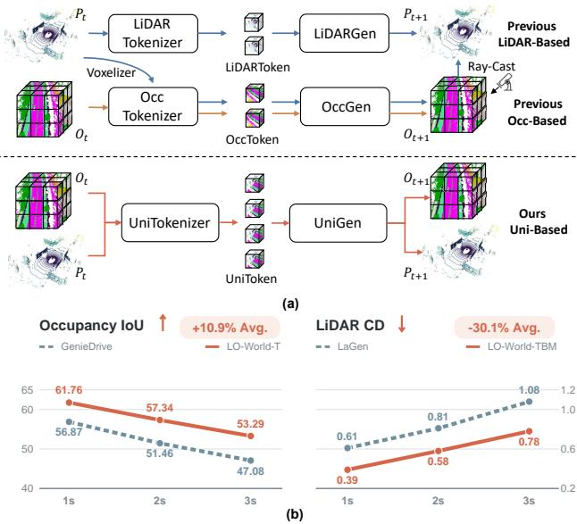
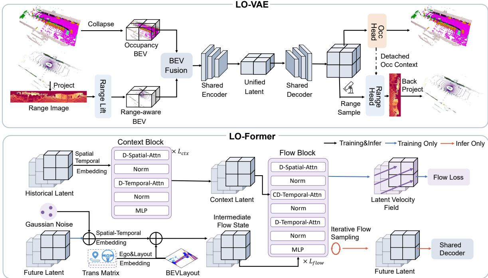
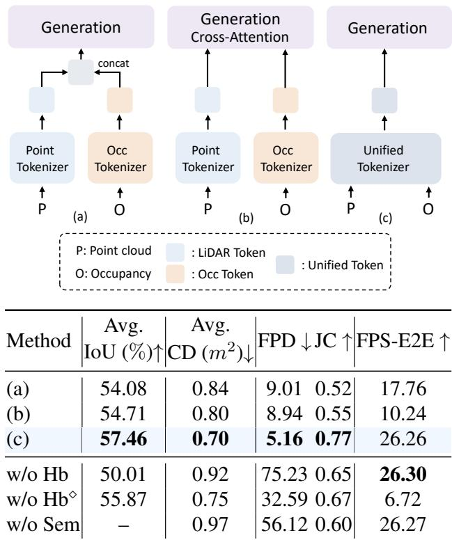
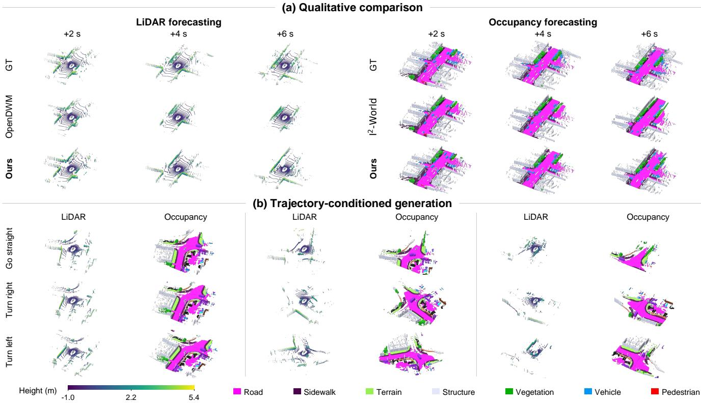
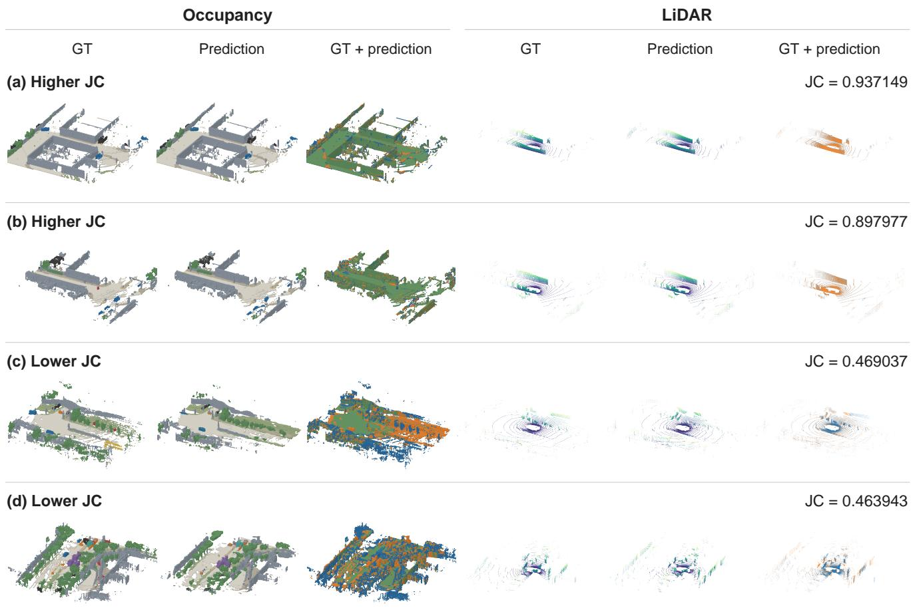
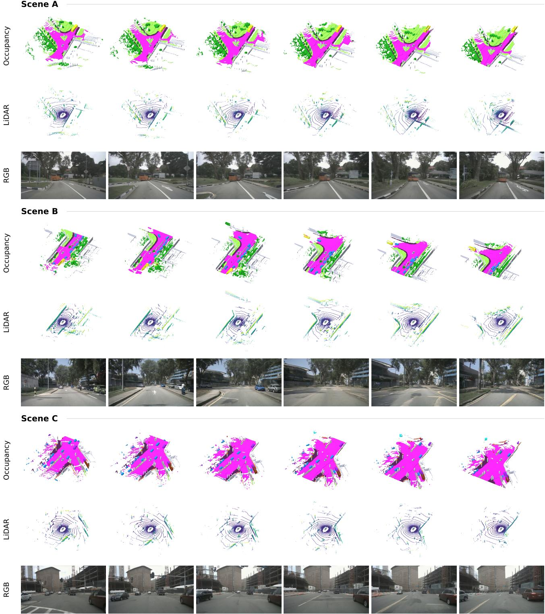
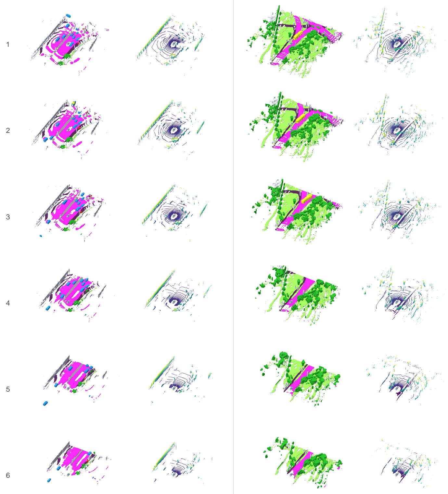

# LO-World: Unified BEV Latent Modeling for Joint 4D Occupancy and LiDAR Forecasting

Zhimin Liao, Ping Wei\*, Kai Mao, Shuaijia Chen National Key Laboratory of Human-Machine Hybrid Augmented Intelligence Institute of Artificial Intelligence and Robotics, Xi’an Jiaotong University liaozm@stu.xjtu.edu.cn, pingwei@xjtu.edu.cn

## Abstract

LiDAR point clouds and 3D semantic occupancy represent two distinct modalities capturingfine-grained metric geometry and dense volumetric semantics, respectively, holding natural potentialfor mutual complementarity. However, existing world models typically forecast these modalities independently or cascade them heuristically, missing the opportunity for reciprocal cross-modal regularization. To address this, we propose LO-World, a unified 4D world model that forecasts both modalities within a shared BEV latent space. This single-stream formulation enables dense semantics and metric geometry to mutually reinforce each other, while eliminating multi-pipeline redundancy. Specifically, LO-World couples an efficient hybrid range-voxel autoencoder with a flow-matching generator that caches historical context to reduce iterative sampling latency. Extensive experiments demonstrate that LO-World outperforms prior state-of-the-art baselines, improving occupancy forecasting IoU by 10.9% and reducing LiDAR Chamfer Distance by 30.1%. Meanwhile, it sustains a real-time throughput exceeding 25 FPS on a single RTX 4090. Our code is available at https://github.com/lzzzzzm/LO-World.

## 1. Introduction

Autonomous-driving world models [12] forecast future 3D scenes to guide downstream tasks [6, 7, 13, 14, 21]. Within these frameworks, 3D semantic occupancy [19, 27, 28, 42] and LiDAR point clouds [2, 17, 26, 40] offer complementary strengths: occupancy yields dense volumetric semantics but suffers from voxel discretization blur, whereas raw LiDAR captures precise metric geometry despite spatial sparsity. We hypothesize that jointly modeling both modalities enables reciprocal spatio-temporal regularization. Specifically, sharp metric geometry holds the potential to anchor voxel boundaries and alleviate spatial discretization blur, while rich volumetric semantics may guide and stabilize the temporal evolution of sparse point distributions across future frames.

  
Figure 1. (a) Unified forecasting. LO-World jointly encodes occupancy and LiDAR into a shared BEV latent, forecasting both modalities through a single generative process. (b) Performance comparison. Under comparable control conditions, LO-World achieves a 10.9% relative improvement in 4D IoU and a 30.1% reduction in Chamfer Distance over prior state-of-the-art baselines.

Despite this promising potential, two common paradigms in existing 4D world models [12, 17, 19, 40, 42] remain limited in exploiting such bidirectional synergy. As illustrated in Fig. 1a, the first paradigm treats occupancy and LiDAR forecasting as separate tasks, using independent modality-specific pipelines [8, 17, 19, 22, 35, 36, 40, 42]. When combined to forecast both modalities, these pipelines require separate generative inference and do not explicitly exploit cross-modal structural regularization. The second paradigm, exemplified by UniScene [13], adopts an occupancy-first cascade, generating semantic occupancy sequences before synthesizing LiDAR point clouds. However, its stage-wise training prevents downstream LiDAR reconstruction supervision from shaping the upstream occupancy representation, leaving reciprocal geometric and semantic learning underexploited. These limitations raise a pivotal question: Can we establish an intrinsic connection between dense semantics andfine-grained metric geometry to enable mutual spatio-temporal regularization through a cohesive generative process?

To answer this question, we present LO-World, a unified generative framework for 4D world modeling. Rather than relying on late-stage attention fusion across isolated branches, LO-World shifts the modeling focus to an intrinsically shared latent space. At the core of our framework is LO-VAE, a multimodal autoencoder [11] designed to bridge the structural gap between the two modalities. Specifically, LO-VAE projects both semantic occupancy and point clouds into a single BEV latent space. Within this pipeline, the LiDAR encoder introduces a hybrid rangevoxel architecture to capture native sensor scan patterns before aggregating them into an ego-aligned BEV plane. By embedding metric geometry directly alongside dense semantics, LO-VAE enables deep cross-modal feature synergy, executing joint forecasting through a single generative stream rather than isolated pipelines.

Building upon this shared latent space, we propose LO-Former, an efficient flow-matching generator [20] tailored for 4D temporal forecasting. Rather than redundantly encoding historical observations during iterative generation, LO-Former caches the spatio-temporal context once, keeping the repeatedly evaluated flow vector field remarkably lightweight. Coupled with the efficient sampling dynamics of flow matching, this design achieves high-fidelity future rollouts in merely four steps. As shown in Fig. 1a, LO-World predicts a sequence of unified latents that are decoded into paired semantic occupancy and LiDAR point clouds through a shared decoder with modality-specific heads. Our main contributions are summarized as follows:

• We explore joint 4D forecasting of 3D semantic occupancy and raw LiDAR point clouds. Empirical results demonstrate that joint modeling can improve forecasting accuracy for both modalities over their unimodal counterparts.

• We propose LO-World, integrating a hybrid range-voxel autoencoder to forecast both modalities within a single generative stream, alongside a flow-matching generator that reduces iterative sampling overhead through context caching.

• Extensive evaluations demonstrate the clear superiority of LO-World over prior state-of-the-art baselines. Specifically, it achieves a 10.9% relative gain in occupancy forecasting IoU and a 30.1% error reduction in LiDAR CD, while operating at over 25 FPS on a single RTX 4090.

## 2. Related Work

## 2.1. LiDAR-Based World Models

Existing LiDAR world models primarily process point clouds through either range-view projections or 3D voxelization [10, 17, 22, 24, 32, 36, 40, 45]. Range-view methods [17, 22, 24, 43, 45], such as LiDARCrafter [17] and R2DM [22], unfold point clouds onto compact 2D spherical planes to match native beam distributions and alleviate input sparsity. However, pixel proximity on the range image fails to preserve genuine 3D spatial adjacency, introducing geometric distortions. Conversely, voxel-based frameworks [10, 32, 36, 40], such as Copilot4D [40] discretizes 3D space into structured grids to maintain metric neighborhood relations. Nevertheless, faithfully capturing physical structures requires fine-grained voxelization, which incurs prohibitive computational and memory overheads. While multimodal world models such as BEVWorld [41] explore a unified BEV latent, they rely on standard voxelization for LiDAR and jointly model camera and LiDAR observations. In contrast, LO-World targets the 4D co-forecasting of occupancy and LiDAR through a hybrid range-voxel design that aggregates range-derived features into spatially aligned voxels for subsequent BEV encoding.

## 2.2. Occupancy-Based World Models

Occupancy provides a dense, semantics-aware representation for 3D world modeling. Following OccWorld [42], subsequent methods [8, 19, 29, 30, 33, 38] improve occupancy forecasting through advances in spatial tokenization, temporal modeling, and multi-condition steering. Beyond standalone forecasting, occupancy also serves as an intermediate structural prior for other modalities [10, 13, 34, 39]. For example, 4DOcc [10] forecasts occupancy from historical LiDAR and renders future point clouds, whereas UniScene [13] first generates occupancy to condition downstream LiDAR and video generators. Although these pipelines highlight the structural benefit of occupancy, they adopt an occupancy-first formulation rather than jointly forecasting a shared representation of both modalities. In contrast, LO-World jointly encodes spatially aligned occupancy and LiDAR into a shared BEV latent, enabling joint forecasting of both modalities through a single latent-space generative process.

## 3. Method

Problem Statement. We formulate 3D scene evolution as the joint forecasting of semantic occupancy and LiDAR point clouds. At each time step t, let $\mathcal { P } _ { t }$ denote the Li-DAR point cloud in the sensor frame and ${ \mathcal { O } } _ { t }$ its paired semantic occupancy grid in the ego coordinate system. Both modalities are spatially aligned via the known LiDAR-toego extrinsic parameters. Given h synchronized historical frames, denoted by $\mathbf { P } _ { t - h + 1 : t } = \{ \mathcal { P } _ { t - h + 1 } , \dots , \mathcal { P } _ { t } \}$ and $\mathbf { O } _ { t - h + 1 : t } = \{ \mathcal { O } _ { t - h + 1 } , \dots , \mathcal { O } _ { t } \}$ , our objective is to forecast both modalities over the subsequent $h ^ { \prime }$ time steps. For notational brevity, we denote the observation and forecasting horizons as $\tau = \{ t - h + 1 : t \}$ and $\tau ^ { \prime } = \{ t + 1 : t + h ^ { \prime } \}$ respectively. We model this process within a unified predictive framework via the joint conditional distribution:

  
Figure 2. Overall architecture of LO-World. Our framework consists of two components: (1) LO-VAE, which jointly tokenizes occupancy and LiDAR into a unified BEV latent space; and (2) LO-Former, a flow-matching-based generation framework that efficientl generates future unified BEV latents from Gaussian noise.

$$
p ( \mathbf { P } _ { \tau ^ { \prime } } , \mathbf { O } _ { \tau ^ { \prime } } \mid \mathbf { P } _ { \tau } , \mathbf { O } _ { \tau } , \mathbf { C } _ { \tau ^ { \prime } } ) ,\tag{1}
$$

where $\mathbf { C } _ { \tau ^ { \prime } }$ denotes the future conditioning signals, which comprise the planned ego-vehicle trajectory alongside optional 3D bounding boxes and map-derived BEV layouts [6].

Overall Architecture. As illustrated in Fig. 2, LO-World comprises two key modules: LO-VAE and LO-Former. At each timestamp, LO-VAE aligns and fuses synchronized occupancy and LiDAR features through a shared encoder into a unified BEV latent. Conditioned on past latents and future navigation priors, LO-Former models temporal dynamics via conditional flow matching to generate future latent sequences. Finally, each forecasted latent is decoded through a shared trunk and modality-specific heads to reconstruct both future modalities in a single pass.

## 3.1. Unified Tokenization of Occupancy and LiDAR

Unified BEV Representation. While LiDAR point clouds provide fine-grained metric geometry, 3D semantic occupancy supplies dense, global semantic structure. To harness their mutual complementarity, LO-VAE first establishes a shared BEV coordinate frame that spatially aligns both modalities before encoding them into a unified latent space.

Specifically, let $\mathcal { O } \in \{ 0 , \ldots , K _ { o } - 1 \} ^ { H \times W \times Z }$ denote the 3D semantic occupancy grid. Each voxel label is mapped to a learned class embedding. Following prior occupancy encoders [19, 42], we collapse the vertical and embedding dimensions to obtain the occupancy BEV feature $\mathcal { O } _ { b e v } \in$ $\mathbb { R } ^ { H \times W \times C _ { \mathrm { o c c } } }$

Conventional LiDAR models [5, 40] typically discretize point clouds directly in 3D Cartesian space, facing an inherent dilemma: coarse voxelization merges adjacent laser beams and destroys native scan patterns, whereas fine grids incur prohibitive computational overhead. To overcome this, we introduce a hybrid range-voxel representation.

Given a LiDAR scan ${ \mathcal { P } } ^ { s }$ , we first project valid returns onto a 2D spherical range image $\mathcal { R } \in \mathrm { ~ \mathbb { R } ~ } ^ { H _ { r } \times W _ { r } }$ parameterized by azimuth and elevation angles, which naturally preserves native beam topologies and angular resolution.

For rays containing multiple returns, the nearest depth is retained. To balance dynamic range disparities while explicitly distinguishing empty regions, we compute a binary validity mask $\mathcal { M } _ { p } = \mathbb { I } ( \mathcal { R } _ { p } > 0 )$ and a logarithmically scaled range value:

$$
\hat { \mathcal { R } } _ { p } = \frac { \log _ { 2 } ( \mathcal { R } _ { p } + 1 ) } { \log _ { 2 } ( d _ { \operatorname* { m a x } } + 1 ) } \mathcal { M } _ { p } ,\tag{2}
$$

where $p$ indexes pixels on ${ \mathcal { R } } ,$ and $d _ { \mathrm { m a x } }$ denotes the maximum sensor range. Each valid range pixel is thus assigned a two-dimensional feature $\mathbf { f } _ { p } = [ \hat { \mathcal { R } } _ { p } , \mathcal { M } _ { p } ] ^ { \top }$

To spatially align with the occupancy grid, valid range pixels are unprojected into the vehicle ego frame and mapped to corresponding 3D voxels. Each nonempty voxel aggregates its assigned pixel features via average pooling:

$$
\mathbf { V } _ { : , k , j , i } = \frac { 1 } { | \Omega _ { k , j , i } | } \sum _ { p \in \Omega _ { k , j , i } } \mathbf { f } _ { p } ,\tag{3}
$$

where $\Omega _ { k , j , i }$ denotes the set of range pixels falling into voxel coordinates $i , \ j ,$ , and $k ,$ while unoccupied voxels are padded with zeros. This yields a range-aware feature volume $\mathbf { V } \in \mathbb { R } ^ { C _ { v } \times Z \times H \times \check { W } }$ with $C _ { v } \ = \ 2$ . Finally, collapsing the vertical dimension $Z$ into the channel dimension produces the aligned LiDAR BEV representation $\mathcal { P } _ { \mathrm { b e v } } \in \mathbb { R } ^ { H \times W \times C _ { \mathrm { l i d } } }$ , where $C _ { \mathrm { l i d } } = C _ { v } Z$ . Here, voxelization spatially aggregates range-derived features, while subsequent feature encoding operates on the height-collapsed BEV representation, enabling efficient joint encoding with occupancy.

Encoder and Latent Fusion. Modality-specific convolutional stems first project $\mathcal { O } _ { b e v }$ and $\mathcal { P } _ { b e v }$ to a matched feature dimension. These features are concatenated and fed into a shared ResNet-style encoder [19], enabling joint cross-modal interaction across all encoding layers. A variational bottleneck with standard reparameterization [11] subsequently yields the shared BEV latent z.

Unified Decoder and Training Objective. LO-VAE upsamples the latent z via a shared BEV decoder before splitting into modality-specific reconstruction heads. The occupancy head factorizes 3D prediction into binary occupancy classification and multi-class semantic classification, producing semantic logits ${ \hat { \mathcal { O } } } .$ . To incorporate occupancy structure into LiDAR reconstruction, we condition the LiDAR head on the predicted occupancy probabilities through a stop-gradient connection.

The LiDAR head lifts shared BEV features into 3D ray space. Along each calibrated sensor ray, features sampled from this volume alongside the detached occupancy context are evaluated at $K$ candidate depths to predict depthbin probabilities and an empty-ray flag. During inference, metric coordinates are directly recovered along rays without dense grid ray-casting.

The training objective unifies occupancy reconstruction, LiDAR range estimation, and variational regularization. The occupancy loss $\mathcal { L } _ { o c c }$ incorporates Focal Loss [16] and Lovasz-Softmax Loss [3]:

$$
\mathcal { L } _ { o c c } = \mathcal { L } _ { f o c a l } ( \hat { \mathcal { O } } , \mathcal { O } ) + \mathcal { L } _ { l o v a s z } ( \hat { \mathcal { O } } , \mathcal { O } ) .\tag{4}
$$

The LiDAR range loss combines bin cross-entropy with Smooth L1 regression:

$$
\begin{array} { r l } { \mathcal { L } _ { \mathrm { r a n g e } } = \displaystyle \frac { 1 } { | \mathcal { R } | } \sum _ { p \in \mathcal { R } } w _ { p } \mathcal { L } _ { \mathrm { C E } } ( \hat { \mathbf { y } } _ { p } , y _ { p } ) } & { } \\ { + \displaystyle \frac { \lambda _ { \mathrm { d e p t h } } } { | \mathcal { M } | } \sum _ { p \in \mathcal { M } } e _ { p } \mathcal { L } _ { \mathrm { S L 1 } } ( \widetilde { u } _ { p } , u ( \mathcal { R } _ { p } ) ) , } \end{array}\tag{5}
$$

where $\hat { \mathbf { y } } _ { p }$ and $y _ { p }$ denote the predicted and ground-truth range-bin labels, $\tilde { u } _ { p }$ is the expected normalized log-depth, $w _ { p }$ balances ray validity, and $e _ { p }$ provides depth-edge weighting. The composite loss is:

$$
\begin{array} { r } { \mathcal { L } _ { \mathrm { L O - V A E } } = \mathcal { L } _ { \mathrm { o c c } } + \lambda _ { \mathrm { r a n g e } } \mathcal { L } _ { \mathrm { r a n g e } } + \lambda _ { \mathrm { K L } } \mathcal { L } _ { \mathrm { K L } } , } \end{array}\tag{6}
$$

where $\lambda _ { \mathrm { { r a n g e } } }$ and $\lambda _ { \mathrm { K L } }$ balance the respective loss components.

## 3.2. Joint Generation of Occupancy and LiDAR

Conditioned on the historical shared BEV latents $\mathbf { z } _ { \tau } .$ , LO-Former forecasts the future latent sequence $\mathbf { z } _ { \tau ^ { \prime } }$ via conditional flow matching [20], guided by the planned egotrajectory alongside optional 3D bounding boxes and HD map layouts [6].

Asymmetric Flow Architecture. Standard diffusion and flow-matching models [9, 20, 23] suffer from considerable inference latency due to the repeated evaluation of deep backbones across iterative sampling steps. To resolve this computational bottleneck, LO-Former adopts a decoupled architecture that separates historical context encoding from recurrent generation via two specialized subnetworks: a deep context encoder and a lightweight flow network. Specifically, the $L _ { \mathrm { c t x } } { \mathrm { - l a y e r } }$ context encoder processes historical latents in a single forward pass, producing a cached conditional representation that is computed only once per rollout. Conversely, the $L _ { \mathrm { f l o w } }$ -layer flow network serves as an iterative generative engine, repeatedly executed at each sampling step to refine future latent trajectories. By amortizing the computational cost of extracting complex spatiotemporal history onto the single-pass context module, the recurrent flow network can be kept remarkably shallow, with $L _ { \mathrm { f l o w } } = 4$ compared to $L _ { \mathrm { c t x } } = 8$ . This design substantially curtails per-step sampling latency while preserving high generative fidelity.

<table><tr><td rowspan="2">Method</td><td rowspan="2">Input/Condition</td><td colspan="4">mIoU (%) ↑</td><td colspan="4">IoU (%) ↑</td><td rowspan="2">FPS ↑</td></tr><tr><td>1s</td><td>2s</td><td>3s</td><td>Avg.</td><td>1s</td><td>2s</td><td>3s</td><td>Avg.</td></tr><tr><td>OccWorld-O [42]</td><td>O /Traj.</td><td>25.78</td><td>15.14</td><td>10.51</td><td>17.14</td><td>34.63</td><td>25.07</td><td>20.18</td><td>26.63</td><td>18.00</td></tr><tr><td>UniScene [13]</td><td>O/Traj.&amp;Box&amp;Map</td><td>35.37</td><td>29.59</td><td>25.08</td><td>30.01</td><td>38.34</td><td>32.70</td><td>29.09</td><td>33.38</td><td></td></tr><tr><td>I2-World [19]</td><td>O/Traj.</td><td>47.62</td><td>38.58</td><td>32.98</td><td>39.73</td><td>54.29</td><td>49.43</td><td>45.69</td><td>49.80</td><td>37.04</td></tr><tr><td>GenieDrive [37]</td><td>O/Traj.</td><td>50.47</td><td>41.47</td><td>35.83</td><td>42.59</td><td>56.87</td><td>51.46</td><td>47.08</td><td>51.80</td><td>41.38</td></tr><tr><td>LO-World-T* (Ours)</td><td>O/Traj.</td><td>52.92</td><td>44.54</td><td>38.37</td><td>45.28</td><td>57.64</td><td>53.10</td><td>49.67</td><td>53.47</td><td>48.25</td></tr><tr><td>LO-World-T (Ours)</td><td>O&amp;L/Traj.</td><td>53.43</td><td>45.21</td><td>39.39</td><td>46.01</td><td>61.76</td><td>57.34</td><td>53.29</td><td>57.46</td><td>45.20</td></tr><tr><td>LO-World-TBM (Ours)</td><td>O&amp;L/Traj.&amp;Box&amp;Map</td><td>59.50</td><td>54.78</td><td>51.16</td><td>55.15</td><td>62.52</td><td>58.76</td><td>55.19</td><td>58.82</td><td>42.46</td></tr><tr><td>DOME-STC</td><td>C/Traj.</td><td>17.79</td><td>14.23</td><td>11.58</td><td>14.53</td><td>26.39</td><td>23.20</td><td>20.42</td><td>23.34</td><td>2.75</td></tr><tr><td>I2-World-STC</td><td>C/Traj.</td><td>21.67</td><td>18.78</td><td>16.47</td><td>18.97</td><td>30.55</td><td>28.76</td><td>26.99</td><td>28.77</td><td>4.21</td></tr><tr><td>LO-World-STC (Ours)</td><td>C&amp;L/Traj.</td><td>23.01</td><td>20.57</td><td>18.46</td><td>20.68</td><td>32.97</td><td>31.77</td><td>30.32</td><td>31.69</td><td>5.01</td></tr></table>

Table 1. 4D occupancy forecasting performance on the Occ3D-nus validation set. $^ { 6 } \mathrm { C } ^ { 3 } , ^ { 6 } \mathrm { O } ^ { 3 }$ , and “L” denote camera, occupancy, and LiDAR modalities, respectively. ∗ denotes the single-modality variant of our method.

Context Block and Flow Block. The historical latents ${ \bf z } _ { \tau }$ are patchified and augmented with spatial and temporal embeddings. The context block applies deformable spatial attention (DSA) [31] and deformable temporal attention (DTA) [15] to aggregate spatiotemporal historical cues into a compact context H.

Within the flow block, we propose Cross-frame Deformable Temporal Attention (CDTA) as a dedicated bridge connecting cached context to future flow updates. Rather than computing costly dense cross-attention, CDTA uses future tokens as queries to sparsely sample historical features from H across time. Together with spatial DSA within each future frame and temporal DTA across future frames, CDTA effectively conditions the iterative flow on past dynamics with minimal computational overhead.

Conditional Flow Matching. During training, let $\mathbf { x } _ { 0 } ~ =$ $\mathbf { z } _ { \tau ^ { \prime } }$ denote target future latents and $\mathbf { \epsilon } \gets \mathcal { N } ( \mathbf { 0 } , \mathbf { I } )$ be standard Gaussian noise. We construct the noisy latent $\mathbf { x } _ { \sigma }$ along a linear probability path:

$$
\begin{array} { r } { \mathbf { x } _ { \sigma } = ( 1 - \sigma ) \mathbf { x } _ { 0 } + \sigma \boldsymbol { \epsilon } , \quad \sigma \in [ 0 , 1 ] . } \end{array}\tag{7}
$$

Future tokens derived from $\mathbf { x } _ { \sigma }$ are augmented with time embeddings, future ego-motion, and BEV layout features [6]. The flow network $\hat { \mathbf { v } } _ { \psi }$ is trained to predict the constant-velocity field target $\begin{array} { r } { \mathbf { v } = \frac { \mathrm { d } \mathbf { x } _ { \sigma } } { \mathrm { d } \sigma } = \epsilon - \mathbf { x } _ { 0 } } \end{array}$ . The conditional flow-matching objective is defined as:

$$
\begin{array} { r } { \mathcal { L } _ { \mathrm { F M } } = \mathbb { E } _ { \sigma , \mathbf { x } _ { 0 } , \epsilon , \mathbf { c } } \left[ \left\| \hat { \mathbf { v } } _ { \psi } ( \mathbf { x } _ { \sigma } , \sigma , \mathbf { c } ) - ( \epsilon - \mathbf { x } _ { 0 } ) \right\| _ { 2 } ^ { 2 } \right] , } \end{array}\tag{8}
$$

where c includes cached context H, ego-motion, and road layouts.

Efficient Inference. During inference, the context H is pre-computed only once and cached. Starting from standard Gaussian noise $\mathbf { x } _ { 1 } \sim \mathcal { N } ( \mathbf { 0 } , \mathbf { I } )$ , a deterministic Euler solver integrates the estimated velocity field from $\sigma = 1$ to $\sigma = 0 .$ . By coupling the lightweight flow block with an efficient four-step sampling schedule, LO-World generates high-fidelity multimodal 4D scenes with remarkable inference speed.

## 4. Experiment

## 4.1. Experimental Setup

Datasets. Primary evaluations are conducted on nuScenes [4] with 32-beam LiDAR and Occ3DnuScenes [27] at a 0.4m voxel resolution. To evaluate cross-sensor transferability and data-efficient adaptation, we further benchmark on the 64-beam Waymo Open Dataset [26] using Occ3D-Waymo [27]. Specifically, models are fine-tuned on a tiny split of merely 50 training sequences, representing under 7% of the standard training data, and comprehensively evaluated on the entire 202 validation sequences.

Evaluation Protocol. Following OccWorld [42], models observe 2s of history to forecast the subsequent 3s. We benchmark three variants: LO-World-T with trajectories, LO-World-TBM with additional 3D boxes and HD maps, and LO-World-STC incorporating camera-derived STC occupancy [18]. We report non-empty IoU and semantic mIoU for occupancy forecasting, and CD for predictive LiDAR geometry. We assess the distributional fidelity of forecasted point clouds using Frechet Pointcloud Distance´ (FPD) [25], BEV-based MMD (B-MMD) [1], and JSD (B-JSD) [1]. Computational efficiency is reported using model FPS and FPS-E2E.

Implementation Details. All LO-World variants are trained on eight NVIDIA RTX 4090 GPUs, while the downstream video model uses eight A100 GPUs. Following OccWorld [42], model FPS is evaluated on a single RTX 4090 with a batch size of one, measuring current-frame encoding and latent forecasting without decoding. FPS-E2E additionally includes dual-modality decoding of all six predicted future frames.

<table><tr><td rowspan="2">Method</td><td rowspan="2">Input/Condition</td><td colspan="4">Forecasting Quality(m²) ↓</td><td colspan="3">Generation Quality</td><td rowspan="2">FPS-E2E ↑</td></tr><tr><td> $\mathrm { C D } _ { \mathrm { 1 s } }$   $\mathrm { C D _ { 2 s } }$ </td><td></td><td> $\mathrm { C D _ { 3 s } }$ </td><td> $\operatorname { A v g } .$ </td><td>FPD↓</td><td>B-MMD ↓ B-JSD ↓</td><td></td></tr><tr><td>HERMES [44]</td><td>C/Traj.</td><td>0.78</td><td>0.95</td><td>1.17</td><td>0.97</td><td>105.96</td><td>21.04</td><td>4.01</td><td>0.51</td></tr><tr><td>OpenDWM-DiT [5]</td><td>L/Traj.&amp;Box&amp;Map</td><td>1.96</td><td>2.78</td><td>3.21</td><td>2.65</td><td>381.91</td><td>5.73</td><td>19.90</td><td>0.10</td></tr><tr><td>LaGen [43]</td><td>L/Traj.&amp;Box&amp;Map</td><td>0.61</td><td>0.81</td><td>1.08</td><td>0.83</td><td></td><td></td><td>3.97</td><td></td></tr><tr><td>UniScene [13]</td><td>O/Traj.&amp;Box&amp;Map</td><td></td><td></td><td></td><td></td><td>976.47</td><td>13.61</td><td>31.55</td><td>0.19</td></tr><tr><td>LO-World-T* (Ours)</td><td>L/Traj.</td><td>0.46</td><td>0.81</td><td>1.18</td><td>0.82</td><td>8.84</td><td>2.68</td><td>4.54</td><td>28.16</td></tr><tr><td>LO-World-T (Ours)</td><td>O&amp;L/Traj.</td><td>0.42</td><td>0.68</td><td>0.98</td><td>0.70</td><td>5.16</td><td>0.76</td><td>2.96</td><td>26.26</td></tr><tr><td>LO-World-TBM* (Ours)</td><td>L/Traj.&amp;Box&amp;Map</td><td>0.40</td><td>0.62</td><td>0.88</td><td>0.63</td><td>4.95</td><td>0.91</td><td>3.15</td><td>27.04</td></tr><tr><td>LO-World-TBM (Ours)</td><td>O&amp;L/Traj.&amp;Box&amp;Map</td><td>0.39</td><td>0.58</td><td>0.78</td><td>0.58</td><td>4.68</td><td>0.77</td><td>2.94</td><td>25.31</td></tr></table>

Table 2. 4D LiDAR forecasting performance on the nuScenes validation set. ${ } ^ { \mathrm { 6 6 } } \mathrm { C } ^ { \mathrm { 9 } } , { } ^ { \mathrm { 6 6 } } \mathrm { O } ^ { \mathrm { 9 } } ,$ , and “L” denote camera, occupancy, and LiDAR, respectively. B-MMD and B-JSD are computed from BEV point-count histograms. Values are multiplied by $1 0 ^ { 4 }$ and ${ \bar { 1 } } 0 ^ { 2 } ,$ respectively. denotes the single-modality variant of our method.

<table><tr><td>Method</td><td>Occ. mIoU (%)↑  $4 s$  5s</td><td>LiDAR  $( m ^ { 2 } ) \downarrow$  6s  $\mathrm { C D } _ { 4 . 0 \mathrm { s } }$   $\mathrm { C D } _ { 5 . 5 \mathrm { s } }$ </td></tr><tr><td>I2-World [19]</td><td>28.59 25.32 22.55</td><td>1 1</td></tr><tr><td>GenieDrive [37]</td><td>31.16 27.17 23.66</td><td></td></tr><tr><td>LaGen [43]</td><td></td><td>1.32 1.73</td></tr><tr><td>LO-World-T LO-World-TBM</td><td>34.01 30.7027.48 48.1645.7443.52</td><td>1.49 2.12 1.10 1.52</td></tr></table>

Table 3. Long-horizon evaluation on nuScenes val set.
<table><tr><td>Method</td><td>Occupancy (%)↑ Avg.mIoU Avg.IoU</td><td>LiDAR  $( m ^ { 2 } ) \downarrow$   $\mathrm { C D _ { 1 s } }$   $\mathrm { C D _ { 3 s } }$ </td></tr><tr><td>OpenDWM† [5]</td><td></td><td>2.27 3.35</td></tr><tr><td>I2-World [19] LO-World-T</td><td>36.38 52.36 41.31 58.30</td><td></td></tr><tr><td>LO-World-T†</td><td></td><td>0.91 1.77</td></tr><tr><td></td><td>46.00 61.08</td><td>0.51 1.28</td></tr></table>

Table 4. Performance comparison on the Waymo dataset. † denotes models fine-tuned on Waymo, while unmarked models are evaluated in a zero-shot setting without target domain fine-tuning.

## 4.2. Main Results

We additionally evaluate unimodal-input variants that use either historical occupancy or historical LiDAR as the sole observed modality.

4D Occupancy Forecasting. As shown in Tab. 1, our occupancy-only variant achieves the highest average mIoU and IoU among the evaluated occupancy-only baselines. Incorporating LiDAR input through LO-World-T improves average IoU from 53.47% to 57.46% and mIoU from 45.28% to 46.01%. With this additional modality, LO-World-T outperforms GenieDrive by 8.03% in mIoU and 10.93% in IoU in relative terms, while achieving 45.20 model FPS. Adding box and map priors raises mIoU to 55.15% for LO-World-TBM, a 19.9% relative improvement over LO-World-T. Finally, LO-World-STC, which additionally uses LiDAR input, outperforms the camera-based $I ^ { 2 } -$ World-STC by 9.0% in mIoU and 10.1% in IoU in relative terms.

<table><tr><td>Method</td><td>|Frames |</td><td>Condition</td><td>FVD↓ mIoU↑ mAP↑</td></tr><tr><td>MagicDrive [6]</td><td>60</td><td>BEV + Box</td><td>|217.94 18.27 11.86</td></tr><tr><td>UniScene [13]</td><td>32</td><td>2 Hz GT Occ.</td><td>610.15 18.59 6.24</td></tr><tr><td>GenieDrive [37]</td><td>81</td><td>2 Hz GT Occ.</td><td>92.78 31.03 18.89</td></tr><tr><td>Ours</td><td>81</td><td>12 Hz Pred. Occ.</td><td>60.41 34.83 27.15</td></tr><tr><td>Oracle</td><td>81</td><td>12 Hz GT Occ.</td><td>40.78 36.47 30.24</td></tr></table>

Table 5. Downstream video generation on the nuScenes validation set. “Oracle” denotes the ground-truth-conditioned reference using 12 Hz occupancy.

4D LiDAR Forecasting. As shown in Tab. 2, the unimodal LO-World-T∗ variant achieves an average CD of 0.82. Joint modeling with semantic occupancy reduces CD to 0.70 for LO-World-T, demonstrating improved LiDAR forecasting. Incorporating box and map guidance further lowers CD to 0.58 for LO-World-TBM, a 30.1% relative reduction compared with LaGen [43]. Compared with its LiDAR-only counterpart, LO-World-T also achieves lower FPD, B-MMD, and B-JSD (2.96 vs. 4.54 for B-JSD). Finally, LO-World-T and LO-World-TBM achieve 26.26 and 25.31 FPS-E2E, respectively, on a single RTX 4090.

  
Table 6. Ablation study on the unified multimodal design. “Hb” indicates the hybrid range-voxel representation for LiDAR, “Sem” specifies whether semantic labels are incorporated into the occupancy volume, and ⋄ denotes the high-resolution voxelization setting.

Long-Horizon Forecasting. As reported in Tab. 3, we further benchmark temporal scalability across 4–6 s horizons. In occupancy forecasting, LO-World-T surpasses GenieDrive by 12.4% in mean mIoU, while LO-World-TBM maintains high mIoU scores exceeding 43% through the entire 6 s rollout. In LiDAR forecasting, LO-World-TBM achieves lower long-horizon CD than LaGen at both evaluated horizons, while the trajectory-only variant remains less accurate in LiDAR forecasting.

Generalization Ability. As presented in Tab. 4, zeroshot LO-World-T surpasses I2-World by over 11% in both mIoU and IoU, while achieving lower CD than fine-tuned OpenDWM [5]. Fine-tuning on 50 Waymo sequences further increases mIoU to 46.00% and reduces CD at 1 s from 0.91 to 0.51, supporting cross-dataset transfer and adaptation with limited target-domain training data.

Downstream Video Generation. As shown in Tab. 5, we fine-tune the GenieDrive [37] video generation framework using the 12 Hz occupancy predicted by LO-World-TBM. Our approach achieves an FVD of 60.41 over 81 frames, alongside 34.83% mIoU and 27.15% mAP, improving over the GenieDrive baseline conditioned on 2 Hz ground-truth occupancy. These results demonstrate the downstream utility of our predicted occupancy sequences, while a gap remains to the reference conditioned on 12 Hz ground-truth occupancy.

<table><tr><td>Method</td><td>Avg. mIoU↑ Avg. CD↓</td><td>FPS-E2E↑</td></tr><tr><td colspan="3">Architecture Ablation</td></tr><tr><td>Full-Model</td><td>46.01</td><td>26.26</td></tr><tr><td>w/o Context w/o Context‡</td><td>0.70 37.19 1.58 43.60 0.74</td><td>34.34 18.43</td></tr><tr><td colspan="3">Layers Ablation (Context, Flow)</td></tr><tr><td>(4, 4) (6, 4)</td><td>42.81 0.90 44.52</td><td>31.71 30.44</td></tr><tr><td>(8,4)</td><td>0.78 46.01 0.70</td><td>26.26</td></tr><tr><td>(8, 6)</td><td>46.36 0.68</td><td>24.12</td></tr><tr><td>(8,2)</td><td>40.85 0.83</td><td>35.53</td></tr><tr><td colspan="3">Sampling Steps</td></tr><tr><td>1 step</td><td>47.20 0.83</td><td>40.06</td></tr><tr><td>2 steps</td><td>47.19 0.83</td><td>35.72</td></tr><tr><td>4 steps</td><td>46.01 0.70</td><td>26.26</td></tr><tr><td>8 steps</td><td>43.80 0.68</td><td>21.54</td></tr></table>

Table 7. Ablation studies on LO-Former. ‡ indicates the depthmatched variant with 12 flow blocks and no context blocks.

## 4.3. Ablation Study

All ablations use LO-World-T unless stated otherwise.

Ablation on Latent and Representation Designs. In Tab. 6, we compare our shared-latent design with two baselines using separate modality-specific latents: (a) employs separate encoders and concatenates modality tokens before forecasting, while (b) introduces cross-modal attention into the context and flow-matching blocks. In contrast, LO-VAE maps both modalities into a shared BEV latent space, yielding higher occupancy IoU and lower LiDAR CD and FPD than both baselines while achieving higher end-to-end throughput: 26.26 FPS-E2E versus 17.76 and 10.24, respectively. To evaluate cross-modal spatial agreement beyond independent metrics, we introduce Joint Consistency (JC), defined as the harmonic mean of surface recall and precision relative to reference geometry (details in supplementary). Benefiting from intrinsic alignment, our sharedlatent design achieves a JC of 0.77, substantially outperforming 0.52 for baseline (a) and 0.55 for baseline (b).

Furthermore, we assess the hybrid range-voxel LiDAR representation. Replacing it with standard voxelization [5, 40] increases CD from 0.70 to 0.92. Increasing the voxel resolution reduces CD to 0.75 but lowers throughput from 26.30 to 6.72 FPS-E2E. These results support the favorable quality–efficiency trade-off of our hybrid representation. Lastly, removing semantic labels from occupancy increases CD from 0.70 to 0.97 and FPD from 5.16 to 56.12, supporting the benefits of semantic information for both forecasting accuracy and distributional fidelity.

  
Figure 3. Qualitative forecasting on nuScenes. (a) LiDAR and occupancy forecasts at 2, 4, and 6 s versus OpenDWM and I2-World, respectively. (b) Paired forecasts under straight, right-turn, and left-turn ego-vehicle trajectories.

2.2 5.4Ablation on LO-Former Configurations. In Tab. 7, we ablate the context–flow architecture, layer allocations, and sampling steps. Removing context encoding reduces mIoU and increases CD, while a depth-matched baseline with 12 iterative flow blocks yields lower accuracy and throughput, supporting the accuracy–efficiency benefits of decoupled context encoding and iterative flow updates. With eight context blocks, increasing the flow depth from four to six blocks slightly improves mIoU and CD but reduces throughput from 26.26 to 24.12 FPS-E2E. For sampling steps, increasing from one to four steps reduces CD by 15.7%, at the cost of a 2.5% relative decrease in mIoU and lower throughput. Increasing from four to eight steps yields only a further 2.9% reduction in CD, while incurring a 4.8% relative decrease in mIoU and further reducing throughput.

We therefore adopt four steps as a balanced default for joint forecasting.

## 4.4. Visualizations

Qualitative Comparison and Controllability. As illustrated in Fig. 3, LO-World produces more complete object contours and more coherent scene layouts than OpenDWM for LiDAR and I2-World for occupancy in the shown examples. Furthermore, conditioning the same historical context on different ego-vehicle trajectories produces distinct future Road Terrain Vegetation Pedestrianforecasts across both modalities, illustrating the trajectoryconditioned controllability of LO-World.

## 5. Conclusion

In this paper, we present LO-World, a unified 4D world model that forecasts 3D semantic occupancy and LiDAR point clouds within a shared BEV latent space. By integrating a hybrid range-voxel autoencoder with a contextcaching flow-matching generator, LO-World realizes highfidelity rollouts in merely four sampling steps. Experiments demonstrate improved forecasting accuracy for both modalities over the corresponding single-modality variants, with forecasting throughput exceeding 25 frames per second on a single RTX 4090. This unified formulation offers a promising paradigm for future autonomous-driving world models.

## References

[1] Panos Achlioptas, Olga Diamanti, Ioannis Mitliagkas, and Leonidas Guibas. Learning representations and generative models for 3d point clouds. In ICML, 2018. 5

[2] Jens Behley, Martin Garbade, Andres Milioto, Jan Quenzel, Sven Behnke, Cyrill Stachniss, and Jurgen Gall. Semantickitti: A dataset for semantic scene understanding of lidar sequences. In ICCV, 2019. 1

[3] Maxim Berman, Amal Rannen Triki, and Matthew B Blaschko. The lovasz-softmax loss: A tractable surrogate´ for the optimization of the intersection-over-union measure in neural networks. In CVPR, 2018. 4

[4] Holger Caesar, Varun Bankiti, Alex H. Lang, Sourabh Vora, Venice Erin Liong, Qiang Xu, Anush Krishnan, Yu Pan, Giancarlo Baldan, and Oscar Beijbom. nuscenes: A multimodal dataset for autonomous driving. In CVPR, 2020. 5

[5] Rui Chen, Zehuan Wu, Yichen Liu, Yuxin Guo, Jingcheng Ni, Haifeng Xia, and Siyu Xia. Unimlvg: Unified framework for multi-view long video generation with comprehensive control capabilities for autonomous driving. arXiv preprint, 2024. 3, 6, 7, 8

[6] Ruiyuan Gao, Kai Chen, Enze Xie, Lanqing Hong, Zhenguo Li, Dit-Yan Yeung, and Qiang Xu. Magicdrive: Street view generation with diverse 3d geometry control. In ICLR, 2024. 1, 3, 4, 5, 6

[7] Ruiyuan Gao, Kai Chen, Bo Xiao, Lanqing Hong, Zhenguo Li, and Qiang Xu. Magicdrive-v2: High-resolution long video generation for autonomous driving with adaptive control. In ICCV, 2025. 1

[8] Songen Gu, Wei Yin, Bu Jin, Xiaoyang Guo, Junming Wang, Haodong Li, Qian Zhang, and Xiaoxiao Long. Dome: Taming diffusion model into high-fidelity controllable occupancy world model. arXiv preprint, 2024. 1, 2

[9] Jonathan Ho, Ajay Jain, and Pieter Abbeel. Denoising diffusion probabilistic models. NIPS, 2020. 4

[10] Tarasha Khurana, Peiyun Hu, David Held, and Deva Ramanan. Point cloud forecasting as a proxy for 4d occupancy forecasting. In CVPR, 2023. 2

[11] Diederik P Kingma and Max Welling. Auto-encoding variational bayes. arXiv preprint arXiv:1312.6114, 2013. 2, 4

[12] Lingdong Kong, Wesley Yang, Jianbiao Mei, Youquan Liu, Ao Liang, Dekai Zhu, Dongyue Lu, Wei Yin, Xiaotao Hu, Mingkai Jia, et al. 3d and 4d world modeling: A survey. arXiv preprint arXiv:2509.07996, 2025. 1

[13] Bohan Li, Jiazhe Guo, Hongsi Liu, Yingshuang Zou, Yikang Ding, Xiwu Chen, Hu Zhu, Feiyang Tan, Chi Zhang, Tiancai Wang, et al. Uniscene: Unified occupancy-centric driving scene generation. In CVPR, 2025. 1, 2, 5, 6, 3

[14] Bohan Li, Xin Jin, Hu Zhu, Hongsi Liu, Ruikai Li, Jiazhe Guo, Kaiwen Cai, Chao Ma, Yueming Jin, Hao Zhao, et al. Scaling up occupancy-centric driving scene generation: Dataset and method. IEEE Transactions on Pattern Analysis and Machine Intelligence, 2026. 1

[15] Zhiqi Li, Wenhai Wang, Hongyang Li, Enze Xie, Chonghao Sima, Tong Lu, Yu Qiao, and Jifeng Dai. Bevformer: Learning bird’s-eye-view representation from multi-camera images via spatiotemporal transformers. In ECCV, 2022. 5

[16] Zhiqi Li, Zhiding Yu, David Austin, Mingsheng Fang, Shiy Lan, Jan Kautz, and Jose M Alvarez. Fb-occ: 3d occupancy prediction based on forward-backward view transformation. arXiv preprint, 2023. 4

[17] Ao Liang, Youquan Liu, Yu Yang, Dongyue Lu, Linfeng Li, Lingdong Kong, Huaici Zhao, and Wei Tsang Ooi. Lidar crafter: Dynamic 4d world modeling from lidar sequences. arXiv preprint, 2025. 1, 2

[18] Zhimin Liao, Ping Wei, Shuaijia Chen, Haoxuan Wang, and Ziyang Ren. Stcocc: Sparse spatial-temporal cascade renovation for 3d occupancy and scene flow prediction. In CVPR, 2025. 5

[19] Zhimin Liao, Ping Wei, Ruijie Zhang, Shuaijia Chen, Haox uan Wang, and Ziyang Ren. i2-world: Intra-inter tokenization for efficient dynamic 4d scene forecasting. In ICCV, 2025. 1, 2, 3, 4, 5, 6

[20] Yaron Lipman, Ricky TQ Chen, Heli Ben-Hamu, Maximil ian Nickel, and Matt Le. Flow matching for generative mod eling. arXiv preprint, 2022. 2, 4

[21] Chen Min, Dawei Zhao, Liang Xiao, Jian Zhao, Xinli Xu, Zheng Zhu, Lei Jin, Jianshu Li, Yulan Guo, Junliang Xing, et al. Driveworld: 4d pre-trained scene understanding via world models for autonomous driving. In CVPR, 2024. 1

[22] Kazuto Nakashima and Ryo Kurazume. Lidar data synthesis with denoising diffusion probabilistic models. In ICRA, 2024. 1, 2

[23] William Peebles and Saining Xie. Scalable diffusion models with transformers. In 2023 IEEE/CVF International Confer ence on Computer Vision (ICCV), pages 4172–4182. IEEE, 2023. 4

[24] Haoxi Ran, Vitor Guizilini, and Yue Wang. Towards realistic scene generation with lidar diffusion models. In CVPR, 2024. 2

[25] Dong Wook Shu, Sung Woo Park, and Junseok Kwon. 3d point cloud generative adversarial network based on tree structured graph convolutions. In ICCV, 2019. 5

[26] Pei Sun, Henrik Kretzschmar, Xerxes Dotiwalla, Aurelien Chouard, Vijaysai Patnaik, Paul Tsui, James Guo, Yin Zhou, Yuning Chai, Benjamin Caine, et al. Scalability in perception for autonomous driving: Waymo open dataset. In CVPR, 2020. 1, 5

[27] Xiaoyu Tian, Tao Jiang, Longfei Yun, Yucheng Mao, Huitong Yang, Yue Wang, Yilun Wang, and Hang Zhao. Occ3d: A large-scale 3d occupancy prediction benchmark for autonomous driving. In NeurIPS, 2023. 1, 5

[28] Wenwen Tong, Chonghao Sima, Tai Wang, Li Chen, Silei Wu, Hanming Deng, Yi Gu, Lewei Lu, Ping Luo, Dahua Lin, et al. Scene as occupancy. In Proceedings of the IEEE/CVF International Conference on Computer Vision, pages 8406– 8415, 2023. 1

[29] Lening Wang, Wenzhao Zheng, Yilong Ren, Han Jiang, Zhiyong Cui, Haiyang Yu, and Jiwen Lu. Occsora: 4d occupancy generation models as world simulators for autonomous driving. arXiv preprint, 2024. 2

[30] Julong Wei, Shanshuai Yuan, Pengfei Li, Qingda Hu, Zhongxue Gan, and Wenchao Ding. Occllama: An occupancy-language-action generative world model for au tonomous driving. arXiv preprint, 2024. 2

[31] Zhuofan Xia, Xuran Pan, Shiji Song, Li Erran Li, and Gao Huang. Vision transformer with deformable attention. In CVPR, 2022. 5

[32] Yuwen Xiong, Wei-Chiu Ma, Jingkang Wang, and Raquel Urtasun. Learning compact representations for lidar completion and generation. In CVPR, 2023. 2

[33] Ziyang Yan, Wenzhen Dong, Yihua Shao, Yuhang Lu, Liu Haiyang, Jingwen Liu, Haozhe Wang, Zhe Wang, Yan Wang, Fabio Remondino, et al. Renderworld: World model with self-supervised 3d label. arXiv preprint, 2024. 2

[34] Yu Yang, Alan Liang, Jianbiao Mei, Yukai Ma, Yong Liu, and Gim Hee Lee. X-scene: Large-scale driving scene generation with high fidelity and flexible controllability. arXiv preprint arXiv:2506.13558, 2025. 2

[35] Yu Yang, Jianbiao Mei, Yukai Ma, Siliang Du, Wenqing Chen, Yijie Qian, Yuxiang Feng, and Yong Liu. Driving in the occupancy world: Vision-centric 4d occupancy forecasting and planning via world models for autonomous driving. AAAI, 2025. 1

[36] Zetong Yang, Li Chen, Yanan Sun, and Hongyang Li. Visual point cloud forecasting enables scalable autonomous driving. In CVPR, 2024. 1, 2

[37] Zhenya Yang, Zhe Liu, Yuxiang Lu, Liping Hou, Chenxuan Miao, Siyi Peng, Bailan Feng, Xiang Bai, and Hengshuang Zhao. Geniedrive: Towards physics-aware driving world model with 4d occupancy guided video generation. In CVPR, 2026. 5, 6, 7, 3

[38] Haiming Zhang, Ying Xue, Xu Yan, Jiacheng Zhang, Weichao Qiu, Dongfeng Bai, Bingbing Liu, Shuguang Cui, and Zhen Li. An efficient occupancy world model via decoupled dynamic flow and image-assisted training. arXiv preprint, 2024. 2

[39] Junge Zhang, Qihang Zhang, Li Zhang, Ramana Rao Kompella, Gaowen Liu, and Bolei Zhou. Urban scene diffusion through semantic occupancy map. arXiv preprint arXiv:2403.11697, 2024. 2

[40] Lunjun Zhang, Yuwen Xiong, Ze Yang, Sergio Casas, Rui Hu, and Raquel Urtasun. Copilot4d: Learning unsupervised world models for autonomous driving via discrete diffusion. ICLR, 2024. 1, 2, 3, 8

[41] Yumeng Zhang, Shi Gong, Kaixin Xiong, Xiaoqing Ye, Xiao Tan, Fan Wang, Jizhou Huang, Hua Wu, and Haifeng Wang. Bevworld: A multimodal world model for autonomous driving via unified bev latent space. 2024. 2

[42] Wenzhao Zheng, Weiliang Chen, Yuanhui Huang, Borui Zhang, Yueqi Duan, and Jiwen Lu. Occworld: Learning a 3d occupancy world model for autonomous driving. In ECCV, 2024. 1, 2, 3, 5, 6

[43] Sizhuo Zhou, Xiaosong Jia, Fanrui Zhang, Junjie Li, Juyong Zhang, Yukang Feng, Jianwen Sun, Songbur Wong, Junqi You, and Junchi Yan. Lagen: Towards autoregressive lidar scene generation. arXiv preprint, 2025. 2, 6

[44] Xin Zhou, Dingkang Liang, Sifan Tu, Xiwu Chen, Yikang Ding, Dingyuan Zhang, Feiyang Tan, Hengshuang Zhao, and Xiang Bai. Hermes: A unified self-driving world model for simultaneous 3d scene understanding and generation. In ICCV, 2025. 6

[45] Vlas Zyrianov, Xiyue Zhu, and Shenlong Wang. Learning to generate realistic lidar point clouds. In ECCV, 2022. 2

# LO-World: Unified BEV Latent Modeling for Joint 4D Occupancy and LiDAR Forecasting

Supplementary Material

This supplementary material is organized as follows:

• Implementation details (Sec. A). We provide details of the data representation, model training, conditioning, downstream video generation, and baseline designs.

• Evaluation details (Sec. B). We specify the evaluation protocol, define Joint Consistency, and describe the modality-specific metrics and efficiency measurements.

• Additional results (Sec. C). We present 12-frame forecasting results and qualitative examples of Joint Consistency and scene structure.

• Scope and limitations (Sec. D). We discuss reversemotion failures and the need for downstream task validation.

## A. Implementation Details

## A.1. Data Representation and Preprocessing

Spatial representation. We pair each nuScenes LiDAR scan with the occupancy annotation of the corresponding frame. Occupancy is represented in the ego frame, while range projection is performed in the LiDAR sensor frame. We align the back-projected range samples with the occupancy grid using the calibrated LiDAR-to-ego transformation. Table A1 summarizes the spatial and temporal settings.

LiDAR preprocessing. We use individual scans without multi-sweep accumulation. Points within the ego-vehicle exclusion region are removed, and the remaining points are restricted to the ego-frame spatial bounds. We then project them onto a spherical range image, retaining the nearest return at each pixel. Projection indices outside the image are clipped to its boundaries. Pixels without a return are set to zero. The tokenizer treats only depths satisfying $d _ { \operatorname* { m i n } } < d < d _ { \operatorname* { m a x } }$ as valid.

Temporal setting. The model observes the current frame and four past frames over 2 s, then predicts six future frames at 0.5 s intervals. Future ego motion is provided as a condition, whereas future occupancy and LiDAR are used only as supervision and evaluation references.

## A.2. LO-VAE

Shared representation. LO-VAE maps occupancy and LiDAR into a shared BEV latent. Occupancy embeddings are collapsed along height, while normalized LiDAR range and validity features are aggregated into voxels and arranged in BEV. Modality-specific convolutional stems process these representations before a shared encoder fuses their concatenated features. A shared decoder then recovers scene features for both output heads. Table A2 summarizes the architecture and sampling settings.

<table><tr><td>Setting</td><td>Value</td></tr><tr><td>Ego-frame bounds (m)</td><td> $[ - 4 0 , 4 0 ) \times [ - 4 0 , 4 0 )$   $\times [ - 1 , 5 . 4 )$ </td></tr><tr><td>Occupancy voxel size</td><td> $0 . 4 \times 0 . 4 \times 0 . 4 \mathrm { { m } }$ </td></tr><tr><td>Occupancy grid  $( N _ { x } , N _ { y } , N _ { z } )$ </td><td> $2 0 0 \times 2 0 0 \times 1 6$ </td></tr><tr><td>Occupancy labels</td><td>18 (free-space ID 17)</td></tr><tr><td>Range-image size  $( H _ { r } , W _ { r } )$ </td><td> $3 2 \times 1 0 2 4$ </td></tr><tr><td>Vertical projection bounds</td><td> $- 3 0 ^ { \circ } , + 1 0 ^ { \circ }$ </td></tr><tr><td>Depth thresholds  $( d _ { \operatorname* { m i n } } , d _ { \operatorname* { m a x } } )$ </td><td>(1.45, 80) m</td></tr><tr><td>Ego exclusion region (m)</td><td>[-1.542,3.042]</td></tr><tr><td>Sampling interval</td><td>×[-0.925,0.925] 0.5 s</td></tr><tr><td>Observed / predicted frames 5 / 6</td><td></td></tr></table>

Table A1. Spatial and temporal settings for the six-frame nuScenes task. Spatial bounds follow $( x , y , z )$ , and the ego exclusion region uses sensor-frame $( x , y )$ coordinates. Observed frames include the current frame.

Ray-based decoding. The LiDAR head lifts the shared BEV features into a 3D feature volume. For each sensor ray, it samples this volume and the predicted occupancy context at 192 candidate depths, uniformly spaced in normalized log-depth. We add an occupied-probability prior to the depth scores and use a separate class for empty rays. Training targets assign each valid return to the nearest candidate in metric depth. At inference, we select the most probable class and convert non-empty predictions to metric 3D points along their sensor rays.

Reconstruction losses. Occupancy reconstruction combines sigmoid focal loss and Lovasz loss with coefficients 10 and 1. The focal loss uses $\gamma = 2 , \alpha = 0 . 2 5$ , and a spatial weight $1 + \rho / \rho _ { \mathrm { m a x } }$ , where $\rho$ is the BEV distance to the grid center and $\rho _ { \mathrm { m a x } }$ its maximum. We sum focal terms over classes before averaging over labeled voxels, and compute

<table><tr><td>Setting</td><td>Value</td></tr><tr><td>LO-VAE</td><td></td></tr><tr><td>Occupancy embedding width</td><td>16</td></tr><tr><td>Stem width per modality</td><td>64</td></tr><tr><td>Encoder stage widths</td><td>64, 128, 256</td></tr><tr><td>Spatial downsampling factor</td><td>4</td></tr><tr><td>Latent size</td><td> $5 0 \times 5 0 \times 1 6$ </td></tr><tr><td>Shared decoded feature width</td><td>64</td></tr><tr><td>Depth candidates / empty class</td><td>192 / 1</td></tr><tr><td>LO-Former</td><td></td></tr><tr><td>Hidden width / attention heads</td><td>512 / 8</td></tr><tr><td>Context blocks / flow blocks</td><td> $8 / 4$ </td></tr><tr><td>Latent patch size</td><td> $1 \times 1$ </td></tr><tr><td>MLP expansion ratio</td><td>4</td></tr><tr><td>Attention / projection dropout</td><td> $0 . 1 / 0 . 1$ </td></tr><tr><td>Euler sampling steps</td><td>4</td></tr></table>

Table A2. Architecture and sampling settings for LO-VAE and LO-Former. Latent sizes list spatial dimensions followed by channel width. Encoder widths follow stage order.

Lovasz loss over the batch for classes present in the targets.   
Both losses exclude unknown labels (ID 255).

LiDAR classification uses base weights of 1 for valid returns and 0.1 for empty rays. Depth regression uses Smooth L1 loss with coefficient 2 and unit transition threshold, only on valid rays. Its prediction is the expected normalized logdepth $u ( d ) = 2 \log ( d + 1 ) / \log ( d _ { \operatorname* { m a x } } + 1 ) - 1$ over the non-empty candidates. The empty-ray class does not enter this expectation. Classification is averaged over all rays, whereas regression is averaged only over valid rays. The overall occupancy and LiDAR coefficients are both 1, and the KL coefficient is $1 0 ^ { - 6 }$ . The KL term is the summed latent divergence divided by the latent width (50), averaged across samples.

Both classification and regression emphasize depth discontinuities. Depth edges occur between horizontally or vertically adjacent valid rays whose normalized log-depth difference exceeds 0.08, with wrap-around adjacency horizontally. Both rays at an edge receive a factor of 3, compared with 1 elsewhere. The edge weights $e _ { p }$ are normalized to mean one over valid rays in the batch. Classification uses $w _ { p } ,$ , the product of $e _ { p }$ and the base weight, while Smooth L1 regression uses $e _ { p }$ directly. Empty-ray weights are unchanged.

Cross-modal gradients. LiDAR supervision updates the shared scene features but does not backpropagate through the occupancy probabilities supplied to the LiDAR head. LiDAR gradients to the shared features are scaled by 0.25.

<table><tr><td rowspan="2">Setting</td><td rowspan="2">LO-VAE</td><td colspan="3">LO-Former</td></tr><tr><td>2-frame</td><td>6-frame</td><td>12-frame</td></tr><tr><td>Learning rate</td><td> $1 0 ^ { - 4 }$ </td><td> $5 \times 1 0 ^ { - 4 }$ </td><td> $1 0 ^ { - 4 }$ </td><td> $1 0 ^ { - 5 }$ </td></tr><tr><td>Total batch size</td><td>16</td><td>8</td><td>8</td><td>8</td></tr><tr><td>Training epochs</td><td>40</td><td>72</td><td>20</td><td>8</td></tr><tr><td>AdamW  $\beta _ { 2 }$ </td><td>0.95</td><td>0.999</td><td>0.999</td><td>0.999</td></tr><tr><td>Gradient clipping</td><td>1</td><td>15</td><td>15</td><td>15</td></tr><tr><td>norm Initial warmup LR ratio</td><td> $1 0 ^ { - 2 }$ </td><td> $1 0 ^ { - 3 }$ </td><td> $1 0 ^ { - 3 }$ </td><td> $1 0 ^ { - 3 }$ </td></tr><tr><td>Learning-rate</td><td>Cosine</td><td>Step</td><td>Step</td><td>Step</td></tr><tr><td>schedule Decay epochs</td><td></td><td>40,56</td><td>10,14</td><td>4,6</td></tr></table>

Table A3. Training settings for LO-VAE and the successive LO-World-T forecasting stages on nuScenes. The 12-frame stage finetunes the six-frame model. Batch sizes are totals across eight GPUs. Warmup ratios are relative to the listed learning rates (LR).

## A.3. LO-Former

Training stages. We first train LO-VAE to reconstruct paired observations. With LO-VAE fixed, we train LO-Former in its latent space, progressing from two-frame to six-frame prediction. For 12-frame prediction over 6 s, we further fine-tune the six-frame model. Table A3 lists the settings for these stages.

Optimization. All stages use AdamW with $\beta _ { 1 } ~ = ~ 0 . 9 ,$ weight decay 0.01, and a 500-iteration linear learning-rate warmup. LO-VAE follows a cosine schedule with a minimum learning rate of $1 0 ^ { - 6 }$ . LO-Former uses step decay, reducing the learning rate by a factor of 0.1 at each listed epoch.

Forecasting objective. In addition to latent flow matching, we supervise decoded LiDAR predictions:

$$
\mathcal { L } _ { \mathrm { f o r e c a s t } } = \mathcal { L } _ { \mathrm { F M } } + 0 . 0 5 \mathcal { L } _ { \mathrm { L i D A R } } ^ { \mathrm { a u x } } .\tag{A1}
$$

The auxiliary term applies the LiDAR classification and regression losses to selected clean-latent predictions $\hat { \mathbf { x } } _ { 0 } ~ =$ ${ \bf x } _ { \sigma } - \sigma \hat { \bf v } _ { \psi }$ decoded by LO-VAE. It updates LO-Former through the fixed decoder, without additional occupancy reconstruction or KL losses.

Flow matching supervises every future latent, averaging the squared velocity error over the batch, frames, and latent elements. The auxiliary LiDAR loss uses both outputs in two-frame training (0.5 and 1 s), but only the last two outputs in six-frame training (2.5 and 3 s). During 12-frame fine-tuning, the first and second six-frame chunks are supervised alternately with equal loss coefficients. The second chunk is conditioned on a sampled first chunk held fixed during this training step. Auxiliary LiDAR supervision remains on the last two frames of the supervised chunk, corresponding to 5.5 and 6 s for the second chunk. These loss settings are shared by LO-World-T and LO-World-TBM.

Training sequences. When the four-frame history is incomplete, we repeat the first observation. Unavailable future targets are replaced with the last observation and assigned weight 0.1 in both forecasting losses, without renormalizing the remaining terms. Evaluation instead requires complete future windows (Sec. B.1).

Sampling. LO-Former jointly generates six future latents from Gaussian noise using four Euler steps and a single encoding of the history. LO-VAE decodes the resulting latents into occupancy grids and LiDAR range images.

Long-horizon rollout. For a 6 s rollout, we generate two consecutive six-frame chunks. Before the second chunk, we re-encode the updated history using predictions from the first chunk rather than future ground-truth observations. Generation remains joint within each chunk.

## A.4. Conditioning and Cross-Dataset Evaluation

Conditioning variants. Both LO-World-T and LO-World-TBM forecast from paired historical occupancy and LiDAR, with relative ego rotation and translation as framewise conditions. LO-World-TBM also uses box- and mapderived layouts as spatial conditions. These layouts are supplied externally rather than predicted by LO-World. For 12-frame prediction, LO-World-TBM is fine-tuned from its six-frame counterpart. It follows the 12-frame settings in Table A3, with a tenfold learning rate for the layout embedding and adapter.

Camera-derived occupancy. In the STC setting, camerapredicted occupancy replaces the annotated occupancy input, while LiDAR remains an observed modality. Occupancy forecasts are still evaluated against the ground-truth annotations.

Waymo evaluation. We evaluate both zero-shot transfer to Waymo and adaptation using 50 target-domain training sequences on the same 202 validation sequences described in the main paper. The LiDAR output uses a 64 × 2048 range image with vertical projection bounds of −17.734◦ and 2.274◦.

## A.5. Downstream Video Generation

Occupancy conditioning. To provide occupancy conditions for video generation, we apply LO-World-TBM zeroshot at 12 Hz using the supplied 12 Hz ego trajectories and box- and map-derived layouts. This changes the prediction frequency without further training the occupancy model, unlike the 12-frame fine-tuning above. The predicted occupancy sequences are fed to GenieDrive [37] following its occupancy-input setup. The 12 Hz ground-truth occupancy reference comes from UniScene [13].

Video training and evaluation. We fine-tune the video model using the first 81 frames of each training scene and evaluate on the first 81 frames of each validation scene. FVD, mIoU, and mAP are computed following the evaluation protocol of MagicDrive [6].

## A.6. Modality-Specific Baselines

Single-modality autoencoders. The separate-latent baselines in Table 6 of the main paper use single-modality variants of LO-VAE. The occupancy-only variant follows the same encoder and decoder architecture as LO-VAE. The LiDAR-only variant retains the LiDAR pathway but removes the occupancy-context skip connection to the LiDAR decoder.

Token concatenation (a). The occupancy and LiDAR latent tokens are concatenated into a single sequence before being processed by LO-Former. This differs from LO-World, which forecasts a shared latent representation rather than separately encoded modality tokens.

Cross-modal attention (b). The two modality-specific sequences remain separate and are processed in parallel, exchanging information through cross-modal attention in both the context and flow blocks of LO-Former.

## B. Evaluation Details

## B.1. Temporal Protocol and Aggregation

We evaluate nuScenes sequences with four available historical frames and a complete ground-truth future window. A missing future frame excludes the sequence from evaluation at every horizon. The six- and 12-frame settings require complete 3 s and 6 s windows, respectively, and therefore use different subsets of the same validation split.

The current-frame reconstruction is kept separate from future prediction. For occupancy mIoU, non-empty IoU, and Chamfer Distance (CD), the main-table average uses the three reported horizons:

$$
\mathrm { A v g . } ( m ) = \frac { m ( 1 \mathrm { s } ) + m ( 2 \mathrm { s } ) + m ( 3 \mathrm { s } ) } { 3 } .\tag{A2}
$$

This average is computed before rounding and does not include all six predicted frames. The 12-frame results in Table A4 are reported separately at each horizon.

## B.2. Occupancy and LiDAR Metrics

Occupancy. We compute occupancy scores from voxellevel confusion counts pooled across samples at each prediction horizon, excluding unknown voxels (label 255). The label space contains 17 non-free categories and one freespace category. Non-empty IoU merges all non-free labels into one occupied category and computes $\mathrm { T P / ( T P + }$ FP + FN) from binary occupied/free decisions. It therefore measures geometry without penalizing semantic confusions among occupied categories. Semantic mIoU averages the non-free class IoUs after excluding all zero-IoU classes, including those present in ground truth, and is set to zero if no class remains. Both scores are reported as percentages and are based on pooled counts rather than mean sample-level IoUs.

LiDAR geometry. We compare predicted and reference point clouds in the LiDAR sensor frame using 3D coordinates only, without intensity. The reference cloud is reconstructed from the projected range image, not the raw scan. Using the angular grid in Table A1, we retain back-projected depths strictly between 1.45 and 80 m. All valid back-projected points are used in nuScenes evaluation, without further subsampling. For the predicted and reference point sets $\widehat { \mathcal P }$ and $\mathcal { P }$ used in evaluation, CD is

$$
\begin{array} { r l } { \mathrm { C D } ( \widehat { \mathcal { P } } , \mathcal { P } ) \displaystyle = \frac { 1 } { | \widehat { \mathcal { P } } | } \sum _ { \widehat { p } \in \widehat { \mathcal { P } } } \displaystyle \operatorname* { m i n } _ { { p } \in \mathcal { P } } \| \widehat { p } - p \| _ { 2 } ^ { 2 } } & { } \\ { \displaystyle + \frac { 1 } { | \mathcal { P } | } \sum _ { { p } \in \mathcal { P } } \displaystyle \operatorname* { m i n } _ { { \hat { p } } \in \widehat { \mathcal { P } } } \| { p } - \widehat { p } \| _ { 2 } ^ { 2 } . } & { } \end{array}\tag{A3}
$$

CD is the sum of the two directional mean squared distances, with no factor of $1 / 2$ or square root. With coordinates in meters, its units are $\mathrm { m ^ { 2 } }$ . We average cloud-pair scores equally across samples at each horizon.

## B.3. Joint Consistency

Joint Consistency (JC) measures whether occupancy and LiDAR predictions jointly recover the same ground-truth geometry. It combines joint surface recall with occupancy precision under a reference determined solely by ground truth. JC treats all occupied categories alike and measures geometric rather than semantic agreement.

Ground-truth reference. We use the angular grid and depth limits in Table $_ \mathrm { A 1 }$ , retaining the nearest original Li-DAR return in each angular bin. Reference returns are restricted to the occupancy region and transformed to the ego frame. Let $p _ { i }$ denote a raw ground-truth return and $d ( p _ { i } , v )$ its Euclidean distance to the axis-aligned box of voxel v, rather than its center. We assign $p _ { i }$ the nearest ground-truth occupied voxel $v _ { i }$ , breaking ties by lexicographic voxel order. With support tolerance $\tau = 0 . 4 \mathrm { m }$ , the return is retained only if $d ( p _ { i } , v _ { i } ) \leq \tau$ and no unknown voxel lies within distance $\tau .$ These retained returns and their assigned voxels form a fixed reference shared by all predictions.

Evaluation region. The local region $\mathcal { D } _ { \mathrm { l o c a l } }$ contains voxel boxes within radius $r ~ = ~ 0 . 8$ m of any retained return. The ray region $\mathcal { D } _ { \mathrm { r a y } }$ contains voxels traversed along the original ground-truth ray to each retained return, starting at the minimum valid depth $d _ { \operatorname* { m i n } } = 1 . 4 5 \mathrm { m }$ . The rays stop at their returns without extending into unobserved space behind them. We take the union of these two regions and exclude unknown ground-truth voxels:

$$
\mathcal D = ( \mathcal D _ { \mathrm { l o c a l } } \cup \mathcal D _ { \mathrm { r a y } } ) \cap \mathcal V _ { \mathrm { k n o w n } } ,\tag{A4}
$$

where $\mathcal { V } _ { \mathrm { k n o w n } }$ is the set of voxels with known occupancy labels. Voxels along a ray retain their ground-truth occupied or free labels rather than being uniformly treated as free.

Joint surface recall. Predicted scans use the same angular binning and depth limits, without an additional spatial crop. For each retained reference return, we select the predicted return $\hat { p } _ { i }$ from the same angular bin and transform it to the ego frame. Let $\tilde { p } _ { i }$ be the ground-truth return reconstructed from its range-image depth along the bincenter ray. To account for angular discretization, we use the matching tolerance

$$
\epsilon _ { i } = \tau + \| \tilde { p } _ { i } - p _ { i } \| _ { 2 } .\tag{A5}
$$

A joint match requires a valid predicted return satisfying all three conditions:

$$
\| \hat { p } _ { i } - p _ { i } \| _ { 2 } \leq \epsilon _ { i } , \quad \hat { o } ( v _ { i } ) = 1 , \quad d ( \hat { p } _ { i } , v _ { i } ) \leq \epsilon _ { i } ,\tag{A6}
$$

where $\hat { o } ( v ) = 1$ denotes predicted occupancy. Thus, both modalities must support the same fixed reference voxel, and the LiDAR return must also match the observed surface. A missing return is a failed match, not an excluded reference.

Score and aggregation. Let N be the number of retained reference returns and J the number ofjoint matches. Within ${ \mathcal { D } } ,$ , let TP count predicted-occupied voxels labeled occupied in ground truth, and FP count predicted-occupied voxels labeled free. Joint recall $R ,$ occupancy precision $P ,$ and JC are

$$
\begin{array} { c } { { R = \displaystyle \frac { J } { N } , \qquad P = \displaystyle \frac { \mathrm { T P } } { \mathrm { T P } + \mathrm { F P } } , } } \\ { { \mathrm { J C } = \displaystyle \frac { 2 P R } { P + R } . } } \end{array}\tag{A7}
$$

We first sum these counts across evaluated samples and all six future frames, excluding the current-frame reconstruction, and then compute the score. JC is therefore neither an average of frame-level scores nor the three-horizon average in Eq. (A2). We set P = 0 when there are no predictedoccupied voxels in D, and JC to zero when $P + R = 0 .$ . If the pooled reference contains no retained returns, the score is undefined and is not reported. Higher JC requires both joint recovery of observed surfaces and fewer false occupied predictions in the ground-truth-defined region. It does not assess consistency outside that region.

  
Figure A1. Examples with higher and lower JC. Each row pairs occupancy and LiDAR views from one example. For each modality, we show ground truth (GT), prediction, and their superimposition. The associated JC score is shown at the right.

Visual examples. Figure A1 provides visual examples, which we discuss in Sec. C.4.

## B.4. Distributional Metrics

We assess distributional fidelity by comparing collections of predicted and reference point clouds, rather than individual prediction–reference pairs.

Point-cloud features. FPD compares the means and covariances of features from a pretrained PointNet. Point coordinates are divided by 80 before feature extraction, producing one 1808-dimensional feature per cloud.

BEV distributions. B-MMD and B-JSD instead use 100 × 100 BEV histograms over $[ - 8 0 , 8 0 ] \times [ - 8 0 , 8 0 ]$ m in the sensor-frame horizontal plane. Only points with 3D distance strictly between 3 and 70 m are retained for these histograms. For B-MMD, each cloud’s histogram is normalized to unit mass and compared using the RBF kernel $k ( { \mathbf a } , { \mathbf b } ) = \exp ( - 2 \| { \mathbf a } - { \mathbf b } \| _ { 2 } ^ { 2 } )$ . We report squared MMD, using all within-set and cross-set histogram pairs, including self-pairs. B-JSD instead pools point counts across clouds and then normalizes each aggregate histogram to unit mass. We report the square root of the Jensen–Shannon divergence between these aggregate distributions, using natural logarithms. Thus, B-MMD gives equal weight to each cloud, whereas the B-JSD aggregates weight clouds in proportion to their retained point counts. The main table displays B-MMD scaled by $1 0 ^ { 4 }$ and B-JSD scaled by $1 0 ^ { 2 }$

Temporal pooling. Each distributional score is computed once from all six future frames across evaluated samples, excluding current-frame reconstruction. Each cloud contributes its own feature or histogram, without merging points across time. This differs from averaging scores computed separately at 1, 2, and 3 s.

<table><tr><td rowspan="2">Time (s)</td><td colspan="3">LO-World-T</td><td colspan="3">LO-World-TBM</td></tr><tr><td>mIoU↑ (%)</td><td>IoU↑ (%)</td><td> $\mathrm { C D \downarrow }$   $( \mathrm { m } ^ { 2 } )$ </td><td>mIoU↑ (%)</td><td>IoU↑ (%)</td><td>CD↓  $( \mathrm { m } ^ { 2 } )$ </td></tr><tr><td>0.5</td><td>60.02</td><td>64.58</td><td>0.3164</td><td>63.32</td><td>64.95</td><td>0.3066</td></tr><tr><td>1.0</td><td>53.56</td><td>61.72</td><td>0.4206</td><td>59.65</td><td>62.49</td><td>0.3896</td></tr><tr><td>1.5</td><td>48.89</td><td>59.31</td><td>0.5440</td><td>57.01</td><td>60.46</td><td>0.4829</td></tr><tr><td>2.0</td><td>45.15</td><td>57.14</td><td>0.6833</td><td>54.86</td><td>58.60</td><td>0.5817</td></tr><tr><td>2.5</td><td>42.00</td><td>55.02</td><td>0.7906</td><td>52.93</td><td>56.77</td><td>0.6526</td></tr><tr><td>3.0</td><td>39.22</td><td>52.97</td><td>0.9740</td><td>51.10</td><td>54.91</td><td>0.7628</td></tr><tr><td>3.5</td><td>35.96</td><td>50.28</td><td>1.2734</td><td>49.41</td><td>52.47</td><td>0.9560</td></tr><tr><td>4.0</td><td>34.01</td><td>48.65</td><td>1.4884</td><td>48.16</td><td>51.01</td><td>1.0986</td></tr><tr><td>4.5</td><td>32.30</td><td>47.15</td><td>1.7019</td><td>46.99</td><td>49.59</td><td>1.2609</td></tr><tr><td>5.0</td><td>30.70</td><td>45.62</td><td>1.9976</td><td>45.74</td><td>48.21</td><td>1.4621</td></tr><tr><td>5.5</td><td>29.12</td><td>43.99</td><td>2.1157</td><td>44.66</td><td>46.76</td><td>1.5186</td></tr><tr><td>6.0</td><td>27.48</td><td>42.38</td><td>2.4280</td><td>43.52</td><td>45.28</td><td>1.7239</td></tr></table>

Table A4. Twelve-frame forecasting on nuScenes at 0.5 s intervals. The divider after 3 s separates the two six-frame chunks.

## B.5. Efficiency Reporting

We measure throughput on one NVIDIA RTX 4090 with a batch size of one. Model FPS includes current-frame encoding and latent forecasting, but excludes output decoding. FPS-E2E additionally includes decoding occupancy and Li-DAR for all six predicted future frames. Both report generated future frames per second, rather than six-frame rollouts per second. We sum the durations of the included stages, synchronizing the GPU at stage boundaries and excluding warmup, data loading, and preprocessing.

## C. Additional Results

## C.1. Long-Horizon Forecasting

To examine how forecasting accuracy changes over longer horizons, we evaluate the 12-frame fine-tuned LO-World-T and LO-World-TBM models over 6 s (Table A4). Requiring a complete 6 s future window also reduces the evaluation subset, as described in Sec. B.1. Because both the models and the subsets differ from the short-horizon setting, the first six horizons are not directly comparable to the main-table results. Occupancy overlap decreases and CD increases with the prediction horizon for both variants. LO-World-TBM maintains higher occupancy scores and lower CD throughout, consistent with the benefit of box and map conditioning over longer rollouts.

<table><tr><td rowspan="2">Steps</td><td colspan="2">Occupancy-only</td><td colspan="2">Joint</td><td colspan="2">LiDAR-only</td></tr><tr><td>mIoU↑ (%)</td><td>IoU↑ (%)</td><td>mIoU↑ (%)</td><td>IoU↑ (%)</td><td> $\mathrm { C D \downarrow }$   $( \mathrm { m } ^ { 2 } )$ </td><td>CD↓  $( \mathrm { m } ^ { 2 } )$ </td></tr><tr><td>1</td><td>45.85</td><td>53.60</td><td>47.20</td><td>57.52</td><td>0.83</td><td>1.01</td></tr><tr><td>2</td><td>45.72</td><td>53.52</td><td>47.19</td><td>57.50</td><td>0.83</td><td>0.98</td></tr><tr><td>3</td><td>45.47</td><td>53.49</td><td>46.77</td><td>57.48</td><td>0.75</td><td>0.89</td></tr><tr><td>4</td><td>45.28</td><td>53.47</td><td>46.01</td><td>57.46</td><td>0.70</td><td>0.82</td></tr><tr><td>8</td><td>42.51</td><td>51.46</td><td>43.80</td><td>55.33</td><td>0.68</td><td>0.81</td></tr></table>

Table A5. Sampling-step ablation for unimodal and joint LO-World-T.

## C.2. Sampling Steps for Unimodal and Joint Forecasting

To examine the sensitivity of sampling steps across generative formulations, we evaluate the occupancy-only, LiDARonly, and joint variants of LO-World-T in Tab. A5 across Euler sampling steps $N \in \{ 1 , 2 , 3 , 4 , 8 \}$

As the step count increases, both the occupancy-only and joint models maintain stable geometric IoU up to four steps before experiencing a slight decline at eight steps, while mIoU exhibits a gradual downward trend. Concurrently, increasing the number of steps steadily refines point cloud distributions, resulting in consistent Chamfer Distance reductions for both LiDAR-only and joint models. Crucially, joint forecasting outperforms the respective unimodal baselines across all tested sampling steps, simultaneously delivering higher semantic mIoU, superior geometric IoU, and lower Chamfer Distance under identical compute budgets. At our default setting of four steps, joint modeling improves geometric IoU by 3.99% and decreases Chamfer Distance from 0.82 to 0.70. These results demonstrate that the bidirectional synergy between occupancy and LiDAR remains robust across varying numerical integration budgets.

## C.3. Module-Wise Complexity and Latency Analysis

In Tab. A6, we provide a detailed breakdown of the parameter count and inference latency for each individual module in LO-VAE and LO-Former.

## C.4. Additional Visualizations

Joint Consistency examples. The higher-JC examples (a) and (b) in Fig. A1 show closer spatial agreement in the occupancy overlays. The lower-JC examples (c) and (d) exhibit more visible discrepancies around foreground structures. These examples illustrate the metric defined in Sec. B.3, rather than provide a controlled comparison between model variants.

<table><tr><td>Module</td><td>Parameters (M)</td><td>Time (ms)</td></tr><tr><td>LO-VAE</td><td>16.7</td><td>125.8</td></tr><tr><td>LO-Former</td><td>43.2</td><td>102.7</td></tr><tr><td>Total</td><td>59.9</td><td>228.5</td></tr></table>

Table A6. Parameter count and execution time of each module.

Scene structure. Across the three scenes in Fig. A2, road corridors and roadside structures remain recognizable in both occupancy and LiDAR. The two representations provide complementary views of these structures: occupancy depicts the spatial extent of roads and surrounding surfaces, while LiDAR depicts their sampled geometry.

## D. Scope and Limitations

Unseen motion patterns. Figure A3 shows two failure cases under reverse ego-motion trajectories. Across the displayed frames, surrounding occupancy becomes less complete and LiDAR geometry becomes sparser. Our training set contains no reverse-motion trajectories, so these examples test motion patterns not seen during training. These failures indicate limited generalization to motion patterns outside the training distribution.

Downstream task validation. Our downstream experiments evaluate occupancy-conditioned video generation, but do not yet establish how the generated occupancy, Li-DAR, and RGB data affect perception or planning. Systematic validation on these tasks remains future work.

  
Figure A2. Occupancy, LiDAR, and RGB views for three scenes.

(a) Reverse-motion case 1 Occupancy

LiDAR

(b) Reverse-motion case 2

Occupancy

LiDAR

  
Figure A3. Two failure cases under reverse ego-motion trajectories. The cases are shown side by side, with occupancy and LiDAR predictions paired in adjacent columns. Successive frames run from top to bottom.