# MARS: Multiscale Appearance-Residual Streams for Video Forgery Detection

Ahmed Y. Radwan Shaina Raza\* Vector Institute for Artificial Intelligence Toronto, Canada {ahmed.radwan,shaina.raza}@vectorinstitute.ai

## Abstract

Generalizing deepfake detection across facial manipulation and fully generated video remains challenging due to forgery traces varying with the manipulation method and scene content. Explicit spatial and temporal feature differences offer a way to capture this variation, but also respond to natural texture and motion, motivating their joint interpretation with appearancefeatures. We investigate whether combining multiscale feature differences with adapted appearance representations improves detection across both forgery categories. We introduce Multiscale Appearance-Residual Streams (MARS), a two-path video detector. The residual path applies fixed spatial and temporal differenceof-Gaussians operators to frozen intermediate features and models the resulting differences alongside appearance context across frames. The semantic path adapts the encoder’s normalization parameters for frame classification, and a clip-dependent gate combines their predictions. Under a shared protocol across seven datasets, MARS achieves the highest average AUROC of 91.43%, outperforming seven compared detectors. When trained on facial manipulations alone, MARS achieves 93.99% AUROC on GenVideo and 75.50% on DF26, demonstrating transfer to generated videos without generated-video training data. MARS also provides signedpatch andframe contributions, whosefaithfulness we evaluate through controlled spatial and temporal removal against random controls. MARS is publicly availablefor research:

€ Project page GitHub

## 1. Introduction

Deepfake detection (DFD) assesses video authenticity across facial manipulations, such as face swapping and reenactment [27], and fully generated videos [4]. Their misuse enables impersonation and misleading content [25], requiring detectors that generalize beyond the forgeries seen during training. Existing approaches to DFD mostly examine spatial residuals [20], adjacent-frame inconsistencies [8], facial style changes [5], or feature dynamics [41]. Pretrained visual encoders provide complementary appearance features learned through image–text supervision [24] or self-supervised objectives [9].

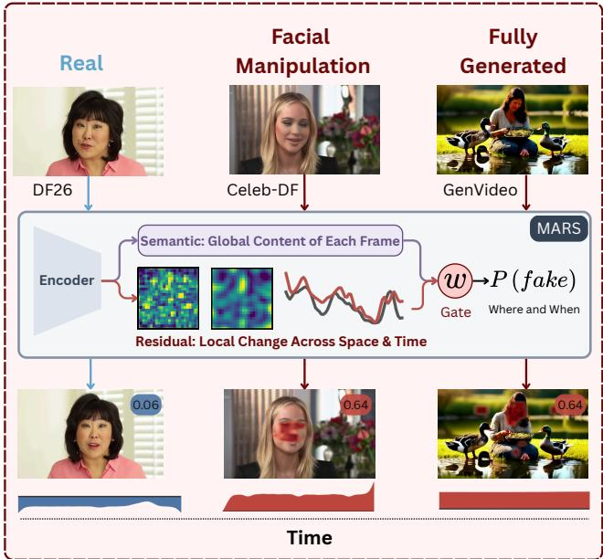  
Figure 1. One detector for facial manipulation and generated video. A real DF26 video, a Celeb-DF facial manipulation, and a GenVideo clip pass through MARS, whose residual path compares local changes across space and time and whose semantic path reads the global content of each frame. Badges: video-level P(fake); overlays: patch contributions to the decision; bottom: contribution over time (red: toward fake, blue: toward real).

One of the common manipulation techniques is facial manipulation, which can introduce localized changes [27], whereas fully generated videos may exhibit alterations in appearance and motion across the entire frame [4]. This variation motivates feature comparisons across spatial neighborhoods and temporal intervals at multiple scales. Seminal works, such as UNITE studies facial manipulation and generated-video detection using pretrained features and attention diversity [14]. GenD demonstrates the effectiveness of adapting pretrained representations through normalization tuning [38]. These advances raise a question: do explicit multiscale spatial and temporal feature differences add useful information to adapted appearance representation? Residuals emphasize local variation [20], but also respond to natural texture and motion. We therefore investigate their joint use with appearance context for detection across both forgery categories.

To investigate this complementarity, we introduce Multiscale Appearance-Residual Streams (MARS), a fullframe detector with two complementary paths (Fig. 1). The residual path applies fixed spatial and temporal differenceof-Gaussians (DoG) operators [19] to frozen intermediate patch features, emphasizing changes at multiple scales while retaining the original features as appearance context. A temporal transformer then models how these changes develop across the clip. The semantic path uses the complete encoder to classify selected frames, tuning only normalization parameters [1] and a classification head while keeping the remaining encoder weights frozen. A lightweight gate combines the two paths’ predictions for each clip (Fig. 2).

Our empirical analysis across seven datasets shows that, under a shared-protocol in which we retrain all compared detectors, MARS achieves 91.43% average AUROC when trained on FF++ and GTA-V, exceeding the strongest baseline by 1.40 points with approximately 5× less training compute. Training on facial manipulations alone achieves 93.99% AUROC on GenVideo [4] and 75.50% on DF26 [29], demonstrating transfer to generated videos. Ablations assess the components’ complementarity, while controlled removal tests evaluate the faithfulness of signed patch and frame contributions derived from MARS.

## 2. Related Work

Facial Forgery Detection. Facial forgery involves altering a person’s identity or expression in a video, and detectors look for forensic cues, the traces these alterations may leave in spatial appearance and across frames, with spatiotemporal inconsistency learning (STIL) combining spatial inconsistencies and adjacent-frame feature differences [8], while TI2Net and StyleFlow model temporal changes in facial identity and style representations, respectively [5, 17]. More recent approaches adapt foundation models for generalizable detection. ForAda supervises a CLIP adapter with blending boundaries derived from manipulation masks [7], whereas GenD tunes normalization layers [38] and DFD-HR selectively processes features through layer pruning, token selection, and expert routing [31].

However, these methods use face-cropping, excluding evidence outside facial regions. This limits their direct application to generated videos that may contain no detectable faces or exhibit synthesis artifacts throughout the scene. MARS instead processes full frames and combines appearance representations with multiscale spatial and temporal feature differences.

Generated Video Detection and Unified Detection. Generated-video detectors examine synthesis traces across the full scene. DeMamba models local spatio-temporal inconsistencies in pretrained visual features [4], while WaveRep uses wavelet-based training augmentation to encourage forensic learning [6]. Other approaches detect deviations in feature trajectories or diffusion-derived spatiotemporal statistics [12, 40, 41], but primarily evaluate transfer across generators. UNITE addresses both facial manipulation and full-scene synthesis using FF++ and GTA-V training data, full-frame SigLIP features, and an attentiondiversity loss [14]. MARS shares this unified detection setting but explicitly computes spatial and temporal differences at multiple scales in frozen intermediate features. It combines these differences with adapted appearance representations to examine their complementary value across both forgery categories.

Low-level and Temporal Cues. Explicit forensic representations capture spatial and temporal variation alongside visual content. High-freq combines multiscale highfrequency features with an RGB pathway through residualguided spatial attention [20], while D3 [41] measures changes in inter-frame feature distances and ReStraV classifies the curvature and stepwise distances of feature trajectories [12].

Our focus is on jointly modeling multiscale spatial and temporal feature differences while retaining appearance context, rather than using spatial residuals or temporal trajectory statistics alone.

## 3. Method

Given a video with a video-level real or fake label, our goal is a single full-frame detector that generalizes to facial manipulations and fully generated videos unseen during training. MARS combines explicit spatial and temporal comparisons with pretrained appearance features. Its residual path models multiscale changes in intermediate patch features across the clip, while its semantic path adapts the encoder’s final representation for frame-level classification. A clipdependent gate combines their predictions, and both paths provide outputs for post-hoc inspection. We provide further details in Sec. A.

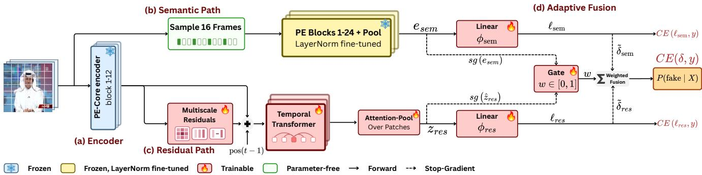  
Figure 2. Overview of MARS. (a) Every frame of a clip passes through the first 12 blocks of a frozen PE-Core-L encoder. (b) The semantic path samples 16 frames and passes them through all 24 blocks and the attention pool of the same encoder, training only its own layer normalizations, then classifies each frame with a linear head $\phi _ { \mathrm { s e m } } .$ . (c) The residual path compares the block-12 patch features across space and time at multiple scales, adds them to the appearance features with a frame-position encoding, models each patch over time with a temporal transformer, and pools over patches into $z _ { \mathrm { r e s } }$ for a linear head $\phi _ { \mathrm { r e s } } .$ . (d) A gate predicts the weight w from both clip representations and mixes the standardized margins into $P ( \mathrm { f a k e } \mid X )$ . Each path is trained by its own cross-entropy; dashed arrows stop gradients, so the fused loss trains only the gate.

## 3.1. Overview and Encoder

Input and notation. Following UNITE’s temporal sampling protocol [14], we sample each video at stride two and divide it into non-overlapping clips of $T = 6 4$ frames. Each clip $X = ( x _ { 1 } , \dots , x _ { T } )$ inherits its video’s label $y \in \{ 0 , 1 \}$ , indicating real or fake respectively, and each frame is resized to $3 3 6 \times 3 3 6$ pixels. Short clips are padded by repeating their last frame, with a validity mask $m \in \{ 0 , 1 \} ^ { T }$ identifying the $\begin{array} { r } { T _ { v } = \sum _ { t } m _ { t } } \end{array}$ genuine frames, which form a prefix. All temporal operations exclude padding, and video predictions average clip probabilities.

Frozen encoder. We build on perception encoder (PE-Core-L/14) [3], which divides each 336 × 336 frame into a $2 4 \times 2 4$ grid of patches.

The resulting N = 576 patch tokens and one class token, each of dimension $D = 1 0 2 4$ , are processed by $L = 2 4$ transformer blocks. We denote blocks a to b by $\mathcal { E } _ { a : b } ( \cdot ; \gamma )$ where $\gamma$ contains the layer normalization (LN) scale and shift parameters. Both paths share frozen attention and multi-layer perceptron (MLP) weights but use different encoder depths and normalization parameters.

The residual path processes every frame through the first $k = 1 2$ blocks with frozen pretrained normalization parameters $\gamma _ { : }$

$$
Z _ { t } = { \mathcal { E } } _ { 1 : k } { \left( x _ { t } ; \gamma \right) } \in \mathbb { R } ^ { \left( N + 1 \right) \times D } , \qquad t = 1 , \dots , T ,\tag{1}
$$

and collects their patch tokens into $F \in \mathbb { R } ^ { T \times N \times D }$ for the residual path. The semantic path processes a subset of frames through all L blocks, tuning its own normalization parameters $\gamma ^ { \mathrm { s e m } }$ , initialized from $\gamma _ { : }$ , throughout the encoder.

## 3.2. Multiscale Residual Path

The residual path computes spatial and temporal feature residuals by subtracting patch features smoothed at consecutive scales, following Gaussian scale-space theory [16] and its DoG formulation [19].

Spatial and temporal comparisons. We apply LN to each patch feature and project it from $D = 1 0 2 4$ to $d _ { r } =$ 256 channels,

$$
\bar { F } = \operatorname { L N } ( F ) , \qquad R = \bar { F } W _ { r } + b _ { r } \in \mathbb { R } ^ { T \times N \times d _ { r } } .\tag{2}
$$

We define Gaussian smoothing $G _ { \sigma }$ over n positions with row-normalized entries,

$$
[ G _ { \sigma } ] _ { i j } = \frac { \exp \bigl ( - ( i - j ) ^ { 2 } / ( 2 \sigma ^ { 2 } ) \bigr ) } { \sum _ { a = 1 } ^ { n } \exp ( - ( i - a ) ^ { 2 } / ( 2 \sigma ^ { 2 } ) ) } .\tag{3}
$$

We parameterize the kernel width as $\sigma ( \tau ) = \sqrt { 2 \tau }$ . The spatial operator $S _ { \tau }$ applies smoothing separably along the rows and columns of each frame’s patch grid, while the temporal operator $\mathcal { T } _ { \tau } ^ { m }$ applies it along the frame axis within the valid prefix, leaving padded positions unchanged. For the scales $\{ \tau _ { j } \} _ { j = 1 } ^ { J } = \{ 0 . 5 , 1 , 2 , 4 \}$ , we compute consecutivescale differences,

$$
\begin{array} { r l } & { r _ { j } ^ { \mathrm { s p } } = S _ { \tau _ { j } } R - S _ { \tau _ { j + 1 } } R , } \\ & { r _ { j } ^ { \mathrm { t m } } = \mathcal { T } _ { \tau _ { j } } ^ { m } R - \mathcal { T } _ { \tau _ { j + 1 } } ^ { m } R , \qquad j = 1 , \dots , J - 1 . } \end{array}\tag{4}
$$

This produces three spatial and three temporal DoG streams. Since each row of $G _ { \sigma }$ sums to one, subtraction cancels constant components and emphasizes variation at different spatial and temporal scales. Fig. S1 shows the spatial response for one channel, Fig. S2 its magnitude across channels, and Fig. S3 the temporal responses at a fixed patch and channel. We also compare consecutive frames using their projected patch features $R _ { t } \in \mathbb { R } ^ { N \times d _ { r } }$

$$
\begin{array} { r } { r _ { t } ^ { \Delta } = \left\{ \begin{array} { l l } { 0 , } & { t = 1 , } \\ { m _ { t } m _ { t - 1 } ( R _ { t } - R _ { t - 1 } ) , } & { t = 2 , \ldots , T , } \end{array} \right. } \end{array}\tag{5}
$$

where the product $m _ { t } m _ { t - 1 }$ keeps the difference only when both frames are genuine. The subtraction compares features at the same patch position in consecutive sampled frames and does not track object motion. Together with the six DoG streams, this gives $M = 7$ residual streams, none of which contains learnable parameters.

Retaining appearance alongside residuals. The residual streams emphasize changes but suppress shared content that may help interpret them. We therefore retain the normalized patch features F¯ as appearance context, project them and the normalized residual streams to a common width $d =$ 1152, and add the outputs. Here, $W _ { a } \in \mathbb { R } ^ { D \times d }$ and $W _ { j } \in$ $\mathbb { R } ^ { d _ { r } \times d }$ are learned projections (biases omitted), and each $\mathrm { L N } _ { j }$ has its own learned scale and shift.

$$
U = \underbrace { \bar { F } W _ { a } } _ { \mathrm { a p p e a r a n c e } } + \sum _ { j = 1 } ^ { M } \underbrace { \mathrm { L N } _ { j } ( r _ { j } ) W _ { j } } _ { \mathrm { r e s i d u a l } \ s \mathrm { t r e a m } \ j } \in \mathbb { R } ^ { T \times N \times d } ,\tag{6}
$$

where $r _ { 1 } , \ldots , r _ { M }$ are the seven residual streams. Perstream normalization reduces differences in magnitude, while the learned projections determine how each stream and the appearance features contribute to the sum.

Frame order. We add a sinusoidal frame-position encoding [32], shared across all patches of each frame,

$$
U _ { t } \gets U _ { t } + \mathrm { p o s } ( t - 1 ) , \qquad t = 1 , \dots , T _ { v } .\tag{7}
$$

Because the valid frames form a prefix, t − 1 is also the frame’s position among the valid frames.

Temporal modeling and readout. To assess how feature changes develop across the clip, we process each patch position n as a temporal sequence $( U _ { 1 , n } , \ldots , U _ { T , n } )$ using a temporal transformer TT, whose attention operates across frames with padded keys masked [2]. We then average its outputs over valid frames to obtain one representation per patch,

$$
u _ { n } = \frac { 1 } { T _ { v } } \sum _ { t = 1 } ^ { T } m _ { t } \operatorname { T T } ( U _ { \cdot , n } ; m ) _ { t } \in \mathbb { R } ^ { d } .\tag{8}
$$

Finally, an attention pool [11] weighs the positions and forms the clip representation $z _ { \mathrm { r e s } } .$ , which a linear classifier $\phi _ { \mathrm { r e s } }$ maps to the residual logits,

$$
\begin{array} { r l r } & { \alpha _ { n } = \displaystyle \mathrm { s o f t m a x } _ { n } \left( a ^ { \top } \operatorname { t a n h } ( W _ { p } u _ { n } ) \right) , } & \\ & { z _ { \mathrm { r e s } } = \displaystyle \sum _ { n = 1 } ^ { N } \alpha _ { n } u _ { n } , \quad } & { \ell _ { \mathrm { r e s } } = \phi _ { \mathrm { r e s } } ( z _ { \mathrm { r e s } } ) \in \mathbb { R } ^ { 2 } . } & \end{array}\tag{9}
$$

## 3.3. Semantic Path

Adaptation of the encoder normalization. The residual path uses intermediate patch features, while the semantic path uses the encoder’s final representation to classify frame appearance,

$$
q _ { t } = \mathcal { E } _ { 1 : L } ( x _ { t } ; \gamma ^ { \mathrm { s e m } } ) \in \mathbb { R } ^ { D } ,\tag{10}
$$

where $\mathcal { E } _ { 1 : L }$ includes the final normalization and attentionpooling head. Following GenD [38], we tune only the LN scale and shift parameters $\gamma ^ { \mathrm { s e m } }$ throughout the encoder, including its input and readout normalizations, while keeping attention and MLP weights frozen. Separate LN parameters in blocks 1 to k preserve the residual features $Z _ { t } .$ , requiring an additional pass through these blocks for the selected semantic frames.

Frame representations and clip prediction. To limit the cost of its full encoder pass, the semantic path processes $T _ { \mathrm { s e m } } = 1 6$ frames per clip, with indices spread evenly over the valid frames [34],

$$
t _ { i } = 1 + \mathrm { r o u n d } \left( \frac { i - 1 } { T _ { \mathrm { s e m } } - 1 } \left( T _ { v } - 1 \right) \right) , \qquad i = 1 , \dots , T _ { \mathrm { s e m } } .\tag{11}
$$

When $T _ { v } ~ < ~ T _ { \mathrm { s e m } }$ , some frames are selected more than once. We normalize each feature to unit length and apply a linear classifier $\phi _ { \mathrm { s e m } }$ , then average the frame logits and normalized features to obtain $\ell _ { \mathrm { s e m } }$ and $e _ { \mathrm { s e m } }$ , respectively,

$$
\begin{array} { r l r } & { \hat { q } _ { i } = \cfrac { q _ { t _ { i } } } { \| q _ { t _ { i } } \| _ { 2 } } , \quad } & { e _ { \mathrm { s e m } } = \cfrac { 1 } { T _ { \mathrm { s e m } } } \displaystyle \sum _ { i = 1 } ^ { T _ { \mathrm { s e m } } } \hat { q } _ { i } , } \\ & { \ell _ { \mathrm { s e m } } = \cfrac { 1 } { T _ { \mathrm { s e m } } } \displaystyle \sum _ { i = 1 } ^ { T _ { \mathrm { s e m } } } \phi _ { \mathrm { s e m } } ( \hat { q } _ { i } ) \in \mathbb { R } ^ { 2 } . } \end{array}\tag{12}
$$

## 3.4. Adaptive Fusion and Training

Normalization of path scores. The two paths can produce logits of different magnitudes, so direct fusion could favor one path because of its scale. We therefore standardize each fake-versus-real margin $\delta _ { \star } = \ell _ { \star } ^ { ( 1 ) } - \ell _ { \star } ^ { ( 0 ) }$ , for $\star \in \{ \mathrm { s e m } , \mathrm { r e s } \}$

$$
\tilde { \delta } _ { \star } = \frac { \delta _ { \star } - \mu _ { \star } } { \sqrt { v _ { \star } + \epsilon } } .\tag{13}
$$

Table 1. Cross-dataset detection under two training settings. Video-level AUROC (%) and EER (%) for methods retrained under the shared protocol with a fixed seed and three epochs. Checkmarks indicate training corpora. Avg. is the equal mean over the seven evaluation datasets. Best results are bold and second-best results are underlined within each training setting, including ties. AP is reported in Tab. S11.
<table><tr><td>Train</td><td></td><td></td><td colspan="2">Source test</td><td colspan="8">Facial manipulation</td><td colspan="4">Generated video</td><td colspan="2">Avg.</td></tr><tr><td>FF++ GTA-V</td><td></td><td></td><td colspan="2">FF++</td><td colspan="2">CelebDF</td><td colspan="2">DF-TIMIT</td><td colspan="2">UADFV</td><td colspan="2">HiFiFace</td><td colspan="2">GenVideo</td><td colspan="2">DF26</td><td colspan="2"></td></tr><tr><td></td><td></td><td>Method</td><td>AUROC↑</td><td>EER↓</td><td>AUROC↑</td><td>EER↓</td><td>AUROC↑ EER↓</td><td></td><td>AUROC↑ EER↓</td><td></td><td>AUROC↑</td><td>EER↓</td><td>AUROC↑</td><td>EER↓</td><td>AUROC↑ EER↓</td><td></td><td>AUROC↑</td><td>EER↓</td></tr><tr><td></td><td></td><td>Frame-level</td><td></td><td></td><td></td><td></td><td></td><td></td><td></td><td></td><td></td><td></td><td></td><td></td><td></td><td></td><td></td><td></td></tr><tr><td>√√</td><td></td><td>ForAda [7]</td><td>86.67</td><td>21.61</td><td>86.66</td><td>22.28</td><td>96.67</td><td>9.53</td><td>95.29</td><td>8.16</td><td>71.26</td><td>35.00</td><td>54.54</td><td>46.59</td><td>39.53</td><td>57.60</td><td>75.80</td><td>28.68</td></tr><tr><td></td><td>××××</td><td>Effort [36]</td><td>72.28</td><td>34.46</td><td>59.50</td><td>40.95</td><td>82.19</td><td>24.69</td><td>94.00</td><td>17.35</td><td>58.28</td><td>44.29</td><td>51.10</td><td>49.28</td><td>36.58</td><td>57.63</td><td>64.85</td><td>38.38</td></tr><tr><td>√√</td><td></td><td>GenD [38]</td><td>70.42</td><td>34.55</td><td>66.13</td><td>39.50</td><td>98.91</td><td>5.08</td><td>51.10</td><td>53.06</td><td>38.76</td><td>56.07</td><td>64.32</td><td>40.55</td><td>59.04</td><td>43.51</td><td>64.10</td><td>38.90</td></tr><tr><td></td><td></td><td>DFD-HR [31]</td><td>99.80</td><td>1.52</td><td>94.88</td><td>13.36</td><td>99.95</td><td>0.94</td><td>97.21</td><td>10.20</td><td>86.75</td><td>19.64</td><td>66.16</td><td>38.94</td><td>70.87</td><td>35.46</td><td>87.95</td><td>17.15</td></tr><tr><td></td><td></td><td>Clip-level</td><td></td><td></td><td></td><td></td><td></td><td></td><td></td><td></td><td></td><td></td><td></td><td></td><td></td><td></td><td></td><td></td></tr><tr><td>√</td><td>×××</td><td>UNITE [14]</td><td>90.22</td><td>16.61</td><td>81.15</td><td>24.85</td><td>91.16</td><td>16.09</td><td>97.38</td><td>7.14</td><td>72.07</td><td>33.57</td><td>66.36</td><td>38.81</td><td>41.29</td><td>55.75</td><td>77.09</td><td>27.55</td></tr><tr><td>1 √</td><td></td><td>DeMamba [4]</td><td>51.54</td><td>48.30</td><td>47.74</td><td>51.56</td><td>49.33</td><td>50.39</td><td>49.25</td><td>52.04</td><td>50.51</td><td>48.93</td><td>51.29</td><td>48.73</td><td>48.78</td><td>50.64</td><td>49.78</td><td>50.09</td></tr><tr><td></td><td></td><td>ReStraV [12]</td><td>52.80</td><td>50.18</td><td>49.00</td><td>51.99</td><td>4.25</td><td>88.67</td><td>52.04</td><td>48.98</td><td>53.44</td><td>47.50</td><td>6.92</td><td>85.74</td><td>59.82</td><td>43.79</td><td>39.75</td><td>59.55</td></tr><tr><td>√</td><td>x</td><td>MARS (Ours)</td><td>99.23</td><td>4.20</td><td>91.25</td><td>16.23</td><td>99.85</td><td>1.88</td><td>97.92</td><td>8.16</td><td>84.92</td><td>22.14</td><td>93.99</td><td>11.52</td><td>75.50</td><td>29.06</td><td>91.81</td><td>13.31</td></tr><tr><td></td><td></td><td>Frame-level</td><td></td><td></td><td></td><td></td><td></td><td></td><td></td><td></td><td></td><td></td><td></td><td></td><td></td><td></td><td></td><td></td></tr><tr><td></td><td>J</td><td>ForAda [7]</td><td>86.55</td><td>22.32</td><td>85.25</td><td>21.41</td><td>96.57</td><td>10.23</td><td>95.59</td><td>10.20</td><td>73.45</td><td>33.57</td><td>64.70</td><td>38.82</td><td>40.04</td><td>55.32</td><td>77.45</td><td>27.41</td></tr><tr><td></td><td>√√√</td><td>Effort [36]</td><td>71.77</td><td>35.09</td><td>59.05</td><td>41.82</td><td>82.33</td><td>25.62</td><td>92.71</td><td>15.31</td><td>57.93</td><td>43.57</td><td>56.45</td><td>45.41</td><td>37.98</td><td>57.93</td><td>65.46</td><td>37.82</td></tr><tr><td>√</td><td></td><td>GenD [38]</td><td>70.47</td><td>34.38</td><td>67.44</td><td>37.51</td><td>98.69</td><td>5.39</td><td>51.81</td><td>47.96</td><td>47.47</td><td>51.43</td><td>64.92</td><td>39.64</td><td>59.63</td><td>44.21</td><td>65.78</td><td>37.22</td></tr><tr><td></td><td></td><td>DFD-HR [31]</td><td>99.80</td><td>1.43</td><td>93.89</td><td>13.93</td><td>99.59</td><td>1.80</td><td>96.25</td><td>10.20</td><td>86.26</td><td>20.71</td><td>79.48</td><td>27.69</td><td>74.95</td><td>31.39</td><td>90.03</td><td>15.31</td></tr><tr><td></td><td></td><td></td><td></td><td></td><td></td><td></td><td></td><td></td><td></td><td></td><td></td><td></td><td></td><td></td><td></td><td></td><td></td><td></td></tr><tr><td></td><td></td><td>Clip-level</td><td></td><td></td><td></td><td></td><td></td><td></td><td></td><td></td><td></td><td></td><td></td><td></td><td></td><td></td><td></td><td></td></tr><tr><td>√</td><td></td><td>UNITE [14]</td><td>84.07</td><td>24.11 49.11</td><td>73.48</td><td>31.04</td><td>86.54</td><td>22.27</td><td>98.58</td><td>5.10</td><td>66.74</td><td>38.21</td><td>66.78</td><td>34.84</td><td>42.64</td><td>55.73</td><td>74.12</td><td>30.18</td></tr><tr><td>√√</td><td>v√√</td><td>DeMamba [4]</td><td>51.40</td><td></td><td>47.85</td><td>52.30</td><td>49.30</td><td>51.02</td><td>51.25</td><td>50.00 53.06</td><td>50.42 53.11</td><td>50.00 48.93</td><td>49.93 9.79</td><td>50.11 82.82</td><td>52.67</td><td>46.20 43.36</td><td>50.40</td><td>49.82</td></tr><tr><td></td><td>√</td><td>ReStraV [12] MARS (Ours)</td><td>52.79 98.98</td><td>48.66 4.46</td><td>50.90 91.22</td><td>50.28 14.80</td><td>4.16 99.95</td><td>88.75 0.94</td><td>50.94 96.58</td><td>8.16</td><td>84.05</td><td>22.50</td><td>93.44</td><td>12.20</td><td>59.93 75.81</td><td>29.78</td><td>40.23 91.43</td><td>59.41 13.26</td></table>

Here, $\mu _ { \star }$ and $v _ { \star }$ are the batch mean and variance during training and their running estimates during inference, equivalent to batch normalization without learnable affine parameters. This makes the margins comparable in scale without calibrating their probabilities.

Input-dependent fusion. To allow the contribution of each path to vary across clips, we predict a mixture weight from their clip representations, $e _ { \mathrm { s e m } }$ and the unit-length residual representation $\hat { z } _ { \mathrm { r e s } } = z _ { \mathrm { r e s } } / \lVert z _ { \mathrm { r e s } } \rVert _ { 2 }$ ,

$$
\begin{array} { r l } & { h = \left[ \mathrm { s g } ( e _ { \mathrm { s e m } } ) ; \mathrm { s g } ( \hat { z } _ { \mathrm { r e s } } ) \right] , } \\ & { w = \sigma ( g ^ { \top } h + b _ { g } ) , } \\ & { \delta = w \mathrm { s g } ( \tilde { \delta } _ { \mathrm { s e m } } ) + ( 1 - w ) \mathrm { s g } ( \tilde { \delta } _ { \mathrm { r e s } } ) , } \end{array}\tag{14}
$$

where $\operatorname { s g } ( \cdot )$ stops gradients. We initialize g and $b _ { g }$ to zero, giving both paths equal weight. Detaching the representations and margins ensures that the fusion objective trains only the gate. The clip’s fake probability is

$$
P ( { \mathrm { f a k e } } \mid X ) = \operatorname { s i g m o i d } ( \delta ) .\tag{15}
$$

Training objective and video prediction. Each path is supervised separately, while the gate is trained through the fused prediction:

$$
\begin{array} { r } { \mathcal { L } = \mathrm { C E } ( \ell _ { \mathrm { s e m } } , y ) + \mathrm { C E } ( \ell _ { \mathrm { r e s } } , y ) + \mathrm { C E } ( [ - \delta / 2 , \ : \delta / 2 ] , y ) , } \end{array}\tag{16}
$$

where CE denotes cross-entropy. The first two terms update their respective paths. Because the representations and margins are detached in Eq. (14), the final term updates only the

gate. The logits $[ - \delta / 2 , \delta / 2 ]$ give a fake-class probability of sigmoid(δ).

## 3.5. Post-hoc Spatial and Temporal Evidence

We inspect which regions and frames support MARS’s prediction without an additional explanation model. We decompose the fused margin into signed frame scores, combining the residual classifier’s patch contributions with the semantic frame margins, so that their sum recovers the fused margin. These scores show which features the classifier rely on, not which pixels caused the prediction. Summing the residual contributions over time also gives a $2 4 \times 2 4$ patch map per clip. We evaluate the faithfulness of this evidence through deletion tests [23], measuring whether removing highly ranked patches or frames changes predictions more than equal-budget random removal. Sec. A.3 provides the score definitions and evaluation details.

## 4. Experimental Setup

## 4.1. Data, Training, and Selection

We train on FF++ c23 [27] and GTA-V [10], and evaluate out-of-domain generalization across facial manipulation and full-scene synthesis using CelebDF-V2 [15], DeepFakeTIMIT [13], HiFiFace [35], UADFV [37], Gen-Video [4], and DF26 [29]. After each epoch, we evaluate on the FF++ validation split and select the checkpoint with the highest video-level AUROC, then evaluate it on the source test splits and out-of-domain datasets. Sec. B summarizes the datasets, with their splits and handling. All methods are trained with a fixed seed for three epochs using AdamW, a learning rate of $1 0 ^ { - 4 }$ , weight decay of $1 0 ^ { - 4 }$ , and an effective batch size of 32 clips. The learning rate is halved every 1,000 optimizer updates. The complete shared training settings are provided in Sec. C.

Table 2. Per-generator detection on GenVideo and DF26. Video-level AUROC (%) for methods trained on FF++ + GTA-V under the shared protocol with a fixed seed and three epochs. Each generator is evaluated against all authentic videos from the same dataset. Best results are bold and second-best results are underlined in each column. Per-generator EER is reported in Tab. S12.
<table><tr><td></td><td colspan="10">GenVideo</td><td colspan="9">DF26</td></tr><tr><td></td><td colspan="10"></td><td colspan="3">Commercial</td><td colspan="5">Open-source</td></tr><tr><td>Method</td><td></td><td>Morph</td><td>Runway</td><td></td><td></td><td></td><td>Moon</td><td>Model</td><td></td><td>Wild Grok</td><td>Kling</td><td>Veo</td><td>Wan</td><td>HV1.5</td><td>HV1.5</td><td>Wan2.2</td><td>Wan2.2</td><td>LTX2.3</td><td>LTX2.3</td></tr><tr><td></td><td>Sora</td><td>Studio</td><td>Gen2</td><td>HotShot Lavie Show-1</td><td></td><td></td><td>Valley</td><td>Crafter Scope</td><td>Scrape</td><td>Imagine</td><td>3.0</td><td>3.1</td><td>2.6</td><td>I2V</td><td>T2V</td><td>I2V</td><td>T2V</td><td>I2V</td><td>T2V</td></tr><tr><td></td><td></td><td></td><td></td><td></td><td></td><td></td><td></td><td></td><td></td><td></td><td></td><td></td><td></td><td></td><td></td><td></td><td></td><td></td><td></td></tr><tr><td>Frame-level ForAda</td><td>59.05</td><td>73.09</td><td>46.58</td><td>72.77</td><td>65.08 65.49</td><td></td><td>57.70 66.61</td><td>79.72</td><td>70.96</td><td>19.68</td><td>30.60</td><td>14.16</td><td>30.90</td><td>40.99</td><td>58.11</td><td>60.62</td><td>42.36</td><td>53.38</td><td>32.36</td></tr><tr><td>Effort</td><td>46.47</td><td>63.11</td><td>47.72</td><td>58.61</td><td>55.66</td><td>61.04</td><td>47.06 52.52</td><td>69.30</td><td>67.16</td><td>26.74</td><td>44.56</td><td>20.91</td><td>30.30</td><td>45.87</td><td>42.59</td><td>49.79</td><td>36.69</td><td>47.47</td><td>27.08</td></tr><tr><td>GenD</td><td>66.36</td><td>61.41</td><td>76.76</td><td>43.09</td><td>58.02</td><td>47.56</td><td>73.53 78.56</td><td>63.36</td><td>64.50</td><td>78.63</td><td>74.64</td><td>52.40</td><td>58.52</td><td>51.14</td><td>63.36</td><td>53.34</td><td>50.10</td><td>60.23</td><td>60.85</td></tr><tr><td>DFD-HR</td><td>71.22</td><td>81.57</td><td>85.03</td><td>57.81</td><td>73.93</td><td>76.17</td><td>66.71 93.46</td><td>86.70</td><td>79.41</td><td>59.65</td><td>81.42</td><td>63.98</td><td>77.26</td><td>62.85</td><td>87.61</td><td>80.27</td><td>65.79</td><td>89.92</td><td>76.16</td></tr><tr><td>Clip-level</td><td></td><td></td><td></td><td></td><td></td><td></td><td></td><td></td><td></td><td></td><td></td><td></td><td></td><td></td><td></td><td></td><td></td><td></td><td></td></tr><tr><td>UNITE</td><td>55.80</td><td>70.01</td><td>51.94</td><td>67.86</td><td>70.20</td><td>73.87</td><td>77.32 66.09</td><td>66.41</td><td>71.47</td><td>44.75</td><td>46.26</td><td>29.80</td><td>39.97</td><td>43.66</td><td>57.67</td><td>50.79</td><td>34.07</td><td>44.01</td><td>32.86</td></tr><tr><td>DeMamba</td><td>55.49</td><td>43.22</td><td>42.93</td><td>61.39</td><td>51.06</td><td>57.97</td><td>42.61 47.33 0.50</td><td>55.37 13.57</td><td>55.12 12.52</td><td>54.80 66.24</td><td>57.40 65.00</td><td>50.93 48.29</td><td>47.39 63.33</td><td>50.60 48.66</td><td>26.19 48.56</td><td>50.95</td><td>61.56 70.00</td><td>52.30</td><td>74.54 68.28</td></tr><tr><td>ReStraV</td><td>1.60</td><td>23.08</td><td>0.32</td><td>4.74</td><td>13.11</td><td>11.74</td><td>12.12</td><td></td><td></td><td></td><td></td><td></td><td></td><td></td><td></td><td>67.57</td><td></td><td>54.28</td><td></td></tr><tr><td>MARS (Ours) 80.56</td><td></td><td>93.01</td><td>94.40</td><td>85.52</td><td>93.32</td><td>87.31</td><td>96.07 98.30</td><td>95.50</td><td>93.18</td><td>72.20</td><td>81.57</td><td>78.12</td><td>84.45</td><td>74.45</td><td>86.49</td><td>72.19</td><td>72.95</td><td>73.37</td><td>65.89</td></tr></table>

## 4.2. Baselines and Evaluation Protocol

We compare MARS with seven methods covering different approaches to forgery detection. ForAda [7], Effort [36], GenD [38], and DFD-HR [31] adapt pretrained image representations, while DeMamba [4] and ReStraV [12] model video features for generated-video detection. UNITE [14] provides a unified video detector for facial manipulation and full-scene synthesis. Tab. S3 summarizes their backbones, adaptation strategies, objectives, and trainable parameter counts. All methods use the input pipeline described in Sec. 3.1. Frames are resized to each encoder’s input resolution and scaled to [−1, 1], and each detector applies its own input normalization. For every detector, a video’s fake score is the mean of its clip probabilities. Implementation details for each method are provided in Sec. D. We examine alternative training settings for GenD and DeMamba in Tab. S6.

We report video-level AUROC, EER, and AP (%), treating fake videos as the positive class. For GenVideo and DF26, each generator is evaluated against the same authentic-video pool within its dataset. Macro results weight generators equally, while pooled results count each video once.

## 4.3. Experimental Results

## 4.3.1. Overall Evaluation Results

Generalization to Unseen Datasets. Training on facial manipulations alone allows MARS to transfer to full-scene synthesis, achieving 93.99% AUROC on GenVideo and 75.50% on DF26, compared with 66.16% and 70.87% for DFD-HR (Tab. 1). Although DFD-HR remains stronger on several facial datasets, MARS achieves the best overall results with 91.81% average AUROC and 13.31% EER. Adding GTA-V improves generated-video detection for several baselines, particularly DFD-HR, whose GenVideo AUROC increases to 79.48%. MARS remains close to its FF++ only results, reaching 91.43% average AUROC and 13.26% EER, suggesting that its transfer across both forgery categories does not depend on GTA-V training. Per-Generator Results. Under FF++ + GTA-V training, MARS achieves the highest GenVideo AUROC in all ten generator groups, averaging 91.72% across generators compared with 77.20% for DFD-HR (Tab. 2). This advantage is less consistent on DF26, where MARS leads in five groups and averages 76.17% against DFD-HR’s 74.49%. MARS performs better on Veo 3.1 and Wan 2.6, while DFD-HR leads on both LTX2.3 modes, showing that the overall gain does not extend uniformly to every generation method.

Overall, MARS generalizes across both forgery categories under either training setting, although its advantage varies across generators. Training and testing compute, energy use, and carbon emissions are reported in Tab. S16.

## 4.3.2. Ablation Study

We evaluate the contribution of each path, residual stream family, semantic normalization tuning, and different encoder depths and fusion under matched training settings (Tab. 3).

Complementarity of the Two Paths. Although the semantic path performs better on its own, adding the residual path raises facial AUROC by 3.0% and overall AUROC from 90.24% to 91.43%. Generated-video AUROC falls from 87.14% to 84.63%, showing that the paths provide complementary information for facial detection. The overall gain also holds when averaged over five seeds (Tab. S6).

Contribution of Residual Streams. Removing spatial DoG causes the largest decrease in average AUROC, from 91.43% to 83.96%, while removing temporal DoG lowers it to 86.07%. Both comparisons therefore contribute beyond the retained appearance features and first difference.

Table 3. Component ablation of MARS. AUROC (%) under the shared training protocol. Sem./Res.: semantic/residual paths; App./Spat./Temp./FD: appearance, spatial DoG, temporal DoG, and first difference; LN: semantic LayerNorm tuning. Facial (F) and Generated (G) average the four external facial and two generated-video datasets, respectively. Avg. includes all seven datasets. Best in bold, second best underlined. Per-dataset results are given in Tab. S13, and the split layer and backbone in Tab. S4.
<table><tr><td rowspan="2">Variant</td><td colspan="2">Path</td><td colspan="4">Residual-path features</td><td rowspan="2">Norm</td><td colspan="4">AUROC↑</td></tr><tr><td>Sem.</td><td>Res.</td><td>App.</td><td>Spat.</td><td>Temp.</td><td>FD</td><td>LN</td><td>F</td><td>G</td><td>Avg.</td></tr><tr><td>MARS (Ours)</td><td>√</td><td>√</td><td>√</td><td>√</td><td>√</td><td>√</td><td>√</td><td>92.95</td><td></td><td>84.63</td><td>91.43</td></tr><tr><td>Residual path only</td><td>x</td><td>√</td><td>√</td><td>√</td><td>√</td><td>√</td><td>=</td><td></td><td>89.13</td><td>69.50</td><td>84.80</td></tr><tr><td>Semantic path only</td><td>√</td><td>x</td><td>=</td><td>=</td><td>=</td><td>=</td><td>√</td><td>89.89</td><td></td><td>87.14</td><td>90.24</td></tr><tr><td>w/o appearance</td><td>√</td><td>√</td><td>x</td><td>√</td><td>√</td><td>√</td><td>√</td><td>93.69</td><td></td><td>82.56</td><td>91.28</td></tr><tr><td>w/o spatial DoG</td><td>√</td><td>√</td><td>√</td><td>x</td><td>√</td><td>√</td><td>√</td><td>85.54</td><td></td><td>73.00</td><td>83.96</td></tr><tr><td>w/o temporal DoG</td><td>√</td><td>√</td><td>√</td><td>√</td><td>x</td><td>√</td><td>√</td><td>88.77</td><td></td><td>74.39</td><td>86.07</td></tr><tr><td>w/o first difference</td><td>√</td><td>√</td><td>√</td><td>√</td><td>√</td><td>x</td><td>√</td><td>92.86</td><td></td><td>81.57</td><td>90.52</td></tr><tr><td>Frozen semantic LNs</td><td>√</td><td>√</td><td>√</td><td>√</td><td>√</td><td>√</td><td>x</td><td></td><td>89.87</td><td>52.37</td><td>80.39</td></tr></table>

Table 4. Split layer and path fusion. AUROC (%), averaged over the four facial (F) and two generated-video (G) test sets, and over all seven (Avg.). In (b), fixed weights replace the gate at inference in the same trained model. Default shaded; best results are bold in each column. Full results in Tabs. S4 and S7.
<table><tr><td>Block</td><td>F</td><td>G</td><td>Avg.</td></tr><tr><td>6</td><td>90.0</td><td>81.0</td><td>88.6</td></tr><tr><td>12</td><td>93.0</td><td>84.6</td><td>91.4</td></tr><tr><td>18</td><td>94.1</td><td>77.0</td><td>89.9</td></tr><tr><td>24</td><td>93.6</td><td>80.8</td><td>90.7</td></tr></table>

(a) Split layer.

<table><tr><td>Fusion weight</td><td>F</td><td>G</td><td>Avg.</td></tr><tr><td>w=0 (residual only)</td><td>90.6</td><td>76.2</td><td>87.7</td></tr><tr><td>w=0.5</td><td>93.0</td><td>84.3</td><td>91.4</td></tr><tr><td>w=1 (semantic only)</td><td>89.4</td><td>83.8</td><td>89.0</td></tr><tr><td>Learned w</td><td>93.0</td><td>84.6</td><td>91.4</td></tr></table>

(b) Path fusion.

Removing the first difference has a smaller effect, yielding 90.52%, whereas removing appearance produces 91.28%, with improved facial detection but weaker generated-video detection. These results suggest that appearance provides useful context for synthesis detection, while spatial and temporal DoG account for the larger gains. We further compare fewer scales and no residual streams in Tab. S8.

Impact of Semantic LayerNorm Tuning. Freezing the semantic normalization parameters reduces generated-video AUROC from 84.63% to 52.37%, compared with a smaller decrease from 92.95% to 89.87% on facial datasets. This indicates that adapting the pretrained representation through normalization is particularly important for transfer to generated videos.

Impact of Split Layer and Path Fusion. Comparing residual extraction depths shows that block 12 performs best overall, while deeper features favor facial detection (Tab. 4). Combining both paths improves overall detection, supporting their complementary value, while the learned gate matches fixed averaging (Tab. 4b); comparisons with additional fixed weights are reported in Tab. S7.

Table 5. Stability across training seeds. Video-level AUROC (%), mean ± std over 5 seeds, trained on FF++ + GTA-V. Mean is the equal average over the seven test sets. Best results are bold in each column.
<table><tr><td>Method</td><td>FF++</td><td>CelebDF</td><td>DF-TIMIT</td><td>UADFV</td><td>HiFiFace</td><td>GenVideo</td><td>DF26</td><td>Mean</td></tr><tr><td>Frame-level</td><td></td><td></td><td></td><td></td><td></td><td></td><td></td><td></td></tr><tr><td>ForAda</td><td>86.40 ±0.6284.05 ±1.6595.37 ±1.3095.74 ±0.56 72.19 ±0.8768.30 ±2.6940.37 ±0.72 77.49 ±0.31</td><td></td><td></td><td></td><td></td><td></td><td></td><td></td></tr><tr><td>Effort</td><td>71.39 ±0.4660.54 ±2.8987.52 ±3.21 91.48 ±0.87 57.49 ±1.0551.74 ±9.0438.60 ±3.5465.54 ±1.98</td><td></td><td></td><td></td><td></td><td></td><td></td><td></td></tr><tr><td>GenD</td><td>70.37 ±7.3468.17 ±4.6398.44 ±1.3253.15 ±15.5148.91 ±11.6063.26 ±3.5361.51 ±3.0966.26 ±5.62</td><td></td><td></td><td></td><td></td><td></td><td></td><td></td></tr><tr><td>DFD-HR</td><td>99.75±0.0693.45 ±0.6599.28 ±0.37 97.30 ±1.49 85.07 ±2.6680.41 ±4.25 71.78 ±3.2689.58 ±0.39</td><td></td><td></td><td></td><td></td><td></td><td></td><td></td></tr><tr><td>Clip-level</td><td></td><td></td><td></td><td></td><td></td><td></td><td></td><td></td></tr><tr><td>UNITE</td><td>90.68 ±4.50 79.14 ±3.4591.99 ±3.5697.83 ± 1.08 75.37 ±5.8866.96 ±4.2739.05 ±2.91 77.29 ±1.97</td><td></td><td></td><td></td><td></td><td></td><td></td><td></td></tr><tr><td>DeMamba</td><td>51.74 ±0.3048.40 ±3.7549.59 ±1.3651.84 ±1.10 50.94 ±0.4852.36 ±3.6048.15 ±2.9850.43 ±0.66</td><td></td><td></td><td></td><td></td><td></td><td></td><td></td></tr><tr><td>ReStraV</td><td>52.99 ±0.14 51.00 ±0.56 8.87 ±5.33 50.23 ±0.58 53.36 ±0.41 7.42 ±2.27 58.60 ±0.93 40.35 ±0.59</td><td></td><td></td><td></td><td></td><td></td><td></td><td></td></tr><tr><td></td><td>MARS (Ours) 98.94 ±0.1590.56±0.5599.85±0.1297.75 ±0.8785.43±1.2188.91 ±4.5473.37 ±2.7190.69 ±1.02</td><td></td><td></td><td></td><td></td><td></td><td></td><td></td></tr></table>

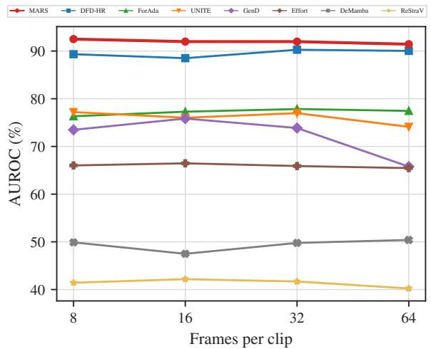  
Figure 3. Stability across clip lengths. Video AUROC averaged over the seven test sets when training and testing with 8, 16, 32 or 64 frames per clip; 64 is the main setting. Training length for all methods is given in Tab. S5, per-dataset results for MARS across training length and clip length in Tab. S14, and the number of frames sampled by the semantic path in Tab. S10.

## 4.3.3. Sensitivity to Initialization and Clip Length

Random Seeds. We repeat training with five seeds to assess whether the comparison depends on a particular run (Tab. 5). MARS achieves the highest mean AUROC across the seven datasets at 90.69±1.02%, compared with 89.58± 0.39% for DFD-HR, while GenD shows greater variability at $6 6 . 2 6 \pm 5 . 6 2 \%$ . The variation is not uniform across datasets, as MARS has a standard deviation of 4.54% on GenVideo but less than 1% on FF++, CelebDF, DF-TIMIT, and UADFV. This indicates that its overall advantage persists across runs, although transfer to generated videos remains more sensitive to training randomness.

Number of Frames. Increasing clip length does not consistently improve detection (Fig. 3). MARS achieves 91.4– 92.5% average AUROC across 8–64 frames and leads at every tested clip length, whereas GenD peaks at 75.85% with 16 frames before declining to 65.78% with 64 frames.

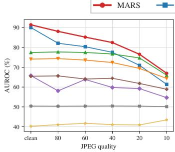  
(a) JPEG compression

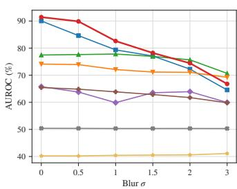  
(b) Gaussian blur

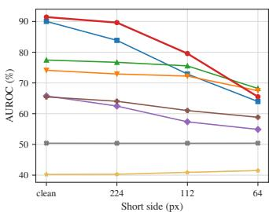  
(c) Downscaling

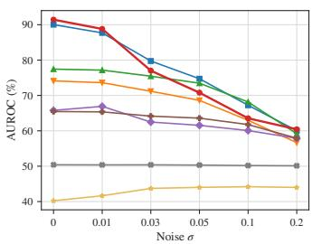  
(d) Gaussian noise  
Figure 4. Robustness to common video degradations. Video AUROC (%) of the main checkpoints, averaged over the seven test sets, as the strength of each degradation increases; the leftmost point is the unperturbed test set. Degradations are applied to every decoded frame: JPEG quality 80 to 10, Gaussian blur with σ from 0.5 to 3 pixels, downscaling of the short side to 224, 112 and 64 pixels, and Gaussian noise with σ from 0.01 to 0.2 on pixel values in [0, 1]. Per-dataset curves are given in Figs. S6 to S9, and AUROC, AP and EER per dataset in Tab. S15.

MARS therefore maintains strong performance with shorter clips under the tested training settings, although changing clip length also changes the number of training updates.

## 4.3.4. Robustness to Processing

We evaluate fixed checkpoints under compression, blur, downscaling, and noise to examine whether detection remains effective after video processing (Fig. 4). MARS achieves the highest average AUROC at every tested JPEG quality, retaining 82.47% at quality 40 compared with 77.55% for DFD-HR. It also leads under downscaling to 112 pixels and blur up to $\sigma = 1 . 5$ , although ForAda performs better under stronger blur and downscaling. Gaussian noise exposes a clearer weakness, with MARS dropping to 70.80% at $\sigma = 0 . 0 5$ , below DFD-HR’s 74.73%. These results show that MARS preserves useful detection evidence under several processing conditions, but its advantage diminishes as degradation increases. DeMamba changes little across perturbations, yet remains near 50% AUROC, illustrating that a small performance drop alone does not establish effective robustness.

## 4.3.5. Faithfulness of Post-hoc Evidence

We visualize the spatial weights and frame scores of MARS (Fig. 5) and test whether removing high-ranked regions or frames affects its predictions more than random removal. On the selected evaluation clips, blanking the 64 highestattribution patches per frame reduces average AUROC from 99.32% to 73.05%, whereas blanking the same number of random patches leaves it at 98.96% (Fig. 5a). The larger drop under attribution-guided removal supports the relevance of the spatial ranking to the detector’s decisions.

For temporal evidence, we construct clips containing a 32-frame manipulated segment within authentic footage. Removing the 32 highest-scoring frames reduces the mean fake probability from 34.21% to 21.75%, while random removal leaves it at 35.10% (Fig. 5b). Removing the known manipulated frames lowers it further to 14.80%, showing that the predicted ranking captures useful temporal evidence but does not fully recover the manipulated segment. Together, these interventions support the relevance of the displayed evidence to MARS’s decisions, without establishing that every highlighted region is a forgery artifact.

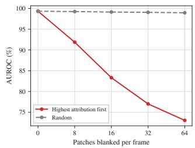  
(a) Patch deletion

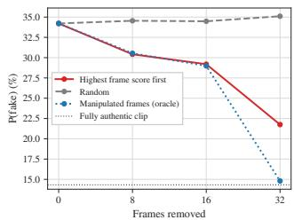  
(b) Frame removal  
Figure 5. Faithfulness of the MARS evidence. (a) AUROC, averaged over the seven test sets, after the k highest-attribution patches or k random patches are blanked in every frame. Each set contributes up to 100 manipulated clips that MARS detects and up to 100 authentic clips, so the unedited AUROC is close to 100. (b) Probability of manipulation of FF++ clips containing a 32-frame manipulated segment, after the k highest-scoring, random or manipulated (oracle) frames are removed; the dotted line marks the fully authentic clip. Per-dataset patch deletion and the 16-frame segment are given in Figs. S10 and S11, and the localization of manipulated frames in Tab. S9.

## 5. Conclusion

We introduced MARS to investigate whether multiscale spatial and temporal feature differences complement adapted appearance representations for detecting facial manipulation and fully generated video. Under a shared protocol across seven datasets, MARS achieves the highest average AUROC among the compared detectors, while training on facial manipulations alone also transfers to generated videos. Ablations show that combining the paths improves facial and overall detection, with benefits that vary across datasets. Controlled removal tests further support the relevance of its signed patch and frame contributions to its predictions. These results support combining explicit feature comparisons with appearance representations for video forgery detection. However, MARS remains sensitive to Gaussian noise, strong blur, and downscaling, while its residual comparisons use fixed scales. Future work could explore adaptive scale and depth selection alongside training for greater robustness to video degradation. Extending MARS beyond visual evidence to incorporate audio to support multimodal forgery detection.

## Acknowledgments

Resources used in preparing this research were provided, in part, by the Province of Ontario and the Government of Canada through CIFAR, as well as companies sponsoring the Vector Institute (http : / / www . vectorinstitute.ai/#partners). This research was funded by the European Union’s Horizon Europe research and innovation programme under the AIXPERT project (Grant Agreement No. 101214389), which aims to develop an agentic, multi-layered, GenAI-powered framework for creating explainable, accountable, and transparent AI systems.

## LLM Usage Statement

We used LLMs for grammar and wording polish of the manuscript, and assisted coding. All technical content, experiments, and analysis were done by the authors.

## References

[1] Samyadeep Basu, Shell Hu, Daniela Massiceti, and Soheil Feizi. Strong baselines for parameter-efficient few-shot finetuning. In Proceedings ofthe AAAI Conference on Artificial Intelligence, pages 11024–11031, 2024. 2

[2] Gedas Bertasius, Heng Wang, and Lorenzo Torresani. Is space-time attention all you need for video understanding? arXiv preprint arXiv:2102.05095, 2021. 4

[3] Daniel Bolya, Po-Yao Huang, Peize Sun, Jang Hyun Cho, Andrea Madotto, Chen Wei, Tengyu Ma, Jiale Zhi, Jathushan Rajasegaran, Hanoona Bangalath, et al. Perception encoder: The best visual embeddings are not at the output of the network. Advances in Neural Information Processing Systems, 38:60884–60937, 2026. 3, 15, 16, 17

[4] Haoxing Chen, Yan Hong, Zizheng Huang, Zhuoer Xu, Zhangxuan Gu, Yaohui Li, Jun Lan, Huijia Zhu, Jianfu Zhang, Weiqiang Wang, et al. Demamba: Ai-generated video detection on million-scale genvideo benchmark. Science China Information Sciences, 69(6):162103, 2026. 1, 2, 5, 6, 14, 16, 21

[5] Jongwook Choi, Taehoon Kim, Yonghyun Jeong, Seungryul Baek, and Jongwon Choi. Exploiting style latent flows for generalizing deepfake video detection. In 2024 IEEE/CVF Conference on Computer Vision and Pattern Recognition (CVPR), pages 1133–1143. IEEE, 2024. 1, 2

[6] Riccardo Corvi, Davide Cozzolino, Ekta Prashnani, Shalini De Mello, Koki Nagano, and Luisa Verdoliva. Seeing what matters: Generalizable ai-generated video detection with forensic-oriented augmentation. Advances in neural information processing systems, 38:26418–26446, 2025. 2

[7] Xinjie Cui, Yuezun Li, Ao Luo, Jiaran Zhou, and Junyu Dong. Forensics adapter: Adapting clip for generalizable face forgery detection. In 2025 IEEE/CVF Conference on Computer Vision and Pattern Recognition (CVPR), pages 19207–19217. IEEE, 2025. 2, 5, 6, 16, 21

[8] Zhihao Gu, Yang Chen, Taiping Yao, Shouhong Ding, Jilin Li, Feiyue Huang, and Lizhuang Ma. Spatiotemporal inconsistency learning for deepfake video detection. In Proceedings of the 29th ACM international conference on multimedia, pages 3473–3481, 2021. 1, 2

[9] Kaiming He, Xinlei Chen, Saining Xie, Yanghao Li, Piotr Dollar, and Ross Girshick. Masked autoencoders are scalable´ vision learners. In 2022 IEEE/CVF conference on computer vision andpattern recognition (CVPR), pages 15979–15988. IEEE, 2022. 1

[10] Yuan-Ting Hu, Jiahong Wang, Raymond A Yeh, and Alexander G Schwing. Sail-vos 3d: A synthetic dataset and baselines for object detection and 3d mesh reconstruction from video data. In 2021 IEEE/CVF Conference on Computer Vision and Pattern Recognition Workshops (CVPRW), pages 3359–3369. IEEE, 2021. 5, 14

[11] Maximilian Ilse, Jakub Tomczak, and Max Welling. Attention-based deep multiple instance learning. In Inter national conference on machine learning, pages 2127–2136. Pmlr, 2018. 4

[12] Christian Interno, Robert Geirhos, Markus Olhofer, Sunny\` Liu, Barbara Hammer, and David Klindt. Ai-generated video detection via perceptual straightening. Advances in neural information processing systems, 38:20672–20705, 2025. 2, 5, 6, 16, 21

[13] Pavel Korshunov and Sebastien Marcel. Deepfakes: a new´ threat to face recognition? assessment and detection. arXiv preprint arXiv:1812.08685, 2018. 5, 14

[14] Rohit Kundu, Hao Xiong, Vishal Mohanty, Athula Balachandran, and Amit K Roy-Chowdhury. Towards a universal synthetic video detector: From face or background manip ulations to fully ai-generated content. In 2025 IEEE/CVF Conference on Computer Vision and Pattern Recognition (CVPR), pages 28050–28060. IEEE, 2025. 2, 3, 5, 6, 15, 21

[15] Yuezun Li, Xin Yang, Pu Sun, Honggang Qi, and Siwei Lyu. Celeb-df: A large-scale challenging dataset for deepfake forensics. In 2020 IEEE/CVF Conference on Computer Vision and Pattern Recognition (CVPR), pages 3204–3213. IEEE, 2020. 5, 14

[16] Tony Lindeberg. Scale-space theory: A basic tool for analyz ing structures at different scales. Journal of applied statistics, 21(1-2):225–270, 1994. 3

[17] Baoping Liu, Bo Liu, Ming Ding, Tianqing Zhu, and Xin Yu. Ti 2 net: Temporal identity inconsistency network for deepfake detection. In 2023 IEEE/CVF Winter Conference on Applications of Computer Vision (WACV), pages 4680– 4689. IEEE, 2023. 2

[18] Ilya Loshchilov and Frank Hutter. Decoupled weight decay regularization. arXiv preprint arXiv:1711.05101, 2017. 15

[19] David G Lowe. Distinctive image features from scaleinvariant keypoints. International journal of computer vision, 60(2):91–110, 2004. 2, 3

[20] Yuchen Luo, Yong Zhang, Junchi Yan, and Wei Liu. Generalizing face forgery detection with high-frequency features. In 2021 IEEE/CVF Conference on Computer Vision and Pattern Recognition (CVPR), pages 16312–16321. IEEE, 2021. 1, 2

[21] Bolin Ni, Houwen Peng, Minghao Chen, Songyang Zhang, Gaofeng Meng, Jianlong Fu, Shiming Xiang, and Haibin Ling. Expanding language-image pretrained models for general video recognition. In European conference on computer vision, pages 1–18. Springer, 2022. 16

[22] Maxime Oquab, Timothee Darcet, Th´ eo Moutakanni, Huy´ Vo, Marc Szafraniec, Vasil Khalidov, Pierre Fernandez, Daniel Haziza, Francisco Massa, Alaaeldin El-Nouby, et al. Dinov2: Learning robust visual features without supervision. arXiv preprint arXiv:2304.07193, 2023. 16

[23] Vitali Petsiuk, Abir Das, and Kate Saenko. Rise: Randomized input sampling for explanation of black-box models. arXiv preprint arXiv:1806.07421, 2018. 5

[24] Alec Radford, Jong Wook Kim, Chris Hallacy, Aditya Ramesh, Gabriel Goh, Sandhini Agarwal, Girish Sastry, Amanda Askell, Pamela Mishkin, Jack Clark, et al. Learning transferable visual models from natural language supervision. In International conference on machine learning, pages 8748–8763. PmLR, 2021. 1, 16

[25] Shaina Raza, Jessee Ho, Ahmed Y Radwan, and Mohamed Hafez. Deepfakes in the foundation-model era: A survey of forensics, generation and distribution across social media lifecycle. 2026. 1

[26] Shaina Raza, Iuliia Zarubiieva, Ahmed Y Radwan, Nathaniel Lesperance, Deval Pandya, Sedef Akinli Kocak, and Graham W Taylor. Position: Sustainable open-source ai requires tracking the cumulative footprint of derivatives. arXiv preprint arXiv:2601.21632, 2026. 23

[27] Andreas Rossler, Davide Cozzolino, Luisa Verdoliva, Christian Riess, Justus Thies, and Matthias Nießner. Faceforensics++: Learning to detect manipulated facial images. In Proceedings of the IEEE/CVF international conference on computer vision, pages 1–11, 2019. 1, 5, 14

[28] Conrad Sanderson and Brian C Lovell. Multi-region probabilistic histograms for robust and scalable identity inference. In International conference on biometrics, pages 199–208. Springer, 2009. 14

[29] Severyn Shykula, Andrii Yermakov, Ivan Samarskyi, Dmytro Mishkin, Jan Cech, and Anastasiia Mishchuk. Df26: We cannot tell fake from real anymore. arXiv preprint arXiv:2609.07369, 2026. 2, 5, 15

[30] Oriane Simeoni, Huy V Vo, Maximilian Seitzer, Federico´ Baldassarre, Maxime Oquab, Cijo Jose, Vasil Khalidov,

Marc Szafraniec, Seungeun Yi, Michael Ramamonjisoa,¨ et al. Dinov3. arXiv preprint arXiv:2508.10104, 2025. 17

[31] Jiamu Sun, Zhiyuan Yan, Ke-Yue Zhang, Taiping Yao, and Shouhong Ding. Dfd-hr: Generalizable deepfake detection via hierarchical routing learning. In Proceedings of the IEEE/CVF Conference on Computer Vision and Pattern Recognition, pages 13984–13995, 2026. 2, 5, 6, 16, 21

[32] Ashish Vaswani, Noam Shazeer, Niki Parmar, Jakob Uszkoreit, Llion Jones, Aidan N Gomez, Łukasz Kaiser, and Illia Polosukhin. Attention is all you need. Advances in neural information processing systems, 30, 2017. 4

[33] Vector Institute. ai-impact-accounting: Data and impact accounting (DIA) to track the carbon and water footprint of open-source AI. Python package, version 0.1.0, https:// pypi.org/project/ai- impact- accounting/, 2026. Released July 8, 2026. Apache-2.0 license. 23

[34] Limin Wang, Yuanjun Xiong, Zhe Wang, Yu Qiao, Dahua Lin, Xiaoou Tang, and Luc Van Gool. Temporal segment networks: Towards good practices for deep action recognition. In European conference on computer vision, pages 20–36. Springer, 2016. 4

[35] Yuhan Wang, Xu Chen, Junwei Zhu, Wenqing Chu, Ying Tai, Chengjie Wang, Jilin Li, Yongjian Wu, Feiyue Huang, and Rongrong Ji. Hififace: 3d shape and semantic prior guided high fidelity face swapping. In Proceedings of the Thirti eth International Joint Conference on Artificial Intelligence, IJCAI-21, pages 1136–1142. International Joint Conferences on Artificial Intelligence Organization, 2021. Main Track. 5, 14

[36] Zhiyuan Yan, Jiangming Wang, Peng Jin, Ke-Yue Zhang, Chengchun Liu, Shen Chen, Taiping Yao, Shouhong Ding, Baoyuan Wu, and Li Yuan. Orthogonal subspace decom position for generalizable ai-generated image detection. In Proceedings of the 42nd International Conference on Ma chine Learning. JMLR.org, 2025. 5, 6, 16, 21

[37] Xin Yang, Yuezun Li, and Siwei Lyu. Exposing deep fakes using inconsistent head poses. In ICASSP 2019-2019 IEEE international conference on acoustics, speech and signal processing (ICASSP), pages 8261–8265. IEEE, 2019. 5, 14

[38] Andrii Yermakov, Jan Cech, Jiri Matas, and Mario Fritz. Deepfake detection that generalizes across benchmarks. In 2026 IEEE/CVF Winter Conference on Applications ofComputer Vision (WACV), pages 773–783. IEEE, 2026. 2, 4, 5, 6, 16, 21, 22

[39] Xiaohua Zhai, Basil Mustafa, Alexander Kolesnikov, and Lucas Beyer. Sigmoid loss for language image pre-training. In 2023 IEEE/CVF International Conference on Computer Vision (ICCV), pages 11941–11952. IEEE, 2023. 15, 17

[40] Shuhai Zhang, ZiHao Lian, Jiahao Yang, Daiyuan Li, Guox uan Pang, Feng Liu, Bo Han, Shutao Li, and Mingkui Tan. Physics-driven spatiotemporal modeling for ai-generated video detection. Advances in neural information processing systems, 38:174683–174730, 2025. 2

[41] Chende Zheng, Ruiqi Suo, Chenhao Lin, Zhengyu Zhao, Le Yang, Shuai Liu, Minghui Yang, Cong Wang, and Chao Shen. D3: Training-free ai-generated video detection using second-order features. In 2025 IEEE/CVF International

Conference on Computer Vision (ICCV), pages 1979–1989. IEEE, 2025. 1, 2

# MARS: Multiscale Appearance-Residual Streams for Video Forgery Detection

Supplementary Material

In this supplementary material, we provide detailed forward pass of our model, selected datasets, models configurations, additional experiments, and expanded detailed results. In Sec. A we present additional details regarding MARS and visualization of the residuals streams, with a detailed steps how to extract evidences from the model. Sec. B, Sec. C and Sec. D present detailed setup about the selected datasets, followed protocol, and configurations of each method. Sec. E covers the selected metrics and how to read their results. In Sec. F we provide additional experiments and ablations covering different backbone, and depth effect on residuals, training duration, different semantic-path frames, quantitative evidence and qualitative examples. Lastly Sec. G expands main tables and figures results to analyze per-dataset results and additional metrics.

## A. Additional MARS Implementation Details

This section complements Sec. 3 with the full forward pass, MARS hyperparameters, and visualizations of the residual streams.

## A.1. Forward Pass

Following our dual-path architecture, both paths use the same frozen attention and MLP weights of PE-Core-L but differ in depth and normalization parameters. The residual path passes every frame through blocks 1 to k once with the pretrained parameters $\gamma ,$ and all of its later operations act on the resulting patch tokens. The semantic path passes the $T _ { \mathrm { s e m } }$ selected frames through all L blocks with its own parameters $\gamma ^ { \mathrm { s e m } }$ . Because $\gamma ^ { \mathrm { s e m } }$ differs from $\gamma$ from the first block onward, these frames cannot reuse $Z _ { t }$ and are encoded a second time. Besides the fake probability, the forward pass returns the patch weights $\alpha ,$ the per-frame semantic probabilities, the gate weight w, and the two standardized margins. We summarize the forward path in Algorithm 1, and Tab. S1 lists the hyperparameters of MARS.

## A.2. Residuals Visualization

We visualize the residual streams of Eq. (4) using features from one FF++ Deepfakes video processed by the trained MARS checkpoint. Fig. S1 follows one projected channel of R through spatial smoothing at $\tau = 1$ and $\tau = 2$ , then subtracts the two outputs to obtain $r _ { 2 } ^ { \mathrm { s p } }$ . The larger scale smooths over a wider neighborhood, so their difference emphasizes variation between the two scales while suppressing content preserved by both. Fig. S2 summarizes this response using the $\ell _ { 2 }$ norm across all $d _ { r }$ channels at each patch. This energy measures the strength of the residual response, which can also arise from natural texture, rather than its contribution to the detector’s decision.

Table S1. MARS hyperparameters. Values shared with the other methods (optimizer, schedule, batch, epochs) are given in $\mathsf { A p - }$ pendix C.
<table><tr><td>Setting</td><td>Value</td></tr><tr><td>Encoder</td><td></td></tr><tr><td>Backbone</td><td> ${ \mathrm { P E } } { \mathrm { - C o r e } } { \mathrm { - } } { \mathrm { L } } / 1 4 { \mathrm { , } } 3 3 6 \times 3 3 6 { \mathrm { , } }$  frozen</td></tr><tr><td>Patch grid, width</td><td> $2 4 \times 2 4 ( N = 5 7 6 ) , D = 1 0 2 4$ </td></tr><tr><td>Blocks, split block</td><td> $L = 2 4 , k = 1 2$ </td></tr><tr><td>Residual path</td><td></td></tr><tr><td>Projection width</td><td> $d _ { r } = 2 5 6$ </td></tr><tr><td>Scales</td><td> $\tau \in \{ 0 . 5 , 1 , 2 , 4 \} , \sigma ( \tau ) = \sqrt { 2 \tau }$ </td></tr><tr><td>Residual streams</td><td>3 spatial, 3 temporal, 1 first difference</td></tr><tr><td>Fusion width</td><td> $d = 1 1 5 2$ </td></tr><tr><td>Temporal transformer</td><td>4 layers, 12 heads, MLP ratio 4, dropout 0.1, post-norm</td></tr><tr><td>Attention pool hidden width</td><td>128 (tanh)</td></tr><tr><td>Semantic path and fusion</td><td></td></tr><tr><td>Semantic frames</td><td> $T _ { \mathrm { s e m } } = 1 6$ </td></tr><tr><td>Tuned parameters</td><td>LayerNorm scale and shift (all 24 blocks), linear head , momentum 0.1</td></tr><tr><td>Margin standardization</td><td>running statistics  $\epsilon = 1 0 ^ { - 5 }$ </td></tr><tr><td>Gate initialization</td><td> $g = 0 , b _ { g } = 0 ( w = 0 . 5 )$ </td></tr><tr><td>Loss weights</td><td>semantic : residual : fused = 1 : 1 : 1</td></tr><tr><td>Trainable parameters</td><td>67.54M (residual path 67.43M, semantic path 0.11M)</td></tr></table>

Fig. S3 shows the temporal comparisons at one patch position and feature channel. Smoothing along the frame axis reduces short fluctuations, and subtracting consecutive smoothing scales produces $r _ { 2 } ^ { \mathrm { t m } }$ . The first difference $r ^ { \Delta } \left( \mathrm { E q . } \left( 5 \right) \right)$ instead compares consecutive sampled frames, capturing changes at the shortest observed interval.

## A.3. Spatial and Temporal Evidence

We compute signed patch and frame contributions from the main MARS checkpoint to inspect which regions and frames support its prediction.

Let $h _ { t , n }$ be the temporal transformer’s output for frame t and patch n. The contribution of this feature to the residual path’s fake-versus-real margin is

$$
c _ { t , n } = \frac { m _ { t } \alpha _ { n } } { T _ { v } } \omega _ { \mathrm { r e s } } ^ { \top } h _ { t , n } ,\tag{S1}
$$

where $\omega _ { \mathrm { r e s } }$ is the difference between the classifier’s fake and real weight vectors. Summing $c _ { t , n }$ over frames and patches, then adding the classifier’s bias difference, recovers the residual margin.

For each frame selected by the semantic path, we also retain its fake-versus-real margin,

$$
\delta _ { i } ^ { \mathrm { s e m } } = \phi _ { \mathrm { s e m } } ( \hat { q } _ { i } ) ^ { ( 1 ) } - \phi _ { \mathrm { s e m } } ( \hat { q } _ { i } ) ^ { ( 0 ) } .\tag{S2}
$$

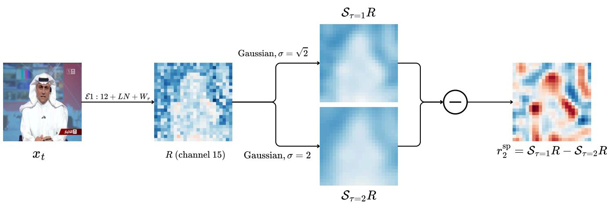  
Figure S1. Spatial comparison on trained MARS features. A frame of an FF++ Deepfakes video is encoded by blocks 1–12 of the frozen encoder $\mathcal { ( E _ { 1 : 1 2 } , }$ , Eq. (1)), then normalized and projected to R (Eq. (2)). We show channel 15 of $R ,$ its smoothings at $\tau = 1$ and $\tau = 2 ,$ , and their difference $r _ { 2 } ^ { \mathrm { s p } } \left( \mathrm { E q . } \left( 4 \right) \right)$ . Maps of R and its smoothings share one zero-centered color scale; $r _ { 2 } ^ { \mathrm { s p } }$ uses its own.

Algorithm 1 MARS forward pass for one clip.   
Require: Clip $X ~ = ~ ( x _ { 1 } , \ldots , x _ { T } )$ , validity mask $m ,$ residual   
depth k   
Ensure: Fake probability P(fake | X) and diagnostic outputs   
// Frozen intermediatefeaturesfor the residual path   
$\begin{array} { r } { 1 \colon T _ { v }  \sum _ { t } m _ { t } } \end{array}$   
2: $Z _ { t } \gets \mathcal { E } _ { 1 : k } ( x _ { t } ; \gamma )$ for $t = 1 , \dots , T$ ▷ Eq. (1)   
3: F ← patch tokens of $Z _ { 1 : T }$   
// Residual path: spatial and temporal differences   
4: $\bar { F }  \mathrm { L N } ( F ) ; R  \bar { F } W _ { r } + b _ { r }$ ▷ Eq. (2)   
5: for $j = 1 , \ldots , J - 1 { \bf d o }$   
6: $r _ { j } ^ { \mathrm { s p } } \gets S _ { \tau _ { j } } R - S _ { \tau _ { j + 1 } } R$ ▷ Eq. (4)   
7: $r _ { j } ^ { \mathrm { t m } } \gets \mathcal { T } _ { \tau _ { j } } ^ { m } R - \mathcal { T } _ { \tau _ { j + 1 } } ^ { m } R$   
8: end for   
9: Compute $r ^ { \Delta }$ ▷ Eq. (5)   
10: Combine appearance and residual streams into U ▷ Eq. (6)   
11: Add positional encodings to U ▷ Eq. (7)   
// Residual path: temporal modeling and readout   
12: $\begin{array} { r } { u _ { n } \gets T _ { v } ^ { - 1 } \sum _ { t } m _ { t } \mathrm { T T } ( U . , . , m ) _ { t } \mathrm { f o r } n = 1 , . . . , N } \end{array}$ ▷   
Eq. (8)   
13: Compute $\alpha , z _ { \mathrm { r e s } } ,$ and $\ell _ { \mathrm { r e s } }$ ▷ Eq. (9)   
// Semantic path: adapted encoder on selectedframes   
14: Select $t _ { 1 } , \dots , t _ { T _ { \mathrm { s e m } } }$ ▷ Eq. (11)   
15: for $i = 1 , \ldots , T _ { \mathrm { s e m } } { \bf d o }$   
16: $q _ { t _ { i } } \gets \mathcal { E } _ { 1 : L } ( x _ { t _ { i } } ; \gamma ^ { \mathrm { s e m } } )$ ▷ Eq. (10)   
17: $\hat { q } _ { i }  q _ { t _ { i } } / \lVert q _ { t _ { i } } \rVert _ { 2 }$   
18: end for   
19: $\mathrm { C o m p u t e } \ \ell _ { \mathrm { s e m } } \ \mathrm { a n d } \ e _ { \mathrm { s e m } }$ ▷ Eq. (12)   
$/ / A d a p t i v e f u s i o n$   
20: Standardize $\delta _ { \mathrm { s e m } }$ and $\delta _ { \mathrm { r e s } }$ ▷ Eq. (13)   
21: Compute w and δ ▷ Eq. (14)   
22: return sigmoid(δ), α, {psem}, w, ˜δsem, ˜δres

We combine these contributions using the same gate weight and normalization as the detector,

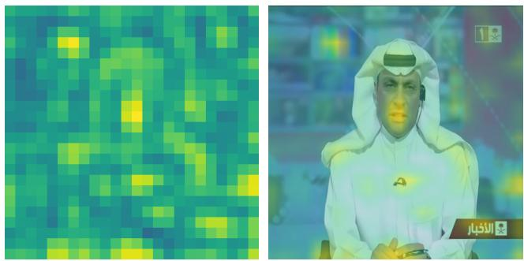  
Figure S2. Spatial residual energy of the frame in Fig. S1. For each patch n, the energy is $\| r _ { 2 , n } ^ { \mathrm { s p } } \| _ { 2 }$ , the norm of the band $r _ { 2 } ^ { \mathrm { s p } } \left( \tau = \right.$ 1 vs. 2) over all $d _ { r } = 2 5 6$ channels. Left: on the $2 4 \times 2 4$ patch grid. Right: overlaid on the frame. Energy measures response magnitude, not where the detector looks.

$$
\begin{array} { l } { \displaystyle s _ { t } = \frac { 1 - w } { \sqrt { v _ { \mathrm { r e s } } + \epsilon } } \sum _ { n } c _ { t , n } } \\ { \displaystyle + \frac { w } { T _ { \mathrm { s e m } } \sqrt { v _ { \mathrm { s e m } } + \epsilon } } \sum _ { i : t _ { i } = t } \delta _ { i } ^ { \mathrm { s e m } } . } \end{array}\tag{S3}
$$

A higher $s _ { t }$ means that frame t contributes more toward a fake prediction. Frames not selected by the semantic path receive only the residual contribution. The patch map uses $( 1 - w ) c _ { t , n } / \sqrt { v _ { \mathrm { r e s } } + \epsilon }$ , summed over time to rank spatial positions.

These scores include the classifier’s signed contributions, rather than attention weights alone. Their sum, together with the bias and normalization offsets, recovers the fused margin to numerical precision; the reported float32 error is approximately $5 \times 1 0 ^ { - 7 }$ . The tests below examine whether these scores also identify input regions and frames that affect the prediction.

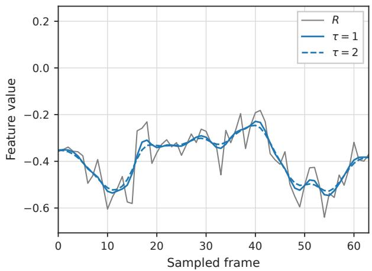

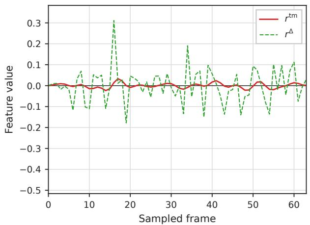  
Figure S3. Temporal comparisons at a fixed patch and channel in an FF++ Deepfakes clip. Top: channel 15 of R, the PE block-12 features after projection (Eq. (2)), over the 64 frames, with its Gaussian smoothings at τ = 1 and $\tau = 2 .$ . Bottom: their difference $r _ { 2 } ^ { \mathrm { t m } }$ and the consecutive-frame difference $r ^ { \Delta }$ . The patch is selected by maximum interior attention, and the channel by the largest spatial variance of the band (τ = 1 vs. 2) over interior patches of the fake frame.

## B. Dataset Details

FaceForensics++. FaceForensics++ [27] provides authentic videos and facial manipulations produced by Deepfakes, Face2Face, FaceSwap, and NeuralTextures. We use c23 compression and the official splits, comprising 3,600 training videos, 700 validation videos, and 700 test videos. The training split contains 720 authentic videos and 720 videos from each manipulation method, while the validation and test splits each contain 140 authentic videos and 140 videos per method. The validation split is used for checkpoint selection. The videos are YouTube recordings of mostly frontal faces, typically around 480p. The median video has 414 frames at 25 fps (about 17 s) in the training split, 398 frames at 30 fps (about 13 s) in the validation split, and 444 frames at 25 fps (about 18 s) in the test split.

GTA-V. We use rendered sequences from SAIL-VOS 3D [10] as fully synthetic videos. The training split contains 141 sequences with a median of 336 frames, and the held-out evaluation split contains 30 sequences with a median of 389 frames, all at 1280 × 800 resolution.

CelebDF-V2. CelebDF-V2 [15] contains face swaps generated from celebrity interviews. We use its official test list of 518 videos, comprising 340 manipulated videos and 178 authentic videos. The authentic pool includes 108 celebrity interview videos and 70 YouTube videos. The evaluated videos are typically around 480p, at 30 fps, with a median of 372 frames (approximately 12 s).

DeepFakeTIMIT. DeepFakeTIMIT [13] contains face swaps at two quality levels, with 320 videos at each level. We pair these 640 manipulated videos with the 320 corresponding VidTIMIT [28] recordings, giving 960 evaluation videos. The authentic recordings cover 32 subjects reading ten sentences each, and matching uses the subject directory and sentence identifier rather than the inserted identity. Each authentic recording is stored as a sequence of numbered JPEG frames, which we read in numerical order as one video. The manipulated videos have a resolution of 512 × 384 and a frame rate of 25 fps. All videos have a median of 103 frames (about 4 s).

HiFiFace. HiFiFace [35] releases 1,000 face-swapped videos generated from FaceForensics++ footage, without an accompanying authentic-video set. We identify the target video from each filename and retain only swaps whose target index belongs to the official FaceForensics++ test split, excluding targets from the training and validation splits. Each retained swap is paired with its corresponding c23 authentic target video, giving a balanced evaluation set of 140 authentic and 140 manipulated videos that share the underlying footage. The videos are typically around 480p at 25 fps, with a median of 460 frames (about 18 s).

UADFV. UADFV [37] contains 49 authentic videos and their 49 face-swapped counterparts. We evaluate all 98 videos. Their resolutions reach approximately 500 pixels on the short side, with a frame rate of 30 fps and a median of 204 frames (about 7 s).

GenVideo. We use the provided validation split of Gen-Video [4] for evaluation, containing 18,286 videos in the evaluated manifest. These comprise 10,000 authentic videos and 8,286 generated videos across ten groups:

Crafter, Gen2, HotShot, Lavie, ModelScope, MoonValley, MorphStudio, Show-1, Sora, and WildScrape. Group sizes range from 56 videos for Sora to 1,400 for Lavie. We retain the provided authentic-video pool without constructing additional real–fake pairings. The authentic videos have a median of 41 frames at 3 fps (about 14 s). For generated videos, the per-generator median ranges from 8 frames (HotShot) to 450 (Sora), at 8–50 fps. Most generated videos last 1–4 s, while the Sora videos are approximately 15 s long. Although frame rate can act as a shortcut in GenVideo, MARS’s semantic path scores frames independently of their spacing, samples only from genuine frames, and still reaches 93.59% AUROC on GenVideo by itself (Tab. S13), comparable to full MARS (93.44%), so MARS’s transfer does not require this cue.

DF26. DF26 [29] contributes 2,691 videos, comprising 271 authentic recordings and 2,420 generated videos. The authentic recordings show people speaking in three settings: direct-to-camera recordings (100), official statements (71), and studio interviews (100). The generated videos cover ten generator or generation-mode groups from seven model families: Grok Imagine, HunyuanVideo 1.5 (T2V and I2V), Kling 3.0, LTX 2.3 (T2V and I2V), Veo 3.1, Wan 2.2 (T2V and I2V), and Wan 2.6. Each group contains between 197 and 271 videos. We use the provided evaluation set and authentic-video pool without constructing additional pairings. All videos have a resolution of 1280 × 720 and last 4–6 s, with 81 to 150 frames at 16–30 fps.

For GenVideo and DF26, per-generator evaluation compares each group’s generated videos against all authentic videos from the same dataset. Pooled evaluation includes each authentic and generated video once.

## C. Shared Training and Evaluation Protocol

All methods, including ours, are trained and evaluated within a single pipeline, so that they differ only in their networks and training objectives.

Input. Each video is decoded in full, and every second frame is retained. Following UNITE [14], the retained frames are split into consecutive, non-overlapping clips of 64 frames, each treated as one sample that carries the label of its source video. A clip with fewer than 64 frames, which occurs at the end of a video or for videos shorter than one clip, is padded by repeating its last frame, and a mask marking the padded frames is provided to the network. Frames are used in full, without face cropping or data augmentation, and are resized to the input resolution of each method’s encoder and normalized with that encoder’s statistics.

Training and model selection. Unless stated otherwise, every method is trained on the FaceForensics++ c23 training split together with the GTA-V training sequences, while the FaceForensics++ validation split is used for model selection. Optimization uses AdamW [18] with a learning rate of $1 0 ^ { { \bar { - 4 } } } ,$ a weight decay of $1 0 ^ { - 4 }$ , and $\left( \beta _ { 1 } , \beta _ { 2 } \right) \ =$ (0.9, 0.999), halving the learning rate every 1,000 optimizer steps. Each step uses an effective batch of 32 clips, with gradient accumulation for methods whose memory footprint requires smaller micro-batches, and gradients are clipped to a norm of 1.0. Training runs for three epochs in bfloat16 mixed precision on four NVIDIA A40 GPUs with distributed data parallelism. After each epoch, the model is evaluated on the FaceForensics++ validation videos, and the epoch with the highest video-level AUROC is retained. The main results use a fixed seed, which fixes both the data order and the initialization of all trainable parameters.

Testing. At test time, every clip of a video is scored, and the video score is the mean of its clip probabilities of being fake, so that each video contributes once regardless of its length. AUROC, AP, and EER are then computed over the videos of each dataset.

## D. Compared Methods

Each compared method is implemented within the shared pipeline of Sec. C: we use its network and training objective from the original paper and released code, except where noted, while inputs, optimization, model selection, and evaluation follow the shared protocol. For methods that classify individual frames, the clip logit is the mean of the frame logits. Tab. S3 summarizes the configuration of each method.

MARS (ours). MARS splits a single frozen PE-Core-L encoder [3] at 336 × 336 after block 12 into the residual and semantic paths described in Sec. 3. The residual path processes all 64 frames of a clip, whereas the semantic path passes 16 frames through the whole encoder with its own trainable copies of the LayerNorm parameters, and a gate combines the scores of the two paths. The model is trained with a cross-entropy loss on each path and on the fused prediction.

UNITE. UNITE [14] encodes each frame with a frozen SigLIP-so400m encoder [39] at 384 × 384 and models time with a four-block per-token temporal transformer over the 64 frames of a clip, followed by attention pooling over tokens and a linear classifier. It is trained with cross-entropy and the attention-diversity loss, each weighted by 0.5.

Table S2. Summary of the datasets used for training and evaluation. Video counts are reported for each selected split, while resolution, frame rate, duration, and frame count describe the original videos before preprocessing (frame counts are medians). For GenVideo, values are given separately for real and fake videos; fake durations describe most generated videos, and fake frame counts are the range of per generator medians. – indicates unreported measurements.
<table><tr><td>Dataset</td><td>Split / use</td><td>Fake content</td><td>Real</td><td>Fake</td><td>Resolution</td><td>FPS</td><td>Duration (s)</td><td>Median frames</td></tr><tr><td>FF++ c23</td><td>Train</td><td>Facial manipulation</td><td>720</td><td>2,880</td><td>~480p</td><td>25</td><td>~17</td><td>414</td></tr><tr><td>FF++ c23</td><td>Validation</td><td>Facial manipulation</td><td>140</td><td>560</td><td>~480p</td><td>30</td><td>~13</td><td>398</td></tr><tr><td>FF++ c23</td><td>Test</td><td>Facial manipulation</td><td>140</td><td>560</td><td>~480p</td><td>25</td><td>~18</td><td>444</td></tr><tr><td>GTA-V</td><td>Train</td><td>Rendered scenes</td><td>0</td><td>141</td><td>1280 × 800</td><td>一</td><td>一</td><td>336</td></tr><tr><td>GTA-V</td><td>Test</td><td>Rendered scenes</td><td>0</td><td>30</td><td>1280 × 800</td><td>一</td><td>一</td><td>389</td></tr><tr><td>CelebDF-V2</td><td>Test</td><td>Facial manipulation</td><td>178</td><td>340</td><td>~480p</td><td>30</td><td>~12</td><td>372</td></tr><tr><td>DeepFakeTIMIT</td><td>Test</td><td>Facial manipulation</td><td>320</td><td>640</td><td>512 × 384 (fake)</td><td>25</td><td>~4</td><td>103</td></tr><tr><td>HiFiFace</td><td>Test</td><td>Facial manipulation</td><td>140</td><td>140</td><td>~480p</td><td>25</td><td>~18</td><td>460</td></tr><tr><td>UADFV</td><td>Test</td><td>Facial manipulation</td><td>49</td><td>49</td><td>Short side ≤ 500</td><td>30</td><td>~7</td><td>204</td></tr><tr><td>GenVideo DF26</td><td>Validation used as test</td><td>Generated video</td><td>10,000</td><td>8,286</td><td>Variable</td><td></td><td></td><td>3 (real); 8–50 (fake) ~14 (real); 1–4 (fake) 41 (real); 8–450 (fake)</td></tr><tr><td></td><td>Test</td><td>Generated video</td><td>271</td><td>2,420</td><td>1280 × 720</td><td>16-30</td><td>4-6</td><td>81-150</td></tr></table>

GenD. GenD [38] tunes only the normalization layers of the PE-Core-L encoder [3] at $3 3 6 \times 3 3 6$ and classifies the L2-normalized pooled feature of each frame with a linear layer. It is trained with cross-entropy together with the uniformity and label-aware alignment losses on the unit sphere, weighted by 0.5 and 0.1, respectively.

ForAda. ForAda [7] steers a frozen CLIP ViT-L/14 [24] at 224 × 224 with a side adapter, built from the first eight blocks of a ViT-Tiny that reads the frame at 256 × 256. The adapter produces attention biases through which 128 learnable query tokens attend to the CLIP patch tokens, and the resulting queries are mapped to the frame logit, with the whole model trained by cross-entropy.

DFD-HR. DFD-HR [31] views each frame at 448×448 as one global 224×224 view and a 2×2 grid of 224×224 tiles, which pass through a frozen CLIP ViT-L/14 [24] equipped with four-expert mixture-of-experts adapters after the attention and MLP of every block. In blocks 21–23, a layer router allows a view to exit early and a token router forwards the top 75% of tokens, after which the global class token and a query-attention summary of the four tile class tokens are classified jointly. The model is trained with crossentropy and the token-ranking loss, the latter weighted by 0.1.

DeMamba. DeMamba [4] fully fine-tunes an X-CLIP B/16 encoder [21] at 224 × 224, which exchanges messages among groups of eight consecutive frames. Its global branch averages the class tokens over the clip, while its detail branch reads the tokens of each spatial zone across frames with a Mamba block, and the two branches are combined into one logit trained with binary cross-entropy.

Effort. Effort [36] applies singular value decomposition to the query, key, value, and output projections of every block of a frozen CLIP ViT-L/14 [24] at 224 × 224, freezing the principal singular directions and training a rank-one residual, and classifies the class token of each frame with a linear layer. It is trained with cross-entropy together with the orthogonality and singular-value constraints of the paper, weighted by 1.0.

ReStraV. ReStraV [12] encodes each frame with a frozen DINOv2 ViT-S/14 [22] at 224 × 224 and treats the normalized tokens of successive frames as a trajectory. Twentyone statistics of the step lengths and turning angles along this trajectory are standardized and classified by a two-layer MLP trained with binary cross-entropy.

## E. Evaluation Metrics

All metrics are computed at the video level and reported as percentages, with fake videos as the positive class.

Video scores. A video V divided into clips $X _ { 1 } , \ldots , X _ { C }$ receives the score

$$
s _ { V } = P ( { \mathrm { f a k e } } \mid V ) = { \frac { 1 } { C } } \sum _ { c = 1 } ^ { C } P ( { \mathrm { f a k e } } \mid X _ { c } ) \in [ 0 , 1 ] .\tag{S4}
$$

For an evaluation set, $\mathcal { V } _ { 0 }$ and $\mathcal { V } _ { 1 }$ denote its authentic $( y = 0 )$ and fake $( y = 1 )$ videos. For a threshold $\theta \in [ 0 , 1 ]$ , a video is predicted fake when $s _ { V } \geq \theta ,$ , giving the false-positive and false-negative rates

$$
\begin{array} { r l } & { \mathrm { F P R } ( \theta ) = \cfrac { \left| \left\{ V \in \mathcal { V } _ { 0 } : s _ { V } \geq \theta \right\} \right| } { \left| \mathcal { V } _ { 0 } \right| } , } \\ & { \mathrm { F N R } ( \theta ) = \cfrac { \left| \left\{ V \in \mathcal { V } _ { 1 } : s _ { V } < \theta \right\} \right| } { \left| \mathcal { V } _ { 1 } \right| } . } \end{array}\tag{S5}
$$

Table S3. Configuration of the compared methods. All methods follow the shared protocol of Appendix C, with an effective batch of 32 clips of 64 frames. Input is the resolution read by the encoder.
<table><tr><td>Method</td><td>Encoder</td><td>Trained components</td><td>Input</td><td>Clip aggregation</td><td>Objective</td><td>Trainable</td></tr><tr><td>UNITE</td><td>SigLIP-so400m (frozen)</td><td>Temporal transformer, head</td><td>384</td><td>Temporal transformer</td><td>CE + AD</td><td>63.91M</td></tr><tr><td>GenD</td><td>PE-Core-L</td><td>Normalization layers, head</td><td>336</td><td>Mean of frame logits</td><td>CE + uniformity + alignment</td><td>0.11M</td></tr><tr><td>ForAda</td><td>CLIP ViT-L/14 (frozen)</td><td>Side adapter, queries, head</td><td>224 /256</td><td>Mean of frame logits</td><td>CE (mask-based terms omitted)</td><td>5.98M</td></tr><tr><td>DFD-HR</td><td>CLIP ViT-L/14 (frozen)</td><td>MoE adapters, token routers, head</td><td>448</td><td>Mean of frame logits</td><td>CE + ranking</td><td>103.48M</td></tr><tr><td>DeMamba</td><td>X-CLIP B/16</td><td>Full encoder, Mamba, head</td><td>224</td><td>Clip-level</td><td>BCE</td><td>125.70M</td></tr><tr><td>Effort</td><td>CLIP ViT-L/14 (frozen)</td><td>Rank-1 SVD residuals, head</td><td>224</td><td>Mean of frame logits</td><td>CE + orthogonality</td><td>0.20M</td></tr><tr><td>ReStraV</td><td>DINOv2 ViT-S/14 (frozen)</td><td>MLP</td><td>224</td><td>Trajectory statistics</td><td>BCE</td><td>3.5K</td></tr><tr><td>MARS (ours)</td><td>PE-Core-L (frozen)</td><td>Residual path, semantic LayerNorms, heads, gate</td><td>336</td><td>Two-path gate</td><td>CE (per path + fused)</td><td>67.54M</td></tr></table>

AUROC. The area under the ROC curve equals the probability that a randomly drawn fake video scores higher than a randomly drawn authentic video, with ties counted as one half,

$$
\begin{array} { c } { \displaystyle \mathrm { A U R O C } = \frac { 1 } { | \mathcal { V } _ { 0 } | | \mathcal { V } _ { 1 } | } \sum _ { V \in \mathcal { V } _ { 1 } } \sum _ { V ^ { \prime } \in \mathcal { V } _ { 0 } } \Big ( | \mathcal { k } [ s _ { V } > s _ { V ^ { \prime } } ] } \\ { \displaystyle + \frac { 1 } { 2 } \mathbb { k } [ s _ { V } = s _ { V ^ { \prime } } ] \Big ) . } \end{array}\tag{S6}
$$

AUROC depends only on how the scores rank the videos, so it requires no threshold and is unaffected by any monotonic rescaling of the scores.

EER. The equal error rate corresponds to the threshold where the false-positive and false-negative rates defined in Eq. (S5) coincide. On the finite evaluation set, we approximate it at the threshold where they are closest,

$$
\begin{array} { r l } & { \mathrm { E E R } = \frac { 1 } { 2 } \big ( \mathrm { F P R } ( \theta ^ { * } ) + \mathrm { F N R } ( \theta ^ { * } ) \big ) , } \\ & { \quad \theta ^ { * } = \arg \operatorname* { m i n } _ { \theta } \big | \mathrm { F P R } ( \theta ) - \mathrm { F N R } ( \theta ) \big | . } \end{array}\tag{S7}
$$

Because $\theta ^ { * }$ is chosen on the evaluated set itself, EER describes an operating point that balances the two error rates rather than performance at a threshold fixed in advance.

AP. Let $\theta _ { 1 } > \theta _ { 2 } > \cdots$ be the distinct video scores of the set, and let $\mathrm { P r e c } _ { j }$ and Recj be the precision and recall of the fake class at threshold $\theta _ { j }$ , with Rec0 = 0. Average precision is

$$
\operatorname { A P } = \sum _ { j } \left( \operatorname { R e c } _ { j } - \operatorname { R e c } _ { j - 1 } \right) \operatorname { P r e c } _ { j } .\tag{S8}
$$

Unlike AUROC, AP depends on the proportion of fake videos in the set, so its values are comparable across methods on the same set but not across sets with different class balance.

Per-generator, macro, and pooled results. For Gen-Video and DF26, let $\mathcal { G }$ be the set of generators and $\mathcal { V } _ { 1 } ^ { ( g ) }$ the fake videos of generator $g .$ The per-generator metric compares $\mathcal { V } _ { 1 } ^ { ( g ) }$ with the full authentic pool $\mathcal { V } _ { 0 }$ of the same dataset, so all generators share one set of authentic videos. The macro value averages these per-generator metrics with equal weight,

$$
\mathrm { A U R O C } _ { \mathrm { m a c r o } } = \frac { 1 } { | \mathcal { G } | } \sum _ { g \in \mathcal { G } } \mathrm { A U R O C } ( \mathcal { V } _ { 0 } , \mathcal { V } _ { 1 } ^ { ( g ) } ) ,\tag{S9}
$$

and analogously for EER. The pooled value is computed once on $\begin{array} { r } { \mathcal { V } _ { 0 } \cup \bigcup _ { q } \mathcal { V } _ { 1 } ^ { ( g ) } } \end{array}$ , so each video counts once and generators with more videos carry more weight.

## F. Additional Experiments

## F.1. Residual Extraction Depth and Backbone

We move the split of the residual path from block 12 to blocks 6, 18, and 24 ( Tab. S4). Block 12 gives the best generated-video mean and seven-dataset average, whereas later splits at blocks 18 and 24 improve facial manipulation by about 1% but lower generated video by up to 8%. An earlier split at block 6 lowers both. This suggests that cues of generated video are best exposed in intermediate features, which still retain local detail, while deeper features become more semantic and favor facial manipulation, consistent with the observation that the strongest PE features lie inside the network rather than at its output [3].

We also replace PE-Core-L with SigLIP-so400m [39], trained with image–text contrastive learning, and DINOv3- L [30], trained with self-supervision on images for dense prediction. Both keep facial manipulation within about 5% of PE but drop generated video by more than 40%, below chance. One possible contributor is that PE-Core is also trained on video, whereas SigLIP and DINOv3 are imageonly, although other differences in data and objectives remain uncontrolled. Overall, we observe that the residual design transfers to facial manipulation across backbones, but its generated-video performance depends on the pretraining of the encoder.

Table S4. Encoder depth and backbone ablation. Results with a fixed seed and three epochs. Each row changes only the listed setting from the highlighted default (PE-Core-L, block 12). F: mean AUROC over CelebDF, DF-TIMIT, UADFV, HiFiFace; G: mean AUROC over GenVideo, DF26; Avg.: equal mean over the seven evaluation datasets (%). Best results are bold and second-best results are underlined in each column.
<table><tr><td>Encoder</td><td>Split block</td><td>F</td><td>G</td><td>Avg.</td></tr><tr><td>Split layer</td><td></td><td></td><td></td><td></td></tr><tr><td>PE</td><td>6</td><td>89.97</td><td>81.04</td><td>88.58</td></tr><tr><td>PE</td><td>12</td><td>92.95</td><td>84.63</td><td>91.43</td></tr><tr><td>PE</td><td>18</td><td>94.06</td><td>77.04</td><td>89.89</td></tr><tr><td>PE</td><td>24</td><td>93.61</td><td>80.80</td><td>90.68</td></tr><tr><td colspan="5">Backbone (split at block 12)</td></tr><tr><td>SigLIP-so400m</td><td>12</td><td>88.26</td><td>42.47</td><td>76.60</td></tr><tr><td>DINOv3-L</td><td>12</td><td>88.31</td><td>40.34</td><td>75.88</td></tr></table>

Table S5. Training duration across methods. Facial (F) and generated-video (G) mean AUROC (%), using 64-frame clips and a fixed seed. Best results are bold and second-best results are underlined in each column.
<table><tr><td rowspan="2">Method</td><td colspan="2">3 epochs</td><td colspan="2">5 epochs</td><td colspan="2">10 epochs</td></tr><tr><td>F</td><td>G</td><td>F</td><td>G</td><td>F</td><td>G</td></tr><tr><td>Frame-level</td><td></td><td></td><td></td><td></td><td></td><td></td></tr><tr><td>ForAda</td><td>87.72</td><td>52.37</td><td>85.76</td><td>53.31</td><td>84.79</td><td>53.14</td></tr><tr><td>Effort</td><td>73.01</td><td>47.21</td><td>74.26</td><td>47.16</td><td>75.23</td><td>48.05</td></tr><tr><td>GenD</td><td>66.35</td><td>62.27</td><td>69.40</td><td>77.67</td><td>88.15</td><td>84.96</td></tr><tr><td>DFD-HR</td><td>94.00</td><td>77.21</td><td>94.81</td><td>77.29</td><td>94.78</td><td>75.58</td></tr><tr><td>Clip-level</td><td></td><td></td><td></td><td></td><td></td><td></td></tr><tr><td>UNITE</td><td>81.34</td><td>54.71</td><td>85.09</td><td>49.84</td><td>86.93</td><td>49.22</td></tr><tr><td>DeMamba</td><td>49.70</td><td>51.30</td><td>48.27</td><td>49.78</td><td>48.15</td><td>49.60</td></tr><tr><td>ReStraV</td><td>39.78</td><td>34.86</td><td>41.73</td><td>33.07</td><td>43.91</td><td>31.57</td></tr><tr><td>MARS (Ours)</td><td>92.95</td><td>84.63</td><td>93.91</td><td>83.32</td><td>92.86</td><td>85.03</td></tr></table>

## F.2. Training Duration

We compare training for three, five, and ten epochs while keeping the clip length at 64 frames (Tab. S5). GenD benefits most from longer training, reaching 88.15% facial and 84.96% generated-video AUROC at ten epochs, compared with 92.86% and 85.03% for MARS. MARS and DFD-HR change less across these budgets: MARS’s overall AUROC varies from 91.43% to 91.70%, while DFD-HR retains the highest facial AUROC. Longer training therefore narrows GenD’s gap on generated videos, while MARS maintains stronger facial performance.

Table S6. Fairness of comparisons. Video-level AUROC (%). GenD and DeMamba columns change only the listed setting from the shared protocol (Sec. C) and use a fixed seed; shared-protocol results are given in Tab. 1 of the main paper. The semantic path reports mean ± std over five seeds, comparable to MARS in Tab. 5 of the main paper. Avg. gives equal weight to the seven datasets.
<table><tr><td></td><td>GenD</td><td colspan="2">DeMamba</td><td>MARS</td></tr><tr><td>Dataset</td><td>CE only, 3 ep</td><td>lr 10−5, 3 ep</td><td>lr 10−5, 10 ep</td><td>Semantic path only</td></tr><tr><td colspan="5">Source test</td></tr><tr><td>FF++</td><td>98.00</td><td>53.21</td><td>83.04</td><td>95.67±4.67</td></tr><tr><td colspan="5">Facial manipulation</td></tr><tr><td>CelebDF</td><td>90.70</td><td>52.90</td><td>70.18</td><td>83.83±11.87</td></tr><tr><td>DF-TIMIT</td><td>99.40</td><td>49.81</td><td>93.19</td><td>99.42±0.13</td></tr><tr><td>UADFV</td><td>83.90</td><td>54.02</td><td>78.43</td><td>78.81±15.28</td></tr><tr><td>HiFiFace</td><td>86.00</td><td>50.95</td><td>54.54</td><td>82.91±9.34</td></tr><tr><td colspan="5">Generated video</td></tr><tr><td>GenVideo</td><td>93.60</td><td>60.88</td><td>28.51</td><td>93.06±2.86</td></tr><tr><td>DF26</td><td>82.76</td><td>51.27</td><td>48.07</td><td>78.12±12.03</td></tr><tr><td>Avg.</td><td>90.62</td><td>53.29</td><td>65.14</td><td>87.40±3.93</td></tr></table>

## F.3. Fairness of Comparisons

We examine whether the shared training settings explain the lower results of DeMamba and GenD (Tab. S6). For DeMamba, which fine-tunes the full encoder, we reduce the learning rate from $1 0 ^ { - 4 } ~ \mathrm { t o } ~ 1 0 ^ { - 5 }$ . Average AUROC increases from 53.29% at three epochs to 65.14% at ten, but the improvement is concentrated on facial datasets, while GenVideo falls from 60.88% to 28.51%. For GenD, removing the alignment and uniformity losses raises threeepoch average AUROC from 65.78% to 90.62%, close to the semantic-only variant’s 90.24%. These results show that the shared budget and training objectives help explain the baseline gaps.

We also evaluate the semantic-only variant across five seeds, obtaining 87.40 ± 3.93% average AUROC compared with 90.69±1.02% for full MARS (Tab. 5). Combining the paths raises mean facial AUROC from 86.24% to 93.40% and reduces variation in the overall average, supporting the residual path’s contribution beyond the main-seed result.

## F.4. Semantic-Path Frame Sampling

We vary the semantic path’s input from 8 to 64 frames while keeping the residual path at 64 frames and training for three epochs (Tab. S10). Increasing semantic sampling from 8 to 16 frames raises average AUROC from 90.76% to 91.43%, while using all 64 reaches 92.05%. However, average EER is lowest with 16 frames at 13.26%, compared with 14.33% using 64. The default balances detection performance with fewer frames processed through the complete encoder.

## F.5. Learned Gate versus Fixed Fusion Weights

We replace the learned gate with constant weights at inference, keeping both trained paths and their margin normalization unchanged (Tab. S7). Fixed weights favor different categories: equal weighting gives the highest facial AU-ROC, while $w = 0 . 7 5$ gives the highest generated-video AUROC. The learned gate achieves the highest overall AU-ROC at 91.43% and the lowest EER at 13.26%, compared with 91.35% and 13.65% for equal weighting. We retain the learned gate because it allows the contribution of each path to vary across clips without selecting a fixed mixture weight, although its overall improvement over equal weighting is negligible.

Table S7. Learned gate versus fixed fusion weights. Results with a fixed seed and three epochs. Each fixed row replaces the learned semantic-path weight w with a constant. F: mean AUROC over CelebDF, DF-TIMIT, UADFV, HiFiFace; G: mean AUROC over GenVideo, DF26; Avg.: equal mean over the seven evaluation datasets (%). Best results are bold and second-best results are underlined in each column.
<table><tr><td>Fusion weight w</td><td>F</td><td>G</td><td>Avg.</td><td>EER↓</td></tr><tr><td>Fixed</td><td></td><td></td><td></td><td></td></tr><tr><td>0 (residual path)</td><td>90.62</td><td>76.21</td><td>87.66</td><td>18.39</td></tr><tr><td>0.25</td><td>92.44</td><td>81.69</td><td>90.33</td><td>15.32</td></tr><tr><td>0.5 (equal average)</td><td>92.99</td><td>84.25</td><td>91.35</td><td>13.65</td></tr><tr><td>0.75</td><td>92.57</td><td>84.72</td><td>91.19</td><td>14.17</td></tr><tr><td>1 (semantic path)</td><td>89.41</td><td>83.78</td><td>89.00</td><td>15.44</td></tr><tr><td>Learned gate (MARS)</td><td>92.95</td><td>84.63</td><td>91.43</td><td>13.26</td></tr></table>

Table S8. Residual streams and scales. Results with a fixed seed and three epochs. Each row changes only the listed setting from the highlighted default (seven streams, $\tau \in \{ 0 . 5 , 1 , 2 , 4 \} )$ . F: mean AUROC over CelebDF, DF-TIMIT, UADFV, HiFiFace; G: mean AUROC over GenVideo, DF26; Avg.: equal mean over the seven evaluation datasets (%). Best results are bold and secondbest results are underlined in each column.
<table><tr><td>Residual streams</td><td>Scales τ</td><td>F</td><td>G</td><td>Avg.</td></tr><tr><td>Streams and scales</td><td></td><td></td><td></td><td></td></tr><tr><td>7</td><td>{0.5, 1, 2, 4}</td><td>92.95</td><td>84.63</td><td>91.43</td></tr><tr><td>3</td><td>{1,2}</td><td>90.58</td><td>79.57</td><td>88.68</td></tr><tr><td>None (appearance only)</td><td></td><td>86.23</td><td>90.56</td><td>88.91</td></tr></table>

## F.6. Residual Streams and Scales

Reducing the seven residual streams to three using τ ∈ {1, 2} lowers average AUROC from 91.43% to 88.68% (Tab. S8). Removing all streams raises generated-video AUROC to 90.56%, but lowers facial AUROC to 86.23%. This variant still models appearance across frames, and its stronger generated-video performance echoes the semanticonly results. Together, the ablations suggest that residual comparisons favor facial detection, while appearance supports generated-video transfer; combining them yields the highest overall average.

Table S9. Temporal localization on spliced FF++ clips. Frame AUROC measures how well manipulated frames rank above authentic frames. Top-1 is the percentage of clips whose highestscoring frame is manipulated, and Chance is the manipulated fraction of the clip. All metrics are percentages.
<table><tr><td>Group</td><td>Clips</td><td>Frame AUROC</td><td>Top-1</td><td>Chance</td></tr><tr><td>Overall</td><td>3,360</td><td>80.73</td><td>93.30</td><td>37.50</td></tr><tr><td>Segment length</td><td></td><td></td><td></td><td></td></tr><tr><td>16 frames</td><td>1,680</td><td>79.15</td><td>90.06</td><td>25.00</td></tr><tr><td>32 frames</td><td>1,680</td><td>82.30</td><td>96.55</td><td>50.00</td></tr><tr><td>Segment position</td><td></td><td></td><td></td><td></td></tr><tr><td>Start</td><td>1,120</td><td>79.65</td><td>92.68</td><td>37.50</td></tr><tr><td>Middle</td><td>1,120</td><td>82.75</td><td>94.55</td><td>37.50</td></tr><tr><td>End</td><td>1,120</td><td>79.78</td><td>92.68</td><td>37.50</td></tr><tr><td>Manipulation</td><td></td><td></td><td></td><td></td></tr><tr><td>Deepfakes</td><td>840</td><td>84.67</td><td>96.19</td><td>37.50</td></tr><tr><td>Face2Face</td><td>840</td><td>79.15</td><td>93.57</td><td>37.50</td></tr><tr><td>FaceSwap</td><td>840</td><td>76.48</td><td>94.17</td><td>37.50</td></tr><tr><td>NeuralTextures</td><td>840</td><td>82.61</td><td>89.29</td><td>37.50</td></tr></table>

## F.7. Temporal Localization

Setup. We pair the 140 FF++ test originals with their four manipulation variants, giving 560 pairs. Both videos are sampled at stride two from the same starting frame. We then insert 16 or 32 manipulated frames into a 64-frame authentic clip, placing the segment at the start, middle, or end. This produces 3,360 clips whose manipulated frames are known.

To check frame alignment, we compare the outer 15% of sampled frames and require a mean absolute pixel difference below 10 on the 0–255 scale. For 86 pairs with a center-cropped manipulated video, we crop the authentic video to match; all 560 pairs pass the check. Using corresponding footage avoids introducing an unrelated scene change at the segment boundary.

Results. We compute frame AUROC within each clip and then average across clips. Top-1 measures whether the highest-scoring frame falls inside the manipulated segment. Tab. S9 shows a Top-1 rate of 93.30%, compared with 37.50% chance, while the lower frame AUROC indicates that ranking the entire segment remains harder.

## F.8. Qualitative Examples and Failure Cases

We examine spatial and temporal evidence on facial manipulation, generated video, and a false positive. Frame probabilities come from the semantic path, while video probabilities combine both paths and are averaged over clips. Each spatial map averages patch contributions over the illustrated clip and is overlaid on a representative frame.

Table S10. Semantic-path frame sampling. Video-level AUROC / EER (%) with a fixed seed and three epochs. The residual path processes 64 frames in every setting. Avg. gives equal weight to seven datasets. The default is highlighted.
<table><tr><td>Semantic frames</td><td>FF++</td><td>CelebDF</td><td>DF-TIMIT</td><td>UADFV</td><td>HiFiFace</td><td>GenVideo</td><td>DF26</td><td>Avg.</td></tr><tr><td>8</td><td>99.01 / 4.37</td><td>91.05 / 16.81</td><td>99.87 / 1.41</td><td>97.38 / 12.24</td><td>84.49 / 20.71</td><td>92.53 / 14.10</td><td>70.96 / 34.02</td><td>90.76 / 14.81</td></tr><tr><td>16 (default)</td><td>98.98 / 4.46</td><td>91.22 / 14.80</td><td>99.95 / 0.94</td><td>96.58 / 8.16</td><td>84.05 / 22.50</td><td>93.44 / 12.20</td><td>75.81 / 29.78</td><td>91.43 / 13.26</td></tr><tr><td>32</td><td>99.26 / 4.20</td><td>91.43 / 15.23</td><td>99.88 / 1.80</td><td>97.25 / 12.24</td><td>85.97 / 21.43</td><td>92.82 / 14.19</td><td>75.13 / 30.69</td><td>91.68 / 14.25</td></tr><tr><td>64</td><td>99.18 / 5.09</td><td>91.56 / 16.09</td><td>99.91 / 1.72</td><td>97.42 / 13.27</td><td>85.92 / 20.71</td><td>93.41 / 12.63</td><td>76.92 / 30.81</td><td>92.05 / 14.33</td></tr></table>

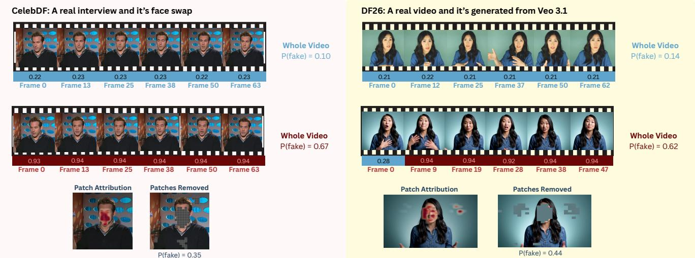  
(a) Facial manipulation on Celeb-DF. Authentic and face-swapped frames,(b) Generated video on DF26. Authentic and Veo 3.1 frames, clip-averaged clip-averaged patch attribution, and the prediction after removing the 64patch attribution, and the prediction after removing the 64 highest-ranked highest-ranked patches per frame. patches per frame.  
Figure S4. Spatial evidence on facial manipulation and generated video.

For Celeb-DF and DF26 (Figs. S4a and S4b), removing the 64 highest-ranked patches per frame lowers the fake probability from 0.67 to 0.35 and from 0.62 to 0.44, respectively, compared with 0.65 and 0.62 after random removal. These examples show that the highlighted regions contribute to the prediction.

In the partially manipulated FF++ video (Fig. S5a), the 32 highest-ranked frames in the illustrated clip match the inserted Face2Face segment. Removing them lowers the video-level fake probability from 0.43 to 0.07, compared with 0.42 for random removal. This indicates that the frame ranking identifies the manipulated interval and that this interval contributes to the fake score.

The authentic makeup tutorial (Fig. S5b) shows that MARS can mistake genuine facial appearance for manipulation. Removing the 64 highest-ranked patches per frame lowers the false-positive score from 0.56 to 0.37, while random removal leaves it at 0.56 on average over five draws. This suggests that the highlighted facial regions contribute to the error, showing how the evidence can help inspect an incorrect prediction even when the detector fails to distinguish authentic appearance from forgery traces.

## G. Detailed Experimental Results

## G.1. Average Precision

Tab. S11 reports AP, which measures how many of the videos ranked as fake are actually fake. AP follows the same pattern as AUROC: MARS achieves the highest average in both training settings (95.57 and 95.15), followed by DFD-HR (92.30 and 93.90), while the remaining methods trail by at least 5.9 points. The largest gap appears on GenVideo, where MARS reaches 92.99 AP against at most 79.10 for the baselines. In contrast, DF26 compresses the differences between methods: since 90% of its videos are fake, a random detector already reaches an AP of about 90, and even DeMamba, near chance in AUROC, scores above 90. Overall, AP confirms the AUROC ranking, but on imbalanced sets such as DF26 it largely reflects the share of fake videos, which makes AUROC and EER the more informative metrics there.

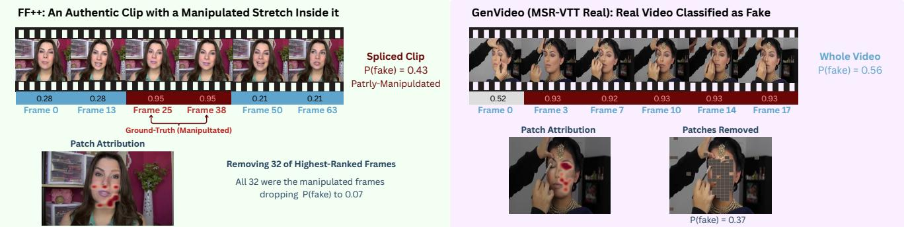  
(a) Temporal localization on FF++. Frames 16–47 of the illustrated clip(b) False positive on an authentic GenVideo video. Clip-averaged attribucontain a Face2Face manipulation and match the 32 highest-ranked frames.tion highlights facial regions whose removal lowers the fake probability from The reported overall probability is the video-level score; frame indices start at0.56 to 0.37. zero.  
Figure S5. Temporal localization and a detection failure.

Table S11. Cross-dataset average precision. Video-level AP (%) under both training settings of the main cross-dataset comparison. Checkmarks indicate training corpora; Avg. gives equal weight to the seven datasets. Best results are bold and second-best results are underlined within each training setting, including ties. AP depends on class balance, so comparisons should be made between methods on the same dataset.
<table><tr><td colspan="2">Train</td><td></td><td>Source test</td><td colspan="4">Facial manipulation</td><td colspan="2">Generated video</td><td rowspan="2">Avg.</td></tr><tr><td>FF++</td><td>GTA-V</td><td>Method</td><td>FF++</td><td>CelebDF</td><td>DF-TIMIT</td><td>UADFV</td><td>HiFiFace</td><td>GenVideo</td><td>DF26</td></tr><tr><td></td><td></td><td>Frame-level</td><td></td><td></td><td></td><td></td><td></td><td></td><td></td><td></td></tr><tr><td></td><td>x</td><td>ForAda [7]</td><td>96.46</td><td>92.37</td><td>98.48</td><td>96.70</td><td>73.77</td><td>52.99</td><td>87.63</td><td>85.48</td></tr><tr><td></td><td>x</td><td>Effort [36]</td><td>91.87</td><td>73.95</td><td>90.90</td><td>94.50</td><td>59.48</td><td>52.61</td><td>86.40</td><td>78.53</td></tr><tr><td>ハン√</td><td>x</td><td>GenD [38]</td><td>89.47</td><td>77.67</td><td>99.44</td><td>49.48</td><td>44.90</td><td>67.39</td><td>92.33</td><td>74.38</td></tr><tr><td></td><td>x</td><td>DFD-HR [31]</td><td>99.95</td><td>97.20</td><td>99.98</td><td>97.98</td><td>88.77</td><td>67.27</td><td>94.96</td><td>92.30</td></tr><tr><td></td><td></td><td>Clip-level</td><td></td><td></td><td></td><td></td><td></td><td></td><td></td><td></td></tr><tr><td></td><td>××</td><td>UNITE [14]</td><td>97.38</td><td>88.56</td><td>95.35</td><td>97.65</td><td>73.39</td><td>64.07</td><td>88.30</td><td>86.38</td></tr><tr><td>vvv</td><td></td><td>DeMamba [4]</td><td>80.71</td><td>62.24</td><td>66.17</td><td>51.51</td><td>50.81</td><td>50.11</td><td>90.40</td><td>64.56</td></tr><tr><td></td><td>x</td><td>ReStraV [12]]</td><td>81.51</td><td>65.07</td><td>46.25</td><td>51.72</td><td>53.74</td><td>27.84</td><td>92.87</td><td>59.86</td></tr><tr><td>√</td><td>x</td><td>MARS (Ours)</td><td>99.80</td><td>94.62</td><td>99.93</td><td>98.29</td><td>87.77</td><td>92.99</td><td>95.58</td><td>95.57</td></tr><tr><td></td><td></td><td>Frame-level</td><td></td><td></td><td></td><td></td><td></td><td></td><td></td><td></td></tr><tr><td></td><td></td><td>ForAda [7]</td><td>96.38</td><td>91.37</td><td>98.34</td><td>97.06</td><td>73.64</td><td>58.97</td><td>87.74</td><td>86.21</td></tr><tr><td></td><td></td><td>Effort [36]</td><td>91.69</td><td>73.42</td><td>90.92</td><td>93.61</td><td>59.29</td><td>55.70</td><td>86.78</td><td>78.77</td></tr><tr><td>ハン√</td><td>vv√</td><td>GenD [38]</td><td>90.12</td><td>77.89</td><td>99.34</td><td>48.17</td><td>51.61</td><td>67.63</td><td>92.65</td><td>75.34</td></tr><tr><td></td><td></td><td>DFD-ÀR [31]</td><td>99.95</td><td>96.70</td><td>99.82</td><td>96.96</td><td>88.91</td><td>79.10</td><td>95.83</td><td>93.90</td></tr><tr><td></td><td></td><td>Clip-level</td><td></td><td></td><td></td><td></td><td></td><td></td><td></td><td></td></tr><tr><td></td><td>vv√</td><td>UNITE [14]</td><td>95.85</td><td>84.39</td><td>93.07</td><td>98.74</td><td>68.78</td><td>66.85</td><td>88.65</td><td>85.19</td></tr><tr><td>vvv</td><td></td><td>DeMamba [4]</td><td>80.47</td><td>63.48</td><td>66.73</td><td>51.64</td><td>51.03</td><td>50.39</td><td>91.25</td><td>65.00</td></tr><tr><td></td><td></td><td>ReStraV [12]</td><td>81.48</td><td>66.77</td><td>46.18</td><td>51.89</td><td>53.47</td><td>28.25</td><td>93.04</td><td>60.16</td></tr><tr><td></td><td></td><td>MARS (Ours)</td><td>99.74</td><td>94.73</td><td>99.97</td><td>97.29</td><td>85.95</td><td>92.60</td><td>95.76</td><td>95.15</td></tr></table>

## G.2. Generator-Level EER

As shown in Tab. S12, MARS achieves the lowest EER on all ten GenVideo generators and on six of the ten DF26 groups, while DFD-HR remains stronger on Wan2.2 I2V and both LTX2.3 modes, and GenD on Grok Imagine. DF26 is harder than GenVideo for all methods, with the lowest EER above 20 on eight of its ten groups, compared with two of ten on GenVideo. Interestingly, the hardest generators differ between detectors: MARS has a higher mean EER on the open-source DF26 groups than on the commercial ones (30.94 vs. 26.78), whereas DFD-HR shows the op posite trend (28.35 vs. 34.69), suggesting that the two methods rely on partly different cues. Overall, we observe that the advantage of MARS holds across the GenVideo generators but not across the more recent DF26 generators, where no single detector is best on every group.

## G.3. Component Ablation by Dataset

The per-dataset results reveal where each component contributes (Tab. S13). The semantic path alone performs similarly to full MARS on GenVideo and better on DF26, but lowers UADFV AUROC from 96.58% to 83.80%. Removing spatial DoG reduces HiFiFace AUROC from 84.05% to 58.80% and GenVideo from 93.44% to 71.39%; removing temporal DoG also lowers GenVideo to 71.75%. Freezing the semantic LayerNorms has its largest effect on GenVideo, reducing AUROC to 40.30%. These differences show that component benefits vary across datasets, while full MARS achieves the highest seven-dataset average among the evaluated variants.

Table S12. Per-generator detection on GenVideo and DF26. Video-level EER (%, lower is better) for methods trained on FF++ + GTA-V under the shared full-frame protocol with a fixed seed and three epochs. Each generator is evaluated against all authentic videos from the same dataset. Best results are bold and second-best results are underlined in each column.
<table><tr><td></td><td colspan="8">GenVideo</td><td></td><td colspan="8">DF26</td></tr><tr><td></td><td></td><td></td><td></td><td></td><td></td><td></td><td></td><td></td><td></td><td></td><td colspan="2">Commercial</td><td></td><td></td><td colspan="4">Open-source</td></tr><tr><td>Method</td><td></td><td>Morph</td><td>Runway</td><td></td><td></td><td>Moon</td><td></td><td>Model</td><td>Wild</td><td>Grok</td><td>Kling</td><td>Veo Wan</td><td>HV1.5</td><td>HV1.5</td><td>Wan2.2</td><td>Wan2.2</td><td>LTX2.3</td><td>LTX2.3</td></tr><tr><td></td><td>Sora</td><td>Studio</td><td>Gen2</td><td>HotShot Lavie Show-1</td><td></td><td>Valley</td><td>Crafter</td><td>Scope</td><td>Scrape</td><td>Imagine</td><td>3.0</td><td>3.1 2.6</td><td>I2V</td><td>T2V</td><td>I2V</td><td>T2V</td><td>I2V</td><td>T2V</td></tr><tr><td>Frame-level</td><td></td><td></td><td></td><td></td><td></td><td></td><td></td><td></td><td></td><td></td><td></td><td></td><td></td><td></td><td></td><td></td><td></td><td></td></tr><tr><td>ForAda</td><td>40.84</td><td>32.38</td><td>53.20</td><td>32.39 39.20</td><td>38.01</td><td>43.58</td><td>36.71</td><td>27.11</td><td>33.40</td><td>70.67</td><td>62.43 76.26</td><td>63.09</td><td>54.43</td><td>43.17</td><td>41.33</td><td>53.51</td><td>47.42</td><td>61.99</td></tr><tr><td>Effort</td><td>51.78</td><td>39.99</td><td>51.52</td><td>43.28 46.21</td><td>42.15</td><td>51.67</td><td>47.78</td><td>35.46</td><td>36.75</td><td>66.38</td><td>52.90</td><td>70.92 64.89</td><td>53.14</td><td>56.09</td><td>51.48</td><td>57.20</td><td>51.11</td><td>65.68</td></tr><tr><td>GenD</td><td>39.26</td><td>42.57</td><td>30.83</td><td>55.75 44.22</td><td>51.88</td><td>32.90</td><td>28.61</td><td>41.15</td><td>40.58</td><td>27.91</td><td>30.72</td><td>49.04 42.10</td><td>50.55</td><td>41.70</td><td>47.60</td><td>50.74</td><td>44.46</td><td>43.54</td></tr><tr><td>DFD-HR</td><td>33.55</td><td>25.70</td><td>22.70</td><td>45.43 32.07</td><td>31.54</td><td>37.39</td><td>14.03</td><td>20.26</td><td>27.18</td><td>43.75</td><td>26.48 40.11</td><td>28.42</td><td>39.85</td><td>20.30</td><td>26.38</td><td>37.08</td><td>16.97</td><td>29.52</td></tr><tr><td>Clip-level</td><td></td><td></td><td></td><td></td><td></td><td></td><td></td><td></td><td></td><td></td><td></td><td></td><td></td><td></td><td></td><td></td><td></td><td></td></tr><tr><td>UNITE</td><td>39.30</td><td>33.76</td><td>45.61</td><td>34.15 33.69</td><td>30.29</td><td>23.99</td><td>35.19</td><td>36.70</td><td>31.74</td><td>52.95</td><td>53.34</td><td>63.92 59.40</td><td>57.20</td><td>43.54</td><td>50.00</td><td>60.70</td><td>55.54</td><td>60.52</td></tr><tr><td>DeMamba</td><td>48.25</td><td>57.65</td><td>57.20</td><td>42.86 48.82</td><td>44.86</td><td>57.82</td><td>52.33</td><td>47.07</td><td>47.15</td><td>45.74</td><td>44.15</td><td>47.87 48.49</td><td>47.79</td><td>66.05</td><td>49.08</td><td>42.80</td><td>47.97</td><td>32.66</td></tr><tr><td>ReStraV</td><td>92.97</td><td>71.34</td><td>97.58</td><td>90.78 79.96</td><td>81.94</td><td>97.46</td><td>80.42</td><td>79.16</td><td>79.05</td><td>38.60</td><td>40.43</td><td>49.29 43.16</td><td>49.82</td><td>49.82</td><td>38.01</td><td>37.64</td><td>47.23</td><td>37.64</td></tr><tr><td>MARS (Ours) 26.40</td><td></td><td>13.43</td><td>10.79</td><td>21.44 12.91</td><td>19.71</td><td>8.16</td><td>5.13</td><td>10.02</td><td>13.10</td><td>32.75</td><td>24.55 27.15</td><td>22.68</td><td>30.07</td><td>19.56</td><td>33.39</td><td>32.84</td><td>33.03</td><td>36.72</td></tr></table>

Table S13. Component ablation across datasets. Video-level AUROC and EER (%) under matched training with a fixed seed and three epochs. Avg. gives equal weight to the seven datasets. Params denotes trainable parameters in millions. Best results are bold and second best results are underlined in each column.
<table><tr><td></td><td rowspan="2"></td><td colspan="2">Source test</td><td colspan="8">Facial manipulation</td><td colspan="4">Generated video</td><td colspan="2">Avg.</td></tr><tr><td></td><td></td><td>FF++</td><td></td><td>CelebDF</td><td></td><td>DF-TIMIT</td><td></td><td>UADFV</td><td></td><td>HiFiFace</td><td>GenVideo</td><td></td><td></td><td>DF26</td><td></td><td></td></tr><tr><td>Variant</td><td>Params 67.54</td><td>AUROC↑</td><td>EER↓ 4.46</td><td>AUROC↑</td><td>EER↓</td><td>AUROC↑</td><td>EER↓</td><td>AUROC↑</td><td>EER↓</td><td>AUROC↑</td><td>EER↓</td><td>AUROC↑</td><td>EER↓</td><td>AUROC↑</td><td>EER↓</td><td>AUROC↑</td><td>EER↓</td></tr><tr><td>Full MARS</td><td></td><td>98.98</td><td></td><td>91.22</td><td>14.80</td><td>99.95</td><td>0.94</td><td>96.58</td><td>8.16</td><td>84.05</td><td>22.50</td><td>93.44</td><td>12.20</td><td>75.81</td><td>29.78</td><td>91.43</td><td>13.26</td></tr><tr><td>Paths</td><td></td><td></td><td></td><td></td><td></td><td></td><td></td><td></td><td></td><td></td><td></td><td></td><td></td><td></td><td></td><td></td><td></td></tr><tr><td>Residual path only</td><td>67.43</td><td>98.07</td><td>7.05</td><td>82.42</td><td>25.29</td><td>99.26</td><td>4.22</td><td>97.79</td><td>6.12</td><td>77.04</td><td>27.86</td><td>74.76</td><td>31.45</td><td>64.23</td><td>40.13 26.59</td><td>84.80</td><td>20.30 14.53</td></tr><tr><td>Semantic path only</td><td>0.11</td><td>97.83</td><td>7.32</td><td>89.16</td><td>18.67</td><td>99.27</td><td>2.66</td><td>83.80</td><td>12.24</td><td>87.34</td><td>20.00</td><td>93.59</td><td>14.25</td><td>80.68</td><td></td><td>90.24</td><td></td></tr><tr><td>Residual streams</td><td></td><td></td><td></td><td></td><td></td><td></td><td></td><td></td><td></td><td></td><td></td><td></td><td></td><td></td><td></td><td></td><td></td></tr><tr><td>w/o appearance</td><td>66.36</td><td>99.09</td><td>4.82</td><td>90.51</td><td>17.38</td><td>99.67</td><td>1.95</td><td>98.21</td><td>8.16</td><td>86.38</td><td>19.29</td><td>93.63</td><td>11.81</td><td>71.49</td><td>33.59</td><td>91.28</td><td>13.86</td></tr><tr><td>w/o spatial streams</td><td>66.65 66.65</td><td>99.56</td><td>2.68 5.54</td><td>90.11 87.10</td><td>17.68 19.68</td><td>99.98 99.91</td><td>1.02</td><td>93.29 97.00</td><td>14.29 7.14</td><td>58.80 71.08</td><td>43.57</td><td>71.39 71.75</td><td>35.29</td><td>74.61</td><td>31.76 30.91</td><td>83.96</td><td>20.90 18.95</td></tr><tr><td>w/o temporal streams w/o first difference</td><td>67.24</td><td>98.62 99.07</td><td>3.39</td><td>91.89</td><td>15.08</td><td>99.90</td><td>1.33 1.80</td><td>97.38</td><td>10.20</td><td>82.28</td><td>33.57 23.57</td><td>90.03</td><td>34.50 15.99</td><td>77.03 73.12</td><td>32.06</td><td>86.07 90.52</td><td>14.59</td></tr><tr><td></td><td></td><td></td><td></td><td></td><td></td><td></td><td></td><td></td><td></td><td></td><td></td><td></td><td></td><td></td><td></td><td></td><td></td></tr><tr><td>Semantic norms</td><td></td><td></td><td></td><td></td><td></td><td>99.99</td><td></td><td></td><td></td><td></td><td>31.07</td><td></td><td></td><td></td><td>39.37</td><td>80.39</td><td></td></tr><tr><td>Frozen norms (encoder fully frozen)</td><td>67.44</td><td>98.53</td><td>6.16</td><td>87.49</td><td>18.83</td><td></td><td>0.23</td><td>99.08</td><td>6.12</td><td>72.90</td><td></td><td>40.30</td><td>58.67</td><td>64.44</td><td></td><td></td><td>22.92</td></tr></table>

## G.4. Training Duration and Clip Length by Dataset

Tab. S14 provides the per-dataset MARS results for training duration and clip length. Shorter clips produce more training batches per epoch and more clip predictions per video, so the clip-length comparison changes both the temporal window and the number of optimizer steps.

## G.5. Robustness by Dataset

Perturbation Settings. We apply each degradation to decoded frames at their native resolution, before encoderspecific resizing and normalization. All methods use their main-table checkpoints (a fixed seed), without additional training. JPEG compression uses Pillow quality levels of 80, 60, 40, 20, and 10. Following GenD [38], Gaussian blur uses standard deviations of 0.5, 1, 1.5, 2, and 3 pixels, with respective kernel sizes of 5, 7, 11, 13, and 19 and reflective padding.

Downscaling reduces the short side to 224, 112, or 64 pixels using bilinear interpolation with antialiasing, preserving the aspect ratio. Gaussian noise uses standard deviations of 0.01, 0.03, 0.05, 0.1, and 0.2 on pixel values in [0, 1], followed by clipping and 8-bit quantization. Noise is seeded by video identifier and clip index so that every method receives the same perturbation.

Per-Dataset Results. Tab. S15 reports metrics averaged over the 18 perturbation settings, while Figs. S6 to S9 show AUROC at each strength for each dataset.

## G.6. Faithfulness by Dataset

Patch Removal For each dataset, we select up to 100 manipulated clips that MARS predicts as fake and up to 100 authentic clips. We use the first clip of each selected video and require more than 16 valid frames. Selecting detected manipulated clips explains why the initial AUROC is close to 100%.

We replace the highest-ranked k ∈ {8, 16, 32, 64} patches with each frame’s mean color. Each patch covers 14 × 14 pixels, and the same positions are replaced in every frame. The random control replaces the same number of patches on the same clips using a fixed random seed. We rerun the detector after each edit and compute AUROC using

Table S14. Training duration and clip length for MARS. Video-level AUROC / EER (%) with a fixed seed. The default uses three epochs, 64-frame clips, and 16 semantic frames. Steps counts optimizer updates over the full run; Avg. gives equal weight to seven datasets.
<table><tr><td>Setting</td><td>Steps</td><td>FF++</td><td>CelebDF</td><td>DF-TIMIT</td><td>UADFV</td><td>HiFiFace</td><td>GenVideo</td><td>DF26</td><td>Avg.</td></tr><tr><td>MARS (Ours): default</td><td>1,449</td><td>98.98 / 4.46</td><td>91.22/ 14.80</td><td>99.95 / 0.94</td><td>96.58 / 8.16</td><td>84.05 / 22.50</td><td>93.44 / 12.20</td><td>75.81 / 29.78</td><td>91.43 /13.26</td></tr><tr><td colspan="10">Training duration (64-frame clips)</td></tr><tr><td>5 epochs</td><td>2,415</td><td>99.62 / 2.86</td><td>92.29 / 14.08</td><td>99.90 / 1.33</td><td>96.58 / 8.16</td><td>86.88 / 18.57</td><td>92.26 / 13.08</td><td>74.38 / 31.32</td><td>91.70 / 12.77</td></tr><tr><td>10 epochs</td><td>4,830</td><td>99.38 / 4.29</td><td>90.81 / 15.81</td><td>99.91 / 1.41</td><td>96.00 / 8.16</td><td>84.71 / 21.79</td><td>95.31 / 9.71</td><td>74.75 / 31.10</td><td>91.55 / 13.18</td></tr><tr><td colspan="10">Clip length (three epochs)</td></tr><tr><td>8 frames</td><td>10,410</td><td>99.40 / 3.57</td><td>92.55 / 14.51</td><td>99.91 / 1.56</td><td>95.84 / 10.20</td><td>86.30 / 21.43</td><td>94.44 / 11.80</td><td>79.11 /27.25</td><td>92.50 / 12.90</td></tr><tr><td>16 frames</td><td>5,292</td><td>99.32 / 4.29</td><td>92.73 / 13.51</td><td>99.96 / 0.94</td><td>95.63 / 11.22</td><td>86.71 / 21.43</td><td>91.22 / 16.92</td><td>78.26 / 28.15</td><td>91.98 / 13.78</td></tr><tr><td>32 frames</td><td>2,727</td><td>99.36 / 4.29</td><td>93.19 / 13.51</td><td>99.88 / 0.94</td><td>97.33 / 13.27</td><td>85.90 / 21.07</td><td>91.66 / 16.26</td><td>76.50 / 30.21</td><td>91.97 / 14.22</td></tr></table>

Table S15. Robustness across datasets. Video-level AUROC, EER, and AP (%), averaged over the 18 JPEG, blur, downscaling, and noise settings in Fig. 4. Mean gives equal weight to the seven datasets. Best results are bold and second-best results are underlined within each metric, including ties.
<table><tr><td rowspan="2">Method</td><td colspan="2">FF++</td><td colspan="2">CelebDF DF-TIMIT</td><td colspan="2">UADFV</td><td colspan="2">HiFiFace GenVideo</td><td colspan="2">DF26</td><td colspan="2">Mean</td></tr><tr><td>|AUC↑ EER↓</td><td>AP↑ |AUC↑</td><td>EER↓ AP↑</td><td>|AUC↑ EER↓</td><td>AP↑ |AUC↑ EER↓</td><td>AP↑</td><td>|AUC↑ EER↓</td><td>AP↑ |AUC↑ EER↓</td><td>AP↑ AUC↑ EER↓</td><td>AP↑ |AUC↑</td><td>EER↓ AP↑</td></tr><tr><td colspan="9">Frame-level</td><td colspan="3"></td></tr><tr><td>ForAda</td><td>82.35 25.94</td><td>95.06| 78.28</td><td>28.08 86.64</td><td>89.64 17.68 94.29</td><td>92.03</td><td>13.04 93.65</td><td>70.30 35.95</td><td>69.61 64.31</td><td>39.19 60.03 38.45</td><td>57.20 87.09</td><td>73.62 31.01 83.77</td></tr><tr><td>Effort</td><td>69.75 36.25</td><td>90.84 56.77</td><td>44.57 71.78</td><td>73.33 32.93</td><td>84.87 83.93</td><td>23.13 84.54</td><td>58.00 44.58 58.75</td><td>58.30 43.94</td><td>58.01 37.29 58.65</td><td>86.49 62.48</td><td>40.58 76.47</td></tr><tr><td>GenD</td><td>61.77 41.26</td><td>85.96 59.18</td><td>43.62 72.71</td><td>74.13 31.45</td><td>84.56 63.54</td><td>40.08 62.06</td><td>49.90 48.77 51.48</td><td>68.54 36.31</td><td>70.26 46.96 52.64</td><td>89.10 60.57</td><td>42.02 73.74</td></tr><tr><td>DFD-HR</td><td>90.60 16.18 97.37</td><td>80.57</td><td>27.06 88.27</td><td>87.82 18.30</td><td>93.13 86.58</td><td>17.63 86.00</td><td>64.60 38.77</td><td>66.44 62.36 41.04</td><td>64.47 48.74</td><td>50.61 89.68 74.47</td><td>29.94 83.62</td></tr><tr><td colspan="9"></td><td></td><td></td><td></td></tr><tr><td>Clip-level UNITE</td><td>80.71</td><td>27.05 94.65| 65.24</td><td>38.82 78.62|</td><td>79.07</td><td>28.3088.43| 90.21</td><td>16.95 90.50</td><td>|64.37</td><td>39.76 65.57| 66.80</td><td>34.78 65.42</td><td>42.56 56.01 88.46|</td><td></td></tr><tr><td>DeMamba</td><td>51.45 49.28</td><td>80.53 47.87</td><td>51.72 63.49</td><td>49.40 50.8466.69</td><td>50.81</td><td>50.45 51.44</td><td>50.50 49.78 50.87</td><td>49.64 50.44</td><td>50.18 52.63</td><td>69.85 46.26 91.22</td><td>34.52 81.67 49.82</td></tr><tr><td>ReStraV</td><td>52.75 48.54 81.59</td><td>51.94</td><td>48.25 67.54</td><td>19.10 74.91 51.85</td><td>52.06</td><td>48.19 52.99</td><td>51.93 49.31 52.20</td><td>9.39 83.36 28.21</td><td>55.02</td><td>50.33 46.50 91.74 41.74</td><td>64.92 57.01 60.87</td></tr><tr><td>MARS (Ours)</td><td>87.31 20.28</td><td>96.27 75.66</td><td>30.21 84.23</td><td>85.33 20.69 92.01</td><td>87.70</td><td>18.31 87.35</td><td>68.94 35.02 69.88|</td><td></td><td>63.12</td><td></td><td></td></tr><tr><td></td><td></td><td></td><td></td><td></td><td></td><td></td><td></td><td>71.15</td><td>33.38 70.28|</td><td>40.53 93.06|</td><td>77.03 28.35 84.72</td></tr></table>

one clip per selected video.

As shown in Fig. S10, ranked removal reduces detection performance more than random removal, particularly on FF++, CelebDF, and UADFV. The effect is smaller on GenVideo, which may reflect evidence spread across more of the scene. This test measures the relevance of selected patches to the prediction, not whether they match the actual manipulated regions.

Frame Removal We use clips with a manipulated segment in the middle, giving 560 clips for each segment length. For a segment of length L, we remove L/4, L/2, or L frames using three choices: the highest frame scores, random frames, or known manipulated frames (oracle). The remaining frames keep their original order and are packed together with an updated validity mask before MARS is run again. For the 16-frame segments, removing the 16 highest-scoring frames lowers the mean fake probability from 24.45% to 19.42%, compared with 24.89% for random removal and 14.53% for oracle removal (Fig. S11). Removing frames also changes the temporal spacing between the remaining frames and the frames sampled by the semantic path, where random removal of the same number of frames introduces the same changes, so the larger drop under ranked removal cannot be attributed to them. Ranked removal moves the prediction closer to the authentic reference, but the gap to oracle removal shows that the ranking does not identify every manipulated frame.

## G.7. Compute and Environmental Footprint

We track the GPU-hours, energy, carbon emissions, and water use of each run with the ai-impact-accounting package [26, 33]. Tab. S16 reports these quantities for the main runs, separately for training and for testing on the seven evaluation datasets.

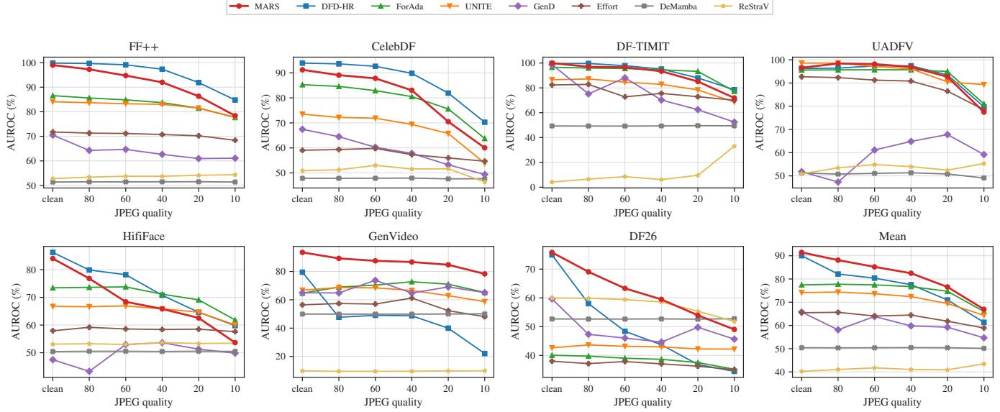  
Figure S6. Robustness to JPEG compression at quality 80, 60, 40, 20 and 10: video AUROC (%) of the main-table checkpoints on each evaluation dataset and their mean. The leftmost point is the unperturbed test set.

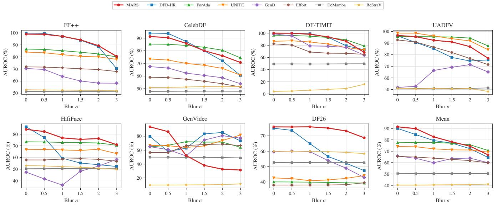  
Figure S7. Robustness to Gaussian blur with standard deviation 0.5, 1, 1.5, 2 and 3 pixels: video AUROC (%) of the main-table checkpoints on each evaluation dataset and their mean. The leftmost point is the unperturbed test set.

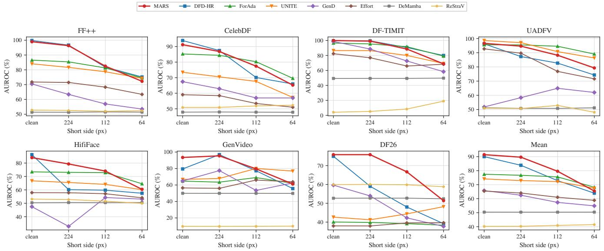  
Figure S8. Robustness to downscaling of the short side to 224, 112 and 64 pixels: video AUROC (%) of the main-table checkpoints on each evaluation dataset and their mean. The leftmost point is the unperturbed test set.

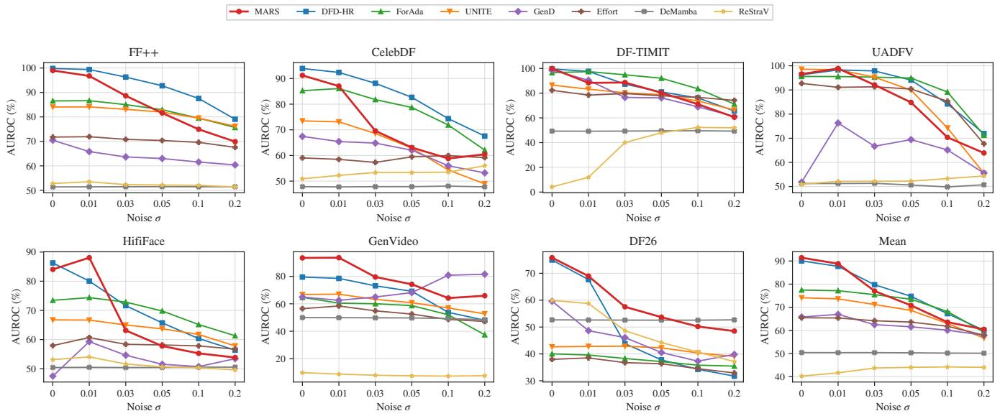  
Figure S9. Robustness to additive Gaussian noise with standard deviation 0.01, 0.03, 0.05, 0.1 and 0.2 on pixel values in [0, 1]: video AUROC (%) of the main-table checkpoints on each evaluation dataset and their mean. The leftmost point is the unperturbed test set.

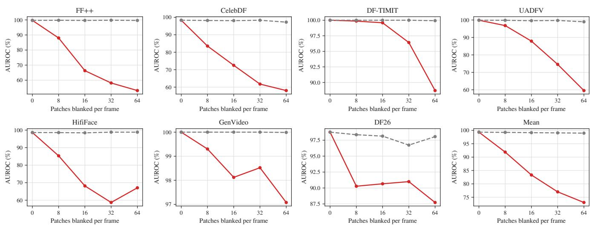  
Figure S10. Patch removal by dataset. AUROC (%) after replacing the highest-ranked or random patches with each frame’s mean color. The same positions are replaced across frames, using one clip per selected video.

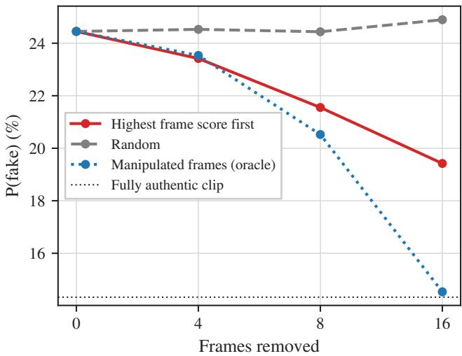  
Figure S11. Frame removal on spliced FF++ clips. Mean fake probability (%) after removing the highest-scoring, random, or known manipulated frames from 560 clips with a 16-frame manipulated segment. The dotted line marks the fully authentic reference.

Table S16. Compute and environmental footprint. Main runs use FF++ + GTA-V, a fixed seed, and three epochs on four NVIDIA A40 GPUs, tracked with the ai-impact-accounting package. Energy use is measured; carbon emissions are estimated from energy use and carbon intensity. Water use is estimated using the default water-use-effectiveness range and reported as low–high. Testing totals cover the seven evaluation datasets.
<table><tr><td></td><td colspan="4">Training</td><td colspan="3">Testing</td></tr><tr><td>Method</td><td>GPU-h kWh</td><td></td><td> $_ \mathrm { k g C O _ { 2 } e }$ </td><td>Water (L)</td><td>GPU-h kWh</td><td></td><td> $_ \mathrm { k g C O _ { 2 } e }$ </td></tr><tr><td>Frame-level</td><td></td><td></td><td></td><td></td><td></td><td></td><td></td></tr><tr><td>ForAda</td><td>27.4</td><td>8.13</td><td>0.526</td><td>14.6–32.5</td><td>4.2</td><td>1.22</td><td>0.079</td></tr><tr><td>Effort</td><td>14.2</td><td>3.96</td><td>0.256</td><td>7.1-15.8</td><td>3.3</td><td>0.73</td><td>0.047</td></tr><tr><td>GenD</td><td>25.5</td><td>7.48</td><td>0.484</td><td>13.5–29.9</td><td>4.3</td><td>1.15</td><td>0.075</td></tr><tr><td>DFD-HR</td><td>86.1</td><td>24.80</td><td>1.605</td><td>44.6–99.2</td><td>9.3</td><td>2.75</td><td>0.178</td></tr><tr><td>Clip-level</td><td></td><td></td><td></td><td></td><td></td><td></td><td></td></tr><tr><td>UNITE</td><td>17.8</td><td>5.71</td><td>0.370</td><td>10.3–22.8</td><td>7.2</td><td>2.22</td><td>0.144</td></tr><tr><td>DeMamba</td><td>38.6</td><td>9.74</td><td>0.630</td><td>17.5–39.0</td><td>3.3</td><td>0.74</td><td>0.048</td></tr><tr><td>ReStraV</td><td>13.6</td><td>2.57</td><td>0.166</td><td>4.6-10.3</td><td>3.1</td><td>0.60</td><td>0.039</td></tr><tr><td>MARS (Ours)</td><td>17.4</td><td>5.46</td><td>0.353</td><td>9.8–21.8</td><td>5.5</td><td>1.61</td><td>0.104</td></tr></table>