Token layout

# MPEG-Diffusion: Mixed-Resolution Video Generation

Dennis Menn1,2 Tianpei Gu2 Guande He2 Aryan V S2 Yanke Song2 Nan Liu2 Desai Xie2 Xun Huang2 Chenfeng Xu1 Diana Marculescu1

1UT Austin 2Roblox

LR background

HR region

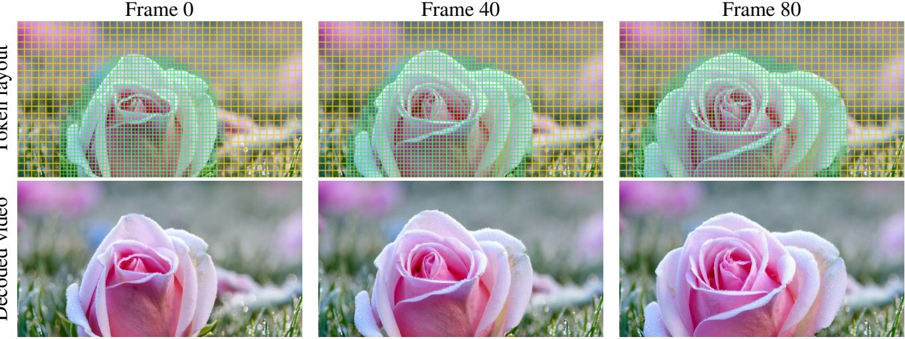

Decoded video

Figure 1. MPEG-Diffusion generates the important region at high resolution and the rest at low resolution: on average 4.8× faster (30% token use) at near full-resolution quality, with a DiT self-selected high-res region. Prompt: a close-up of a rose with morning droplets.

## Abstract

Video diffusion transformers (DiTs) generate realistic videos, but their heavy computational cost limits broader real-world applications. Mixed-resolution generation reduces this cost by generating the visually important region at high resolution (HR) and the rest at low resolution (LR), yet existing methods suffer a severe quality drop on videos and require knowing the HR region in advance. We show that these failures are not inherent to mixed resolution, and propose MPEG-Diffusion to address their three root causes: (1) dual-resolution attention to mitigate the curse of mixed resolution, where each query reads the K/V of its own resolution, (2) a mixed-resolution decoder to blend the HR and LR latents before decoding and resolve distortion, and (3) a self-selected HR region using the DiT’s knowledge to find the visually important region without requiring it in advance. Processing only 30% of full-resolution tokens, MPEG-Diffusion speeds up denoising by 4.8× on Wan2.1 14B (3.8× on 1.3B), outperforming prior methods

on nearly every metric. In the user study, we demonstrate the high quality of MPEG-Diffusion, with raters preferring it over prior mixed-resolution methods in over 90% ofpairs and rating it close tofull resolution.

## 1. Introduction

Video diffusion transformers (DiTs) [31] generate videos of striking quality, but attention scales quadratically with the number of tokens as resolution and duration grow, limiting their broader real-world applicability. Yet this compute is spent uniformly: every region of every frame is generated at the same resolution, whether it shows a detailed face or a plain blue sky.

Video coding solved the same problem for transmission decades ago. Codecs such as MPEG and H.264/AVC [32] spend fewer bits on simple or predictable content and more on the regions that matter, which saves a large share of the bandwidth at little perceptual cost. We ask whether a video generator can do the same with compute. Mixed-resolution generation [4, 18, 36] offers a natural mechanism: the visually important region is generated at high resolution (HR) and the rest at low resolution (LR), where one LR token replaces multiple HR tokens (Fig. 1). This cuts the cost of every denoising step in proportion to the LR area.

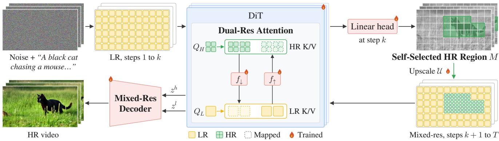  
Figure 2. Overview of MPEG-Diffusion. The first k of T steps run at LR. At step k, a linear head selects the HR region M (part 2), and the remaining steps denoise M at HR and the rest at LR. In dual-resolution attention (part 1), each query reads the K/V of its own resolution, with missing entries (dashed) filled from the other resolution by linear maps. The mixed-resolution decoder (part 3) merges the HR and LR latents into one HR video. Flames mark trained parts.

In practice, however, mixed resolution is rarely used for video generation, for two reasons. First, prior mixedresolution methods suffer a sharp drop in quality, with blurry details and visible distortion along the resolution boundary. Second, unlike a codec that compresses an existing video, a generator must know the HR region in advance, when the intermediate frames are still too blurry for an off-the-shelf detector.

We argue that these failures are not inherent to mixedresolution generation: we identify three root causes in existing approaches [4, 18, 36] (Sec. 3) and propose MPEG-Diffusion (Fig. 2) to address each cause:

1. Curse of mixed resolution → Dual-resolution attention. When HR and LR tokens share one set of keys and values (K/V), we prove that no single LR token can match the attention of the n HR tokens it replaces (Proposition 1), even with fine-tuning. Instead, we propose dual-resolution attention, where a linear map fills in the missing K/V from the other resolution (Sec. 3.1), so each query reads the K/V of its own resolution, avoiding the quality drop caused by cross-resolution attention.

2. Resolution mismatch → Mixed-resolution decoder. In the VAE decoder, each patch depends strongly on its neighboring patches, so decoding the LR and HR latents separately causes severe distortion at the resolution boundary, even on real videos (Sec. 3.2); hence we propose a mixed-resolution decoder to blend them in latent space before decoding.

3. External condition reliance → Self-selected HR region. Existing methods require knowing the HR region in advance [4, 18]. Instead, leveraging the DiT’s knowledge of the visually important subject across frames (Fig. 4), we use a linear layer on the DiT features to predict the HR mask during denoising at negligible cost, enabling plain text-to-video generation.

Processing only 30% of full-resolution tokens, MPEG-Diffusion speeds up denoising by 3.8× on Wan2.1 1.3B and 4.8× on 14B at near full-resolution quality, outperforming prior methods on nearly every metric at the same token budget (Tab. 1). In a blind user study, raters prefer ours over Phase-Aligned RoPE and Foveated Diffusion (98.8% and 90.1% win rates), with a 45.2% win rate against fullresolution generation (Fig. 9).

## 2. Related work

Efficient diffusion. Along the token axis, token merging and pruning remove redundant tokens in the intermediate layers of the transformer [2, 3, 6, 13, 35], and sparse attention skips unimportant query–key pairs in video DiTs [37, 40]. Along the time axis, feature caching reuses intermediate features across denoising steps [14, 17], and distillation and consistency models reduce the number of steps [24, 25, 41]. However, all of these methods still generate every region at the same output resolution. We instead vary resolution across regions, orthogonal to these methods.

Mixed-resolution generation. LIPAR [18] reuses temporal tokens that are deemed redundant, whereas we focus on spatial redundancy. Phase-aligned RoPE [36] and foveated diffusion [4] generate different regions at different resolutions, the latter around a known gaze point. Concurrently, Level-of-Token Diffusion [19] varies the token size across regions, following a layout given in advance. While promising, on video generation their quality drops severely (Tab. 1) and they require the region in advance; we identify and address the three root causes (Sec. 3).

Localization from diffusion features. Diffusion features carry rich semantic and spatial information. They can match and track objects without supervision [16, 27, 42], support segmentation [30, 38, 44], and their cross-attention maps localize the words of the prompt [28]. In video DiTs, attention also matches points across frames [20]. Building on this, we read the visually important HR region directly off the DiT with a single linear head (Sec. 4.3).

## 3. Observations: why mixed resolution fails

We make three observations on why mixed resolution fails and how to fix it, each of which motivates one component of our method (Sec. 4).

## 3.1. Observation 1: the curse of mixed resolution

Whether an area is generated at HR or LR is a design choice: ideally, it should change only how much detail the area has, and approximately maintain its effects on other regions. However, we show that under softmax attention, one LR token cannot maintain the effects of multiple HR tokens when the two resolutions share one set of keys and values (a shared K/V). The mismatch comes from the number of tokens under softmax, not from the weights, so fine-tuning alone cannot fully resolve it.

Consider an arbitrary softmax attention head in a transformer layer. Assume that we plan to replace n high-resolution tokens with keys $k _ { 1 } , \ldots , k _ { n }$ and values $v _ { 1 } , \ldots , v _ { n }$ by a low-resolution token with key $k _ { c }$ and value $v _ { c }$ . Let $\ddot { k } _ { 1 } , \dots , \ddot { k } _ { m }$ and $\tilde { v } _ { 1 } , \ldots , \tilde { v } _ { m }$ be the keys and values of the other, unchanged regions. Consider an arbitrary token with query $q$ (absorbing the $1 / \sqrt { d }$ scale). Maintaining the effects of the high-resolution tokens with one low-resolution token thus translates to (we use an equality for simplicity, but the same conclusion also holds approximately):

$$
\frac { \sum _ { i } e ^ { q \cdot k _ { i } } v _ { i } + \sum _ { j } e ^ { q \cdot \tilde { k } _ { j } } \tilde { v } _ { j } } { \sum _ { i } e ^ { q \cdot k _ { i } } + \sum _ { j } e ^ { q \cdot \tilde { k } _ { j } } } = \frac { e ^ { q \cdot k _ { c } } v _ { c } + \sum _ { j } e ^ { q \cdot \tilde { k } _ { j } } \tilde { v } _ { j } } { e ^ { q \cdot k _ { c } } + \sum _ { j } e ^ { q \cdot \tilde { k } _ { j } } } .\tag{1}
$$

Since high-to-low replacement does not control other regions, Eq. (1) needs to hold for any combination of $q ,$ $\{ \tilde { k } _ { j } \} _ { j = 1 } ^ { m }$ and $\{ \tilde { v } _ { j } \} _ { j = 1 } ^ { m }$ . However, for $n \geq 2 .$ , even with a logit bias $\beta$ as in proportional attention [3], Eq. (1) holds only in the trivial case where all n HR tokens are identical (Proposition 1). Replacing HR tokens with fewer LR tokens in a shared K/V is therefore bound to affect other regions under softmax attention.

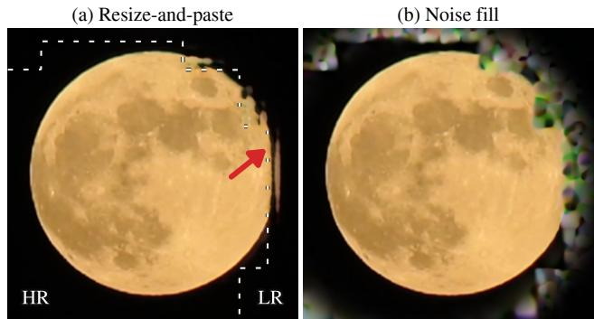  
Figure 3. The VAE decoder depends on neighboring latent patches. (a) Resize-and-paste causes a seam along the resolution boundary (dashed; red arrow), even for latents encoded from a real video. (b) Noise fill spreads the error further.

Proposition 1. Let $n \geq 2 , k _ { 1 } , \ldots , k _ { n } , k _ { c } \in \mathbb { R } ^ { d }$ and $\beta \in \mathbb { R }$ and add a bias β to the logit ofthe LR token in $E q . \ ( 1 )$ , that $i s ,$ replace $\boldsymbol { q } \cdot \boldsymbol { k } _ { c }$ by $\begin{array} { r } { \boldsymbol { q } \cdot \boldsymbol { k } _ { c } + \beta . } \end{array}$ If Eq. (1) holds for all $q$ in a non-empty open set $\Omega \subset \mathbb { R } ^ { d }$ and all $\{ \tilde { k } _ { j } \} , \ \{ \tilde { v } _ { j } \}$ , then $k _ { 1 } = \cdot \cdot \cdot = k _ { n } = k _ { c } , \beta = \log n$ and $\begin{array} { r } { v _ { c } = \frac { 1 } { n } \sum _ { i } v _ { i } } \end{array}$ . The proof is in Sec. C.

From shared to per-resolution K/V. A single video generative model can already generate good quality videos at different resolutions when each video has a uniform resolution (so queries and K/V share the same resolution). Mixed generation fails because LR queries attend to HR K/V or vice versa, breaking this match. Each query should therefore read K/V at its own resolution, with a map filling in its missing positions from the other resolution. Such a map is likely to exist because an LR token and the n HR tokens of its area represent the same content, differing only in fine detail.

A strong linear relation. To test whether a simple linear map suffices, we encode 50 videos at both HR and LR and run the base Wan2.1 1.3B DiT (without fine-tuning) on each resolution separately to collect the HR and LR K/V at every block. Pairing each LR token with the n HR tokens at the corresponding spatial-temporal position, we fit one linear map per block and direction: the down map predicts the LR key (or value) from its n corresponding HR keys (or values), and the up map does the reverse. On 50 held-out videos, the fitted maps reach an average cosine similarity of 0.96 and 0.85 for down keys and values, and 0.94 and 0.75 for up keys and values (Fig. 21 in the supplementary), indicating a strong linear relation between the two resolutions and making dual-resolution attention feasible (Sec. 4.1).

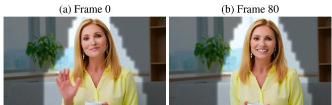  
Figure 4. The DiT knows where the subject is. A linear head on the DiT features at an early denoising step predicts the HR region (bright), which tracks the subject from frame 0 to 80 while the background stays at LR (dimmed).

## 3.2. Observation 2: VAE neighbor sensitivity

Due to the structural constraint of the VAE decoder, which requires a uniform spatial grid, a mixed-resolution latent cannot be decoded directly because its HR and LR parts have different dimensions. A naive solution (resize-andpaste [4]) fills each latent’s missing region with the resized other latent, decodes them separately, and pastes them together. However, we find that the VAE decoder relies heavily on surrounding patches, so a misaligned neighbor corrupts the decoded patch even when the patch itself is correct. To verify this without denoising error, we encode a real video at both HR and LR: resize-and-paste still leaves a seam along the boundary (Fig. 3a), and filling the missing region with noise spreads the artifacts further (Fig. 3b). This inspires our mixed-resolution decoder (Sec. 4.2), which merges the HR and LR latents into a single unified latent before decoding so every patch sees consistent neighbors.

## 3.3. Observation 3: the DiT knows the important region

A major challenge of mixed resolution is knowing which region should be HR in advance. MPEG compresses a video that already exists, so its motion vectors are known in advance. A generator, however, must choose its HR region before the video exists, and early in denoising the predicted video is still too blurry for a detector to be reliable.

Surprisingly, we find that the DiT itself already knows which region is visually important. A single linear layer on the DiT features captures the main subject, even as it moves (Fig. 4). This matches prior work showing that diffusion features can track objects [20, 27]. This property lets us read the HR region directly off the model without knowing it in advance, extending mixed-resolution generation to plain text-to-video (Sec. 4.3).

## 4. MPEG-Diffusion

Based on these observations, MPEG-Diffusion saves compute by generating the visually important regions of a video at HR and the rest at LR (Fig. 2).

Inference. Generation has four stages: (1) LR generation: the first k of T steps denoise the whole video at LR; (2) Region selection: at step k, a linear head on the DiT features selects the HR region M (Sec. 4.3); (3) Mixedresolution generation: we upscale the selected LR region M to HR with U (by upscaling the clean LR prediction at step k and re-noising it), and the remaining steps denoise M at HR and the rest at LR with dual-resolution attention (Sec. 4.1); and (4) Decoding: the mixed-resolution decoder merges the two latents into one HR video (Sec. 4.2).

Training. We fine-tune the DiT together with the K/V maps and a resolution embedding, one learned vector each for HR and LR tokens, added to every token and initialized at zero. Each training video is encoded at both resolutions and noised to the same level [4], and each latent learns to denoise only its own region:

$$
\mathcal { L } _ { \mathrm { D i T } } = \frac { \Vert M _ { \uparrow } \odot ( \hat { v } ^ { h } - v ^ { h } ) \Vert ^ { 2 } } { \Vert M _ { \uparrow } \Vert _ { 1 } } + \frac { \Vert ( 1 - M ) \odot ( \hat { v } ^ { l } - v ^ { l } ) \Vert ^ { 2 } } { \Vert 1 - M \Vert _ { 1 } } ,\tag{2}
$$

with $\hat { v }$ and v the predicted and true velocities, and $M _ { \uparrow }$ the mask on the HR grid. Here M is the 25% of tokens per latent frame with the highest perceptual label (Sec. 4.3).

## 4.1. Dual-resolution attention

To avoid the curse of mixed resolution (Proposition 1), we propose dual-resolution attention: each attention layer keeps complete HR and LR sets of keys and values (K/V), and each query reads only the K/V of its own resolution.

K/V mapping. Since HR and LR tokens are only generated in their respective regions, we complete each resolution’s K/V from the other with linear maps $f ( x ) = x W$ (Sec. 3.1), where $f _ { \uparrow }$ maps one LR token to n HR tokens and $f _ { \downarrow }$ maps n HR tokens to one LR token (n = 4 by default). With subscripts H and L for HR and LR tokens, the attention is

$$
O _ { H } = \mathrm { A t t n } \Big ( Q _ { H } , \left[ { K } _ { H } \atop f _ { \uparrow } ( K _ { L } ) \right] , \left[ { V } _ { H } \atop f _ { \uparrow } ( V _ { L } ) \right] \Big ) ,\tag{3}
$$

$$
O _ { L } = \mathrm { A t t n } \Big ( Q _ { L } , \binom { K _ { L } } { f _ { \downarrow } ( K _ { H } ) } , \binom { V _ { L } } { f _ { \downarrow } ( V _ { H } ) } \Big ) .\tag{4}
$$

Each query thus sees the K/V of the whole video at its own resolution, as in single-resolution generation. Keys are mapped before the rotary position embedding (RoPE) [26], so the maps act only on content and RoPE uses each resolution’s grid. The maps are fine-tuned jointly with the DiT.

We initialize each map by ridge regression on paired K/V, obtained by running the base model on the same videos at both resolutions. For large models, full maps are costly in memory, so we use a linear delta variant instead,

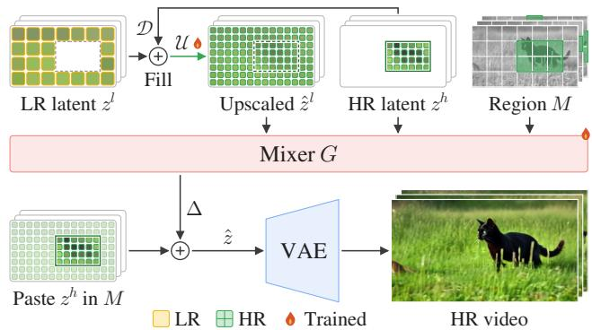

Figure 5. Mixed-resolution decoder. We merge the HR and LR latents before decoding. First, the LR latent is filled with the downscaled HR region (D) and upscaled (U), so patches near the boundary see less distorted neighbors. Then the mixer (G), guided by the mask, merges the LR and HR latents into one latent for the VAE.  
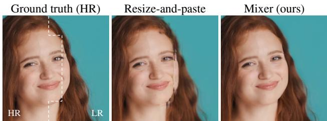  
Figure 6. The mixer removes the seam across the HR/LR boundary (white dashed line). Left: ground-truth HR frame. Middle: resize-and-paste (Sec. 3.2) leaves a seam across the face. Right: our mixed-resolution decoder keeps it intact.

$W = A + U V ^ { \top }$ , where A is the exact average over the n HR tokens (down) or copy to them (up), and $U V ^ { \top }$ is a rank-r correction.

## 4.2. Mixed-resolution decoder

After denoising, $z ^ { h }$ is generated only on the selected HR region M and $z ^ { l }$ only on the remaining LR region. Due to the resolution constraint of the VAE decoder (Sec. 3.2), the two latents cannot be decoded together directly, while decoding them separately without blending their information causes boundary seams. We therefore propose a mixed-resolution decoder that blends the HR and LR latents in latent space before decoding (Fig. 5).

Inference. Since $z ^ { l }$ is missing the HR region M, we first fill M with the downscaled HR latent $\mathcal { D } ( z ^ { h } )$ and upscale the completed LR latent to the HR grid with a learned latent upscaler U [36] to match the size of $z ^ { h }$ :

$$
\hat { z } ^ { l } = \mathcal { U } \big ( ( 1 - M ) \odot z ^ { l } + M \odot \mathcal { D } ( z ^ { h } ) \big ) .\tag{5}
$$

Filling M with $\mathcal { D } ( z ^ { h } )$ provides cleaner boundary neighbors than nearest-neighbor resizing, giving a better upscaled latent $\hat { z } ^ { l }$ before mixing. The mixer $G$ (a small 3D convolutional network) then takes $z ^ { h } , \hat { z } ^ { l }$ and $M ,$ retains $z ^ { h }$ in the HR region, and predicts a residual $\Delta = G ( z ^ { h } , \hat { z } ^ { l } , { \cal M } )$ on the LR region to remove the boundary seam:

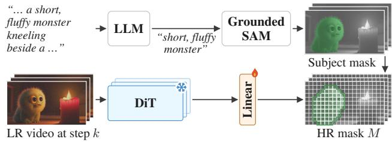  
Figure 7. Self-selected HR region. Top: an LLM identifies the main subject from the prompt, and Grounded SAM tracks it to produce subject masks. Bottom: a linear head on the frozen DiT features at step k learns to predict the HR mask M.

$$
\hat { z } = M _ { \uparrow } \odot z ^ { h } + ( 1 - M _ { \uparrow } ) \odot ( \hat { z } ^ { l } + \Delta ) ,\tag{6}
$$

where $M _ { \uparrow }$ is the mask on the HR grid. The VAE then decodes zˆ into a seamless HR video (Fig. 6).

Training. We train G and U on real videos: given a training mask M (Sec. 4), we keep only the HR latent in M and the LR latent outside M, and train zˆ to predict the groundtruth HR latent (training recipe in Sec. H).

## 4.3. Self-selected HR region

To enable plain text-to-video generation, we leverage the DiT’s ability to locate the visually important region (Sec. 3.3) and read the HR region directly off its features with a linear head.

Inference. At step k, from the output $h _ { b } \in \mathbb { R } ^ { C }$ of a middle DiT block at LR token $b ,$ the head scores each token as

$$
\begin{array} { r } { s _ { b } = w ^ { \top } \mathrm { L N } ( h _ { b } ) , } \end{array}\tag{7}
$$

where LN is layer normalization and $w \in \mathbb { R } ^ { C }$ is the learned weight. We smooth the scores in space and time, giving ${ \tilde { s } } _ { b } .$ and threshold them relative to each video’s own scores, with m the median and $p$ the 99th percentile of s˜:

$$
M _ { b } = \mathbb { I } \big [ \tilde { s } _ { b } > m + \alpha ( p - m ) \big ] ,\tag{8}
$$

with α a hyperparameter. If $p$ is below a fixed floor, the video has no clear subject and stays fully at LR.

Training. We train the head on the frozen DiT and explore two ways to label visually important tokens: (1) a self-supervised perceptual label, defined as the per-patch LPIPS [43] between the decoded LR prediction at step k and the ground-truth HR video (Sec. G), which directly measures where LR loses detail without external models, but can be distracted by high-frequency background texture; and (2) an object label, where an LLM [22] identifies the main subject from the prompt and Grounded SAM [15, 23] tracks it across frames (Fig. 7). We use the object label at inference, as it better aligns with human attention, and train the head with binary cross-entropy loss.

## 5. Experiments

Setup. We evaluate on both video and image generation. For video, we build on Wan2.1 [31] 1.3B at 480p and 14B at 720p (704×1280, so that each LR token covers 2×2 HR tokens), generating 81-frame videos in 50 steps. The DiT is fully fine-tuned with the K/V maps for 1,250 steps on 64 NVIDIA B200 GPUs; the mixer and upscaler are trained separately for 4k steps, and the region head on about 2,500 labeled clips. For images, we apply our method to FLUX.2 [klein] 4B [1], a DiT that, unlike Wan, puts the text and image tokens in one joint attention, at 1024×1024.

Baselines. We compare with token merging (ToMe [2], IDM [35]) and the prior mixed-resolution methods, Phase-Aligned RoPE [36] and Foveated Diffusion [4]. Since the gaze region is not available in text-to-video, we follow [4] and run both with a circular HR region moving along a predefined path at all steps, matching the token count and training data. HR and LR serve as references.

Evaluation. We generate one sample per prompt with a fixed seed. For video, we report MANIQA [39], imaging quality [10] and DOVER [33] on 1,003 MovieGen [21] prompts and VBench Quality on 944 VBench [8] prompts, together with a human study on 400 randomly selected video pairs from MovieGen (Sec. 5.1). For images, we report Q-Align [34] and patch FID [7] on 1,000 held-out prompts, together with a GPT-5.6 pairwise test (Sec. I). Speed is the denoising time on one NVIDIA B200, relative to HR.

## 5.1. Comparison with Acceleration Methods

Qualitative. We first compare generated videos with the prior mixed-resolution methods on both Wan2.1 14B and 1.3B. In Fig. 8, both baselines show strong artifacts where the HR and LR regions meet, while our method generates the subject sharply and without a seam. This holds across prompts and is even more pronounced when viewed in video; we encourage the reader to view the videos in the supplementary material. Additional visual examples with token layouts are provided in Sec. A.

Machine metrics. To quantitatively demonstrate the effectiveness of our method, we compare MPEG-Diffusion with token merging and mixed-resolution methods on Wan2.1 1.3B and 14B at the same token ratio. Quality. At both k = 40 (a 30% token ratio) and k = 25 (38% on 1.3B and 37% on 14B, Tab. 1), our method is the best on every quality metric for both models. The gap is largest on MANIQA, which penalizes local distortions: prior mixedresolution methods leave seams and artifacts around the HR region, and ToMe [2] and IDM [35] collapse into complete noise at this high compression ratio. Our method also comes closest to HR (a DOVER gap of 0.016 on 1.3B and 0.025 on 14B at k = 40), preserving near full-resolution quality with only 30% of the tokens needed. While VBench Quality is insensitive to blur (barely separating HR and LR in the 14B case), detail-sensitive metrics (MANIQA, DOVER) and human raters (Fig. 9) show a clear gap over LR.

Speed. On 1.3B, our method is the fastest at k = 40 (3.8×) and on par at k = 25 (2.8×). On 14B, it is slightly slower (4.8× vs. 5.2× at k = 40), because each HR token attends to the full HR K/V rather than a shorter mixedresolution sequence. However, with fewer tokens (30% vs. 37%), our method still beats both baselines in speed (4.8× vs. 4.2×) and on every metric.

Human evaluation. Metrics do not always match human judgment, so we also run a blind pairwise user study on Wan2.1 14B. We compare ours with Phase-Aligned RoPE and Foveated Diffusion, all at a 37% token ratio, HR and LR, on 400 uncurated video pairs (100 MovieGen prompts × 4 baselines). Each of the 15 raters judges 200 pairs, shown in random order with the two videos in random positions, and picks the one with better visual and temporal quality, or a draw.

Following Jiang et al. [9], Li et al. [12], we split each draw equally between the two methods. Raters prefer ours over Phase-Aligned RoPE (98.8%), Foveated Diffusion (90.1%) and LR (69.1%) (Fig. 9). Against HR, a draw is the most common answer (44%), and HR is only slightly preferred (54.8% vs. 45.2%), though ours is 3.3× faster. Our method outperforms prior mixed-resolution methods and is close to full-resolution quality at a fraction of the cost. Study details and win/draw/loss counts are in Sec. E.

Higher resolution. To demonstrate the generalizability of MPEG-Diffusion, we also run Wan2.1 14B at 960p with a 240p LR track, so each LR token stands for 16 HR tokens (k = 25). Following the same evaluation setting as Tab. 1, we compare our method with Foveated Diffusion [4] at the same token ratio. As shown in Tab. 2, our method stays close to HR (DOVER 0.789 vs. 0.806) at 4.8× the speed and consistently beats Foveated Diffusion on every metric at the same speed, while LR degrades across all quality metrics. The speedup also grows with resolution, from 3.3× at

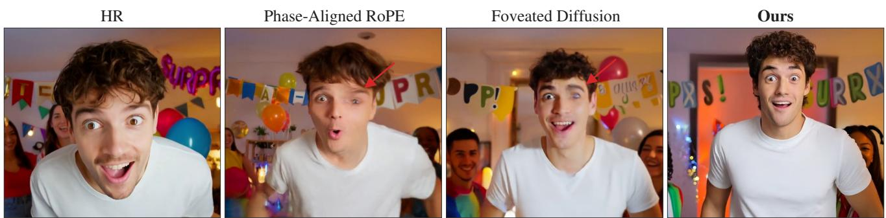  
Figure 8. Qualitative comparison on faces (Wan2.1 14B, k = 25, same seed). Prompt: a young man steps into a surprise party. Both baselines show clear artifacts where the HR and LR regions meet, with one eye sharp and the other ghosted (arrows). Ours shows no visible degradation and is close to HR (more examples in Sec. A).

Table 1. Comparison at matched token budgets (k = 40 and k = 25). The token ratio is the percentage of full-resolution tokens processed over all denoising steps. Speedup is measured in denoising time relative to HR. MANIQA, Imaging and DOVER are evaluated on the MovieGen prompt set [21], and VBench Quality on the VBench prompt set [8]. HR and LR are references. Bold: best among the token-matched methods.
<table><tr><td rowspan="3">Method</td><td colspan="5">Wan2.1 1.3B (480p)</td><td colspan="5">Wan2.1 14B (720p)</td></tr><tr><td>Speedup ↑</td><td>MANIQA ↑</td><td>Imaging ↑</td><td>DOVER ↑</td><td>VBench Q. ↑</td><td>Speedup ↑</td><td>MANIQA ↑</td><td>Imaging ↑</td><td>DOVER ↑</td><td>VBench Q. ↑</td></tr><tr><td>HR (100% tokens)</td><td>1.0×</td><td>0.371</td><td>0.644</td><td>0.778</td><td>84.0</td><td>1.0×</td><td>0.445</td><td>0.671</td><td>0.819</td><td>85.3</td></tr><tr><td>LR (25% tokens)</td><td>5.8×</td><td>0.244</td><td>0.586</td><td>0.492</td><td>80.3</td><td>7.2×</td><td>0.318</td><td>0.645</td><td>0.768</td><td>84.4</td></tr><tr><td>k = 40 (30% tokens)</td><td></td><td></td><td></td><td></td><td></td><td></td><td></td><td></td><td></td><td></td></tr><tr><td>ToMe [2]</td><td>2.3×</td><td>0.211</td><td>0.504</td><td>0.119</td><td>66.7</td><td>3.8×</td><td>0.299</td><td>0.522</td><td>0.069</td><td>67.7</td></tr><tr><td>IDM [35]</td><td>2.3×</td><td>0.214</td><td>0.506</td><td>0.110</td><td>66.9</td><td>3.8×</td><td>0.300</td><td>0.530</td><td>0.069</td><td>67.5</td></tr><tr><td>Phase-Aligned RoPE [36]</td><td>3.2×</td><td>0.215</td><td>0.535</td><td>0.508</td><td>78.9</td><td>5.2×</td><td>0.293</td><td>0.622</td><td>0.757</td><td>83.8</td></tr><tr><td>Foveated Diffusion [4]</td><td>3.2×</td><td>0.261</td><td>0.599</td><td>0.658</td><td>81.5</td><td>5.2×</td><td>0.300</td><td>0.619</td><td>0.743</td><td>83.9</td></tr><tr><td>MPEG-Diffusion</td><td>3.8×</td><td>0.345</td><td>0.631</td><td>0.762</td><td>81.7</td><td>4.8×</td><td>0.397</td><td>0.644</td><td>0.794</td><td>83.9</td></tr><tr><td>k = 25 (38% tokens)</td><td></td><td></td><td></td><td></td><td></td><td></td><td></td><td></td><td></td><td></td></tr><tr><td>Phase-Aligned RoPE [36]</td><td>2.8×</td><td>0.236</td><td>0.536</td><td>0.576</td><td>78.3</td><td>4.2×</td><td>0.316</td><td>0.622</td><td>0.769</td><td>83.7</td></tr><tr><td>Foveated Diffusion [4]</td><td>2.8×</td><td>0.285</td><td>0.602</td><td>0.701</td><td>81.5</td><td>4.2×</td><td>0.323</td><td>0.623</td><td>0.761</td><td>83.8</td></tr><tr><td>MPEG-Diffusion</td><td>2.8×</td><td>0.355</td><td>0.635</td><td>0.769</td><td>81.6</td><td>3.3×</td><td>0.402</td><td>0.649</td><td>0.803</td><td>84.1</td></tr></table>

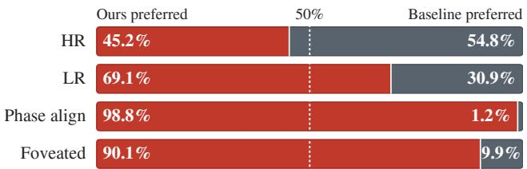  
Figure 9. Human evaluation on Wan2.1 14B. Votes preferring ours (red) vs. baseline (gray), splitting draws 50/50.

720p (Tab. 1) to 4.8× at 960p.

## 5.2. Image generation

We further test MPEG-Diffusion on the text-to-image model FLUX.2 [klein] 4B [1] at 1024×1024. Prior mixedresolution methods often show artifacts at the seam between the HR and LR regions (Fig. 10), while MPEG-Diffusion keeps the whole sign sharp and the text correct (more examples in Sec. B).

Table 2. Higher resolution (Wan2.1 14B at 960p, k = 25). Speedup is relative to HR. LR is generated at 240p.
<table><tr><td>Method</td><td></td><td></td><td></td><td></td><td>Speedup ↑ MANIQA ↑ Imaging ↑ DOVER ↑ VBench Q. ↑</td></tr><tr><td>HR</td><td>1.0×</td><td>0.472</td><td>0.667</td><td>0.806</td><td>85.3</td></tr><tr><td>LR</td><td>45.7×</td><td>0.270</td><td>0.598</td><td>0.592</td><td>82.8</td></tr><tr><td>Foveated Diffusion</td><td>4.7×</td><td>0.354</td><td>0.604</td><td>0.766</td><td>81.6</td></tr><tr><td>MPEG-Diffusion</td><td>4.8×</td><td>0.367</td><td>0.633</td><td>0.789</td><td>82.9</td></tr></table>

To quantify this, we evaluate on 1,000 held-out prompts at a 33% token ratio, following the default setting of Foveated Diffusion [4]. Our method is the best on every quality metric compared with the prior mixed-resolution methods and LR (Tab. 3), with the lowest patch FID (13.0). We also perform a blind pairwise test with GPT-5.6, which prefers our images over Foveated Diffusion, LR and Phase-

Table 3. Image generation on FLUX.2 [klein] 4B (1024×1024, 1,000 prompts). Speedup is per denoising step, relative to HR. FID: patch FID against the HR images. Ours pref.: rate at which GPT-5.6 prefers ours over the baseline (> 50% favors ours). LR is a reference. Bold: best among the token-matched methods.
<table><tr><td>Method</td><td>Tokens (%) ↓ Speedup ↑ Q-Align ↑ FID ↓</td><td></td><td></td><td></td><td>Ours pref. ↑</td></tr><tr><td>LR</td><td>25</td><td>1.55×</td><td>4.42</td><td>15.61</td><td>78.0%</td></tr><tr><td>Phase-Aligned RoPE</td><td>33</td><td>1.11×</td><td>4.34</td><td>14.59</td><td>83.8%</td></tr><tr><td>Foveated Diffusion</td><td>33</td><td>1.14×</td><td>4.49</td><td>16.40</td><td>61.4%</td></tr><tr><td>MPEG-Diffusion</td><td>33</td><td>1.40×</td><td>4.60</td><td>12.97</td><td></td></tr></table>

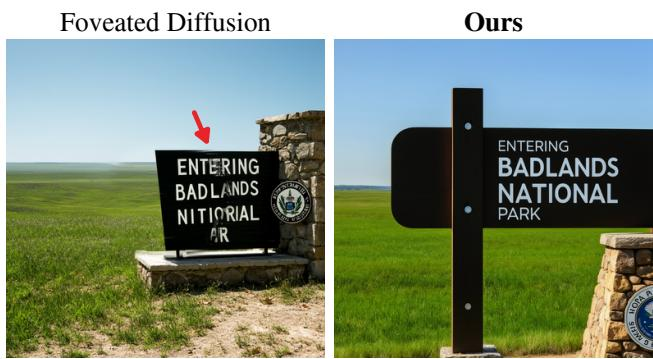  
Figure 10. Text on FLUX.2 [klein] 4B (same prompt, token budget and seed). Foveated Diffusion shows artifacts at the HR/LR seam (arrow), while ours generates the whole sign sharply (more examples in Sec. B).

Aligned RoPE in 61.4%, 78.0% and 83.8% of the pairs.

Our method is also faster at the same token budget (1.40× vs. 1.14× for Foveated Diffusion and 1.11× for Phase-Aligned RoPE). It runs the first k steps purely at LR, whereas both baselines run mixed resolution at all steps and split every attention layer into two calls, which incurs large overhead when each image has only 4,096 tokens.

## 5.3. Ablation studies

Runtime overhead. We profile the runtime of MPEG-Diffusion on Wan2.1 1.3B (480p, 81 frames, 50 steps, one GPU, batch size 1) at a 30% token ratio, averaging nine runs after one warm-up run. The MPEG components add only 3.0% to the generation time: the K/V maps take 2.4%, the mixer 0.6% and the region head 0.04%, as shown in Fig. 11.

Dual-resolution attention. In Sec. 3.1, we show that with a shared K/V, one LR token cannot match the attention of the n HR tokens it replaces, which motivates dual-resolution attention. We compare it with a shared K/V with adjusted RoPE, as in Foveated Diffusion [4] and Phase-Aligned RoPE [36], both on Wan2.1 1.3B, trained for 5,000 steps, with all else fixed, and evaluated on the 1,003 MovieGen prompts (details in Sec. F).

In Fig. 12, the resolution mismatch in the shared K/V bends the clock hand crossing the HR/LR edge, whereas dual-resolution attention keeps it straight. To quantify this phenomenon, we measure temporal consistency near the edge with temporal LPIPS [5] and the warping error [11]. As the HR region moves, the seam moves with it, so the distortion at the seam changes over time and lowers temporal consistency.

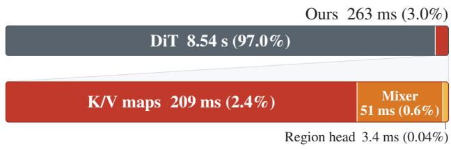  
Figure 11. Runtime breakdown on Wan2.1 1.3B. Our compo nents add only 3.0% overhead, where K/V maps account for 2.4%.

(a) Shared K/V  
(b) Dual-resolution attention  
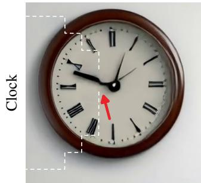

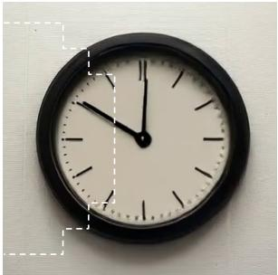  
Figure 12. Misalignment across the HR/LR edge (white dashed circle). A shared K/V distorts the clock hand crossing the edge (red arrow), whereas dual-resolution attention keeps it straight.

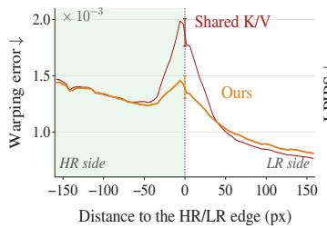  
(a) Dual-resolution attention: warping error, 1,003 prompts

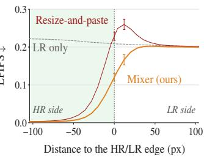  
(b) Mixed-resolution decoder: LPIPS, 100 real clips  
Figure 13. Error profile across the HR/LR edge (negative distance: HR side; shaded: 95% CI). (a) Dual-resolution attention suppresses the warping-error spike of the shared K/V at the edge (+25% vs. +70%). (b) Our mixer removes the LPIPS spike of resize-and-paste just outside the edge.

At the seam between HR and LR, dual-resolution attention lowers temporal LPIPS from 4.59 to $4 . 1 4 \times 1 0 ^ { - 2 }$ and the warping error from 2.61 to $1 . 9 6 \times 1 0 ^ { - 3 }$ (Tab. 5 in the supplementary), indicating less distortion. Figure 13a further confirms this: at the seam, the warping error is much lower with dual-resolution attention, while far from the seam the two models are the same.

Mixed-resolution decoder. In Sec. 3.2, we observe that the VAE decoder depends on neighboring patches, so resizing and pasting the two decodes leaves a seam.

To test whether the mixed-resolution decoder removes this seam, we use 100 real held-out videos. We encode each video at 480p and at 240p, and build a mixed latent as in generation: the 480p latent inside a random moving circle and the 240p latent outside. We measure the LPIPS of each decoding method on the mixed-resolution latent against the 480p video in pixel space, comparing the mixer with resizeand-paste and LR only.

In Fig. 13b, we find that near the HR/LR edge, resizeand-paste shows a surge in LPIPS, indicating a distortion relative to the 480p video. In contrast, the mixer removes the distortion, lowering LPIPS near the edge from 0.19 to 0.12.

Self-selected region. In Sec. 3.3, we observe that DiT features can locate the visually important region. To evaluate our linear head quantitatively, we compare the HR mask M it predicts at step k against the main-subject mask labeled by the LLM and Grounded SAM (Sec. 4.3) across the 1,003 generated MovieGen videos. The predicted region achieves an mIoU of 0.59 on Wan2.1 1.3B and 0.67 on 14B, showing that the linear head accurately locates and tracks the main subject during denoising.

## 6. Conclusion

We studied why mixed-resolution generation comes with a severe drop in quality. We found three root causes and addressed each with one component of MPEG-Diffusion: (1) dual-resolution attention to mitigate the curse of mixed resolution, (2) the mixed-resolution decoder to blend the HR and LR latents before decoding, and (3) a linear layer using the DiT’s knowledge to find the important region without requiring it in advance. Together, MPEG-Diffusion achieves up to a 4.8× speedup, and in our human study raters prefer it over prior mixed-resolution methods in over 90% of the pairs. We hope our work opens the way to mixed-resolution generation.

Limitations and future work. Dual-resolution attention assumes a linear relation between the HR and LR tokens of an area. This relation is strong in the base model (Sec. 3.1), but it remains a structural constraint. This may still lead to a slight degradation of the quality. Additionally, the difference between the blurry LR region and the sharp HR details is sometimes obvious, and further work is needed to blend them more smoothly. Finally, the self-selected region is learned from subject labels given by an LLM and

Grounded SAM, so we suggest end-to-end fine-tuning as future work.

## LLM Usage Statement

LLMs are used in two parts of the method and evaluation, both described in the paper: Qwen2.5 [22] identifies the main subject from the prompt to build the object labels for the region head (Sec. 4.3), and GPT-5.6 serves as a blind pairwise judge of image quality (Sec. 5.2). We also used an LLM-based assistant to edit the text for grammar and clarity. The authors checked all text and results and take full responsibility for them.

## References

[1] Black Forest Labs. FLUX.2. https://github.com/ black-forest-labs/flux2, 2025. 6, 7

[2] Daniel Bolya and Judy Hoffman. Token Merging for Fast Stable Diffusion. In CVPRW, pages 4599–4603, 2023. 2, 6, 7

[3] Daniel Bolya, Cheng-Yang Fu, Xiaoliang Dai, Peizhao Zhang, Christoph Feichtenhofer, and Judy Hoffman. Token Merging: Your ViT But Faster. In ICLR, 2023. 2, 3

[4] Brian Chao, Lior Yariv, Howard Xiao, and Gordon Wetzstein. Foveated Diffusion: Efficient Spatially Adaptive Im age and Video Generation. arXiv preprint arXiv:2603.23491, 2026. 2, 4, 6, 7, 8, 5

[5] Mengyu Chu, You Xie, Jonas Mayer, Laura Leal-Taixe,´ and Nils Thuerey. Learning Temporal Coherence via Self-Supervision for GAN-based Video Generation. ACM TOG, 39(4):75:1–75:13, 2020. 8, 5

[6] Haipeng Fang, Sheng Tang, Juan Cao, Enshuo Zhang, Fan Tang, and Tong-Yee Lee. Attend to Not Attended: Structure then-Detail Token Merging for Post-training DiT Accelera tion. In CVPR, 2025. 2

[7] Martin Heusel, Hubert Ramsauer, Thomas Unterthiner, Bernhard Nessler, and Sepp Hochreiter. GANs Trained by a Two Time-Scale Update Rule Converge to a Local Nash Equilibrium. In NeurIPS, 2017. 6

[8] Ziqi Huang, Yinan He, Jiashuo Yu, Fan Zhang, Chenyang Si, Yuming Jiang, et al. VBench: Comprehensive Benchmark Suite for Video Generative Models. In CVPR, pages 21807– 21818, 2024. 6, 7

[9] Dongfu Jiang, Max Ku, Tianle Li, Yuansheng Ni, Shizhuo Sun, Rongqi Fan, and Wenhu Chen. GenAI Arena: An Open Evaluation Platform for Generative Models. In NeurIPS, 2024. 6, 4

[10] Junjie Ke, Qifei Wang, Yilin Wang, Peyman Milanfar, and Feng Yang. MUSIQ: Multi-scale Image Quality Transformer. In ICCV, pages 5128–5137, 2021. 6

[11] Wei-Sheng Lai, Jia-Bin Huang, Oliver Wang, Eli Shechtman, Ersin Yumer, and Ming-Hsuan Yang. Learning Blind Video Temporal Consistency. In ECCV, pages 170–185, 2018. 8, 5

[12] Xuechen Li, Tianyi Zhang, Yann Dubois, Rohan Taori, Ishaan Gulrajani, Carlos Guestrin, Percy Liang, and Tatsunori B. Hashimoto. AlpacaEval: An Automatic Evalua

tor of Instruction-following Models. https://github. com/tatsu-lab/alpaca\_eval, 2023. 6, 4

[13] Xirui Li, Chao Ma, Xiaokang Yang, and Ming-Hsuan Yang. VidToMe: Video Token Merging for Zero-Shot Video Editing. In CVPR, 2024. 2

[14] Feng Liu, Shiwei Zhang, Xiaofeng Wang, Yujie Wei, Haonan Qiu, Yuzhong Zhao, Yingya Zhang, Qixiang Ye, and Fang Wan. Timestep Embedding Tells: It’s Time to Cache for Video Diffusion Model. In CVPR, pages 7353–7363, 2025. 2

[15] Shilong Liu, Zhaoyang Zeng, Tianhe Ren, Feng Li, Hao Zhang, Jie Yang, et al. Grounding DINO: Marrying DINO with Grounded Pre-Training for Open-Set Object Detection. In ECCV, 2024. 6

[16] Grace Luo, Lisa Dunlap, Dong Huk Park, Aleksander Holynski, and Trevor Darrell. Diffusion Hyperfeatures: Searching Through Time and Space for Semantic Correspondence. In NeurIPS, 2023. 3

[17] Xinyin Ma, Gongfan Fang, and Xinchao Wang. DeepCache: Accelerating Diffusion Models for Free. In CVPR, pages 15762–15772, 2024. 2

[18] Dennis Menn, Yuedong Yang, Bokun Wang, Xiwen Wei, Mustafa Munir, Feng Liang, Radu Marculescu, Chenfeng Xu, and Diana Marculescu. Video Compression Meets Video Generation: Latent Inter-Frame Pruning with Attention Recovery. arXiv preprint arXiv:2603.05811, 2026. 2

[19] Kiyohiro Nakayama, Brian Chao, Jan Ackermann, Hansheng Chen, Federico Tombari, Leonidas Guibas, Lior Yariv, and Gordon Wetzstein. Level-of-Token Diffusion. arXiv preprint arXiv:2610.05816, 2026. 2

[20] Jisu Nam, Soowon Son, Dahyun Chung, Jiyoung Kim, Siyoon Jin, Junhwa Hur, and Seungryong Kim. Emergent Temporal Correspondences from Video Diffusion Transformers. In NeurIPS, 2025. 3, 4

[21] Adam Polyak, Amit Zohar, Andrew Brown, Andros Tjandra, Animesh Sinha, Ann Lee, et al. Movie Gen: A Cast of Media Foundation Models. arXiv preprint arXiv:2410.13720, 2024. 6, 7

[22] Qwen Team. Qwen2.5 Technical Report. arXiv preprint arXiv:2412.15115, 2024. 6, 9

[23] Nikhila Ravi, Valentin Gabeur, Yuan-Ting Hu, Ronghang Hu, Chaitanya Ryali, Tengyu Ma, et al. SAM 2: Segment Anything in Images and Videos. In ICLR, 2025. 6

[24] Tim Salimans and Jonathan Ho. Progressive Distillation for Fast Sampling of Diffusion Models. In ICLR, 2022. 2

[25] Yang Song, Prafulla Dhariwal, Mark Chen, and Ilya Sutskever. Consistency Models. In ICML, 2023. 2

[26] Jianlin Su, Yu Lu, Shengfeng Pan, Ahmed Murtadha, Bo Wen, and Yunfeng Liu. RoFormer: Enhanced Transformer with Rotary Position Embedding. Neurocomputing, 568: 127063, 2024. 4

[27] Luming Tang, Menglin Jia, Qianqian Wang, Cheng Perng Phoo, and Bharath Hariharan. Emergent Correspondence from Image Diffusion. In NeurIPS, 2023. 3, 4

[28] Raphael Tang, Linqing Liu, Akshat Pandey, Zhiying Jiang, Gefei Yang, Karun Kumar, Pontus Stenetorp, Jimmy Lin, and Ferhan Ture. What the DAAM: Interpreting Stable Diffusion Using Cross Attention. In ACL, 2023. 3

[29] Zachary Teed and Jia Deng. RAFT: Recurrent All-Pairs Field Transforms for Optical Flow. In ECCV, pages 402–419, 2020. 5

[30] Junjiao Tian, Lavisha Aggarwal, Andrea Colaco, Zsolt Kira, and Mar Gonzalez-Franco. Diffuse, Attend, and Segment: Unsupervised Zero-Shot Segmentation using Stable Diffusion. In CVPR, 2024. 3

[31] Wan Team, Ang Wang, Baole Ai, Bin Wen, Chaojie Mao, Chen-Wei Xie, et al. Wan: Open and Advanced Large-Scale Video Generative Models. arXiv preprint arXiv:2503.20314, 2025. 1, 6

[32] Thomas Wiegand, Gary J. Sullivan, Gisle Bjøntegaard, and Ajay Luthra. Overview of the H.264/AVC Video Coding Standard. IEEE TCSVT, 13(7):560–576, 2003. 1

[33] Haoning Wu, Erli Zhang, Liang Liao, Chaofeng Chen, Jingwen Hou, Annan Wang, Wenxiu Sun, Qiong Yan, and Weis Lin. Exploring Video Quality Assessment on User Generated Contents from Aesthetic and Technical Perspectives. In ICCV, pages 20087–20097, 2023. 6

[34] Haoning Wu, Zicheng Zhang, Weixia Zhang, Chaofeng Chen, Liang Liao, Chunyi Li, Yixuan Gao, Annan Wang, Erli Zhang, Wenxiu Sun, Qiong Yan, Xiongkuo Min, Guangtao Zhai, and Weisi Lin. Q-Align: Teaching LMMs for Vi sual Scoring via Discrete Text-Defined Levels. In ICML, 2024. 6

[35] Haoyu Wu, Jingyi Xu, Hieu Le, and Dimitris Samaras. Importance-Based Token Merging for Efficient Image and Video Generation. In ICCV, pages 4983–4995, 2025. 2, 6, 7

[36] Haoyu Wu, Jingyi Xu, Qiaomu Miao, Dimitris Samaras, and Hieu Le. Phase-Aligned RoPE for Mixed-Resolution Diffu sion Transformer. In ECCV, 2026. 2, 5, 6, 7, 8

[37] Haocheng Xi, Shuo Yang, Yilong Zhao, Chenfeng Xu, Muyang Li, Xiuyu Li, et al. Sparse VideoGen: Accelerating Video Diffusion Transformers with Spatial-Temporal Sparsity. In ICML, 2025. 2

[38] Jiarui Xu, Sifei Liu, Arash Vahdat, Wonmin Byeon, Xiaolong Wang, and Shalini De Mello. Open-Vocabulary Panop tic Segmentation with Text-to-Image Diffusion Models. In CVPR, 2023. 3

[39] Sidi Yang, Tianhe Wu, Shuwei Shi, Shanshan Lao, Yuan Gong, Mingdeng Cao, Jiahao Wang, and Yujiu Yang. MANIQA: Multi-dimension Attention Network for No-Reference Image Quality Assessment. In CVPRW, pages 1190–1199, 2022. 6

[40] Shuo Yang, Haocheng Xi, Yilong Zhao, Muyang Li, Jintao Zhang, Han Cai, Yujun Lin, Xiuyu Li, Chenfeng Xu, Kelly Peng, Jianfei Chen, Song Han, Kurt Keutzer, and Ion Stoica. Sparse VideoGen2: Accelerate Video Generation with Sparse Attention via Semantic-Aware Permutation. In NeurIPS, 2025. 2

[41] Tianwei Yin, Michael Gharbi, Richard Zhang, Eli Shecht-¨ man, Fredo Durand, William T. Freeman, and Taesung Park. One-step Diffusion with Distribution Matching Distillation. In CVPR, pages 6613–6623, 2024. 2

[42] Junyi Zhang, Charles Herrmann, Junhwa Hur, Luisa Polania Cabrera, Varun Jampani, Deqing Sun, and Ming-Hsuan Yang. A Tale of Two Features: Stable Diffusion Comple-

ments DINO for Zero-Shot Semantic Correspondence. In NeurIPS, 2023. 3

[43] Richard Zhang, Phillip Isola, Alexei A. Efros, Eli Shechtman, and Oliver Wang. The Unreasonable Effectiveness of Deep Features as a Perceptual Metric. In CVPR, 2018. 5

[44] Wenliang Zhao, Yongming Rao, Zuyan Liu, Benlin Liu, Jie Zhou, and Jiwen Lu. Unleashing Text-to-Image Diffusion Models for Visual Perception. In ICCV, 2023. 3

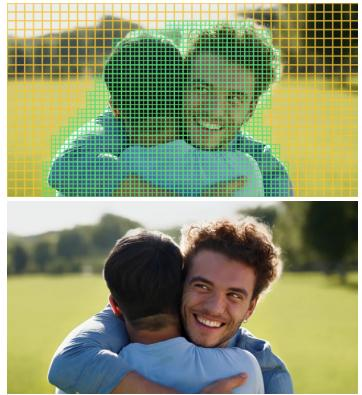  
Frame 0

# MPEG-Diffusion: Mixed-Resolution Video Generation Supplementary Material

## A. Additional video qualitative results

Figures 14 to 18 show additional visual examples generated by MPEG-Diffusion on Wan2.1 14B (k = 25), pairing each clip’s token layout with its decoded video as in Fig. 1.

Frame 0  
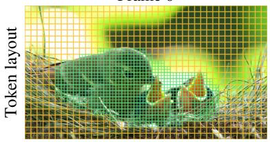

Frame 40  
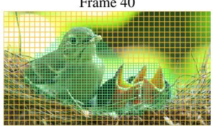  
HR region  
LR background

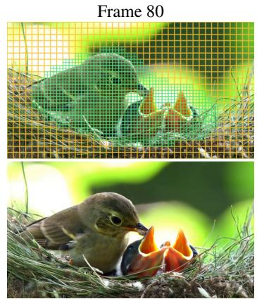  
Figure 14. Mother bird feeding chicks (3.1× faster, 38.7% token use). Prompt: a mother bird feeding her chicks in a nest.

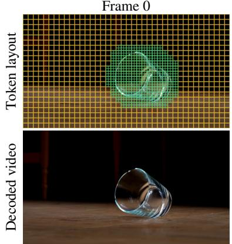

Frame 40  
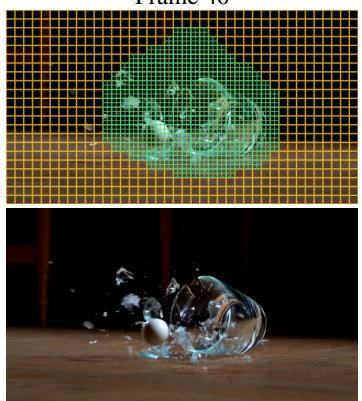

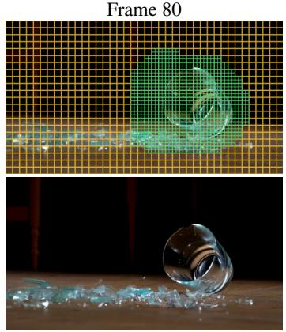

Figure 15. Marble through a glass (3.4× faster, 36.1% token use). Prompt: a marble shattering a glass cup on a wooden table. Frame 0 Frame 40 Frame 80  
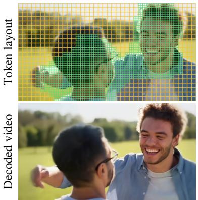

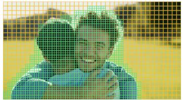

  
Figure 16. Friends hugging (2.4× faster, 45.0% token use). Prompt: two friends hugging outdoors.

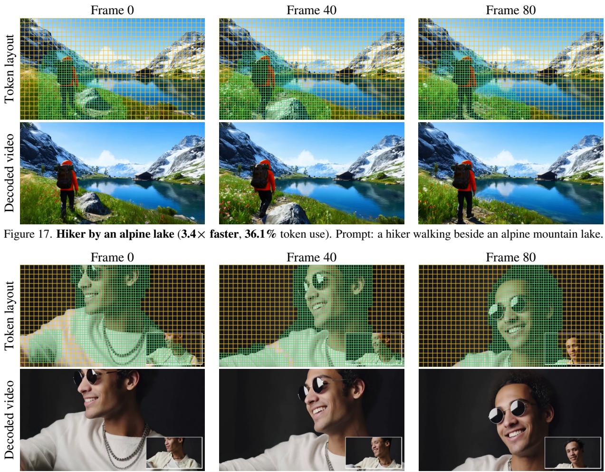  
Figure 18. Sunglasses and leather jacket (4.0× faster, 48.2% token use, input video in the corner). Prompt: a young man wearing black sunglasses and a leather jacket.

## B. Additional image qualitative results

Figures 19 and 20 show additional text-to-image examples generated by MPEG-Diffusion on FLUX.2 [klein] 4B (1024×1024), pairing each image’s token layout with its decoded image.

Royal guard (32.9% tokens)  
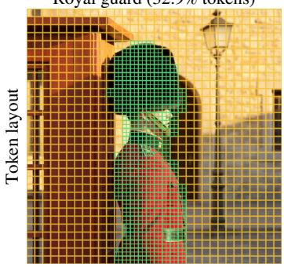

Autumn skateboard (35.2% tokens)  
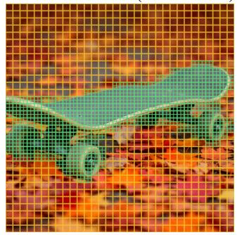

HR region LR background  
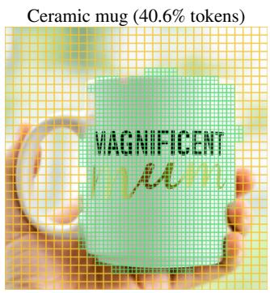

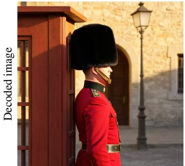

  
Figure 19. Text-to-image generation on FLUX.2 [klein] 4B (1024×1024, 1.40× faster on average). Left: a royal guard in a red uniform and bearskin hat in a sentry box. Middle: a skateboard on colorful autumn leaves. Right: a hand holding a ceramic mug reading MAGNIFICENT Mum.

Holstein cow (39.8% tokens)  
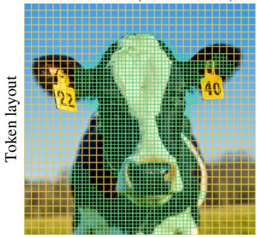

Man in sunglasses (40.7% tokens)  
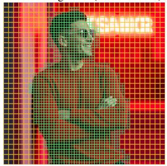

Riverside boats (36.0% tokens)  
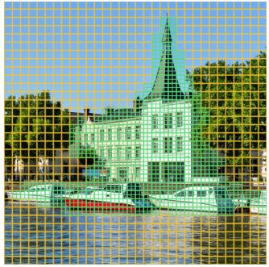

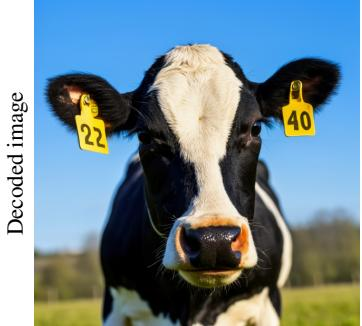

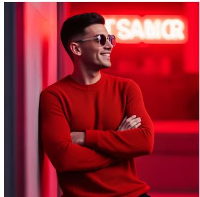

  
Figure 20. Additional text-to-image results on FLUX.2 [klein] 4B (1024×1024). Left: a Holstein cow in a field under a blue sky. Middle: a young man in sunglasses leaning against a neon-lit wall. Right: boats anchored near a historic riverside building.

## C. Proof of Proposition 1

Proof. Fix q and $\{ \tilde { k } _ { j } \}$ . Both sides of Eq. (1) are affine in $\begin{array} { r } { R = \sum _ { j } e ^ { q \cdot \tilde { k } _ { j } } \tilde { v } _ { j } } \end{array}$ , which takes any value as the $\tilde { v } _ { j }$ vary. Matching the coefficients of R gives $\begin{array} { r } { e ^ { q \cdot k _ { c } + \beta } = \sum _ { i } e ^ { q \cdot k _ { i } } } \end{array}$ and matching the rest gives $\begin{array} { r } { e ^ { q \cdot k _ { c } + \beta } v _ { c } = \sum _ { i } e ^ { q \cdot k _ { i } } v _ { i } } \end{array}$ . Taking logs of the first,

$$
\underbrace { \boldsymbol { q } \cdot \boldsymbol { k _ { c } } + \beta } _ { \boldsymbol { g ( q ) } } = \underbrace { \log \sum _ { i = 1 } ^ { n } } _ { \boldsymbol { f ( q ) } } e ^ { \boldsymbol { q } \cdot \boldsymbol { k _ { i } } } \quad \mathrm { o n } \ \Omega .\tag{9}
$$

Let $\begin{array} { r } { p _ { i } ( q ) = e ^ { q \cdot k _ { i } } / \sum _ { i } e ^ { q \cdot k _ { j } } > 0 } \end{array}$ be the softmax weights. Then $\begin{array} { r } { \nabla f ( q ) = \sum _ { i } p _ { i } \boldsymbol { k } _ { i } = : \bar { \boldsymbol { k } } ( q ) } \end{array}$ and

$$
\nabla ^ { 2 } f ( \boldsymbol { q } ) = \sum _ { i = 1 } ^ { n } p _ { i } ( k _ { i } - \bar { k } ) ( k _ { i } - \bar { k } ) ^ { \top } .
$$

The left side of Eq. (9) is affine in q, so this Hessian is zero on Ω, and so is its trace $\begin{array} { r } { \sum _ { i } p _ { i } \| k _ { i } - \bar { \bar { k } } \| ^ { 2 } } \end{array}$ . Since every $p _ { i } > 0$ all n keys equal ¯k; call them k. Then $f ( q ) = q \cdot k + \log n .$ and Eq. (9) becomes $q \cdot ( k _ { c } - k ) = \log n - \beta \ \mathrm { o n } \ \Omega$ . An affine function that is constant on an open set has zero slope, so $k _ { c } = k$ and $\beta = \log n$ . Finally, the second condition becomes n $e ^ { q \cdot k } v _ { c } = e ^ { q \cdot k } \textstyle \sum _ { i } v _ { i }$ , so $\begin{array} { r } { v _ { c } = \frac { 1 } { n } \sum _ { i } v _ { i } } \end{array}$ □

## D. Linear relation between HR and LR keys and values

Fig. 21 shows, for each transformer block, how well the linear maps of Sec. 3.1 predict the keys and values of the other resolution.

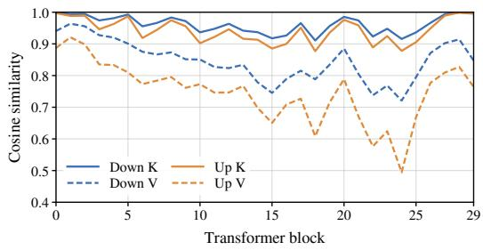  
Figure 21. A linear map predicts the K/V of the other resolution. Cosine similarity between the mapped and native keys (K) and values (V) in each transformer block of the base Wan2.1 1.3B model (no fine-tuning) at t = 0, on 50 held-out clips (about 1.6M HR and 0.4M LR tokens). Down: HR → LR; Up: LR → HR.

## E. Human evaluation details

This section details the human study of Sec. 5.1: how it is run, what raters see, and the full vote counts.

We run a blind pairwise study: in each pair, raters watch two videos generated from the same prompt, one by our method and one by a baseline, and pick the better one or a draw.

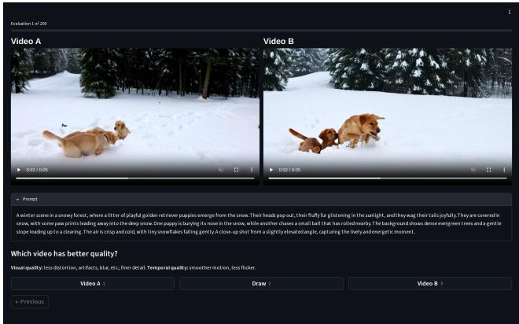  
Figure 22. User study interface. The two videos play side by side; the vote buttons are below. The prompt box is opened here for illustration; raters see it collapsed.

Interface. The two videos play side by side, in sync and looped (Fig. 22). LR videos (640×352) are upscaled to 1280×704 by the browser. Raters are told to judge visual quality (artifacts, blur, detail) and temporal quality (smooth motion, no flicker), and to choose Draw only if they cannot tell which is better.

Prompts and pairs. We randomly choose 100 prompts from MovieGen and generate one video per method with the same seed, giving 400 pairs (ours vs. each of the 4 baselines). The videos are uncurated. Each of the 15 raters judges 200 pairs, shown in random order with ours randomly on the left or right.

Win rate. The win rate is (ours better + draw/2) / votes [9, 12]. Table 4 lists the raw vote shares behind the win rates.

Table 4. Human evaluation on Wan2.1 14B (k = 25), 750 votes per baseline (749 for Foveated Diffusion). “Win rate” counts a draw as half a vote for each side.
<table><tr><td>Ours vs.</td><td>Ours better</td><td>Draw</td><td>Baseline better</td><td>Win rate</td></tr><tr><td>HR</td><td>23.2%</td><td>44.0%</td><td>32.8%</td><td>45.2%</td></tr><tr><td>LR</td><td>51.7%</td><td>34.7%</td><td>13.6%</td><td>69.1%</td></tr><tr><td>Phase-Aligned RoPE</td><td>97.9%</td><td>1.9%</td><td>0.3%</td><td>98.8%</td></tr><tr><td>Foveated Diffusion</td><td>84.6%</td><td>10.8%</td><td>4.5%</td><td>90.1%</td></tr></table>

## F. Dual-resolution attention ablation details

This section gives the details of the dual-resolution attention ablation in Sec. 5.3. We train two Wan2.1 1.3B (480p)

models in the same way for 5,000 steps. One uses dualresolution attention (ours). The other uses a single shared K/V with adjusted RoPE, as in Foveated Diffusion [4] and Phase-Aligned RoPE [36]. To test only the attention, both models use the same mixed-resolution decoder and the same moving circular HR region. Each model generates one video for each of the 1,003 MovieGen prompts, with the same seeds. In each video, we take 80 boxes of 64×64 pixels centered on the HR/LR edge. Temporal LPIPS [5] measures how much a box changes between consecutive frames. The warping error [11] measures the change that remains after removing motion with optical flow (RAFT [29]). Ours lowers temporal LPIPS from 4.59 to $4 . 1 4 \times 1 0 ^ { - 2 }$ (10% lower) and the warping error from 2.61 to $1 . 9 6 \times 1 0 ^ { - 3 }$ (25% lower) (Tab. 5). So content at the seam distorts less from frame to frame: objects stay consistent as the edge moves over them, instead of distorting.

Table 5. Temporal consistency at the HR/LR edge (64×64 boxes centered on the edge, 1,003 MovieGen prompts, Wan2.1 1.3B). Bold: better of the two K/V designs.
<table><tr><td colspan="2">Metric Shared K/V Dual K/V (ours)</td></tr><tr><td>Temporal LPIPS  $( \times 1 0 ^ { - 2 } ) \downarrow$ </td><td>4.59</td></tr><tr><td></td><td>4.14</td></tr><tr><td>Warping error  $( \times 1 0 ^ { - 3 } ) \downarrow$  2.61</td><td>1.96</td></tr></table>

## G. LPIPS label details

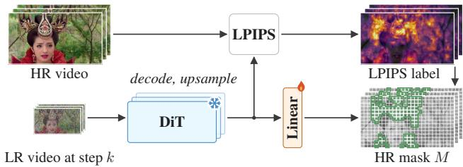  
Figure 23. LPIPS label, an end-to-end alternative to the subject label in Fig. 7. Top: LPIPS between the real HR video and the DiT’s decoded, upsampled LR prediction. Bottom: a linear head on the frozen DiT learns to predict it.

This section details the perceptual label of Sec. 4.3 (Fig. 23), which directly uses the $\mathrm { D i T } \mathbf { s }$ own denoising error. We noise the 240p latent of a real video to step $k ,$ and let the frozen DiT predict the clean video $\scriptstyle { \hat { x } } _ { 0 }$ . Each token’s label is the LPIPS [43] between the decoded, 2×-upsampled $\scriptstyle { \hat { x } } _ { 0 }$ and the real 480p video $x ^ { \mathrm { H R } }$ , averaged over the token:

$$
L = \mathrm { L P I P S } \big ( \mathrm { U p } ( \mathrm { D e c } ( \hat { x } _ { 0 } ) ) , x ^ { \mathrm { H R } } \big ) .\tag{10}
$$

From the DiT’s middle-block feature at step $k ,$ the linear head learns to predict L for each denoised sample, with a regression loss and a ranking loss within each frame. Importantly, this prediction also serves as a confidence score for each denoised patch: a higher score means the model expects a larger difference from the ground truth. We train it on real videos, with 8 noise draws per video, for 3,000 iterations at batch size 8 on 8 GPUs. At inference, M is the 25% of tokens with the highest predicted L in each frame.

## H. Mixed-resolution decoder training recipe

We train the mixer $G$ and upscaler U on real clips. For each training clip, we encode the HR video and its $2 \times -$ downsampled LR video with the VAE encoder to obtain the ground-truth HR latent $z _ { 0 } ^ { h }$ and LR latent $z _ { 0 } ^ { l }$ . To form a training pair that matches the output of mixed-resolution denoising, we take a training mask M (Sec. 4) and keep only the HR latent inside M $( z ^ { h } = M _ { \uparrow } \odot z _ { 0 } ^ { h } )$ and only the LR latent outside it $( z ^ { l } = ( 1 - M ) \odot z _ { 0 } ^ { l } )$ . Given $( z ^ { h } , z ^ { \bar { l } } , M )$ , we train the merged latent zˆ (Eq. (6)) to predict the full ground-truth HR latent $z _ { 0 } ^ { h }$ . We use the loss from [36] for the upscaler training, which combines a latent, a pixel and a perceptual term:

$$
\begin{array} { r l } & { \mathcal { L } _ { \mathrm { m i x } } = \| \hat { z } - z _ { 0 } ^ { h } \| _ { 1 } + \| \mathrm { D e c } ( \hat { z } ) - \mathrm { D e c } ( z _ { 0 } ^ { h } ) \| _ { 1 } } \\ & { \qquad + \lambda \mathrm { L P I P S } \big ( \mathrm { D e c } ( \hat { z } ) , \mathrm { D e c } ( z _ { 0 } ^ { h } ) \big ) , } \end{array}\tag{11}
$$

where Dec is the VAE decoder and λ a weight. In practice, the latent term is computed only outside the HR region $M _ { \uparrow } ,$ and both L1 terms are up-weighted near the boundary. We train on 30,000 real video clips for 4,000 iterations at batch size 64.

## I. GPT-5.6 pairwise test details

GPT-5.6 sees two anonymous images (A and B) from the same prompt and seed, one ours and one from a baseline. The prompt is hidden, so it rates image quality only: fine detail, seams, blocks, smearing, distorted objects and garbled text. It may zoom in but may not compute metrics. Each pair is judged once, our image is A in half of the pairs, and ties were allowed but never chosen.