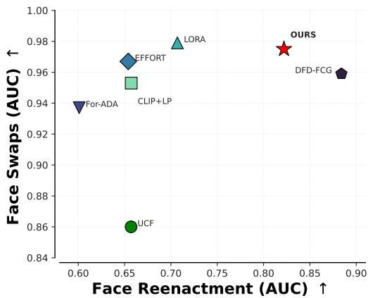
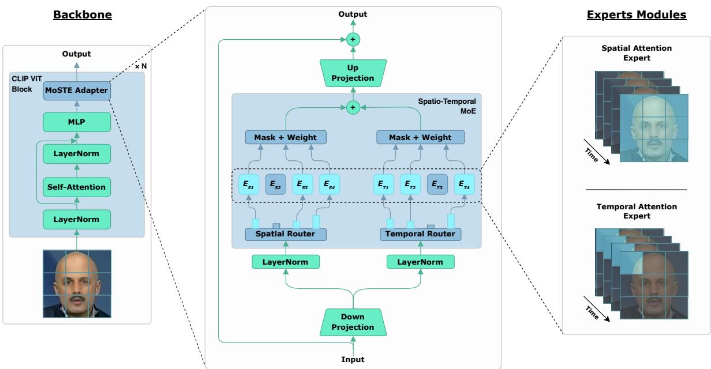
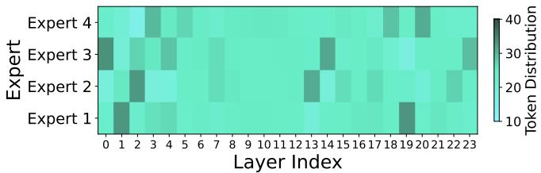
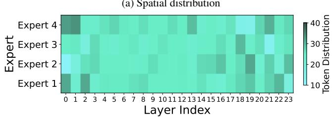
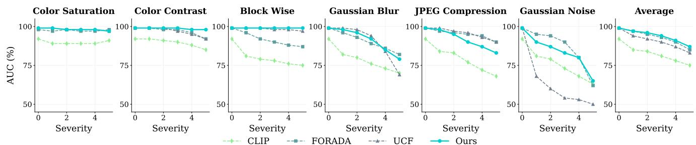
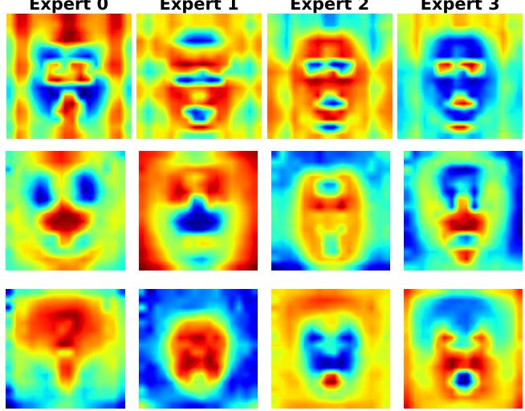
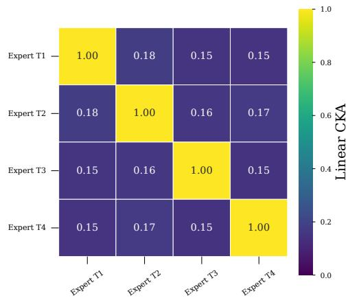

# MoSTE: Mixture of Spatio-Temporal Experts for Deepfake Detection in Videos

Charbel Yahchouchi1,2∗ Nabyl Quignon1∗ Noemi Roggero2

Laurent Saroul2 Antitza Dantcheva1

1 Inria Centre at Universite C´ ote d’Azur ˆ 2 Probayes

## Abstract

Generalizable deepfake video detection remains challenging because forgery artifacts vary substantially across manipulation types and often combine diverse spatial and temporal inconsistencies. Existing parameter-efficient adaptation methods typically rely on a single shared representation, rendering them prone to manipulation-specific bias and limiting transfer to unseen forgeries. To address this challenge, we propose Mixture Of Spatio-Temporal Experts (MoSTE), an adaptation framework that enables conditional specialization offorensic representations. Instead offorcing one adapter to model all forgery patterns, MoSTE decomposes adaptation into parallel spatial and temporal expert pools and dynamically routes tokens to the most relevant experts through an unsupervised tokenlevel routing mechanism. This allows experts to naturally specialize in complementary forgery cues without requiring explicit manipulation labels or multi-stage training, while effectively transferring representations from CLIP to the video domain. Extensive experiments across crossdataset and cross-manipulation benchmarks demonstrate that MoSTE sets a new state of the art in average generalization while preserving strong performance across diverse manipulation families. Additional analysis of expert routing and attention behavior reveals the emergence ofexpert diversity, suggesting that MoSTE learns complementary spatio-temporalforensicfeatures. Code is available at https://github.com/charbelyah/MoSTE

## 1. Introduction

Video generation [7, 41, 44, 48, 49] has reached unprecedented levels of realism, driven by remarkably rapid advancements in generative models including Stable Diffusion [44], Sora [2], Flux [26], and WanVideo [48]. While such advancements allow for new creative prospects in use cases related to entertainment and marketing, they thrust upon us the danger of deepfakes - generated videos portraying individuals in scenarios that never occurred. Deepfakes pose an imminent security threat, and have already been weaponized for manipulation, disinformation, and fraud [34, 47].

  
Figure 1. Face Swap vs. Face Reenactment generalization on DF40 dataset. We compare MoSTE with CLIP+LP [42], LoRA [21], UCF [53], DFD-FCG [20], EFFORT [56], and ForAda [10] . Each point reports video-level AUC averaged over the corresponding manipulation family. MoSTE, shown with a star, achieves the best balance between Face Swap and Face Reenactment performance.

Consequently, deepfake detection has gained high interest and impact in computer vision [1, 8, 40, 43]. Early approaches leveraged deep learning architectures aimed at discriminating real and fake images and videos, and were able to achieve impressive results in in-dataset evaluation; however, their performance often collapsed in cross-dataset settings, i.e., they lacked generalizability. Therefore, more recent research aimed at improving generalization by focusing on specific forgery clues, such as frequency domain analysis [32, 40] and blending artifacts [27]. Additional approaches explored the use of synthetic data [46, 61], in order to reduce overfitting to manipulation-specific cues. We note that existing detectors remain challenged when facing images and videos pertaining to “unseen” generative models, i.e., out of training distribution, as they tend to overfit to specific artifact distributions of their training domains.

Recently, adapting foundation models has become a promising direction towards more generalizable detection [9, 10, 20, 56, 57], as these models demonstrate inherent zero-shot capabilities. Such parameter-efficient finetuning (PEFT) techniques for deepfake detection primarily focus on equipping pretrained backbones with forgery priors, leveraging the associated foundational knowledge.

However, such approaches often tend to neglect the inductive bias inherent to each PEFT technique [33, 35]. Specifically, a model adapted using a fine-tuning strategy may become highly effective at detecting certain manipulation types, while underperforming on others. Such bias limits the robustness of detectors and hinders generalization across diverse and unseen forgery methods. We illustrate in Fig. 1 how different adaptations yield inconsistent performance in deepfake detection, in particular for Face Swap and Reenactment. We note that Face Swap involves identity replacement, whereas Face Reenactment entails transferring facial expressions from one person to another. EF-FORT [56] and ForAda [10] achieve high Area Under the Curve (AUCs) on Face Swap; however, on Face Reenactment, they show similar performance to the base CLIP model. Conversely, methods such as DFD-FCG [20] significantly improve results on Face Reenactment by considering temporality, whereas demonstrate limited performance on Face Swap, on challenging datasets such as DFDC [13].

We note that it is imperative to consider the bias limits, in order to ensure generalizability. Therefore, we deviate from a single representation by enforcing independent learning of different forgery traces and modeling thereof. Specifically, we decompose adaptation into specialized spatial and temporal experts and allow tokens to dynamically select the most relevant experts during training. This transforms adaptation from a fixed global transformation into an input-dependent process.

We propose a Mixture of Spatio-Temporal Experts (MoSTE), where we insert an adapter across transformer layers of a frozen CLIP-ViT-L/14 backbone. MoSTE disentangles adaptation into spatial and temporal expert pools, while token-level routing dynamically assigns tokens to the most relevant experts. This enables specialization across both artifact nature and artifact diversity without explicit manipulation labels. This approach effectively resolves the imbalance in manipulation sensitivity and establishes a highly generalizable detection framework. Our contributions include the following.

• We introduce MoSTE, a novel single-stage PEFTframework for video deepfake detection that performs spatiotemporal adaptation through token-level expert routing. Unlike previous approaches that learn a single shared representation per manipulation type, MoSTE allows unsupervised specialization across diverse forgery traces without explicit guidance.

• We conduct extensive experiments, comparing MoSTE to recent SOTA on datasets such as Celeb-DF-v3 [29] and DF40 [55] under a set of protocols. Our results suggest that MoSTE is endowed with generalizability, as opposed to SOTA models.

• We evaluate MoSTE entailing large-scale training using the DF40 Face Swap and Face Reenactment subsets, in order to assess the scalability of our proposed adaptation architecture and its generalization capability.

## 2. Related work

## 2.1. Generalizable Deepfake Detection

Limited generalization capacity of deepfake detection stems from the tendency of models to capture manipulationspecific cues rather than intrinsic forensic traces. Towards mitigating this challenge, a prominent research direction focused on learning universal forgery artifacts, including frequency-domain inconsistencies [31, 32, 40], blending artifacts [10, 27, 36], and facial attribute anomalies [18, 19]. Another widely explored approach leveraged blending data [27, 46, 61] by simulating common forgery inconsistencies, aimed at encouraging models to learn generalized forgery features. Subsequent studies [5, 30] have proposed training strategies that combine handcrafted pseudo-fake samples and deepfake data from FaceForensics++ (FF++) dataset. Under the same blending-data paradigm, several works [3, 37, 57] extended pseudo-fake generation to the video domain by simulating common temporal artifacts, like temporal landmark drifting.

Tackling generalizability, research works [17, 23, 59] advanced deepfake detection into the spatio-temporal domain by explicitly modeling temporal dynamics to capture artifacts such as temporal inconsistency, and unnatural motion. These methods employ diverse strategies, including 3D convolutional backbones [62], temporal encoding schemes [51], spatial–temporal optimization [50], and latent style-flow cues [6].

Deviating from the aforementioned approaches, we assume that each manipulation category exhibits distinct forgery artifacts, and therefore a single adaptation strategy is insufficient. To address this, we propose a novel adapter architecture capable of dynamically adapting to the diverse landscape of forensic traces.

## 2.2. Foundation Model Adaptation for Deepfake Detection

Foundation vision-language models such as CLIP [42] have strong transfer ability, motivating recent CLIP-based deepfake detectors [10, 20, 52, 56, 57]. These methods preserve pretrained representations while learning forensic cues [56]: ForensicsAdapter [10] learns blending-aware attention biases, Yan et al. [57] add spatial-temporal modules using synthetic videos, DFD-FCG [20] uses a side decoder for intermediate spatial-temporal cues, and EFFORT [56] adapts LoRA [21] while retaining principal components. However, these PEFT strategies remain fixed across manipulation types and may introduce their own inductive bias [33], limiting generalization to out-of-training manipulations. MoSTE instead routes tokens through specialized spatial and temporal expert pools.

## 2.3. Mixture of Experts in Deepfake Detection

The Mixture of Experts (MoE) paradigm has recently emerged in multimedia forensics as an effective mechanism to improve cross-domain generalization. MoE-FFD [24] integrates LoRA and Adapter layers as distinct experts within Vision Transformers (ViT) to extract complementary global and local forgery cues. DevFD [60] extends this to continual learning by adding orthogonal LoRA experts for emerging manipulation types. Forensic-MoE [15] broadens the scope to universal synthetic image detection by assigning experts explicitly to GAN and Diffusion generative domains. Despite their promise, these approaches share two fundamental limitations. First, they operate at the frame level [15, 24, 60], entirely discarding temporal artifacts. Second, they rely on explicit domain supervision or multi-stage training to guide expert specialization [15, 60]. In contrast, MoSTE addresses both limitations through a single-stage spatio-temporal framework with an unsupervised routing mechanism that autonomously discovers spatial and temporal forgery traces without requiring domain labels or sequential pre-training.

## 3. Methodology

## 3.1. Overview

In this work, we introduce MoSTE, an adapter to transfer frozen CLIP-ViT image representations to the video deepfake detection domain. The key challenge is that forgery evidence is diverse: some artifacts are spatial and appear within individual frames, while others are temporal and only emerge across frames. Moreover, different manipulation families introduce different traces, e.g., face swaps often produce blending artifacts, whereas reenactment methods may create motion or landmark inconsistencies. A single shared adapter projection has to encode all these cues with the same parameters, which can limit specialization. MoSTE addresses this diversity by replacing the standard adapter bottleneck with a mixture of spatio-temporal experts. Each adapter first projects tokens to a compact bottleneck representation, then routes them to two expert pools: spatial experts process patches within each frame, while temporal experts process the same patch locations across frames. A token-level router selects and weights the most relevant experts, allowing different tokens to rely on different forensic cues without requiring manipulation labels. Fig. 2 illustrates the overall adapter framework. Section 3.2 details the expert design, and Section 3.3 describes routing and load balancing.

## 3.2. Spatio-Temporal Expert Design

MoSTE builds on the observation that artifacts are both spatially and temporally different. Instead of using a fixed dualpathway adapter [38, 39], we introduce conditional spatial and temporal expert pools with token-level routing. Each adapter maps the input $X _ { i n }$ to a bottleneck representation $X _ { m i d }$ through a shared down-projection and GELU activation, then processes $X _ { m i d }$ with two independent expert pools.

Spatial and temporal experts. We define two expert pools, $\mathcal { E } _ { B } ~ = ~ \{ E _ { e } ^ { B } \} _ { e = 1 } ^ { N }$ with $B \ \in \ \{ S , T \}$ , where S and $T$ denote the spatial and temporal branches, respectively. Each expert is implemented as self-attention over a branchspecific token arrangement:

$$
E _ { e } ^ { B } ( X _ { m i d } ) = \mathrm { A t t n } _ { B , e } \big ( \mathrm { R e s h a p e } _ { B } ( X _ { m i d } ) \big ) , \quad B \in \{ S , T \} .\tag{1}
$$

Here, Reshape groups patches within each frame to capture intra-frame artifacts, while Reshape groups the same patch location across frames to capture inter-frame inconsistencies.

## 3.3. Expert Routing and Specialization

Token-level routing. The goal of routing is specialization: each expert should consistently handle a specific type of forensic trace. For each token i in $X _ { m i d }$ , a linear gating network produces routing logits $r _ { i , e }$ over the E available experts. The Top-k experts are selected per token, and routing weights are computed via softmax restricted to those selected experts:

$$
w _ { i , e } = \left\{ \begin{array} { l l } { \frac { \exp ( r _ { i , e } ) } { \sum _ { j \in \mathcal { T } _ { i } } \exp ( r _ { i , j } ) } } & { \mathrm { i f } e \in \mathcal { T } _ { i } } \\ { 0 } & { \mathrm { o t h e r w i s e } } \end{array} \right. ,\tag{2}
$$

where $\mathcal { T } _ { i }$ is the set of Top-k selected experts for token i. Each active expert processes the full sequence, but its contribution is gated by these weights. Tokens not assigned to a given expert receive a zero weight, effectively masking its output. The aggregated spatial branch output is:

$$
Y _ { S } = \sum _ { e = 1 } ^ { N } w _ { i , e } \odot \mathcal { E } _ { S , e } ( X _ { m i d } ) ,\tag{3}
$$

and $Y _ { T }$ is computed identically for the temporal branch. The outputs of both branches are additively fused with $X _ { m i d }$ , passed through a GELU activation, and projected

MoSTE Adapter architecture  
  
Figure 2. Overview of the MoSTE architecture. MoSTE adapters are inserted into a frozen CLIP-ViT backbone and operate in the adapter bottleneck space. Tokens are routed to independent spatial and temporal expert pools. The selected expert outputs are masked, weighted, fused, and projected back through a residual adapter update.

(a) Spatial distribution  
  
(b) Temporal distribution  
Figure 3. Expert routing load. Each cell shows the percentage of tokens routed to each of the four experts (E1–E4), with separate heatmaps for spatial and temporal attention. A perfectly balanced distribution corresponds to 25% per expert. The middle layers (4- 12) exhibit near-uniform routing, while the early (0-2) and late (18-23) layers show stronger specialization.

back to the original dimension via a shared up-projection $W _ { u p } ,$ with a residual connection preserving the original feature stream:

$$
X _ { o u t } = X _ { i n } + \mathrm { { G E L U } } ( X _ { m i d } + Y _ { S } + Y _ { T } ) W _ { u p }\tag{4}
$$

Load balancing without auxiliary losses. A common failure mode in MoE models is routing collapse, where most tokens are repeatedly assigned to a small subset of experts. This reduces expert diversity and limits the benefit of using an MoE architecture. Standard approaches often prevent this behavior with auxiliary load-balancing losses, but these losses introduce an additional optimization objective that may interfere with the main deepfake detection loss.

To avoid this, we follow the auxiliary-loss-free strategy of DeepSeek-V3 [11]. Each expert e is assigned an adaptive routing bias $b _ { e } ,$ which is used only when selecting the Top-k experts for each token:

$$
\mathcal { T } _ { i } = \mathrm { T o p } \ – k _ { e } ( r _ { i , e } + b _ { e } ) ,\tag{5}
$$

where $r _ { i , e }$ is the routing logit between token i and expert e, and $\mathcal { T } _ { i }$ denotes the selected expert set.

Importantly, the bias affects only the expert selection step. Once the experts are selected, the routing weights are still computed from the original logits $\boldsymbol { r } _ { i , e } .$ , as in Eq. 2. This preserves the main learning signal while allowing the router to correct imbalanced expert usage.

After each training step, we update the bias according to the observed expert load. Experts that receive too many tokens have their bias decreased, making them less likely to be selected in subsequent steps. Conversely, underused experts have their bias increased, encouraging the router to assign them more tokens. This simple feedback mechanism keeps expert utilization balanced without introducing any auxiliary loss. As shown in Fig. 3, it maintains welldistributed routing across experts while allowing the model to optimize only the primary detection objective.

## 4. Experiments

We here elaborate on implementation details and evaluation settings, and proceed to evaluate MoSTE under two deepfake detection protocols, aimed at assessing generalization across datasets and manipulation types. We then conduct an ablation study, in order to quantify the contribution of each MoSTE-component.

## 4.1. Implementation Details

We use CLIP-ViT-L/14 [42] as a frozen backbone and insert MoSTE adapters into all 24 transformer blocks, optimizing only the adapters, classification head, and learnable temporal embeddings. Each adapter has bottleneck dimension $d _ { \mathrm { a d a p t e r } } = 1 2 8$ and separate spatial/temporal expert pools with $N \ = \ 4$ experts each, Top-k routing with $k \ = \ 3 .$ and auxiliary-loss-free bias balancing with update speed $\gamma = 1 0 ^ { - 4 }$ . We train for 10 epochs on 4 NVIDIA H100 GPUs using Adam with learning rate $4 \times 1 0 ^ { - 4 } , \beta _ { 1 } = 0 . 9$ $\beta _ { 2 } ~ = ~ 0 . 9 9 9$ , weight decay $5 \times 1 0 ^ { - 4 }$ , and cosine annealing to $1 0 ^ { - 5 }$ with $t _ { \mathrm { m a x } } = 1 0$ . From each video, we sample 32 frames and feed 8-frame clips with horizontal flip, random rotation, Gaussian blur, and brightness/contrast perturbations.

## 4.2. Evaluation Settings

We conduct training on the FF++ dataset [45] under the C23 compression setting. The training split comprises 1,000 real and 4,000 manipulated videos.

To comprehensively evaluate the generalization capability of the proposed approach, we adopt two complementary evaluation protocols, namely Protocol-1 (cross-dataset evaluation) and Protocol-2 (cross-manipulation evaluation within the FF++ domain) that we proceed to elaborate on.

Protocol-1. Cross-Dataset Evaluation. In this setting, models trained on FF++ are evaluated on large-scale deepfake benchmarks without further fine-tuning. Specifically, we consider Celeb-DF v2 (CDF-v2) [28], Celeb-DF-v3 (CDF-v3) [29], DeepFakeDetection (DFD) [14], the Deep-Fake Detection Challenge (DFDC) dataset [13], and its preview version (DFDCP) [12]. This protocol measures robustness to domain shifts in data distribution, compression artifacts, and manipulation pipelines.

Protocol-2. Cross-Manipulation Evaluation. As proposed by Yan et al. [56], we further assess generalization to unseen manipulation methods using the recently introduced DF40 dataset [55]. DF40 is constructed from real samples in CDF and includes deepfakes generated with 40 additional manipulation techniques, including face swaps and reenactment. Protocol-2 evaluates the model’s ability to generalize to a more diverse set of forgery methods.

## 4.3. Generalization Evaluation

## 4.3.1. Cross-Dataset Evaluation

W.r.t. Protocol-1, all methods are trained on FF++ and directly evaluated on unseen target datasets to assess crossdataset generalization. The results are reported in Table 1 in terms of video-level AUC (%). Our results suggest that MoSTE achieves superior average performance across datasets, indicating strong and consistent generalization ability. In particular, MoSTE attains the top performance on DFD and ranks second on CDF-v3 and DFDC, while remaining highly competitive on the other benchmarks. Although ForAda achieves the best results on CDFv2, DFDC, and DFDCP, our approach demonstrates more balanced performance across datasets.

Compared with existing SOTA, MoSTE excels on single benchmarks, as well as maintains robust performance under different distribution shifts, i.e., ability to generalize across datasets.

## 4.3.2. Cross-Manipulation Evaluation

W.r.t. Protocol-2, where models are trained on FF++ and evaluated on unseen DF40 manipulations, Table 2 directly validates our central claim by evaluating both Face Swap and Face Reenactment attacks. MoSTE achieves the best overall performance and maintains a consistent high AUC across both manipulation families.

Unlike Fig. 1, which averages over all DF40 methods per family, Table 2 reports per-method results on a representative subset covering distinct generation mechanisms (e.g., latent-space animation in LIA, audio-driven lip synchronization in Wav2Lip, warping-based motion transfer in TPSM). MoSTE performs strongly on Face Swap (Ble-Face, InSwap, SimSwap, UniFace) while generalizing well to Face Reenactment (Wav2Lip, LIA, TPSM), whereas recent PEFT-based detectors are less balanced across the two families. This indicates that spatio-temporal expert routing reduces manipulation-specific bias and yields more transferable forensic representations.

## 4.3.3. Robustness Evaluation

We evaluate the robustness of our proposed framework against common post-processing perturbations. Following the experimental protocol in [22], we subject FF++ test data to six categories of distortions across multiple severity levels, viz. color saturation, color contrast, block-wise distortions, Gaussian blur, JPEG compression, and Gaussian noise. We compare MoSTE with recent SOTA approaches, including ForAda [10], UCF [53], and the CLIP-based baseline [42]. As summarized in Fig. 4, our method consistently outperforms competing approaches in mean performance. Specifically, this disentangled spatio-temporal experts setup maintains forensic fidelity despite compression and noise, demonstrating robustness to common real-world degradations.

Table 1. Cross-dataset evaluation results under Protocol-1. All methods are trained on FaceForensics++ (FF++) C23 and evaluated across different datasets. Baseline results are taken from [56] and reported in terms of video-level AUC (%). † indicates inference from official checkpoints. The best result for each dataset is highlighted in bold, and the second-best result is underlined.
<table><tr><td>Detector</td><td>CDF-v2</td><td> ${ \mathrm { C D F - v } } 3 ^ { \dagger }$ </td><td>DFD</td><td>DFDC</td><td>DFDCP</td><td>Avg</td></tr><tr><td>SBI [46]</td><td>93.2</td><td></td><td>82.7</td><td>72.4</td><td></td><td>82.8</td></tr><tr><td>UCF [53]</td><td>83.7</td><td>83.6</td><td>86.7</td><td>74.2</td><td>77.0</td><td>81.0</td></tr><tr><td>LSDA [54]</td><td>87.5</td><td>一</td><td>88.1</td><td>70.1</td><td>81.2</td><td>81.7</td></tr><tr><td>ProDet [5]</td><td>92.6</td><td></td><td>90.1</td><td>70.7</td><td>82.8</td><td>84.1</td></tr><tr><td>CDFA [30]</td><td>93.8</td><td>一</td><td>95.4</td><td>83.0</td><td>88.1</td><td>90.1</td></tr><tr><td>UDD [16]</td><td>93.1</td><td>一</td><td>95.5</td><td>81.2</td><td>88.1</td><td>89.5</td></tr><tr><td>FakeSTormer [37]</td><td>92.4</td><td></td><td>96.5</td><td>74.6</td><td>90.0</td><td>88.4</td></tr><tr><td>ForAda [10]</td><td>95.7</td><td>84.5</td><td>97.2</td><td>87.2</td><td>92.9</td><td>91.5</td></tr><tr><td>DFD-FCG [20]</td><td>95.0</td><td>93.8</td><td></td><td>81.8</td><td></td><td>90.2</td></tr><tr><td>GenD [58]</td><td>95.4</td><td>90.1</td><td>96.4</td><td>86.4</td><td>90.0</td><td>91.7</td></tr><tr><td>EFFORT†[56]</td><td>93.2</td><td>87.2</td><td>96.5</td><td>84.3</td><td>85.6</td><td>89.4</td></tr><tr><td>Ours (MoSTE)</td><td>95.5</td><td>91.3</td><td>97.5</td><td>86.8</td><td>90.7</td><td>92.4</td></tr></table>

Table 2. Cross-manipulation evaluation under Protocol-2. Models are trained on FF++ and tested on CDF-domain face swap and reen actment manipulations. All methods use official checkpoints and setup settings provided by authors. Metric: video-level AUC (%). Best results are bolded and second-best underlined.
<table><tr><td rowspan="2">Method</td><td colspan="5">Face Swap</td><td colspan="4">Face Reenactment</td></tr><tr><td>BleFace</td><td>Inswap</td><td>Simswap</td><td>UniFace</td><td>Avg.</td><td>Wav2Lip</td><td>LIA</td><td>TPSM</td><td>Avg.</td></tr><tr><td>UCF [53]</td><td>66.3</td><td>70.5</td><td>47.3</td><td>66.7</td><td>62.7</td><td>71.0</td><td>87.2</td><td>57.0</td><td>71.7</td></tr><tr><td>ProDet [5]</td><td>83.1</td><td>75.1</td><td>64.4</td><td>78.4</td><td>75.3</td><td>71.5</td><td>75.1</td><td>46.7</td><td>64.4</td></tr><tr><td>DFD-FCG [20]</td><td>95.4</td><td>93.7</td><td>92.7</td><td>97.9</td><td>94.9</td><td>57.4</td><td>98.5</td><td>89.5</td><td>81.8</td></tr><tr><td>GenD [58]</td><td>92.8</td><td>89.1</td><td>90.1</td><td>97.0</td><td>92.3</td><td>78.9</td><td>88.8</td><td>70.8</td><td>79.5</td></tr><tr><td>EFFORT [56]</td><td>89.7</td><td>87.8</td><td>86.9</td><td>92.8</td><td>89.3</td><td>64.5</td><td>79.6</td><td>62.2</td><td>68.8</td></tr><tr><td>ForAda [10]</td><td>82.8</td><td>89.1</td><td>75.9</td><td>86.0</td><td>83.4</td><td>57.8</td><td>79.5</td><td>62.7</td><td>66.7</td></tr><tr><td>Ours (MoSTE)</td><td>93.7</td><td>96.3</td><td>95.7</td><td>97.7</td><td>95.9</td><td>78.4</td><td>97.4</td><td>82.4</td><td>86.1</td></tr></table>

Table 3. Main components ablation. Impact of MoE, “S” for Spatial, and $^ { 6 6 } \mathrm { T } ^ { \flat }$ for Temporal components. The metric is videolevel AUC (%).
<table><tr><td>MoE</td><td>S</td><td>T</td><td>CDF-v2</td><td>DFDCP</td><td>DFDC</td><td>DFD</td><td> $\operatorname { A v g } .$ </td></tr><tr><td>×</td><td>√</td><td>√</td><td>95.5</td><td>88.0</td><td>86.5</td><td>97.1</td><td>91.8</td></tr><tr><td>√</td><td>X</td><td>√</td><td>91.6</td><td>88.1</td><td>80.9</td><td>94.7</td><td>88.8</td></tr><tr><td>√</td><td>√</td><td>×</td><td>91.3</td><td>85.6</td><td>80.6</td><td>97.4</td><td>88.7</td></tr><tr><td>√</td><td>√</td><td>√</td><td>95.5</td><td>90.7</td><td>86.8</td><td>97.5</td><td>92.6</td></tr></table>

## 4.4. Ablation Study

## 4.4.1. Ablation on Adapter Components

We isolate the core components of the MoSTE architecture to validate our design choices, see Table 3. Replacing the MoE routing mechanism with an unweighted ensemble of

4 experts leads to a notable degradation of generalizability, particularly on DFDCP dataset with a −2.7%. This indicates that the concurrent activation of all learned features introduces noise, degrading model performance. Without the specialized focus of the routers, the final representation of each token becomes less informative, preventing the model from isolating the specific spatial or temporal traces it has learned to identify. Furthermore, disabling either the spatial or temporal branch severely degrades performance, demonstrating that both branches are mandatory.

## 4.4.2. Ablation on Experts

Table 4 shows the effect of the number of experts N and the Top-k routing threshold. The experiment $N = 1$ serves as a baseline; it refers to a simple dense spatio-temporal adapter without any router. Introducing multiple experts $( N \geq 2 )$ consistently improves the average AUC over the single path spatio-temporal baseline, confirming the benefit of specialization. Performance increases up to $N = 4 ,$ , while further scaling to N = 8 yields no additional gains and slightly reduces stability across datasets, indicating diminishing returns from excessive capacity.

Expert 2  
  
Figure 4. Robustness analysis on FF++. We evaluate the video-level AUC under six common perturbations such as Gaussian Blur and JPEG compression across multiple severity levels. MoSTE exhibits lower performance degradation compared to SOTA.

Table 4. Ablation Study on Expert Configuration. Impact of the total number of experts (N) and the Top-k routing selection on video-level AUC.
<table><tr><td rowspan=1 colspan=1>Experts</td><td rowspan=1 colspan=1>Top-k</td><td rowspan=1 colspan=2>CDF-v2 DFDCP</td><td rowspan=1 colspan=1>DFDC</td><td rowspan=1 colspan=2>Avg.</td></tr><tr><td rowspan=1 colspan=1>N = 1</td><td rowspan=1 colspan=1>1</td><td rowspan=1 colspan=1>92.8</td><td rowspan=1 colspan=1>89.8</td><td rowspan=1 colspan=1>85.2</td><td rowspan=1 colspan=2>89.3</td></tr><tr><td rowspan=1 colspan=1>N = 2</td><td rowspan=1 colspan=1>12</td><td rowspan=1 colspan=1>95.295.1</td><td rowspan=1 colspan=1>90.891.0</td><td rowspan=1 colspan=1>85.286.0</td><td rowspan=1 colspan=2>90.490.7</td></tr><tr><td rowspan=2 colspan=1>N = 4</td><td rowspan=2 colspan=1>234</td><td rowspan=2 colspan=1>96.295.595.8</td><td rowspan=1 colspan=1>86.4</td><td rowspan=1 colspan=1>82.7</td><td rowspan=2 colspan=2>88.491.090.0</td></tr><tr><td rowspan=1 colspan=1>90.788.7</td><td rowspan=1 colspan=1>86.885.5</td></tr><tr><td rowspan=2 colspan=1>N = 8</td><td rowspan=2 colspan=1>46</td><td rowspan=2 colspan=1>93.694.4</td><td rowspan=1 colspan=1>89.0</td><td rowspan=1 colspan=1>84.1</td><td rowspan=1 colspan=2>88.9</td></tr><tr><td rowspan=1 colspan=1>90.3</td><td rowspan=1 colspan=1>86.6</td><td></td><td></td></tr></table>

Table 5. One router ablation. Comparison of expert selection methods with only one router. The metric is video-level AUC.

<table><tr><td rowspan=1 colspan=1>Selection</td><td rowspan=1 colspan=1>CDF-v2</td><td rowspan=1 colspan=1>CDF-v3</td><td rowspan=1 colspan=1>FSh</td><td rowspan=1 colspan=1>DFD</td><td rowspan=1 colspan=1>DFDC</td><td rowspan=1 colspan=1>Avg.</td></tr><tr><td rowspan=1 colspan=1>PS</td><td rowspan=1 colspan=1>94.7</td><td rowspan=1 colspan=1>88.1</td><td rowspan=1 colspan=1>87.2</td><td rowspan=1 colspan=1>96.9</td><td rowspan=1 colspan=1>84.7</td><td rowspan=1 colspan=1>90.3</td></tr><tr><td rowspan=1 colspan=1>FS</td><td rowspan=1 colspan=1>92.3</td><td rowspan=1 colspan=1>87.4</td><td rowspan=1 colspan=1>88.9</td><td rowspan=1 colspan=1>96.7</td><td rowspan=1 colspan=1>84.1</td><td rowspan=2 colspan=1>89.992.2</td></tr><tr><td rowspan=1 colspan=1>Ours</td><td rowspan=1 colspan=1>95.5</td><td rowspan=1 colspan=1>91.3</td><td rowspan=1 colspan=1>90.1</td><td rowspan=1 colspan=1>97.5</td><td rowspan=1 colspan=1>86.8</td></tr></table>

Overall, N = 4 with Top-k = 3 achieves the best tradeoff between performance and parameter efficiency, delivering the highest average AUC while keeping the parameter increase below 7% (19M params).

## 4.4.3. One Router Ablation

A key design element of MoSTE is the use of independent routers for the spatial and temporal expert pools. We evaluate this architecture against two “Unified Routing” baselines to justify the decoupling of forensic traces. In the Pair Selection (PS) configuration, a single router dispatches tokens to a fixed pair consisting of one spatial and one temporal expert. Conversely, the Free Selection (FS) setting employs a single router that is free to route tokens to any available expert, regardless of whether that expert specializes in spatial or temporal features. Results are reported in Table 5.

Expert 0  
Expert 1  
  
Figure 5. Average Attention Maps on CDF-v2. Visualization of the average spatial attention maps from our MoSTE adapter across three network depths (ordered from top to bottom: layers 1, 14, and 23). The heatmaps illustrate the emergent routing behavior of four distinct experts (E0–E3).

## 4.5. Qualitative Analysis of Expert Specialization

## 4.5.1. Spatial Expert

In Fig. 5, we visualize the averaged attention maps of four spatial experts from our MoSTE framework on CDF-v2 test samples. We select attention maps from three different backbone depths. The results show that, at each depth, the experts focus on distinct facial regions, such as the forehead, cheeks, and eyebrows, without explicit supervision. These visualizations offer indicative evidence of expert diversity, suggesting that MoSTE captures complementary cues across heterogeneous forgery features in videos.

  
Figure 6. Temporal expert similarity measured with linear CKA. Metric is averaged over all blocks of backbone and 1000 samples from CDF-v2.

## 4.5.2. Temporal Expert Complementarity

We use linear CKA [25] to measure whether temporal experts learn redundant or complementary representations. Expert outputs are extracted before spatial fusion, up-projection, and the global residual connection, then weighted by their temporal router assignments while keeping the same ordered spatio-temporal tokens across experts.

As shown in Fig. 6, off-diagonal CKA values remain low (0.15–0.18), while diagonal values are 1.0 by construction. This suggests that temporal experts avoid representational collapse and learn complementary inter-frame forensic cues.

## 4.6. Capacity-Controlled Adapter Ablation

A natural question is whether MoSTE’s gains stem from expert routing or simply from increased adapter capacity. To isolate this factor, we compare MoSTE against dense dualpathway spatio-temporal adapters with enlarged bottleneck dimensions, chosen to match or exceed the trainable parameter count of MoSTE. As shown in Table 6, increasing the capacity of a dense adapter does not consistently improve out-of-distribution generalization. In particular, the 75Mparameter baseline underperforms the smaller 25M baseline on average, suggesting that additional capacity alone may amplify overfitting to the source distribution. In contrast, MoSTE achieves the best average AUC with fewer parameters than the largest dense baseline, indicating that the improvement comes from conditional spatio-temporal expert routing rather than parameter count alone.

## 4.7. Effect of Scaling

To evaluate scalability, we follow recent large-scale training protocols based on DF40 [55]. Our model (N = 4, Topk = 3) is trained on a DF40 subset containing over 25,000 video sequences spanning 23 distinct Face Swap and Reenactment methods. We ensure no overlap with other evaluation datasets. For comparison, we retrain EFFORT, a strong PEFT baseline, using the authors’ official implementation, increasing the residual rank to handle greater manipulation diversity. We also report results from DF40 project checkpoints for CLIP full fine-tuning [42] and an I3D-based [4] video detector.

Table 6. Capacity-controlled comparison with dense dual-pathway adapters.
<table><tr><td>Method</td><td>Params</td><td>CDF-v2</td><td>DFDCP</td><td>CDF-v3</td><td>Avg.</td></tr><tr><td>Dense ST adapter, dim=512</td><td>75M</td><td>93.6</td><td>91.1</td><td>87.2</td><td>90.6</td></tr><tr><td>Dense ST adapter, dim=256</td><td>25M</td><td>93.4</td><td>91.3</td><td>90.3</td><td>91.7</td></tr><tr><td>D2ST adapter [39]</td><td>9M</td><td>92.6</td><td>88.6</td><td>87.6</td><td>89.6</td></tr><tr><td>MoSTE</td><td>19M</td><td>95.5</td><td>90.7</td><td>91.3</td><td>92.5</td></tr></table>

Table 7. Video-level AUC (%) of different deepfake detection methods trained on DF40 [55]. † denotes models evaluated from the released DF40 checkpoints, while FR+FS indicates training on a combination of Face Swap and Face Reenactment sequences.

<table><tr><td>Method</td><td>Train Set</td><td> $\mathrm { F F } { + + }$ </td><td>CDF-v2</td><td>DFD</td><td>FSh</td><td>Avg</td></tr><tr><td>CLIP†</td><td>DF40</td><td>88.4</td><td>92.0</td><td>82.3</td><td>93.9</td><td>89.2</td></tr><tr><td>EFFORT</td><td>FR+FS</td><td>95.7</td><td>87.0</td><td>84.1</td><td>93.4</td><td>90.1</td></tr><tr><td>I3D†</td><td>FR+FS</td><td>95.2</td><td>76.3</td><td>68.0</td><td>95.1</td><td>83.7</td></tr><tr><td>Ours</td><td>FR+FS</td><td>93.8</td><td>91.5</td><td>96.7</td><td>95.7</td><td>94.4</td></tr></table>

Evaluation is performed on four benchmarks, including FF++, DFD, CDF-v2, and FaceShifter. Table 7 indicates that MoSTE benefits from large-scale and diverse training, while maintaining consistent generalization performance across unseen manipulations compared to SOTA.

## 5. Conclusions

In this paper, we introduced MoSTE, a novel Mixture of Spatio-Temporal Experts framework designed to improve generalization in video deepfake detection. Different manipulation types produce fundamentally different spatial and temporal artifacts, rendering a single adaptation pathway inherently biased toward particular forgery families, i.e., face swap and face reenactment. To overcome this limitation, MoSTE decouples feature representation into parallel spatial and temporal experts. Specifically, we learn a set of specialized experts and dynamically select which experts process each token. This enables the model to adapt to heterogeneous forgery patterns while remaining fully labelfree and end-to-end trainable. In our extensive evaluations we showcase that our single-stage approach successfully balances detection capabilities across diverse manipulation methods. By establishing new state-of-the-art performance on both, cross-dataset and cross-manipulation benchmarks, alongside proven robustness to real-world video perturbations, MoSTE provides a highly adaptable detection approach in the continuously evolving landscape of video forgeries.

## Acknowledgements

This work was granted access to the HPC resources of IDRIS under the allocation 2026-AD011016744R1 and 2025-AD011015982R1 made by GENCI. The work of A. Dantcheva has been supported by the French government, through the France 2030 plan managed by the National Research Agency (ANR) with the reference number ”ANR-23-IACL-0001”.

## References

[1] Saurabh Atreya, Nabyl Quignon, Baptiste Chopin, Abhijit Das, and Antitza Dantcheva. Beyond real versus fake towards intent-aware video analysis. IEEE Transactions on Biometrics, Behavior, and Identity Science, 2026. 1

[2] Tim Brooks, Bill Peebles, Connor Holmes, Will DePue, Yufei Guo, Li Jing, David Schnurr, Joe Taylor, Troy Luhman, Eric Luhman, Clarence Ng, Ricky Wang, and Aditya Ramesh. Video generation models as world simulators. 2024. 1

[3] Yinqi Cai, Jichang Li, Zhaolun Li, Weikai Chen, Rushi Lan, Xi Xie, Xiaonan Luo, and Guanbin Li. Deepshield: Fortifying deepfake video detection with local and global forgery analysis. In Proceedings of the IEEE/CVF International Conference on Computer Vision, pages 12524–12534, 2025. 2

[4] Joao Carreira and Andrew Zisserman. Quo vadis, action recognition? a new model and the kinetics dataset. In proceedings of the IEEE Conference on Computer Vision and Pattern Recognition, pages 6299–6308, 2017. 8

[5] Jikang Cheng, Zhiyuan Yan, Ying Zhang, Yuhao Luo, Zhongyuan Wang, and Chen Li. Can we leave deepfake data behind in training deepfake detector? Advances in Neural Information Processing Systems, 37:21979–21998, 2024. 2, 6

[6] Jongwook Choi, Taehoon Kim, Yonghyun Jeong, Seungryul Baek, and Jongwon Choi. Exploiting style latent flows for generalizing deepfake video detection. In Proceedings of the IEEE/CVF conference on computer vision and pattern recognition, pages 1133–1143, 2024. 2

[7] Baptiste Chopin, Tashvik Dhamija, Pranav Balaji, Yaohui Wang, and Antitza Dantcheva. AI killed the video star. Audio-driven diffusion model for expressive talking head generation. International Journal of Computer Vision, 134 (5):239, 2026. 1

[8] Baptiste Chopin, Thomas Swearingen, Arun Ross, Antitza Dantcheva, and Christian Rathgeb. Ccdf: A benchmark dataset for deepfake detection in real-world surveillance footage. arXiv preprint arXiv:2610.07939, 2026. 1

[9] Davide Cozzolino, Giovanni Poggi, Riccardo Corvi, Matthias Nießner, and Luisa Verdoliva. Raising the Bar of AI-generated Image Detection with CLIP. In IEEE/CVF Conference on Computer Vision and Pattern Recognition Workshops (CVPRW), 2024. 2

[10] Xinjie Cui, Yuezun Li, Ao Luo, Jiaran Zhou, and Junyu Dong. Forensics adapter: Adapting clip for generalizable face forgery detection. In Proceedings of the Computer

Vision and Pattern Recognition Conference, pages 19207– 19217, 2025. 1, 2, 5, 6

[11] DeepSeek-AI. Deepseek-v3 technical report. arXiv preprin arXiv:2412.19437, 2025. 4

[12] Brian Dolhansky, Russ Howes, Ben Pflaum, Nicole Baram, and Cristian Canton Ferrer. The deepfake detection challenge (dfdc) preview dataset. arXiv preprint arXiv:1910.08854, 2019. 5

[13] Brian Dolhansky, Joanna Bitton, Ben Pflaum, Jikuo Lu, Russ Howes, Menglin Wang, and Cristian Canton Ferrer. The deepfake detection challenge (dfdc) dataset. arXiv preprint arXiv:2006.07397, 2020. 2, 5

[14] Nick Dufour and Andrew Gully. Contributing data to deepfake detection research. https : / / research . google / blog / contributing - data - to - deepfake - detection - research/, 2019. Google Research Blog. 5

[15] Mingqi Fang, Ziguang Li, Lingyun Yu, Quanwei Yang, Hongtao Xie, and Yongdong Zhang. Forensic-moe: Ex ploring comprehensive synthetic image detection traces with mixture of experts. In Proceedings of the IEEE/CVF International Conference on Computer Vision, pages 17772– 17782, 2025. 3

[16] Xinghe Fu, Zhiyuan Yan, Taiping Yao, Shen Chen, and Xi Li. Exploring unbiased deepfake detection via tokenlevel shuffling and mixing. In Proceedings of the AAAI Conference on Artificial Intelligence, pages 3040–3048, 2025. 6

[17] Zhihao Gu, Yang Chen, Taiping Yao, Shouhong Ding, Jilin Li, Feiyue Huang, and Lizhuang Ma. Spatiotempo ral inconsistency learning for deepfake video detection. In Proceedings of the 29th ACM international conference on multimedia, pages 3473–3481, 2021. 2

[18] Hui Guo, Shu Hu, Xin Wang, Ming-Ching Chang, and Siwei Lyu. Eyes tell all: Irregular pupil shapes reveal gan-generated faces. In ICASSP 2022-2022 IEEE international conference on acoustics, speech and signal processing (ICASSP), pages 2904–2908. IEEE, 2022. 2

[19] Alexandros Haliassos, Konstantinos Vougioukas, Stavros Petridis, and Maja Pantic. Lips don’t lie: A generalisable and robust approach to face forgery detection. In Proceedings of the IEEE/CVF conference on computer vision and pattern recognition, pages 5039–5049, 2021. 2

[20] Yue-Hua Han, Tai-Ming Huang, Kai-Lung Hua, and Jun-Cheng Chen. Towards more general video-based deepfake detection through facial component guided adaptation for foundation model. In Proceedings of the Computer Vision and Pattern Recognition Conference, pages 22995–23005, 2025. 1, 2, 3, 6

[21] Edward J Hu, Yelong Shen, Phillip Wallis, Zeyuan Allen Zhu, Yuanzhi Li, Shean Wang, Lu Wang, and Weizhu Chen. LoRA: Low-rank adaptation of large language models. In International Conference on Learning Representations, 2022. 1, 3

[22] Liming Jiang, Ren Li, Wayne Wu, Chen Qian, and Chen Change Loy. Deeperforensics-1.0: A large-scale dataset for real-world face forgery detection. In Proceedings

of the IEEE/CVF conference on computer vision and pattern recognition, pages 2889–2898, 2020. 5

[23] Taehoon Kim, Jongwook Choi, Yonghyun Jeong, Haeun Noh, Jaejun Yoo, Seungryul Baek, and Jongwon Choi. Beyond spatial frequency: Pixel-wise temporal frequencybased deepfake video detection. In Proceedings of the IEEE/CVF International Conference on Computer Vision (ICCV), pages 11198–11207, 2025. 2

[24] Chenqi Kong, Anwei Luo, Peijun Bao, Yi Yu, Haoliang Li, Zengwei Zheng, Shiqi Wang, and Alex C. Kot. Moe-ffd: Mixture of experts for generalized and parameter-efficient face forgery detection. IEEE Transactions on Dependable and Secure Computing, 23(1):82–96, 2026. 3

[25] Simon Kornblith, Mohammad Norouzi, Honglak Lee, and Geoffrey Hinton. Similarity of neural network representations revisited. In International conference on machine learning, pages 3519–3529. PMLR, 2019. 8

[26] Black Forest Labs. Flux. https://github.com/ black-forest-labs/flux, 2024. 1

[27] Lingzhi Li, Jianmin Bao, Ting Zhang, Hao Yang, Dong Chen, Fang Wen, and Baining Guo. Face x-ray for more general face forgery detection. In 2020 IEEE/CVF Conference on Computer Vision and Pattern Recognition (CVPR), pages 5000–5009. IEEE, 2020. 1, 2

[28] Yuezun Li, Xin Yang, Pu Sun, Honggang Qi, and Siwei Lyu. Celeb-df: A large-scale challenging dataset for deepfake forensics. In Proceedings of the IEEE/CVF conference on computer vision and pattern recognition, pages 3207–3216, 2020. 5

[29] Yuezun Li, Delong Zhu, Xinjie Cui, and Siwei Lyu. Celeb-df++: A large-scale challenging video deepfake benchmark for generalizable forensics. arXiv preprint arXiv:2507.18015, 2025. 2, 5

[30] Yuzhen Lin, Wentang Song, Bin Li, Yuezun Li, Jiangqun Ni, Han Chen, and Qiushi Li. Fake it till you make it: Curricular dynamic forgery augmentations towards general deepfake detection. In European conference on computer vision, pages 104–122. Springer, 2024. 2, 6

[31] Honggu Liu, Xiaodan Li, Wenbo Zhou, Yuefeng Chen, Yuan He, Hui Xue, Weiming Zhang, and Nenghai Yu. Spatialphase shallow learning: rethinking face forgery detection in frequency domain. In Proceedings of the IEEE/CVF conference on computer vision and pattern recognition, pages 772–781, 2021. 2

[32] Yuchen Luo, Yong Zhang, Junchi Yan, and Wei Liu. Generalizing face forgery detection with high-frequency features. In Proceedings of the IEEE/CVF conference on computer vision and pattern recognition, pages 16317–16326, 2021. 1, 2

[33] Zheda Mai, Ping Zhang, Cheng-Hao Tu, Hong-You Chen, Quang-Huy Nguyen, Li Zhang, and Wei-Lun Chao. Lessons and insights from a unifying study of parameter-efficient fine-tuning (peft) in visual recognition. In Proceedings of the Computer Vision and Pattern Recognition Conference, pages 14845–14857, 2025. 2, 3

[34] Phoebe Matich, T. J. Thomson, and Ryan J. Thomas. Old threats, new name? generative ai and visual journalism. Journalism Practice, 19(10):2402–2421, 2025. 1

[35] Behnam Neyshabur, Ryota Tomioka, and Nathan Srebro. In search of the real inductive bias: On the role of implicit regu larization in deep learning. arXiv preprint arXiv:1412.6614, 2014. 2

[36] Dat Nguyen, Nesryne Mejri, Inder Pal Singh, Polina Kuleshova, Marcella Astrid, Anis Kacem, Enjie Ghorbel, and Djamila Aouada. Laa-net: Localized artifact attention network for quality-agnostic and generalizable deepfake detection. In Proceedings of the IEEE/CVF Conference on Computer Vision and Pattern Recognition, pages 17395– 17405, 2024. 2

[37] Dat Nguyen, Marcella Astrid, Anis Kacem, Enjie Ghorbel, and Djamila Aouada. Vulnerability-aware spatio-temporal learning for generalizable deepfake video detection. In Proceedings of the IEEE/CVF International Conference on Computer Vision, pages 10786–10796, 2025. 2, 6

[38] Jungin Park, Jiyoung Lee, and Kwanghoon Sohn. Dual-path adaptation from image to video transformers. In Proceedings of the IEEE/CVF Conference on Computer Vision and Pattern Recognition, pages 2203–2213, 2023. 3

[39] Wenjie Pei, Qizhong Tan, Guangming Lu, Jiandong Tian, and Jun Yu. D2st-adapter: Disentangled-and-deformable spatio-temporal adapter for few-shot action recognition. In Proceedings of the IEEE/CVF International Conference on Computer Vision, pages 11317–11326, 2025. 3, 8

[40] Yuyang Qian, Guojun Yin, Lu Sheng, Zixuan Chen, and Jing Shao. Thinking in frequency: Face forgery detection by mining frequency-aware clues. In European conference on computer vision, pages 86–103. Springer, 2020. 1, 2

[41] Nabyl Quignon, Baptiste Chopin, Yaohui Wang, and An titza Dantcheva. Theval. evaluation framework for talking head video generation. In Proceedings of the IEEE/CVF Conference on Computer Vision and Pattern Recognition (CVPR) Findings, pages 1943–1953, 2026. 1

[42] Alec Radford, Jong Wook Kim, Chris Hallacy, Aditya Ramesh, Gabriel Goh, Sandhini Agarwal, Girish Sastry, Amanda Askell, Pamela Mishkin, Jack Clark, et al. Learning transferable visual models from natural language supervision. In International conference on machine learning, pages 8748–8763. PMLR, 2021. 1, 2, 5, 8

[43] Shukesh Reddy, Maheswar Bora, Tashvik Dhamija, Baptiste Chopin, Pranav Balaji, Abhijit Das, and Antitza Dantcheva. Do you see what i say? generalizable deepfake detection based on visual speech recognition. IEEE Transactions on Biometrics, Behavior, and Identity Science, 8(6):1001–1012, 2026. 1

[44] Robin Rombach, Andreas Blattmann, Dominik Lorenz, Patrick Esser, and Bjorn Ommer. High-resolution image¨ synthesis with latent diffusion models. In Proceedings of the IEEE/CVF conference on computer vision and pattern recognition, pages 10684–10695, 2022. 1

[45] Andreas Rossler, Davide Cozzolino, Luisa Verdoliva, Christian Riess, Justus Thies, and Matthias Nießner. Faceforensics++: Learning to detect manipulated facial images. In Proceedings of the IEEE/CVF international conference on computer vision, pages 1–11, 2019. 5

[46] Kaede Shiohara and Toshihiko Yamasaki. Detecting deepfakes with self-blended images. In Proceedings of the IEEE/CVF conference on computer vision and pattern recognition, pages 18720–18729, 2022. 1, 2, 6

[47] Araz Taeihagh. Governance of generative ai. Policy and Society, 44(1):1–22, 2025. 1

[48] Team Wan. Wan: Open and advanced large-scale video generative models. arXiv preprint arXiv:2503.20314, 2025. 1

[49] Yaohui Wang, Di Yang, Francois Bremond, and Antitza Dantcheva. Lia: Latent image animator. IEEE Transactions on Pattern Analysis and Machine Intelligence, 46(12): 10829–10844, 2024. 1

[50] Zhendong Wang, Jianmin Bao, Wengang Zhou, Weilun Wang, and Houqiang Li. Altfreezing for more general video face forgery detection. In Proceedings of the IEEE/CVF conference on computer vision and pattern recognition, pages 4129–4138, 2023. 2

[51] Yuting Xu, Jian Liang, Gengyun Jia, Ziming Yang, Yanhao Zhang, and Ran He. Tall: Thumbnail layout for deepfake video detection. In Proceedings of the IEEE/CVF international conference on computer vision, pages 22658– 22668, 2023. 2

[52] Charbel Yahchouchi, Noemi Roggero, Laurent Saroul, and Antitza Dantcheva. Generalizable deepfake detection via simplicity-bias-aware clip adaptation. In International Conference on Pattern Recognition, pages 573– 588. Springer, 2026. 2

[53] Zhiyuan Yan, Yong Zhang, Yanbo Fan, and Baoyuan Wu. Ucf: Uncovering common features for generalizable deepfake detection. In Proceedings of the IEEE/CVF international conference on computer vision, pages 22412– 22423, 2023. 1, 5, 6

[54] Zhiyuan Yan, Yuhao Luo, Siwei Lyu, Qingshan Liu, and Baoyuan Wu. Transcending forgery specificity with latent space augmentation for generalizable deepfake detection. In Proceedings of the IEEE/CVF Conference on Computer Vision and Pattern Recognition, pages 8984–8994, 2024. 6

[55] Zhiyuan Yan, Taiping Yao, Shen Chen, Yandan Zhao, Xinghe Fu, Junwei Zhu, Donghao Luo, Chengjie Wang, Shouhong Ding, Yunsheng Wu, et al. Df40: Toward

next-generation deepfake detection. Advances in Neural Information Processing Systems, 37:29387–29434, 2024. 2, 5, 8

[56] Zhiyuan Yan, Jiangming Wang, Peng Jin, Ke-Yue Zhang, Chengchun Liu, Shen Chen, Taiping Yao, Shouhong Ding, Baoyuan Wu, and Li Yuan. Orthogonal subspace de composition for generalizable ai-generated image detection. In International Conference on Machine Learning, pages 70268–70288. PMLR, 2025. 1, 2, 3, 5, 6

[57] Zhiyuan Yan, Yandan Zhao, Shen Chen, Mingyi Guo, Xinghe Fu, Taiping Yao, Shouhong Ding, Yunsheng Wu, and Li Yuan. Generalizing deepfake video detection with plug and-play: Video-level blending and spatiotemporal adapter tuning. In Proceedings of the Computer Vision and Pattern Recognition Conference, pages 12615–12625, 2025. 2

[58] Andrii Yermakov, Jan Cech, Jiri Matas, and Mario Fritz. Deepfake detection that generalizes across benchmarks. In 2026 IEEE/CVF Winter Conference on Applications of Computer Vision (WACV), pages 773–783. IEEE, 2026. 6

[59] Daichi Zhang, Zihao Xiao, Shikun Li, Fanzhao Lin, Jianmin Li, and Shiming Ge. Learning natural consistency representation for face forgery video detection. In European Conference on Computer Vision, pages 407–424. Springer, 2024. 2

[60] Tianshuo Zhang, Li Gao, Siran Peng, Xiangyu Zhu, and Zhen Lei. DevFD : Developmental face forgery detection by learning shared and orthogonal loRA subspaces. In The Thirty-ninth Annual Conference on Neural Information Processing Systems, 2025. 3

[61] Tianchen Zhao, Xiang Xu, Mingze Xu, Hui Ding, Yuanjun Xiong, and Wei Xia. Learning self-consistency for deepfake detection. In Proceedings of the IEEE/CVF international conference on computer vision, pages 15023–15033, 2021. 1, 2

[62] Yinglin Zheng, Jianmin Bao, Dong Chen, Ming Zeng, and Fang Wen. Exploring temporal coherence for more general video face forgery detection. In Proceedings of the IEEE/CVF international conference on computer vision, pages 15044–15054, 2021. 2