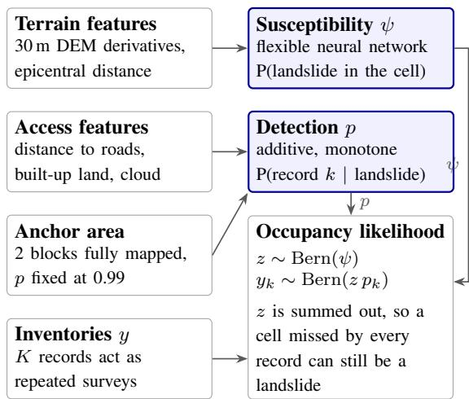
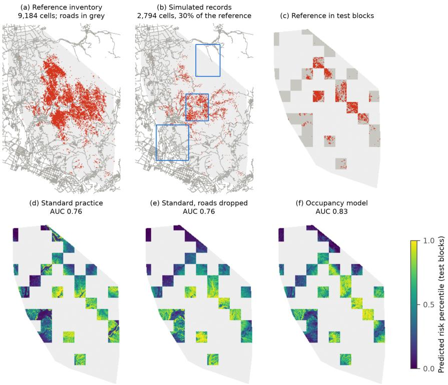
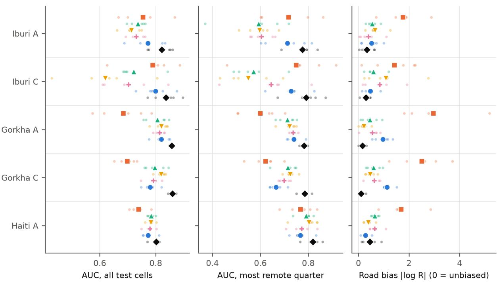
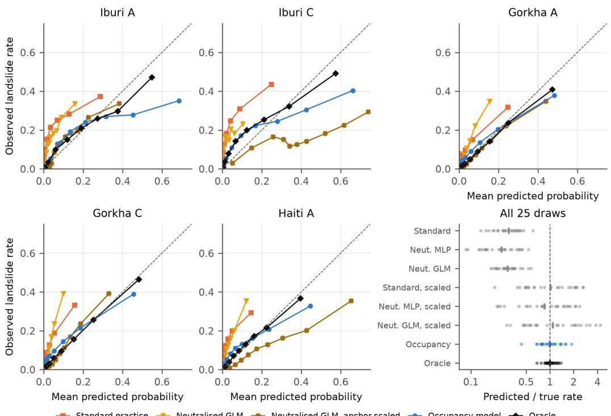
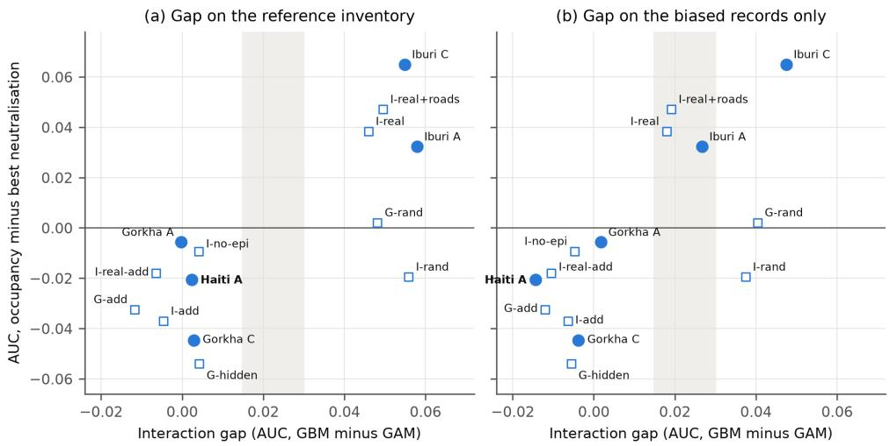
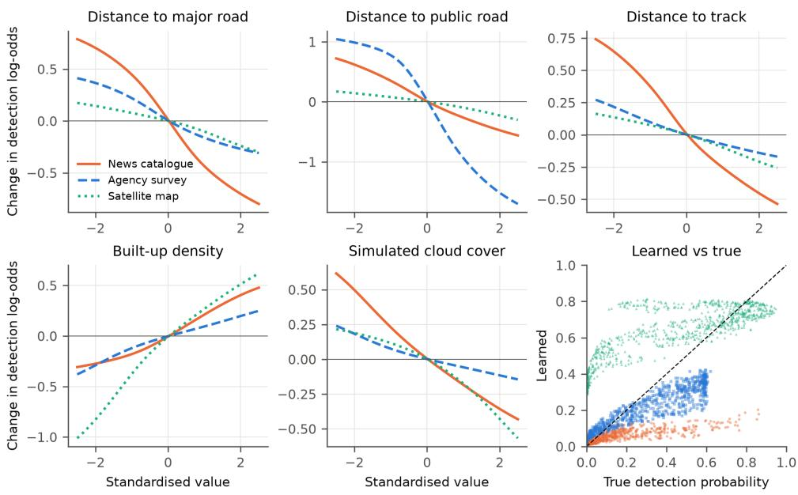

# Occupancy Modelling of Biased Landslide Inventories: When Does Separating Occurrence from Recording Improve on Neutralisation?

Abdirashid Omar

Abdikadir Ugaas

rashiidmatan@gmail.com

ugas@chungbuk.ac.kr

## ABSTRACT

Landslide susceptibility models are trained on inventories that record where landslides were seen, not where they occurred. The established remedy fits bias-describing variables and neutralises them when mapping. We adapt occupancy–detection modelling from ecology, treating several inventories as imperfect observers of one event and separating occurrence from recording, and ask when this improves on neutralisation.

We use near-complete inventories of the 2018 Hokkaido Eastern Iburi, 2015 Gorkha and 2010 Haiti earthquakes with simulated reporting bias, and three real Gorkha inventories. Compared with standard practice, the occupancy model reduces road bias in 24 of 25 paired draws and raises AUC by 0.08–0.14 on Gorkha and 0.03 on Haiti, but only 0.01–0.02 on Iburi. Its median predicted-to-true landslide rate is 0.99 (range 0.44–1.89), against 0.24–0.30 for the baselines. Rescaling the baselines with the same anchor area corrects their median but leaves larger errors (range 0.20–4.34). Cell-level probabilities remain too extreme (calibration slope 0.59). Compared with the best neutralised model, AUC is higher on Iburi (by 0.03–0.07) and lower on Gorkha and Haiti (by 0.01–0.05). Transplant experiments tie the Iburi advantage to the structure of its true landslide pattern, not to its terrain or road network. In all eight settings with a low interaction gap, computable from biased records, neutralisation was at least as accurate, including a prespecified test on Haiti; a high gap did not guarantee an advantage. The real Gorkha inventories are slope-biased, not road-biased, and there the model brings no meaningful gain. Report-based catalogues remain the main untested case.

Keywords Landslide susceptibility mapping · Landslide inventory bias · Occupancy–detection modelling · Imperfect detection · Bias neutralisation · Probability calibration · Earthquake-triggered landslides

## 1 INTRODUCTION

Data-driven landslide susceptibility maps depend on the inventories they learn from [1]. An inventory is a record of observation: a landslide enters it when someone reports, surveys or maps it. Reporting is easier near roads and towns and under clear skies, so inventories are spatially incomplete in systematic ways [2, 3]. A classifier trained on such records learns the observation process together with the hazard. The problem matters because landslides do not cluster near roads in the way reports do. In all three earthquakes studied here, cells with mapped landslides lie farther from public roads than other cells (median 0.50 vs 0.25 km in Iburi, 0.66 vs 0.33 km in Gorkha, 0.81 vs 0.62 km in Haiti), so road-biased records undersample terrain where landslides are common.

Dropping bias-related predictors confounds the remaining effects [2]. The established alternative is to include them during fitting and remove their influence when mapping [4]. This neutralisation needs only one inventory, but it assumes that the bias variables can be separated from the hazard signal inside a single model. Ecology has long faced the same problem, since species are recorded where observers look. Occupancy models address it structurally, with one process for true presence and another for detection, identified through repeated surveys [5]. Several independently produced inventories of one event could play the role of those surveys, but this requires more data than neutralisation, and whether it is

  
Figure 1: Model structure. The susceptibility head sees only terrain and the detection head sees only access. Both enter the occupancy likelihood, fitted to several inventories at once, with the anchor area fixing the scale of detection. Only ψ is mapped.

## worth the cost is an open question.

This paper therefore asks when treating inventories as imperfect observers improves on neutralisation. We make three contributions:

1. A model. We adapt deep occupancy– detection modelling to landslide inventories, using separate inventories of one event as repeated surveys, sign-constrained detection, and a small exhaustively mapped anchor area.

2. An evaluation against a known reference. On real terrain, roads and near-complete inventories from three earthquakes with simulated reporting bias, the model reduces road bias relative to standard practice and estimates the overall landslide rate more stably than baselines, including baselines rescaled with the same anchor. Its ranking advantage over neutralisation is confined to one earthquake. On three real Gorkha inventories, whose bias follows slope rather than roads, it brings no meaningful gain.

3. An explanation and a selection rule. Transplant experiments link the ranking advantage to the structure of the true landslide pattern rather than to terrain or roads. From this we derive a rule that can be computed from biased records. In our tests a low value always meant that the simpler neutralisation sufficed, including a prediction recorded before testing on a third earthquake. A high value is necessary but not sufficient for an advantage.

## 2 RELATED WORK

Inventory bias in susceptibility mapping. Statistical susceptibility models are reviewed by Reichenbach et al. [1]. Three lines of work show that inventory bias changes model results. Steger et al. [2] introduced synthetic biases and showed that excluding bias-describing predictors confounds the remaining effects, while mixed-effects models were least affected. Stanley and Kirschbaum [6] truncated a synthetic inventory to mimic road and population reporting biases and found that the effects should not be ignored. In Bavaria, gaps in the inventory led to underestimated hazard in poorly mapped areas [7]. How bias arises depends on how an inventory was made. Field, report and newspaper inventories under-sample terrain poorly visible from roads [3], whereas excess landslide density near roads appeared in only 3 of 12 inventories examined by Malamud et al. [8], who attributed it to mapping remit. As remedies, Steger et al. [4] and Lima et al. [9] account for data-collection effects during fitting and remove them for prediction, the latter at national scale. Steger et al. [4] enter bias-describing variables as random effects in a generalised additive mixed model and zero them for prediction. In their South Tyrol case this bias-adjusted model had limited success (median AUROC 0.59–0.61), which they attribute partly to test data that share the bias. These remedies use one inventory and one model of the combined process, which is the assumption we examine.

Negative-sample selection. A large literature treats bias as a problem of choosing non-landslide samples, for example positive–unlabelled learning with adaptive sampling [10] or with a contrastive loss [11]. These methods address unknown negatives, but not spatially structured under-reporting of positives.

Inventory comparison. Independent inventories of the Gorkha earthquake differ substantially in completeness and delineation [12], and co-seismic inventories worldwide vary widely in quality and completeness [13]. The USGS ground-failure repository collects them in one format [14], so multiple inventories of one event are available, but they have rarely been used jointly in model fitting.

Occupancy models. Ecological occupancy models separate presence from imperfect detection using repeated surveys [5], and have been combined with neural networks [15–17]. False-positive extensions allow observers to record absent species [18] and become well identified when some detections are known to be certain [19]. To our knowledge, occupancy modelling has not been applied to landslide inventories.

## 3 METHOD

Occupancy–detection likelihood. For grid cell $i ,$ let $z _ { i } = 1$ if a landslide occurred, with probability $\psi _ { i }$ given by a susceptibility network on terrain features. Inventory k records a landslide in cell i with probability $p _ { i k }$ given by a detection network on observation features, and only where it surveyed $( m _ { i k } = 1 )$ . With records $y _ { i k }$ , the likelihood of a cell marginalises over the unknown $z _ { i } \mathrm { : }$

$$
\begin{array} { r } { L _ { i } = \psi _ { i } \prod _ { k } \left[ p _ { i k } ^ { y _ { i k } } ( 1 - p _ { i k } ) ^ { 1 - y _ { i k } } \right] ^ { m _ { i k } } } \\ { + \left( 1 - \psi _ { i } \right) \mathcal { H } [ \sum _ { k } m _ { i k } y _ { i k } = 0 ] . } \end{array}\tag{1}
$$

The two networks are trained jointly by minimising the mean negative log-likelihood. Only $\psi$ is used for mapping (Fig. 1).

Monotone detection. Detection is additive and sign-constrained, in the spirit of shape-constrained additive models [20]: being farther from a road, or under more cloud, can only lower the recording probability, and more built-up area can only raise it. Each standardised feature $x _ { i j }$ enters through a sum of increasing sigmoids with non-negative weights, multiplied by its known sign $s _ { j } { \mathrm { : } }$

$$
\begin{array} { l } { { \displaystyle \mathrm { l o g i t } p _ { i k } = b _ { k } + \sum _ { j } s _ { j } \sum _ { m } \mathrm { s o f t p l u s } ( a _ { k j m } ) } } \\ { { \displaystyle \qquad \times \sigma ( 2 \mathrm { s o f t p l u s } ( c _ { k j m } ) ( x _ { i j } - t _ { m } ) ) } . } \end{array}\tag{2}
$$

where $\sigma$ is the logistic function and $t _ { m }$ are eight fixed knots on [−2.5, 2.5]. Features whose effect direction is unknown (terrain visibility for satellite inventories) enter twice, once with each sign, giving an unconstrained additive shape.

Anchor area. Two training blocks of $2 5 \times 2 5$ cells (3 km at 120 m, 5.25 km at 210 m; about 2% of the area) are treated as exhaustively mapped. They enter the likelihood as one further survey, covering only those blocks, with detection fixed at 0.99. This sets the scale of detection, and hence the overall landslide rate.

Assumptions. Identifying $\psi$ and $p$ separately rests on four assumptions: (i) all inventories observe the same z; (ii) inventories are independent given z and the features; (iii) there are no false positives, since Eq. (1) gives a recorded cell zero probability under $z _ { i } = 0 ;$ and (iv) an exclusion restriction, whereby access features affect detection and terrain features affect occurrence. Assumption (iv) matters more than the number of inventories suggests. In an early unconstrained version on Iburi, three inventories gained little over one merged inventory when susceptibility used terrain only $( \mathrm { A U C } 0 . 7 5 \ \mathrm { v s } 0 . 7 4 )$ , and more when it could also use road distance (0.74 vs 0.71). Assumption (ii) is tested in Sect. 5.7, and assumption (iii) fails for real inventories (Sect. 5.6).

Training. We use full-batch AdamW [21] in Py-Torch [22], with learning rate $5 \times 1 0 ^ { - 3 }$ , weight decay $1 0 ^ { - 4 }$ and at most 3000 steps. Training stops early on a held-out validation block using observed records only. Each model is the mean of three restarts. Networks are multilayer perceptrons (MLPs) with two hidden layers of 64 SiLU units.

Extensions. Three extensions are tested in Sects. 5.6 and 5.7. A short-range road term lets road distance $d _ { i }$ enter susceptibility only through a non-negative effect with a range of 50–300 m, so that reporting bias acting over kilometres cannot be absorbed:

$$
\begin{array} { c } { { \mathrm { l o g i t } \psi _ { i } = f ( \mathrm { t e r r a i n } _ { i } ) + \mathrm { s o f t p l u s } ( \alpha ) e ^ { - d _ { i } / \lambda } , } } \\ { { \lambda \in [ 0 . 0 5 , 0 . 3 0 ] \mathrm { k m } . } } \end{array}\tag{3}
$$

A constant false-positive term gives each inventory a learned rate of recording cells with $z _ { i } = 0$ A spillover term models such records as arising mainly from neighbouring landslides (positional mismatch), with $q _ { i }$ the probability that at least one of the 8 neighbours $N ( i )$ has a landslide:

$$
\begin{array} { c } { { P ( y _ { i k } = 1 \mid z _ { i } = 0 ) = \sigma ( \gamma _ { k } ) q _ { i } + \sigma ( \delta _ { k } ) , } } \\ { { q _ { i } = 1 - \displaystyle \prod _ { j \in N ( i ) } ( 1 - \psi _ { j } ) . } } \end{array}\tag{4}
$$

Selection rule. The interaction gap is the testblock AUC of a flexible gradient-boosting model [23, 24] (300 iterations, learning rate 0.05) minus that of an additive spline model [25] (cubic splines, 6 knots), both on terrain features only. A gap above 0.03 predicts that the occupancy model will outperform the best neutralised model, and a gap below 0.015 predicts that neutralisation will be as good or better. Between these values the rule makes no prediction. The thresholds were set after measuring Iburi (0.058) and Gorkha (0.000) on their reference inventories and were fixed before Haiti was analysed. Because practitioners do not have a reference inventory, we also compute the gap from the union of biased records alone, for both fitting and scoring.

## 4 DATA AND EXPERIMENTAL DESIGN

Task. All models are trained and tested on spatial blocks of the same event, using epicentral distance as a feature. The maps therefore describe where landslides occurred in that event. They are eventconditional susceptibility maps, not forecasts for a future earthquake.

Features. Terrain features come from the Copernicus GLO-30 surface model [33], computed at 30 m and aggregated: elevation, mean, maximum and standard deviation of slope, aspect, curvature, topographic position at 150 m and 600 m, relative height, relief, and epicentral distance. GLO-30 derives from TanDEM-X data acquired between December 2010 and January 2015. It therefore predates Iburi and largely pre-dates Gorkha, but postdates Haiti, where some landslide scars may affect the terrain features. Observation features are distance to major roads, public roads and tracks [34] and built-up density (ESA WorldCover 2021, class 50 only) [35]. Other WorldCover classes are excluded because they show landslide scars. Roads and built-up land also post-date all three events, so post-event reconstruction is a limitation, chiefly for the real-inventory test. In the simulations the same fields define detection, so the mismatch does not arise. No shaking variable is used: epicentral distance is a proxy for shaking.

Simulated observers. The reference inventory is taken as the true z. Three observers record it under known rules, with distance d in kilometres and standardised built-up density u and cloud field c:

$$
\begin{array} { r l } & { \mathrm { l o g i t } p _ { \mathrm { n e w s } } = - 1 - 2 d _ { \mathrm { m a j o r } } + 0 . 8 u , } \\ & { \mathrm { l o g i t } p _ { \mathrm { a g e n c y } } = 0 . 5 - 5 d _ { \mathrm { p u b l i c } } , } \\ & { \mathrm { l o g i t } p _ { \mathrm { s a t e l l i t e } } = - 1 . 8 c . } \end{array}\tag{5}
$$

The satellite observer covers only three random rectangular footprints. Cloud cover is synthetic: a smoothed random field (weight 0.6) combined with elevation (weight 0.4), redrawn for each draw and given to the detection head. Together the observers record 18–41% of reference landslide cells. Scenario A uses these rules. Scenario B lets susceptibility also use road distance. Scenario C misspecifies detection with a hidden reporting-effort field, a road × built-up interaction, and surveys that skip steep slopes. Scenario D plants a known road-cut effect, with probability $0 . 2 5 e ^ { - d / 1 2 0 \mathrm { m } } \sigma ( 2 \mathrm { s l o p e } )$ , and scenario E makes the news catalogue re-publish half of the agency’s records.

Real observers. Three real Gorkha inventories from the USGS ground-failure repository [14] are used without simulation. Their coverage is the convex hull of each inventory within the window. The anchor area is taken from the reference inventory, so the model sees about 2% of the reference. Models are scored against the reference and against a consensus (a cell in at least 2 of the 4 inventories). The consensus includes the training records, so it is not an independent test, and it can favour models fitted to them.

Baselines. Standard practice is one MLP trained on the union of all records, including anchor records, with terrain and access features. Standard, roads dropped uses terrain features only. Neutralised models are fitted to the same union with access features, which are then set to their mean for prediction. We implement this as an MLP, a logistic GLM and a generalised additive model (GAM) with cubic splines. Steger et al. [4] instead use a generalised additive mixed model with bias variables as random effects, zeroed for prediction. We follow the same logic, but with access features as fixed effects. In the additive GLM and GAM, a constant access value gives the same ranking as zeroing those terms, but the fitted coefficients differ because no random-effect shrinkage is applied. Our results therefore evaluate neutralisation in these three model classes, not the mixed-model method itself. Where we refer to the best neutralised model, we take the highest AUC among the variants on each draw, which favours neutralisation because the best variant cannot be known in practice. The oracle is an MLP trained on the reference inventory.

Table 1: Study sites. Haiti was analysed only after the selection rule was fixed (Sect. 5.5).
<table><tr><td>Iburi</td><td>2018 Hokkaido Eastern</td><td>2015 Gorkha (Sindhupalchok window)</td><td>2010 Haiti</td></tr><tr><td>Reference inven- tory</td><td>Zhang et al. [26], 5,625 polygons</td><td>Roback et al. [27], Zekkos et al. [28], source areas, 12,246 polygons</td><td>Harp et al. [29], 23,567 polygons (21,666 in window)</td></tr><tr><td>Area and mask</td><td>convex hull of the inventory</td><td>mapped extent minus obscured areas, 27.65–28.05°N, 85.40–86.10°E</td><td>convex hull of the inventory, 18.18–18.50°N, 72.98–72.17°W</td></tr><tr><td>Grid</td><td>120 m, 56,399 cells, 16.3% landslide</td><td>210 m, 62,652 cells, 10.4% landslide</td><td>210 m, 63,995 cells, 10.4% landslide</td></tr><tr><td>Epicentres</td><td>mainshock</td><td>mainshock and 12 May Mw 7.3 aftershock</td><td>mainshock</td></tr><tr><td>Real independent inventories</td><td></td><td>Gnyawali and Adhikari [30], Valagussa et al. [31], Zhang et al. [32]</td><td></td></tr></table>

Evaluation. Spatial blocks of 25 × 25 cells are split 60/15/25 into training, validation and test sets. Test-block metrics are AUC against the reference, AUC within the most remote quarter of road distance, and road bias. With R the ratio of predicted rates in the most remote and nearest quarters of road distance, divided by the same ratio in the reference, road bias is | log R|. The oracle’s road bias (0.11–0.45) indicates the noise floor of this metric. For probabilities we report the ratio of mean predicted to true rate, expected calibration error (ECE; 10 equal-frequency bins), log loss, Brier score and calibration slope (the coefficient from a logistic regression of outcomes on predicted log-odds; 1 is ideal, and values below 1 mean predictions are too extreme). Each setting has five random draws of the reporting realisation, split and anchor. Comparisons within a scenario are paired on identical draws, using counts and Wilcoxon signed-rank tests [36]. Splits differ between scenarios A and C, so we do not compare results across them. With five draws a two-sided test cannot go below $p \ : = \ : 0 . 0 6 2 5$ , and draws within an earthquake share terrain and truth, so we report site-level effects first and treat pooled p-values as descriptive.

## 5 RESULTS

## 5.1 REPORTING BIAS DISTORTS STANDARD MAPS

Standard practice rates remote terrain far too low in every setting: median R is 0.06–0.17 on Iburi and Gorkha (1 = unbiased). On Gorkha it also loses much of its ranking skill (AUC 0.685 vs 0.857 for the oracle in scenario A).

## 5.2 OCCUPANCY MODEL, STANDARD PRAC-TICE AND NEUTRALISATION

Against standard practice. The occupancy model has lower road bias in 24 of 25 paired draws across all settings (Fig. 3). Its effect on ranking depends on the site (Table 2). AUC gains are large on Gorkha (+0.135 in A, +0.082 in C, 5/5 draws each) and moderate on Haiti (+0.034, 5/5). On Iburi they are small and unreliable (+0.018, 3/5 in $\mathrm { A } ; + 0 . 0 1 0 , 2 / 5$ in C), and remote-quarter AUC is about equal. On Iburi, then, the benefit lies in removing bias, not in better ranking.

Against neutralisation. Neither approach dominates, and the split follows the earthquake. Relative to the best neutralised model, the occupancy model has higher AUC on Iburi (+0.032, 3/5 in $\mathrm { A } ; + 0 . 0 6 5 ,$ 5/5 in C) and lower AUC on Gorkha (−0.006, 2/5 in A; −0.045, 0/5 in C) and Haiti (−0.021, 1/5). Compared with the neutralised GAM alone, the occupancy model is higher on

  
Figure 2: Iburi semi-synthetic setup (scenario A, draw 0). (a) Reference inventory with public roads. (b) Simulated biased records, with satellite footprints in blue. (c) Reference landslides in the held-out test blocks. (d–f) Predicted risk percentile from three models. This draw is favourable to the occupancy model. Means over five draws are 0.754 for standard practice and 0.772 for the occupancy model.

Iburi in 9/10 draws for AUC and 10/10 for remotequarter AUC. On Gorkha the two are about even (AUC 6/10, mean −0.003; remote quarter 3/10, mean −0.015). Neutralisation removes road bias as well or better: pooled over Iburi and Gorkha, the occupancy model has lower road bias than the MLP, GLM and GAM in only 6, 7 and 7 of 20 draws. On Gorkha, road bias is higher than the GLM’s in all 10 draws (0.97 and 1.13 vs 0.22 and 0.47). Haiti is an exception, where the occupancy model has the lowest mean road bias (Table 5).

## 5.3 ESTIMATING LANDSLIDE PROBABILITY

Under simulated reporting bias, baselines learn the probability of being recorded and underestimate the overall landslide rate three- to four-fold in the median. The occupancy model’s median ratio is 0.99 (Table 3). This difference may owe more to the anchor data than to the likelihood, so we gave the baselines the same information, dividing their predictions by the share of anchor landslide cells recorded by any inventory [37]. This corrects their median rate (0.85–1.08), so the anchor does much of that work. The likelihood adds stability:

mean | log rate| is 0.25 for the occupancy model and 0.60–0.70 for the scaled baselines, and its rate is closer to the truth than each of theirs in 20–22 of 25 draws. Scaling also degrades other measures, because the estimate of recording share rests on as few as 15 landslide cells and applies one factor to all cells.

Better rate estimation is not full calibration. The occupancy model has the lowest ECE, log loss and Brier score of the non-oracle models, but its median calibration slope of 0.59 shows that its predictions are too extreme (Fig. 4). Its rate estimate also varies between draws (0.44–1.89) and between settings (site medians 0.80–1.19). Its probabilities should therefore be read as better than the baselines’, not as ready for direct use in risk calculations.

## 5.4 WHEN THE OCCUPANCY MODEL OUTPER-FORMS NEUTRALISATION

Interaction gaps differ sharply between the earthquakes: +0.058 on Iburi, 0.000 on Gorkha. To test whether this structure causes the difference, transplant experiments keep the real terrain, roads

Table 2: Test AUC against the reference inventory (mean ± SD over 5 draws). Bold marks the best non-oracle model in each column. The GAM was added after the Haiti prediction was recorded.
<table><tr><td>Model</td><td>Iburi A</td><td>Iburi C</td><td>Gorkha A</td><td>Gorkha C</td><td>Haiti A</td></tr><tr><td>Standard practice</td><td> $0 . 7 5 4 \pm 0 . 0 7 8$ </td><td> $0 . 7 8 9 \pm 0 . 0 9 7$ </td><td> $0 . 6 8 5 \pm 0 . 0 8 8$ </td><td> $0 . 6 9 8 \pm 0 . 0 3 3$ </td><td> $0 . 7 3 9 \pm 0 . 0 3 0$ </td></tr><tr><td>Neutralised MLP</td><td> $0 . 7 3 6 \pm 0 . 0 2 9$ </td><td> $0 . 7 2 1 \pm 0 . 0 6 8$ </td><td> $0 . 8 0 6 \pm 0 . 0 4 2$ </td><td> $0 . 7 9 7 \pm 0 . 0 3 8$ </td><td> $\mathbf { 0 . 7 8 4 \pm 0 . 0 1 2 }$ </td></tr><tr><td>Neutralised GLM</td><td> $0 . 7 1 3 \pm 0 . 0 3 5$ </td><td> $0 . 6 1 9 \pm 0 . 1 3 7$ </td><td> ${ \bf 0 . 8 2 0 \pm 0 . 0 2 8 }$ </td><td> ${ \bf 0 . 8 2 0 \pm 0 . 0 1 8 }$ </td><td> $0 . 7 8 3 \pm 0 . 0 1 5$ </td></tr><tr><td>Neutralised GAM</td><td> $0 . 7 3 1 \pm 0 . 0 2 8$ </td><td> $0 . 7 0 3 \pm 0 . 0 9 9$ </td><td> $0 . 8 1 4 \pm 0 . 0 1 8$ </td><td> $0 . 7 9 2 \pm 0 . 0 2 8$ </td><td> $0 . 7 8 0 \pm 0 . 0 1 9$ </td></tr><tr><td>Occupancy model</td><td> $\mathbf { 0 . 7 7 2 \pm 0 . 0 6 0 }$ </td><td> $\mathbf { 0 . 7 9 9 \pm 0 . 0 5 4 }$ </td><td> ${ \bf 0 . 8 2 0 \pm 0 . 0 3 0 }$ </td><td> $0 . 7 8 0 \pm 0 . 0 2 7$ </td><td> $0 . 7 7 3 \pm 0 . 0 2 3$ </td></tr><tr><td>Oracle</td><td> $0 . 8 2 2 \pm 0 . 0 4 4$ </td><td> $0 . 8 3 7 \pm 0 . 0 5 1$ </td><td> $0 . 8 5 7 \pm 0 . 0 0 7$ </td><td> $0 . 8 6 0 \pm 0 . 0 1 0$ </td><td> $0 . 8 0 2 \pm 0 . 0 1 8$ </td></tr></table>

  
Standard practice▲Neutralised MLPNeutralised GLM+Neutralised GAMOccupancy modelOracle

Figure 3: Standard practice, three neutralised models, the occupancy model and the oracle in each setting. Large markers are means and small dots are the 5 draws. Horizontal axes do not start at zero.

and reporting simulation and replace only the true pattern (Table 4).

Three results stand out. First, Iburi’s own pattern is enough to produce the advantage: refitting it from terrain alone gives +0.038 (5/5). Removing epicentral distance (−0.009, 2/5) or interactions (−0.018, 0/5) removes the advantage. Second, signal proxied by roads is not the cause, since adding it barely changes the result (I-real+roads, +0.047), and a hand-built road-tied driver on Gorkha terrain gives no advantage (−0.054, 2/5). Third, additive truths favour neutralisation on both terrains (−0.037 and −0.032), so the outcome follows the structure of the true pattern and not the country’s terrain or roads.

However, interaction strength alone is not sufficient. Synthetic interactions with a gap as large as Iburi’s real pattern give no advantage: on Iburi terrain the neutralised MLP outperforms the occupancy model (I-rand, −0.019, 1/5), and on Gorkha terrain the two are tied (G-rand, +0.002, 3/5). The neutralised MLP retains these synthetic interactions (AUC 0.852 on I-rand) but not Iburi’s real pattern (0.776 on I-real). Something more specific to the real pattern is at work, which we discuss in Sect. 6.

The rule on biased records. Biased records weaken the gap (Fig. 5b). On Iburi it falls from +0.058 to +0.027, inside the no-prediction range. Across the 14 settings of Table 4, a records gap below 0.015 occurs in 8 settings, and the occupancy model does not outperform the best neutralised model in any of them. Of the 3 settings above 0.03, one shows a clear advantage (Iburi C), one a tie (G-rand) and one a loss (I-rand). The 3 settings in the no-prediction range all favour the occupancy model. Using the reference inventory instead, the same 8 settings fall below 0.015, and 5 of the 6 above 0.03 show a higher mean AUC for the occupancy model, one of them the tie. A low gap is therefore a useful signal that neutralisation suffices, and is what can be claimed from records. A high gap is necessary but not sufficient. Apart from Haiti, these settings informed the rule or derive from the same two earthquakes, so they are not independent tests.

Table 3: Probability estimates on test blocks, 25 re-fitted draws over the five settings of Table 2. “Scaled” divides a baseline’s prediction by the share of anchor landslide cells recorded by any inventory.
<table><tr><td>Model</td><td>Pred. ÷ true rate, median (range)</td><td>Mean |log rate|</td><td>ECE</td><td>Log loss</td><td>Brier</td><td>Calib. slope</td></tr><tr><td>Standard practice</td><td>0.30 (0.13–0.61)</td><td>1.24</td><td>0.088</td><td>0.486</td><td>0.109</td><td>0.41</td></tr><tr><td>Neutralised MLP</td><td>0.24 (0.09–0.53)</td><td>1.48</td><td>0.094</td><td>0.448</td><td>0.113</td><td>0.61</td></tr><tr><td>Neutralised GLM</td><td>0.29 (0.18–0.58)</td><td>1.22</td><td>0.089</td><td>0.412</td><td>0.112</td><td>1.14</td></tr><tr><td>Standard, scaled</td><td>1.01 (0.20–2.64)</td><td>0.60</td><td>0.109</td><td>0.816</td><td>0.131</td><td>0.15</td></tr><tr><td>Neutralised MLP, scaled</td><td>0.85 (0.21–2.39)</td><td>0.61</td><td>0.091</td><td>0.604</td><td>0.124</td><td>0.41</td></tr><tr><td>Neutralised GLM, scaled</td><td>1.08 (0.28–4.34)</td><td>0.70</td><td>0.122</td><td>0.852</td><td>0.144</td><td>0.61</td></tr><tr><td>Occupancy model</td><td>0.99 (0.44–1.89)</td><td>0.25</td><td>0.056</td><td>0.343</td><td>0.104</td><td>0.59</td></tr><tr><td>Oracle</td><td>1.00 (0.68–1.37)</td><td>0.13</td><td>0.026</td><td>0.289</td><td>0.090</td><td>0.86</td></tr></table>

Table 4: Interaction gaps and the AUC of the occupancy model minus the best neutralised model (MLP, GLM or GAM), 5 draws each. Upper part: transplant worlds, with labels as in Fig. 5. Lower part: real settings of Table 2.
<table><tr><td>Label</td><td>True pattern</td><td>Gap, reference</td><td>Gap, records</td><td>Occ. – best</td><td>Occ. higher</td></tr><tr><td>I-add</td><td>Iburi terrain: additive GLM fit of the inventory</td><td>-0.005</td><td>-0.006</td><td>-0.037</td><td>0/5</td></tr><tr><td>I-rand</td><td>Iburi terrain: GLM fit + synthetic interactions</td><td>+0.056</td><td>+0.037</td><td>-0.019</td><td>1/5</td></tr><tr><td>I-real</td><td>Iburi terrain: flexible fit on terrain</td><td>+0.046</td><td>+0.018</td><td>+0.038</td><td>5/5</td></tr><tr><td>I-real+roads</td><td>Iburi terrain: flexible fit on terrain + roads</td><td>+0.050</td><td>+0.019</td><td>+0.047</td><td>5/5</td></tr><tr><td>I-no-epi</td><td>Iburi terrain: flexible fit, no epicentral distance</td><td>+0.004</td><td>-0.005</td><td>-0.009</td><td>2/5</td></tr><tr><td>I-real-add</td><td>Iburi terrain: additive spline fit on terrain</td><td>-0.006</td><td>-0.010</td><td>-0.018</td><td>0/5</td></tr><tr><td>G-hidden</td><td>Gorkha terrain: GLM fit + hidden road-tied driver</td><td>+0.004</td><td>-0.006</td><td>-0.054</td><td>2/5</td></tr><tr><td>G-add</td><td>Gorkha terrain: additive GLM fit of the inventory</td><td>-0.012</td><td>-0.012</td><td>-0.032</td><td>0/5</td></tr><tr><td>G-rand</td><td>Gorkha terrain: GLM fit + synthetic interactions</td><td>+0.048</td><td>+0.040</td><td>+0.002</td><td>3/5</td></tr><tr><td>Iburi A</td><td>Reference inventory</td><td>+0.058</td><td>+0.027</td><td>+0.032</td><td>3/5</td></tr><tr><td>Iburi C</td><td>Reference inventory</td><td>+0.055</td><td>+0.047</td><td>+0.065</td><td>5/5</td></tr><tr><td>Gorkha A</td><td>Reference inventory</td><td>0.000</td><td>+0.002</td><td>-0.006</td><td>2/5</td></tr><tr><td>Gorkha C</td><td>Reference inventory</td><td>+0.003</td><td>-0.004</td><td>-0.045</td><td>0/5</td></tr><tr><td>Haiti A</td><td>Reference inventory</td><td>+0.002</td><td>-0.014</td><td>-0.021</td><td>1/5</td></tr></table>

## 5.5 A PRESPECIFIED TEST ON A THIRD EARTHQUAKE (HAITI 2010)

We turned the rule into a prediction for an earthquake not used in developing it. We built the Haiti grid from the Harp et al. [29] inventory and measured the interaction gap on the reference before running any comparison: +0.002, below the 0.015 threshold. The prediction, that neutralisation would be as good or better, was saved with a UTC timestamp (see code availability) but was not lodged with a third-party registry. The comparison, then limited to the MLP and GLM variants, confirmed it. The occupancy model trailed the better variant on each draw by 0.017 AUC on average and exceeded it in only 1 of 5 draws (differences −0.032, −0.034, −0.016, +0.012, −0.014). Adding the GAM afterwards gives −0.021, still 1/5, and the gap computed from biased records leads to the same prediction (−0.014).

  
Figure 4: Reliability curves on test blocks, averaged over 5 draws per setting (dashed line = perfect calibration); the neutralised GLM stands in for the other neutralised baselines. Bottom right: predicted ÷ true overall rate for every draw and model, on a logarithmic axis; vertical ticks are medians.

Table 5: Haiti 2010, scenario A, means over 5 draws. “Remote” is AUC in the most remote quarter; $\ " \mathrm { R a t e } ^ { \prime \ }$ is predicted ÷ true rate; “Bias” is road bias.
<table><tr><td>Model</td><td>AUC</td><td>Remote</td><td>Rate</td><td>Bias</td></tr><tr><td>Standard practice</td><td>0.739</td><td>0.768</td><td>0.24</td><td>1.70</td></tr><tr><td>Neutralised MLP</td><td>0.784</td><td>0.791</td><td>0.19</td><td>0.65</td></tr><tr><td>Neutralised GLM</td><td>0.783</td><td>0.803</td><td>0.29</td><td>0.39</td></tr><tr><td>Neutralised GAM</td><td>0.780</td><td>0.773</td><td>0.11</td><td>0.65</td></tr><tr><td>Occupancy model</td><td>0.773</td><td>0.767</td><td>0.97</td><td>0.28</td></tr><tr><td>Oracle</td><td>0.802</td><td>0.819</td><td>0.99</td><td>0.45</td></tr></table>

The other simulation findings replicate here (Table 5). The occupancy model outperforms standard practice in all 5 draws (+0.034 AUC) and has lower road bias in all 5. Its mean rate ratio is close to 1 (0.97; median 0.80 in the re-fitted draws). Its road bias is below the oracle’s, within the metric’s noise, and lower than the GLM’s in 3 of 5 draws. This is a single new site that tested only the negative side of the rule. A planned fourth site (1994 Northridge) was dropped because road data for its northern, landslide-rich strip could not

be completed.

## 5.6 REAL, INDEPENDENTLY PRODUCED IN-VENTORIES

The three real Gorkha inventories are not roadbiased: their catch rate of reference landslides is nearly flat with road distance (Gnyawali 45–56% across quartiles). They are slope-biased (Valagussa catches 28% of gentle-slope vs 56% of steep-slope landslides) and disagree heavily with the reference: 29–41% of each one’s cells are absent from it, of which 59–84% lie within one cell of a reference landslide (vs 20% for a random cell). This suggests that many disagreements are positional, although some may be omissions from the reference, which is itself imperfect. Together the three inventories catch 64% of reference cells.

Here the occupancy model brings no meaningful gain (Table 6). Its AUC ties the terrain-only standard model (+0.001, 3/5 draws, $p = 0 . 4 4 )$ and is 0.008 and 0.012 above the neutralised MLP and GLM (4/5 and 5/5). These differences are small. The records gap here is 0.000, so the rule predicts that neutralisation will be as good or better; on AUC it was narrowly not. The occupancy model has the worst slope bias of the main models (0.47) and overestimates the rate by 38%, while neutralisation gives a lower slope bias and a rate near 1. Adding visibility features to detection improves slope bias but does not fix the rate. Adding constant false positives improves the rate (1.15) but nearly doubles slope bias (0.86). The overestimated rate is consistent with assumption (iii): every record is treated as a true landslide, so cells absent from the reference inflate ψ. The model does rank the completeness of each inventory correctly with access to only the anchor part of the reference (learned 0.59–0.65, 0.48–0.56 and 0.11– 0.13 vs measured 0.52, 0.43 and 0.10), but overestimates each.

  
Figure 5: Interaction gap against the AUC difference between the occupancy model and the best neutralised model, for real settings (filled circles) and transplant worlds (open squares; labels as in Table 4). The shaded band is the no-prediction range of the rule. Haiti, in bold, is the only setting not used in developing the rule.

Table 6: Real Gorkha inventories (5 draws, held-out blocks). Slope bias is | log | of the steep/gentle predicted-rate ratio relative to the reference. The consensus includes the training records, so it is not an independent test.
<table><tr><td>Model</td><td>AUC vs reference</td><td>AUC vs consensus</td><td>Slope bias</td><td>Pred. ÷ true rate</td></tr><tr><td>Standard practice</td><td>0.830</td><td>0.867</td><td>0.44</td><td>1.11</td></tr><tr><td>Standard, roads dropped</td><td>0.836</td><td>0.872</td><td>0.41</td><td>1.13</td></tr><tr><td>Neutralised MLP</td><td>0.829</td><td>0.863</td><td>0.25</td><td>1.15</td></tr><tr><td>Neutralised GLM</td><td>0.825</td><td>0.858</td><td>0.28</td><td>1.05</td></tr><tr><td>Occupancy model</td><td>0.837</td><td>0.873</td><td>0.47</td><td>1.38</td></tr><tr><td>Occupancy + visibility detection</td><td>0.835</td><td>0.872</td><td>0.31</td><td>1.35</td></tr><tr><td>Occupancy + visibility + constant</td><td>0.837</td><td>0.873</td><td>0.86</td><td>1.15</td></tr><tr><td>false positives Oracle</td><td>0.852</td><td>0.867</td><td>0.24</td><td>0.99</td></tr></table>

Because most extra cells sit next to a reference landslide, we tried the spillover term (Eq. 4). It was not identifiable: the fit swapped freely between “recorded because a landslide is here” and “recorded because one is next door”. In one draw almost every record was attributed to spillover (detection 0.01–0.08; AUC 0.731 vs 0.858 without the term). In another the opposite occurred (detection 0.21–0.85; AUC 0.820 vs 0.821; rate underestimated about threefold). We stopped after these two draws. Correcting real false positives probably needs outside information, such as a small hand-checked sample [19].

## 5.7 ROBUSTNESS AND DESIGN CHOICES

Monotone detection. On Iburi, monotone detection raised remote-quarter AUC from 0.58 to 0.72, and it is the design choice with the largest effect. A spatial random effect in detection made results worse (−0.01 to −0.02 AUC), probably because it competes with the spatial pattern of susceptibility.

What the model learns about observers. Learned detection follows the direction of the main effects (Fig. 6), with correlations of 0.81 (news), 0.80 (agency) and 0.56 (satellite) between learned and true probability. Magnitudes are recovered poorly: the news catalogue’s detection is strongly underestimated and the satellite’s overestimated. Since the overall rate is still near correct, some errors may offset one another, and the separation of ψ and p should not be over-interpreted. The satellite observer also picks up spurious road and built-up effects.

Misspecification and dependence. Under misspecified detection (scenario C) the model keeps its advantage on Iburi but falls behind the neutralised GLM on Gorkha (0.780 vs 0.820). When the news catalogue copies half of the agency’s records (scenario E, on the same draws as A), Iburi AUC moves only from 0.772 to 0.776.

Anchor alone. Models trained only on the anchor area give the worst maps on Iburi (AUC 0.68– 0.70), so the anchor is useful within the model but insufficient by itself.

Roads that genuinely cause landslides. Letting road distance enter susceptibility freely brings the bias back (Iburi B: AUC 0.730, median R = 0.33). Restricting it to the short-range term (Eq. 3) recovers performance (AUC 0.774, road bias below standard practice in 5/5 draws), about the same as leaving roads out entirely (0.772). With a planted road-cut effect (scenario D), the short-range model reproduces the near-road excess most closely (lift $1 . 0 2 \pm 0 . 0 4$ , where 1 matches the reference; free roads 1.27; standard practice 1.48). The learned strength responds only modestly (0.33 to 0.43 logodds), and the range is over-estimated (185 vs 120 m). The term thus allows a road effect without re-absorbing bias, but does not measure that effect well.

## 6 DISCUSSION

Which method to use. Both approaches remove much of the road-driven reporting bias, but they have different costs and strengths. Neutralisation needs one inventory and, where susceptibility is close to additive, it ranks at least as well. The occupancy model needs at least two inventories with different biases and a small exhaustively mapped area. In return it estimates the overall rate more stably and, in some settings, ranks better. We suggest the following procedure. Fit a gradientboosting and an additive model to the available records and compute the interaction gap on heldout blocks. If the gap is below 0.015, use neutralisation for ranking, since nothing in our tests favoured the extra data requirement. If it is larger, the occupancy model may help, but this is not assured. In either case, if the overall rate matters and an anchor area exists, the occupancy model gave more stable rates than scaling a neutralised model.

Mechanism. Neither generic nonlinearity nor road-proxied signal explains the Iburi advantage; the combination of epicentral structure and interactions in the real pattern does. One reading is that a flexible neutralised model fits part of that structure through the road variables, and discards it when they are neutralised. Slope is more strongly correlated with road distance on Iburi $( r = 0 . 5 0 -$ 0.59 for public and major roads) than on Gorkha (0.39) or Haiti (0.23–0.37), which is consistent with this reading. It is not established, however: terrain as a whole predicts road distance better on Gorkha than on Iburi $( R ^ { 2 } \ 0 . 7 4 \ \mathrm { ~ v s ~ } 0 . 4 9 )$ , and a GLM loses on Iburi for a simpler reason, as it cannot represent interactions at all. We avoid describing this as a shaking × terrain interaction, since we measured epicentral distance and not shaking. Testing the role of shaking directly, for example with USGS ShakeMap, is a natural next step.

Real inventories and the target of the method. The method was designed for reporting driven by roads and population, and the real inventories we could test have a different kind of bias. This fits earlier observations that road effects depend on how an inventory is made [8]: satellite mapping of a whole event has no need to follow roads. Slope bias is harder, because slope also drives real occurrence, which undermines the exclusion restriction. On such inventories, a standard terrain-only model is already within 0.016 AUC of the oracle, leaving little room for improvement. Scoring against a near-complete reference also matters for all these comparisons: Steger et al. [4] note that performance measured on biased test data can understate a bias-adjusted model. Our results do not show that the method is useful on real inventories, only that it does not fail on ranking; for rate estimation and slope bias it was worse than the alter-

  
Figure 6: Detection learned for each simulated observer (Iburi, scenario A, draw 0). Curves show the additive effect of each feature on detection log-odds, constrained to the known direction. The last panel compares learned and true detection probability (dashed line = equality; colours as in the other panels).

natives.

## Limitations.

• Road and population reporting bias, and cloud cover, are simulated. Detection features match the simulated rules closely in scenario A, which favours the occupancy model; scenario C relaxes this.

• Three earthquakes, of which only Haiti was out of sample, and it tested only the negative side of the rule. There is no out-of-sample test of a high gap.

• Draws within one earthquake share terrain and truth, so pooled statistics overstate generality. No transplant uses Gorkha’s own refitted pattern.

• The reference inventories are treated as truth, but are themselves imperfect.

• Neutralisation is implemented with fixed effects. A random-effects version, as in Steger et al. [4], was not tested and could perform differently.

• Maps are conditional on the event and are not forecasts. Roads and built-up land post-date the events, and the DEM post-dates Haiti.

• The method needs more input than neutralisation. Exhaustively mapped areas may not exist, and the scaled-baseline comparison used one simple correction; other corrections may do better.

• Cells are square at 120–210 m and features are tabular. Slope units and image-based features are natural extensions, since the framework accepts any susceptibility network.

Main open test. The bias the method targets is typical of report-based catalogues (news, agency and citizen reports). NASA’s Global Landslide Catalog [38, 39] cannot be scored against the coseismic inventories used here because it covers rainfall-triggered landslides only. A decisive test needs a rainfall event that has both report-based records and a complete inventory, for example Hurricane Maria in Puerto Rico in 2017 [40].

## 7 CONCLUSIONS

Treating several biased landslide inventories as imperfect observers reduces simulated road and population bias relative to standard practice and gives more stable estimates of the overall landslide rate than baselines, including baselines rescaled with the same anchor area, although cell-level probabilities remain too extreme. Whether it also ranks better than neutralisation depends on the structure of the true landslide pattern: it did on Iburi, but not on Gorkha or Haiti. Wherever the interaction gap computed from biased records alone was low, neutralisation was at least as accurate, including a prediction recorded before testing on Haiti, whereas a high gap did not guarantee an advantage. On real satellite-mapped inventories, whose bias follows slope and not roads, the model brought no meaningful gain. Neutralisation remains the sensible default for ranking when only one inventory exists or the interaction gap is low. The case for the occupancy model rests on rate estimation and on patterns with strong interactions, and its value on the report-based catalogues it was designed for is still to be shown.

## DATA AND CODE AVAILABILITY

Inventories: Zenodo record 2577300 (Iburi) [26]; USGS data release https://doi.org/10. 5066/F7DZ06F9 (Gorkha reference) [28]; USGS ground-failure repository [14] for the real Gorkha inventories and the Haiti inventory [29]. DEM: Copernicus GLO-30 [33]. Land cover: ESA WorldCover 2021 [35]. Roads: OpenStreetMap via Overpass [34]. Code, results and the timestamped Haiti prediction: https://github.com/rashiedomar/ occupancy-landslide-inventories.

## REFERENCES

[1] Paola Reichenbach, Mauro Rossi, Bruce D. Malamud, Monika Mihir, and Fausto Guzzetti. A review of statistically-based landslide susceptibility models. Earth-Science Reviews, 180:60–91, 2018. doi: 10.1016/j.earscirev.2018.03.001.

[2] Stefan Steger, Alexander Brenning, Rainer Bell, and Thomas Glade. The influence of systematically incomplete shallow landslide inventories on statistical susceptibility models and suggestions for improvements. Landslides, 14(5):1767–1781, 2017. doi: 10.1007/s10346-017-0820-0.

[3] Txomin Bornaetxea, Ivan Marchesini, Sumit Kumar, Rabisankar Karmakar, and Alessandro Mondini. Terrain visibility impact on the preparation of landslide inventories: a practical example in Darjeeling district (India). Natural Hazards and Earth System Sciences, 22:2929–2941, 2022. doi: 10.5194/nhess-22-2929-2022.

[4] Stefan Steger, Volkmar Mair, Christian Kofler, Massimiliano Pittore, Marc Zebisch, and Stefan Schneiderbauer. Correlation does not imply ge-

omorphic causation in data-driven landslide susceptibility modelling – benefits of exploring landslide data collection effects. Science of the Total Environment, 776:145935, 2021. doi: 10.1016/j. scitotenv.2021.145935.

[5] Darryl I. MacKenzie, James D. Nichols, Gideon B. Lachman, Sam Droege, J. Andrew Royle, and Catherine A. Langtimm. Estimating site occupancy rates when detection probabilities are less than one. Ecology, 83(8):2248–2255, 2002. doi: 10.1890/0012-9658(2002)083[2248: ESORWD]2.0.CO;2.

[6] Thomas A. Stanley and Dalia B. Kirschbaum. Effects of inventory bias on landslide susceptibility calculations. In Proceedings of the 3rd North American Symposium on Landslides. Association of Environmental & Engineering Geologists, 2017. https://ntrs.nasa.gov/ citations/20170007214.

[7] Veronika Buchauer, Marta Sapena, Christian Geiß, Patrick Aravena Pelizari, and Hannes Taubenböck. Landslide susceptibility mapping with explainable AI techniques: evidence from Bavaria, Germany. EGUsphere preprint, 2026.

[8] Bruce D. Malamud, Renée A. Heijenk, Faith E. Taylor, and Joanne L. Wood. Road influences on landslide inventories. EGU General Assembly 2022, EGU22-7616, 2022.

[9] Pedro Lima, Stefan Steger, and Thomas Glade. Counteracting flawed landslide data in statistically based landslide susceptibility modelling for very large areas: a national-scale assessment for Austria. Landslides, 18:3531–3546, 2021. doi: 10.1007/s10346-021-01693-7.

[10] Zhice Fang, Yi Wang, Ruiqing Niu, and Ling Peng. Landslide susceptibility prediction based on positive unlabeled learning coupled with adaptive sampling. IEEE Journal of Selected Topics in Applied Earth Observations and Remote Sensing, 14:11581–11592, 2021. doi: 10.1109/JSTARS. 2021.3125741.

[11] Shubing Ouyang, Weitao Chen, Hangyuan Liu, Yuanyao Li, and Zhanya Xu. A novel landslide susceptibility prediction framework based on contrastive loss. GIScience & Remote Sensing, 61(1), 2024. doi: 10.1080/15481603.2024. 2306740.

[12] Badal Pokharel, Massimiliano Alvioli, and Samsung Lim. Assessment of earthquake-induced landslide inventories and susceptibility maps using slope unit-based logistic regression and geospatial statistics. Scientific Reports, 11:21333, 2021. doi: 10.1038/s41598-021-00780-y.

[13] Hakan Tanya¸s, Cees J. van Westen, Kate E. Allstadt, M. Anna Nowicki Jessee, Tolga Görüm, Randall W. Jibson, Jonathan W. Godt, Hiroshi P.

Sato, Robert G. Schmitt, Odin Marc, and Niels Hovius. Presentation and analysis of a worldwide database of earthquake-induced landslide inventories. Journal of Geophysical Research: Earth Surface, 122(10):1991–2015, 2017. doi: 10.1002/2017JF004236.

[14] Robert G. Schmitt, Hakan Tanya¸s, M. Anna Nowicki Jessee, Jing Zhu, Katherine M. Biegel, Kate E. Allstadt, Randall W. Jibson, Eric M. Thompson, Cees J. van Westen, Hiroshi P. Sato, David J. Wald, Jonathan W. Godt, Tolga Gorum, Chong Xu, Ellen M. Rathje, and Keith L. Knudsen. An open repository of earthquake-triggered ground-failure inventories. Data Series 1064, U.S. Geological Survey, 2017. Data release: https://doi.org/10.5066/F7H70DB4.

[15] Maxwell B. Joseph. Neural hierarchical models of ecological populations. Ecology Letters, 23(4): 734–747, 2020. doi: 10.1111/ele.13462.

[16] Eugene Seo, Rebecca A. Hutchinson, Xiao Fu, Chelsea Li, Tyler A. Hallman, John Kilbride, and W. Douglas Robinson. StatEcoNet: statistical ecology neural networks for species distribution modeling. In Proceedings of the AAAI Conference on Artificial Intelligence, volume 35, pages 513–521, 2021. doi: 10.1609/aaai.v35i1.16129.

[17] Raphaël Benerradi, Christophe Botella, Maximilien Servajean, and Alexis Joly. Deep-learning site-occupancy models for disentangling biases in species distribution and trend assessment from citizen science data. In World Biodiversity Forum 2026, 2026. doi: 10.5194/wbf2026-738. WBF2026-738.

[18] J. Andrew Royle and William A. Link. Generalized site occupancy models allowing for false positive and false negative errors. Ecology, 87(4): 835–841, 2006. doi: 10.1890/0012-9658(2006) 87[835:GSOMAF]2.0.CO;2.

[19] David A. Miller, James D. Nichols, Brett T. Mc-Clintock, Evan H. Campbell Grant, Larissa L. Bailey, and Linda A. Weir. Improving occupancy estimation when two types of observational error occur: non-detection and species misidentification. Ecology, 92(7):1422–1428, 2011. doi: 10.1890/10-1396.1.

[20] Natalya Pya and Simon N. Wood. Shape constrained additive models. Statistics and Computing, 25(3):543–559, 2015. doi: 10.1007/ s11222-013-9448-7.

[21] Ilya Loshchilov and Frank Hutter. Decoupled weight decay regularization. In International Conference on Learning Representations (ICLR), 2019.

[22] Adam Paszke et al. PyTorch: an imperative style, high-performance deep learning library. In Advances in Neural Information Processing Systems

32, pages 8024–8035, 2019.

[23] Jerome H. Friedman. Greedy function approximation: a gradient boosting machine. Annals of Statistics, 29(5):1189–1232, 2001. doi: 10.1214/ aos/1013203451.

[24] Fabian Pedregosa et al. Scikit-learn: machine learning in Python. Journal of Machine Learning Research, 12:2825–2830, 2011.

[25] Paul H. C. Eilers and Brian D. Marx. Flexible smoothing with B-splines and penalties. Statistical Science, 11(2):89–121, 1996. doi: 10.1214/ ss/1038425655.

[26] Shuai Zhang, Ran Li, Fawu Wang, and Akinori Iio. Characteristics of landslides triggered by the 2018 Hokkaido Eastern Iburi earthquake, Northern Japan. Landslides, 16(9):1691–1708, 2019. doi: 10.1007/s10346-019-01207-6. Data: Zenodo record 2577300.

[27] Kevin Roback, Marin K. Clark, A. Joshua West, Dimitrios Zekkos, Gen Li, Sean F. Gallen, Deepak Chamlagain, and Jonathan W. Godt. The size, distribution, and mobility of landslides caused by the 2015 Mw7.8 Gorkha earthquake, Nepal. Geomorphology, 301:121–138, 2018. doi: 10.1016/j.geomorph.2017.01.030.

[28] Dimitrios Zekkos, Marin K. Clark, Kevin Roback, Sean F. Gallen, A. Joshua West, Gen Li, Deepak Chamlagain, and Jonathan W. Godt. Map data of landslides triggered by the 25 April 2015 Mw 7.8 Gorkha, Nepal earthquake. U.S. Geological Survey data release, 2017.

[29] Edwin L. Harp, Randall W. Jibson, and Robert G. Schmitt. Map of landslides triggered by the January 12, 2010, Haiti earthquake. Scientific Investigations Map 3353, U.S. Geological Survey, 2016.

[30] Kaushal R. Gnyawali and Basanta R. Adhikari. Spatial relations of earthquake induced landslides triggered by 2015 Gorkha earthquake Mw = 7.8. In Matjaž Mikoš et al., editors, Advancing Culture of Living with Landslides, pages 85–93. Springer, Cham, 2017. doi: 10. 1007/978-3-319-53485-5\_10. Inventory data: https://doi.org/10.5066/F7028Q2X.

[31] Andrea Valagussa, Paolo Frattini, Elena Valbuzzi, and Giovanni B. Crosta. Role of landslides on the volume balance of the Nepal 2015 earthquake sequence. Scientific Reports, 11:3434, 2021. doi: 10.1038/s41598-021-83037-y.

[32] Jianqiang Zhang, R. Liu, W. Deng, N. R. Khanal, D. R. Gurung, M. S. R. Murthy, and S. Wahid. Characteristics of landslide in Koshi River basin, Central Himalaya. Inventory in the USGS ground-failure repository, 2016.

[33] European Space Agency. Copernicus DEM GLO-30, 2021.

[34] OpenStreetMap contributors. OpenStreetMap road network, retrieved via the Overpass API on 1–2 November 2026. https://www. openstreetmap.org, 2026.

[35] Daniele Zanaga et al. ESA WorldCover 10 m 2021 v200, 2022.

[36] Frank Wilcoxon. Individual comparisons by ranking methods. Biometrics Bulletin, 1(6):80– 83, 1945. doi: 10.2307/3001968.

[37] Charles Elkan and Keith Noto. Learning classifiers from only positive and unlabeled data. In Proceedings of the 14th ACM SIGKDD International Conference on Knowledge Discovery and Data Mining, pages 213–220, 2008. doi: 10. 1145/1401890.1401920.

[38] Dalia B. Kirschbaum, Robert Adler, Yang Hong, Stephanie Hill, and Arthur Lerner-Lam. A global landslide catalog for hazard applications: method, results, and limitations. Natural Hazards, 52(3):561–575, 2010. doi: 10.1007/ s11069-009-9401-4.

[39] Dalia Kirschbaum, Thomas Stanley, and Yaping Zhou. Spatial and temporal analysis of a global landslide catalog. Geomorphology, 249:4–15, 2015. doi: 10.1016/j.geomorph.2015.03.016.

[40] Erin K. Bessette-Kirton, Corina Cerovski-Darriau, William H. Schulz, Jeffrey A. Coe, Jason W. Kean, Jonathan W. Godt, Matthew A. Thomas, and K. Stephen Hughes. Landslides triggered by Hurricane Maria: assessment of an extreme event in Puerto Rico. GSA Today, 29(6): 4–10, 2019. doi: 10.1130/GSATG383A.1.