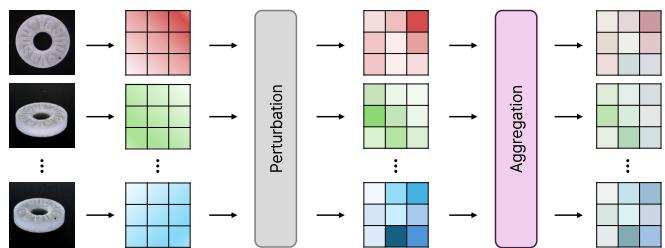
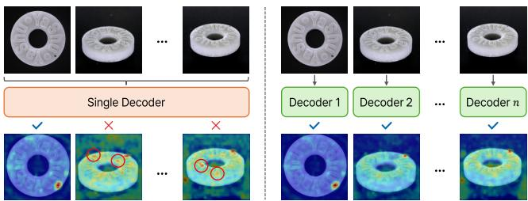
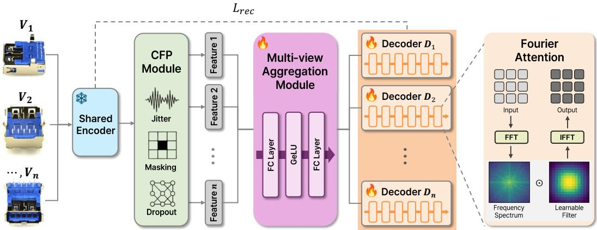
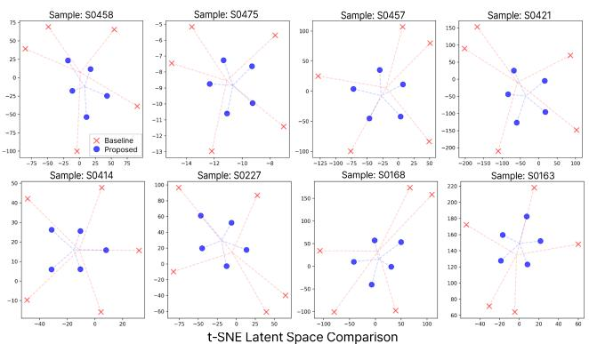
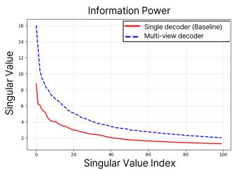
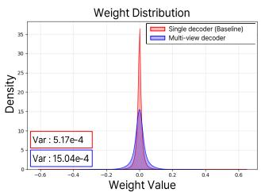
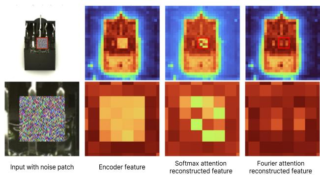
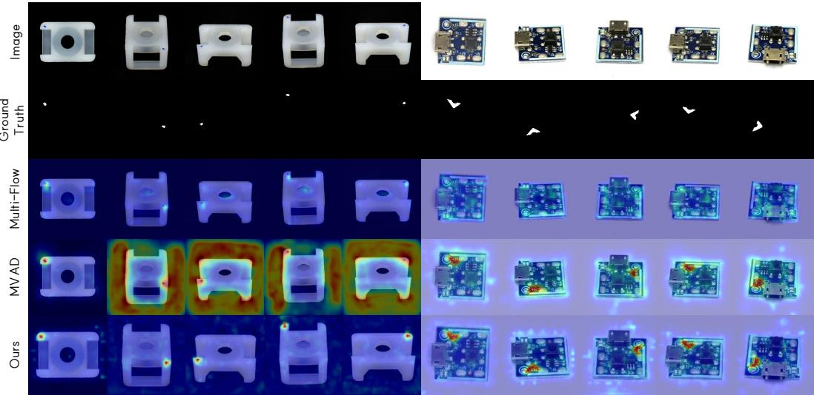
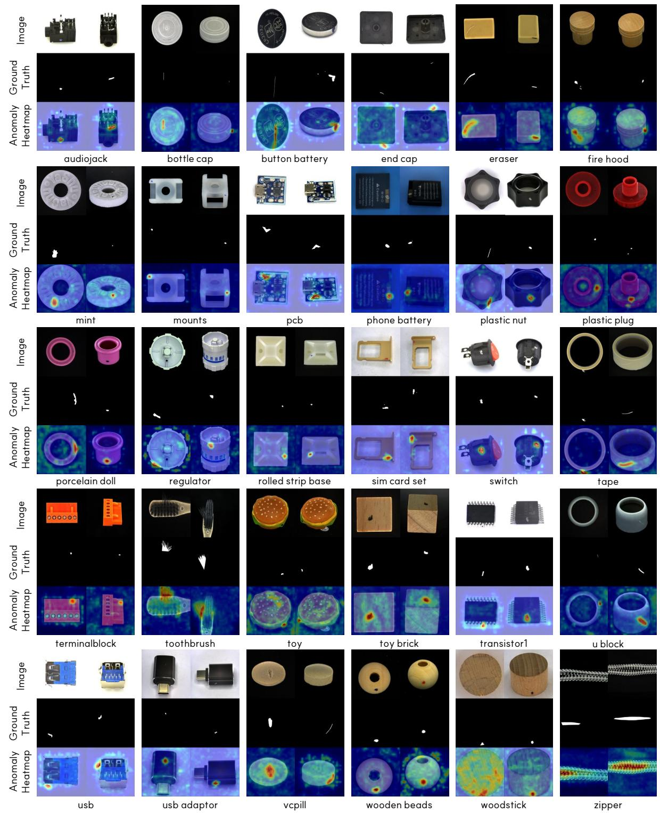

# Perturb, Aggregate then Reconstruct: Consensus Aggregation and Fourier-Atended Multi-Decoders for Reconstruction-based Multi-View Anomaly Detection

Yongho Son Hanyang University Seoul, Republic of Korea yhson@hanyang.ac.kr

Junyeong Yun   
Hanyang University   
Seoul, Republic of Korea   
yuns0713@hanyang.ac.k

Je Hyeong Hong∗ Hanyang University Seoul, Republic of Korea jhh37@hanyang.ac.kr

## Abstract

Multi-view anomaly detection is crucial for industrial inspection to identify defects hidden from single viewpoints. Yet, despite their strong success in single-view applications, reconstruction-based methods remain largely underexplored in multi-view settings. A key challenge in extending these methods lies in generating viewconsistent pseudo-anomalies. To address this, we propose PAR, a reconstruction-based framework for enhanced multi-view anomaly detection. First, we introduce a feature perturbation strategy coupled with a consensus aggregation module that integrates these perturbed features across viewpoints to mitigate view-inconsistent anomalies and construct highly aligned pseudo-anomaly representations. Second, we employ a view-specialized multi-decoder architecture; by assigning a dedicated decoder to each view, we increase the model’s representational complexity, enabling the generation of highly feasible, localized anomaly maps rather than less precise, view-agnostic reconstructions. Last, we incorporate Fourier attention into the decoders to emphasize global frequency-domain structures over local token evidence, efectively preventing identity mapping. Extensive experiments on the Real-IAD dataset demonstrate that PAR consistently outperforms state-of-the-art methods in sample-level, image-level, and pixel-level anomaly detection. Our code is available at https://github.com/SpatialAILab/PAR\_mvad.

## CCS Concepts

• Computing methodologies → Scene anomaly detection.

## Keywords

anomaly detection, multi-view, reconstruction-based, feature perturbation, consensus aggregation

## ACM Reference Format:

Yongho Son, Junyeong Yun, and Je Hyeong Hong. 2026. Perturb, Aggregate then Reconstruct: Consensus Aggregation and Fourier-Attended Multi-Decoders for Reconstruction-based Multi-View Anomaly Detection. In Proceedings ofthe 34th ACM International Conference on Multimedia (MM ’26), November 10–14, 2026, Rio de Janeiro, Brazil. ACM, New York, NY, USA, 14 pages. https://doi.org/10.1145/3767308.3836311

(a) Proposed perturbation with consensus aggregation strategy for producing more aligned view-consistent pseudo-anomalies  
  
(b) Proposed view-specialized multi-decoder architecture

Figure 1: Overview of the key components of PAR. (a) Given multi-view inputs, feature perturbation first injects anomaly corruption. The consensus aggregation module then integrates these complementary cues across viewpoints to construct multi-view-consistent pseudo-anomaly features. (b) A shared decoder can produce view-agnostic reconstructions and inaccurate localization (red circles), whereas viewspecialized decoders enable more accurate and consistent anomaly localization across viewpoints.

## 1 Introduction

Anomaly detection plays a crucial role in industrial inspection, where early defect discovery can reduce material waste, manual inspection costs, and production risk. Since anomalous samples in manufacturing are scarce and diverse, enumerating all possible defect patterns is impractical. Therefore, most visual anomaly detection methods adopt a one-class setting, training only on normal data to detect deviations at test time.

Despite their success, most conventional anomaly detection methods assume single-view images. This is restrictive in real-world inspection, as defect visibility heavily depends on object geometry and viewpoint. While defects on relatively flat objects (e.g., the PCB category in Real-IAD, Figure 6) may remain observable across multiple angles, defective regions on volumetric objects can easily become invisible from certain viewpoints. For example, a bird’s-eye view of a mint (Figure 1) cannot reliably capture side-region defects visible only obliquely. Moreover, multi-view anomaly detection must not only observe defects from multiple angles, but also reason about cross-view correlations and geometric inconsistencies. These limitations have sparked recent research in multi-view anomaly detection [43].

Recent multi-view studies have mainly explored memory bank, teacher-student, and normalizing flow paradigms. For instance, MVAD uses a teacher-student framework for cross-view interactions [19], while Multi-Flow enables cross-view message passing within normalizing flows [20]. Nevertheless, to the best of our knowledge, no prior industrial multi-view method has systematically explored a reconstruction-based design. Given their strong performance in single-view settings (e.g., RealNet [53], Dinomaly [17]), extending reconstruction-based approaches to multi-view settings provides the primary motivation for our work.

Devising a reconstruction-based multi-view approach, however, turns out to be non-trivial. A key bottleneck is generating viewconsistent pseudo-anomalies during training. While local perturbations efectively prevent trivial identity mapping in single-view settings, applying them independently across multiple views fails to incorporate underlying geometric correlations, generating unaligned, isolated corruptions. This produces overly view-specific features that fail to reflect a coherent, shared anomalous pattern, significantly degrading multi-view anomaly detection performance.

In this work, we address this challenge by proposing PAR (Perturb, Aggregate then Reconstruct), a novel reconstruction-based framework tailored for multi-view anomaly detection. Our pipeline begins by subjecting encoded multi-view features to a stochastic perturbation strategy, followed immediately by a late consensus aggregation module. This step acts as a latent-space consensus mechanism, directly mitigating spatial disjointedness to construct viewaligned pseudo-anomalies. These aligned representations are then routed into a view-specialized multi-decoder architecture. Rather than forcing a single shared decoder to generalize across all camera angles, assigning a dedicated reconstruction pathway to each view substantially increases the model’s representational complexity, yielding highly feasible, localized anomaly maps. Furthermore, we equip these decoders with Fourier attention to shift the reconstruction process from the spatial to the frequency domain. By forcing the network to recover global structural patterns instead of copy ing local token evidence, this mechanism prevents trivial identity mapping and ensures robust, anomaly-free recovery.

In summary, our main contributions are as follows:

• We propose PAR, a reconstruction-based framework for multi-view anomaly detection that follows the principle of perturb, aggregate, then reconstruct.

• We introduce a composite feature perturbation strategy combined with consensus aggregation to construct better viewaligned pseudo-anomaly features.

• We design a view-specialized multi-decoder architecture equipped with Fourier attention to reconstruct features based on global structural patterns, yielding more precise anomaly maps that lead to enhanced multi-view anomaly detection.

## 2 Related work

## 2.1 Unsupervised anomaly detection

Unsupervised anomaly detection aims to identify anomalies using only normal data, making it particularly suitable for real-world industrial scenarios where anomalous samples are scarce and diverse. Since it is impractical to collect and annotate all possible defect types, learning solely from normal data provides a scalable and costefective solution. Existing methods can be broadly categorized into representation-based and reconstruction-based approaches.

Representation-based methods model the distribution of normal features in a representation space and detect anomalies by measuring feature deviations between normal and anomalous samples. PaDiM [9] models patch-wise feature distributions with multivariate Gaussians, PatchCore [34] constructs a memory bank of normal patch features for nearest-neighbor retrieval, and CFA [21] improves localization by adapting target-oriented features with a scalable memory bank. Recent studies have further extended embedding-based approaches using normalizing flow frameworks, such as CFlow [15], which explicitly model the probability distribution of normal features to estimate anomaly likelihoods. In addition, recent representation-based approaches have explored diverse feature modeling and embedding strategies, including contrastive learning, prototypical learning, and hybrid reconstruction–embedding frameworks [16, 22, 24, 49]. However, these methods are often sensitive to distribution shifts and may struggle to generalize under varying conditions. Although these methods achieve strong performance, they also predominantly assume single-view inputs and do not explicitly exploit complementary evidence distributed across multiple viewpoints.

Reconstruction-based methods learn to restore normal images or features and detect anomalies based on reconstruction discrepancies. DRAEM [50] and NSA [37] improve anomaly learning by introducing synthetic anomalies during training, while RealNet [53] further advances feature reconstruction with realistic synthetic anomalies and adaptive feature selection. Other reconstructionoriented methods [3, 45], including RD4AD [10], RD++ [40], and DeSTSeg [52], reconstruct normal feature representations through reverse distillation and feature alignment between teacher and student networks. Adversarial learning-based approaches have been introduced to improve reconstruction fidelity and better capture complex data distributions [1, 2, 36]. Memory-augmented reconstruction methods further constrain the model to represent normal patterns using a limited memory bank, alleviating overgeneralization [13, 30]. More recently, difusion-based generative models have been explored to achieve high-quality and robust reconstruction under complex data distributions [18, 51]. Despite these advances, reconstruction-based methods inherently sufer from a normality bias, where both normal and anomalous inputs are projected onto the learned normal manifold, often leading to limited anomaly sensitivity and degraded localization performance.

As a result, existing unsupervised anomaly detection methods are not well aligned with practical multi-view inspection settings, where complementary observations from diferent viewpoints must be jointly leveraged for reliable anomaly detection and localization.

  
Figure 2: Overview of the proposed framework for multi-view anomaly detection. Multi-view images are first encoded by a pre-trained encoder. The resulting features are then perturbed by the composite feature perturbation (CFP) module using feature jitter, masking, and dropout to generate anomaly-like corrupted features. These perturbed features are aggregated across views by the consensus aggregation module to construct more view-aligned pseudo-anomaly features. Finally, the aggregated features are fed into a set of view-specialized decoders, where each decoder is responsible for reconstructing the normal feature of a particular view. Fourier attention is employed in each decoder to emphasize global structural patterns during reconstruction. The model is trained with the reconstruction loss $\mathcal { L } _ { r e c } .$

## 2.2 Multi-view anomaly detection

Multi-view learning has been extensively studied in the broader computer vision community, particularly for tasks such as 3D reconstruction, object recognition, and cross-view representation learning, where complementary information from multiple viewpoints is leveraged to improve robustness and performance [6, 14, 27, 29, 38, 44, 46, 54]. Building upon this foundation, multi-view anomaly detection extends conventional anomaly detection by exploiting multiple observations of the same object to enhance detection reliability and robustness. Unlike single-view approaches, where anomalies may be occluded or only partially visible, multiview settings enable the aggregation of complementary evidence across views, thereby facilitating more accurate anomaly detection and localization.

Recent studies have explored various strategies to incorporate multi-view information into anomaly detection frameworks. MVAD [19] proposes an adaptive selection-based attention mechanism that models semantic correlations across views by selecting top-k relevant regions for feature fusion. Multi-Flow [20] introduces a normalizing flow-based framework that enables cross-view information exchange through message passing and likelihood estimation across views. In addition, alignment-based approaches have been investigated to enforce consistency across views. Epipolar-based methods [23] utilize geometric constraints to establish correspondences along epipolar lines, while homography-based methods [8] perform explicit feature alignment by projecting corresponding regions across views. These approaches aim to maintain spatial consistency and improve cross-view correspondence in anomaly detection tasks.

Remark. Despite these advances, efectively leveraging multi-view information for anomaly detection remains challenging. In particular, balancing cross-view interaction and view-specific representations entails an inherent trade-of: excessive information sharing weakens view-specific discriminative cues, while limited interaction hinders the integration of complementary multi-view evidence. Furthermore, while memory banks and normalizing flows have been adapted for multi-view settings, reconstruction-based paradigms remain largely underexplored. We conjecture this is primarily due to the dificulty of generating view-consistent pseudo-anomalies without disrupting the underlying geometric correlations across cameras. Designing an eficient framework that can simultaneously promote cross-view anomaly consistency while preserving viewaware structural reconstruction remains an open problem, which this work seeks to address.

## 3 Proposed method

We now illustrate Perturb, Aggregate then Reconstruct (PAR), a simple yet efective reconstruction-based framework for unsupervised multi-view industrial anomaly detection (see Figure 2 for an overview).

Preliminaries and overview. We define the training set as $\boldsymbol { X } : = \{  { \mathbf { I } _ { i } } \} _ { i = 1 } ^ { N }$ , where $\mathbf { I } _ { i } = \{ I _ { i } ^ { ( v ) } \} _ { v = 1 } ^ { V }$ denotes the �-th multi-view sample, $I _ { i } ^ { ( v ) } \in \mathbb { R } ^ { H \times W \times 3 }$ is the image captured from the �-th view, � and � denote its height and width, respectively, � is the number of views, and � is the number of training samples. Given a normal multi-view sample $\mathbf { I } _ { i } ,$ a shared pre-trained encoder E extracts view-wise patch features $\{ F _ { i } ^ { ( v ) } \} _ { v = 1 } ^ { V }$ . PAR first perturbs these features using $\mathcal { P }$ and then integrates the resulting representations through the consensus aggregation module A. The aggregated features are subsequently reconstructed by a set of view-specialized decoders $\{ \mathcal { D } ^ { ( v ) } \} _ { v = : } ^ { V }$ equipped with Fourier attention, as illustrated in Figure 2.

  
Figure 3: A �-SNE visualization of latent pseudo-anomaly features generated by the vanilla individual-view perturbation strategy (red x markers) and our consensus aggregation method (blue dots). More compact feature distributions indicate pseudo-anomaly features are better aligned across views.

## 3.1 Perturbation and consensus aggregation

A key challenge in extending reconstruction-based anomaly detection to the multi-view setting lies in generating view-aligned pseudo-anomalies. In single-view applications, local perturbations efectively force the model to learn normal structural restoration from corrupted inputs. However, directly applying this strategy to multi-view data is non-trivial. Because each view observes the object from a diferent angle, independent perturbations often introduce strong view-specific biases, resulting in isolated corruptions rather than a spatially coherent anomalous pattern. To address this, we introduce a consensus aggregation strategy: we first perturb the features of each view independently, and then aggregate them to construct highly aligned and cross-view coherent pseudo-anomaly representations.

Given a normal multi-view sample $\mathbf { I } _ { i } = \{ I _ { i } ^ { ( v ) } \} _ { v = 1 } ^ { V }$ , we first extract patch-level features from each view using a shared pre-trained encoder E. The encoded feature of the �-th view is denoted as

$$
F _ { i } ^ { ( v ) } = \mathcal { E } \Big ( I _ { i } ^ { ( v ) } \Big ) = \Big [ f _ { i , 1 } ^ { ( v ) } , \boldsymbol { \cdot } \boldsymbol { \cdot } \boldsymbol { \cdot } , f _ { i , J } ^ { ( v ) } \Big ] ^ { \top } \in \mathbb { R } ^ { J \times C } ,\tag{1}
$$

where � is the number of patch tokens and � is the feature dimension. Our goal is to generate pseudo-anomaly features that are not only corrupted at the feature level but also coherent across views.

To achieve this, our framework processes the encoded features in two sequential stages: independent feature perturbation followed by late feature aggregation. First, we apply a stochastic perturbation operator $\mathcal { P } ( \cdot )$ independently to each view to inject anomaly-like corruptions:

$$
\tilde { F } _ { i } ^ { ( v ) } = \mathcal { P } \Big ( F _ { i } ^ { ( v ) } \Big ) .\tag{2}
$$

Unfortunately, applying it independently produces scattered, viewinconsistent pseudo-anomaly features. Therefore, we immediately route these perturbed features through a consensus aggregation module A so that complementary multi-view evidence can be jointly incorporated. We concatenate the perturbed features along the channel dimension while preserving their token-grid organization:

$$
\bar { F } _ { i } = \operatorname { C o n c a t } \left( \tilde { F } _ { i } ^ { ( 1 ) } , \tilde { F } _ { i } ^ { ( 2 ) } , \dots , \tilde { F } _ { i } ^ { ( V ) } \right) \in \mathbb { R } ^ { J \times V C } ,\tag{3}
$$

where features sharing the same token-grid index are concatenated across views. The aggregation module maps the concatenated representation to a $J \times V C$ feature, which is subsequently divided into � view-specific features of dimension $J \times C { : }$

$$
\begin{array} { r } { \pmb { \mathcal { A } } \big ( \bar { F } _ { i } \big ) = \mathrm { C o n c a t } \Big ( z _ { i } ^ { ( 1 ) } , z _ { i } ^ { ( 2 ) } , . . . , z _ { i } ^ { ( V ) } \Big ) \in \mathbb { R } ^ { J \times V C } . } \end{array}\tag{4}
$$

The aggregated pseudo-anomaly feature corresponding to the �-th view is then defined as

$$
z _ { i } ^ { ( v ) } = \pi _ { v } \big ( \mathcal { A } \big ( \bar { F } _ { i } \big ) \big ) \in \mathbb { R } ^ { J \times C } , \qquad v = 1 , 2 , . . . , V ,\tag{5}
$$

where $\pi _ { \boldsymbol { v } } ( \cdot )$ denotes the operation that selects the �-th channel block from the output of the aggregation module.

By aggregating after perturbation, we essentially perform a latent-space consensus operation. While the injected noise is independent and stochastic for each view, the underlying structural features $F _ { i } ^ { ( v ) }$ remain geometrically correlated across viewpoints. The aggregation module learns to suppress view-specific stochastic noise while emphasizing the shared structural manifold, thereby producing a pseudo-anomaly that resembles a coherent physical perturbation of the object rather than isolated sensor noise. As illustrated in Figure 3, features generated independently for each view are widely scattered in the latent space, indicating view-biased anomaly representations. In contrast, after aggregation, the features become highly compact and are drawn closer to their shared centers. This confirms that our consensus aggregation strategy successfully constructs view-aligned anomaly representations that better reflect the coherent defect patterns encountered in real-world multi-view scenarios.

To instantiate the perturbation operator P, we draw inspiration from prior studies on feature-space corruption [17, 24, 49, 50]. Specifically, we sequentially apply feature jitter, random masking, and dropout. First, feature jitter injects stochastic variations into the latent representation:

$$
F _ { i , \mathrm { j i t } } ^ { ( v ) } = \mathcal { T } _ { \mathrm { j i t } } \Big ( F _ { i } ^ { ( v ) } \Big ) = F _ { i } ^ { ( v ) } + \alpha \Delta _ { i } ^ { ( v ) } ,\tag{6}
$$

where $\Delta _ { i } ^ { ( v ) } \in \mathbb { R } ^ { J \times C }$ denotes a random noise tensor and � controls the jitter magnitude (set to 20). Next, random masking is imposed to further corrupt partial token information:

$$
\begin{array} { r } { F _ { i , \mathrm { m a s k } } ^ { ( v ) } = \mathcal { T } _ { \mathrm { m a s k } } \left( F _ { i , \mathrm { j i t } } ^ { ( v ) } \right) . } \end{array}\tag{7}
$$

Finally, dropout is applied to randomly suppress feature activations:

$$
\tilde { F } _ { i } ^ { ( v ) } = \mathcal { T } _ { \mathrm { d r o p } } \left( F _ { i , \mathrm { m a s k } } ^ { ( v ) } \right) .\tag{8}
$$

By cascading these operations $( \mathcal { P } = \mathcal { T } _ { \mathrm { d r o p } } \circ \mathcal { T } _ { \mathrm { m a s k } } \circ \mathcal { T } _ { \mathrm { j i t } } )$ , we ensure the model encounters highly diverse and robust anomalous patterns during training before the consensus aggregation occurs.

  
Figure 4: Comparison of singular values and weight distributions between the baseline single decoder and our proposed multi-view decoder. Higher singular values indicate greater representational capacity, while higher variance in the weight distribution suggests that the decoder learns more expressive and diverse parameters instead of collapsing around zero.

## 3.2 Fourier-attended view-specialized decoders

To reconstruct view-specific normal features from the aggregated pseudo-anomaly $z _ { i } ^ { ( v ) }$ , a single shared decoder often struggles, biasing the model toward averaged characteristics rather than finegrained normality patterns. To preserve these view-dependent details, we propose a view-specialized multi-decoder architecture. Formally, we define the multi-view decoder as

$$
\mathcal { D } = \{ \mathcal { D } ^ { ( v ) } \} _ { v = 1 } ^ { V } ,\tag{9}
$$

where $\mathcal { D } ^ { ( o ) }$ denotes the decoder specialized for the �-th view. Given the aggregated pseudo-anomaly feature $z _ { i } ^ { ( v ) }$ , the �-th decoder produces a reconstructed feature representation

$$
\hat { F } _ { i } ^ { ( v ) } = \mathcal { D } ^ { ( v ) } \left( z _ { i } ^ { ( v ) } \right) \in \mathbb { R } ^ { J \times C } ,\tag{10}
$$

where $\hat { F } _ { i } ^ { ( v ) }$ denotes the reconstructed feature for the �-th view, $H _ { f }$ and $W _ { f }$ denote the height and width of the spatial feature grid, respectively, $J = H _ { f } W _ { f }$ is the number of spatial tokens, and � is the feature dimension. The corresponding target feature extracted from the shared pre-trained encoder is denoted by

$$
\boldsymbol { F } _ { i } ^ { ( v ) } = \boldsymbol { \mathcal { E } } \Big ( \boldsymbol { I } _ { i } ^ { ( v ) } \Big ) \in \mathbb { R } ^ { J \times C } .\tag{11}
$$

While allocating an individual decoder to each view increases representational capacity, the decoders must still be prevented from trivially copying corrupted local evidence. If a decoder directly exploits locally available defect patterns via standard spatial attention, it can easily fall into shortcut behavior that resembles identity mapping. To mitigate this, we equip each $\mathcal { D } ^ { ( o ) }$ with Fourier attention [31]. By transforming features into the frequency domain, Fourier attention encourages reconstruction at the level of global structural patterns rather than direct token-wise copying.

Given an intermediate decoder sequence feature of the �-th view, $H _ { i } ^ { ( v ) } \in \mathbb { R } ^ { J \times C }$ , we reshape it into a 2D feature map

$$
\begin{array} { r } { H _ { i , \operatorname* { m a p } } ^ { ( v ) } = \mathrm { r e s h a p e } _ { H _ { f } \times W _ { f } \times C } \Big ( H _ { i } ^ { ( v ) } \Big ) \in \mathbb { R } ^ { H _ { f } \times W _ { f } \times C } . } \end{array}\tag{12}
$$

We then apply a two-dimensional real-input Fourier transform,

$$
\boldsymbol { X } _ { i } ^ { ( v ) } = \mathcal { F } _ { r } \left( \boldsymbol { H } _ { i , \mathrm { m a p } } ^ { ( v ) } \right) \in { \mathbb { C } } ^ { H _ { f } \times W _ { f , r } \times C } ,\tag{13}
$$

where $W _ { f , r } = \lfloor W _ { f } / 2 \rfloor + 1$ and $\mathcal { F } _ { r }$ denotes the two-dimensional realinput fast Fourier transform. The resulting spectrum is modulated by a learnable view-specific complex filter as

$$
\tilde { X } _ { i } ^ { ( v ) } = X _ { i } ^ { ( v ) } \odot \Psi \Big ( K ^ { ( v ) } ; H _ { f } , W _ { f , r } \Big ) ,\tag{14}
$$

where $K ^ { ( v ) } \in \mathbb { C } ^ { H _ { 0 } \times W _ { r , 0 } \times C }$ denotes the learnable spectral filter specialized for the �-th view, � and $W _ { r , 0 }$ denote its initial frequencygrid dimensions, $\Psi ( \cdot ; H _ { f } , W _ { f , r } )$ resizes the filter to the current frequency resolution, and ⊙ denotes element-wise multiplication. The filtered spectrum is subsequently transformed back to the spatial domain:

$$
\begin{array} { r } { \tilde { H } _ { i , \mathrm { m a p } } ^ { ( v ) } = { \mathcal { F } _ { r } } ^ { - 1 } \left( \tilde { X } _ { i } ^ { ( v ) } \right) \in \mathbb { R } ^ { H _ { f } \times W _ { f } \times C } . } \end{array}\tag{15}
$$

Finally, the spatial feature map is reshaped back into a sequence and passed through a projection layer and dropout:

$$
\hat { H } _ { i } ^ { ( v ) } = \mathrm { D r o p } \left( \operatorname* { P r o j } \Bigl ( \operatorname { r e s h a p e } _ { J \times C } \Bigl ( \tilde { H } _ { i , \operatorname* { m a p } } ^ { ( v ) } \Bigr ) \Bigr ) \right) \in \mathbb { R } ^ { J \times C } .\tag{16}
$$

The above design acts as a global re-synthesis process. Because local corruptions afect the global spectrum, the decoder is forced to recover features using globally consistent structural regularities rather than spatial token copying. As illustrated in Figure 5, it behaves similarly to a low-pass filtering process, smoothing out irregular high-frequency anomalies (e.g., cracks and scratches) and preventing shortcut identity mapping. Furthermore, as demonstrated in Figure 4, our view-specialized decoders exhibit significantly larger singular values and weight variances than a shared baseline. This confirms that our integrated design possesses the necessary representational capacity to capture complex view-specific details without collapsing into averaged characteristics.

## 3.3 Training objective

To optimize the trainable components of PAR, we employ a global cosine reconstruction loss [16]. For the �-th view of the �-th sample, the reconstruction loss between the decoder output and the target feature $F _ { i } ^ { ( v ) }$ is defined as

$$
\mathcal { L } _ { \mathrm { g c } , i } ^ { ( v ) } = 1 - \cos \Big ( \mathrm { v e c } \Big ( F _ { i } ^ { ( v ) } \Big ) , \mathrm { v e c } \Big ( \hat { F } _ { i } ^ { ( v ) } \Big ) \Big ) ,\tag{17}
$$

where vec(·) denotes the flattening operation and the target feature $F _ { i } ^ { ( v ) }$ is detached from gradient computation. The overall reconstruction loss for the �-th sample is obtained by averaging the cosine discrepancy across all � views

$$
\mathcal { L } _ { \mathrm { r e c } , i } = \frac { 1 } { V } \sum _ { v = 1 } ^ { V } \mathcal { L } _ { \mathrm { g c } , i } ^ { ( v ) } .\tag{18}
$$

Minimizing ${ \mathcal { L } } _ { \mathrm { r e c } , i }$ jointly trains the consensus aggregation module and the view-specialized decoders to restore multi-view normal representations, while the shared encoder remains frozen.

## 4 Experimental results

We now describe our experimental setup and present both quantitative and qualitative results. We also conduct ablation studies to evaluate the individual contributions of the proposed components.

Table 1: Comparison of quantitative experimental results on the Real-IAD dataset. Best value in each row for each metric is boldfaced, and second best is underlined. Scores are reported as S-AUROC / I-AUROC / P-AUROC.
<table><tr><td rowspan=1 colspan=1>Class</td><td rowspan=1 colspan=5>Representation-based methods</td><td rowspan=1 colspan=7>Reconstruction-based methods</td></tr><tr><td rowspan=1 colspan=1></td><td rowspan=1 colspan=5>PatchCore    CFlow     FiCo      VSAD    Multi-Flow</td><td rowspan=1 colspan=3>DRAEM   DeSTSeg    RD++</td><td rowspan=1 colspan=4>CKAAD    RealNet     MVAD    PAR (ours)</td></tr><tr><td rowspan=1 colspan=1>Audiojack</td><td rowspan=1 colspan=1>93.7/81.4/97.6</td><td rowspan=1 colspan=2>86.5/81.1/89.992.3/89.5/98.3</td><td rowspan=1 colspan=2>90.3/89.7/98.796.6/90.7/97.7</td><td rowspan=1 colspan=1>91.4/83.2/92.8</td><td rowspan=1 colspan=2>88.5/81.9/95.686.4/85.4/86.3</td><td rowspan=1 colspan=4>87.8/89.2/95.391.3/79.8/91.4 93.1/86.9/98.8 93.3/91.9/99.5</td></tr><tr><td rowspan=1 colspan=1>Bottle cap</td><td rowspan=1 colspan=1>94.1/91.7/94.2</td><td rowspan=1 colspan=2>98.9/86.8/95.398.8/97.7/98.6</td><td rowspan=1 colspan=2>98.2/97.5/98.698.0/94.6/99.1</td><td rowspan=1 colspan=1>96.3/67.6/88.1</td><td rowspan=1 colspan=1>96.6/85.3/95.1</td><td rowspan=1 colspan=1>96.4/95.0/98.5</td><td rowspan=1 colspan=1>95.1/92.8/97.6</td><td rowspan=1 colspan=2>97.3/92.8/98.5 98.9/95.6/99.7</td><td rowspan=1 colspan=1>97.8/96.9/99.8</td></tr><tr><td rowspan=1 colspan=1>Button battery</td><td rowspan=1 colspan=1>81.3/79.2/96.7</td><td rowspan=1 colspan=2>93.3/77.8/92.081.9/77.4/91.2</td><td rowspan=1 colspan=2>96.4/93.8/97.696.6/89.4/98.6</td><td rowspan=1 colspan=1>94.6/84.4/93.1</td><td rowspan=1 colspan=1>92.0/90.8/97.0</td><td rowspan=1 colspan=1>94.4/89.0/95.9</td><td rowspan=1 colspan=1>91.1/85.7/96.8</td><td rowspan=1 colspan=2>90.6/82.5/96.6 93.4/90.8/98.8</td><td rowspan=1 colspan=1>94.7/93.1/99.3</td></tr><tr><td rowspan=1 colspan=1>End cap</td><td rowspan=1 colspan=1>86.7/80.6/96.2</td><td rowspan=1 colspan=2>83.2/75.2/89.889.0/82.7/95.9</td><td rowspan=1 colspan=2>94.7/89.3/96.890.9/84.8/95.5</td><td rowspan=1 colspan=1>75.4/64.8/86.3</td><td rowspan=1 colspan=1>87.2/81.5/94.0</td><td rowspan=1 colspan=1>93.7/86.7/96.0</td><td rowspan=1 colspan=1>94.8/90.0/96.4</td><td rowspan=1 colspan=2>81.4/72.8/92.0 91.9/85.8/98.1</td><td rowspan=1 colspan=1>94.4/90.5/99.4</td></tr><tr><td rowspan=1 colspan=1>Eraser</td><td rowspan=1 colspan=1>90.6/90.7/98.3</td><td rowspan=1 colspan=2>92.1/90.3/98.989.4/90.1/97.2</td><td rowspan=1 colspan=2>93.8/95.0/99.192.8/92.1/98.8</td><td rowspan=1 colspan=1>69.4/70.4/81.3</td><td rowspan=1 colspan=1>95.6/96.3/98.7</td><td rowspan=1 colspan=1>93.6/90.4/96.2</td><td rowspan=1 colspan=1>92.3/91.9/96.3</td><td rowspan=1 colspan=1>88.9/87.2/98.2</td><td rowspan=1 colspan=1>91.8/91.2/99.2</td><td rowspan=1 colspan=1>96.3/94.4/99.7</td></tr><tr><td rowspan=1 colspan=1>Fire hood</td><td rowspan=1 colspan=1>87.2/81.6/94.3</td><td rowspan=1 colspan=1>88.2/83.6/97.4</td><td rowspan=1 colspan=1>89.2/85.6/96.1</td><td rowspan=1 colspan=1>90.4/88.3/98.4</td><td rowspan=1 colspan=1>95.5/93.4/98.4</td><td rowspan=1 colspan=1>83.9/72.0/83.6</td><td rowspan=1 colspan=1>93.4/88.1/95.6</td><td rowspan=1 colspan=1>89.5/83.8/96.7</td><td rowspan=1 colspan=1>84.7/82.0/97.9</td><td rowspan=1 colspan=1>85.6/77.9/98.1</td><td rowspan=1 colspan=1>90.2/84.6/99.1</td><td rowspan=1 colspan=1>94.7/90.3/99.6</td></tr><tr><td rowspan=1 colspan=1>Mint</td><td rowspan=1 colspan=1>75.8/70.8/95.3</td><td rowspan=1 colspan=1>74.5/69.6/94.2</td><td rowspan=1 colspan=1>65.5/65.9/92.6</td><td rowspan=1 colspan=1>85.7/85.8/97.0</td><td rowspan=1 colspan=1>87.8/79.4/95.3</td><td rowspan=1 colspan=1>78.6/70.2/83.1</td><td rowspan=1 colspan=1>80.0/70.6/93.4</td><td rowspan=1 colspan=1>84.7/82.2/95.9</td><td rowspan=1 colspan=1>79.4/73.3/95.4</td><td rowspan=1 colspan=1>73.1/66.6/93.6</td><td rowspan=1 colspan=1>85.9/79.5/98.5</td><td rowspan=1 colspan=1>89.4/83.1/98.5</td></tr><tr><td rowspan=1 colspan=1>Mounts</td><td rowspan=1 colspan=1>98.9/85.4/96.4</td><td rowspan=1 colspan=1>98.3/85.5/98.1</td><td rowspan=1 colspan=1>96.4/83.1/96.2</td><td rowspan=1 colspan=1>96.9/88.5/98.9</td><td rowspan=1 colspan=1>99.5/84.3/95.8</td><td rowspan=1 colspan=1>89.3/73.3/84.0</td><td rowspan=1 colspan=1>96.1/83.4/96.9</td><td rowspan=1 colspan=1>95.7/88.9/97.1</td><td rowspan=1 colspan=1>97.0/85.9/98.6</td><td rowspan=1 colspan=1>97.2/85.0/99.0</td><td rowspan=1 colspan=1>99.6/87.9/99.0</td><td rowspan=1 colspan=1>99.9/87.8/99.5</td></tr><tr><td rowspan=1 colspan=1>Pcb</td><td rowspan=1 colspan=1>94.5/94.2/97.3</td><td rowspan=1 colspan=1>77.4/75.8/94.3</td><td rowspan=1 colspan=1>89.7/89.5/96.2</td><td rowspan=1 colspan=1>94.6/94.5/98.2</td><td rowspan=1 colspan=1>93.9/91.8/98.7</td><td rowspan=1 colspan=1>90.5/87.6/95.5</td><td rowspan=1 colspan=1>91.0/87.7/97.5</td><td rowspan=1 colspan=1>91.8/91.9/97.7</td><td rowspan=1 colspan=1>93.9/93.1/97.3</td><td rowspan=1 colspan=1>86.4/77.0/94.5</td><td rowspan=1 colspan=1>91.1/91.3/99.4</td><td rowspan=1 colspan=1>96.1/95.9/99.7</td></tr><tr><td rowspan=1 colspan=1>Phone battery</td><td rowspan=1 colspan=1>93.1/89.6/98.1</td><td rowspan=1 colspan=1>91.3/86.3/97.1</td><td rowspan=1 colspan=1>92.7/91.0/98.4</td><td rowspan=1 colspan=1>94.3/91.1/97.5</td><td rowspan=1 colspan=1>98.7/90.8/86.2</td><td rowspan=1 colspan=1>97.8/76.6/85.4</td><td rowspan=1 colspan=1>93.2/83.6/87.3</td><td rowspan=1 colspan=1>96.4/91.3/98.3</td><td rowspan=1 colspan=1>93.9/91.2/98.2</td><td rowspan=1 colspan=1>86.5/81.4/97.3</td><td rowspan=1 colspan=1>94.2/92.5/99.2</td><td rowspan=1 colspan=1>97.1/94.3/99.7</td></tr><tr><td rowspan=1 colspan=1>Plastic nut</td><td rowspan=1 colspan=1>95.9/88.7/96.4</td><td rowspan=1 colspan=1>86.7/77.1/95.3</td><td rowspan=1 colspan=1>94.0/88.9/95.9</td><td rowspan=1 colspan=1>97.8/95.2/98.6</td><td rowspan=1 colspan=1>99.0/88.0/98.7</td><td rowspan=1 colspan=1>89.8/71.2/80.8</td><td rowspan=1 colspan=1>94.2/88.1/96.1</td><td rowspan=1 colspan=1>97.0/92.6/98.5</td><td rowspan=1 colspan=1>92.1/89.1/98.5</td><td rowspan=1 colspan=1>87.1/80.3/95.6</td><td rowspan=1 colspan=1>97.2/91.3/99.6</td><td rowspan=1 colspan=1>98.4/94.7/99.8</td></tr><tr><td rowspan=1 colspan=1>Plastic plug</td><td rowspan=1 colspan=1>87.7/85.2/96.6</td><td rowspan=1 colspan=1>90.6/84.9/94.6</td><td rowspan=1 colspan=1>93.7/89.2/96.1</td><td rowspan=1 colspan=1>95.5/92.1/99.3</td><td rowspan=1 colspan=1>93.9/88.5/97.9</td><td rowspan=1 colspan=1>85.3/71.8/76.9</td><td rowspan=1 colspan=1>93.8/83.9/95.6</td><td rowspan=1 colspan=1>95.3/92.0/98.6</td><td rowspan=1 colspan=1>91.5/87.2/98.5</td><td rowspan=1 colspan=1>86.0/80.3/94.2</td><td rowspan=1 colspan=1>94.4/89.7/99.0</td><td rowspan=1 colspan=1>97.6/91.3/99.1</td></tr><tr><td rowspan=1 colspan=1>Porcelain doll</td><td rowspan=1 colspan=1>90.8/79.9/96.1</td><td rowspan=1 colspan=1>95.2/83.4/96.3</td><td rowspan=1 colspan=1>93.9/83.5/98.3</td><td rowspan=1 colspan=1>94.6/89.3/96.2</td><td rowspan=1 colspan=1>94.4/86.6/98.3</td><td rowspan=1 colspan=1>94.0/75.7/86.2</td><td rowspan=1 colspan=1>94.4/81.6/95.8</td><td rowspan=1 colspan=1>97.2/90.4/98.2</td><td rowspan=1 colspan=1>96.8/86.8/97.1</td><td rowspan=1 colspan=1>90.2/80.1/96.9</td><td rowspan=1 colspan=1>96.2/87.8/99.1</td><td rowspan=1 colspan=1>98.5/85.5/98.8</td></tr><tr><td rowspan=1 colspan=1>Regulator</td><td rowspan=1 colspan=1>75.7/71.3/96.6</td><td rowspan=1 colspan=1>66.4/59.6/90.9</td><td rowspan=1 colspan=1>93.8/88.6/97.9</td><td rowspan=1 colspan=1>91.5/89.5/98.1</td><td rowspan=1 colspan=1>94.2/87.7/98.0</td><td rowspan=1 colspan=1>85.6/72.1/86.0</td><td rowspan=1 colspan=1>92.2/87.9/97.5</td><td rowspan=1 colspan=1>91.1/90.1/98.2</td><td rowspan=1 colspan=1>83.6/82.4/98.1</td><td rowspan=1 colspan=1>74.5/65.2/95.5</td><td rowspan=1 colspan=1>87.7/85.2/99.1</td><td rowspan=1 colspan=1>99.4/92.0/99.6</td></tr><tr><td rowspan=1 colspan=1>Strip base*</td><td rowspan=1 colspan=1>99.8/99.4/98.8</td><td rowspan=1 colspan=1>99.0/97.5/98.2</td><td rowspan=1 colspan=1>99.7/99.4/99.6</td><td rowspan=1 colspan=1>99.7/98.9/98.6</td><td rowspan=1 colspan=1>99.6/98.2/98.4</td><td rowspan=1 colspan=1>80.0/87.8/94.9</td><td rowspan=1 colspan=1>98.9/98.4/98.8</td><td rowspan=1 colspan=1>99.4/99.3/99.6</td><td rowspan=1 colspan=1>99.5/97.9/99.0</td><td rowspan=1 colspan=1>99.0/96.8/98.1</td><td rowspan=1 colspan=1>99.6/99.4/99.7</td><td rowspan=1 colspan=1>99.5/99.4/99.7</td></tr><tr><td rowspan=1 colspan=1>Sim card set</td><td rowspan=1 colspan=1>93.3/94.3/97.9</td><td rowspan=1 colspan=1>96.1/95.1/98.5</td><td rowspan=1 colspan=1>96.2/95.6/98.7</td><td rowspan=1 colspan=1>99.0/94.2/97.8</td><td rowspan=1 colspan=1>98.8/90.7/98.7</td><td rowspan=1 colspan=1>99.7/94.1/96.0</td><td rowspan=1 colspan=1>97.4/91.7/96.9</td><td rowspan=1 colspan=1>96.9/95.9/97.6</td><td rowspan=1 colspan=1>98.7/96.8/98.0</td><td rowspan=1 colspan=1>91.2/91.4/97.3</td><td rowspan=1 colspan=1>98.2/96.2/98.5</td><td rowspan=1 colspan=1>99.8/97.1/99.0</td></tr><tr><td rowspan=1 colspan=1>Switch</td><td rowspan=1 colspan=1>94.3/93.1/96.9</td><td rowspan=1 colspan=1>96.0/96.0/97.9</td><td rowspan=1 colspan=1>96.2/94.8/96.5</td><td rowspan=1 colspan=1>97.1/96.9/99.3</td><td rowspan=1 colspan=1>99.3/96.0/90.3</td><td rowspan=1 colspan=1>92.6/84.7/89.7</td><td rowspan=1 colspan=1>96.3/95.0/99.1</td><td rowspan=1 colspan=1>97.3/96.7/99.2</td><td rowspan=1 colspan=1>98.6/95.1/97.1</td><td rowspan=1 colspan=1>87.7/82.7/96.1</td><td rowspan=1 colspan=1>96.3/93.1/99.5</td><td rowspan=1 colspan=1>99.5/98.5/99.3</td></tr><tr><td rowspan=1 colspan=1>Tape</td><td rowspan=1 colspan=1>99.2/97.0/98.7</td><td rowspan=1 colspan=1>99.5/96.6/99.2</td><td rowspan=1 colspan=1>99.4/96.8/99.3</td><td rowspan=1 colspan=1>97.4/96.8/99.6</td><td rowspan=1 colspan=1>97.1/94.3/97.2</td><td rowspan=1 colspan=1>99.1/91.5/97.4</td><td rowspan=1 colspan=1>98.6/94.6/99.2</td><td rowspan=1 colspan=1>99.8/97.9/99.6</td><td rowspan=1 colspan=1>93.3/93.0/98.7</td><td rowspan=1 colspan=1>96.8/91.9/99.5</td><td rowspan=1 colspan=1>100.0/98.1/99.7</td><td rowspan=1 colspan=1>99.8/98.3/99.8</td></tr><tr><td rowspan=1 colspan=1>Terminalblock</td><td rowspan=1 colspan=1>96.6/90.5/99.6</td><td rowspan=1 colspan=1>95.7/88.8/97.5</td><td rowspan=1 colspan=1>97.3/93.5/99.2</td><td rowspan=1 colspan=1>98.5/96.9/99.7</td><td rowspan=1 colspan=1>99.1/96.4/99.3</td><td rowspan=1 colspan=1>68.9/55.9/83.1</td><td rowspan=1 colspan=1>96.8/93.1/97.5</td><td rowspan=1 colspan=1>93.7/96.9/98.4</td><td rowspan=1 colspan=1>98.4/96.3/99.4</td><td rowspan=1 colspan=1>92.3/82.9/91.3</td><td rowspan=1 colspan=1>98.6/97.3/99.8</td><td rowspan=1 colspan=1>98.6/98.6/99.9</td></tr><tr><td rowspan=1 colspan=1>Toothbrush</td><td rowspan=1 colspan=1>91.6/85.3/96.8</td><td rowspan=1 colspan=1>92.6/80.0/92.8</td><td rowspan=1 colspan=1>90.2/83.2/95.5</td><td rowspan=1 colspan=1>95.3/86.7/97.0</td><td rowspan=1 colspan=1>96.9/85.2/95.2</td><td rowspan=1 colspan=1>93.0/74.6/68.0</td><td rowspan=1 colspan=1>92.0/88.3/95.4</td><td rowspan=1 colspan=1>95.6/85.3/96.9</td><td rowspan=1 colspan=1>95.7/88.7/97.2</td><td rowspan=1 colspan=1>86.8/69.7/92.0</td><td rowspan=1 colspan=1>95.8/85.5/97.3</td><td rowspan=1 colspan=1>98.9/86.8/96.0</td></tr><tr><td rowspan=1 colspan=1>Toy</td><td rowspan=1 colspan=1>91.5/82.9/95.9</td><td rowspan=1 colspan=1>70.1/63.2/86.4</td><td rowspan=1 colspan=1>84.6/78.5/90.4</td><td rowspan=1 colspan=1>92.6/88.9/96.1</td><td rowspan=1 colspan=1>96.5/88.3/87.3</td><td rowspan=1 colspan=1>68.0/62.0/60.0</td><td rowspan=1 colspan=1>91.6/82.1/89.7</td><td rowspan=1 colspan=1>91.5/86.6/95.7</td><td rowspan=1 colspan=1>91.8/88.8/95.3</td><td rowspan=1 colspan=1>70.8/64.0/90.2</td><td rowspan=1 colspan=1>93.6/86.5/97.3</td><td rowspan=1 colspan=1>98.5/87.8/94.9</td></tr><tr><td rowspan=1 colspan=1>Toy Brick</td><td rowspan=1 colspan=1>79.9/69.8/92.4</td><td rowspan=1 colspan=2>82.1/81.2/96.488.5/78.4/96.1</td><td rowspan=1 colspan=2>89.6/80.4/97.591.7/87.4/94.6</td><td rowspan=1 colspan=1>67.6/65.7/91.2</td><td rowspan=1 colspan=1>84.8/79.0/95.3</td><td rowspan=1 colspan=1>82.6/78.4/95.8</td><td rowspan=1 colspan=1>79.5/77.1/92.3</td><td rowspan=1 colspan=1>82.4/78.1/94.2</td><td rowspan=1 colspan=1>80.8/77.9/97.6</td><td rowspan=1 colspan=1>85.5/82.6/98.1</td></tr><tr><td rowspan=1 colspan=1>Transistor1</td><td rowspan=1 colspan=1>99.0/94.8/98.3</td><td rowspan=1 colspan=1>98.1/92.6/96.9</td><td rowspan=1 colspan=1>97.6/96.3/98.4</td><td rowspan=1 colspan=1>97.4/95.2/99.1</td><td rowspan=1 colspan=1>98.6/94.9/93.1</td><td rowspan=1 colspan=1>93.8/83.1/88.0</td><td rowspan=1 colspan=1>97.2/95.0/96.7</td><td rowspan=1 colspan=1>97.8/96.9/97.9</td><td rowspan=1 colspan=1>98.7/93.8/98.1</td><td rowspan=1 colspan=1>82.4/78.1/92.3</td><td rowspan=1 colspan=1>99.8/97.9/99.5</td><td rowspan=1 colspan=1>99.9/98.5/99.6</td></tr><tr><td rowspan=1 colspan=1>U Block</td><td rowspan=1 colspan=1>96.8/90.1/96.6</td><td rowspan=1 colspan=1>94.8/87.0/95.6</td><td rowspan=1 colspan=1>95.7/89.5/97.4</td><td rowspan=1 colspan=1>98.4/89.5/99.4</td><td rowspan=1 colspan=1>96.6/90.5/98.8</td><td rowspan=1 colspan=1>89.7/73.9/88.6</td><td rowspan=1 colspan=1>98.1/89.3/98.8</td><td rowspan=1 colspan=1>99.1/92.4/99.4</td><td rowspan=1 colspan=1>98.8/92.3/97.5</td><td rowspan=1 colspan=1>90.8/86.4/96.5</td><td rowspan=1 colspan=1>98.4/93.1/99.6</td><td rowspan=1 colspan=1>99.6/94.5/99.6</td></tr><tr><td rowspan=1 colspan=1>Usb</td><td rowspan=1 colspan=1>88.7/82.4/96.4</td><td rowspan=1 colspan=1>84.3/80.5/96.0</td><td rowspan=1 colspan=1>94.5/90.7/97.2</td><td rowspan=1 colspan=1>93.3/91.3/99.0</td><td rowspan=1 colspan=1>96.8/93.4/97.5</td><td rowspan=1 colspan=1>82.2/72.6/95.7</td><td rowspan=1 colspan=2>92.5/87.4/97.894.1/90.3/96.4</td><td rowspan=1 colspan=1>95.0/92.7/96.9</td><td rowspan=1 colspan=1>90.0/83.3/97.7</td><td rowspan=1 colspan=1>96.3/92.8/99.6</td><td rowspan=1 colspan=1>97.1/95.1/99.7</td></tr><tr><td rowspan=1 colspan=1>USB adaptor</td><td rowspan=1 colspan=1>87.0/79.9/96.8</td><td rowspan=1 colspan=1>86.7/80.0/94.1</td><td rowspan=1 colspan=1>86.0/78.6/92.0</td><td rowspan=1 colspan=1>93.6/85.7/98.1</td><td rowspan=1 colspan=1>93.4/88.1/98.7</td><td rowspan=1 colspan=1>94.6/72.6/85.1</td><td rowspan=1 colspan=1>93.7/73.9/91.5</td><td rowspan=1 colspan=1>92.1/82.2/96.6</td><td rowspan=1 colspan=1>92.2/84.8/97.2</td><td rowspan=1 colspan=1>84.6/72.0/95.5</td><td rowspan=1 colspan=1>93.3/83.8/97.3</td><td rowspan=1 colspan=1>94.4/86.0/99.0</td></tr><tr><td rowspan=1 colspan=1>Vcpill</td><td rowspan=1 colspan=1>88.7/83.5/97.3</td><td rowspan=1 colspan=1>91.2/89.5/97.7</td><td rowspan=1 colspan=1>89.8/85.2/95.7</td><td rowspan=1 colspan=1>97.3/92.8/98.8</td><td rowspan=1 colspan=1>95.9/89.5/97.7</td><td rowspan=1 colspan=1>82.8/75.5/75.9</td><td rowspan=1 colspan=1>96.6/90.6/98.1</td><td rowspan=1 colspan=1>96.6/91.1/97.1</td><td rowspan=1 colspan=1>96.8/90.7/96.7</td><td rowspan=1 colspan=1>92.4/88.9/98.2</td><td rowspan=1 colspan=1>95.9/90.8/99.0</td><td rowspan=1 colspan=1>99.3/95.2/99.3</td></tr><tr><td rowspan=1 colspan=1>Wooden beads</td><td rowspan=1 colspan=1>89.8/86.0/95.8</td><td rowspan=1 colspan=1>89.4/86.1/96.6</td><td rowspan=1 colspan=1>90.1/85.7/94.1</td><td rowspan=1 colspan=1>89.9/87.2/97.2</td><td rowspan=1 colspan=1>94.7/87.3/97.4</td><td rowspan=1 colspan=1>86.8/77.8/86.1</td><td rowspan=1 colspan=1>92.6/86.2/95.8</td><td rowspan=1 colspan=1>93.0/89.3/98.1</td><td rowspan=1 colspan=1>90.7/87.7/98.1</td><td rowspan=1 colspan=1>89.2/82.6/97.9</td><td rowspan=1 colspan=1>92.7/89.5/98.6</td><td rowspan=1 colspan=1>94.4/89.9/99.2</td></tr><tr><td rowspan=1 colspan=1>Woodstick</td><td rowspan=1 colspan=1>87.6/86.3/89.0</td><td rowspan=1 colspan=1>71.0/79.5/92.8</td><td rowspan=1 colspan=1>83.8/85.0/96.7</td><td rowspan=1 colspan=1>90.6/89.1/97.7</td><td rowspan=1 colspan=1>89.2/88.0/95.5</td><td rowspan=1 colspan=1>76.4/72.5/90.5</td><td rowspan=1 colspan=1>87.9/87.9/97.1</td><td rowspan=1 colspan=1>84.8/85.8/96.4</td><td rowspan=1 colspan=1>74.3/74.5/92.6</td><td rowspan=1 colspan=1>92.4/90.6/95.3</td><td rowspan=1 colspan=1>85.0/85.7/98.5</td><td rowspan=1 colspan=1>89.7/89.6/99.4</td></tr><tr><td rowspan=1 colspan=1>Zipper</td><td rowspan=1 colspan=1>98.8/97.9/98.1</td><td rowspan=1 colspan=1>98.1/95.7/96.6</td><td rowspan=1 colspan=1>99.8/97.5/98.0</td><td rowspan=1 colspan=1>99.9/98.9/99.1</td><td rowspan=1 colspan=1>99.9/98.2/97.5</td><td rowspan=1 colspan=1>97.8/90.8/82.5</td><td rowspan=1 colspan=1>99.4/98.5/96.2</td><td rowspan=1 colspan=1>84.8/85.8/98.3</td><td rowspan=1 colspan=1>99.8/98.8/98.8</td><td rowspan=1 colspan=1>99.4/94.0/97.2</td><td rowspan=1 colspan=1>99.6/99.4/99.2</td><td rowspan=1 colspan=1>100.0/99.1/99.3</td></tr><tr><td rowspan=1 colspan=1>Average</td><td rowspan=1 colspan=1>90.9/86.1/96.5</td><td rowspan=1 colspan=2>88.9/83.5/95.391.6/87.7/96.4</td><td rowspan=1 colspan=1>94.8/91.7/98.3</td><td rowspan=1 colspan=1>95.9/90.3/96.5</td><td rowspan=1 colspan=1>86.5/75.9/85.9</td><td rowspan=1 colspan=1>93.4/87.4/96.0</td><td rowspan=1 colspan=1>93.4/90.0/97.2</td><td rowspan=1 colspan=1>92.5/89.0/97.1</td><td rowspan=1 colspan=1>88.1/81.4/95.7</td><td rowspan=1 colspan=1>94.3/90.2/98.9</td><td rowspan=1 colspan=1>96.7/92.6/99.1</td></tr></table>

  
Figure 5: Visualization of reconstructed feature maps for diferent attention mechanisms. Successful normal-feature reconstruction should suppress the injected noise patch.

## 4.1 Experimental settings

Dataset. We evaluate on the Real-IAD [43] dataset, which is a large-scale industrial anomaly detection dataset with multi-view observations over 30 object categories. Following the oficial split used in our experiments, the training set contains 36,465 normal images, while the test set contains 114,585 images, including 63,256 normal and 51,329 anomalous images.

Compared methods. We extensively evaluate our proposed framework against a diverse set of state-of-the-art unsupervised anomaly detection baselines. To ensure a comprehensive comparison, we include representation-based approaches (e.g., PatchCore [34],

CFlow [15], and VSAD [8]) as well as reconstruction-based paradigms (e.g., DRAEM [50], DeSTSeg [52], CKAAD [12], RD++ [40], and RealNet [53]). Most importantly, we benchmark our approach against recent methods specifically tailored for multi-view anomaly detection, namely Multi-Flow [20] and MVAD [19], which represent the current state-of-the-art in this domain.

Evaluation metrics. We evaluate our method using samplelevel AUROC (S-AUROC), image-level AUROC (I-AUROC), and pixel-level AUROC (P-AUROC). Specifically, S-AUROC evaluates anomaly detection performance at the multi-view sample level by aggregating view-wise scores, I-AUROC measures the ability to distinguish normal and anomalous images, and P-AUROC assesses the accuracy of pixel-wise anomaly localization. Note that when an anomaly is visible only from a subset of sample images, then the sample is defined as anomalous while some individual images are labeled as “normal”.

Implementation details. We use ViT-Base/14 pre-trained with DINOv2 as the encoder [28]. The perturbation module uses a dropout rate of 0.2, a feature jitter scale of 20.0, a jitter application probability of 1.0, and a random patch masking probability of 0.1. We optimize the network with StableAdamW [47] with AMSGrad [32] and decoupled weight decay [25], using a learning rate of 2 × 10−3, � = (0.9, 0.999), and weight decay of 10−4. The network is trained for 5,000 iterations on Real-IAD. All experiments are conducted on a server equipped with four NVIDIA RTX A6000 GPUs.

## 4.2 Quantitative results

Table 1 summarizes the quantitative results on Real-IAD. Our method achieves the best overall performance among all compared methods, obtaining 96.7% S-AUROC, 92.6% I-AUROC, and 99.1% P-AUROC on average. In particular, PAR improves the average S-AUROC to 96.7%, compared with 95.9% for Multi-Flow and 94.3% for MVAD. It also achieves 92.6% I-AUROC and 99.1% P-AUROC, outperforming both prior multi-view methods. These results indicate that our perturb aggregate-reconstruct framework more efectively leverages complementary multi-view information while preserving view-specific characteristics. The gains are especially meaningful at the sample and image levels, suggesting that our method produces more reli able anomaly evidence across views rather than relying on a shared reconstruction pathway.

## 4.3 Qualitative results

Figure 6 presents qualitative comparisons with the state-of-the-art multi-view anomaly detection methods, Multi-Flow and MVAD. As shown in the examples, Multi-Flow often produces relatively weak or spatially difuse responses around the defect regions, while MVAD tends to highlight broader background regions together with the anomalies, resulting in less precise localization. In contrast, our method generates compact and high-confidence anomaly maps that focus more accurately on the defective regions. Moreover, the localized anomaly regions produced by our method more closely resemble the ground-truth masks in both position and shape, demonstrating that PAR is better able to capture the actual extent of defects while suppressing irrelevant activations on normal regions.

## 4.4 Ablation study

We conduct detailed ablation analyses on Real-IAD. In addition, Table 2 reports the component ablation results on three benchmark datasets to evaluate the generality of the proposed components. Additional ablation results and experimental results on other datasets are provided in the supplementary material.

Component ablation. We conduct component ablations to eval uate the efectiveness of consensus aggregation, view-specialized decoding, and Fourier attention, as shown in Table 2. The baseline follows a standard reconstruction-based framework, in which a pretrained encoder extracts normal feature representations and a single decoder reconstructs them from perturbed features. Consensus aggregation substantially improves performance by integrating the independently perturbed multi-view features into more coherent pseudo-anomaly representations. The view-specialized decoders enable the model to capture view-dependent characteristics that are essential for multi-view anomaly detection. Fourier attention further improves reconstruction by preventing trivial identity map ping and promoting globally consistent structural recovery. Each component contributes to the overall performance, and their combination yields the best results, demonstrating their complementary efects.

Perturbation analysis. The impact of diferent pseudo-anomaly generation strategies is analyzed by applying dropout, feature jit ter, and random masking to corrupt feature representations prior to multi-view fusion. Detailed results are provided in Table 3. Using a single perturbation provides limited improvement, whereas combining multiple perturbations consistently leads to better performance. In particular, applying all three perturbations achieves the best results, indicating that diverse feature corruption helps the model learn more discriminative anomaly representations. All other components of the full model are retained while varying only the perturbation operations.

Attention type analysis. Table 4 compares diferent attention mechanisms within the decoder. Softmax attention yields the lowest performance, while masked and linear attention substantially improve all three metrics, indicating that restricting direct spatial correspondence helps alleviate shortcut reconstruction. Fourier attention achieves the best results, slightly outperforming linear attention. These results support the efectiveness of frequencydomain filtering in promoting globally consistent reconstruction. Multi-decoder analysis. The efect of the proposed multi-decoder design is evaluated by comparing it with a single-decoder baseline, as reported in Table 5. For a fair comparison, we also increase the capacity ofthe single-decoder baseline by using a larger MLP ratio and a deeper feed-forward network (FFN). Despite this, the proposed multi-decoder model consistently achieves the best performance across all metrics, obtaining 96.73 S-AUROC, 92.62 I-AUROC, and 99.12 P-AUROC. In contrast, simply increasing the capacity of a single shared decoder does not improve performance and even leads to slight degradation. These results suggest that the performance gain does not stem from larger model capacity, but from explicitly decomposing the reconstruction process into view-specialized pathways.

Missing view evaluation. Table 6 evaluates the proposed method under missing-view scenarios. We progressively remove input views at inference time while keeping the model trained on full-view data. Compared with Multi-Flow and MVAD, the proposed method achieves the best performance for nearly all metrics and missingview settings while remaining competitive in the remaining case. Although performance generally decreases as views are removed, PAR preserves its performance more efectively than the competing methods. This robustness can be attributed in part to the viewspecialized decoders, which preserve view-dependent normality patterns and reduce reliance on a single shared reconstruction pathway.

Table 2: Component ablation study on three benchmark datasets. Metrics are reported as S-AUROC / I-AUROC / P-AUROC (%). The baseline uses feature perturbation without consensus aggregation, a single shared decoder, and linear attention. Consensus aggregation, view-specialized decoding, and Fourier attention are then added incrementally.
<table><tr><td>Proposed methods</td><td>Real-IAD</td><td>MANTA</td><td>M2AD</td></tr><tr><td>Baseline</td><td>78.92 / 74.08 / 95.15</td><td>63.65 / 60.95 / 79.77</td><td>67.53 / 61.63 / 87.64</td></tr><tr><td>+ Consensus aggregation</td><td>96.20 / 91.94 / 99.08</td><td>96.58 / 89.01 / 96.88</td><td>91.31 / 85.48 / 95.52</td></tr><tr><td>+ View-specialized decoders</td><td>96.63 / 92.44 / 99.10</td><td>96.69 / 89.52 / 97.14</td><td>91.44 / 87.68 / 95.32</td></tr><tr><td>+ Fourier attention</td><td>96.73 / 92.62 / 99.12</td><td>96.78 / 89.60 / 97.15</td><td>92.84 / 89.18 / 95.90</td></tr></table>

## 5 Conclusion

In this paper, we presented PAR, a novel reconstruction-based framework tailored for multi-view anomaly detection. Following a perturb-aggregate-reconstruct paradigm, our method first generates highly view-aligned pseudo-anomalies through stochastic feature perturbation and a late consensus aggregation module. These aligned representations are then processed by view-specialized decoders, which efectively increase the model’s representational complexity to preserve fine-grained, view-dependent normality patterns. Furthermore, we integrated Fourier attention into the decoders to shift the reconstruction process to the frequency domain, successfully preventing trivial identity mapping and ensuring robust, anomaly-free recovery. By jointly encouraging spatial coherence of pseudo-anomalies, improving view-specific normal-feature reconstruction and preventing identity mapping, PAR achieves improved multi-view anomaly detection performance over stateof-the-art methods on the large-scale Real-IAD benchmark.

  
Figure 6: Visualization of anomaly detection results achieved by SOTA models on the Real-IAD dataset.

Table 3: Ablation study of combinations of pseudo-anomaly feature generation methods.
<table><tr><td>Random masking</td><td>Feature jitter</td><td>Dropout</td><td>S-AUROC (%)</td><td>I-AUROC (%)</td><td>P-AUROC (%)</td></tr><tr><td rowspan="4">√</td><td></td><td></td><td>95.71</td><td>91.98</td><td>98.97</td></tr><tr><td></td><td></td><td>94.98</td><td>91.46</td><td>98.26</td></tr><tr><td>√</td><td></td><td>95.89</td><td>92.00</td><td>98.91</td></tr><tr><td></td><td>√</td><td>96.54</td><td>92.36</td><td>99.11</td></tr><tr><td>√</td><td>√</td><td></td><td>96.01</td><td>92.37</td><td>98.89</td></tr><tr><td>√</td><td></td><td>√</td><td>96.59</td><td>92.54</td><td>99.01</td></tr><tr><td></td><td>√</td><td>√</td><td>96.67</td><td>92.49</td><td>99.12</td></tr><tr><td>√</td><td>√</td><td>√</td><td>96.73</td><td>92.62</td><td>99.12</td></tr></table>

Table 4: Comparison with other attention mechanisms on Real-IAD. “Attn.” denotes attention.
<table><tr><td>Softmax Attn.</td><td>Masked Attn.</td><td>Linear Attn.</td><td>Fourier Attn.</td></tr><tr><td>91.91 / 89.41 / 98.65</td><td>96.24 / 91.35 / 98.73</td><td>96.63 / 92.44 / 99.10</td><td>96.73 / 92.62 / 99.12</td></tr></table>

Table 5: Comparison between the single-decoder baseline and the proposed multi-decoder model. ‘Dim.’ denotes dimension, ‘FFN’ denotes feed-forward network.
<table><tr><td>Model</td><td>Hidden Dim.</td><td>FFN Depth</td><td>S-AUROC (%)</td><td>I-AUROC (%)</td><td>P-AUROC (%)</td></tr><tr><td rowspan="2">Single-decoder</td><td>3072</td><td>1</td><td>96.13</td><td>91.82</td><td>99.05</td></tr><tr><td>6144</td><td>2</td><td>95.57</td><td>91.82</td><td>99.02</td></tr><tr><td>Multi-decoder (ours)</td><td>3072</td><td>1</td><td>96.73</td><td>92.62</td><td>99.12</td></tr></table>

Table 6: Performance comparison of multi-view anomaly detection methods under diferent numbers of missing views. Scores are reported as S-AUROC / I-AUROC / P-AUROC.
<table><tr><td rowspan="2">Method</td><td colspan="5">Number of missing views</td></tr><tr><td>0</td><td>1</td><td>2</td><td>3</td><td>4</td></tr><tr><td>Multi-Flow</td><td>95.85/90.27/96.40</td><td>57.01/54.00/79.86</td><td>56.90/52.03/71.48</td><td>55.67/48.91/62.26</td><td>54.96/48.57/56.31</td></tr><tr><td>MVAD</td><td>94.33/89.56/98.58</td><td>92.65/89.33/98.52</td><td>91.36/89.06/98.49</td><td>88.93/88.28/98.29</td><td>88.92/88.93/98.48</td></tr><tr><td>Ours</td><td>96.73/92.62/99.12</td><td>92.45/89.96/98.84</td><td>91.56/89.97/98.85</td><td>90.35/89.56/98.84</td><td>91.71/91.71/98.85</td></tr></table>

Limitations. Despite its strong performance, PAR has a few limitations. First, the framework assumes a fixed multi-view camera setup with dedicated decoder assignments, which may be less suitable for scenarios with varying or unordered viewpoints. Second, while our consensus aggregation strategy produces highly aligned pseudoanomalies, it does not strictly enforce geometric consistency of pseudo-anomaly features. Finally, scaling the number of decoders linearly with the number of views introduces additional memory overhead compared to a single shared decoder.

## Acknowledgments

This work was supported by the Korea Evaluation Institute of Industrial Technology (KEIT, RS-2026-25525507, 75%), Institute of Information & Communications Technology Planning & Evaluation (IITP) grant funded by the Korea government(MSIT) (No. RS-2020- II201373, Artificial Intelligence Graduate School Program (Hanyang University), 25%) and Hanyang University (HY-202500000003991).

## References

[1] Samet Akcay, Amir Atapour-Abarghouei, and Toby P Breckon. 2018. Ganomaly: Semi-supervised anomaly detection via adversarial training. In Asian conference on computer vision. Springer, 622–637.

[2] Samet Akçay, Amir Atapour-Abarghouei, and Toby P Breckon. 2019. Skip ganomaly: Skip connected and adversarially trained encoder-decoder anomaly detection. arXiv preprint arXiv:1901.08954 (2019).

[3] Paul Bergmann, Michael Fauser, David Sattlegger, and Carsten Steger. 2020. Uninformed students: Student-teacher anomaly detection with discriminative latent embeddings. In Proceedings ofthe IEEE/CVF conference on computer vision and pattern recognition. 4183–4192.

[4] Yunkang Cao, Yuqi Cheng, Yuxin Zhang, Xiaohao Xu, Yiheng Zhang, Yihan Sun, Yuxiang Tan, Xiaonan Huang, Chao Huang, and Weiming Shen. 2026. Visua anomaly detection under complex view-illumination interplay: A large-scale benchmark. Pattern Recognition (2026), 113666.

[5] Yunkang Cao, Xiaohao Xu, Zhaoge Liu, and Weiming Shen. 2023. Collaborative discrepancy optimization for reliable image anomaly localization. IEEE Transactions on Industrial Informatics 19, 11 (2023), 10674–10683.

[6] Xiaozhi Chen, Huimin Ma, Ji Wan, Bo Li, and Tian Xia. 2017. Multi-view 3d object detection network for autonomous driving. In Proceedings ofthe IEEE conference on Computer Vision and Pattern Recognition. 1907–1915.

[7] Xinlei Chen, Saining Xie, and Kaiming He. 2021. An empirical study of training self-supervised vision transformers. In Proceedings ofthe IEEE/CVF international conference on computer vision. 9640–9649.

[8] Xintao Chen, Xiaohao Xu, Bozhong Zheng, Yun Liu, and Yingna Wu. 2026. Unsupervised Multi-View Visual Anomaly Detection via Progressive Homography Guided Alignment. In Proceedings of the AAAI Conference on Artificial Intelligence, Vol. 40. 3065–3073.

[9] Thomas Defard, Aleksandr Setkov, Angelique Loesch, and Romaric Audigier. 2021. PaDiM: A Patch Distribution Modeling Framework for Anomaly Detection and Localization. In Pattern Recognition. ICPR International Workshops and Challenges. Lecture Notes in Computer Science, Vol. 12664. Springer, 475–489.

[10] Hanqiu Deng and Xingyu Li. 2022. Anomaly Detection via Reverse Distillation From One-Class Embedding. In Proceedings of the IEEE/CVF Conference on Computer Vision and Pattern Recognition (CVPR). 9737–9746.

[11] Lei Fan, Dongdong Fan, Zhiguang Hu, Yiwen Ding, Donglin Di, Kai Yi, Maurice Pagnucco, and Yang Song. 2025. MANTA: A Large-Scale Multi-View and Visual Text Anomaly Detection Dataset for Tiny Objects. In Proceedings ofthe IEEE/CVF Conference on Computer Vision and Pattern Recognition. 25518–25527.

[12] Qingqing Fang, Qinliang Su, Wenxi Lv, Wenchao Xu, and Jianxing Yu. 2025. Boosting fine-grained visual anomaly detection with coarse-knowledge-aware adversarial learning. In Proceedings ofthe AAAIconference on artificial intelligence, Vol. 39. 16532–16540.

[13] Dong Gong, Lingqiao Liu, Vuong Le, Budhaditya Saha, Moussa Reda Mansour, Svetha Venkatesh, and Anton van den Hengel. 2019. Memorizing normality to detect anomaly: Memory-augmented deep autoencoder for unsupervised anomaly detection. In Proceedings ofthe IEEE/CVF international conference on computer vision. 1705–1714.

[14] Brian Gordon, Sigal Raab, Guy Azov, Raja Giryes, and Daniel Cohen-Or. 2022. FLEX: extrinsic parameters-free multi-view 3D human motion reconstruction. In European Conference on Computer Vision. Springer, 176–196.

[15] Denis Gudovskiy, Shun Ishizaka, and Kazuki Kozuka. 2022. Cflow-ad: Real-time unsupervised anomaly detection with localization via conditional normalizing flows. In Proceedings ofthe IEEE/CVF winter conference on applications ofcomputer vision. 98–107.

[16] Jia Guo, Shuai Lu, Lize Jia, Weihang Zhang, and Huiqi Li. 2023. Recontrast: Domain-specific anomaly detection via contrastive reconstruction. Advances in Neural Information Processing Systems 36 (2023), 10721–10740.

[17] Jia Guo, Shuai Lu, Weihang Zhang, Fang Chen, Huiqi Li, and Hongen Liao. 2025. Dinomaly: The less is more philosophy in multi-class unsupervised anomaly detection. In Proceedings of the Computer Vision and Pattern Recognition Conference. 20405–20415.

[18] Haoyang He, Jiangning Zhang, Hongxu Chen, Xuhai Chen, Zhishan Li, Xu Chen, Yabiao Wang, Chengjie Wang, and Lei Xie. 2024. A difusion-based framework for multi-class anomaly detection. In Proceedings of the AAAI conference on artificial intelligence, Vol. 38. 8472–8480.

[19] Haoyang He, Jiangning Zhang, Guanzhong Tian, Chengjie Wang, and Lei Xie. 2026. Learning Multi-view Anomaly Detection with Eficient Adaptive Selection. IEEE Transactions on Multimedia (2026).

[20] Mathis Kruse and Bodo Rosenhahn. 2025. Multi-Flow: Multi-View-Enriched Normalizing Flows for Industrial Anomaly Detection. In Proceedings ofthe Computer Vision and Pattern Recognition Conference Workshops. 3933–3944.

[21] Sungwook Lee, Seunghyun Lee, and Byung Cheol Song. 2022. CFA: Coupled-Hypersphere-Based Feature Adaptation for Target-Oriented Anomaly Localization. IEEE Access 10 (2022), 78446–78454.

[22] Chun-Liang Li, Kihyuk Sohn, Jinsung Yoon, and Tomas Pfister. 2021. Cutpaste: Self-supervised learning for anomaly detection and localization. In Proceedings

of the IEEE/CVF Conference on Computer Vision and Pattern Recognition (CVPR). 9664–9674. doi:10.1109/cvpr46437.2021.00954

[23] Yifan Liu, Xun Xu, Shijie Li, Jingyi Liao, and Xulei Yang. 2025. Multi-view industrial anomaly detection with Epipolar constrained cross-view fusion. arXiv preprint arXiv:2503.11088 (2025).

[24] Zhikang Liu, Yiming Zhou, Yuansheng Xu, and Zilei Wang. 2023. Simplenet: A simple network for image anomaly detection and localization. In Proceedings of the IEEE/CVF conference on computer vision and pattern recognition. 20402–20411.

[25] Ilya Loshchilov and Frank Hutter. 2019. Decoupled Weight Decay Regularization. In International Conference on Learning Representations.

[26] Wei Luo, Yunkang Cao, Haiming Yao, Xiaotian Zhang, Jianan Lou, Yuqi Cheng, Weiming Shen, and Wenyong Yu. 2025. Exploring intrinsic normal prototypes within a single image for universal anomaly detection. In Proceedings of the Computer Vision and Pattern Recognition Conference. 9974–9983.

[27] Haoyu Ma, Zhe Wang, Yifei Chen, Deying Kong, Liangjian Chen, Xingwei Liu, Xi angyi Yan, Hao Tang, and Xiaohui Xie. 2022. Ppt: token-pruned pose transformer for monocular and multi-view human pose estimation. In European Conference on Computer Vision. Springer, 424–442

[28] Maxime Oquab, Timothée Darcet, Théo Moutakanni, Huy V. Vo, Marc Szafraniec, Vasil Khalidov, Pierre Fernandez, Daniel Haziza, Francisco Massa, Alaaeldin El-Nouby, Mahmoud Assran, Nicolas Ballas, Wojciech Galuba, Russell Howes, Po-Yao Huang, Shang-Wen Li, Ishan Misra, Michael Rabbat, Vasu Sharma, Gabriel Synnaeve, Hu Xu, Hervé Jégou, Julien Mairal, Patrick Labatut, Armand Joulin, and Piotr Bojanowski. 2024. DINOv2: Learning Robust Visual Features without Supervision. Transactions on Machine Learning Research (2024). https://openreview.net/forum?id=a68SUt6zFt

[29] Youwei Pang, Xiaoqi Zhao, Lihe Zhang, and Huchuan Lu. 2023. CAVER: Crossmodal view-mixed transformer for bi-modal salient object detection. IEEE Transactions on Image Processing 32 (2023), 892–904.

[30] Hyunjong Park, Jongyoun Noh, and Bumsub Ham. 2020. Learning memoryguided normality for anomaly detection. In Proceedings of the IEEE/CVF conference on computer vision and pattern recognition. 14372–14381.

[31] Yongming Rao, Wenliang Zhao, Zheng Zhu, Jiwen Lu, and Jie Zhou. 2021. Global Filter Networks for Image Classification. In Advances in Neural Information Processing Systems.

[32] Sashank J. Reddi, Satyen Kale, and Sanjiv Kumar. 2018. On the Convergence of Adam and Beyond. In International Conference on Learning Representations.

[33] Sucheng Ren, Zeyu Wang, Hongru Zhu, Junfei Xiao, Alan Yuille, and Cihang Xie. 2023. Rejuvenating image-gpt as strong visual representation learners. arXiv preprint arXiv:2312.02147 (2023).

[34] Karsten Roth, Latha Pemula, Joaquin Zepeda, Bernhard Schölkopf, Thomas Brox, and Peter Gehler. 2022. Towards Total Recall in Industrial Anomaly Detection. In Proceedings ofthe IEEE/CVFConference on ComputerVision and Pattern Recognition (CVPR). 14318–14328.

[35] David E Rumelhart, Geofrey E Hinton, and Ronald J Williams. 1986. Learning representations by back-propagating errors. nature 323, 6088 (1986), 533–536.

[36] Thomas Schlegl, Philipp Seeböck, Sebastian M Waldstein, Georg Langs, and Ursula Schmidt-Erfurth. 2019. f-AnoGAN: Fast unsupervised anomaly detection with generative adversarial networks. Medical image analysis 54 (2019), 30–44.

[37] Hannah M. Schlüter, Jeremy Tan, Benjamin Hou, and Bernhard Kainz. 2022. Natural Synthetic Anomalies for Self-supervised Anomaly Detection and Localization. In Computer Vision – ECCV 2022. Lecture Notes in Computer Science, Vol. 13691. Springer, 474–489.

[38] Hang Su, Subhransu Maji, Evangelos Kalogerakis, and Erik Learned-Miller. 2015. Multi-view convolutional neural networks for 3d shape recognition. In Proceedings ofthe IEEE international conference on computer vision. 945–953.

[39] Tran Dinh Tien, Anh Tuan Nguyen, Nguyen Hoang Tran, Ta Duc Huy, Soan Duong, Chanh D Tr Nguyen, and Steven QH Truong. 2023. Revisiting reverse distillation for anomaly detection. In Proceedings ofthe IEEE/CVF conference on computer vision and pattern recognition. 24511–24520.

[40] Tran Dinh Tien, Anh Tuan Nguyen, Nguyen Hoang Tran, Ta Duc Huy, Soan T.M. Duong, Chanh D. Tr. Nguyen, and Steven Q. H. Truong. 2023. Revisiting Reverse Distillation for Anomaly Detection. In Proceedings ofthe IEEE/CVF Conference on Computer Vision and Pattern Recognition (CVPR). 24511–24520.

[41] Ilya O Tolstikhin, Neil Houlsby, Alexander Kolesnikov, Lucas Beyer, Xiaohua Zhai, Thomas Unterthiner, Jessica Yung, Andreas Steiner, Daniel Keysers, Jakob Uszkoreit, et al. 2021. Mlp-mixer: An all-mlp architecture for vision. Advances in neural information processing systems 34 (2021), 24261–24272.

[42] Ashish Vaswani, Noam Shazeer, Niki Parmar, Jakob Uszkoreit, Llion Jones, Aidan N Gomez, Łukasz Kaiser, and Illia Polosukhin. 2017. Attention is all you need. Advances in neural information processing systems 30 (2017).

[43] Chengjie Wang, Wenbing Zhu, Bin-Bin Gao, Zhenye Gan, Jiangning Zhang, Zhihao Gu, Shuguang Qian, Mingang Chen, and Lizhuang Ma. 2024. Real-IAD: A Real-World Multi-View Dataset for Benchmarking Versatile Industrial Anomaly Detection. In Proceedings ofthe IEEE/CVF Conference on Computer Vision and Pattern Recognition. 22883–22892.

[44] Fangjinhua Wang, Silvano Galliani, Christoph Vogel, Pablo Speciale, and Marc Pollefeys. 2021. Patchmatchnet: Learned multi-view patchmatch stereo. In Proceedings ofthe IEEE/CVF conference on computer vision and pattern recognition. 14194–14203.

[45] Guodong Wang, Shumin Han, Errui Ding, and Di Huang. 2021. Student-teacher feature pyramid matching for anomaly detection. arXiv preprint arXiv:2103.04257 (2021).

[46] Xiaofeng Wang, Zheng Zhu, Guan Huang, Fangbo Qin, Yun Ye, Yijia He, Xu Chi, and Xingang Wang. 2022. Mvster: Epipolar transformer for eficient multi-view stereo. In European conference on computer vision. Springer, 573–591.

[47] Mitchell Wortsman, Tim Dettmers, Luke Zettlemoyer, Ari Morcos, Ali Farhadi, and Ludwig Schmidt. 2023. Stable and Low-Precision Training for Large-Scale Vision-Language Models. In Advances in Neural Information Processing Systems.

[48] Teng Yan, Binkai Liu, Shuai Liu, Yue Yu, and Bingzhuo Zhong. 2026. PiCo: Active Manifold Canonicalization for Robust Robotic Visual Anomaly Detection. arXiv preprint arXiv:2603.23122 (2026).

[49] Zhiyuan You, Lei Cui, Yujun Shen, Kai Yang, Xin Lu, Yu Zheng, and Xinyi Le. 2022. A unified model for multi-class anomaly detection. Advances in Neural Information Processing Systems 35 (2022), 4571–4584.

[50] Vitjan Zavrtanik, Matej Kristan, and Danijel Skočaj. 2021. DRAEM: A Discrimi natively Trained Reconstruction Embedding for Surface Anomaly Detection. In Proceedings ofthe IEEE/CVF International Conference on Computer Vision (ICCV). 8330–8339.

[51] Xinyi Zhang, Naiqi Li, Jiawei Li, Tao Dai, Yong Jiang, and Shu-Tao Xia. 2023. Unsupervised surface anomaly detection with difusion probabilistic model. In Proceedings ofthe IEEE/CVF International Conference on Computer Vision. 6782– 6791.

[52] Xuan Zhang, Shiyu Li, Xi Li, Ping Huang, Jiulong Shan, and Ting Chen. 2023. DeSTSeg: Segmentation Guided Denoising Student-Teacher for Anomaly Detection. In Proceedings ofthe IEEE/CVF Conference on Computer Vision and Pattern Recognition (CVPR). 3914–3923.

[53] Ximiao Zhang, Min Xu, and Xiuzhuang Zhou. 2024. Realnet: A feature selection network with realistic synthetic anomaly for anomaly detection. In Proceedings of the IEEE/CVF conference on computer vision and pattern recognition. 16699–16708.

[54] Jiayuan Zhou, Lijun Wang, Huchuan Lu, Kaining Huang, Xinchu Shi, and Bocong Liu. 2022. Mvsalnet: Multi-view augmentation for rgb-d salient object detection. In European conference on computer vision. Springer, 270–287.

[55] Jinghao Zhou, Chen Wei, Huiyu Wang, Wei Shen, Cihang Xie, Alan Yuille, and Tao Kong. 2021. ibot: Image bert pre-training with online tokenizer. arXiv preprint arXiv:2111.07832 (2021).

[56] Yixuan Zhou, Xing Xu, Jingkuan Song, Fumin Shen, and Heng Tao Shen. 2024. Msflow: Multiscale flow-based framework for unsupervised anomaly detection. IEEE transactions on neural networks and learning systems (2024).

# Perturb, Aggregate then Reconstruct: Consensus Aggregation and Fourier-Attended Multi-Decoders for Reconstruction-based Multi-View Anomaly Detection

Supplementary Document

## 1 Additional ablation studies

All additional ablation studies in this section are conducted on the Real-IAD dataset.

Pre-trained backbone analysis. The quality of the frozen foundation encoder has a direct impact on unsupervised multiview anomaly detection performance. To examine this efect, we compare several representative self-supervised backbones that are trained with diferent pre-training objectives, including masked image modeling (MIM), contrastive learning (CL), and their combination. D-iGPT [33] is a pure MIM-based model, where the pretext task focuses on recovering target features from masked inputs. MoCo v3 [7] represents a contrastive learning paradigm that learns discriminative representations by pulling semantically similar samples closer and pushing dissimilar ones apart. In contrast, iBOT [55] and DINOv2 [28] combine contrastive learning and masked image modeling, providing both discriminative and reconstruction-aware supervisory signals during pre-training. As shown in Table A1, encoders trained with both CL and MIM generally provide stronger performance than those relying on a single objective, with DINOv2 achieving the best overall results. This suggests that jointly learning semantic discrimination and masked reconstruction yields feature representations that are more suitable for our reconstruction-based multi-view anomaly detection framework.

Table A1: Comparison across diferent pre-trained backbones. "MIM" denotes masked image modeling, and "CL" denotes contrastive learning.
<table><tr><td>Pre-trained backbone</td><td>Type</td><td>S-AUROC (%)</td><td>I-AUROC (%)</td><td>P-AUROC (%)</td></tr><tr><td>D-iGPT [33]</td><td>MIM</td><td>96.58</td><td>92.16</td><td>98.54</td></tr><tr><td>MoCo v3 [7]</td><td>CL</td><td>96.02</td><td>91.56</td><td>98.50</td></tr><tr><td>iBOT [55]</td><td> $\mathrm { C L } + \mathrm { M I M }$ </td><td>96.49</td><td>92.64</td><td>98.83</td></tr><tr><td>DINOv2 [28]</td><td> $\mathrm { C L } + \mathrm { M I M }$ </td><td>96.73</td><td>92.62</td><td>99.12</td></tr></table>

Aggregation strategy analysis. The efect of diferent aggrega tion strategies is summarized in Table A2. Among the compared methods, the simple MLP layer consistently achieves the best performance across all three metrics, outperforming both MLP-Mixer [41] and cross-attention [42]. While MLP-Mixer shows competitive S-AUROC and cross-attention achieves relatively strong I-AUROC and P-AUROC, neither surpasses the MLP layer overall. These results suggest that, for the proposed perturb-then-aggregate design, a lightweight learned fusion module is suficient to capture complementary cross-view cues while preserving the multi-view features. Consensus aggregation analysis. To evaluate whether consensus aggregation improves cross-view consistency of pseudoanomaly features, we measure mutual information and cross-view token retrieval accuracy on Real-IAD. We use a lightweight twolayer MLP for view mixing, implemented as Linear(5 → 10),

Table A2: Ablation study on aggregation strategies.
<table><tr><td>Aggregation strategy</td><td>S-AUROC (%)</td><td>I-AUROC (%)</td><td>P-AUROC (%)</td></tr><tr><td>MLP-Mixer [41]</td><td>96.45</td><td>92.08</td><td>98.94</td></tr><tr><td>Cross-attention [42]</td><td>96.18</td><td>92.24</td><td>98.96</td></tr><tr><td>MLP [35]</td><td>96.73</td><td>92.62</td><td>99.12</td></tr></table>

GELU, and Linear(10 → 5) in the 5-view setting. For the mutual information analysis, we use the center-region tokens visible across all views. Specifically, we estimate mutual information under a bivariate Gaussian assumption based on cross-view feature correlations. For a pair (�, �), the cross-covariance is $\Sigma _ { p q } =$ $\begin{array} { r } { \frac { 1 } { M - 1 } ( Z ^ { ( p ) } - \mu ^ { ( p ) } ) ^ { \top } ( Z ^ { ( q ) } - \mu ^ { ( q ) } ) } \end{array}$ , where $\mu ^ { \left( p \right) } , \mu ^ { \left( q \right) }$ , and � denote the mean feature vectors and the number of shared tokens. Table A3 shows that independent perturbation without consensus aggregation yields consistently low mutual information. We further measure cross-view token retrieval accuracy on the same shared center-region tokens. Table A4 shows that consensus aggregation consistently improves Top-1 retrieval accuracy across all view pairs.

Table A3: Mutual information scores based on crosscovariance. “CA” denotes consensus aggregation.
<table><tr><td></td><td>View 1-View 2</td><td>View 1-View 3</td><td>View 1-View 4</td><td>View 1-View 5</td><td>Mean</td></tr><tr><td>w/o CA</td><td>0.1015</td><td>0.0419</td><td>0.0997</td><td>0.1122</td><td>0.0888</td></tr><tr><td>w/CA</td><td>0.2328</td><td>0.1226</td><td>0.2575</td><td>0.2167</td><td>0.2074</td></tr></table>

Table A4: Cross-view token retrieval accuracy (%) using View 1 as the anchor. “CA” denotes consensus aggregation.
<table><tr><td></td><td>View 1–View 2</td><td> $\overline { { \mathrm { V i e w } 1  – \mathrm { V i e w } 3 } }$ </td><td></td><td>View 1-View 4 View 1-View 5</td></tr><tr><td>w/o CA</td><td>9.22</td><td>2.32</td><td>7.36</td><td>2.94</td></tr><tr><td>w/CA</td><td>31.22</td><td>11.99</td><td>37.35</td><td>15.79</td></tr></table>

Missing-view analysis. To examine how PAR performs when some input views are unavailable, we evaluate the model under missing-view settings. Missing views are simulated only at inference time by zeroing the corresponding view features. As shown in Table A5, PAR exhibits only modest performance degradation under any single-view removal, maintaining 95.0–96.5% S-AUROC, 92.1–92.6% I-AUROC, and 98.9–99.0% P-AUROC.

Robustness to afine perturbations. To evaluate robustness to moderate spatial misalignment, we apply random afine perturbations with rotations of $\pm 3 ^ { \circ }$ and translations of ±5%, as shown in Table A6. Although the performance decreases under afine perturbations, PAR maintains strong results and exhibits substantially greater robustness than MVAD.

Table A5: Performance under missing-view settings. Scores are reported as S-AUROC / I-AUROC / P-AUROC (%).
<table><tr><td></td><td>Missing View 1</td><td>Missing View 2</td><td>Missing View 3</td><td>Missing View 4</td><td>Missing View 5</td></tr><tr><td>Ours</td><td>96.5 / 92.6 / 99.0</td><td>95.7 / 92.3 / 99.0</td><td>95.6 / 92.2 / 98.9</td><td>95.0 / 92.1 / 98.9</td><td>95.6 / 92.1 / 98.9</td></tr></table>

Table A6: Comparison under afine transformations. Scores are reported as S-AUROC / I-AUROC / P-AUROC (%).
<table><tr><td></td><td>No transformation</td><td>Affine transformation</td></tr><tr><td>MVAD</td><td>90.08 / 86.42 / 97.71</td><td>63.24 / 63.67 / 90.41</td></tr><tr><td>Ours</td><td>96.73 / 92.62 / 99.12</td><td>89.59 / 89.73 / 98.03</td></tr></table>

Table A7: Model eficiency analysis.
<table><tr><td></td><td>GFLOPs</td><td>GPU Memory (MB)</td><td>FPS</td></tr><tr><td>Multi-Flow</td><td>36.896</td><td>315.97</td><td>369.58</td></tr><tr><td>MVAD</td><td>113.828</td><td>340.41</td><td>283.14</td></tr><tr><td>Ours</td><td>1085.83</td><td>3554.24</td><td>102.41</td></tr></table>

Model eficiency analysis. Table A7 compares the computational cost, GPU memory usage, and inference throughput of PAR with Multi-Flow and MVAD under identical inference settings. Although PAR incurs higher computational cost and memory usage due to its view-specialized decoders, it achieves a throughput of 102.41 FPS. All measurements were conducted on an AMD Ryzen 9 7900X CPU and an NVIDIA RTX 4090 GPU using an input resolution of 392 × 392 and a batch size of 1. FPS is measured per multi-view sample, including all input views, and GPU memory denotes the peak allocated memory during inference.

## 2 Additional datasets

To further examine the generalization ability of the proposed method, we conduct additional experiments on two large-scale multi-view anomaly detection datasets, namely M2AD and MANTA.

M2AD is a benchmark designed to evaluate visual anomaly detection under the complex interplay of viewpoint and illumination. It contains 119,880 high-resolution images collected from 999 specimens across 10 categories, where each specimen is captured under 12 synchronized views and 10 illumination settings, resulting in 120 imaging configurations per object. The dataset includes 69,070 normal images and 50,810 anomalous images with pixel-precise annotations, making it a challenging benchmark for multi-view anomaly detection under realistic imaging variations [4].

MANTA is a large-scale multi-view anomaly detection dataset for tiny industrial objects. Its visual component comprises more than 137.3K images across 38 product categories spanning five domains, among which about 8.6K anomalous images are provided with pixel-level annotations. Each object is captured from five distinct viewpoints, enabling comprehensive multi-view evaluation in finegrained industrial inspection scenarios [11].

For both datasets, we use the same training hyperparameters as those used on Real-IAD, with the number of view-specialized decoders adjusted to the number of input views. The quantitative comparisons are reported in Tables A8 and A9. The baseline results for M2AD and MANTA are taken from [48] and [8], respectively.

PAR achieves strong performance on both datasets, demonstrating that the proposed perturb-aggregate-reconstruct framework generalizes beyond Real-IAD.

## 3 Qualitative visualization

We visualize the anomaly maps produced by PAR on Real-IAD in Fig. A1. Compared with the ground-truth masks, our model successfully detects various defect patterns and sizes.

Table A8: Comparison on the M2AD dataset. The best score for each metric in each row is boldfaced, and the second-best score is underlined. Scores are reported as S-AUROC / I-AUROC / P-AUROC. P-AUROC has not been reported for the CDO model [5].
<table><tr><td>Category</td><td>CDO [5]</td><td>RD++ [39]</td><td>MSFlow [56]</td><td>INP-Former [26]</td><td>RealNet [53]</td><td>CKAAD [12]</td><td>MVAD [19]</td><td>Ours</td></tr><tr><td>Bird</td><td>73.8/71.8/-</td><td>90.8/71.3/70.2</td><td>86.8/61.8/62.0</td><td>87.7/71.8/67.2</td><td>90.6/76.3/97.1</td><td>77.6/76.3/96.3</td><td>82.2/71.8/97.0</td><td>85.6/81.6/97.6</td></tr><tr><td>Car</td><td>84.1/75.7/-</td><td>86.3/68.6/68.2</td><td>71.5/69.7/55.9</td><td>85.6/80.6/53.9</td><td>79.0/65.2/92.3</td><td>77.6/75.4/89.8</td><td>84.5/77.8/91.9</td><td>90.3/89.0/93.1</td></tr><tr><td>Cube</td><td>95.1/91.1/-</td><td>83.2/76.0/74.6</td><td>80.1/74.6/57.8</td><td>89.4/86.5/74.5</td><td>94.5/81.9/90.1</td><td>81.1/74.5/90.9</td><td>82.2/75.4/91.7</td><td>88.7/80.7/94.5</td></tr><tr><td>Dice</td><td>76.0/71.8/-</td><td>98.5/90.0/89.4</td><td>79.1/77.5/69.4</td><td>72.5/74.4/83.7</td><td>97.3/88.6/94.0</td><td>98.4/86.2/92.6</td><td>97.7/88.0/92.6</td><td>96.5/90.7/96.2</td></tr><tr><td>Doll</td><td>99.7/90.4/-</td><td>67.4/66.0/65.9</td><td>57.3/56.2/55.1</td><td>99.0/84.4/73.7</td><td>79.3/70.0/95.3</td><td>77.0/67.2/96.4</td><td>76.2/69.9/97.2</td><td>82.2/73.5/97.8</td></tr><tr><td>Holder</td><td>96.5/91.7/-</td><td>99.1/87.8/87.8</td><td>97.9/68.6/76.6</td><td>80.5/70.0/76.4</td><td>98.3/84.6/91.7</td><td>97.2/94.4/92.3</td><td>98.2/90.2/93.0</td><td>99.4/97.2/96.4</td></tr><tr><td>Motor</td><td>93.8/90.5/-</td><td>92.2/87.9/87.9</td><td>77.3/61.7/61.4</td><td>87.6/84.0/61.1</td><td>88.2/78.4/98.6</td><td>92.5/88.5/98.5</td><td>95.1/91.8/98.9</td><td>98.1/97.0/99.1</td></tr><tr><td>Ring</td><td>86.8/74.0/-</td><td>96.7/91.6/90.9</td><td>86.9/80.3/72.4</td><td>69.8/60.8/71.7</td><td>93.0/88.8/95.8</td><td>89.1/81.7/85.7</td><td>92.4/86.3/88.3</td><td>91.9/90.3/95.8</td></tr><tr><td>Teapot</td><td>100.0/96.4/-</td><td>91.3/86.0/86.0</td><td>72.1/65.4/63.9</td><td>82.1/80.2/79.1</td><td>99.3/88.9/98.8</td><td>99.1/86.5/96.5</td><td>99.6/90.2/98.5</td><td>98.5/95.5/98.0</td></tr><tr><td>Tube</td><td>95.9/89.0/-</td><td>92.1/81.2/81.2</td><td>80.7/68.8/67.3</td><td>87.4/77.0/64.1</td><td>84.0/78.3/95.0</td><td>89.7/82.9/90.4</td><td>94.9/81.8/90.5</td><td>97.1/96.4/90.5</td></tr><tr><td>Average</td><td>90.2/84.2/-</td><td>89.7/80.6/80.2</td><td>79.0/68.5/64.2</td><td>84.2/77.0/70.5</td><td>90.3/80.1/94.9</td><td>87.9/81.4/93.0</td><td>90.3/82.3/94.0</td><td>92.8/89.2/95.9</td></tr></table>

Table A9: Comparison on the MANTA dataset. The best score for each metric in each row is boldfaced, and the second-best score is underlined. Scores are reported as S-AUROC / I-AUROC / P-AUROC. The starred names abbreviate Round Button Cap, Square Button Cap, and Yellow Green Washer, respectively.
<table><tr><td rowspan=1 colspan=1>Class</td><td rowspan=1 colspan=5>Embedding-based methods</td><td rowspan=1 colspan=7>Reconstruction-based methods</td></tr><tr><td rowspan=1 colspan=1></td><td rowspan=1 colspan=5>PatchCore   CFlow     FiCo      VSAD    Multi-Flow</td><td rowspan=1 colspan=3>DRAEM   DeSTSeg    RD++</td><td rowspan=1 colspan=2>CKAAD    RealNet</td><td rowspan=1 colspan=1>MVAD</td><td rowspan=1 colspan=1>Ours</td></tr><tr><td rowspan=1 colspan=1>Block Inductor</td><td rowspan=1 colspan=1>92.1/92.5/97.8</td><td rowspan=1 colspan=2>84.3/87.2/95.777.7/69.2/87.5</td><td rowspan=1 colspan=1>93.2/93.7/98.6</td><td rowspan=1 colspan=1>89.9/82.3/95.1</td><td rowspan=1 colspan=1>85.6/81.8/71.8</td><td rowspan=1 colspan=1>92.1/91.4/97.7</td><td rowspan=1 colspan=1>91.0/91.4/96.3</td><td rowspan=1 colspan=1>89.5/91.2/97.2</td><td rowspan=1 colspan=1>76.1/77.4/88.6</td><td rowspan=1 colspan=1>90.3/92.0/98.3</td><td rowspan=1 colspan=1>95.5/90.4/98.8</td></tr><tr><td rowspan=1 colspan=1>Copper Standoff</td><td rowspan=1 colspan=1>97.1/97.5/97.9</td><td rowspan=1 colspan=2>98.0/94.5/96.866.2/83.7/97.5</td><td rowspan=1 colspan=1>96.3/97.9/98.1</td><td rowspan=1 colspan=1>97.0/91.7/92.8</td><td rowspan=1 colspan=1>66.9/61.7/71.7</td><td rowspan=1 colspan=1>91.8/92.8/94.7</td><td rowspan=1 colspan=1>98.5/98.0/98.4</td><td rowspan=1 colspan=1>98.2/97.9/98.1</td><td rowspan=1 colspan=1>92.9/87.1/95.3</td><td rowspan=1 colspan=1>99.2/96.6/98.6</td><td rowspan=1 colspan=1>99.8/96.4/99.2</td></tr><tr><td rowspan=1 colspan=1>Flat Nut</td><td rowspan=1 colspan=1>95.5/95.6/98.2</td><td rowspan=1 colspan=2>84.8/88.7/97.383.0/86.2/95.9</td><td rowspan=1 colspan=1>96.4/97.7/99.6</td><td rowspan=1 colspan=1>86.4/77.9/98.2</td><td rowspan=1 colspan=1>60.1/62.5/69.1</td><td rowspan=1 colspan=1>84.7/83.2/96.2</td><td rowspan=1 colspan=1>95.0/96.4/98.8</td><td rowspan=1 colspan=1>89.8/92.6/96.2</td><td rowspan=1 colspan=1>83.8/81.4/94.5</td><td rowspan=1 colspan=1>90.5/92.9/99.2</td><td rowspan=1 colspan=1>98.3/89.1/99.4</td></tr><tr><td rowspan=1 colspan=1>Led</td><td rowspan=1 colspan=1>96.9/97.8/98.6</td><td rowspan=1 colspan=2>97.9/97.8/99.198.8/98.2/98.6</td><td rowspan=1 colspan=1>99.0/99.8/99.1</td><td rowspan=1 colspan=1>92.3/83.2/96.1</td><td rowspan=1 colspan=1>92.0/90.1/86.9</td><td rowspan=1 colspan=1>96.0/92.0/97.5</td><td rowspan=1 colspan=1>98.9/99.0/99.4</td><td rowspan=1 colspan=1>97.9/97.2/98.5</td><td rowspan=1 colspan=1>90.8/92.6/97.3</td><td rowspan=1 colspan=1>98.6/98.9/99.3</td><td rowspan=1 colspan=1>99.9/92.8/99.6</td></tr><tr><td rowspan=1 colspan=1>Led Pad</td><td rowspan=1 colspan=1>98.7/97.1/97.7</td><td rowspan=1 colspan=1>91.4/94.0/97.1</td><td rowspan=1 colspan=1>98.8/96.7/98.5</td><td rowspan=1 colspan=1>95.0/95.4/97.2</td><td rowspan=1 colspan=1>89.9/81.1/94.8</td><td rowspan=1 colspan=1>60.7/58.8/71.7</td><td rowspan=1 colspan=1>98.3/97.0/95.2</td><td rowspan=1 colspan=1>96.4/97.1/96.9</td><td rowspan=1 colspan=1>98.9/97.2/98.8</td><td rowspan=1 colspan=1>77.1/78.3/91.8</td><td rowspan=1 colspan=1>99.3/99.2/98.9</td><td rowspan=1 colspan=1>99.6/89.5/99.2</td></tr><tr><td rowspan=1 colspan=1>Long Button</td><td rowspan=1 colspan=1>96.0/96.5/98.0</td><td rowspan=1 colspan=1>92.1/92.5/95.8</td><td rowspan=1 colspan=1>95.5/96.1/97.8</td><td rowspan=1 colspan=1>98.3/97.9/98.6</td><td rowspan=1 colspan=1>96.2/88.7/96.6</td><td rowspan=1 colspan=1>83.8/75.8/79.4</td><td rowspan=1 colspan=1>95.4/97.3/98.5</td><td rowspan=1 colspan=1>96.3/96.9/98.1</td><td rowspan=1 colspan=1>98.2/97.8/98.5</td><td rowspan=1 colspan=1>85.5/83.9/93.1</td><td rowspan=1 colspan=1>97.9/97.7/98.5</td><td rowspan=1 colspan=1>98.6/93.0/98.8</td></tr><tr><td rowspan=1 colspan=1>Power Inductor</td><td rowspan=1 colspan=1>81.5/82.3/94.5</td><td rowspan=1 colspan=1>81.1/80.7/93.7</td><td rowspan=1 colspan=1>80.9/83.7/96.6</td><td rowspan=1 colspan=1>86.7/88.3/95.6</td><td rowspan=1 colspan=1>81.5/75.0/89.3</td><td rowspan=1 colspan=1>65.1/66.3/76.9</td><td rowspan=1 colspan=1>87.9/88.7/94.7</td><td rowspan=1 colspan=1>83.8/86.7/97.0</td><td rowspan=1 colspan=1>85.1/86.9/95.6</td><td rowspan=1 colspan=1>67.1/62.9/87.4</td><td rowspan=1 colspan=1>88.9/89.6/97.2</td><td rowspan=1 colspan=1>98.4/86.9/98.6</td></tr><tr><td rowspan=1 colspan=1>Short Button</td><td rowspan=1 colspan=1>95.4/94.8/98.9</td><td rowspan=1 colspan=1>87.9/87.4/96.9</td><td rowspan=1 colspan=1>93.1/92.8/98.6</td><td rowspan=1 colspan=1>96.9/96.8/99.4</td><td rowspan=1 colspan=1>96.4/87.1/97.6</td><td rowspan=1 colspan=1>75.5/67.0/76.1</td><td rowspan=1 colspan=1>96.2/95.5/99.2</td><td rowspan=1 colspan=1>94.7/95.3/97.0</td><td rowspan=1 colspan=1>95.2/95.1/98.1</td><td rowspan=1 colspan=1>75.2/74.2/92.8</td><td rowspan=1 colspan=1>95.6/95.8/99.1</td><td rowspan=1 colspan=1>97.1/89.6/99.5</td></tr><tr><td rowspan=1 colspan=1>Thin Resistor</td><td rowspan=1 colspan=1>97.2/96.0/97.6</td><td rowspan=1 colspan=1>95.0/95.6/98.0</td><td rowspan=1 colspan=1>97.8/90.3/94.3</td><td rowspan=1 colspan=1>98.8/97.9/99.4</td><td rowspan=1 colspan=1>96.0/87.7/95.6</td><td rowspan=1 colspan=1>90.1/87.8/76.2</td><td rowspan=1 colspan=1>98.3/94.8/96.9</td><td rowspan=1 colspan=1>98.1/97.0/98.0</td><td rowspan=1 colspan=1>97.0/97.5/98.1</td><td rowspan=1 colspan=1>89.2/88.6/95.5</td><td rowspan=1 colspan=1>97.4/97.4/97.9</td><td rowspan=1 colspan=1>99.7/92.7/98.2</td></tr><tr><td rowspan=1 colspan=1>Type C</td><td rowspan=1 colspan=1>97.3/95.6/96.8</td><td rowspan=1 colspan=1>92.6/92.8/97.7</td><td rowspan=1 colspan=1>98.5/97.4/98.9</td><td rowspan=1 colspan=1>95.3/96.8/97.6</td><td rowspan=1 colspan=1>94.5/88.5/87.0</td><td rowspan=1 colspan=1>89.3/81.9/82.7</td><td rowspan=1 colspan=1>97.1/97.2/98.3</td><td rowspan=1 colspan=1>98.0/97.8/98.9</td><td rowspan=1 colspan=1>96.8/97.0/98.1</td><td rowspan=1 colspan=1>84.0/83.7/93.3</td><td rowspan=1 colspan=1>99.1/98.0/99.0</td><td rowspan=1 colspan=1>99.9/95.3/99.0</td></tr><tr><td rowspan=1 colspan=1>Wafer Resistor</td><td rowspan=1 colspan=1>94.0/95.6/96.2</td><td rowspan=1 colspan=1>92.4/93.0/95.3</td><td rowspan=1 colspan=1>92.5/93.2/98.7</td><td rowspan=1 colspan=1>97.6/95.6/99.2</td><td rowspan=1 colspan=1>95.8/82.6/93.3</td><td rowspan=1 colspan=1>84.0/83.4/71.6</td><td rowspan=1 colspan=1>96.8/94.6/96.0</td><td rowspan=1 colspan=1>96.1/96.0/99.1</td><td rowspan=1 colspan=1>95.3/94.7/97.4</td><td rowspan=1 colspan=1>80.9/83.5/95.1</td><td rowspan=1 colspan=1>99.1/98.0/99.0</td><td rowspan=1 colspan=1>98.7/87.1/99.4</td></tr><tr><td rowspan=1 colspan=1>Maize</td><td rowspan=1 colspan=1>85.6/84.1/92.5</td><td rowspan=1 colspan=1>68.6/69.7/82.1</td><td rowspan=1 colspan=1>61.2/67.0/89.2</td><td rowspan=1 colspan=1>85.1/82.9/91.7</td><td rowspan=1 colspan=1>69.6/64.4/85.9</td><td rowspan=1 colspan=1>80.8/79.8/67.8</td><td rowspan=1 colspan=1>84.4/81.4/79.6</td><td rowspan=1 colspan=1>75.6/76.6/90.7</td><td rowspan=1 colspan=1>83.1/82.4/87.3</td><td rowspan=1 colspan=1>70.7/71.2/83.2</td><td rowspan=1 colspan=1>80.7/80.5/90.8</td><td rowspan=1 colspan=1>90.4/85.6/92.4</td></tr><tr><td rowspan=1 colspan=1>Paddy</td><td rowspan=1 colspan=1>89.1/88.5/85.7</td><td rowspan=1 colspan=1>86.3/81.6/73.7</td><td rowspan=1 colspan=1>75.1/73.3/77.3</td><td rowspan=1 colspan=1>84.3/88.4/83.2</td><td rowspan=1 colspan=1>88.4/81.9/81.1</td><td rowspan=1 colspan=1>67.3/66.8/79.7</td><td rowspan=1 colspan=1>86.6/80.6/63.1</td><td rowspan=1 colspan=1>87.3/84.8/78.3</td><td rowspan=1 colspan=1>86.8/84.3/79.6</td><td rowspan=1 colspan=1>88.0/80.9/75.4</td><td rowspan=1 colspan=1>88.8/86.0/78.8</td><td rowspan=1 colspan=1>93.9/92.2/85.7</td></tr><tr><td rowspan=1 colspan=1>Soybean</td><td rowspan=1 colspan=1>88.7/91.1/92.2</td><td rowspan=1 colspan=1>81.4/86.2/88.2</td><td rowspan=1 colspan=1>65.4/77.8/90.0</td><td rowspan=1 colspan=1>92.7/94.5/93.3</td><td rowspan=1 colspan=1>89.4/81.0/89.5</td><td rowspan=1 colspan=1>78.8/83.0/68.2</td><td rowspan=1 colspan=1>90.7/89.7/85.4</td><td rowspan=1 colspan=1>87.5/90.9/92.3</td><td rowspan=1 colspan=1>91.8/94.4/93.2</td><td rowspan=1 colspan=1>84.6/84.6/85.8</td><td rowspan=1 colspan=1>93.0/93.3/92.3</td><td rowspan=1 colspan=1>96.8/92.6/94.6</td></tr><tr><td rowspan=1 colspan=1>Wheat</td><td rowspan=1 colspan=1>86.1/86.9/94.6</td><td rowspan=1 colspan=1>85.6/86.2/94.4</td><td rowspan=1 colspan=1>78.7/84.7/94.1</td><td rowspan=1 colspan=1>86.9/87.6/96.4</td><td rowspan=1 colspan=1>86.6/78.6/92.6</td><td rowspan=1 colspan=1>61.0/67.7/82.0</td><td rowspan=1 colspan=1>86.0/82.7/89.0</td><td rowspan=1 colspan=1>86.4/85.8/93.5</td><td rowspan=1 colspan=1>85.2/84.7/93.0</td><td rowspan=1 colspan=1>80.1/76.9/91.5</td><td rowspan=1 colspan=1>93.5/92.4/95.3</td><td rowspan=1 colspan=1>95.2/88.6/96.9</td></tr><tr><td rowspan=1 colspan=1>Capsule</td><td rowspan=1 colspan=1>98.9/98.1/93.3</td><td rowspan=1 colspan=1>96.5/96.8/84.7</td><td rowspan=1 colspan=1>98.1/98.2/94.1</td><td rowspan=1 colspan=1>99.4/98.9/95.5</td><td rowspan=1 colspan=1>98.5/95.5/91.1</td><td rowspan=1 colspan=1>98.8/98.0/84.6</td><td rowspan=1 colspan=1>98.8/98.1/89.3</td><td rowspan=1 colspan=1>99.0/98.4/90.2</td><td rowspan=1 colspan=1>97.4/96.9/87.5</td><td rowspan=1 colspan=1>95.7/91.9/79.8</td><td rowspan=1 colspan=1>99.0/99.4/90.2</td><td rowspan=1 colspan=1>98.3/96.9/94.3</td></tr><tr><td rowspan=1 colspan=1>Coated Tablet</td><td rowspan=1 colspan=1>99.2/98.9/99.8</td><td rowspan=1 colspan=1>98.1/97.4/99.7</td><td rowspan=1 colspan=1>98.3/98.8/98.9</td><td rowspan=1 colspan=1>97.4/97.1/99.7</td><td rowspan=1 colspan=1>95.9/89.3/99.5</td><td rowspan=1 colspan=1>98.6/97.6/99.0</td><td rowspan=1 colspan=1>99.7/99.5/99.8</td><td rowspan=1 colspan=1>98.2/98.6/99.7</td><td rowspan=1 colspan=1>99.6/99.3/99.7</td><td rowspan=1 colspan=1>98.7/98.3/99.4</td><td rowspan=1 colspan=1>99.3/99.2/99.8</td><td rowspan=1 colspan=1>99.6/96.6/99.8</td></tr><tr><td rowspan=1 colspan=1>Embossed Tablet</td><td rowspan=1 colspan=1>95.3/96.1/97.6</td><td rowspan=1 colspan=1>90.0/88.9/92.3</td><td rowspan=1 colspan=1>95.6/95.0/98.3</td><td rowspan=1 colspan=1>97.8/96.1/98.5</td><td rowspan=1 colspan=1>90.5/83.9/98.5</td><td rowspan=1 colspan=1>83.2/79.6/77.8</td><td rowspan=1 colspan=1>95.3/94.7/93.5</td><td rowspan=1 colspan=1>96.7/96.6/98.5</td><td rowspan=1 colspan=1>96.0/95.9/97.7</td><td rowspan=1 colspan=1>86.5/87.2/89.9</td><td rowspan=1 colspan=1>98.1/97.6/98.3</td><td rowspan=1 colspan=1>99.9/88.4/98.8</td></tr><tr><td rowspan=1 colspan=1>Lettered Tablet</td><td rowspan=1 colspan=1>94.5/94.1/97.2</td><td rowspan=1 colspan=1>91.2/91.3/96.4</td><td rowspan=1 colspan=1>92.3/93.2/96.2</td><td rowspan=1 colspan=1>94.3/91.4/97.0</td><td rowspan=1 colspan=1>92.2/80.9/97.8</td><td rowspan=1 colspan=1>77.2/73.1/68.3</td><td rowspan=1 colspan=1>87.1/84.0/89.7</td><td rowspan=1 colspan=1>95.1/94.6/97.3</td><td rowspan=1 colspan=1>94.9/94.3/97.5</td><td rowspan=1 colspan=1>77.4/76.0/94.4</td><td rowspan=1 colspan=1>95.5/94.4/98.2</td><td rowspan=1 colspan=1>98.3/84.8/98.9</td></tr><tr><td rowspan=1 colspan=1>Oblong Tablet</td><td rowspan=1 colspan=1>87.5/89.7/94.5</td><td rowspan=1 colspan=1>77.9/81.5/92.4</td><td rowspan=1 colspan=1>81.6/77.5/95.2</td><td rowspan=1 colspan=1>95.4/93.9/98.1</td><td rowspan=1 colspan=1>85.5/76.2/94.3</td><td rowspan=1 colspan=1>72.3/70.5/76.0</td><td rowspan=1 colspan=1>93.5/89.7/93.0</td><td rowspan=1 colspan=1>87.3/90.5/92.6</td><td rowspan=1 colspan=1>93.2/91.6/97.1</td><td rowspan=1 colspan=1>76.1/75.8/89.1</td><td rowspan=1 colspan=1>92.7/92.3/97.3</td><td rowspan=1 colspan=1>98.0/87.3/98.6</td></tr><tr><td rowspan=1 colspan=1>Pink Tablet</td><td rowspan=1 colspan=1>97.7/97.3/98.2</td><td rowspan=1 colspan=1>96.4/95.5/98.8</td><td rowspan=1 colspan=1>99.0/98.5/98.0</td><td rowspan=1 colspan=1>98.8/98.3/99.4</td><td rowspan=1 colspan=1>97.9/90.5/98.1</td><td rowspan=1 colspan=1>94.3/91.8/92.7</td><td rowspan=1 colspan=1>97.4/96.5/96.9</td><td rowspan=1 colspan=1>98.5/97.2/98.2</td><td rowspan=1 colspan=1>98.3/97.5/98.3</td><td rowspan=1 colspan=1>95.4/94.2/98.2</td><td rowspan=1 colspan=1>98.9/97.7/99.1</td><td rowspan=1 colspan=1>99.7/91.6/99.3</td></tr><tr><td rowspan=1 colspan=1>Red Tablet</td><td rowspan=1 colspan=1>77.1/80.6/82.9</td><td rowspan=1 colspan=1>77.5/79.8/71.2</td><td rowspan=1 colspan=1>74.9/77.6/83.6</td><td rowspan=1 colspan=1>87.3/89.6/89.7</td><td rowspan=1 colspan=1>87.0/79.4/88.5</td><td rowspan=1 colspan=1>74.3/71.3/73.7</td><td rowspan=1 colspan=1>80.0/81.4/66.4</td><td rowspan=1 colspan=1>79.1/82.4/84.1</td><td rowspan=1 colspan=1>82.6/85.1/85.0</td><td rowspan=1 colspan=1>77.5/75.5/69.5</td><td rowspan=1 colspan=1>89.0/88.8/86.4</td><td rowspan=1 colspan=1>93.2/92.7/88.1</td></tr><tr><td rowspan=1 colspan=1>White Tablet</td><td rowspan=1 colspan=1>97.2/96.0/97.6</td><td rowspan=1 colspan=1>96.1/95.4/96.3</td><td rowspan=1 colspan=1>97.9/95.9/98.2</td><td rowspan=1 colspan=1>98.0/96.0/98.4</td><td rowspan=1 colspan=1>97.5/88.3/98.2</td><td rowspan=1 colspan=1>88.9/88.9/82.4</td><td rowspan=1 colspan=1>99.1/96.6/99.2</td><td rowspan=1 colspan=1>98.2/96.6/98.7</td><td rowspan=1 colspan=1>98.5/95.7/97.8</td><td rowspan=1 colspan=1>95.5/93.9/97.2</td><td rowspan=1 colspan=1>98.7/97.2/98.4</td><td rowspan=1 colspan=1>99.2/89.8/99.0</td></tr><tr><td rowspan=1 colspan=1>Yellow Tablet</td><td rowspan=1 colspan=1>98.6/98.3/97.7</td><td rowspan=1 colspan=1>98.7/96.3/98.5</td><td rowspan=1 colspan=1>98.7/95.5/98.3</td><td rowspan=1 colspan=1>98.4/95.0/98.6</td><td rowspan=1 colspan=1>97.1/91.1/98.6</td><td rowspan=1 colspan=1>93.8/92.7/94.5</td><td rowspan=1 colspan=1>99.3/97.4/98.4</td><td rowspan=1 colspan=1>98.9/98.3/98.9</td><td rowspan=1 colspan=1>98.1/97.0/97.1</td><td rowspan=1 colspan=1>98.3/96.5/97.6</td><td rowspan=1 colspan=1>99.4/98.6/98.8</td><td rowspan=1 colspan=1>99.9/95.4/99.4</td></tr><tr><td rowspan=1 colspan=1>Button</td><td rowspan=1 colspan=1>88.7/92.5/95.2</td><td rowspan=1 colspan=1>76.7/86.8/93.2</td><td rowspan=1 colspan=1>89.1/82.6/92.3</td><td rowspan=1 colspan=1>93.9/96.8/99.6</td><td rowspan=1 colspan=1>87.2/79.9/99.0</td><td rowspan=1 colspan=1>92.8/94.5/96.8</td><td rowspan=1 colspan=1>93.9/96.0/99.4</td><td rowspan=1 colspan=1>90.1/93.8/99.5</td><td rowspan=1 colspan=1>91.0/93.8/98.5</td><td rowspan=1 colspan=1>92.9/88.5/99.4</td><td rowspan=1 colspan=1>93.2/94.9/99.5</td><td rowspan=1 colspan=1>94.2/83.8/99.6</td></tr><tr><td rowspan=1 colspan=1>Gear</td><td rowspan=1 colspan=1>96.6/95.3/99.4</td><td rowspan=1 colspan=1>85.1/80.4/97.1</td><td rowspan=1 colspan=1>96.0/94.3/99.2</td><td rowspan=1 colspan=1>98.1/97.0/99.7</td><td rowspan=1 colspan=1>90.2/78.1/97.2</td><td rowspan=1 colspan=1>87.7/81.6/76.3</td><td rowspan=1 colspan=1>98.0/96.9/99.0</td><td rowspan=1 colspan=1>96.8/96.1/97.4</td><td rowspan=1 colspan=1>96.8/96.2/98.4</td><td rowspan=1 colspan=1>84.8/78.2/86.3</td><td rowspan=1 colspan=1>97.3/96.3/99.4</td><td rowspan=1 colspan=1>98.9/92.0/99.6</td></tr><tr><td rowspan=1 colspan=1>Nut</td><td rowspan=1 colspan=1>93.0/87.5/96.4</td><td rowspan=1 colspan=1>84.2/88.4/97.9</td><td rowspan=1 colspan=1>96.6/92.2/97.9</td><td rowspan=1 colspan=1>94.0/93.2/97.5</td><td rowspan=1 colspan=1>82.0/71.2/97.2</td><td rowspan=1 colspan=1>66.5/80.2/86.8</td><td rowspan=1 colspan=1>82.1/80.4/94.4</td><td rowspan=1 colspan=1>91.0/94.0/99.0</td><td rowspan=1 colspan=1>94.1/92.8/97.8</td><td rowspan=1 colspan=1>92.7/89.6/97.6</td><td rowspan=1 colspan=1>96.2/96.2/99.1</td><td rowspan=1 colspan=1>96.1/77.7/99.2</td></tr><tr><td rowspan=1 colspan=1>Nut Cap</td><td rowspan=1 colspan=1>94.3/89.0/97.2</td><td rowspan=1 colspan=1>86.2/80.3/95.0</td><td rowspan=1 colspan=1>92.2/87.2/96.5</td><td rowspan=1 colspan=1>98.8/92.9/98.4</td><td rowspan=1 colspan=1>88.8/78.9/96.1</td><td rowspan=1 colspan=1>75.0/65.3/55.7</td><td rowspan=1 colspan=1>87.3/77.1/93.0</td><td rowspan=1 colspan=1>93.0/86.3/96.1</td><td rowspan=1 colspan=1>93.8/89.8/97.6</td><td rowspan=1 colspan=1>89.4/79.7/91.4</td><td rowspan=1 colspan=1>94.4/88.8/97.8</td><td rowspan=1 colspan=1>90.4/82.5/99.2</td></tr><tr><td rowspan=1 colspan=1>Red Washer</td><td rowspan=1 colspan=1>97.5/97.2/98.3</td><td rowspan=1 colspan=1>93.0/95.0/98.6</td><td rowspan=1 colspan=1>99.1/97.6/99.2</td><td rowspan=1 colspan=1>97.7/96.6/98.6</td><td rowspan=1 colspan=1>95.4/88.1/98.4</td><td rowspan=1 colspan=1>96.7/94.7/91.5</td><td rowspan=1 colspan=1>96.7/95.8/97.7</td><td rowspan=1 colspan=1>96.6/95.9/98.2</td><td rowspan=1 colspan=1>96.9/95.0/98.4</td><td rowspan=1 colspan=1>94.3/91.9/98.8</td><td rowspan=1 colspan=1>98.5/98.6/99.3</td><td rowspan=1 colspan=1>99.5/90.1/99.2</td></tr><tr><td rowspan=1 colspan=1>Round Button</td><td rowspan=1 colspan=1>97.3/97.9/98.4</td><td rowspan=1 colspan=1>89.9/93.0/92.8</td><td rowspan=1 colspan=1>97.2/98.0/99.5</td><td rowspan=1 colspan=1>95.7/96.8/98.3</td><td rowspan=1 colspan=1>94.6/83.2/97.9</td><td rowspan=1 colspan=1>82.2/82.4/85.2</td><td rowspan=1 colspan=1>99.2/98.5/99.2</td><td rowspan=1 colspan=1>97.9/98.6/99.5</td><td rowspan=1 colspan=1>98.9/98.1/99.6</td><td rowspan=1 colspan=1>88.1/87.9/96.7</td><td rowspan=1 colspan=1>98.8/98.9/99.5</td><td rowspan=1 colspan=1>99.9/97.1/99.6</td></tr><tr><td rowspan=1 colspan=1>Screw</td><td rowspan=1 colspan=1>90.8/88.8/94.6</td><td rowspan=1 colspan=1>71.1/76.6/91.8</td><td rowspan=1 colspan=1>96.6/89.0/96.7</td><td rowspan=1 colspan=1>97.7/92.8/96.4</td><td rowspan=1 colspan=1>91.0/78.0/95.5</td><td rowspan=1 colspan=1>65.7/67.1/81.7</td><td rowspan=1 colspan=1>90.9/88.4/96.3</td><td rowspan=1 colspan=1>90.6/89.0/96.4</td><td rowspan=1 colspan=1>94.1/91.7/95.6</td><td rowspan=1 colspan=1>74.5/72.2/80.6</td><td rowspan=1 colspan=1>93.7/94.8/99.0</td><td rowspan=1 colspan=1>99.0/89.6/99.3</td></tr><tr><td rowspan=1 colspan=1>Square Button</td><td rowspan=1 colspan=1>98.2/98.4/99.4</td><td rowspan=1 colspan=1>92.3/93.7/98.4</td><td rowspan=1 colspan=1>97.7/97.1/99.3</td><td rowspan=1 colspan=1>95.0/95.0/98.3</td><td rowspan=1 colspan=1>92.9/85.7/96.4</td><td rowspan=1 colspan=1>97.0/91.9/85.4</td><td rowspan=1 colspan=1>97.2/96.9/98.7</td><td rowspan=1 colspan=1>97.6/97.2/99.3</td><td rowspan=1 colspan=1>97.0/96.9/99.3</td><td rowspan=1 colspan=1>92.2/90.3/97.9</td><td rowspan=1 colspan=1>99.6/98.5/99.0</td><td rowspan=1 colspan=1>99.8/94.3/99.6</td></tr><tr><td rowspan=1 colspan=1>Terminal</td><td rowspan=1 colspan=1>93.6/94.0/96.1</td><td rowspan=1 colspan=1>84.1/84.5/96.59</td><td rowspan=1 colspan=1>7.1/98.2/98.9</td><td rowspan=1 colspan=1>96.8/97.6/98.6</td><td rowspan=1 colspan=1>96.8/93.6/97.7</td><td rowspan=1 colspan=1>82.2/77.3/70.7</td><td rowspan=1 colspan=1>96.7/95.0/98.5</td><td rowspan=1 colspan=1>94.0/92.8/97.2</td><td rowspan=1 colspan=1>96.5/95.9/97.4</td><td rowspan=1 colspan=1>77.0/73.7/90.7</td><td rowspan=1 colspan=1>97.7/97.1/99.3</td><td rowspan=1 colspan=1>99.3/90.8/99.5</td></tr><tr><td rowspan=1 colspan=1>Wire Cap</td><td rowspan=1 colspan=1>90.6/93.0/95.0</td><td rowspan=1 colspan=1>83.7/84.8/94.0</td><td rowspan=1 colspan=1>96.6/95.4/98.3</td><td rowspan=1 colspan=1>95.1/94.2/98.7</td><td rowspan=1 colspan=1>93.1/85.1/94.6</td><td rowspan=1 colspan=1>93.3/87.9/88.4</td><td rowspan=1 colspan=1>96.6/95.4/98.3</td><td rowspan=1 colspan=1>91.0/91.1/98.5</td><td rowspan=1 colspan=1>94.6/93.9/96.6</td><td rowspan=1 colspan=1>82.6/80.8/95.6</td><td rowspan=1 colspan=1>93.7/94.8/99.0</td><td rowspan=1 colspan=1>98.1/88.2/99.4</td></tr><tr><td rowspan=1 colspan=1>Yellow Washer*</td><td rowspan=1 colspan=1>92.1/91.2/95.5</td><td rowspan=1 colspan=1>87.5/88.3/92.8</td><td rowspan=1 colspan=1>96.9/91.7/95.2</td><td rowspan=1 colspan=1>97.1/96.1/96.5</td><td rowspan=1 colspan=1>93.1/85.1/94.6</td><td rowspan=1 colspan=1>78.5/76.5/77.9</td><td rowspan=1 colspan=1>92.8/91.1/94.0</td><td rowspan=1 colspan=1>93.3/95.1/95.3</td><td rowspan=1 colspan=1>93.4/92.4/95.1</td><td rowspan=1 colspan=1>89.6/85.7/90.4</td><td rowspan=1 colspan=1>95.0/93.6/95.9</td><td rowspan=1 colspan=1>97.0/93.1/96.2</td></tr><tr><td rowspan=1 colspan=1>Coffee Beans</td><td rowspan=1 colspan=1>74.9/75.5/89.5</td><td rowspan=1 colspan=1>74.8/72.3/84.5</td><td rowspan=1 colspan=1>67.7/64.3/84.4</td><td rowspan=1 colspan=1>88.9/86.8/91.5</td><td rowspan=1 colspan=1>70.0/64.9/82.5</td><td rowspan=1 colspan=1>65.1/60.4/62.3</td><td rowspan=1 colspan=1>83.6/80.9/88.4</td><td rowspan=1 colspan=1>64.4/62.1/85.5</td><td rowspan=1 colspan=1>85.3/80.9/89.6</td><td rowspan=1 colspan=1>67.3/61.5/70.3</td><td rowspan=1 colspan=1>73.0/71.2/83.8</td><td rowspan=1 colspan=1>89.8/87.0/91.6</td></tr><tr><td rowspan=1 colspan=1>Goji Berries</td><td rowspan=1 colspan=1>89.0/85.0/91.2</td><td rowspan=1 colspan=1>87.8/83.7/93.5</td><td rowspan=1 colspan=1>92.2/81.3/90.4</td><td rowspan=1 colspan=1>94.2/89.5/95.3</td><td rowspan=1 colspan=1>86.5/78.1/93.5</td><td rowspan=1 colspan=1>78.4/77.2/81.9</td><td rowspan=1 colspan=1>86.4/79.7/87.7</td><td rowspan=1 colspan=1>89.2/84.3/93.1</td><td rowspan=1 colspan=1>92.4/87.5/93.7</td><td rowspan=1 colspan=1>77.7/75.1/88.6</td><td rowspan=1 colspan=1>90.6/87.3/94.9</td><td rowspan=1 colspan=1>92.5/80.7/95.4</td></tr><tr><td rowspan=1 colspan=1>Pistachios</td><td rowspan=1 colspan=1>78.1/77.3/83.6</td><td rowspan=1 colspan=1>74.7/75.9/77.8</td><td rowspan=1 colspan=1>71.7/67.0/78.4</td><td rowspan=1 colspan=1>79.8/78.3/88.1</td><td rowspan=1 colspan=1>76.6/69.8/82.5</td><td rowspan=1 colspan=1>57.2/62.8/67.5</td><td rowspan=1 colspan=1>61.2/60.8/69.1</td><td rowspan=1 colspan=1>74.6/72.9/81.5</td><td rowspan=1 colspan=1>78.4/77.0/86.7</td><td rowspan=1 colspan=1>79.4/76.6/76.7</td><td rowspan=1 colspan=1>75.4/75.0/81.3</td><td rowspan=1 colspan=1>75.4/73.8/81.4</td></tr><tr><td rowspan=1 colspan=1>Average</td><td rowspan=1 colspan=3>92.4/92.2/95.487.2/87.7/93.188.8/88.2/94.7</td><td rowspan=1 colspan=2>94.5/93.9/96.890.2/81.9/94.1</td><td rowspan=1 colspan=3>80.0/78.4/78.792.0/90.3/92.7 92.0/91.9/95.4</td><td rowspan=1 colspan=2>93.4/92.8/95.584.5/82.3/90.4</td><td rowspan=1 colspan=2>94.0/93.4/96.296.8/89.6/97.2</td></tr></table>

  
Figure A1: Visualization of anomaly detection results on the Real-IAD dataset.