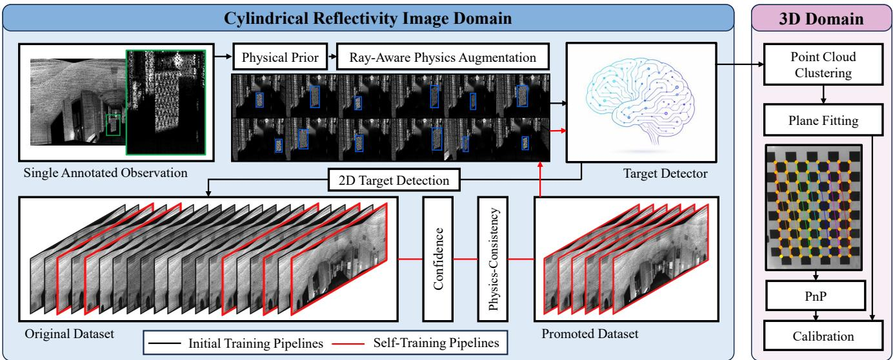
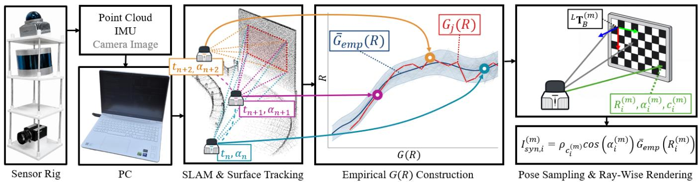
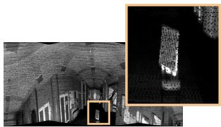
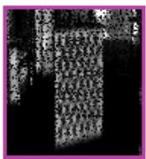
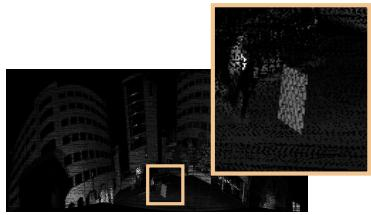
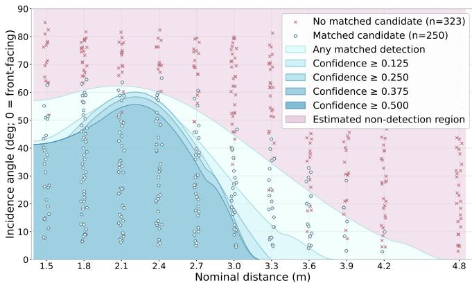

# RAPA: Ray-Aware Physics Augmentation for Robust Camera–LiDAR Calibration

Kyung-Rin Oh∗, Ji-Hoon Kim∗, TaeJoon Ha, and Jae-Sang Hyun†

Abstract— Camera–LiDAR calibration is essential for reliable perception in robotic and autonomous systems. Most targetbased calibration methods rely on checkerboard observations, but accurate checkerboard feature extraction from LiDAR point clouds remains challenging due to measurement sparsity. Existing approaches either require manual annotation of 3D corners or depend on geometric feature extraction methods, both of which can become unreliable when checkerboard features are insufficiently observed. In this paper, we formulate checkerboard localization as a 2D detection problem using cylindrical LiDAR reflectivity images. To overcome the limited availability of labeled training data, we propose rayaware physics augmentation (RAPA), which generates diverse synthetic samples from a single checkerboard observation. The generated data are used to improve detector robustness and generalization under varying sensing conditions. Across four independently captured indoor and outdoor locations, the proposed synthetic augmentation exceeds the strongest evaluated image-space augmentation baseline by 16.1–43.1 percentage points in mAP@0.5. Compared with training-free target-based methods on 242 observations, RAPA yields the largest number of valid target localizations, with 96.4% of its returned detections yielding valid target poses. These reliable localizations support downstream camera–LiDAR calibration across all four evaluated locations. Overall, RAPA addresses a key bottleneck in target-based calibration by enabling automated LiDARside target localization with only a single annotated target observation.

Index Terms— Calibration and Identification, Deep Learning for Visual Perception, Range Sensing.

## I. INTRODUCTION

Cameras and LiDARs provide complementary appearance and metric geometry for autonomous vehicles, mobile robots, and mapping systems [1]–[3]. Extrinsic calibration aligns these measurements for perception and localization [4], [5]. Checkerboards provide repeatable geometric constraints [5], [6] and are reliably detected in camera images [7]. In LiDAR, sparse and non-uniform sampling can leave their boundaries and internal pattern only partially observed, particularly at long ranges or unfavorable viewpoints [8]–[10]. This makes LiDAR-side target localization a bottleneck in calibration automation.

We formulate checkerboard localization as 2D detection in cylindrical reflectivity images (Fig. 1). This representation preserves the angular scan structure and black–white target contrast; the detected region identifies 3D returns for boardpose recovery.

Learning a robust detector in this domain is challenging when annotated calibration-target data are scarce. Acquiring observations over diverse ranges, viewpoints, and backgrounds requires dedicated data collection, while manual target annotation is labor-intensive [11]. This creates a practical tension: target localization should reduce manual intervention in calibration, but training the detector should not require a large collection of manually localized targets. To train with limited annotation, ray-aware physics augmentation (RAPA) combines geometry and reflectivity priors from one annotated observation with a range-response prior estimated from separate static surfaces. It renders virtual target poses using per-ray intersection range and incidence angle. One round of self-training adds reliable unlabeled observations without further manual annotation [12].

The resulting detector automates target localization in subsequent observations and supplies regions for geometric pose recovery. We evaluate this contribution to camera– LiDAR calibration across four indoor/outdoor locations, with additional targets and sensors testing the framework’s applicability.

Our main contributions are listed as follows:

• We formulate LiDAR checkerboard localization as 2D detection in cylindrical reflectivity images, providing a target-specific region for subsequent 3D geometric fitting under sparse point sampling.

• We propose ray-aware physics augmentation combining target-specific priors from one annotated observation with an empirical sensor–environment range-response prior, ray-wise rendering, and one round of self-training.

• We advance camera–LiDAR calibration automation by linking automatic LiDAR target localization to 3D pose recovery after one annotated observation. Verified target correspondences support calibration across all four evaluated locations.

  
Fig. 1. RAPA overview. Geometry and reflectivity priors from one annotated observation and a sensor–environment range-response prior generate rayconsistent synthetic targets. One self-training round refines the detector on unlabeled observations. Detected regions guide 3D board-pose recovery for camera–LiDAR calibration.

## II. RELATED WORK

## A. Camera–LiDAR Calibration

Target-free calibration uses cross-modal appearance [13], [14], reflectivity [4], edges [15], or geometric structures [16], [17], with method-specific assumptions about initialization and cross-modal feature matching. Target-based methods use known geometry: Zhang and Pless [6] related checkerboard planes to laser measurements, Geiger et al. [5] used multiple checkerboards for single-shot calibration, and Zhou et al. [18] extracted 3D boundary and plane correspondences. Reflectance and temporal cues help verify candidates [10], but sparse returns can still limit geometric support [19]. These approaches provide repeatable geometric constraints once the target is localized, but locating that target remains a distinct requirement. Manual region selection can provide the required support, while automatic methods must distinguish the board from competing planar structures before extracting correspondences. RAPA supplies a learned target region while retaining geometric fitting for 3D pose estimation.

## B. LiDAR Intensity and Reflectivity

Wang et al. [8] used checkerboard intensity contrast to fit a board model and recover 3D corners; Fu et al. [9] jointly used LiDAR intensity and camera observations through a differentiable checkerboard model. We use this contrast to synthesize detector-training observations. Intensity also depends on range, incidence angle, and sensor response. Viswanath et al. [20] compensated for these dependencies for semantic segmentation. Such compensation seeks a consistent representation of a surface despite changes in sensing geometry. Our objective is to predict how a target’s measured appearance changes at a new pose, so RAPA incorporates these dependencies into forward rendering. Its empirical sensor–environment range-response prior captures the response under the acquisition conditions without assuming a universal material-reflectance law.

## C. Learning with Limited Calibration Data

Learning a calibration-target detector in LiDAR is challenging because annotated LiDAR observations are typically scarce [21]. Calibration datasets usually contain only a limited number of annotated target observations. As a result, the limited training diversity makes it difficult to capture appearance variations across different sensing conditions. Consequently, learning detectors that generalize to unseen observations remains challenging [8], [9].

Cylindrical reflectivity images provide an alternative representation that preserves the LiDAR scan structure and exposes the black–white target contrast. Conventional image augmentations [22], [23] perform pixel-level transformations without preserving the underlying ray geometry and angular sampling pattern of cylindrical LiDAR scans. As a result, the generated target appearances are geometrically inconsistent with the LiDAR sensing process. They also fail to model appearance variations caused by range, incidence angle, and sampling sparsity [24]. In contrast, our augmentation preserves the underlying ray geometry while generating synthetic target observations.

## III. PROPOSED METHOD

The single annotated target observation, or good frame, supplies the board geometry and reflectivity priors. RAPA follows Fig. 1 to render training samples, refine the detector through self-training, and recover target poses from detections. Additional inputs are known target dimensions, a pretrained detector, an unlabeled pool, and separate LiDAR– IMU recordings for the range-response prior (Fig. 2).

## A. Cylindrical Reflectivity Representation

A LiDAR return is represented by $\mathbf { p } _ { i } \ = \ ( x _ { i } , y _ { i } , z _ { i } , I _ { i } )$ where $I _ { i }$ denotes the intensity reported by the sensor. Its range, azimuth, and elevation are computed as

$$
\begin{array} { r l } & { R _ { i } = \sqrt { x _ { i } ^ { 2 } + y _ { i } ^ { 2 } + z _ { i } ^ { 2 } } , } \\ & { \theta _ { i } = \mathrm { a t a n 2 } ( y _ { i } , x _ { i } ) , } \\ & { \phi _ { i } = \sin ^ { - 1 } \left( \frac { z _ { i } } { R _ { i } } \right) . } \end{array}\tag{1}
$$

Given fixed angular bounds $[ \theta _ { \mathrm { m i n } } , \theta _ { \mathrm { m a x } } ]$ and $[ \phi _ { \mathrm { m i n } } , \phi _ { \mathrm { m a x } } ] ,$ the return is projected onto a cylindrical image of width $W _ { I }$ and height $H _ { I }$ as

$$
\begin{array} { r l } & { u _ { i } = \left\lfloor \cfrac { \theta _ { i } - \theta _ { \operatorname* { m i n } } } { \theta _ { \operatorname* { m a x } } - \theta _ { \operatorname* { m i n } } } ( W _ { I } - 1 ) \right\rfloor , } \\ & { v _ { i } = \left\lfloor \cfrac { \phi _ { \operatorname* { m a x } } - \phi _ { i } } { \phi _ { \operatorname* { m a x } } - \phi _ { \operatorname* { m i n } } } ( H _ { I } - 1 ) \right\rfloor . } \end{array}\tag{2}
$$

Each valid pixel stores the intensity I, range $R ,$ validity mask M, and corresponding 3D coordinates $( x , y , z )$ . The intensity channel is converted into a grayscale reflectivity image for detector training, while the range, validity, and 3D coordinate channels retain the pixel-to-ray correspondence required for ray-aware rendering and downstream board-pose estimation.

B. Ray-Aware Physics Augmentation from a Single Annotated Observation

1) Board geometry and checker alignment: For the good frame, the operator specifies the target using corner points or a target-region seed in a single observation. The selected 3D returns are used to fit the board plane automatically; known target dimensions determine its center, normal, in-plane axes, and physical support. Projecting this support provides the detector bounding box. The resulting board pose ${ { \cal L } } _ { \mathbf { T } _ { B } }$ maps the board coordinate frame B to the LiDAR coordinate frame $L \colon$

$$
\begin{array} { r } { \boldsymbol { { \cal L } } { \bf \boldsymbol { \cal T } } _ { B } = \left[ \begin{array} { c c c c } { { \bf a } _ { u } } & { { \bf a } _ { v } } & { { \bf n } } & { { \bf c } } \\ { 0 } & { 0 } & { 0 } & { 1 } \end{array} \right] , } \end{array}\tag{3}
$$

where c is the board center, $\mathbf { a } _ { u }$ and ${ \bf a } _ { v }$ are its in-plane axes, and n is the board normal. The board has known dimensions $W _ { B }$ and $H _ { B }$ , denoting the board width and height, with square size d.

For a unit ray direction d, the intersection with the board plane is

$$
\lambda = \frac { \mathbf { n } ^ { \top } \mathbf { c } } { \mathbf { n } ^ { \top } \mathbf { d } } , \qquad \mathbf { p } = \lambda \mathbf { d } .\tag{4}
$$

The board-local coordinates of the intersection are

$$
u = ( \mathbf { p } - \mathbf { c } ) ^ { \top } \mathbf { a } _ { u } , \qquad v = ( \mathbf { p } - \mathbf { c } ) ^ { \top } \mathbf { a } _ { v } .\tag{5}
$$

A ray belongs to the physical board support when

$$
\lambda > 0 , \quad | u | \leq W _ { B } / 2 , \quad | v | \leq H _ { B } / 2 .\tag{6}
$$

Since the board pose does not determine the printed checker alignment, we additionally estimate the in-plane

offsets $( \delta _ { u } , \delta _ { v } )$ and binary phase $q .$ For each candidate, the checker indices are

$$
\begin{array} { r } { n _ { u } = \left\lfloor \frac { u + W _ { B } / 2 + \delta _ { u } } { d } \right\rfloor , \qquad n _ { v } = \left\lfloor \frac { H _ { B } / 2 - v + \delta _ { v } } { d } \right\rfloor . } \end{array}\tag{7}
$$

The white-square mask is defined by

$$
\mathcal { M } _ { \mathrm { w h i t e } } = \left[ \left( n _ { u } + n _ { v } + q \right) \mathrm { m o d } 2 = 0 \right] .\tag{8}
$$

The in-plane offsets and binary phase are selected by grid search as

$$
\begin{array} { r } { ( \delta _ { u } ^ { * } , \delta _ { v } ^ { * } , q ^ { * } ) = \operatorname * { a r g m a x } _ { \delta _ { u } , \delta _ { v } , q } \left[ \operatorname * { m e d i a n } ( I _ { \mathrm { w h i t e } } ) - \operatorname * { m e d i a n } ( I _ { \mathrm { b l a c k } } ) \right] . } \end{array}\tag{9}
$$

2) Sensor range-response prior: A standard LiDAR radiometric model expresses the received intensity as

$$
I ( R , \alpha , \rho ) \propto \eta ( R ) \frac { \rho \cos ( \alpha ) } { R ^ { 2 } } ,\tag{10}
$$

where $R ^ { - 2 }$ represents ideal geometric attenuation and $\eta ( R )$ captures additional range-dependent optical and sensor effects [20], [25]. For a commercial LiDAR, however, the reported intensity is already affected by proprietary sensor processing, making these range-dependent components difficult to identify separately. We therefore model their combined effect empirically as a range-response function $G ( R )$ Specifically, $G ( R )$ is estimated from tracked static surfaces, and the resulting arithmetic-mean response $\bar { G } _ { \mathrm { e m p } , \ell , e } ( R )$ is fixed and used as the sensor–environment range-response prior for rendering.

3) Empirical range-response construction: Using synchronized LiDAR–IMU streams, LiDAR–inertial SLAM [26] registers the scans, after which a separate tracker associates persistent, approximately homogeneous planar surface patches across scans. These recordings track noncheckerboard environmental surfaces and use no checkerboard labels, while observing the same surface over a range of distances.

Within each sensor–environment group $( \ell , e )$ , trackedplane measurements are aggregated into 0.25-m range bins. Subtracting the median log incidence cosine from the median log intensity gives $z _ { j , b } = a _ { j } + g _ { b } + \epsilon _ { j , b }$ for track $j$ and bin $b ,$ where $a _ { j }$ absorbs surface-specific scale and $g _ { b }$ describes shared range dependence. We fit $g _ { b }$ with a log-domain cubic P-spline and retain the central 50% of stable, rangesupported tracks under response-envelope and adjacent-bin limits. Applying a common population-center scale at 3 m to exp $( z _ { j , b } - \widehat { a } _ { j } )$ gives $G _ { j , \ell , e } ( R _ { b } )$

At each supported range bin, the empirical-mean rangeresponse prior is computed as the arithmetic mean of the available per-track responses:

$$
\bar { G } _ { \mathrm { e m p } , \ell , e } ( R _ { b } ) = \frac { 1 } { | \mathcal { I } _ { \ell , e , b } | } \sum _ { j \in \mathcal { I } _ { \ell , e , b } } G _ { j , \ell , e } ( R _ { b } ) ,\tag{11}
$$

where $\mathcal { T } _ { \ell , e , b }$ contains retained tracks supporting $R _ { b }$ . The binned mean is linearly interpolated and mildly smoothed with a log-domain cubic P-spline to obtain the fixed $\bar { G } _ { \mathrm { e m p } , \ell , e } ( R )$ used for target-reflectivity estimation and synthetic rendering.

  
Fig. 2. Automated construction and ray-wise application of the empirical range-response prior G(R). Synchronized LiDAR–IMU scans are registered, and persistent planar surfaces are tracked across scans. Their incidence-corrected measurements are used to obtain retained per-track response curves $G _ { j } ( R ) .$ Their distancewise arithmetic mean is interpolated and mildly smoothed by a log-domain cubic P-spline to obtain the fixed response ${ \hat { G } } _ { \mathrm { e m p } } ( R )$ . The shaded band denotes the sample standard deviation across retained tracks. For synthetic observation m, the smoothed response is evaluated at each ray–board intersection range $R _ { i } ^ { ( m ) }$ and combined with the corresponding incidence angle $\alpha _ { i } ^ { ( m ) }$ and checker class $c _ { i } ^ { ( m ) }$ . The LiDAR sensor and environment-group indices are omitted for clarity.

4) Target reflectivity priors: Using the empirical rangeresponse prior, we model the noise-free intensity of checker class $c \in$ {white, black} as

$$
I _ { c } ( R , \alpha ) = \rho _ { c } \cos \alpha \bar { G } _ { \mathrm { e m p } , \ell , e } ( R ) ,\tag{12}
$$

where $\rho _ { c }$ is the target-specific reflectivity prior and α is the incidence angle. This is an empirical rendering approximation for the measured sensor–environment group. For each measured LiDAR return k whose ray intersects the physical board support in the good frame, the normalized reflectivity is computed as

$$
\widehat { \rho } _ { k } = \frac { I _ { k } } { \cos ( \alpha _ { k } ) \bar { G } _ { \mathrm { e m p } , \ell , e } ( R _ { k } ) } .\tag{13}
$$

The white and black reflectivity priors are then estimated robustly as

$$
\rho _ { c } = { \mathrm { m e d i a n } } _ { k \in { \mathcal { S } } _ { c } } { \widehat { \rho } } _ { k } ,\tag{14}
$$

where $ { \boldsymbol { S } } _ { c }$ contains valid board returns assigned to checker class c, with invalid ranges and near-grazing rays excluded. Thus, $\rho _ { \mathrm { w h i t e } } , \rho _ { \mathrm { b l a c k } }$ , and the checker alignment are inferred from the single good frame.

5) Synthetic rendering: For synthetic observation $m ,$ a virtual board pose ${ ^ L { \bf T } _ { B } ^ { ( m ) } }$ is generated by randomly sampling the board range, azimuth, and orientation while retaining the physical board width, height, and checker-square size. Each cylindrical pixel corresponds to a LiDAR ray. The valid intersection determines the actual range $R _ { i } ^ { ( m ) }$ , incidence angle $\alpha _ { i } ^ { ( m ) }$ , and checker class $c _ { i } ^ { ( m ) } \in \overline { { \mathrm { \{ w h i t e } } }  .$ black}. The checker class is obtained using the fitted in-plane offsets and binary phase. The noise-free ray-wise synthetic intensity is

$$
I _ { \mathrm { s y n } , i } ^ { ( m ) } = \rho _ { c _ { i } ^ { ( m ) } } \cos \left( \alpha _ { i } ^ { ( m ) } \right) \bar { G } _ { \mathrm { e m p } , \ell , e } \left( R _ { i } ^ { ( m ) } \right) .\tag{15}
$$

Although the synthetic board is positioned at a nominal center range, the actual ray–board intersection distance varies across the board, especially for oblique orientations. Syn50 targets are composited onto the Good1 image after removing its original board.

  
(a) good frame

(b) Real Reference Target  
  
(c) Synthetic Target  
Fig. 3. Qualitative comparison of pose-conditioned synthetic rendering. (a) The single annotated observation used to estimate the target-specific reflectivity and checker-alignment priors. (b) A real target observed at a different target pose. (c) A synthetic target rendered at the same target pose as (b), but composited onto a different background using the priors estimated from (a).

We subsequently add small ray-wise intensity noise and stochastically remove a subset of the valid board returns to model measurement noise and return dropout. Thus, the range-response prior remains deterministic, while the synthetic observations vary through board pose, ray-wise geometry, intensity noise, and return dropout. As illustrated in Fig. 3, the synthetic target rendered at the same pose as the real observation closely resembles the real measurement.

## C. One-Round Self-Training

Although ray-aware augmentation and initial training expand the training distribution from a single annotated observation, synthetic samples cannot fully capture the variability of real measurements. We therefore use one-round selftraining to incorporate additional reliable real observations without extra manual annotation [12].

The detector trained with the initial real and synthetic samples is applied to an unannotated pool, retaining only the highest-confidence prediction per observation. A prediction is considered for promotion only if it falls within the top 30% and has a confidence score of at least 0.25. The remaining candidates are further filtered using physics-consistency checks on range support, projected target size, valid-return support, and reflectivity contrast.

For each promoted observation, additional ray-aware synthetic samples are generated and added together with the promoted observation, yielding the R1 detector after one additional training round. We use a single self-training round because additional rounds provide limited gains.

## D. Detector-Guided 3D Target Localization and Calibration

Within the detected region of interest, the dominant range cluster is selected and its plane and normal are estimated using RANSAC. The bounding-box-center ray intersects the plane to initialize the board center. A rectangle with the known board dimensions is then fitted to the detected bounding box to initialize the center and in-plane orientation. Grid search refines the planar center offsets and rotation using the Good1 checker phase, white/black reflectivity priors, and G(R) to maximize reflectivity-pattern consistency. Only poses with sufficient range support, plane consistency, and physical coverage are retained as ${ L } \widehat { \mathbf { T } } _ { B }$

The corresponding camera-side pose is independently estimated from the detected checkerboard corners using PnP with the calibrated camera intrinsics and known board geometry. Only observations with valid poses in both modalities are used for calibration. Given the LiDAR center and normal, $\widehat { \mathbf { c } } _ { i } ^ { L }$ and $\widehat { \mathbf { n } } _ { i } ^ { L } .$ , and their camera-side counterparts, $\mathbf { c } _ { i } ^ { C }$ and $\mathbf { n } _ { i } ^ { C }$ , we estimate the camera–LiDAR extrinsic transformation ${ \bf \nabla } ^ { C } { \bf \dot { T } } _ { L } = ( { \bf \nabla } ^ { C } { \bf R } _ { L } , { \bf \nabla } ^ { C } { \bf t } _ { L } )$ such that

$$
\mathbf { c } _ { i } ^ { C } \simeq { } ^ { C } \mathbf { R } _ { L } \hat { \mathbf { c } } _ { i } ^ { L } + { } ^ { C } \mathbf { t } _ { L } , \qquad \mathbf { n } _ { i } ^ { C } \simeq { } ^ { C } \mathbf { R } _ { L } \hat { \mathbf { n } } _ { i } ^ { L } .\tag{16}
$$

The transformation is obtained by jointly minimizing the center and normal alignment residuals over all fitting observations.

## IV. EXPERIMENTS

Our sensor rig comprises a Livox Mid-360, a Velodyne VLP-16, and a Grasshopper camera rigidly mounted together. The Mid-360 is used for the main checkerboard detection and camera–LiDAR calibration experiments. The concurrently recorded VLP-16 data are used to evaluate applicability under a substantially sparser LiDAR sampling pattern.

The checkerboard measures $W _ { B } ~ = ~ 0 . 3 6$ m by $H _ { B } \ =$ 0.27 m, with d = 0.03 m. Mid-360 scans are projected into cylindrical reflectivity images using a fixed field of view of $\theta ~ \in ~ [ - 1 8 0 ^ { \circ } , 1 8 0 ^ { \circ } ]$ and $\phi ~ \in ~ [ - 7 ^ { \circ } , 5 2 ^ { \circ } ]$ , with an image resolution of $( W _ { I } , H _ { I } ) \ = \ ( 1 0 2 4 , 5 1 2 )$ . Each main Mid-360 observation aggregates an approximately 5-s stationary capture, retaining the nearest return per cylindrical pixel without combining different target poses or sessions. The final evaluation comprises four independently captured locations: Indoor1, Indoor2, Outdoor1, and Outdoor2, containing 59, 64, 56, and 63 observations, respectively. Indoor1 and Outdoor1 have relatively open and less cluttered backgrounds, whereas Indoor2 and Outdoor2 contain more nearby objects and greater variations in scene structure and reflectivity. Outdoor2 additionally contains dense vegetation, adding further background complexity.

TABLE I  
DETECTION PERFORMANCE UNDER IMAGE-SPACE AUGMENTATION,GOOD1 INITIALIZATION SENSITIVITY, AND FULL SUPERVISION.SENSITIVITY RESULTS ARE THE MEAN AND SAMPLE STANDARDDEVIATION OVER 20 GOOD1 CANDIDATES; ALL OTHER RESULTS ARESINGLE RUNS. SYN50/GT DENOTES 50 SYNTHETIC SAMPLESGENERATED PER POSITIVE GT OBSERVATION. VALUES AREMAP@0.5/MAP@0.5:0.95.
<table><tr><td>Training condition</td><td>Indoor1</td><td>Indoor2</td><td>Outdoor1</td><td>Outdoor2</td></tr><tr><td colspan="3">Predefined Good1 (single run)</td><td></td><td></td></tr><tr><td>Good1 repeated (no aug.)</td><td>.405/.119</td><td>.097/.048</td><td>.198/.056</td><td>.022/.010</td></tr><tr><td>HSV jitter Aug5ò</td><td>.495/.141</td><td>.102/.047</td><td>.178/.066</td><td>.065/.029</td></tr><tr><td>Horizontal flip Aug50</td><td>.538/.174</td><td>.132/.076</td><td>.292/.087</td><td>.059/.027</td></tr><tr><td>Deep ChArUco Aug50</td><td>.623/.285</td><td>.413/.182</td><td>.563/.206</td><td>.167/.056</td></tr><tr><td>Good1+Syn50 (R0)</td><td>.784/.524</td><td>.844/.489</td><td>.779/.565</td><td>.483/.290</td></tr><tr><td colspan="3">Good1 sensitivity (20 candidates) Good1+Syn50 Mean .752/.434</td><td>.647/.442</td><td>.206/.120</td></tr><tr><td>± Std. Good1+Syn50+R1 Mean</td><td>.145/.121 .875/.530</td><td>.492/.284 .331/.195 .652/.383</td><td>.122/.086 .796/.547</td><td>.218/.133</td></tr><tr><td>± Std.</td><td>.083/.074</td><td>.253/.164</td><td>.105/.072</td><td>.240/.141 .260/.160</td></tr><tr><td colspan="3">Fully supervised references All train GT (real only) .993/.659</td><td>.683/.441</td><td></td></tr><tr><td colspan="3">All train GT + Syn50/GT .870/.636</td><td>.757/.484 .961/.669 .772/.604</td><td>.372/.240 .711/.436</td></tr></table>

For each location, one of 20 predefined Good1 candidates is labeled; the other 19 plus 15/6/6/6 additional unlabeled observations form R1 pools of 34/25/25/25 for Indoor1/Indoor2/Outdoor1/Outdoor2. Validation sets contain 10/10/5/10 observations. Good1, the R1 pool, validation, and test are disjoint at the observation level; test observations, including later additions, are never used for selection or training.

All detectors are initialized from the same pretrained YOLO11n [27] checkpoint and trained for 100 epochs. The 1024 × 512 cylindrical images are downsampled by a factor of two and padded vertically to form 512×512 inputs without geometric distortion.

## A. Training conditions and terminology

Good1 uses one labeled frame; Good1+Syn50 (R0) adds 50 ray-aware synthetic samples; Good1+Syn50+R1 adds one round of self-training. Unless specified, RAPA denotes the last configuration. In the controlled comparison, image-space baselines and R0 share the same predefined Good1, test split, base training settings, and 50 repeated or augmented samples per location. A separate 20-candidate analysis measures Good1 sensitivity with fixed splits and settings.

## B. Detection and Augmentation Results

Table I separates the fixed-Good1 augmentation comparison from initialization sensitivity. HSV jitter and horizontal flipping are image-space baselines [23]; the Deep ChArUcostyle baseline follows its homography and pixel-degradation policy [22]. With the same predefined Good1, R0 exceeds

  
Fig. 4. Operating range of the proposed detector with respect to target distance and incidence angle, shown at varying confidence thresholds.

Deep ChArUco by 16.1, 43.1, 21.6, and 31.6 percentage points in mAP@0.5 for Indoor1, Indoor2, Outdoor1, and Outdoor2, respectively. This comparison evaluates the combined ray-aware augmentation model before self-training. The separate 20-candidate block reports initialization sensitivity and the mean change after R1.

Under full supervision, augmentation improves performance in Indoor2 and Outdoor2, although gains are not uniform across locations. With the predefined Good1 and fixed promotion settings, mean mAP@0.5 over the four locations is .723/.817/.818/.832 for R0/R1/R2/R3, respectively. Later gains are smaller and non-monotonic across locations; R1 is therefore used as a fixed choice for the final pipeline.

## C. Robustness to Initialization and Operating Conditions

We evaluate the robustness of RAPA to Good1 selection, location changes, and target observation geometry.

1) Good1 sensitivity: For each location, 20 randomly sampled Good1 candidates are fixed before evaluation. Each initializes the same Good1+Syn50+R1 pipeline; R0 and R1 are evaluated on the same location-specific test set with the remaining pipeline settings fixed. Table I reports the mean and sample standard deviation over all candidates, without retrospectively selecting the best initialization. R1 improves mAP@0.5 for 18/20, 19/20, 19/20, and 6/20 candidates in Indoor1, Indoor2, Outdoor1, and Outdoor2, respectively, and reduces the standard deviation in the first three locations. Outdoor2 remains sensitive to initialization: R1 yields .240±.260 mAP@0.5, spanning .000–.673 across candidates. Thus, one annotation can initialize the framework, but its quality remains important under difficult visibility and background conditions.

2) Range and incidence angle: Figure 4 reports detection performance as a function of target range and incidence angle. Performance remains stable under well-sampled operating conditions and degrades as increasing range or oblique incidence reduces the target’s LiDAR support. The detectable region is widest around 2.1 m, where candidates are matched even under oblique incidence. Beyond this range, the maximum detectable incidence angle decreases steadily with distance.

## TABLE II

COMPARISON WITH TRAINING-FREE TARGET-BASED BASELINES. “RETURNED” COUNTS OBSERVATIONS IN WHICH EACH METHOD RETURNS A BOARD CANDIDATE. FOR RAPA, “VALID” REQUIRES SUCCESSFUL POSE RECOVERY AND CENTER AND NORMAL ERRORS OF   
AT MOST 10 CM AND $5 ^ { \circ } .$ , RESPECTIVELY, RELATIVE TO THE MANUALLY   
ANNOTATED 3D BOARD POSE. EACH METHOD IS CALIBRATED FROM ITS   
VALID DETECTIONS, AND ONLY WHEN AT LEAST THREE ARE AVAILABLE.   
$E _ { r }$ AND $E _ { t }$ ARE CROSS-MODAL TARGET-NORMAL AND TARGET-CENTER RESIDUALS (MEDIAN/RMSE), EVALUATED USING THE FITTED   
EXTRINSIC TRANSFORMATION AND INCLUDING FITTING OBSERVATIONS.

<table><tr><td>Dataset</td><td>Method</td><td>Returned</td><td>Valid↑</td><td>Er (°)↓</td><td>Et (cm)↓</td></tr><tr><td rowspan="3">Indoor1</td><td>RAPA</td><td>50/59</td><td>46/59</td><td>1.37/5.14</td><td>2.55/3.25</td></tr><tr><td>Zhou et al.</td><td>27/59</td><td>21/59</td><td>1.60/5.10</td><td>2.40/2.98</td></tr><tr><td>ACSC</td><td>51/59</td><td>38/59</td><td>1.39/5.12</td><td>3.10/3.54</td></tr><tr><td rowspan="3">Indoor2</td><td>RAPA</td><td>49/64</td><td>47/64</td><td>1.67/3.20</td><td>3.34/3.79</td></tr><tr><td>Zhou et al.</td><td>8/64</td><td>1/64</td><td></td><td></td></tr><tr><td>ACSC</td><td>32/64</td><td>12/64</td><td>1.66/3.21</td><td>3.41/3.84</td></tr><tr><td rowspan="3">Outdoor1</td><td>RAPA</td><td>44/56</td><td>44/56</td><td>1.49/2.45</td><td>2.31/2.73</td></tr><tr><td>Zhou et al.</td><td>2/56</td><td>2/56</td><td></td><td></td></tr><tr><td>ACSC</td><td>52/56</td><td>39/56</td><td>1.33/2.44</td><td>3.94/4.62</td></tr><tr><td rowspan="3">Outdoor2</td><td>RAPA</td><td>25/63</td><td>25/63</td><td>1.57/2.27</td><td>1.87/1.99</td></tr><tr><td>Zhou et al.</td><td>11/63</td><td>2/63</td><td></td><td></td></tr><tr><td>ACSC</td><td>56/63</td><td>10/63</td><td>1.70/2.51</td><td>3.15/3.31</td></tr></table>

## D. Target Detection and Camera–LiDAR Calibration

We quantitatively compare the complete pipeline against two training-free target-based calibration methods, Zhou et al. [18] and ACSC [10], measuring target detection under our small-board, sparse-observation conditions and calibration obtained from each method’s verified valid detections.

As shown in Table II, 162/168 RAPA returns are valid (96.4%), yielding target localizations in 162/242 observations (66.9%); Zhou et al. and ACSC yield 26/242 and 99/242, respectively.

Extrinsics are fitted from observations with valid LiDAR and camera PnP poses. $E _ { r }$ and $E _ { t }$ measure target-normal angular and target-center distance disagreement on these same observations, so they are fitted cross-modal residuals, not held-out errors. RAPA LiDAR poses come from the proposed recovery stage, camera poses from corner detection and PnP; manual 3D annotations determine validity only.

Zhou et al. rarely returns a candidate outside Indoor1, with most failures occurring during corner extraction under non-repetitive LiDAR sampling. ACSC returns candidates more frequently, but many correspond to non-target planes satisfying similar geometric constraints; in Outdoor2, only 10 of 56 returns are valid. Its intensity-pattern verification also appears less effective at our board scale, where the 3 cm squares are below the recommended 8 cm minimum.

For calibration, target-normal residuals are broadly comparable when calibration is available, whereas RAPA achieves lower target-center residuals than ACSC in all four locations. Zhou et al. provides insufficient valid detections for calibration outside Indoor1, while RAPA supports calibration in all four locations.

These results highlight a practical advantage of RAPA: supporting camera–LiDAR calibration with a compact 0.36× 0.27 m checkerboard containing 3 cm squares under sparse

TABLE III  
GENERALIZATION RESULTS USING RAPA. “VALID” IS THE COUNT/TOTAL OF LIDAR POSES SATISFYING THE FIXED VALIDITY CRITERIA. Er AND Et ARE CROSS-MODAL TARGET-NORMAL AND TARGET-CENTER RESIDUALS (MEDIAN/RMSE). THE FINAL TWO ROWS AVERAGE THE FOUR SAME-LOCATION AND TWELVE CROSS-LOCATION CASES WITHIN THE TRANSFER EXPERIMENT; VALID IS THE UNWEIGHTED MEAN OF THEIR VALID-POSE RATES.
<table><tr><td>Experiment</td><td></td><td>mAP@.5↑ mAP@.5:.95↑ Valid↑</td><td></td><td>Er (°)↓ Et (cm)↓</td><td></td></tr><tr><td colspan="6">Target-configuration transfer</td></tr><tr><td>Large ChArUco, Outdoor2</td><td>.682</td><td>.439</td><td>30/55</td><td></td><td>1.11/1.42 3.64/4.36</td></tr><tr><td>Large ChArUco, Indoor2</td><td>.892</td><td>.621</td><td>35/55</td><td></td><td>0.97/1.13 3.76/4.43</td></tr><tr><td colspan="6">LiDAR-sensor adaptation</td></tr><tr><td>VLP-16, Indoor1</td><td>.888</td><td>.391</td><td>52/59</td><td></td><td>1.85/2.58 5.50/6.23</td></tr><tr><td colspan="6">Extension beyond checkerboards</td></tr><tr><td>Circular traffic sign</td><td>.993</td><td>.734</td><td></td><td></td><td>19/20 2.46/5.51 1.88/3.35</td></tr><tr><td colspan="6">Cross-location Good1-prior transfer</td></tr><tr><td>Same-location mean</td><td>.776</td><td>.500</td><td></td><td></td><td>56.8% 0.98/2.05 2.43/2.64</td></tr><tr><td>Cross-location mean</td><td>.759</td><td>.468</td><td></td><td>55.5%1.44/2.14 2.48/2.91</td><td></td></tr></table>

LiDAR sampling. By recovering more valid target observations in this setting, RAPA improves the availability of usable calibration correspondences. This capability is particularly relevant to calibration setups in which target size is constrained.

Target-free MIAS-LCEC [13] returns no estimate on our single-observation captures, whose projected point count is only 6–10% of its TF360 data. To also examine conditions compatible with the baselines, we evaluate the public MIAS-LCEC-CB70 dataset [13]: 15 camera–LiDAR pairs captured using a Mid-70 and a checkerboard with 8 cm squares at 3–5 m. ACSC returns 12 candidates, of which 11 are valid, with median target-normal/center residuals of 0.59◦/1.22 cm. MIAS-LCEC returns extrinsic estimates on all 15 pairs, with corresponding medians of 0.47◦/2.54 cm. RAPA uses one Good1, seven unlabeled pairs, and seven evaluation pairs, recovering six valid poses. Since the baselines use all 15 pairs, these results do not constitute a comparison on identical test sets. They show that the baselines work under compatible conditions; our main comparison demonstrates the benefit of reliable LiDAR-side target localization for calibration under small-board, sparse-observation conditions, rather than superiority across all sensing conditions.

## E. Generalization Across Targets, Sensors, and Locations

To examine generalization beyond the calibration-target configuration and LiDAR sensor used in the main experiments, we conduct additional experiments with a larger ChArUco board and a VLP-16. The VLP-16 experiment uses the same concurrently recorded Indoor1 observations as the Mid-360 experiment, isolating sensor differences from scene variation. We further examine extension to a circular traffic sign and cross-location transfer of the checkerboard-derived Good1 prior. Table III summarizes the results.

1) Target-configuration transfer: The additional target is a 0.75 × 0.55 m ChArUco board with a 15 × 11 grid and a square size of 0.05 m. Despite differences in size, pattern, and material, RAPA recovers valid 3D poses and supports calibration in both indoor and outdoor environments.

2) LiDAR-sensor adaptation: For VLP-16, we retain the RAPA pipeline with a sensor-specific range-response prior. Despite its substantially sparser sampling, RAPA maintains detection performance comparable to Mid-360.

3) Extension beyond checkerboards: We adapt the target geometry and reflectivity priors to a 0.60-m circular traffic sign. RAPA recovers valid poses for most evaluation observations and supports calibration. This result shows that the framework is not restricted to checker patterns and can be extended to targets with known geometry.

4) Cross-location transfer: This experiment uses separately trained R1 models, rather than the checkpoints used for the fixed-Good1 results above. Each source-location detector uses only that location’s Good1 and unlabeled pool, then is frozen for evaluation on all four locations without adaptation or target-location threshold tuning. The same-location row in Table III averages the four cases in which source and test locations coincide; the cross-location row averages the other twelve cases. Within this comparison, mean mAP@0.5 changes from .776 to .759 and the mean valid-pose rate from 56.8% to 55.5%, with similar calibration residuals.

5) Computational cost: On an AMD Ryzen 5 7500F and NVIDIA RTX 5060 Ti desktop, online projection, detection, and pose recovery take 171 ms per observation; onetime Syn50+R1 adaptation takes 6.7 min. These exclude rosbag/disk I/O and fixed range-response-prior construction, respectively.

## V. CONCLUSION

We presented a ray-aware physics augmentation framework for LiDAR calibration-target detection using only a single labeled target observation. By incorporating ray–board intersection geometry, incidence-angle effects, and an empirical sensor–environment range-response prior, the proposed method generates ray-consistent synthetic target observations across varying poses and distances. Experiments demonstrate improved target detection under the evaluated conditions, with further mean gains from one-round self-training, while the resulting detections support downstream targetpose estimation and camera–LiDAR calibration across all evaluated locations. Additional evaluations across different sensing conditions and structured reflective targets further support the applicability of the proposed framework. Overall, the proposed framework moves target-based camera–LiDAR calibration toward a more automated pipeline by enabling reliable LiDAR-side target localization with minimal manual supervision.

## A. Limitations and future work

The current framework requires one manually annotated target, which limits the degree of automation. Future work could reduce this manual requirement through visionlanguage-model-assisted target localization and segmentation [28]–[30]. Detection reliability also remains sensitive to challenging sensing and background conditions. Incorporating algorithms that exploit temporal information across consecutive observations can improve target detection performance by integrating information over time [31], [32]. Additionally, further self-training beyond R1 yields only limited performance gains in our experiments. More advanced pseudo-label promotion strategies may enable more effective use of additional self-training rounds [33], [34]. Finally, while this study focuses on object detection and physicsbased augmentation in cylindrical reflectivity images, extending this representation to sequence-level vision tasks such as optical flow [35], [36], scene flow [37], and temporal correspondence would be a direction for applying advanced vision algorithms to LiDAR sensing.

## REFERENCES

[1] K. Huang, B. Shi, X. Li, X. Li, S. Huang, and Y. Li, “Multi-modal sensor fusion for auto driving perception: A survey,” arXiv preprint arXiv:2202.02703, 2022.

[2] A. Geiger, P. Lenz, C. Stiller, and R. Urtasun, “Vision meets robotics: The KITTI dataset,” International Journal of Robotics Research (IJRR), vol. 32, no. 11, pp. 1231–1237, 2013.

[3] P. Sun, H. Kretzschmar, X. Dotiwalla, A. Chouard, V. Patnaik, P. Tsui, J. Guo, Y. Zhou, Y. Chai, B. Caine, V. Vasudevan, W. Han, J. Ngiam, H. Zhao, A. Timofeev, S. Ettinger, M. Krivokon, A. Gao, A. Joshi, Y. Zhang, J. Shlens, Z. Chen, and D. Anguelov, “Scalability in perception for autonomous driving: Waymo open dataset,” in Proceedings of the IEEE/CVF Conference on Computer Vision and Pattern Recognition (CVPR), 2020, pp. 2443–2451.

[4] G. Pandey, J. R. McBride, S. Savarese, and R. M. Eustice, “Automatic targetless extrinsic calibration of a 3D lidar and camera by maximizing mutual information,” in Proceedings of the AAAI Conference on Artificial Intelligence, 2012.

[5] A. Geiger, F. Moosmann, O. Car, and B. Schuster, “Automatic camera and range sensor calibration using a single shot,” in Proceedings of the IEEE International Conference on Robotics and Automation (ICRA), 2012, pp. 3936–3943.

[6] Q. Zhang and R. Pless, “Extrinsic calibration of a camera and laser range finder (improves camera calibration),” in Proceedings of the IEEE/RSJ International Conference on Intelligent Robots and Systems (IROS), 2004.

[7] Z. Zhang, “A flexible new technique for camera calibration,” IEEE Transactions on Pattern Analysis and Machine Intelligence, vol. 22, no. 11, pp. 1330–1334, 2000.

[8] W. Wang, K. Sakurada, and N. Kawaguchi, “Reflectance intensity assisted automatic and accurate extrinsic calibration of 3D LiDAR and panoramic camera using a printed chessboard,” Remote Sensing, vol. 9, no. 8, p. 851, 2017.

[9] L. Fu, N. Chebrolu, and M. Fallon, “Extrinsic calibration of camera to LiDAR using a differentiable checkerboard model,” in Proceedings of the IEEE/RSJ International Conference on Intelligent Robots and Systems (IROS), 2023.

[10] J. Cui, J. Niu, Z. Ouyang, Y. He, and D. Liu, “ACSC: Automatic calibration for non-repetitive scanning solid-state LiDAR and camera systems,” arXiv preprint arXiv:2011.08516, 2020.

[11] Z. Wang, M. Varga, T. Medic, and A. Wieser, “Assessing the alignment´ between geometry and colors in TLS colored point clouds,” ISPRS Annals of the Photogrammetry, Remote Sensing and Spatial Information Sciences, vol. X-1/W1-2023, pp. 597–604, 2023.

[12] D.-H. Lee, “Pseudo-label: The simple and efficient semi-supervised learning method for deep neural networks,” in Workshop on Challenges in Representation Learning, ICML, 2013.

[13] Z. Huang, Y. Zhang, Q. Chen, and R. Fan, “Online, target-free LiDAR– camera extrinsic calibration via cross-modal mask matching,” IEEE Transactions on Intelligent Vehicles, 2024.

[14] H. Jung, N. Kim, J. Kim, and J. Park, “Targetless LiDAR-camera calibration with neural gaussian splatting,” IEEE Robotics and Automation Letters, 2026.

[15] Y. Liao, J. Li, S. Kang, Q. Li, G. Zhu, S. Yuan, Z. Dong, and B. Yang, “SE-Calib: Semantic edge-based LiDAR–camera boresight online calibration in urban scenes,” IEEE Transactions on Geoscience and Remote Sensing, vol. 61, pp. 1–13, 2023, art. no. 1000513.

[16] G. Iyer, R. K. Ram, J. K. Murthy, and K. M. Krishna, “Calibnet: Geometrically supervised extrinsic calibration using 3d spatial transformer networks,” in Proceedings of the IEEE/RSJ International Conference on Intelligent Robots and Systems (IROS), 2018.

[17] Z. Huang, Y. Fu, Y. Zhou, X. Chen, Q. Chen, and R. Fan, “DST-Calib: A dual-path, self-supervised, target-free LiDAR–camera extrinsic calibration network,” IEEE Transactions on Robotics, 2026, arXiv:2601.01188.

[18] L. Zhou, Z. Li, and M. Kaess, “Automatic extrinsic calibration of a camera and a 3D LiDAR using line and plane correspondences,” in Proceedings of the IEEE/RSJ International Conference on Intelligent Robots and Systems (IROS), 2018.

[19] J. S. K. Hu, T. Kuai, and S. L. Waslander, “Point density-aware voxels for LiDAR 3D object detection,” in Proceedings of the IEEE/CVF Conference on Computer Vision and Pattern Recognition (CVPR), 2022.

[20] K. Viswanath, P. Jiang, and S. Saripalli, “Reflectivity is all you need!: Advancing LiDAR semantic segmentation,” IFAC-PapersOnLine, vol. 59, no. 3, pp. 43–48, 2025.

[21] A. Xiao, J. Huang, W. Xuan, R. Ren, K. Liu, D. Guan, A. E. Saddik, S. Lu, and E. Xing, “3D semantic segmentation in the wild: Learning generalized models for adverse-condition point clouds,” arXiv preprint arXiv:2304.00690, 2023.

[22] D. Hu, D. DeTone, and T. Malisiewicz, “Deep ChArUco: Dark ChArUco marker pose estimation,” in Proceedings of the IEEE/CVF Conference on Computer Vision and Pattern Recognition (CVPR), June 2019, pp. 8436–8444.

[23] C. Shorten and T. M. Khoshgoftaar, “A survey on image data augmentation for deep learning,” Journal of Big Data, vol. 6, no. 1, p. 60, 2019.

[24] L. Fan, X. Xiong, F. Wang, N. Wang, and Z. Zhang, “RangeDet: In defense of range view for LiDAR-based 3D object detection,” in Proceedings of the IEEE/CVF International Conference on Computer Vision (ICCV), 2021.

[25] A. V. Jelalian, “Laser radar systems,” in EASCON 1980; Electronics and Aerospace Systems Conference, 1980, pp. 546–554.

[26] W. Xu, Y. Cai, D. He, J. Lin, and F. Zhang, “Fast-lio2: Fast direct lidarinertial odometry,” IEEE Transactions on Robotics, vol. 38, no. 4, pp. 2053–2073, 2022.

[27] G. Jocher and J. Qiu, “Ultralytics YOLO11,” 2024. [Online]. Available: https://github.com/ultralytics/ultralytics

[28] A. Radford, J. W. Kim, C. Hallacy, A. Ramesh, G. Goh, S. Agarwal, G. Sastry, A. Askell, P. Mishkin, J. Clark, G. Krueger, and I. Sutskever, “Learning transferable visual models from natural language supervision,” in Proceedings ofthe 38th International Conference on Machine Learning, 2021, pp. 8748–8763.

[29] S. Liu, Z. Zeng, T. Ren, F. Li, H. Zhang, J. Yang, Q. Jiang, C. Li, J. Yang, H. Su, J. Zhu, and L. Zhang, “Grounding DINO: Marrying DINO with grounded pre-training for open-set object detection,” in Proceedings of the European Conference on Computer Vision, 2024, pp. 38–55.

[30] A. Kirillov, E. Mintun, N. Ravi, H. Mao, C. Rolland, L. Gustafson, T. Xiao, S. Whitehead, A. C. Berg, W.-Y. Lo, P. Dollar, and´ R. Girshick, “Segment anything,” in Proceedings of the IEEE/CVF International Conference on Computer Vision, 2023, pp. 4015–4026.

[31] J. Yin, J. Shen, C. Guan, D. Zhou, and R. Yang, “Lidar-based online 3d video object detection with graph-based message passing and spatiotemporal transformer attention,” in 2020 IEEE/CVF Conference on Computer Vision and Pattern Recognition (CVPR). IEEE, 2020, pp. 11 492–11 501.

[32] J. Koh, J. Lee, Y. Lee, J. Kim, and J. W. Choi, “Mgtanet: Encoding sequential lidar points using long short-term motion-guided temporal attention for 3d object detection,” in Proceedings of the AAAI Conference on Artificial Intelligence, vol. 37, no. 1, 2023, pp. 1179–1187.

[33] Y.-C. Liu, C.-Y. Ma, Z. He, C.-W. Kuo, K. Chen, P. Zhang, B. Wu, Z. Kira, and P. Vajda, “Unbiased teacher for semi-supervised object detection,” arXiv preprint arXiv:2102.09480, 2021.

[34] F. Yu, D. Wang, Y. Chen, N. Karianakis, T. Shen, P. Yu, D. Lymberopoulos, S. Lu, W. Shi, and X. Chen, “Sc-uda: Style and content gaps aware unsupervised domain adaptation for object detection,”

in 2022 IEEE/CVF Winter Conference on Applications of Computer Vision (WACV). IEEE, 2022, pp. 1061–1070.

[35] Z. Teed and J. Deng, “Raft: Recurrent all-pairs field transforms for optical flow,” in European conference on computer vision. Springer, 2020, pp. 402–419.

[36] V. Vaquero, A. Sanfeliu, and F. Moreno-Noguer, “Hallucinating dense optical flow from sparse lidar for autonomous vehicles,” in 2018 24th International Conference on Pattern Recognition (ICPR). IEEE, 2018, pp. 1959–1964.

[37] X. Liu, C. R. Qi, and L. J. Guibas, “Flownet3d: Learning scene flow in 3d point clouds,” in 2019 IEEE/CVF Conference on Computer Vision and Pattern Recognition (CVPR). IEEE, 2019, pp. 529–537.