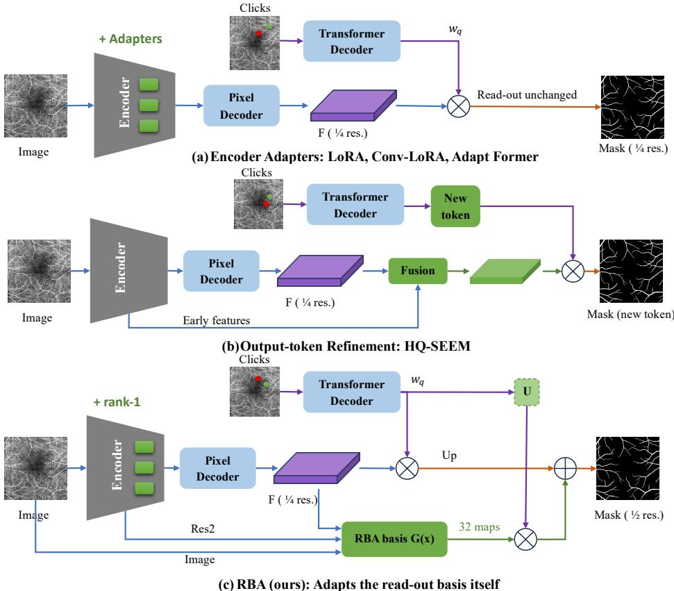
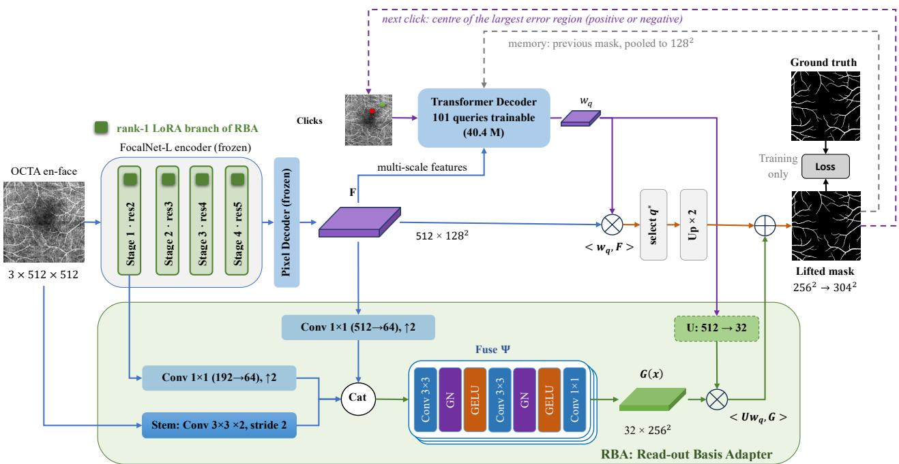
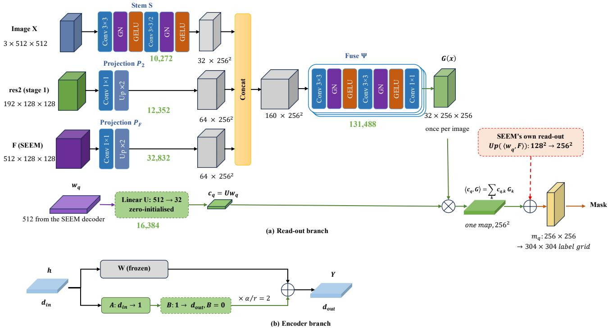
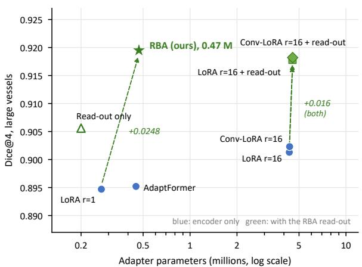
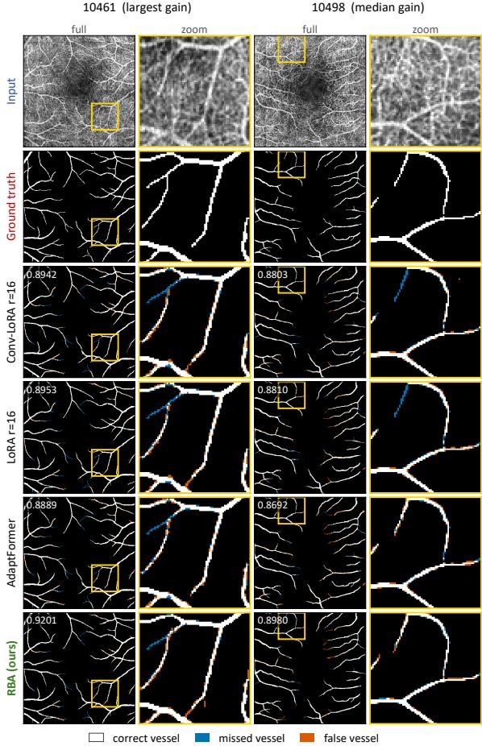
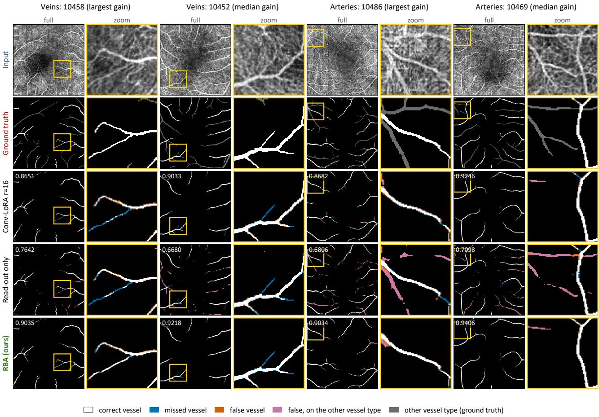

# RBA: A Read-out Basis Adapter for Parameter-Eficient Interactive OCTA Vessel Segmentation with SEEM

Jaafar M. Al-Ghabbana, Mohammad Reza Mohammadia,∗

aSchool of Computer Engineering, Iran University of Science and Technology, Tehran, Iran

A R T I C L E I N F O

Keywords:   
Optical coherence tomography angiog  
raphy   
Retinal vessel segmentation   
Interactive segmentation   
Parameter-eficient fine-tuning   
Segmentation foundation model

## A BS T R AC T

Retinal disease monitoring with optical coherence tomography angiography (OCTA) relies on segmentation of vessels and the foveal avascular zone (FAZ). Promptable models such as SEEM (Segment Everything Everywhere All at Once) allow click-based refinement, but without adaptation SEEM segments thin vessels poorly and needs many clicks. Fully fine-tuning its 342 million parameters on a few hundred images is costly and risks overfitting, and parameter-eficient methods such as low-rank adaptation (LoRA) usually adapt only the encoder. Yet SEEM reads every candidate mask from one feature map at quarter resolution, too coarse for vessels one to three pixels wide. This study introduces the Read-out Basis Adapter (RBA), whose read-out branch generates 32 image-specific basis maps at half resolution. Each candidate accesses them through its own vector and a zero-initialised projection, so the model starts exactly as SEEM. The encoder branch, a standard rank-1 LoRA, supplies the information needed to tell arteries from veins. RBA adds 0.47 million trainable parameters. Under simulated error-driven clicks, with the ground truth used only to place them, RBA outperforms LoRA, Conv-LoRA and AdaptFormer on OCTA-500 3 mm large vessels. Averaged over three seeds, it reaches an intersection over union (IoU) of 85.16% and a Dice score of 91.93%, 2.90 and 1.72 percentage points above Conv-LoRA. On the 6 mm subset, one run gives margins of 4.35 and 2.76 points. The gain extends to arteries, veins and ROSE-O but not to the FAZ. In SEEM, adaptation capacity pays more at the mask read-out than in the encoder.

## 1. Introduction

Retinal vessel segmentation underpins the quantitative study of retinal diseases such as diabetic retinopathy and glaucoma. Diabetic retinopathy afects more than one in five people with diabetes, and 160.5 million adults are projected to have it by 2045 [1]. Glaucoma afected an estimated 64.3 million people aged 40 to 80 in 2013, a number projected to reach 111.8 million by 2040 [2]. Both diseases change the retinal microvasculature, so vessel density, vessel calibre and the shape of the foveal avascular zone (FAZ) are used to study them. Each of these measurements is only as reliable as the segmentation behind it.

Optical coherence tomography angiography (OCTA) images the retinal microvasculature in depth-resolved scans. Unlike fluorescein angiography, it needs no dye injection [3]. The measurements above are taken on its en-face projections, which show the vessels of selected retinal layers.

Deep networks trained on dense labels now dominate this segmentation. Public datasets such as OCTA-500 [4] and ROSE [5] have turned it into a benchmark. On these datasets, Li et al. with IPN [6], Hu et al. with Joint-Seg [7] and Peng et al. with FARGO [8] report high scores. These networks share two limits. Each new target or imaging device needs new dense labels, and an error can only be corrected by editing the mask pixel by pixel.

Three properties of OCTA projections make the segmentation hard. Many vessels on the 3 mm OCTA-500 images are one to three pixels wide, and vessels below three pixels make up about a quarter of the large-vessel label. Huang et al. [9] report that vessel ends are faint and low in contrast, and Hu et al. [10] address the noise and artefacts that the projections carry. Vessel pixels are also a small minority of each image, so quality is decided on thin branches and vessel edges, whereas the FAZ is a single compact region.

Interactive segmentation addresses both limits of dedicated networks. The user clicks on a missed or a false region, and the model revises its mask after each click, as in FocalClick, SimpleClick and RITM [11–13]. Promptable foundation models such as the Segment Anything Model (SAM) [14] and SEEM, short for Segment Everything Everywhere All at Once [15], ofer this mode for general images. SAM-OCTA [16, 17] and SAM-OCTA2 [18] adapted SAM to OCTA, but with prompts drawn from the ground truth. Out of the box, these models do not see OCTA vessels well. With a frozen encoder and a trained decoder, SEEM reaches a Dice score of only 75.83% on large vessels and 50.98% on veins in this study, although its pixel accuracy is 96.6%. Even with its decoder trained, this model did not reach 90% Dice within the 20 allowed clicks on the large-vessel test images, so SEEM must be adapted to OCTA. Fine-tuning all of its 341.7 M parameters on a few hundred labelled images is costly and risks overfitting, which motivates parametereficient adaptation.

The first group of adaptation methods changes how the image is encoded, as panel a of Fig. 1 shows. Hu et al. [19] proposed low-rank adaptation (LoRA), which adds a trainable low-rank update to frozen weights, and Zhong et al. [20] placed a convolution inside this low-rank bottleneck in Conv-LoRA. Such encoder adapters change what the feature map of SEEM contains. They change neither its quarter resolution nor the way masks are read from it.

The second group changes how the final mask is produced, as panel b of Fig. 1 shows. Ke et al. [21] proposed HQ-SAM, which adds a high-quality output token whose mask, computed from fused early and late encoder features, replaces the mask of SAM. This token sharpens the mask, but it bypasses the candidates and the selection among them on which interaction relies.

Neither group acts at the step at which SEEM forms its masks. Each decoder query of SEEM produces a vector, and its candidate mask is the dot product of this vector with one feature map at a quarter of the input resolution. Every mask that SEEM can produce is therefore a combination of this coarse basis. No existing adapter acts at this read-out while keeping the candidates and the selection of SEEM and starting from the exact pretrained model.

To address this gap, this study proposes the Read-out Basis Adapter (RBA), shown in panel c of Fig. 1. RBA consists of two branches. The read-out branch builds 32 basis maps at half the input resolution from the image alone. Every candidate reads them through its own vector via a linear map that starts at zero, like the update of LoRA [19]. The encoder branch is a standard rank-1 LoRA that supplies the information needed to tell arteries from veins. RBA therefore starts exactly as SEEM, keeps its candidates and selection, and computes the new basis once per image, so a click costs almost nothing more. Fig. 2 shows the complete pipeline.

The contributions of this work are fourfold. First, it proposes RBA, an adapter of the basis from which every SEEM candidate mask is read, with 0.47 M parameters, which is 0.14% of SEEM. Second, it shows that in SEEM adaptation capacity pays more at the read-out than in the encoder. Once the read-out is adapted, a rank-1 encoder branch sufices, and the read-out improves every encoder adapter to which it is added. Third, it evaluates the model with simulated clicks in which no ground truth enters the prediction, and it tests every diference in pairs under decision rules fixed before the runs. Fourth, it reports results on OCTA-500 and ROSE-O. On large vessels of the 3 mm subset, RBA outperforms LoRA, Conv-LoRA and AdaptFormer on all 50 test images, as Table 1 reports. Averaged over three training seeds, it exceeds Conv-LoRA by 1.72 percentage points in Dice and 2.90 in intersection over union (IoU), and the seed-to-seed standard deviation of Dice is 0.02% for both models. On the 6 mm subset the Dice margin grows to 2.76 percentage points, and the gain extends to veins, arteries and ROSE-O, whereas the FAZ shows no significant diference.

The rest of this paper is organised as follows. Section 2 reviews related work, Section 3 presents the methodology, Section 4 reports the results and Section 5 concludes.

## 2. Related work

## 2.1. Deep learning for OCTA vessel segmentation

Progress in OCTA vessel segmentation has relied on public datasets with pixel-level labels. Li et al. [4] released

OCTA-500, which covers 500 eyes at 3 mm and 6 mm fields of view with pixel-level labels for large vessels, arteries, veins, capillaries and the FAZ. Ma et al. [5] introduced ROSE, which adds vessel labels from two devices, together with the OCTA-Net model. Hao et al. [22] extended ROSE with FAZ labels as ROSE-O and proposed the multitask network VAFF-Net.

The dedicated networks difer mainly in how they build vessel structure into the model. Li et al. [6] proposed the image projection network IPN, which learns the projection from the 3D volume to the en-face image. Peng et al. [8] with FARGO and Hu et al. [7] with Joint-Seg segment the FAZ and the vessels as a joint task, and Melo et al. [23] applied multitask learning to the FAZ. Chen et al. [24] proposed SSW-OCTA, which uses snake-like convolutions that follow vessel paths, and Ma et al. [25] combined full-scale skip connections with split attention in RS\_Unet3+. Two further networks address the properties that make vessels hard to segment. Hu et al. [10] disentangle vessels from noise and artefacts in D2Net, and Huang et al. [9] add patch-wise attention for faint vessel ends in LSENet.

These networks reach high accuracy, but they share two costs. Every new target or imaging device needs new dense labels, and an error in a prediction can only be corrected by editing the mask pixel by pixel.

Promptable models reached OCTA through SAM-OCTA of Wang et al. [16] and Chen et al. [17] and through SAM-OCTA2 ofChen et al. [18], which fine-tune SAM and SAM 2 with LoRA. Their prompts are sampled from the ground truth, in SAM-OCTA from every connected component of the label. This measures how well a model segments when it receives ideal prompts, not how it behaves when a user corrects its mistakes. The present work evaluates the second case, with error-driven clicks and the model’s own choice of candidate.

## 2.2. Promptable models and parameter-eficient adaptation

Interactive segmentation follows a standard protocol, used by Sofiiuk et al. [13] in RITM, by Chen et al. [11] in FocalClick and by Liu et al. [12] in SimpleClick. A simulated user clicks at the centre of the largest error region, and the score is the number of clicks needed to reach a target IoU or Dice. The ground truth places the clicks but never chooses the output.

Kirillov et al. [14] extended prompting to many prompt types with SAM, and Zou et al. [15] did so with SEEM, whose decoder derives from the Mask2Former of Cheng et al. [26]. Evaluations that pick the candidate or the threshold against the ground truth overstate what a model achieves on its own, so this work leaves both choices to the model.

Beyond LoRA [19] and Conv-LoRA [20], introduced in Section 1, several variants change what happens inside the low-rank bottleneck. Chen et al. [27] proposed NAS-LoRA, which searches the bottleneck structure, and Yin et al. [28] proposed LoRand for dense prediction. Iltaf et al. [29] used atrous convolutions for aortic vessels in VesselSAM. Bottleneck adapters insert small multilayer perceptrons (MLPs) instead. Chen et al. [30] placed them in parallel with each MLP in AdaptFormer, and Chen et al. [31] introduced SAM-Adapter. Wu et al. [32] proposed the Medical SAM Adapter, and Hu et al. [33] added spatial priors in SPA. Closest to the vessel setting, Khazem [34] combined LoRA with a lightweight spatial convolutional adapter on high-resolution embeddings and a clDice loss in TopoLoRA-SAM, for noninteractive segmentation of thin structures such as retinal vessels. For SEEM itself, Abou Baker et al. [35] compared adapters and LoRA for instance segmentation, with SEEM and Mask DINO as base models.

  
Figure 1: Three ways to adapt a promptable segmentation model: (a) encoder adapters such as LoRA, Conv-LoRA and AdaptFormer, (b) output-token refinement as in HQ-SEEM, and (c) RBA, which adapts the read-out basis of SEEM. Green marks trainable additions.

These methods assume that segmentation lacks a better representation. For SEEM this is only half of the problem, since better encoder features still reach the masks through the same quarter-resolution read-out. The case for convolutional adapters is weaker still, because the FocalNet encoder of SEEM [36] already aggregates context with depth-wise convolutions. On the output side, HQ-SAM [21] sharpens the mask with an extra token, but it bypasses the candidates and the selection that interaction relies on.

In summary, encoder adapters change what the features contain, and output-token methods replace the candidates, while the basis from which SEEM reads its candidates stays unchanged. RBA combines the zero-initialised low-rank update of LoRA with high-resolution image features and applies them to this read-out. The next section formalises the read-out and presents RBA.

## 3. Methodology

## 3.1. Problem formulation

In interactive segmentation, the model refines its mask over several rounds of user clicks. Let $x \in \mathbb { R } ^ { 3 \times S \times S }$ be the OCTA input, three stacked en-face projections resized to � = 512. Let $y \in \{ 0 , 1 \} ^ { H \times W }$ be its label on the native grid, where $H = W = 3 0 4$ for the 3 mm subset and ROSE-O and � = � = 400 for the 6 mm subset. An interactive session is a sequence of rounds $k = 1 , \dots , K$ . In round � the user has placed the clicks $c _ { 1 : k } ,$ each with a location and a sign, positive on a missed vessel and negative on a false one, and the model returns a mask ${ \hat { y } } _ { k } . \mathrm { A }$ good model reaches a high Dice in few rounds while selecting its own output at a fixed threshold. The ground truth is used only to simulate where a user would click.

SEEM processes the input with a FocalNet-L encoder [36] and a pixel decoder, which produce a maskfeature map � of size $C \times S / 4 \times S / 4$ with � = 512. Given the prompts, the transformer decoder updates $Q ~ = ~ 1 0 1$ queries, and the mask-embedding MLP of SEEM maps each query to a vector ${ \bf w } _ { q }$ of dimension �. Following the prototype-based view of instance segmentation [37], the logit of candidate � at pixel � of the $S / 4 \times S / 4$ grid is

  
Figure 2: Overview of SEEM with RBA. Blue marks the image path, purple the click path and green the read-out term of RBA. Dashed loops mark the next click and the previous-mask memory.

$$
m _ { q } ( u ) = \langle \mathbf { w } _ { q } , F ( u ) \rangle = \sum _ { c = 1 } ^ { C } w _ { q , c } F _ { c } ( u ) .\tag{1}
$$

This dot product is the read-out of SEEM. SEEM selects one candidate per click with a query pooled at the click. A click changes the vectors ${ \bf w } _ { q }$ and the selected candidate, but not $F .$ For a given image, every candidate is therefore the sigmoid of a weighted sum of the same 512 maps at 128 × 128 pixels, for a label grid of 304×304. If the shape of a thin vessel or of a vessel edge is not in the span of these maps, no candidate can express it.

## 3.2. Read-out Basis Adapter

RBA is built on SEEM and adds two branches. SEEM with the FocalNet-L encoder has 341.7 M parameters in total. The FocalNet-L encoder, the pixel decoder that produces � and the language encoder, which the click task does not use, stay frozen. The transformer decoder, with 39.8 M parameters, is trained, and its previous-mask memory and its selection rule are used unchanged. A learned positional click prompt with 0.57 M parameters is trained with the decoder. It combines the click tokens of SEEM with a learned positional encoding of each click and is shared by every configuration compared in this work. RBA itself has 474,168 parameters, of which 270,840 belong to the encoder branch and 203,328 to the read-out branch. The image path runs once per image, and only the decoder and the read-out run in every click round. Fig. 2 shows how the branches connect to SEEM.

The encoder branch supplies the small, task-specific change that the frozen encoder needs to tell vessel types apart. It is a standard rank-1 LoRA [19] in the linear layers �, ��1, ��2 and ���� of all 24 FocalNet-L blocks, which makes 96 layers:

$$
y = W h + \frac { \alpha } { r } B A h , \qquad r = 1 , \quad \frac { \alpha } { r } = 2 .\tag{2}
$$

Here � is the frozen weight, ℎ is the layer input, $A \in \mathbb { R } ^ { 1 \times d _ { \mathrm { i n } } }$ $B \in \mathbb { R } ^ { d _ { \mathrm { o u t } } \times 1 }$ , and � is initialised to zero. The rank is kept at one because a larger encoder adapter does not improve large-vessel segmentation once the read-out is adapted, as Section 4.1 shows.

The read-out branch supplies the spatial detail that the quarter-resolution features � lack. It builds $n _ { b } = 3 2$ maps at half the input resolution from three sources of increasing depth:

$$
G ( x ) = \Psi \big ( [ S ( x ) ; \mathrm { U p } ( P _ { 2 } \mathrm { r e s } 2 ) ; \mathrm { U p } ( P _ { F } F ) ] \big ) .\tag{3}
$$

Here [⋅ ; ⋅] denotes channel concatenation, Up denotes bilinear upsampling by two, and $G ( x ) \ \in \ \mathbb { R } ^ { n _ { b } \times \bar { S } / 2 \times S / 2 }$ . The stem $s$ processes the image rescaled to [−1, 1] with two $3 \times 3$ convolutions, the second with stride 2, each followed by group normalisation and a Gaussian error linear unit (GELU). $P _ { 2 }$ and $P _ { F }$ are $1 \times 1$ projections to 64 channels. $P _ { 2 }$ takes the stage-1 features res2 of FocalNet-L, which carry early edges and textures, and $P _ { F }$ takes $F ,$ the semantics that SEEM already uses. The fusion network Ψ merges the 160 concatenated channels with two $3 \times 3$ convolutions, each followed by group normalisation and GELU, and $\textbf { a } 1 \times 1$ convolution to the 32 maps. � depends on the image alone and is computed once per image, before any click. Fig. 3 gives the layers of both branches and their parameter counts.

  
Figure 3: The RBA module: (a) read-out branch and (b) encoder branch. Green numbers give parameter counts, dashed green boxes mark zero initialisation, and red marks the unchanged read-out of SEEM.

The lifted read-out lets every candidate use the new basis without changing the mechanism of SEEM. RBA adds a second, zero-initialised term to Eq. (1):

$$
m _ { q } = \mathrm { U p } \big ( \langle { \mathbf { w } } _ { q } , F \rangle \big ) + \langle U { \mathbf { w } } _ { q } , G ( x ) \rangle .\tag{4}
$$

Here $U \in \mathbb { R } ^ { n _ { b } \times C }$ , with 16,384 parameters, maps each query vector to $n _ { b }$ coeficients. Equivalently, the read-out basis becomes $\mathrm { U p } ( F ) + U ^ { \top } G ( x )$ , a rank- $^ { - n } b$ update of the basis, in the same way as the term �� in LoRA is a low-rank update of a weight matrix.

Four properties follow. First, the start is exact. Since � is zero at the start, $m _ { q }$ equals $\operatorname { U p } ( \langle \mathbf { w } _ { q } , F \rangle )$ , the read-out of the pretrained model, because bilinear upsampling is linear and commutes with the sum over channels. Second, directions are kept. For any � in the null space of � the mask is the stock mask, so RBA re-assigns at most $n _ { b }$ of the 512 readout directions. Third, the branch depends on the image only. A click therefore costs one $5 1 2 \  \ 3 2$ linear map and a weighted sum of 32 maps of 256×256 pixels, which is about two million multiply-adds. Fourth, learning is ordered. With $U = 0$ the gradient of $m _ { q }$ with respect to � is zero, so only � learns in the first step, and the layers that build � follow once � has moved. The first, second and fourth properties were verified numerically at the tensor sizes of SEEM.

## 3.3. Click simulation and training

Clicks are simulated from the ground truth, which a real user does not have. The first click is placed at the maximum of the distance transform of the label, inside the thickest vessel. Each later click follows the error-driven rule of Sofiiuk et al. [13]. The missed and the false pixels of the current mask at threshold 0.5 form two error maps, and a 7×7 window around every earlier click is excluded from both. The click goes to the centre of the thickest error region, that is, to the larger of the two distance-transform maxima. It is positive on a missed region and negative on a false one, and a random error pixel is used if no error pixel remains outside the excluded windows. Clicks are placed on the label grid, mapped to the input and rendered as disks of radius 8 pixels on the $5 1 2 \times 5 1 2$ input. Between rounds, the lifted mask is area-pooled to $1 2 8 \times 1 2 8$ , detached from the gradient and passed to SEEM as the previous-mask memory. This mask belongs to the supervised candidate during training and to the candidate selected by SEEM at test time.

During training, all candidates are lifted and the one that best matches the label is supervised. The mask loss of round � combines Dice [38], focal [39] and Tversky [40] terms on the lifted mask, resized to the native grid:

$$
\mathcal { L } ^ { ( k ) } = 0 . 4 \mathcal { L } _ { \mathrm { D } } ^ { ( k ) } + 0 . 3 \mathcal { L } _ { \mathrm { F } } ^ { ( k ) } + 0 . 3 \mathcal { L } _ { \mathrm { T } } ^ { ( k ) } .\tag{5}
$$

The focal parameters are $\alpha \ = \ 0 . 2 5$ and $\gamma \ = \ 2 .$ , and the Tversky weights are 0.3 for false positives and 0.7 for false negatives, which favours the recall of thin vessels. A second term penalises a round that is worse than the previous one:

$$
\mathcal { L } _ { \mathrm { i m p r } } = \frac { 1 } { K - 1 } \sum _ { k = 2 } ^ { K } \Big [ \mathcal { L } _ { \mathrm { D } } ^ { ( k ) } - \mathrm { s g } \big ( \mathcal { L } _ { \mathrm { D } } ^ { ( k - 1 ) } \big ) \Big ] _ { + } ,\tag{6}
$$

where $[ \cdot ] _ { + } = \operatorname* { m a x } ( 0 , \cdot )$ and sg stops the gradient. The total loss is

$$
\mathcal { L } = \frac { 1 } { K } \sum _ { k = 1 } ^ { K } \mathcal { L } ^ { ( k ) } + 0 . 5 \mathcal { L } _ { \mathrm { i m p r } } .\tag{7}
$$

Algorithm 1 summarises the training loop.

Algorithm 1: Training SEEM with RBA and sim  
ulated clicks.   
Input: training set ; SEEM with frozen encoder and   
pixel decoder; trainable set Θ: SEEM decoder,   
encoder branch $( A , B ) ,$ read-out branch   
$( S , P _ { 2 } , P _ { F } , \Psi , U ) ;$ rounds �; epochs �   
Output: trained model $f _ { \Theta ^ { \star } }$   
1 Initialise $B  0 , U  0 ; \quad \mathrm { ~ } / /$ the model starts as SEEM   
2 for ����ℎ = 1, … , � do   
3 foreach image � with label � in , with dihedral and   
intensity augmentation do   
4 (�, res2) ← encoder and pixel decoder(�);   
$G  G ( x )$ ; // once per image   
5 $c _ { 1 } \gets$ distance-transform peak of �; ������ $ \varnothing ;$   
6 for $k = 1 , \dots , K$ do   
7 $\{ \mathbf { w } _ { q } \} _ { q = 1 } ^ { Q }$ ← SEEM decode $( F , c _ { 1 : k } ,$ ������);   
8 $m _ { q } \gets \mathrm { U p } ( \langle { \bf w } _ { q } , F \rangle ) + \langle U { \bf w } _ { q } , G \rangle$ for all $q$   
$/ /$ Eq. (4)   
9 $q ^ { \dagger } \gets \mathrm { a r g }$ max Dice $( m _ { q } , y ) ; / /$ training only   
10 accumulate $\mathcal { L } ^ { ( k ) } ( m _ { q ^ { \dagger } } , y ) ;$ // Eq. (5)   
11 ������ ← area-poo $1 ( m _ { q ^ { \dagger } } ) ; c _ { k + 1 } \gets$   
error-driven click;   
12 $\begin{array} { r } { \mathcal { L } \gets \frac { 1 } { \kappa } \sum _ { k } \mathcal { L } ^ { ( k ) } + 0 . 5 \mathcal { L } _ { \mathrm { i m p r } } ; \qquad / / } \end{array}$ Eqs. (6), (7)   
13 $\Theta  \Theta - \mathrm { A d a m W } ( \nabla _ { \Theta } \mathcal { L } ) ;$   
14 return $f _ { \Theta ^ { \star } } ,$ , the checkpoint with the best validation   
$D i c e @ 4$

## 3.4. Datasets and implementation

The experiments use two public datasets, OCTA-500 with its 3 mm and 6 mm subsets and ROSE-O. The OCTA-500 3 mm subset [4] contains 200 eyes with en-face projections of 304×304 pixels, split by the dataset authors into 140 training, 10 validation and 50 test images, which are images 10301–10440, 10441–10450 and 10451–10500. The input stacks three projections, namely the full-depth projection, the projection from the internal limiting membrane to the outer plexiform layer (ILM–OPL) and the projection from the outer plexiform layer to Bruch’s membrane (OPL–BM). The stack is resized to 512 × 512 and normalised with the pixel statistics of SEEM. The 6 mm subset contains 300 eyes with projections of $4 0 0 \times 4 0 0$ pixels over a $6 \times 6$ mm field of view, so that a vessel spans about 1.5 times fewer pixels. It uses the split of the dataset paper, with 240 training, 10 validation and 50 test images, which are images 10001– 10240, 10241–10250 and 10251–10300, and the same three projections.

ROSE-O [22] extends ROSE [5] with FAZ labels. It provides en-face projections of the superficial, deep and inner vascular complexes (SVC, DVC and IVC) of 39 subjects at 304×304 pixels. The vessel and FAZ labels are drawn on the IVC projection. It was acquired at a diferent centre and in a diferent population from OCTA-500, namely patients with Alzheimer’s disease and controls, but with a device of the same family, the Optovue RTVue XR Avanti. The released split gives 30 training and 9 test subjects, and five training subjects, drawn with a fixed seed, are held out for validation.

On the 3 mm subset, four targets are studied. Large vessels are the main target, veins and arteries split the largevessel labels into the two vessel types, and the FAZ, a single compact region, serves as a non-tubular control. On the 6 mm subset and on ROSE-O, RBA is compared with Conv-LoRA, the strongest encoder adapter on the 3 mm subset. Capillary labels are used only in the comparison with an alternative read-out design in Section 4.4.

All models are implemented in PyTorch on the public FocalNet-L checkpoint of SEEM. The encoder and the pixel decoder are frozen and run in evaluation mode. The decoder of SEEM, with 40.4 M parameters including the positional prompt, and the adapter are trained, except in the frozen-SEEM experiment of Section 4.1. The optimiser is AdamW [41] with a weight decay of $1 0 ^ { - 4 }$ . The learning rates are $5 \times 1 0 ^ { - 5 }$ for the decoder, $2 \times 1 0 ^ { - 4 }$ for encoder adapters and $5 \times 1 0 ^ { - 4 }$ for new modules, namely the click prompt and the read-out branch. They follow a three-epoch linear warm-up and a cosine decay to 1% of their value. Gradients are clipped at norm 1, the batch size is 1, and training runs for 100 epochs with $K = 4$ click rounds per image. An exponential moving average of the weights with decay 0.999 is used for validation, for the saved checkpoint and for the test. Training images are augmented with the eight dihedral transforms and, with probability 0.8, a gamma change of intensity with a small change of contrast and brightness. The checkpoint with the best validation Dice@4 is kept, at the threshold that is best on the validation set, and every test result uses the fixed threshold 0.5. To measure training variation, the main comparison on 3 mm large vessels, RBA against LoRA with rank 16 and Conv-LoRA, was repeated with three training seeds, 42, 1 and 2. These rows are reported as mean ± standard deviation over the seeds, and all other rows come from seed 42. All experiments ran on a laptop with an Intel Core i7 processor, 32 GB of RAM and a single NVIDIA GeForce RTX 3070 Ti Laptop GPU with 8 GB, with PyTorch 2.1 and CUDA 12.1. One epoch of RBA takes about 4.8 min, against about 6.4 min for Conv-LoRA.

The compared adapters share the pipeline, the 100 epochs and the training of the decoder of SEEM, and difer only in the adapter. LoRA is used with rank 1 and rank 16, and Conv-LoRA with rank 16 in its single-scale form, with one depth-wise 3 × 3 convolution inside the bottleneck. AdaptFormer uses a bottleneck of 12 channels in all 24 blocks, which matches the parameter budget of RBA, and its output scale is set to $\alpha / r = 2$ as for the LoRA rows. The RBA read-out is also added to LoRA with rank 16 and to Conv-LoRA, and the read-out branch is trained alone. All baselines are re-implementations in this pipeline.

## 3.5. Evaluation protocol and metrics

All results use a protocol in which no ground truth enters the prediction. The model selects its own candidate with the rule of SEEM, the threshold is fixed at 0.5, and the ground truth only places the simulated clicks. Predictions are resized bilinearly to the native label grid, which is 304 × 304 for the 3 mm subset and ROSE-O and 400×400 for the 6 mm subset, and are scored there.

For a binary prediction � and a label � , the Dice score is

$$
\operatorname { D i c e } ( P , Y ) = { \frac { 2 \left| P \cap Y \right| } { \left| P \right| + \left| Y \right| } } .\tag{8}
$$

The primary measure, fixed before the runs, is the Dice score after four clicks, Dice@4. The centre-line measure clDice [42] compares the skeletons $S _ { P }$ and $S _ { Y }$ of the prediction and the label:

$$
\begin{array} { l } { { \displaystyle \mathrm { c l D i c e } = \frac { 2 T _ { \mathrm { p r e c } } T _ { \mathrm { s e n s } } } { T _ { \mathrm { p r e c } } + T _ { \mathrm { s e n s } } } } , } \\ { { \displaystyle T _ { \mathrm { p r e c } } = \frac { | S _ { P } \cap Y | } { | S _ { P } | } } , \quad \displaystyle T _ { \mathrm { s e n s } } = \frac { | S _ { Y } \cap P | } { | S _ { Y } | } . } \end{array}\tag{9}
$$

It rewards connected vessel trees. Click efort is the mean number of clicks (NoC) needed to reach a target Dice � over the � test images:

$$
\operatorname { N o C } @ \tau = \frac { 1 } { N } \sum _ { i = 1 } ^ { N } \operatorname* { m i n } \{ k \le 2 0 : \operatorname { D i c e } _ { k } ^ { ( i ) } \ge \tau \} .\tag{10}
$$

An image that never reaches � counts as 20 clicks, and NoC@90 is reported. Following the OCTA-500 paper [4], intersection over union, accuracy, sensitivity and specificity are also reported, abbreviated IoU, ACC, SE and SP. All scores are given in percent, and diferences between scores are absolute diferences in percentage points, written with %.

Rows are compared image by image on the same test images, which are 50 images for OCTA-500 and 9 subjects for ROSE-O. Each comparison reports the mean diference with a 95% �-interval and the number of images that improved. It also reports a two-sided Wilcoxon signed-rank test [43], corrected by the Holm method [44] within each family of comparisons and target. For the rows with three seeds, these paired tests use seed 42, and the per-seed diferences are reported as well. The decision rules were fixed before the runs. A row B beats a row A if the diference is positive and the corrected �-value is below 0.05. B matches A if the diference is not significant and the whole interval lies within ±0.3%. Otherwise the result is unclear. Rows are compared only if they were trained for the same number of epochs.

## 4. Results

## 4.1. Comparison with encoder adapters

The first experiment compared adaptation at the read-out with adaptation at the encoder on large vessels of the OCTA-500 3 mm subset. Nine configurations were trained under identical conditions. They were SEEM without an adapter, LoRA with rank 1 and rank 16, Conv-LoRA, AdaptFormer, the read-out branch alone, RBA, and Conv-LoRA and LoRA with rank 16 combined with the RBA read-out. Table 1 lists the parameter count, Dice@4, clDice, sensitivity, specificity and NoC@90 of each configuration, and the paired diference between RBA and each row.

Without an adapter, SEEM reached a Dice@4 of 75.83%. Every encoder adapter raised it to about 90%, whatever its size, and sixteen times the encoder rank added less than 0.7%. Conv-LoRA gained only 0.09% over LoRA of the same rank. RBA reached $9 1 . 9 3 \pm 0 . 0 2 \%$ with 0.47 M parameters. On seed 42 it outperformed LoRA with rank 16, Conv-LoRA and AdaptFormer on all 50 test images, by 1.82%, 1.73% and 2.44%. Over the three seeds its lead was 1.80% over LoRA with rank 16 and 1.72% over Conv-LoRA, with perseed leads from 1.76% to 1.82% and from 1.71% to 1.72%. The margin was larger in IoU, at 85.16% against 82.26% for Conv-LoRA.

The read-out also improved every encoder adapter to which it was added, again on all 50 images, by 2.48% on LoRA with rank 1, 1.65% on LoRA with rank 16 and 1.60% on Conv-LoRA. With the read-out in place, the size of the encoder adapter made little diference. RBA, which uses rank 1, and Conv-LoRA with the read-out difered by 0.13% on 33 of 50 images. This diference was significant, with a corrected �-value of 0.012, but it lay inside the ±0.3% margin, so the two were practically equivalent. The read-out branch alone outperformed Conv-LoRA by 0.33% on 37 of 50 images (� = 0.008).

RBA was not the best on every measure. LoRA with rank 16 and the read-out had a marginally higher clDice, 93.90% against 93.88%, and needed about as many clicks to reach 90% Dice, 3.00 against 3.03, at nearly ten times the adapter size. The read-out branch alone had the highest sensitivity and the lowest specificity of the adapted rows, since it marked more pixels as vessel, both correctly and wrongly. Fig. 4 plots Dice@4 against the number of adapter parameters. Every configuration with the read-out lay above every encoder-only adapter.

The decoder of SEEM, with 40.4 M parameters, was trained in every row of Table 1. Three rows were therefore repeated with all of SEEM frozen, so that only the adapter and the click prompt were trained, and Table 2 compares them with the trained decoder. Freezing SEEM changed nothing measurable, since no change in Dice@4 exceeded 0.03% or was significant. RBA then trained 1.04 M parameters, which are 0.30% of SEEM, and still outperformed Conv-LoRA by 1.68% on all 50 images, as it did with the decoder trained. With the click prompt also switched of, only the 0.47 M parameters of RBA were trained, which are 0.14% of SEEM, and Dice@4 was 91.75%. The diference from the row with the prompt was not significant.

Adapters on large vessels, OCTA-500 3 mm subset, 50 test images, scores in %. Enc. and Read-out mark the two branches. Rows marked ‡ give the mean ± standard deviation over three training seeds; the other rows use seed 42. The last two columns give the paired change from the row to RBA for seed 42, with its 95% interval, and the number of images on which RBA is better; $p < 1 0 ^ { - 1 0 }$ except † $\left( p = 0 . 0 1 2 \right)$ . Bold: best; underlined: second best.
<table><tr><td>Method</td><td>Enc.</td><td>Read-out</td><td>Params</td><td>Dice@4</td><td>clDice</td><td>SE</td><td>SP</td><td>NoC@90</td><td>RBA – row [95% CI]</td><td>RBA better</td></tr><tr><td>No adapter</td><td>一</td><td></td><td>0</td><td>75.83</td><td>80.44</td><td>80.05</td><td>97.79</td><td>20.00</td><td>一</td><td></td></tr><tr><td>LoRA r=1</td><td>√</td><td></td><td>0.27 M</td><td>89.47</td><td>92.34</td><td>90.27</td><td>99.18</td><td>11.80</td><td> $+ 2 . 4 8 \ [ + 2 . 3 5 , \ + 2 . 6 1 ]$ </td><td>50/50</td></tr><tr><td> $\mathsf { L o R A \ } r \mathrm { = } 1 6 ^ { \ddagger }$ </td><td>√</td><td></td><td>4.33 M</td><td>90.13±0.04</td><td>92.80±0.02</td><td>90.79±0.14</td><td>99.24±0.02</td><td>7.37±0.53</td><td>+1.82 [+1.71, +1.94]</td><td>50/50</td></tr><tr><td> $\mathsf { C o n v - L o R A } r \mathrm { = } 1 6 ^ { \ddagger }$ </td><td>√</td><td></td><td>4.35 M</td><td> $9 0 . 2 2 { \scriptstyle \pm 0 . 0 2 }$ </td><td>92.90±0.02</td><td>90.96±0.12</td><td>99.24±0.01</td><td>6.68±0.38</td><td>+1.73 [+1.63, +1.83]</td><td>50/50</td></tr><tr><td>AdaptFormer</td><td>√</td><td>一</td><td>0.45 M</td><td>89.52</td><td>92.53</td><td>90.68</td><td>99.15</td><td>11.18</td><td>+2.44 [+2.28, +2.59]</td><td>50/50</td></tr><tr><td> $\mathsf { R e a d - o u t \ o n l y \ ( o u r s ) }$ </td><td>一</td><td>√</td><td>0.20 M</td><td>90.56</td><td>92.15</td><td>93.27</td><td>99.10</td><td>5.64</td><td>+1.40 [+1.18, +1.61]</td><td>50/50</td></tr><tr><td> $\mathsf { C o n v - L o R A } \mathsf { \Pi } _ { r = 1 6 } \mathsf { \Pi } + \mathsf { \Pi } _ { r e a d - \mathsf { o u t } }$ </td><td>√</td><td>√</td><td>4.55 M</td><td>91.82</td><td>93.89</td><td>92.50</td><td>99.37</td><td>3.02</td><td>+0.13 [+0.03, +0.23]†</td><td>33/50</td></tr><tr><td> $\mathsf { L o R A } \ r \mathsf { = } 1 6 + \mathsf { r e a d - o u t }$ </td><td>√</td><td>√</td><td>4.54 M</td><td>91.78</td><td>93.90</td><td>92.74</td><td>99.34</td><td>3.00</td><td></td><td></td></tr><tr><td> ${ \mathsf { R B A } } \ ( \mathsf { o u r s } ) ^ { \ddag }$ </td><td>√</td><td>√</td><td>0.47 M</td><td>91.93±0.02</td><td>93.88±0.07</td><td>92.52±0.48</td><td>99.38±0.04 3.03±0.44</td><td></td><td></td><td></td></tr></table>

  
Figure 4: Dice@4 on large vessels against adapter parameters on a logarithmic scale, for seed 42. Blue marks encoder-only adapters, green marks adapters with the RBA read-out, and dashed arrows mark its addition.

Efect of freezing the decoder of SEEM on large vessels (seed 42). Trained gives millions of trained parameters, and Change is frozen minus trained, in %. In the last row the click prompt is also of.
<table><tr><td></td><td colspan="2">Decoder trained</td><td colspan="2">SEEM frozen</td><td></td></tr><tr><td>Adapter</td><td>Trained</td><td>Dice@4</td><td>Trained</td><td>Dice@4</td><td>Change</td></tr><tr><td>LoRA r=1</td><td>40.65</td><td>89.47</td><td>0.84</td><td>89.44</td><td>-0.03</td></tr><tr><td>Conv-LoRA r=16</td><td>44.73</td><td>90.23</td><td>4.91</td><td>90.26</td><td>+0.03</td></tr><tr><td>RBA</td><td>40.85</td><td>91.95</td><td>1.04</td><td>91.94</td><td>-0.01</td></tr><tr><td>RBA, click prompt off</td><td>一</td><td></td><td>0.47</td><td>91.75</td><td>一</td></tr></table>

## 4.2. Generalisation across targets and datasets

The gain of RBA was then tested beyond the large vessels of the 3 mm subset. RBA was compared with Conv-LoRA, the strongest encoder adapter in Table 1, on every target of the OCTA-500 subsets and of ROSE-O. Table 3 lists Dice@4, clDice and NoC@90 of both models for each target, the paired diference in Dice@4 with its 95% interval, the number of images on which RBA was better and the corrected �-value.

On the three vessel targets of the 3 mm subset the gain was stable, at 1.73% on large vessels, 1.62% on veins and 1.57% on arteries, with corrected $p < 1 0 ^ { - 1 0 }$ . The clDice was higher on all three, and the clicks needed to reach 90% Dice fell by about half. On veins, RBA also outperformed Conv-LoRA with the same read-out, by 0.81% on 42 of 50 images. On the FAZ, the diference of −0.34% was not significant, and its interval, from −0.90% to +0.21%, was too wide to call the models equal.

The gain carried over to the other two datasets. On the 6 mm subset it was larger on every vessel target, at 2.76% on large vessels, 1.99% on veins and 2.99% on arteries, with $p <$ $1 0 ^ { - 1 0 }$ . A second training seed of RBA on 6 mm large vessels gave 88.98%, against 88.67% for seed 42. Conv-LoRA never reached 90% Dice within 20 clicks on these targets, whereas RBA did on part of the images. The larger gain is consistent with the thinner vessels of the 6 mm subset, where a vessel spans about 1.5 times fewer pixels, since the gain of the read-out concentrated on thin vessels, as Section 4.4 shows. On ROSE-O, RBA gained 1.32% on vessels, on 8 of the 9 test subjects with $p = 0 . 0 0 8$ , although both models stayed well below their OCTA-500 accuracy. On the FAZ of the 6 mm subset and of ROSE-O, the diferences of −1.30% and −0.66% were not significant.

The pixel measures used in the OCTA-500 paper complete this comparison. Table 4 lists them, namely Dice, IoU, accuracy, sensitivity and specificity, for both models after four clicks. On every vessel target, RBA had the higher sensitivity and the higher specificity, by 0.5% to 2.1% and by 0.1% to 0.7%. On the FAZ the pattern reversed, as for a region drawn slightly too large. The IoU showed the same ordering as Dice with larger margins, for example 2.90% on 3 mm large vessels. Accuracy difered by at most 0.6%, because background pixels dominate it. Supplementary Tables S1 to S5 set these measures beside those of the OCTA-500 baselines, and Supplementary Tables S6 to S9 give them for every trained row.

## 4.3. Comparison with published methods

Published Dice scores were collected to place these results in context. They were not re-run, and the settings difer. The automatic networks use six projections, one projection or the OCTA volume. SAM-OCTA and SAM-OCTA2 receive prompt points drawn from the ground truth, whereas RBA receives four error-driven clicks and selects its own output. Table 5 lists the published results on OCTA-500. The U-Net, Attention U-Net and IPN-V2 rows are the singletask results of the OCTA-500 paper [4], and the IPN V2+, FARGO and Joint-Seg rows come from Table I of SAM-OCTA2 [18]. The other rows come from the original papers. Table 6 lists the published results on ROSE-O, which come from Table I of Hao et al. [22], who used the three projections and 30 training subjects. D2Net is the exception, and its result comes from its own paper and uses the SVC projection only.

RBA against Conv-LoRA �=16 on every target, scores in %. Δ is the paired change in Dice@4 with its 95% interval for seed 42, and � is Holm-corrected. ‡Mean over three seeds. Bold marks the better Dice@4 where the diference is significant.
<table><tr><td colspan="2"></td><td colspan="2">Dice@4</td><td colspan="8"></td></tr><tr><td>Dataset</td><td>Target</td><td>RBA</td><td>Conv-LoRA</td><td></td><td>∆ [95% CI]</td><td></td><td>Better</td><td>p</td><td>clDice R / C</td><td></td><td>NoC@90 R / C</td></tr><tr><td rowspan="4">OCTA-500 3 mm</td><td>Large vessels</td><td>91.93</td><td>90.22</td><td></td><td>+1.73 [+1.63, +1.83]</td><td></td><td>50/50</td><td> $< 1 0 ^ { - 1 0 }$ </td><td>93.88</td><td>/ 92.90</td><td>3.03 / 6.68</td></tr><tr><td>Veins</td><td>90.49</td><td>88.87</td><td>+1.62</td><td>[+1.31, +1.92]</td><td></td><td>45/50</td><td> $< 1 0 ^ { - 1 0 }$ </td><td>92.78</td><td>92.28</td><td>6.72 /13.54</td></tr><tr><td>Arteries</td><td>91.26</td><td>89.69</td><td></td><td>+1.57 [+1.30, +1.84]</td><td></td><td>48/50</td><td> $< 1 0 ^ { - 1 0 }$ </td><td>93.17/</td><td>92.39</td><td>4.48 / 10.48</td></tr><tr><td>FAZ</td><td>97.52</td><td>97.86</td><td></td><td>−0.34 [–0.90, +0.21]</td><td></td><td>25/50</td><td>0.59</td><td></td><td></td><td>1.00/ 1.00</td></tr><tr><td rowspan="4">OCTA-500 6 mm</td><td>Large vessels</td><td>88.67</td><td>85.91</td><td></td><td>+2.76 [+2.59, +2.92]</td><td></td><td>50/50</td><td> $< 1 0 ^ { - 1 0 }$ </td><td>91.08 /</td><td>89.44</td><td>13.40 / 20.00</td></tr><tr><td>Veins</td><td>87.25</td><td>85.27</td><td></td><td>+1.99 [+1.70, +2.28]</td><td></td><td>47/50</td><td> $< 1 0 ^ { - 1 0 }$ </td><td>90.11 / 89.66</td><td></td><td>16.22 / 20.00</td></tr><tr><td>Arteries</td><td>87.56</td><td>84.57</td><td>+2.99</td><td>[+2.75, +3.24]</td><td></td><td>50/50</td><td> $< 1 0 ^ { - 1 0 }$ </td><td>90.01 / 88.37</td><td></td><td>17.04 / 20.00</td></tr><tr><td>FAZ</td><td>91.29</td><td>92.59</td><td></td><td>-1.30 [–2.78, +0.17]</td><td></td><td>23/50</td><td>0.084</td><td></td><td></td><td>4.04 / 3.36</td></tr><tr><td rowspan="2">ROSE-O</td><td>Vessels</td><td>77.55</td><td>76.23</td><td></td><td>+1.32 [+0.66, +1.99]</td><td></td><td>8/9</td><td>0.008</td><td>69.09 / 68.41</td><td></td><td>20.00 / 20.00</td></tr><tr><td>FAZ</td><td>95.24</td><td>95.90</td><td></td><td>−0.66 [–1.77, +0.45]</td><td></td><td>4/9</td><td>0.36</td><td></td><td></td><td>1.00 / 1.00</td></tr></table>

Pixel measures of Conv-LoRA �=16 (C) and RBA (R) after four clicks, in %. ‡Mean over three seeds; the other rows use seed 42. Bold marks the better of the two.
<table><tr><td></td><td></td><td colspan="2">Dice</td><td colspan="2">loU</td><td colspan="2">ACC</td><td colspan="2">SE</td><td colspan="2">SP</td></tr><tr><td>Dataset</td><td>Target</td><td>C</td><td>R</td><td>C</td><td>R</td><td>C</td><td>R</td><td>C</td><td>R</td><td>C</td><td>R</td></tr><tr><td rowspan="4">OCTA-500 3 mm</td><td>Large vessels</td><td>90.22</td><td>91.93</td><td>82.26</td><td>85.16</td><td>98.69</td><td>98.92</td><td>90.96</td><td>92.52</td><td>99.24</td><td>99.38</td></tr><tr><td>Veins</td><td>88.87</td><td>90.49</td><td>80.03</td><td>82.69</td><td>99.35</td><td>99.44</td><td>90.36</td><td>91.24</td><td>99.62</td><td>99.69</td></tr><tr><td>Arteries</td><td>89.69</td><td>91.26</td><td>81.39</td><td>84.00</td><td>99.23</td><td>99.35</td><td>90.52</td><td>92.02</td><td>99.57</td><td>99.63</td></tr><tr><td>FAZ</td><td>97.86</td><td>97.52</td><td>95.88</td><td>95.32</td><td>99.84</td><td>99.80</td><td>98.58</td><td>98.89</td><td>99.89</td><td>99.83</td></tr><tr><td rowspan="4">OCTA-500 6 mm</td><td>Large vessels</td><td>85.91</td><td>88.67</td><td>75.39</td><td>79.74</td><td>97.25</td><td>97.82</td><td>88.45</td><td>89.70</td><td>98.18</td><td>98.68</td></tr><tr><td>Veins</td><td>85.27</td><td>87.25</td><td>74.43</td><td>77.56</td><td>98.54</td><td>98.73</td><td>87.40</td><td>89.54</td><td>99.12</td><td>99.21</td></tr><tr><td>Arteries</td><td>84.57</td><td>87.56</td><td>73.36</td><td>77.98</td><td>98.63</td><td>98.92</td><td>87.51</td><td>89.02</td><td>99.13</td><td>99.37</td></tr><tr><td>FAZ</td><td>92.59</td><td>91.29</td><td>87.01</td><td>85.24</td><td>99.82</td><td>99.79</td><td>95.22</td><td>95.67</td><td>99.90</td><td>99.87</td></tr><tr><td rowspan="2">ROSE-O</td><td>Vessels</td><td>76.23</td><td>77.55</td><td>61.86</td><td>63.61</td><td>90.96</td><td>91.58</td><td>76.38</td><td>76.85</td><td>94.58</td><td>95.27</td></tr><tr><td>FAZ</td><td>95.90</td><td>95.24</td><td>92.13</td><td>90.97</td><td>99.74</td><td>99.71</td><td>95.52</td><td>95.72</td><td>99.88</td><td>99.84</td></tr></table>

On the 3 mm subset, RBA had the highest artery and vein Dice, at 91.26% and 90.49% against 90.78% and 89.71% for IPN-V2. On large vessels it was level with LSENet [9], at 91.93% against 92.03%, and 0.81% below IPN V2+, which reached 92.74%. On the FAZ it stayed below the dedicated networks, at 97.52% against up to 98.49%. On the 6 mm subset, RBA had the highest artery Dice, 87.56% against 87.35%, and was level with the best vein result, 87.25% against 87.30%. Its large-vessel Dice of 88.67% was below every published result, which range from 88.98% to 89.72%, and its FAZ Dice of 91.29% was below the best, 92.84%. On

ROSE-O, RBA reached a vessel Dice of 77.55%, above the best published value of 76.58% for VAFF-Net, which used all 30 training subjects against 25 for RBA and no clicks. Its FAZ Dice was level with that of VAFF-Net, at 95.24% against 95.19%. The gain over Conv-LoRA on 6 mm large vessels is therefore a gain within SEEM and not over the published methods.

## 4.4. Ablation and error analysis

To separate the contributions of the two branches, RBA was trained with each branch alone and with both. Table 7 lists the Dice@4 of the four combinations on large vessels and veins. On large vessels, either branch alone recovered most of the gap left by SEEM without an adapter, with 13.6% for the encoder branch and 14.7% for the read-out branch. On veins the read-out branch alone reached only 71.32%, against 87.98% for the encoder branch alone. On top of the encoder branch, the read-out added 2.5% on both targets, on every test image. This gain was smaller than the gain of the readout without the encoder branch, by 12.2% on large vessels and 17.8% on veins, with 95% intervals of [−12.8, −11.7] and [−18.9, −16.8]. The efects of the two branches therefore overlapped and were not complementary.

Table 7  
Table 6  
Table 5  
Published Dice scores on the OCTA-500 test sets in %, for context. Results of other methods are taken from the cited papers. A dash marks values not reported, † marks images 10200–10300 instead of 10251–10300, and ‡ marks the mean over three seeds. Bold: best; underlined: second best.
<table><tr><td></td><td></td><td colspan="2">Large vessels</td><td colspan="2">Arteries</td><td colspan="2">Veins</td><td colspan="2">FAZ</td></tr><tr><td>Method</td><td>Setting</td><td>3 mm</td><td>6 mm</td><td>3 mm</td><td>6 mm</td><td>3 mm</td><td>6 mm</td><td>3 mm</td><td>6 mm</td></tr><tr><td>U-Net [45]</td><td>Automatic, six projections</td><td>92.04</td><td>89.11</td><td>89.58</td><td>87.27</td><td>87.99</td><td>86.90</td><td>96.48</td><td>87.55</td></tr><tr><td>Attention U-Net [46]</td><td>Automatic, six projections</td><td>91.91</td><td>89.26</td><td>90.14</td><td>87.35</td><td>88.07</td><td>87.03</td><td>97.76</td><td>86.73</td></tr><tr><td>IPN-V2 [4]</td><td>Automatic, OCTA volume</td><td>92.32</td><td>89.17</td><td>90.78</td><td>87.27</td><td>89.71</td><td>87.30</td><td>97.68</td><td>90.12</td></tr><tr><td>IPN V2+ [47]</td><td>Automatic</td><td>92.74</td><td>89.41</td><td>一</td><td></td><td></td><td></td><td>97.55</td><td>90.84</td></tr><tr><td>FARGO [8]</td><td>Automatic</td><td>91.68</td><td>89.15</td><td></td><td></td><td></td><td></td><td>98.39</td><td>92.72</td></tr><tr><td>Joint-Seg [7]</td><td>Automatic</td><td>91.13</td><td>89.72</td><td></td><td></td><td></td><td></td><td>98.43</td><td>90.51</td></tr><tr><td>SSW-OCTA [24]</td><td>Automatic</td><td>92.15</td><td></td><td></td><td></td><td></td><td></td><td>98.16</td><td></td></tr><tr><td>Melo et al. [23]</td><td>Automatic</td><td></td><td></td><td></td><td></td><td></td><td></td><td>98.49</td><td></td></tr><tr><td>D2Net [10]</td><td>Automatic, one projection</td><td>91.23</td><td></td><td></td><td></td><td></td><td></td><td></td><td></td></tr><tr><td>LSENet [9]</td><td>Automatic, one projection</td><td>92.03</td><td>89.14</td><td></td><td></td><td></td><td></td><td></td><td></td></tr><tr><td>SAM-OCTA [17]</td><td>Label prompts, best setting</td><td>91.57</td><td>88.98†</td><td>88.95</td><td>85.80†</td><td>88.72</td><td>85.99†</td><td>98.24</td><td>91.26†</td></tr><tr><td>SAM-OCTA2 [18]</td><td>Label prompts</td><td>92.07</td><td>89.23</td><td></td><td></td><td></td><td></td><td>98.33</td><td>92.84</td></tr><tr><td>RBA (ours)</td><td>4 clicks, own selection</td><td>91.93</td><td>88.67</td><td>91.26</td><td>87.56</td><td>90.49</td><td>87.25</td><td>97.52</td><td>91.29</td></tr></table>

Table 8

Published Dice scores on the ROSE-O test set in %, for context. Bold: best; underlined: second best.
<table><tr><td>Method</td><td>Type</td><td>Vessels</td><td>FAZ</td></tr><tr><td>U-Net [45]</td><td>Single-task</td><td>70.32</td><td>93.82</td></tr><tr><td>OCTA-Net [5]</td><td>Single-task</td><td>75.83</td><td>94.64</td></tr><tr><td>UTNet [48]</td><td>Single-task</td><td>75.08</td><td>94.47</td></tr><tr><td>FARGO [8]</td><td>Multi-task</td><td>74.59</td><td>94.42</td></tr><tr><td>MTI-Net [49]</td><td>Multi-task</td><td>75.34</td><td>94.77</td></tr><tr><td>VAFF-Net [22]</td><td>Multi-task</td><td>76.58</td><td>95.19</td></tr><tr><td>D2Net [10]</td><td>Single-task, SVC</td><td>75.37</td><td></td></tr><tr><td>RBA (ours)</td><td>Interactive, 4 clicks</td><td>77.55</td><td>95.24</td></tr></table>

Ablation of the two branches of RBA, Dice@4 in % on 50 test images (seed 42), with paired changes and the interaction. The decoder of SEEM is trained in every row.
<table><tr><td>Encoder branch</td><td>Read-out branch</td><td>Params (M)</td><td>Large vessels</td><td>Veins</td></tr><tr><td>一</td><td>一</td><td>0</td><td>75.83</td><td>50.98</td></tr><tr><td>√</td><td>一</td><td>0.27</td><td>89.47</td><td>87.98</td></tr><tr><td>一</td><td>√</td><td>0.20</td><td>90.56</td><td>71.32</td></tr><tr><td>√</td><td>√</td><td>0.47</td><td>91.95</td><td>90.49</td></tr><tr><td>Read-out added to encoder</td><td></td><td></td><td>+2.48</td><td>+2.51</td></tr><tr><td>Encoder added to read-out</td><td></td><td></td><td>+1.40</td><td>+19.16</td></tr><tr><td>Interaction</td><td></td><td></td><td>-12.2</td><td>-17.8</td></tr></table>

The weakness of the read-out branch on veins concerned vessel identity and not detection. Table 8 lists the share of vein pixels that were found, the share of artery pixels marked as vein and the share of false positives on arteries. The readout branch alone found 85.7% of the vein pixels, close to the other rows, but it marked 30.4% of the artery pixels as vein, and about 70% of its false positives lay on arteries. With any encoder branch, about 2% of the artery pixels were marked as vein.

Vessel identity on the vein target, in % (seed 42). Found is the share of vein pixels found, Art. as vein the share of artery pixels marked as vein, and FP on art. the share of false positives on arteries.
<table><tr><td>Row</td><td>Dice@4</td><td>Found</td><td>Art. as vein</td><td>FP on art.</td></tr><tr><td>No adapter</td><td>50.98</td><td>64.5</td><td>41.3</td><td>59.8</td></tr><tr><td>Read-out only</td><td>71.32</td><td>85.7</td><td>30.4</td><td>69.5</td></tr><tr><td>LoRA r=1</td><td>87.98</td><td>89.6</td><td>2.1</td><td>9.4</td></tr><tr><td>Conv-LoRA r=16</td><td>88.87</td><td>90.3</td><td>1.8</td><td>7.4</td></tr><tr><td>Conv-LoRA + read-out</td><td>89.68</td><td>93.0</td><td>2.4</td><td>12.1</td></tr><tr><td>RBA (ours)</td><td>90.49</td><td>91.2</td><td>2.3</td><td>15.1</td></tr></table>

The gain of the read-out concentrated on thin vessels and edges. Table 9 splits the large-vessel results by vessel width and by distance to the vessel edge. Thin vessels, below three pixels wide, make up 24% of the vessel pixels, and thick vessels are seven pixels wide or more. Adding the read-out to LoRA with rank 1 raised thin-vessel recall from 77.6% to 84.0% and centre-line recall from 90.3% to 93.5%. It also lowered the error within one pixel of the vessel edge from 11.7% to 8.4%, each on all 50 test images. Thick-vessel recall changed by only 0.2%, and on Conv-LoRA the pattern was the same. One trade-of was visible. A larger share of the remaining false positives lay more than 2 pixels from any vessel, at 19% for RBA against 9% to 11% for the encoderonly adapters.

A second, much smaller read-out design, called RiDA here, was also tested. It uses rank-1 codes sharpened by a fixed Hessian-based ridge operator [50] and has 0.29 M parameters. It did not outperform RBA, as Supplementary Table S9 reports, but its read-out alone still added 1.78% to LoRA with rank 1.

Large-vessel results by vessel width and edge proximity, in % (seed 42). Lower is better for the edge error and for distant false positives (FP). The last rows give the paired change when the read-out is added, with the number of images that improved. Bold marks the best value.
<table><tr><td>Row</td><td>Dice@4</td><td>Recall, thin</td><td>Recall, mid</td><td>Recall, thick</td><td>Edge error</td><td>Centre-line recall</td><td>Distant FP</td></tr><tr><td>No adapter</td><td>75.83</td><td>52.5</td><td>88.7</td><td>94.9</td><td>24.8</td><td>76.8</td><td>18.5</td></tr><tr><td>LoRA r=1</td><td>89.47</td><td>77.6</td><td>94.3</td><td>97.2</td><td>11.7</td><td>90.3</td><td>9.4</td></tr><tr><td>Conv-LoRA r=16</td><td>90.23</td><td>79.5</td><td>94.5</td><td>97.4</td><td>10.8</td><td>91.2</td><td>11.0</td></tr><tr><td>Read-out only</td><td>90.56</td><td>85.8</td><td>95.6</td><td>97.5</td><td>9.0</td><td>94.1</td><td>29.3</td></tr><tr><td>Conv-LoRA + read-out</td><td>91.82</td><td>84.2</td><td>95.1</td><td>97.7</td><td>8.6</td><td>93.5</td><td>17.8</td></tr><tr><td>RBA (ours)</td><td>91.95</td><td>84.0</td><td>94.9</td><td>97.4</td><td>8.4</td><td>93.5</td><td>19.2</td></tr><tr><td>Read-out added to LoRA r=1</td><td></td><td>+6.3 (50/50)</td><td></td><td>+0.2</td><td>-3.4 (50/50)</td><td>+3.2 (50/50)</td><td></td></tr><tr><td>Read-out added to Conv-LoRA</td><td></td><td>+4.6 (48/50)</td><td></td><td>+0.3</td><td>-2.2 (50/50)</td><td>+2.3 (49/50)</td><td></td></tr></table>

These results are consistent with the structure of the read-out in Eq. (1). In SEEM, every candidate mask is a weighted sum of the same 512 maps at a quarter of the input resolution. An encoder adapter changes the content of these maps but not their resolution, whereas RBA adds high-resolution directions to them. Accordingly, the gain was stable on thin, elongated targets and absent on the FAZ, a large smooth region for which a quarter-resolution basis seems to sufice. Within the vessel targets, the gain landed on thin vessels and edges, while thick vessels were left almost unchanged, and RiDA showed the same efect.

The read-out branch alone failed on veins and arteries, where the model must decide which vessel type a pixel belongs to. A possible reason is that this decision needs context, such as how a vessel branches and where it crosses others, which only adapted encoder features carry. A rank-1 encoder branch was enough for this role once the read-out was adapted. LoRA with rank 16 and Conv-LoRA with the same read-out were not better on large vessels, and Conv-LoRA was even worse on veins, at 89.68% against 90.49%. In this work, it was therefore found that adaptation capacity in SEEM is better spent where the features are read than where they are computed.

## 4.5. Qualitative results

Qualitative examples show where the gain of RBA appears in the images. For large vessels, Fig. 5 shows the test images with the largest and the median gain of RBA over Conv-LoRA, images 10461 and 10498. Each image is shown in full and with a zoom on the area where the models disagreed most. On image 10461, Dice rose from 89.42% with Conv-LoRA to 92.01% with RBA, and on image 10498 from 88.03% to 89.80%, close to the mean gain in Table 1. In both zooms the gain came from thin branches. Conv-LoRA and LoRA with rank 16 missed a thin vessel on image 10498 that RBA and AdaptFormer recovered. On image 10461, all three encoder-only adapters missed most of a thin branch that RBA recovered in part. The remaining errors of all models were mostly one-pixel deviations along the edges of larger vessels, consistent with Table 9. The images were selected by their gain and illustrate the tables, but they do not by themselves show general performance.

  
Figure 5: Large-vessel segmentation after four clicks on test image 10461, with the largest gain, and image 10498, with the median gain. White marks correct vessel, blue missed vessel and orange false vessel. Numbers are Dice scores.

The same comparison for veins and arteries is shown in Fig. 6, with the read-out branch alone added as a further row. On the vein image with the largest gain, image 10458, Conv-LoRA missed most of a thin branch that RBA recovered, and Dice rose from 86.51% to 90.35%. On the artery image with the largest gain, image 10486, Dice rose from 86.82% to 90.34%, and the two median-gain images, 10452 and 10469, gained 1.85% and 1.60%. Without the encoder branch, the model marked many vessels of the other type as the target, shown in pink, and its Dice fell to between 67% and 76%, in line with Table 8.

  
Figure 6: Vein and artery segmentation after four clicks on the images with the largest and the median gain. Colours as in Fig. 5, with pink for false vessel on the other vessel type and grey for the other vessel type in the ground truth. Numbers are Dice scores.

## 4.6. Interaction behaviour and computational cost

The gains in NoC@90 came mainly from better masks after the first click and not from larger gains per click. On large vessels, Dice@4 exceeded Dice@1 by only 0.04% to 0.06% for most adapted rows, and by 0.01% to 0.05% in the extra seeds of LoRA with rank 16 and Conv-LoRA. A click placed at random inside the error region lowered the Dice of RBA by only 0.04% at the fourth click, so the gains did not rest on ideal click placement. On the FAZ, the Dice of RBA decreased slightly from 97.92% at the first click to 97.52% at the fourth, which was not significant.

The cost of the adapters was measured at test time on the 3 mm subset, as the mean over 48 test images after two warm-up images and without data loading. The encoder time covers the pass run once per image, including the RBA basis, and the image time adds four click rounds. Table 10 also lists the trained parameters of each row and the peak GPU memory. With four clicks, every row took 381 to 404 ms per image and 72 to 75 ms per click round, a time dominated by the decoder of SEEM. RBA took 401 ms against 400 ms for

Conv-LoRA, and it needed 1.78 GB of GPU memory against 1.71 GB. The basis alone added about 7 ms to the encoder pass, which took 99 ms against 92 ms without an adapter. These properties make RBA practical for interactive use. The basis is computed once per image, so a click costs almost the same as with Conv-LoRA, and every model in this study was trained and tested on one laptop GPU with 8 GB.

## 5. Conclusion

In this work, the Read-out Basis Adapter (RBA) was introduced to adapt the basis from which SEEM generates its candidate masks, rather than only its image encoder, for interactive retinal vessel segmentation in OCTA. With 0.47 M additional parameters, RBA starts exactly as SEEM and keeps its candidate generation and selection. It outperformed LoRA, Conv-LoRA and AdaptFormer on all 50 large-vessel test images of the OCTA-500 3 mm subset and, averaged over three training seeds, improved Dice by 1.72 percentage points over Conv-LoRA. The gain was also observed for veins and arteries, on the 6 mm subset and on ROSE-O, and it came mainly from thin vessels and vessel boundaries. The rank-1 encoder branch supplied vessel identity, which the read-out branch alone could not provide for arteries and veins. With the original SEEM components frozen, RBA kept its accuracy while training only 0.30% of the parameters of SEEM. No significant diference was observed in FAZ segmentation, which suggests that the benefit of RBA lies in thin tubular structures. These findings show that, in SEEM, adaptation capacity pays more at the mask read-out than in the encoder.

Table 10  
Cost at test time on the 3 mm subset, large vessels, on one NVIDIA GeForce RTX 3070 Ti Laptop GPU. Encoder is the pass run once per image, and Image adds four click rounds. Trained is in millions of parameters, and Memory is peak GPU memory.
<table><tr><td>Method</td><td>Trained (M)</td><td>Memory (GB)</td><td>Encoder (ms)</td><td>(ms)</td><td>Click Image (ms)</td></tr><tr><td>No adapter</td><td>40.38</td><td>1.70</td><td>92</td><td>74.6</td><td>390</td></tr><tr><td>LoRA r=1</td><td>40.65</td><td>1.70</td><td>103</td><td>72.3</td><td>393</td></tr><tr><td>LoRA r=16</td><td>44.71</td><td>1.71</td><td>105</td><td>72.3</td><td>394</td></tr><tr><td>Conv-LoRA r=16</td><td>44.73</td><td>1.71</td><td>111</td><td>72.2</td><td>400</td></tr><tr><td>AdaptFormer</td><td>40.83</td><td>1.70</td><td>94</td><td>71.6</td><td>381</td></tr><tr><td>Read-out only</td><td>40.58</td><td>1.78</td><td>99</td><td>72.3</td><td>389</td></tr><tr><td>LoRA r=16 + read-out</td><td>44.92</td><td>1.80</td><td>111</td><td>72.8</td><td>402</td></tr><tr><td>Conv-LoRA + read-out</td><td>44.93</td><td>1.80</td><td>115</td><td>72.2</td><td>404</td></tr><tr><td>RBA (ours)</td><td>40.85</td><td>1.78</td><td>109</td><td>72.8</td><td>401</td></tr><tr><td>RBA, SEEM frozen</td><td>1.04</td><td>1.78</td><td>109</td><td>73.2</td><td>402</td></tr></table>

Several directions can extend these findings. Multi-seed evaluations on the remaining targets and datasets, together with images from other OCTA devices, would establish the robustness and cross-device generalisability of the approach. Clicks placed along vessel boundaries or outside the error regions, followed by a study with expert annotators, would show how far the gains carry over to real interaction. Ablations of the number, sources and resolution of the basis maps would clarify which components contribute most to the gain. Extending the read-out adaptation to compact structures such as the FAZ is a further direction. Beyond SEEM, SAM and SAM 2 also form their masks from output tokens and one image embedding, so read-out adaptation can be investigated in these models. Finally, click-conditioned features could make each click more informative and strengthen the refinement over successive clicks.

## CRediT authorship contribution statement

Jaafar M. Al-Ghabban: Conceptualization, Methodology, Software, Validation, Formal analysis, Investigation, Data curation, Visualization, Writing – original draft. Mohammad Reza Mohammadi: Conceptualization, Methodology, Supervision, Project administration, Writing – review & editing.

## Declaration of competing interest

The authors declare that they have no known competing financial interests or personal relationships that could have appeared to influence the work reported in this paper.

## Declaration of generative AI and AI-assisted technologies in the manuscript preparation process

The authors did not use generative AI or AI-assisted technologies to produce the scientific content, experiments, or results reported in this work. Where such tools were used to assist with language editing and drafting code help, the authors reviewed and edited the output and take full responsibility for the content of the published article.

## Funding

This research did not receive any specific grant from funding agencies in the public, commercial, or not-for-profit sectors.

## Data availability

OCTA-500 [4] is publicly available at https://ieee-d ataport.org/open- access/octa- 500. ROSE and ROSE-O [5, 22] are available from their authors on request. Code for RBA and all analyses: https://github.com/jaafaralgha bban/SEEM-adapter.

## Acknowledgements

The authors thank the School of Computer Engineering, Iran University of Science and Technology, for computational support, and the providers of OCTA-500 and ROSE-O for sharing their data.

## References

[1] Z. L. Teo, Y.-C. Tham, M. Yu, M. L. Chee, T. H. Rim, N. Cheung, M. M. Bikbov, Y. X. Wang, Y. Tang, Y. Lu, et al., Global prevalence of diabetic retinopathy and projection of burden through 2045: systematic review and meta-analysis, Ophthalmology 128 (2021) 1580– 1591.

[2] Y.-C. Tham, X. Li, T. Y. Wong, H. A. Quigley, T. Aung, C.-Y. Cheng, Global prevalence of glaucoma and projections of glaucoma burden through 2040: a systematic review and meta-analysis, Ophthalmology 121 (2014) 2081–2090.

[3] T. E. De Carlo, A. Romano, N. K. Waheed, J. S. Duker, A review of optical coherence tomography angiography (octa), International journal of retina and vitreous 1 (2015) 5.

[4] M. Li, K. Huang, Q. Xu, J. Yang, Y. Zhang, Z. Ji, K. Xie, S. Yuan, Q. Liu, Q. Chen, Octa-500: A retinal dataset for optical coherence tomography angiography study, Medical image analysis 93 (2024) 103092.

[5] Y. Ma, H. Hao, J. Xie, H. Fu, J. Zhang, J. Yang, Z. Wang, J. Liu, Y. Zheng, Y. Zhao, Rose: a retinal oct-angiography vessel segmentation dataset and new model, IEEE transactions on medical imaging 40 (2020) 928–939.

[6] M. Li, Y. Chen, Z. Ji, K. Xie, S. Yuan, Q. Chen, S. Li, Image projection network: 3d to 2d image segmentation in octa images, IEEE Transactions on Medical Imaging 39 (2020) 3343–3354.

[7] K. Hu, S. Jiang, Y. Zhang, X. Li, X. Gao, Joint-seg: Treat foveal avascular zone and retinal vessel segmentation in octa images as a joint task, IEEE Transactions on Instrumentation and Measurement 71 (2022) 1–13.

[8] L. Peng, L. Lin, P. Cheng, Z. Wang, X. Tang, Fargo: A joint framework for faz and rv segmentation from octa images, in: International

Workshop on Ophthalmic Medical Image Analysis, Springer, 2021, pp. 42–51.

[9] T. Huang, D. Ma, X. Wu, Gaze into the details: Locality-sensitive enhancement for octa retinal vessel segmentation, arXiv preprint arXiv:2605.20651 (2026).

[10] X. Hu, J. Hao, Q. Yi, Y. Zhao, J. Zhang, Dual-stream disentangled model for microvascular extraction in five datasets from multiple octa instruments, Frontiers in Medicine 12 (2025) 1542737.

[11] X. Chen, Z. Zhao, Y. Zhang, M. Duan, D. Qi, H. Zhao, Focalclick: Towards practical interactive image segmentation, in: 2022 IEEE/CVF Conference on Computer Vision and Pattern Recognition (CVPR), IEEE, 2022, pp. 1290–1299.

[12] Q. Liu, Z. Xu, G. Bertasius, M. Niethammer, Simpleclick: Interactive image segmentation with simple vision transformers, in: 2023 IEEE/CVF International Conference on Computer Vision (ICCV), IEEE, 2023, pp. 22233–22243.

[13] K. Sofiiuk, I. A. Petrov, A. Konushin, Reviving iterative training with mask guidance for interactive segmentation, in: 2022 IEEE international conference on image processing (ICIP), IEEE, 2022, pp. 3141–3145.

[14] A. Kirillov, E. Mintun, N. Ravi, H. Mao, C. Rolland, L. Gustafson, T. Xiao, S. Whitehead, A. C. Berg, W.-Y. Lo, et al., Segment anything, in: 2023 IEEE/CVF international conference on computer vision (ICCV), IEEE, 2023, pp. 3992–4003.

[15] X. Zou, J. Yang, H. Zhang, F. Li, L. Li, J. Wang, L. Wang, J. Gao, Y. J. Lee, Segment everything everywhere all at once, Advances in neural information processing systems 36 (2023) 19769–19782.

[16] C. Wang, X. Chen, H. Ning, S. Li, Sam-octa: a fine-tuning strategy for applying foundation model octa image segmentation tasks, in: ICASSP 2024-2024 IEEE International Conference on Acoustics, Speech and Signal Processing (ICASSP), IEEE, 2024, pp. 1771– 1775.

[17] X. Chen, C. Wang, H. Ning, S. Li, M. Shen, Sam-octa: Prompting segment-anything for octa image segmentation, Biomedical Signal Processing and Control 106 (2025) 107698.

[18] X. Chen, C. Wang, H. Ning, M. Zhang, M. Shen, S. Li, Sam-octa2: Layer sequence octa segmentation with fine-tuned segment anything model 2, in: ICASSP 2025-2025 IEEE International Conference on Acoustics, Speech and Signal Processing (ICASSP), IEEE, 2025, pp. 1–5.

[19] E. J. Hu, Y. Shen, P. Wallis, Z. Allen-Zhu, Y. Li, S. Wang, L. Wang, W. Chen, Lora: Low-rank adaptation of large language models, arXiv preprint arXiv:2106.09685 (2021).

[20] Z. Zhong, Z. Tang, T. He, H. Fang, C. Yuan, Convolution meets lora: Parameter eficient finetuning for segment anything model, in: International Conference on Learning Representations, volume 2024, 2024, pp. 26755–26779.

[21] L. Ke, M. Ye, M. Danelljan, Y.-W. Tai, C.-K. Tang, F. Yu, et al., Segment anything in high quality, Advances in Neural Information Processing Systems 36 (2023) 29914–29934.

[22] J. Hao, T. Shen, X. Zhu, Y. Liu, A. Behera, D. Zhang, B. Chen, J. Liu, J. Zhang, Y. Zhao, Retinal structure detection in octa image via votingbased multitask learning, IEEE Transactions on Medical Imaging 41 (2022) 3969–3980.

[23] T. Melo, M. Costa, Â. Carneiro, A. Campilho, A. M. Mendonça, Multitask learning approach for foveal avascular zone segmentation in octa images, Pattern Analysis and Applications 29 (2026) 165.

[24] X. Chen, M. Shen, H. Ning, M. Zhang, C. Wang, S. Li, Snake with shifted window: Learning to adapt vessel pattern for octa segmentation, arXiv preprint arXiv:2404.18096 (2024).

[25] K. Ma, J. Zhang, X. Hu, Y. Chen, G. Wang, Y. Huang, J. Yuan, P. Xiao, Deep learning-based segmentation and quantitative analysis of retinal microstructures in optical coherence tomography angiography images using rs\_unet3+, Intelligent Medicine 6 (2026) 12–23.

[26] B. Cheng, I. Misra, A. G. Schwing, A. Kirillov, R. Girdhar, Maskedattention mask transformer for universal image segmentation, in: 2022 IEEE/CVF Conference on Computer Vision and Pattern Recognition (CVPR), IEEE, 2022, pp. 1280–1289.

[27] R. Chen, H. Su, S. Tang, Nas-lora: Empowering parameter-eficient fine-tuning for visual foundation models with searchable adaptation, arXiv preprint arXiv:2512.03499 (2025).

[28] D. Yin, Y. Yang, Z. Wang, H. Yu, K. Wei, X. Sun, 1% vs 100%: Parameter-eficient low rank adapter for dense predictions, in: 2023 IEEE/CVF Conference on Computer Vision and Pattern Recognition (CVPR), IEEE, 2023, pp. 20116–20126.

[29] A. Iltaf, R. M. Ahmed, Z. Zhang, B. Li, S. Zhou, Vesselsam: Leveraging sam for aortic vessel segmentation with atrouslora, arXiv preprint arXiv:2502.18185 (2025).

[30] S. Chen, C. Ge, Z. Tong, J. Wang, Y. Song, J. Wang, P. Luo, Adaptformer: Adapting vision transformers for scalable visual recognition, Advances in neural information processing systems 35 (2022) 16664– 16678.

[31] T. Chen, L. Zhu, C. Deng, R. Cao, Y. Wang, S. Zhang, Z. Li, L. Sun, Y. Zang, P. Mao, Sam-adapter: Adapting segment anything in underperformed scenes, in: Proceedings of the IEEE/CVF international conference on computer vision, 2023, pp. 3367–3375.

[32] J. Wu, Z. Wang, M. Hong, W. Ji, H. Fu, Y. Xu, M. Xu, Y. Jin, Medical sam adapter: Adapting segment anything model for medical image segmentation, Medical image analysis 102 (2025) 103547.

[33] J. Hu, Y. Li, R. K. Jain, L. Lin, Y.-W. Chen, Spa: Leveraging the sam with spatial priors adapter for enhanced medical image segmentation, IEEE Journal of Biomedical and Health Informatics (2025).

[34] S. Khazem, Topolora-sam: Topology-aware parameter-eficient adaptation of foundation segmenters for thin-structure and cross-domain binary semantic segmentation, in: International Conference on Pattern Recognition, Springer, 2026, pp. 682–696.

[35] N. Abou Baker, D. Rohrschneider, U. Handmann, Parameter-eficient fine-tuning of large pretrained models for instance segmentation tasks, Machine Learning and Knowledge Extraction 6 (2024) 2783–2807.

[36] J. Yang, C. Li, X. Dai, J. Gao, Focal modulation networks, Advances in neural information processing systems 35 (2022) 4203–4217.

[37] D. Bolya, C. Zhou, F. Xiao, Y. J. Lee, Yolact: Real-time instance segmentation, in: Proceedings of the IEEE/CVF international conference on computer vision, 2019, pp. 9157–9166.

[38] F. Milletari, N. Navab, S.-A. Ahmadi, V-net: Fully convolutional neural networks for volumetric medical image segmentation, in: 2016 fourth international conference on 3D vision (3DV), Ieee, 2016, pp. 565–571.

[39] T.-Y. Lin, P. Goyal, R. Girshick, K. He, P. Dollár, Focal loss for dense object detection, in: Proceedings of the IEEE international conference on computer vision, 2017, pp. 2980–2988.

[40] S. S. M. Salehi, D. Erdogmus, A. Gholipour, Tversky loss function for image segmentation using 3d fully convolutional deep networks, in: International workshop on machine learning in medical imaging, Springer, 2017, pp. 379–387.

[41] I. Loshchilov, F. Hutter, Decoupled weight decay regularization, arXiv preprint arXiv:1711.05101 (2017).

[42] S. Shit, J. C. Paetzold, A. Sekuboyina, I. Ezhov, A. Unger, A. Zhylka, J. P. Pluim, U. Bauer, B. H. Menze, cldice-a novel topologypreserving loss function for tubular structure segmentation, in: 2021 IEEE/CVF Conference on Computer Vision and Pattern Recognition (CVPR), IEEE, 2021, pp. 16555–16564.

[43] F. Wilcoxon, Individual comparisons by ranking methods, Biometrics bulletin 1 (1945) 80–83.

[44] S. Holm, A simple sequentially rejective multiple test procedure, Scandinavian journal of statistics (1979) 65–70.

[45] O. Ronneberger, P. Fischer, T. Brox, U-net: Convolutional networks for biomedical image segmentation, in: International Conference on Medical image computing and computer-assisted intervention, Springer, 2015, pp. 234–241.

[46] O. Oktay, J. Schlemper, L. L. Folgoc, M. Lee, M. Heinrich, K. Misawa, K. Mori, S. McDonagh, N. Y. Hammerla, B. Kainz, et al., Attention u-net: Learning where to look for the pancreas, arXiv preprint arXiv:1804.03999 (2018).

[47] M. Li, Y. Zhang, Z. Ji, K. Xie, S. Yuan, Q. Liu, Q. Chen, Ipn-v2 and octa-500: Methodology and dataset for retinal image segmentation,

arXiv preprint arXiv:2012.07261 5 (2020) 7.

[48] Y. Gao, M. Zhou, D. N. Metaxas, Utnet: a hybrid transformer architecture for medical image segmentation, in: International conference on medical image computing and computer-assisted intervention, Springer, 2021, pp. 61–71.

[49] S. Vandenhende, S. Georgoulis, L. Van Gool, Mti-net: Multi-scale task interaction networks for multi-task learning, in: European conference on computer vision, Springer, 2020, pp. 527–543.

[50] A. F. Frangi, W. J. Niessen, K. L. Vincken, M. A. Viergever, Multiscale vessel enhancement filtering, in: International conference on medical image computing and computer-assisted intervention, Springer, 1998, pp. 130–137.