# ReVMap: Vectorized Global Mapping via Connectivity-Aware Local Map Fusion

Hongjae Shin∗ Jungho Kim∗ Donghyuk Kwak Myeongjun Kim Seunghoon Yu Jiyong Oh Jun Won Choi† Seoul National University

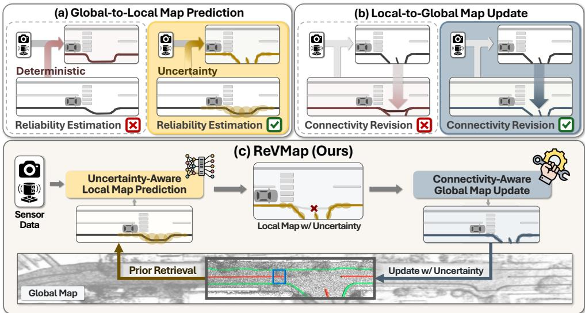  
Figure 1: Comparison of Map Update Paradigms and the ReVMap Framework. (a) Reliabilityagnostic prior reuse leads to over-trusting unreliable accumulated elements, whereas uncertaintyaware prediction modulates their influence. (b) Heuristic matching can lead to incorrect map connections, whereas connectivity-guided revision enables more robust integration of local predictions into the global map. (c) ReVMap iteratively constructs and refines the global map through uncertainty aware local prediction and connectivity-guided global map revision.

## Abstract

Large-scale annotation of vectorized high-definition (HD) maps is labor-intensive and costly, motivating local-to-global auto-labeling approaches that incrementally construct global maps from local vectorized predictions. However, existing approaches often overlook prediction uncertainty and rely on heuristic map integration, potentially propagating errors and introducing topological inconsistencies. To address these limitations, we propose ReVMap, a reliable local-to-global framework that iteratively refines local map predictions and global map construction through uncertainty-guided prior utilization and connectivity-guided global map revision. Specifically, ReVMap leverages point-wise localization uncertainty to incorporate global map priors into local map prediction, improving robustness against inaccurate prior information. It then predicts local-to-global connectivity and selectively updates the global map through uncertainty-aware fusion based on the reliability of local predictions. By iteratively coupling local prediction and

global revision, ReVMap progressively improves both local map accuracy and global map consistency. Extensive experiments on the nuScenes and Argoverse 2 benchmarks demonstrate that ReVMap achieves state-of-the-art performance in both local map prediction and global map construction.

## 1 Introduction

HD maps are essential for safe autonomous driving, providing high-precision representations of lane boundaries, road edges, and road-element topology. Structured geometric and topological context from HD maps is widely used in downstream motion forecasting [6, 16] and trajectory planning [12–14]. A typical HD map construction pipeline consists of three stages: 1) global scene reconstruction from collected sensor data, 2) vectorized annotation of road elements, and 3) quality verification before deployment. Within this pipeline, the vectorized annotation stage is particularly labor-intensive, as accurate labels require precise map-element geometry and consistent topology across road structures. Recent HD map auto-labeling pipelines [3, 4, 32, 45] reduce manual labeling effort by producing vectorized HD map elements using learning-based map construction methods [7, 8, 17, 18, 25, 29], requiring human annotators only for minor corrections and quality verification.

For HD map auto-labeling in global coordinates, direct vector map generation over large areas is impractical due to high computational costs and the difficulty of optimizing long-range geometric and topological consistency. Previous works [3, 4, 30, 37, 38, 45] therefore adopt a local-to-global formulation, decomposing the task into local vector map generation and global map integration. This decomposition improves scalability by focusing each prediction on a local observation range, thereby reducing computational and memory demands while preserving fine-grained map geometry. During global map integration, newly predicted local elements either replace outdated global elements corresponding to the same map structures or are added as new elements in regions not yet covered by the global map.

Another line of research [30, 39, 43, 46] explores the use of global map priors to improve local map prediction. Unlike offboard auto-labeling, where the global map primarily serves as the final supervisory target, these methods leverage the accumulated global map as prior information to guide subsequent local map estimation. Such priors provide valuable geometric and topological information that may be difficult to infer from current sensor observations alone, particularly in scenarios involving limited perception range, occlusions, or ambiguous road structures.

However, these accumulated map priors may also contain errors from earlier local predictions. Existing methods [3, 30, 43, 46] that leverage these priors often treat accumulated map elements as deterministic without explicitly accounting for their reliability. Inaccurate global map elements may thus be over-trusted, and their errors may propagate into subsequent local predictions (see Figure 1(a)).

A related challenge arises when integrating newly predicted local elements into the accumulated global map. Existing approaches [3, 30] rely on heuristic rules, such as distance-based matching, to associate local predictions with existing global elements, which can lead to incorrect associations in the presence of prediction errors. They then update only the overlapping portions of matched global elements, leaving the remaining geometry unchanged. Consequently, incorrect associations may introduce topological inconsistencies, while partial updates may leave existing structural errors unresolved (see Figure 1(b)).

To address these challenges, we introduce ReVMap, a local-to-global framework for reliable vectorized global map construction, which can be used for HD map auto-label generation. As illustrated in Figure 1 (c), ReVMap iteratively couples uncertainty-guided prior utilization with connectivityguided global map revision. The framework comprises two core components: Uncertainty-aware Local Map Generation (ULG) and Global Map Revision Network (GMR).

ULG leverages the accumulated global map as a reliability-aware prior to guide local map prediction. It also estimates point-wise localization uncertainty for newly predicted local map elements, which is propagated to the global map through GMR. This enables the accumulated global map to maintain uncertainty-aware representations for subsequent local predictions.

GMR updates the accumulated global map using local predictions from ULG. For local-to-global association, GMR predicts connectivity between current local instances and surrounding global segments outside the local prediction region, rather than relying on heuristic matching rules. The predicted connectivity guides map revision, while uncertainty-based filtering and fusion reduce the influence of unreliable local predictions on the updated geometry. The updated global map and its uncertainty are then reused by ULG in subsequent iterations, establishing a continuous feedback loop between local map prediction and global map refinement.

We evaluate ReVMap on large-scale HD map construction benchmarks, including nuScenes and Argoverse2. ReVMap achieves substantial performance gains over previous state-of-the-art methods on both benchmarks. On nuScenes, ReVMap establishes a new state of the art in both global map construction and local prediction, achieving 36.1% mGAP, 43.4% miECM, and 58.0% local mAP. On Argoverse2, ReVMap achieves 62.1% mGAP, 62.5% miECM, and 77.0% local mAP, establishing new state-of-the-art performance across both global map construction and local prediction.

• We propose ReVMap, a local-to-global mapping framework that constructs and progressively refines a global map through uncertainty-guided prior utilization and connectivity-guided map revision.

• We introduce ULG, which predicts vectorized local map elements and localization uncertainty to construct reliability-aware global map priors for subsequent local prediction.

• We present GMR that refines the global map through learned local-to-global connectivity estimation and uncertainty-aware map fusion.

• ReVMap achieves state-of-the-art performance in both local map prediction and global map construction on the nuScenes and Argoverse 2 benchmarks.

## 2 Related Work

Online Local Map Construction. Online local map construction [7, 8, 15, 17, 18, 20, 22, 25, 29, 31] predicts vectorized map elements around the ego vehicle from onboard sensor observations. Querybased approaches improve local map construction with structured map-element representations. MapTR [17] introduces permutation-equivalent point sets, and MapTRv2 [18] strengthens supervision and matching. Mask2Map [7] further incorporates BEV masks for instance-level semantics and point-level geometry. Since local prediction from current observations remains sensitive to limited perception range, occlusion, and temporal inconsistency, recent work incorporates accumulated map context into local prediction. NMP [39] utilizes global BEV features as a neural prior, HRMapNet [46] builds historical rasterized maps from previous predictions, and GlobalMapNet [30] constructs an online global vector map for subsequent local prediction.

Vectorized Global Map Construction. Vectorized global map auto-annotation and large-scale map generation [3, 10, 30, 32, 37, 44, 48] aim to produce spatially consistent vector annotations over large regions, often by integrating local predictions into accumulated global maps. Map-Tracker [2] and IC-Mapper [48] propagate element identities through tracking-based association, but their single-sequence update logic lacks mechanisms for existing-map revision or multi-trip integration. GlobalMapNet [30] and VMA [3] instead accumulate local predictions through geometric association, where GlobalMapNet adopts Chamfer-distance-based one-to-one matching and VMA adds endpoint-distance constraints. These hand-crafted criteria limit flexible matching under branching or fragmented structures, and both methods update only overlapping portions of matched elements, leaving inconsistent non-overlapping geometry unchanged after accumulation. CAMA and CAMAv2 [4, 45] improve the consistency and accuracy of vectorized map auto-annotation from multi-camera data, but their VMA-style global update process inherits similar rule-based association and overlap-only update limitations.

Uncertainty Estimation in HD Map Construction. Semantic confidence quantifies the model’s certainty in the predicted class of a map element but does not directly capture its localization accuracy. Explicit assessment of localization reliability is particularly important under occlusion and ambiguous road structures, motivating uncertainty estimation for map geometry. Prior work [11] leverages point-wise uncertainty to reduce the influence of unreliable map geometry on downstream trajectory prediction, and UIGenMap [21] introduces uncertainty-guided structure injection to improve the generalization of local map prediction. However, these approaches do not propagate uncertainty estimates into accumulated global maps. MV-Map [38] employs an uncertainty network to estimate the per-frame prediction reliability for map aggregation, while Kalman-filter-based HD map updating [23] incorporates uncertainty into the fusion of observations. However, these methods do not maintain point-wise localization uncertainty in an accumulated vectorized global map for reuse in subsequent local prediction.

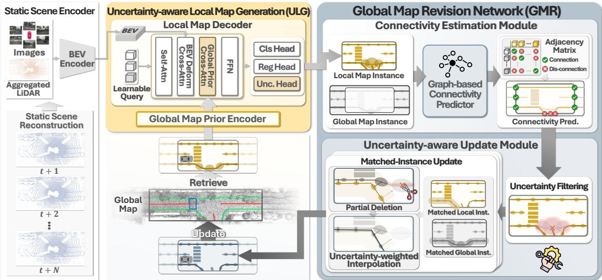  
Figure 2: Overall structure of ReVMap. ReVMap consists of three main components: Static Scene Encoder, ULG, and GMR. The Static Scene Encoder generates a BEV feature map from multi-view images and, in the offboard setting, from a static 3D scene reconstructed from multi-timestep LiDAR sweeps. ULG retrieves global map priors and predicts local vectorized map instances with point-wise uncertainty. GMR then estimates local-to-global connectivity and updates the accumulated global map via uncertainty-aware filtering and fusion.

## 3 Method

## 3.1 Overview

Each vectorized map instance consists of a semantic class and an ordered sequence of 2D BEV points, where the classes are lane dividers, pedestrian crossings, and road boundaries. Local instances use a fixed number of points, whereas accumulated global instances may contain a variable number of points after iterative merging and revision. As illustrated in Figure 2, ReVMap consists of three components, Static Scene Encoder, ULG, and GMR, and operates iteratively over local prediction regions. At each iteration, (1) the Static Scene Encoder encodes the reconstructed static scene and multi-camera images into BEV features. (2) ULG uses these features and the accumulated global map as a prior to predict local vectorized map instances with point-wise localization uncertainty. (3) GMR estimates local-to-global connectivity and revises the accumulated global map through uncertainty-aware updates. The updated global map and its uncertainty are reused as the prior for the next iteration.

## 3.2 Static Scene Encoder

Static Scene Reconstruction. A single LiDAR sweep provides sparse and partially occluded observations of the road layout, which is insufficient for reliable vectorized global map construction. We therefore reconstruct a dense static scene by aggregating multi-timestep LiDAR sweeps in a common global coordinate frame. For each sweep, points belonging to dynamic objects are removed using per-frame GT 3D boxes before aggregation, preventing movable objects from being fused into the static map representation. The filtered sweeps are merged into a scene-level static point cloud, which provides stable geometric evidence for BEV feature extraction and vectorized map prediction.

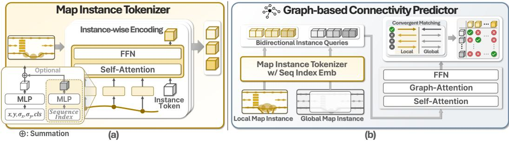  
Figure 3: Details of Map Instance Tokenizer and Graph-based Connectivity Predictor. (a) The Map Instance Tokenizer aggregates per-point embeddings into a single instance token via selfattention. The sequence-index positional embedding is optional and applied only in the Graph-based Connectivity Predictor. (b) The Graph-based Connectivity Predictor first generates bidirectional instance queries from local and global instances using sequence-index positional embeddings, and then predicts their connectivity through self-attention, graph attention, and convergent matching.

BEV Feature Extractor. The BEV feature extractor produces a unified static-scene BEV representation from the reconstructed static point cloud and multi-camera images. We encode the static point cloud with a SECOND encoder [41] and transform image features into BEV space using LSS [28]. Since dynamic objects are removed only during LiDAR-based reconstruction, we exclude regions of dynamic objects during LSS pooling by identifying them using pretrained Mask2Former [5]. Following BEVFusion [24], the resulting camera BEV features are concatenated with the LiDAR BEV features and fused through a convolutional layer to obtain the final BEV feature map.

## 3.3 Uncertainty-aware Local Map Generation (ULG)

ULG consists of the Global Map Prior Encoder and Local Map Decoder. The Global Map Prior Encoder extracts reliability-aware prior embeddings from previously accumulated global map elements. The Local Map Decoder leverages global prior embeddings and the BEV feature map to predict local map instances with point-wise uncertainty.

Global Map Prior Encoder. The Global Map Prior Encoder tokenizes accumulated global map instances to provide global context to the Local Map Decoder. We apply the Map Instance Tokenizer illustrated in Figure 3 (a), which is inspired by the CLS-token-based aggregation mechanism [9]. Accumulated global instances are represented as vector geometries with varying numbers of points, since they are formed by merging multiple local predictions. Before tokenization, each global instance is cropped to the local prediction region and uniformly resampled into K points along its geometry, matching the fixed K-point format of local map instances. Each resampled point is first projected into a point embedding from its coordinate, class, and point-wise uncertainty using an MLP, without adding point-order positional embeddings. For each instance, a learnable instance token is concatenated to the point embeddings, and the combined tokens are processed by self-attention and FFN. The final instance token is used as the global prior embedding for the Local Map Decoder.

Local Map Decoder with Uncertainty Estimation. The Local Map Decoder predicts the class, point coordinates, and point-wise localization uncertainty for each local map instance utilizing global prior embeddings. Following MapTRv2 [18], learnable map queries are decoded through multiple layers. In each decoder layer, the map queries exchange information through self-attention and aggregate local BEV features via deformable attention. The updated queries then interact with the global prior embeddings through cross-attention within the same layer, incorporating accumulated map context. Since the global prior embeddings encode accumulated uncertainty with geometry and class, this cross-attention enables the decoder to selectively leverage reliable priors when refining local predictions.

The resulting prior-enhanced queries are fed into classification and regression heads. For localization, the regression head parameterizes each point as a Gaussian distribution, where the mean $\textbf { p } \in$ $\mathbb { R } ^ { 2 }$ represents the point coordinate and the standard deviation $\pmb { \sigma } \in \mathbb { R } ^ { 2 }$ represents its localization uncertainty. The predicted uncertainty is propagated to the global map and later used for uncertaintyaware integration and prior reuse.

## 3.4 Global Map Revision Network (GMR)

GMR updates the accumulated global map within the current local prediction region while preserving geometry outside it. It first estimates connectivity between current local instances and surrounding global segments outside this region, and then updates the global geometry using point-wise uncertainty.

Connectivity Estimation Module. To prevent potentially erroneous geometry within the local prediction region from affecting connectivity estimation, we extract candidate segments from accumulated global instances within a fixed-margin band immediately outside the region. The Connectivity Estimation Module then predicts connections between these global segments and the current local instances.

As illustrated in Figure 3 (b), the Graph-based Connectivity Predictor estimates connectivity based on instance orientation and distance. Since the same vector geometry can be traversed in two opposite directions, a single order-specific representation cannot capture all possible directed connections. We therefore encode each instance in both its original and reversed point orders using the Map Instance Tokenizer with sequence-index embeddings, producing two direction-aware instance tokens for each instance. Specifically, each point in a map instance is first projected from its coordinate, class, and point-wise uncertainty into a point embedding through an MLP. The sequence index is then embedded with another MLP and added to the point embeddings using the original and reversed point orders. The tokenizer outputs one directional instance token from each order, allowing the module to distinguish the two possible connection directions of each instance.

To explicitly model inter-instance distance, we update these instance tokens using self-attention and graph attention. Following [36, 47], we construct the graph with edges connecting nearby instance pairs, and define the edge feature as the minimum pairwise point distance between two instances. We predict a connectivity score for each directed local–global token pair and use these scores to determine local-to-global connections. For connectivity supervision, we adopt convergent matching, assigning a positive label only to the direction in which the two endpoints face each other. All unmatched pairs and non-converging directions are assigned negative labels.

Uncertainty-aware Map Update Module. To prevent noisy geometry from being accumulated into the global map, the Uncertainty-aware Map Update first filters local instances using point-wise uncertainty. A local instance is discarded when its mean point-wise uncertainty from ULG is above an uncertainty threshold. For each remaining local instance, we restrict the update of its matched global instance to the local prediction region. Within this region, we delete global points whose nearest distance to the local instance is larger than a distance threshold, eliminating accumulated geometry that is inconsistent with the current local geometry.

The remaining global geometry is then fused with the local instance through point-wise uncertaintyweighted interpolation. Since interpolation is performed point-wise, we first establish correspondences between local and global points. For each local point, we construct a normal line passing through the point and perpendicular to the local tangent direction, and take its intersection with the remaining global geometry as the corresponding global point. Since point-wise uncertainty is parameterized as the Gaussian standard deviation, interpolation weights are defined by inverse variance, $w = 1 / ( \sigma ^ { 2 } + \epsilon )$ , assigning larger weights to points with lower uncertainty. The corresponding local and global points are then interpolated with the normalized weights to update the global geometry.

## 3.5 Training Loss

The total loss $\mathcal { L }$ used to train ReVMap is given by

$$
\mathcal { L } = \mathcal { L } _ { \mathrm { n l l } } + \mathcal { L } _ { \mathrm { c l s } } + \mathcal { L } _ { \mathrm { c o n } } + \mathcal { L } _ { \mathrm { a u x } } ,\tag{1}
$$

where $\mathcal { L } _ { \mathrm { n l l } }$ and $\mathcal { L } _ { \mathrm { c l s } }$ supervise the local map predictions of UL $A , \mathcal { L } _ { \mathrm { c o n } }$ supervises the connectivity predictions of GMR, and $\mathcal { L } _ { \mathrm { a u x } }$ provides auxiliary depth and segmentation supervision following [18]. The negative log-likelihood loss $\mathcal { L } _ { \mathrm { n l l } }$ supervises the point-wise uncertainty by modeling each predicted point as a bivariate Gaussian with mean $\hat { { \bf p } } _ { i }$ and standard deviation $\pmb { \sigma } _ { i } .$

$$
\mathcal { L } _ { \mathrm { n l l } } = \frac { 1 } { N _ { p } } \sum _ { i = 1 } ^ { N _ { p } } \sum _ { k \in \{ x , y \} } \left( \log \sigma _ { i } ^ { k } + \frac { ( p _ { i } ^ { k } - \hat { p } _ { i } ^ { k } ) ^ { 2 } } { 2 ( \sigma _ { i } ^ { k } ) ^ { 2 } } \right) ,\tag{2}
$$

Table 1: Comparison with SOTA methods on the nuScenes new split validation set. “C” and “C+L” denote camera-only onboard setting and multi-modal offboard setting, respectively. The “-” indicates that the method does not build a scene-level global map and is included for comparison with local prediction.
<table><tr><td rowspan="2">Method</td><td rowspan="2">Modality</td><td rowspan="2">mAP</td><td colspan="4">GAP Metrics</td><td colspan="4">iECM</td></tr><tr><td>div</td><td>ped</td><td>bou</td><td>mean</td><td>div</td><td>ped</td><td>bou</td><td>mean</td></tr><tr><td>Mask2Map[7]</td><td>C</td><td>29.4</td><td>-</td><td>-</td><td>1</td><td>-</td><td>-</td><td>一</td><td>-</td><td>-</td></tr><tr><td>HRMapNet[46]</td><td>C</td><td>37.1</td><td>一</td><td>一</td><td>一</td><td>一</td><td>一</td><td></td><td>-</td><td>一</td></tr><tr><td>UniPrevPredMap[27]</td><td>C</td><td>39.7</td><td>一</td><td>-</td><td>-</td><td>-</td><td>一</td><td>-</td><td>-</td><td>一</td></tr><tr><td>StreamMapNet[42]</td><td>C</td><td>32.9</td><td>13.4</td><td>15.5</td><td>12.8</td><td>13.9</td><td>32.8</td><td>16.3</td><td>40.8</td><td>30.0</td></tr><tr><td>GlobalMapNet[30]</td><td>C</td><td>34.8</td><td>16.3</td><td>18.5</td><td>18.0</td><td>17.6</td><td>36.0</td><td>18.8</td><td>42.4</td><td>32.4</td></tr><tr><td>MapTracker[2]</td><td>C</td><td>40.3</td><td>18.1</td><td>36.1</td><td>19.4</td><td>24.5</td><td>38.7</td><td>27.4</td><td>45.2</td><td>37.1</td></tr><tr><td>ReVMap (Ours)</td><td>C</td><td>45.6</td><td>18.1</td><td>37.9</td><td>29.6</td><td>28.5</td><td>42.3</td><td>27.7</td><td>50.9</td><td>40.3</td></tr><tr><td>ReVMap (Ours)</td><td>C + L</td><td>58.0</td><td>18.2</td><td>46.8</td><td>43.2</td><td>36.1</td><td>46.1</td><td>28.6</td><td>55.6</td><td>43.4</td></tr></table>

Table 2: Comparison with global map construction SOTA methods on Argoverse2 new split validation set. $\bf \tilde { \Sigma } ^ { 6 6 } C ^ { 5 9 }$ and $\bf \ddot { \Phi } C { + } L \bf \ '$ denote camera-only onboard setting and multi-modal offboard setting, respectively.
<table><tr><td rowspan="2">Method</td><td rowspan="2">Modality</td><td rowspan="2">mAP</td><td colspan="4">GAP Metrics</td><td colspan="4">iECM</td></tr><tr><td>div</td><td>ped</td><td>bou</td><td>mean</td><td>div</td><td>ped</td><td>bou</td><td>mean</td></tr><tr><td>GlobalMapNet[30]</td><td>C</td><td>60.3</td><td>34.5</td><td>33.7</td><td>38.8</td><td>35.6</td><td>55.5</td><td>43.2</td><td>58.2</td><td>52.3</td></tr><tr><td>MapTracker[2]</td><td>C</td><td>71.3</td><td>29.3</td><td>52.8</td><td>45.0</td><td>42.4</td><td>46.9</td><td>50.7</td><td>63.1</td><td>53.6</td></tr><tr><td>ReVMap (Ours)</td><td>C+L</td><td>77.0</td><td>55.3</td><td>59.0</td><td>71.9</td><td>62.1</td><td>56.3</td><td>55.3</td><td>75.9</td><td>62.5</td></tr></table>

where $\mathbf { p } _ { i }$ is the ground-truth coordinate of the i-th point and $N _ { p }$ is the number of points per instance. The classification loss $\mathcal { L } _ { \mathrm { c l s } }$ and the connectivity loss ${ \mathcal { L } } _ { \mathrm { c o n } }$ are defined as focal losses [19] for class score prediction in ULG and connectivity prediction in GMR, respectively.

## 4 Experiments

## 4.1 Experiment Setup

Datasets. We evaluate our method on nuScenes [1] and Argoverse2 [35], which contain 1,000 driving scenes each. nuScenes provides 20-second scenes at 2 Hz, whereas Argoverse2 provides approximately 15-second scenes at 10 Hz. To evaluate generalization to unseen areas, we follow the geographically non-overlapping new splits of StreamMapNet [42].

Evaluation Metrics. We evaluate local map prediction using mean Average Precision (mAP), following previous works [18, 42]. For global map construction, we adopt scene-level mean Global Average Precision (mGAP) [30]. We also report multi-trip mGAP, where overlapping predictions from different scenes are accumulated into an existing global map and evaluated as a unified map. We further evaluate whether predictions cover each GT element without fragmentation by adapting the Entropy-based Connectivity Metric (ECM) [3, 40] to the instance level. This penalizes fragmented predictions assigned to the same GT element, and the class-averaged score is reported as miECM. Details are provided in the Appendix.

Implementation Details. For fair comparison, static point cloud reconstruction and dynamic feature masking are used only in the offboard camera–LiDAR setting, not in the onboard camera-only setting. Dynamic-object point clouds are removed using ground-truth 3D boxes, which can be replaced by any 3D object detector. We use ResNet-50 as the image backbone. For the standard scene-level evaluation, we initialize each scene with a global map prior constructed from ReVMap’s own local predictions across the scene. ReVMap is trained in three stages: local-map-only training, connectivity-module training with the local model frozen, and end-to-end training with global priors, for 24, 1, and 6 epochs, respectively. More implementation details are provided in the Appendix.

Table 3: Camera-only comparison on nuScenes with global map priors constructed using only past frames.
<table><tr><td>Method</td><td>mAP</td><td>mGAP</td><td>miECM</td></tr><tr><td>GlobalMapNet [30]</td><td>34.8</td><td>17.6</td><td>32.4</td></tr><tr><td>MapTracker [2]</td><td>40.3</td><td>24.5</td><td>37.1</td></tr><tr><td>ReMap (Ours)</td><td>43.2</td><td>26.2</td><td>38.7</td></tr></table>

Table 4: Performance comparison of multi-trip global map construction on nuScenes. The “-” indicates that the method cannot merge maps across scenes. “∗” denotes reproduced results.
<table><tr><td>Method</td><td>mAP</td><td>miECM</td><td>mGAP</td></tr><tr><td>GlobalMapNet* [30]</td><td>34.8</td><td>25.5</td><td>13.7</td></tr><tr><td>MapTracker [2]</td><td>40.3</td><td></td><td></td></tr><tr><td>ReVMap (Ours)</td><td>45.6</td><td>34.1</td><td>21.1</td></tr></table>

Table 5: Ablation study of main components of ReVMap.
<table><tr><td rowspan="2">Method</td><td rowspan="2">mAP</td><td rowspan="2">miECM</td><td colspan="4">GAP Metrics</td></tr><tr><td>div</td><td>ped</td><td>bou</td><td>mean</td></tr><tr><td>Baseline</td><td>39.0</td><td>30.1</td><td>13.6</td><td>32.0</td><td>12.7</td><td>19.4</td></tr><tr><td>+ Connectivity Estimation</td><td>39.0</td><td>34.9</td><td>14.8</td><td>30.5</td><td>23.5</td><td>22.9</td></tr><tr><td>+ Global Map Prior</td><td>44.8</td><td>40.0</td><td>18.0</td><td>34.9</td><td>27.6</td><td>26.8</td></tr><tr><td>+ Uncertainty Estimation</td><td>45.6</td><td>40.2</td><td>17.9</td><td>36.2</td><td>28.1</td><td>27.4</td></tr><tr><td>+ Uncertainty Update</td><td>45.6</td><td>40.3</td><td>18.1</td><td>37.9</td><td>29.6</td><td>28.5</td></tr></table>

Table 6: Effect of replacing the GT boxes used for dynamic-object removal in the C+L setting on nuScenes.
<table><tr><td>Boxes</td><td>mAP↑</td><td>mGAP↑</td></tr><tr><td>GT boxes</td><td>58.0</td><td>36.1</td></tr><tr><td>Perturbed GT boxes</td><td>57.6</td><td>35.6</td></tr><tr><td>No removal</td><td>57.3</td><td>35.2</td></tr></table>

Table 7: Ablation study for evaluating the effect of Uncertainty Update. “Filter” denotes the Uncertainty Filtering and “Interp” refers to Uncertainty-weighted Interpolation.  
Table 8: Analysis of different local prediction and global construction method combinations.
<table><tr><td rowspan="3">Filter</td><td rowspan="3">Interp</td><td rowspan="3">miECM</td><td colspan="4">GAP Metrics</td></tr><tr><td>div</td><td>ped</td><td>bou</td><td>mean</td></tr><tr><td rowspan="3">√</td><td rowspan="3"></td><td>40.2</td><td>17.9</td><td>36.2</td><td>28.1</td><td>27.4</td></tr><tr><td>40.2 40.3</td><td>18.0</td><td>37.3</td><td>29.0</td><td>28.1</td></tr><tr><td>√</td><td>17.8</td><td>37.1</td><td>28.9</td><td>27.9</td></tr><tr><td>」</td><td>√</td><td>40.3</td><td>18.1</td><td>37.9</td><td>29.6</td><td>28.5</td></tr></table>

<table><tr><td rowspan=1 colspan=1>Local Map</td><td rowspan=1 colspan=1>Global Map</td><td rowspan=1 colspan=1>mAP</td><td rowspan=1 colspan=1>miECM</td><td rowspan=1 colspan=1>mGAP</td></tr><tr><td rowspan=1 colspan=1>GlobalMapNet</td><td rowspan=1 colspan=1>GlobalMapNetOurs</td><td rowspan=1 colspan=1>34.834.8</td><td rowspan=1 colspan=1>32.435.2 (+2.8)</td><td rowspan=1 colspan=1>17.619.4 (+1.8)</td></tr><tr><td rowspan=1 colspan=1>MapTracker</td><td rowspan=1 colspan=1>MapTrackerOurs</td><td rowspan=1 colspan=1>40.340.3</td><td rowspan=1 colspan=1>37.137.8 (+0.7)</td><td rowspan=1 colspan=1>24.526.5 (+2.0)</td></tr><tr><td rowspan=1 colspan=1>Ours</td><td rowspan=1 colspan=1>GlobalMapNetVMAOurs</td><td rowspan=1 colspan=1>45.645.645.6</td><td rowspan=1 colspan=1>38.239.340.3 (+2.1)</td><td rowspan=1 colspan=1>23.525.728.5 (+5.0)</td></tr></table>

## 4.2 Performance Comparison

Table 1 compares ReVMap with recent online mapping and global map construction methods [2, 7, 27, 30, 42, 46] on the nuScenes new split validation set, showing state-of-the-art performance in the onboard camera-only setting and substantial gains with offboard camera–LiDAR inputs, reaching 58.0 mAP, 36.1 mGAP, and 43.4 miECM. Table 2 shows that ReVMap also outperforms existing global map construction methods [2, 30] on Argoverse2 across all metrics.

Since the scene-level prior may contain elements observed only in later frames, Table 3 further compares camera-only methods with the same ResNet-50 backbone under a strictly causal protocol, where each scene starts from an empty map and the prior is built only from past frames. ReVMap still outperforms MapTracker [2] by 2.9% mAP, 1.7% mGAP, and 1.6% miECM, showing that its gain does not rely on future observations.

Table 4 evaluates multi-trip global map construction, a cross-scene setting that MapTracker [2] cannot handle due to its single-scene identity propagation scheme. ReVMap outperforms GlobalMapNet [30] in mAP, miECM, and mGAP, establishing state-of-the-art multi-trip global map construction.

## 4.3 Ablation Study

We conducted ablation studies to evaluate ReVMap’s core components. Unless otherwise noted, these experiments used the onboard camera-only setting, with models trained on the nuScenes training new split and evaluated on the new split validation set.

## Contributions of Main Components.

Table 5 ablates the main components of ReVMap. The baseline uses a hand-crafted endpoint-distance rule for local-to-global association instead of learned connectivity estimation. Connectivity Estimation improves mGAP by 3.5% and miECM by 4.8%, demonstrating more reliable association than rulebased matching. Adding the Global Map Prior further improves mAP, mGAP, and miECM by 5.8%, 3.9%, and 5.1%, showing the importance of accumulated map context. Uncertainty Estimation and

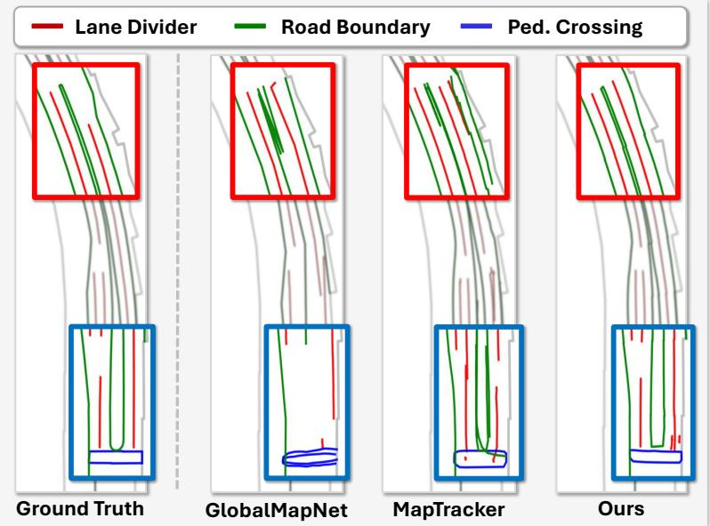  
Figure 4: Qualitative results on the nuScenes new split validation set.

Update further improve mGAP by 0.6% and 1.1%, strengthening reliability-aware prediction and global map fusion.

Dependence on GT Boxes for Dynamic-object Removal. In the offboard camera–LiDAR setting, dynamic objects are removed from the aggregated LiDAR sweeps using GT 3D boxes. Since public nuScenes detectors are trained on scenes that overlap the new split validation set, Table 6 instead perturbs the GT boxes with missed detections and box noise so that their class-wise AP matches that of MambaFusion [33], and also evaluates a variant that removes no dynamic points. mAP and mGAP drop by only 0.4% and 0.5% with perturbed boxes and by 0.7% and 0.9% without removal, showing that ReVMap does not critically depend on GT boxes.

Effects of Uncertainty Update. Table 7 evaluates uncertainty-based Filtering and uncertaintyweighted Interpolation in the Uncertainty Update. Filtering alone improves mGAP by 0.7%, while Interpolation alone yields a 0.5% gain, and combining both operations raises mGAP to 28.5%, demonstrating their complementary roles in reliable global map update.

Plug-in Analysis of Global Construction. Table 8 analyzes our global map construction across different local predictors and existing global methods. GlobalMapNet and MapTracker use their own local predictors trained without an initial map, and the same ReVMap local predictions are processed by GlobalMapNet, VMA, and our method, so only the global construction method changes within each group. Combining our global construction with GlobalMapNet [30] and MapTracker [2] improves both mGAP and miECM, while replacing ours with GlobalMapNet or VMA [3] under the same local predictor degrades mGAP by 5.0% and 2.8%, respectively. This confirms that the gains generalize across local predictors and stem from the proposed connectivity estimation and uncertainty-aware update.

## 4.4 Qualitative Analysis

## Qualitative Results Compared with SOTA Methods.

Figure 4 compares ReVMap with GlobalMapNet [30] and MapTracker [2]. While previous methods exhibit topological inconsistencies, ReVMap produces more coherent and structurally consistent maps. Additional qualitative results are provided in the Appendix.

Qualitative Analysis of the Update Process. Figure 5 illustrates the matching and update process of existing methods and the proposed method. VMA [3] discards valid local instances and retains erroneous global geometry because its rule-based matching rejects pairs that fail endpoint-distance criteria. GlobalMapNet [30] produces incorrect updates because it simply replaces only the overlapping regions between matched local and global instances. In contrast, ReVMap identifies revision targets through connectivity estimation and applies uncertainty-aware fusion, correcting erroneous segments without disrupting valid global structures.

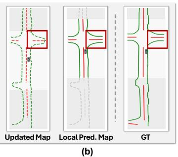

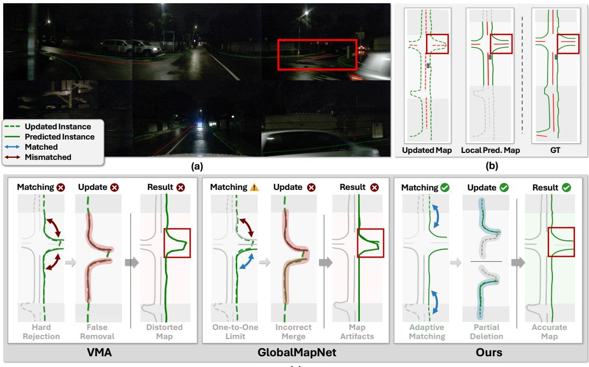  
(c)  
Figure 5: Visualization of the Matching and Update Process. (a) Multi-view camera inputs. (b) The accumulated global map, the current local prediction, and the ground-truth global map. (c) Comparison of update processes between existing methods and the proposed ReVMap.

## 5 Discussion and Conclusion

Limitations and Future Work. Despite reducing manual effort in map auto-labeling, ReVMap remains supervised and relies on ground-truth vectorized maps to train its local map prediction and connectivity estimation modules. In addition, the map update process relies on empirically selected thresholds for uncertainty filtering and geometric revision, which may require tuning for different datasets. Future work could reduce reliance on ground-truth maps by generating pseudo-labels from unlabeled sensor data, potentially leveraging neural reconstruction methods such as Gaussian splatting to provide geometric cues.

Conclusion. We presented ReVMap, a local-to-global framework for reliable vectorized global map construction. By combining uncertainty-guided prior reuse with connectivity-guided global map revision, ReVMap enables the correction of accumulated map errors while limiting their propagation into subsequent local predictions. Experiments on nuScenes and Argoverse2 demonstrate stateof-the-art performance in both local map prediction and global map construction, highlighting the effectiveness of reliability-aware map evolution.

## References

[1] Holger Caesar, Varun Bankiti, Alex H Lang, Sourabh Vora, Venice Erin Liong, Qiang Xu, Anush Krishnan, Yu Pan, Giancarlo Baldan, and Oscar Beijbom. nuscenes: A multimodal dataset for autonomous driving. In Proceedings of the IEEE/CVF conference on computer vision and pattern recognition, pages 11621–11631, 2020.

[2] Jiacheng Chen, Yuefan Wu, Jiaqi Tan, Hang Ma, and Yasutaka Furukawa. Maptracker: Tracking with strided memory fusion for consistent vector hd mapping. In European Conference on Computer Vision, pages 90–107. Springer, 2024.

[3] Shaoyu Chen, Yunchi Zhang, Bencheng Liao, Jiafeng Xie, Tianheng Cheng, Wei Sui, Qian Zhang, Chang Huang, Wenyu Liu, and Xinggang Wang. Vma: Divide-and-conquer vectorized map annotation system for large-scale driving scene. arXiv preprint arXiv:2304.09807, 2023.

[4] Shiyuan Chen, Jiaxin Zhang, Ruohong Mei, Yingfeng Cai, Haoran Yin, Wei Sui, and Cong Yang. Camav2: A vision-centric approach for static map element annotation. IEEE Transactions on Intelligent Transportation Systems, 2026.

[5] Bowen Cheng, Ishan Misra, Alexander G Schwing, Alexander Kirillov, and Rohit Girdhar. Masked-attention mask transformer for universal image segmentation. In Proceedings ofthe IEEE/CVF conference on computer vision and pattern recognition, pages 1290–1299, 2022.

[6] Sehwan Choi, Jungho Kim, Junyong Yun, and Jun Won Choi. R-pred: Two-stage motion prediction via tube-query attention-based trajectory refinement. In Proceedings ofthe IEEE/CVF International Conference on Computer Vision, pages 8525–8535, 2023.

[7] Sehwan Choi, Jungho Kim, Hongjae Shin, and Jun Won Choi. Mask2map: Vectorized hd map construction using bird’s eye view segmentation masks. In European Conference on Computer Vision, pages 19–36. Springer, 2024.

[8] Wenjie Ding, Limeng Qiao, Xi Qiu, and Chi Zhang. Pivotnet: Vectorized pivot learning for end-to-end hd map construction. In Proceedings ofthe IEEE/CVF International Conference on Computer Vision, pages 3672–3682, 2023.

[9] Alexey Dosovitskiy, Lucas Beyer, Alexander Kolesnikov, Dirk Weissenborn, Xiaohua Zhai, Thomas Unterthiner, Mostafa Dehghani, Matthias Minderer, Georg Heigold, Sylvain Gelly, et al. An image is worth 16x16 words: Transformers for image recognition at scale. arXiv preprint arXiv:2010.11929, 2020.

[10] Zebang Feng, Miao Fan, Bao Liu, Shengtong Xu, and Haoyi Xiong. End-to-end generation of city-scale vectorized maps by crowdsourced vehicles. arXiv preprint arXiv:2507.08901, 2025.

[11] Xunjiang Gu, Guanyu Song, Igor Gilitschenski, Marco Pavone, and Boris Ivanovic. Producing and leveraging online map uncertainty in trajectory prediction. In Proceedings ofthe IEEE/CVF Conference on Computer Vision and Pattern Recognition, pages 14521–14530, 2024.

[12] Yihan Hu, Jiazhi Yang, Li Chen, Keyu Li, Chonghao Sima, Xizhou Zhu, Siqi Chai, Senyao Du, Tianwei Lin, Wenhai Wang, et al. Planning-oriented autonomous driving. In Proceedings ofthe IEEE/CVF conference on computer vision and pattern recognition, pages 17853–17862, 2023.

[13] Bo Jiang, Shaoyu Chen, Qing Xu, Bencheng Liao, Jiajie Chen, Helong Zhou, Qian Zhang, Wenyu Liu, Chang Huang, and Xinggang Wang. Vad: Vectorized scene representation for efficient autonomous driving. In Proceedings ofthe IEEE/CVF International Conference on Computer Vision, pages 8340–8350, 2023.

[14] Jungho Kim, Jiyong Oh, Seunghoon Yu, Hongjae Shin, Donghyuk Kwak, and Jun Won Choi. Safedrive: Fine-grained safety reasoning for end-to-end driving in a sparse world. arXiv preprint arXiv:2602.18887, 2026.

[15] Qi Li, Yue Wang, Yilun Wang, and Hang Zhao. Hdmapnet: An online hd map construction and evaluation framework. In 2022 International Conference on Robotics and Automation (ICRA), pages 4628–4634. IEEE, 2022.

[16] Ming Liang, Bin Yang, Rui Hu, Yun Chen, Renjie Liao, Song Feng, and Raquel Urtasun. Learning lane graph representations for motion forecasting. In European Conference on Computer Vision, pages 541–556. Springer, 2020.

[17] Bencheng Liao, Shaoyu Chen, Xinggang Wang, Tianheng Cheng, Qian Zhang, Wenyu Liu, and Chang Huang. Maptr: Structured modeling and learning for online vectorized hd map construction. arXiv preprint arXiv:2208.14437, 2022.

[18] Bencheng Liao, Shaoyu Chen, Yunchi Zhang, Bo Jiang, Qian Zhang, Wenyu Liu, Chang Huang, and Xinggang Wang. Maptrv2: An end-to-end framework for online vectorized hd map construction. International Journal ofComputer Vision, 133(3):1352–1374, 2025.

[19] Tsung-Yi Lin, Priya Goyal, Ross Girshick, Kaiming He, and Piotr Dollár. Focal loss for dense object detection. In Proceedings of the IEEE international conference on computer vision, pages 2980–2988, 2017.

[20] Xiaolu Liu, Song Wang, Wentong Li, Ruizi Yang, Junbo Chen, and Jianke Zhu. Mgmap: Maskguided learning for online vectorized hd map construction. In Proceedings ofthe IEEE/CVF Conference on Computer Vision and Pattern Recognition, pages 14812–14821, 2024.

[21] Xiaolu Liu, Ruizi Yang, Song Wang, Wentong Li, Junbo Chen, and Jianke Zhu. Uncertaintyinstructed structure injection for generalizable hd map construction. In Proceedings of the Computer Vision and Pattern Recognition Conference, pages 22359–22368, 2025.

[22] Yicheng Liu, Tianyuan Yuan, Yue Wang, Yilun Wang, and Hang Zhao. Vectormapnet: Endto-end vectorized hd map learning. In International conference on machine learning, pages 22352–22369. PMLR, 2023.

[23] Yinqi Liu, Mengxuan Song, and Yafeng Guo. An incremental fusing method for high-definition map updating. In 2019 IEEE International Conference on Systems, Man and Cybernetics (SMC), pages 4251–4256. IEEE, 2019.

[24] Zhijian Liu, Haotian Tang, Alexander Amini, Xinyu Yang, Huizi Mao, Daniela L Rus, and Song Han. Bevfusion: Multi-task multi-sensor fusion with unified bird’s-eye view representation. In 2023 IEEE international conference on robotics and automation (ICRA), pages 2774–2781. IEEE, 2023.

[25] Zihao Liu, Xiaoyu Zhang, Guangwei Liu, Ji Zhao, and Ningyi Xu. Leveraging enhanced queries of point sets for vectorized map construction. In European Conference on Computer Vision, pages 461–477. Springer, 2024.

[26] Gerhard Neuhold, Tobias Ollmann, Samuel Rota Bulo, and Peter Kontschieder. The mapillary vistas dataset for semantic understanding of street scenes. In Proceedings of the IEEE international conference on computer vision, pages 4990–4999, 2017.

[27] Nan Peng, Xun Zhou, Mingming Wang, Guisong Chen, and Wenqi Xu. Uni-prevpredmap: Extending prevpredmap to a unified framework of prior-informed modeling for online vectorized hd map construction. arXiv preprint arXiv:2504.06647, 2025.

[28] Jonah Philion and Sanja Fidler. Lift, splat, shoot: Encoding images from arbitrary camera rigs by implicitly unprojecting to 3d. In European conference on computer vision, pages 194–210. Springer, 2020.

[29] Limeng Qiao, Wenjie Ding, Xi Qiu, and Chi Zhang. End-to-end vectorized hd-map construction with piecewise bezier curve. In Proceedings of the IEEE/CVF Conference on Computer Vision and Pattern Recognition, pages 13218–13228, 2023.

[30] Anqi Shi, Yuze Cai, Xiangyu Chen, Jian Pu, Zeyu Fu, and Hong Lu. Globalmapnet: An online framework for vectorized global hd map construction. arXiv preprint arXiv:2409.10063, 2024.

[31] Juyeb Shin, Hyeonjun Jeong, Francois Rameau, and Dongsuk Kum. Instagram: Instance-level graph modeling for vectorized hd map learning. IEEE Transactions on Intelligent Transportation Systems, 26(2):1889–1899, 2025.

[32] Kun Tang, Xu Cao, Zhipeng Cao, Tong Zhou, Erlong Li, Ao Liu, Shengtao Zou, Chang Liu, Shuqi Mei, Elena Sizikova, et al. Thma: Tencent hd map ai system for creating hd map annotations. In Proceedings of the AAAI Conference on Artificial Intelligence, volume 37, pages 15585–15593, 2023.

[33] Hanshi Wang, Jin Gao, Weiming Hu, and Zhipeng Zhang. MambaFusion: Height-fidelity dense global fusion for multi-modal 3D object detection. In Proceedings of the IEEE/CVF International Conference on Computer Vision, pages 26664–26674, 2025.

[34] Huijie Wang, Tianyu Li, Yang Li, Li Chen, Chonghao Sima, Zhenbo Liu, Bangjun Wang, Peijin Jia, Yuting Wang, Shengyin Jiang, et al. Openlane-v2: A topology reasoning benchmark for unified 3d hd mapping. Advances in Neural Information Processing Systems, 36:18873–18884, 2023.

[35] Benjamin Wilson, William Qi, Tanmay Agarwal, John Lambert, Jagjeet Singh, Siddhesh Khandelwal, Bowen Pan, Ratnesh Kumar, Andrew Hartnett, Jhony Kaesemodel Pontes, et al. Argoverse 2: Next generation datasets for self-driving perception and forecasting. In Thirty-fifth Conference on Neural Information Processing Systems Datasets and Benchmarks Track (Round 2).

[36] Wei Wu, Xiaoxin Feng, Ziyan Gao, and Yuheng Kan. Smart: Scalable multi-agent real-time motion generation via next-token prediction. Advances in Neural Information Processing Systems, 37:114048–114071, 2024.

[37] Deguo Xia, Weiming Zhang, Xiyan Liu, Wei Zhang, Chenting Gong, Jizhou Huang, Mengmeng Yang, and Diange Yang. Dumapnet: An end-to-end vectorization system for city-scale lane-level map generation. In Proceedings of the 30th ACM SIGKDD Conference on Knowledge Discovery and Data Mining, pages 6015–6024, 2024.

[38] Ziyang Xie, Ziqi Pang, and Yu-Xiong Wang. Mv-map: Offboard hd-map generation with multiview consistency. In Proceedings of the IEEE/CVF International Conference on Computer Vision, pages 8658–8668, 2023.

[39] Xuan Xiong, Yicheng Liu, Tianyuan Yuan, Yue Wang, Yilun Wang, and Hang Zhao. Neural map prior for autonomous driving. In Proceedings ofthe IEEE/CVF Conference on Computer Vision and Pattern Recognition, pages 17535–17544, 2023.

[40] Zhenhua Xu, Yuxiang Sun, and Ming Liu. Topo-boundary: A benchmark dataset on topological road-boundary detection using aerial images for autonomous driving. IEEE Robotics and Automation Letters, 6(4):7248–7255, 2021.

[41] Yan Yan, Yuxing Mao, and Bo Li. Second: Sparsely embedded convolutional detection. Sensors, 18(10):3337, 2018.

[42] Tianyuan Yuan, Yicheng Liu, Yue Wang, Yilun Wang, and Hang Zhao. Streammapnet: Streaming mapping network for vectorized online hd map construction. In Proceedings of the IEEE/CVF Winter Conference on Applications of Computer Vision, pages 7356–7365, 2024.

[43] Tianyuan Yuan, Yucheng Mao, Jiawei Yang, Yicheng Liu, Yue Wang, and Hang Zhao. Presight: Enhancing autonomous vehicle perception with city-scale nerf priors. In European Conference on Computer Vision, pages 323–339. Springer, 2024.

[44] Yujian Yuan, Changjie Wu, Xinyuan Chang, Sijin Wang, Hang Zhang, Shiyi Liang, Shuang Zeng, and Mu Xu. Unimapgen: A generative framework for large-scale map construction from multi-modal data. In Proceedings ofthe AAAI Conference on Artificial Intelligence, volume 40, pages 12277–12285, 2026.

[45] Jiaxin Zhang, Shiyuan Chen, Haoran Yin, Ruohong Mei, Xuan Liu, Cong Yang, Qian Zhang, and Wei Sui. A vision-centric approach for static map element annotation. In 2024 IEEE International Conference on Robotics and Automation (ICRA), pages 15861–15867. IEEE, 2024.

[46] Xiaoyu Zhang, Guangwei Liu, Zihao Liu, Ningyi Xu, Yunhui Liu, and Ji Zhao. Enhancing vectorized map perception with historical rasterized maps. In European Conference on Computer Vision, pages 422–439. Springer, 2024.

[47] Zikang Zhou, Luyao Ye, Jianping Wang, Kui Wu, and Kejie Lu. Hivt: Hierarchical vector transformer for multi-agent motion prediction. In Proceedings ofthe IEEE/CVF conference on computer vision and pattern recognition, pages 8823–8833, 2022.

[48] Jiangtong Zhu, Zhao Yang, Yinan Shi, Jianwu Fang, and Jianru Xue. Ic-mapper: Instancecentric spatio-temporal modeling for online vectorized map construction. In Proceedings of the 32nd ACM International Conference on Multimedia, pages 9961–9969, 2024.

# Supplementary Materials for ReVMap

## 6 Additional Details for ReVMap

## 6.1 Evaluation Metrics

Chamfer-based AP Metrics. We evaluate mAP, mGAP, and multi-trip mGAP using the same Chamfer-distance-based AP computation. AP is computed at distance thresholds of 0.5, 1.0, and 1.5 meters for lane divider, pedestrian crossing, and road boundary classes. The final score is obtained by averaging AP over thresholds and classes.

Instance-level ECM. ECM [40] is designed to penalize cases where a single GT element is covered by multiple fragmented predictions. To compute this, predicted map elements are rasterized, and each prediction mask is assigned to the GT mask closest to most of its pixels. It then scores each GT mask using the coverage and entropy of its assigned prediction masks. However, overlapping fragmented predictions are merged into a single component after rasterization, causing ECM to treat multiple fragments as a single prediction and thereby under-penalize fragmented predictions. We therefore rasterize each predicted polyline separately, keeping fragments as individual prediction masks, and compute ECM in the same manner. For each GT mask $M _ { j } , C _ { j }$ measures the entropy of the normalized sizes of its assigned prediction masks, while $\alpha _ { j }$ measures their coverage of $M _ { j }$ . The per-class instance-level ECM is

$$
\mathrm { i E C M } _ { c } = \sum _ { j } \frac { \lvert M _ { j } \rvert } { \sum _ { j ^ { \prime } } \lvert M _ { j ^ { \prime } } \rvert } \alpha _ { j } e ^ { - C _ { j } } .
$$

We report miECM by averaging over classes, for both scene-level and multi-trip global maps.

TOP Metric. To evaluate the local-to-global connectivity prediction performance in the Connectivity Estimation Module, we adapt the TOP metric [34], proposed for lane topology reasoning. The original TOP metric uses Fréchet-distance-based matching to align predicted instances with ground-truth instances before computing per-instance mean average precision. We instead evaluate the binary connectivity matrix between local predictions and global instances using Chamfer-distance-based matching with a distance threshold of 1.5 m. The connectivity ground truth is defined based on matched ground-truth instances in each region, assigning connectivity when a local instance and a global instance are matched to the same ground-truth instance. It is defined over all four directional combinations between the original and reverse directions of local and global instances, with only the convergent matching pair labeled as positive.

## 6.2 Implementation Details

For nuScenes, input images are resized by 0.5. For Argoverse2, seven camera images are padded to 2048 × 2048 and resized by 0.3. For image-to-BEV transformation, we use an LSS-based image-to-BEV module with a BEV grid resolution of 0.3 m. The local perception range is set to [−30, 30, −15, 15]m, and global instances for connectivity estimation are retrieved within [−45, 45, −30, 30]m, following the longitudinal and lateral order. Mask2Former [5] is pretrained on Mapillary Vistas V2 [26] for dynamic-region masking. ULG uses 100 instance queries, each with 20 point queries, so each local map instance contains 20 points. Global instances in the Global Prior Encoder and Connectivity Module are also resampled to 20 points. The Global Prior Encoder and Local Map Decoder consist of 2 and 6 layers, respectively. The Connectivity Module consists of an encoder with a single layer and a decoder with 6 layers. For uncertainty filtering, the uncertainty thresholds for lane divider, pedestrian crossing, and road boundary are empirically set to 1.6, 1.4, and 2.8, respectively. Before fusing a matched local-global instance pair, we trim the matched global instance by discarding segments farther than 1.5 m from the local instance. We use AdamW with an initial learning rate of $\bar { 6 } \times 1 0 ^ { - 4 }$ and weight decay of 0.01, cosine learning-rate decay with 500 warm-up iterations, and four A6000 GPUs with a total batch size of 16.

## 7 Supplementary Experimental Results

Table 9: Impact of ground-truth preprocessing on local map construction. All models are evaluated under the camera-only onboard setting.
<table><tr><td>Method</td><td>div</td><td>ped</td><td>bou</td><td>mAP</td></tr><tr><td>MapTRv2 (merged GT)</td><td>26.5</td><td>37.2</td><td>46.1</td><td>36.6</td></tr><tr><td>MapTRv2 (split GT)</td><td>29.3</td><td>42.0</td><td>45.7</td><td>39.0</td></tr><tr><td>ReVMap (Ours)</td><td>33.7</td><td>49.6</td><td>53.4</td><td>45.6</td></tr></table>

Table 10: Ablation study for evaluating the effect of the Connectivity Estimation submodules. “Encoder” denotes the bidirectional Map Instance Tokenizer and “Decoder” refers to the Graphbased Connectivity Predictor.
<table><tr><td rowspan="2">Encoder</td><td rowspan="2">Decoder</td><td colspan="3">TOP Metrics</td></tr><tr><td>div</td><td>ped</td><td>bou</td><td>mean</td></tr><tr><td rowspan="3">√</td><td></td><td>58.2</td><td>58.3</td><td>56.9</td><td>57.8</td></tr><tr><td></td><td>61.0</td><td>62.5</td><td>57.1</td><td>60.2</td></tr><tr><td>√</td><td>61.8</td><td>63.4</td><td>57.0</td><td>60.7</td></tr><tr><td>L</td><td>√</td><td>62.7</td><td>65.8</td><td>57.4</td><td>61.9</td></tr></table>

## 7.1 Baseline Analysis with Consistent Pedestrian Crossing Ground Truth

Recent local map construction methods use different ground-truth definitions for pedestrian crossings. Several methods [7, 17, 18, 25] merge overlapping pedestrian crossing polygon fragments into a single polygon and resample it into a fixed number of points. In contrast, StreamMapNet [42] and MapTracker [2] use a different preprocessing strategy that avoids indiscriminate merging of pedestrian crossing fragments and produces more consistent pedestrian crossing instances.

Following this StreamMapNet-style preprocessing, we conduct an ablation study to clarify whether the performance gain comes from ground-truth preprocessing or from the proposed architecture. As shown in Table 9, changing the MapTRv2 baseline from merged GT to split GT notably improves pedestrian crossing AP from 37.2% to 42.0%, showing that the pedestrian crossing annotation definition has a significant impact on this category. Under the same split-GT setting, our model further improves the strengthened baseline and achieves the best performance across all categories, increasing mAP from 39.0% to 45.6%.

## 7.2 Effect of the Connectivity Estimation submodules.

Table 10 evaluates the two submodules of the Connectivity Estimation. In the baseline configuration, both submodules are replaced with simple MLPs. Adding either submodule alone improves the TOP metric by 2.4% and 2.9%, respectively, and applying both together yields a further gain to 61.9%, showing that the two submodules are complementary. The bidirectional encoder captures the point ordering direction at each end of a polyline, while the graph-based decoder models geometric proximity between candidate pairs.

## 8 Extensive Qualitative Results

Figure 6 visualizes the predicted local HD map together with its point-wise uncertainty on the nuScenes new split validation set. The uncertainty estimates concentrate on visually ambiguous and occluded regions, showing that ULG captures localization reliability. Figures 7 and 8 present additional qualitative results on the nuScenes and Argoverse2 new split validation sets, respectively, showing the consistency of the proposed method across scene layouts. Figures 9 and 10 provide comparisons between the reconstructed multi-trip global maps and the corresponding ground-truth maps, demonstrating that the proposed method produces globally coherent map structures over large-scale driving areas.

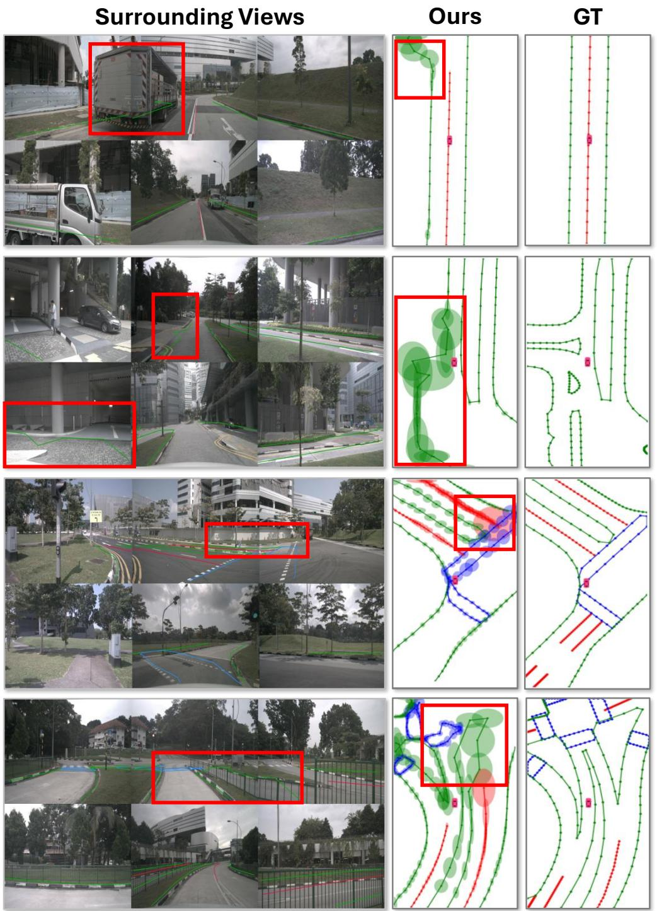  
Figure 6: Qualitative visualization of uncertainty-aware local vectorized maps on the nuScenes new split validation set.

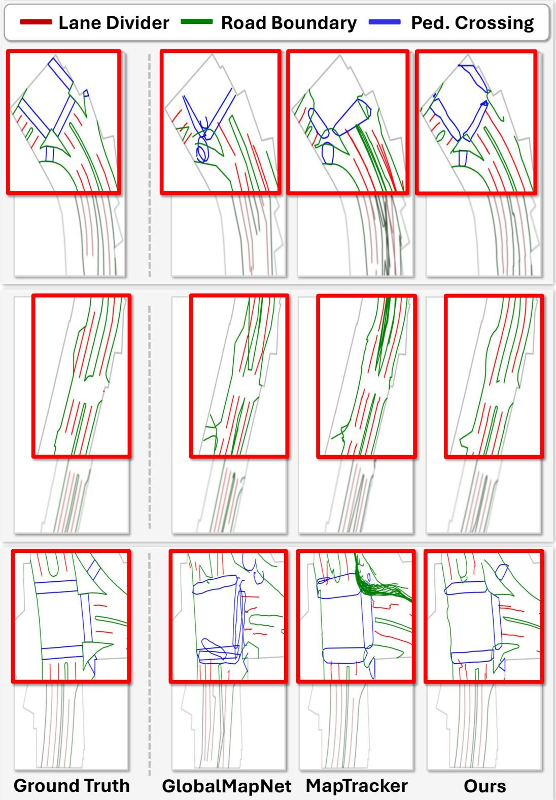  
Figure 7: Additional qualitative results on the nuScenes new split validation set.

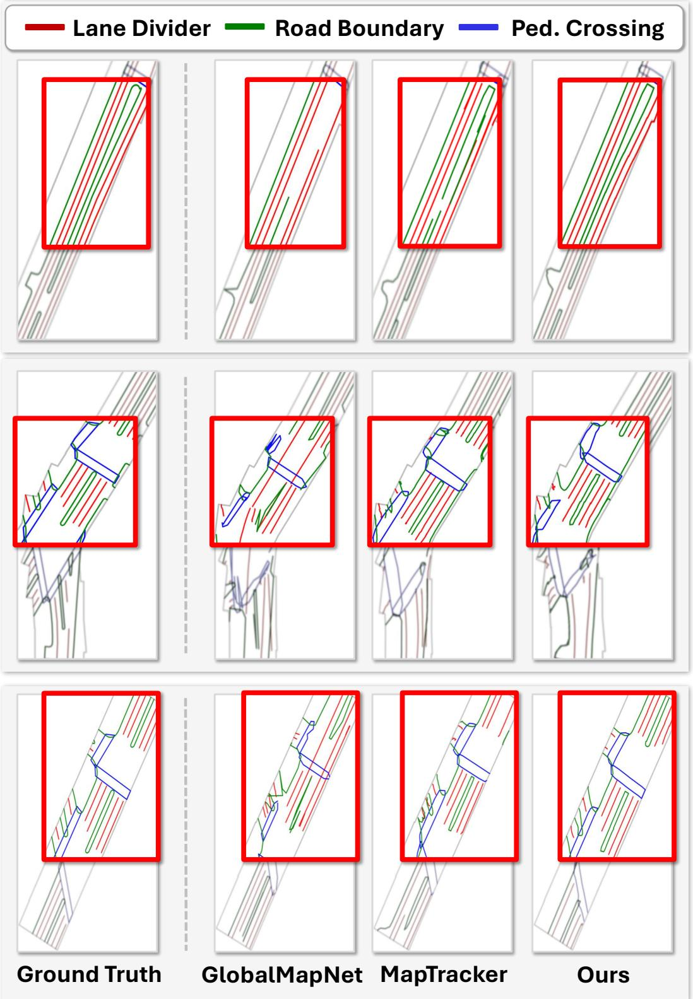  
Figure 8: Qualitative results on the Argoverse2 new split validation set.

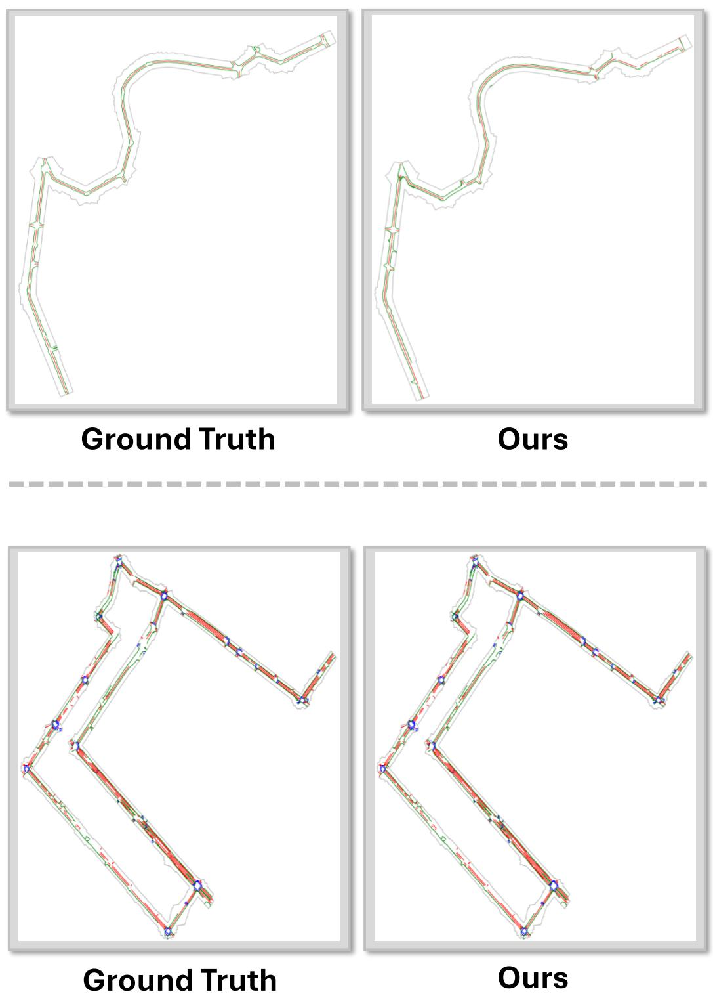  
Figure 9: Qualitative results of multi-trip vectorized global map construction on the nuScenes new split validation set.

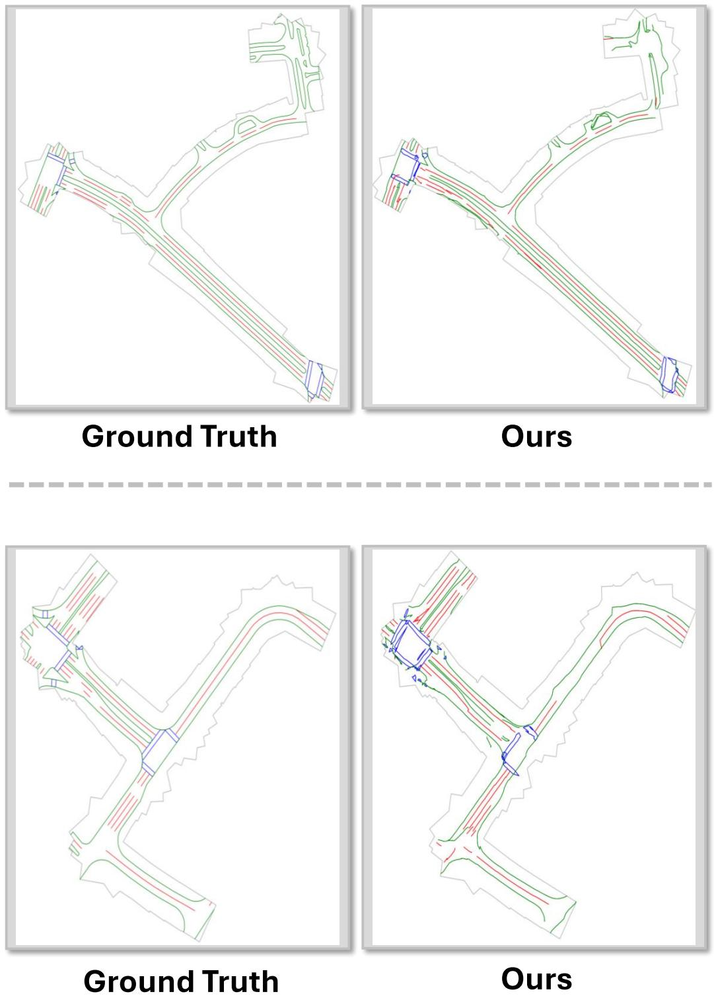  
Figure 10: Qualitative results of multi-trip vectorized global map construction on the nuScenes new split validation set.