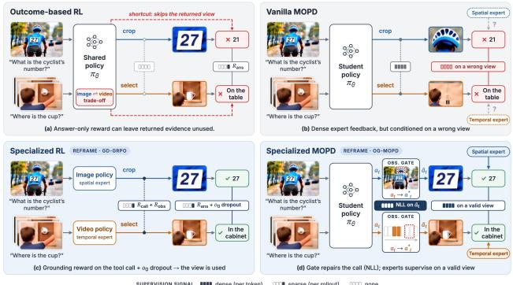
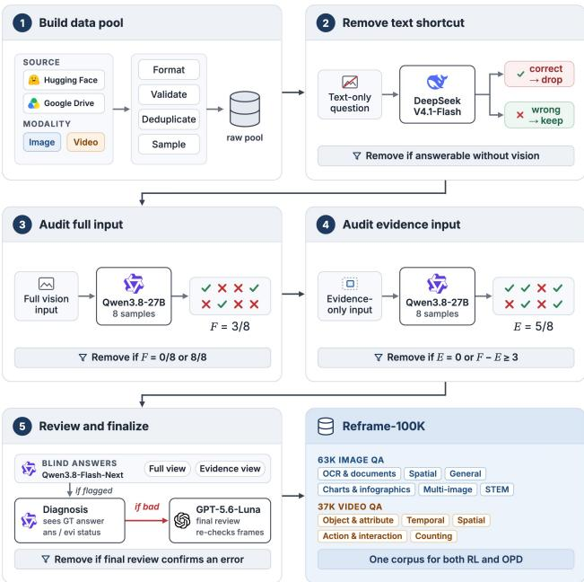
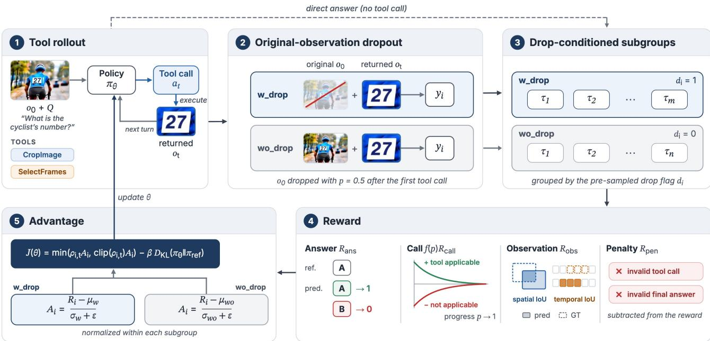
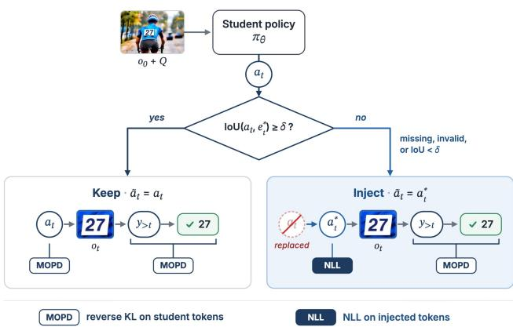

# Reframe: Observation-Aligned Multi-Teacher On-Policy Distillation for Agentic Visual Reasoning

Haozhi Yuan<sup>1,†</sup> Handong Li<sup>2</sup> Yifan Zhang<sup>2</sup> Qianshan Wei<sup>2</sup>

<sup>1</sup>Nanjing University <sup>2</sup>Institute of Automation, Chinese Academy of Sciences

<sup>†</sup>Corresponding Author (haozhiyuan@smail.nju.edu.cn)

## Abstract

Agentic reinforcement learning (RL) and multi-teacher onpolicy distillation (MOPD) offer complementary routes to post-training. For visual agents, however, tool use presents two related challenges. Models may overlook useful toolreturned observations, while poorly grounded actions can limit the evidence available for subsequent distillation. We introduce Reframe, a post-training framework that treats the observation state, rather than only the output distribution, as an object of alignment. First, Ground-Drop-GRPO (GD-GRPO) trains spatial and temporal specialists with evidence-aware rewards and stochastic removal of the original visual input, encouraging them to acquire grounded evidence and use the returned observations. Second, Observation-Gated-MOPD (OG-MOPD) replaces deficient tool actions with canonical ones mid-rollout and resumes distillation from the repaired observation. The two stages complement each other, as learning to rely on tool-returned observations can help the policy benefit from observation repair. Neither stage requires a taskspecific SFT cold start. Extensive experiments over 14 image and video benchmarks demonstrate that Reframe outperforms both Mix-RL and vanilla MOPD. Ablation results show that GD-GRPO increases observation dependence and tool gain compared with outcome-based GRPO. https://github.com/EliYuan30/Reframe

## 1. Introduction

Agentic visual reasoning addresses the evidence-sparse bottleneck in perception-centered tasks by equipping visionlanguage models (VLMs) with tools to acquire fine-grained evidence. Related studies include think with images [13, 25, 32–34, 47, 48] and think with videos [12, 28, 41, 45]. However, invoking a tool does not guarantee that the model uses what it returns. We term this problem observation neglect, where a model acquires an intermediate observation but its subsequent reasoning is largely unaffected [37]. Alongside efforts to improve when tools are invoked [33, 34, 42], this raises a complementary question of how to train models to make effective use of the acquired observation.

  
Figure 1. Overview of Reframe: visual agents should produce reliable intermediate results and truly look at them. (a) Outcome-based RL without explicit grounding rewards can permit observation neglect. (b) Vanilla MOPD may supervise trajectories conditioned on a poorly grounded observation state. (c) Our GD-GRPO rewards grounded actions and encourages reliance on tool-returned observations. (d) Our OG-MOPD repairs deficient tool actions before continuing distillation.

Meanwhile, most previous works focus exclusively on a single modality, while the few that simultaneously incorporate image and video tools rely on a mixed-data SFT-then-RL training paradigm. However, this often leaves the final unified model significantly lagging behind the one trained on a single modality. We argue that this is the combined result of the pattern conflict of off-policy SFT training and the supervision sparsity of RL. A more promising alternative is a densely supervised, predominantly on-policy training paradigm. On-policy distillation (OPD) serves as a foundational approach: by supervising the student’s own rollouts with dense token-level feedback, it bypasses both the sparse credit assignment of RL and the reference bias of off-policy imitation [1, 31]. Extending this paradigm, multi-teacher on-policy distillation (MOPD) [24] routes student-generated trajectories to domain-specialized teachers, and has been increasingly adopted by frontier models [4, 5, 14, 23, 44]. Subsequent works further refine it in terms of capability imbalance [11], heterogeneous convergence [2], behavioral drift under tool use [29], and crossmodal routing [20, 27]. However, existing paradigms primarily refine how supervision is delivered without intervening in rollout trajectories. This is a critical limitation for agentic visual reasoning since subsequent supervision is all conditioned on what tools returned.

Table 1. Comparison with representative visual agents. Reframe adopts a predominantly on-policy paradigm to consolidate image and video reasoning within a unified model, while achieving the highest observation dependence and tool gain among the compared models. Observation dependence is measured on V<sup>∗</sup>. Tool gain is measured across seven image benchmarks.
<table><tr><td rowspan="2">Model</td><td colspan="2">Training Properties</td><td colspan="2">Effective Tool Use</td></tr><tr><td>Unified Image-Video</td><td>No SFT Cold Start</td><td>Observation Dependence</td><td>Tool Gain</td></tr><tr><td>Pixel-Reasoner</td><td>V</td><td>X</td><td>23.25</td><td>+0.97</td></tr><tr><td>Thyme</td><td>X</td><td>X</td><td>34.20</td><td>+1.47</td></tr><tr><td>DeepEyes</td><td>X</td><td>√</td><td>19.47</td><td>+1.32</td></tr><tr><td>DeepEyesV2</td><td>X</td><td>X</td><td>41.93</td><td>-2.45</td></tr><tr><td>Reframe (Ours)</td><td>√</td><td>L</td><td>75.53</td><td>+5.23</td></tr></table>

Motivated by these, we propose Reframe, a twostage training framework comprising Ground-Drop-GRPO (GD-GRPO) and Observation-Gated-MOPD (OG-MOPD). Together, the two training stages enforce the two core properties for effective tool use: GD-GRPO makes the acquired observation necessary, while OG-MOPD keeps it valid. GD-GRPO directly targets the neglect problem by augmenting observation-based reward and stochastically dropping the original visual input. It forces the model to genuinely rely on the tool-returned results. Subsequently, OG-MOPD ensures that consolidation remains conditioned on valid trajectories by repairing deviated tool use. Across 14 image and video benchmarks, Reframe outperforms both Mix-RL and vanilla MOPD, even surpassing the dedicated experts on average. Furthermore, diagnostic analyses on observation dependence confirm that Reframe exhibits a markedly stronger causal reliance on tool-returned results than previous methods.

Our contributions are summarized as follows:

• We propose Reframe, the first tool-use MOPD framework that unifies image and video agentic reasoning. Its OG-MOPD actively intervenes in rollout trajectories and repairs deviated tool actions, promoting observation validity throughout cross-modal consolidation.

• We address observation neglect—the issue where agentic VLMs invoke a tool yet overlook what it returns. Through GD-GRPO, we enforce observation necessity via input dropping and observation rewards.

• We develop the Reframe-100K dataset to support both training stages. Evaluations across 14 image and video

benchmarks show consistently improved performance.   
Code, dataset, and model are open-sourced.

## 2. Related Work

Agentic visual reasoning. Multimodal reasoning often uses textual chain-of-thought (CoT) [6, 7], but its benefits vary across visual tasks [9, 22, 43]. Recent approaches instead incorporate visual information into reasoning [16, 25], including interface- or code-based tool calls that acquire query-relevant observations. These tools allow models to inspect image regions and video segments in finer detail that may be difficult to resolve from the original input. However, acquiring finer visual evidence does not guarantee its use. Recent studies find that tool-returned observations may have little causal effect on subsequent predictions [26, 37].

On-policy distillation. OPD provides dense token-level feedback on student-generated rollouts, reducing the statedistribution mismatch of off-policy imitation [1, 31]. Effective transfer depends on compatible reasoning and novel teacher capabilities [19], coverage of student-visited states [10], and teacher corrections within the student’s learnable token support [36]. Extensions support blackbox teachers through logit-free verification [50], temporal video grounding [17], and supervision through teachergenerated reasoning steps [39]. These methods primarily refine supervision along student-generated trajectories. For visual agents, however, preceding tool actions also determine which observations are available when that supervision is applied. Token-level feedback on a continuation cannot retroactively recover evidence that the preceding action failed to acquire.

Multi-teacher on-policy distillation. MOPD consolidates independently trained specialists by routing teacher supervision over a shared student’s rollouts [24], an approach increasingly used in frontier-model post-training [5, 14, 23, 44]. Open-MOPD studies imbalance from token budgets, convergence drift, and stale supervision [11], while D<sup>3</sup>-MOPD adapts domain sampling to different convergence rates [2]. Multimodal variants route specialists for GUI interaction and video understanding [20, 27]. Other work identifies distortions of decision-critical tool tokens despite sufficient retained teacher probability mass [29]. These advances focus on routing and supervision while generally taking rollout observations as given. Reframe instead considers both whether acquired observations are used and whether they provide valid evidence for subsequent distillation, supporting unified image and video reasoning.

## 3. Method

In this section, we introduce the data construction and the two-stage training procedure of Reframe. We make three design choices: (1) We restrict the toolset to two fundamental vision tools, CropImage and SelectFrames, for simplicity. (2) We adopt Qwen3.5-9B as our base model. (3) Both RL and OPD stages use the same data corpus.

  
Figure 2. Construction pipeline of Reframe-100K. We first collect public data sources and preprocess them into a raw data pool. We then drop samples answerable from text alone, and audit the rest with 8 rollouts on the full input (F) and on the annotated evidence alone (E), discarding samples that are (1) too easy or too hard; (2) insufficiently supported by their evidence. Remaining suspicious samples are diagnosed by Qwen and removed only when a final reviewer confirms an answer or evidence error.

## 3.1. Training Data Construction

Reframe-100K comprises 63K image QA pairs and 37K video QA pairs, constructed from heterogeneous spatial and temporal grounding annotations. As illustrated in Fig. 2, we establish a five-step cascaded data construction pipeline guided by the following three principles.

Quality control of grounding annotations. The quality of grounding annotations is critical to our framework, as unreliable evidence can undermine both evidence-aware rewards and subsequent observation repair. We therefore place emphasis on evidence quality throughout our datacleaning pipeline, incorporating multiple rounds of evidence auditing and verification. As illustrated in Fig. 2, these procedures aim to ensure that the retained annotations provide reliable supervision for visual tool use.

Data-centric tool applicability. Determining whether a tool call is beneficial remains challenging, particularly when the model has not yet developed reliable tool-use capabilities. Unlike model-dependent strategies [33, 34], we derive tool-applicability labels from annotation coverage, distinguishing beneficial, neutral, and non-beneficial examples without relying on base-model rollout accuracy or stronger-model judgments of tool utility. This avoids introducing model-prediction bias into applicability labels. Importantly, examples are not discarded solely because the base model can answer them without tools, as even correctly answered questions can provide valuable spatial or temporal tool-use supervision.

Context-aware evidence. Grounding annotations typically localize minimal objects or temporal events, whereas visual question answering usually requires surrounding context for recognition, comparison, or disambiguation. We therefore expand each spatial bounding box by scaling its width and height by 1.5 about its center, clipping the result to the image boundary. For temporal evidence, we extend each contiguous annotated segment by one frame at both ends. This context-preserving relaxation provides additional evidence without introducing excessive irrelevant visual content. We apply it only once before computing evidence coverage and constructing tool supervision.

Finally, spatial and temporal annotations are converted into executable tool metadata under a unified format. The resulting Reframe-100K supports both RL and OPD.

## 3.2. GD-GRPO

We train spatial and temporal specialists independently on the image and video subsets of Reframe-100K using GD-GRPO. The core idea is to couple observation acquisition with observation reliance. While observation rewards guide the policy toward informative tool actions, originalobservation dropout reduces its tendency to bypass the resulting observations, thereby establishing the necessity of the acquired observations. GD-GRPO is characterized by three key designs: reward, dropout, and subgroup.

## 3.2.1. Reward Design

Outcome correctness alone cannot stably reveal whether a tool retrieves relevant information or whether subsequent reasoning uses its returned observation. For an input x = (Q, o<sub>0</sub>) consisting of a question and its original observation, the reward is defined as

$$
\begin{array} { r l } & { R ( \tau ; x , p ) = R _ { \mathrm { a n s } } ( \tau ; x ) + f ( p ) R _ { \mathrm { c a l l } } ( \tau ; x ) } \\ & { \quad \quad + \lambda _ { \mathrm { o b s } } R _ { \mathrm { o b s } } ( \tau ; x ) - R _ { \mathrm { p e n } } ( \tau ; x ) , } \end{array}\tag{1}
$$

where τ and $p ~ \in ~ [ 0 , 1 ]$ denote trajectories and training progress, respectively. The four terms evaluate answer correctness, tool call behavior, grounding quality, and output validity, where the tool call term provides a temporary exploration incentive derived from the annotation-based applicability. Both the valid-call bonus and the inapplicable-call penalty decay with training progress according to

  
Figure 3. Overview of GD-GRPO. The policy samples multi-turn tool-use rollouts. After the first successful tool call, the original input o<sub>0</sub> is dropped with probability 0.5 while tool-returned observations $o _ { t }$ remain visible, so the answer must rely on what the tools have retrieved Rollouts are grouped by their pre-sampled drop flag $d _ { i } ,$ , and advantages are normalized within each subgroup so that dropout does not confound the comparison.

$$
f ( p ) = \frac { \exp ( - \kappa p ) - \exp ( - \kappa ) } { 1 - \exp ( - \kappa ) } , \qquad \kappa > 0 .\tag{2}
$$

Unlike $R _ { \mathrm { c a l l } } , R _ { \mathrm { o b s } }$ remains active throughout training. For images, we jointly match the cropped images along a trajectory to the annotated regions using global one-to-one IoU matching, which rewards complementary coverage while preventing repeated localization of the same target from multiplying its reward. For videos, we evaluate the latest attempt using frame IoU rather than retrospectively selecting the most favorable attempt. Later attempts are discounted to encourage efficient acquisition. Importantly, grounding supervision is not gated by answer correctness. A proper tool action receives credit even when the policy does not answer correctly. Examples without grounding annotations receive no $R _ { \mathrm { c a l l } }$ or $R _ { \mathrm { o b s } }$ , and remain supervised by answer correctness and validity penalties.

## 3.2.2. Original-Observation Dropout

Accurate localization does not by itself establish observation reliance. A model may still answer from the original visual input without using the tool-returned result. To reduce this bypass, we stochastically drop $o _ { 0 }$ with a probability of 0.5 after the first successful tool call during training, while retaining the question, textual history, and tool-returned observations. The model then has to rely on the acquired observations for subsequent reasoning rather than bypassing them through the original input. At inference, the original visual input is always retained.

Rather than prescribing tool actions, the dropout changes the conditions under which they contribute to successful reasoning. By removing the original visual input, it turns tool-returned observations from supplementary cues into essential information for subsequent reasoning. Coupled with grounding rewards, it encourages the policy to both acquire informative observations and genuinely rely on them.

## 3.2.3. Drop-Conditioned Subgroup

Original-observation dropout introduces an external source of variation into rollout difficulty. Comparing dropped and retained trajectories against a shared group baseline may encourage lower-quality trajectories, thereby confounding action quality with the randomly assigned condition. To address this, we compute relative advantages within subgroups that share the same pre-sampled dropout indicator $d _ { i } \in \{ 0 , 1 \}$ . For rollouts $\{ \tau _ { i } \}$ of input $x ,$ define $\mathcal { G } _ { x , d } = \{ i$ $d _ { i } = d \}$ . The advantage is

$$
A _ { i } = \left\{ \begin{array} { l l } { \displaystyle \frac { R _ { i } - \mu _ { x , d _ { i } } } { \sigma _ { x , d _ { i } } + \epsilon } , } & { | \mathcal { G } _ { x , d _ { i } } | > 1 , } \\ { 0 , } & { \mathrm { o t h e r w i s e } . } \end{array} \right.\tag{3}
$$

Crucially, subgroups are defined by the pre-sampled dropout indicator rather than actual dropout, ensuring that group assignment remains independent of the policy’s tooluse decisions.

  
Figure 4. Overview of OG-MOPD. Tool actions of the student policy are checked against annotated evidence using an IoU threshold. Missing, invalid, or poorly grounded actions are replaced with annotation-derived actions to obtain query-relevant observations. Injected action tokens receive NLL supervision, while retained student-generated tokens are trained with MOPD.

Overall, GD-GRPO couples observation acquisition with downstream reliance: grounding rewards encourage the policy to acquire informative observations, while originalvision dropout promotes their actual use. This provides the foundation for observation-aligned capability consolidation in the subsequent OG-MOPD stage.

## 3.3. OG-MOPD

For tool-use models, the effectiveness of distillation depends not only on the selected teacher but also on the observations available when its supervision is applied. A deficient tool action can place the student in an uninformative visual state, constraining all subsequent teacher feedback. Although token-level optimization can improve future actions, feedback on the current continuation does not retroactively repair the observation already returned. OG-MOPD therefore intervenes at the tool-action boundary to improve observation validity, while retaining the student’s generation. Essentially, this is a trade-off between on-policy learning and observation validity.

## 3.3.1. Observation-Gated Rollouts

Let $a _ { t }$ denote the student’s proposed tool action, $a _ { t } ^ { \star }$ the canonical action derived from grounding annotations, and $e _ { t } ^ { \star }$ the corresponding annotated evidence. For toolapplicable examples, we selectively replace missing, invalid, or poorly grounded actions according to

$$
\tilde { a } _ { t } = \left\{ \begin{array} { l l } { a _ { t } ^ { \star } , } & { a _ { t } \mathrm { ~ i s ~ i n v a l i d ~ o r ~ } \mathrm { I o U } ( a _ { t } , e _ { t } ^ { \star } ) < \delta , } \\ { a _ { t } , } & { \mathrm { o t h e r w i s e } , } \end{array} \right.\tag{4}
$$

where $\delta$ is the grounding threshold. Missing actions are treated as invalid, and IoU is measured against the original or context-expanded annotations.

The environment executes $\tilde { a } _ { t }$ and returns the corresponding observation, from which the student resumes sampling. Crucially, this selective intervention preserves wellgrounded student actions while repairing deficient ones, balancing on-policy exploration with observation validity.

## 3.3.2. Branch-Aware Distillation

Observation repair introduces two distinct token sources: student-sampled tokens S and injected action tokens I. For the former, we retain standard MOPD supervision, where the corresponding image or video specialist provides dense token-level feedback on the student’s actual continuation. Teacher routing follows the executed tool action, with the input modality providing the initial assignment. However, injected actions are not sampled from the student policy and should not be treated as on-policy tokens. We therefore introduce a separate NLL objective:

$$
\begin{array} { r l } & { \mathcal { L } _ { \mathrm { O G - M O P D } } = \mathcal { L } _ { \mathrm { M O P D } } ( \mathcal { S } ) + \lambda _ { \mathrm { b r } } \mathcal { L } _ { \mathrm { N L L } } ( \mathcal { T } ) , } \\ & { \quad \mathcal { L } _ { \mathrm { N L L } } ( \mathcal { T } ) = - \displaystyle \frac { 1 } { | \mathcal { T } | } \sum _ { k \in \mathcal { Z } } \log \pi _ { \theta } ( y _ { k } \mid h _ { k } ) , } \end{array}\tag{5}
$$

where $h _ { k }$ denotes the interaction history preceding token $y _ { k }$ . If there is no injected action, then the NLL term is omitted. This separation provides complementary supervision: NLL teaches the student how to reach informative observation states, while MOPD transfers expert behavior along the subsequent student-sampled trajectories. At inference, neither observation gating nor specialist teachers are required. Training details are provided in Appendix B.

## 4. Experiments

## 4.1. Experimental Setup

Benchmarks. We evaluate Reframe on seven image benchmarks and seven video benchmarks, testing whether targeted visual inspection translates into both fine-grained perception and broader visual understanding. For images, $\mathbf { V } ^ { * }$ [40], HR-Bench 4K/8K [35], VisualProbe [15], and ZoomBench [38] stress the ability to find and resolve task-relevant details within complex visual inputs. MME-RealWorld [46] extends the evaluation to diverse real-world scenes, while PerceptionBench [21] probes atomic visual perception. For videos, Video-MME [8], Video-MMEv2 [9], MVBench [18], and MLVU [49] assess understanding across diverse tasks and temporal scales. MME-VideoOCR [30] and VSI-Bench [43] target video text understanding and spatial reasoning, respectively. V-STaR [3] probes spatial and temporal evidence understanding.

Baselines. We conduct two groups of comparisons. The first compares training paradigms using five baselines: Qwen3.5-9B; Image-RL and Video-RL, the modalityspecific specialists trained with GD-GRPO on singlemodality data; Mix-RL, trained with GD-GRPO on the combined image and video data; and MOPD, which consolidates the two specialists through vanilla MOPD. The second compares Reframe with existing agentic visual reasoning models: Pixel-Reasoner, Thyme, DeepEyes, and Deep-EyesV2, in terms of performance, observation dependence, and tool gain. Furthermore, outcome-based GRPO serves as a baseline to diagnose the proposed GD-GRPO.

Evaluation protocol. We evaluate all models under shared visual-token budgets using greedy decoding. Each original image receives up to 5,120 tokens, and each toolreturned image receives up to 1,960 tokens. For videos, we use 64 frames with 128 tokens per frame. Each selected frame receives up to 400 tokens, subject to a cumulative budget of 4,096 tokens across all select calls. Evaluation details are provided in Appendix C.

## 4.2. Main Results

Results are shown in Tables 2, 3 and 4. We make three main observations: (1) Reframe outperforms vanilla MOPD, which in turn outperforms Mix-RL. MOPD can even surpass its specialist teachers, while observation repair adds further gains; (2) Compared with outcome-based GRPO, GD-GRPO improves the specialist’s benchmark performance and increases observation dependence and tool gain; and (3) Reframe achieves the largest tool gain and the strongest dependence on tool-returned observations among the compared visual agents.

## 4.3. Ablation and Analysis

We first examine GD-GRPO, then compare specialist consolidation methods, and finally analyze observation dependence and tool gain against existing agents.

## 4.3.1. Effectiveness of GD-GRPO

Table 3 compares image specialists trained with GD-GRPO and outcome-based GRPO, which uses only correctness rewards and no original-observation dropout. GD-GRPO improves the image average by 2.07 points. In the toolgain evaluation, enabling tools adds 3.82 points with GD-GRPO versus 1.97 with GRPO, while tool-free accuracy improves by only 0.22 points. These results suggest that GD-GRPO yields only modest gains in general visual capabilities, while its main benefit lies in enabling the model to translate visual tool use into better reasoning performance.

To better understand this tool-related improvement, we examine how GD-GRPO changes the model’s response to different tool observations. GD-GRPO improves accuracy under GT, Random, and Blank by 5.23, 3.67, and 3.14 points, respectively, with the largest gain under GT. We summarize this behavior with the dependence score (Appendix C.2), defined as the fraction of errors under uninformative observations (the mean of Random and Blank) that are corrected once the ground-truth observation is supplied. It measures sensitivity to observation content rather than overall capability. GD-GRPO raises it from 52.59 to 69.03, while also improving accuracy under corrupted observations. Together with the larger tool gain, these results support better use of returned observations rather than greater vulnerability to misleading observations.

## 4.3.2. Comparison of Training Paradigms

We compare Mix-RL, MOPD, and Reframe against the modality-specific experts in Table 2.

Mix-RL falls short of the specialists. Mix-RL trails Image-RL and Video-RL in their respective modalities by 1.17 and 1.37 points (Table 2), retaining 74% and 55% of their gains over the base model. Although it uses the GD-GRPO reward, these signals are aggregated into trajectorylevel advantages rather than separate assessments of each acquisition and reasoning decision. The shared policy must therefore discover spatial and temporal strategies jointly, yet gradient updates favoring one modality do not necessarily benefit the other. This couples exploration across modalities with coarse credit assignment, providing a plausible explanation for the specialist gap. In contrast, the MOPD results show that near-specialist performance in both modalities is attainable, suggesting that the learning process does matter.

MOPD approaches specialist performance. MOPD retains 106% and 85% of the gains achieved by Image-RL and Video-RL, respectively. It surpasses both teachers on 5 of the 14 benchmarks. The key difference from Mix-RL lies in the supervision density. Mix-RL uses a trajectorylevel advantage, while MOPD provides specialist feedback for each generated token. This gives the student more direct guidance on intermediate generation choices, reducing the need to infer their value from an aggregate response-level signal. Such dense supervision can make better use of each rollout, making MOPD a more practical choice for consolidating specialists.

Observation repair yields additional gains. With the same GD-GRPO specialists as teachers, Reframe improves over MOPD by 1.29 points on images and 0.78 on videos. The largest gain occurs on VisualProbe (+4.86). MOPD already teaches both actions and reasoning, but its feedback on a continuation is conditioned on the observation the student has obtained. Repair provides task-relevant evidence before distillation continues. Its contribution is therefore focused on deficient actions in tool-applicable examples, complementing the broader consolidation already achieved by MOPD. The central trade-off in observation repair is between observation validity and the degree to which the rollout remains on-policy. An externally supplied action changes the history from which the student continues, even though the continuation itself remains student-generated. OG-MOPD limits this intervention by preserving valid student actions and repairing only deficient ones. NLL on the injected actions encourages the student to produce the corrected actions itself at inference.

Table 2. Comparison of training paradigms. Bold and underline mark the best and second-best scores. Image-RL, Video-RL, and Mix-RL use GD-GRPO; MOPD and Reframe distill the same specialists with vanilla MOPD and OG-MOPD. Video-MME-v2, VSI-Bench, and V-STaR report Non-Lin Score, accuracy/MRA, and $1 0 0 { \overset { - } { \times } } \operatorname { m A M } ,$ , respectively; MLVU reports M-Avg.
<table><tr><td>Benchmark</td><td>Qwen3.5-9B</td><td>Image-RL</td><td>Video-RL</td><td>Mix-RL</td><td>MOPD</td><td>Reframe (Ours)</td></tr><tr><td colspan="7">Image Understanding</td></tr><tr><td>V*</td><td>83.77</td><td>89.53</td><td>86.91</td><td>88.48</td><td>90.05</td><td> $\mathbf { 9 1 . 6 2 } _ { + 7 . 8 5 }$ </td></tr><tr><td>HR-Bench-4K</td><td>83.13</td><td>85.25</td><td>82.63</td><td>83.25</td><td>84.88</td><td> $8 4 . 7 5 _ { + 1 . 6 2 }$ </td></tr><tr><td>HR-Bench-8K</td><td>76.88</td><td>82.63</td><td>81.63</td><td>80.50</td><td>82.50</td><td> $\mathbf { 8 3 . 5 0 } _ { + 6 . 6 2 }$ </td></tr><tr><td>VisualProbe</td><td>43.88</td><td>51.65</td><td>51.65</td><td>51.46</td><td>52.62</td><td> $5 7 . 4 8 _ { + 1 3 . 6 0 }$ </td></tr><tr><td>ZoomBench</td><td>50.53</td><td>57.40</td><td>56.57</td><td>57.51</td><td>58.46</td><td> ${ \pmb 5 9 . 8 8 } _ { + 9 . 3 5 }$ </td></tr><tr><td>MME-RealWorld</td><td>71.45</td><td>72.77</td><td>71.12</td><td>70.99</td><td>72.99</td><td> $7 3 . 0 4 _ { + 1 . 5 9 }$ </td></tr><tr><td>PerceptionBench</td><td>34.60</td><td>36.23</td><td>33.97</td><td>35.07</td><td>35.80</td><td> $3 6 . 0 7 _ { + 1 . 4 7 }$ </td></tr><tr><td>Image Avg.</td><td>63.46</td><td>67.92</td><td>66.35</td><td>66.75</td><td>68.19</td><td> $\mathbf { 6 9 . 4 8 } _ { + 6 . 0 2 }$ </td></tr><tr><td colspan="7">Video Understanding</td></tr><tr><td>Video-MME</td><td>65.00</td><td>66.30</td><td>67.93</td><td>66.44</td><td>67.41</td><td> $\mathbf { 6 9 . 0 7 } _ { + 4 . 0 7 }$ </td></tr><tr><td>Video-MME-v2</td><td>14.12</td><td>13.55</td><td>14.47</td><td>13.46</td><td>14.24</td><td> $\mathbf { 1 5 . 6 1 } _ { + 1 . 4 9 }$ </td></tr><tr><td>MVBench</td><td>66.08</td><td>68.50</td><td>70.37</td><td>69.29</td><td>70.08</td><td> $6 9 . 1 1 _ { + 3 . 0 3 }$ </td></tr><tr><td>MLVU</td><td>63.83</td><td>66.42</td><td>70.39</td><td>68.54</td><td>69.48</td><td> $7 0 . 1 0 _ { + 6 . 2 7 }$ </td></tr><tr><td>MME-VideoOCR</td><td>62.15</td><td>64.26</td><td>63.74</td><td>63.49</td><td>64.92</td><td> ${ \bf 6 5 . 2 8 } _ { + 3 . 1 3 }$ </td></tr><tr><td>VSI-Bench</td><td>52.97</td><td>50.40</td><td>56.74</td><td>53.45</td><td>55.15</td><td> $5 6 . 7 0 _ { + 3 . 7 3 }$ </td></tr><tr><td>V-STaR</td><td>24.09</td><td>23.29</td><td>25.82</td><td>25.19</td><td>24.98</td><td> $2 5 . 8 0 _ { + 1 . 7 1 }$ </td></tr><tr><td>Video Avg.</td><td>49.75</td><td>50.39</td><td>52.78</td><td>51.41</td><td>52.32</td><td> ${ \bf 5 3 . 1 0 } _ { + 3 . 3 5 }$ </td></tr></table>

Table 3. GD-GRPO versus outcome-based GRPO for imagespecialist training. Image performance and tool gain average seven benchmarks. On $\mathrm { V } ^ { \ast }$ , observation dependence is $1 0 0 ~ \times$ $\frac { \mathrm { G T } - ( \mathrm { R a n d o m } + \mathrm { B l a n k } ) / 2 } { 1 0 0 - ( \mathrm { R a n d o m } + \mathrm { B l a n k } ) / 2 } \mathrm { ~ ( }$ (%).
<table><tr><td>Condition</td><td>GRPO</td><td>GD-GRPO</td></tr><tr><td colspan="3">Image Understanding</td></tr><tr><td>Image Avg.</td><td>65.85</td><td>67.92</td></tr><tr><td colspan="3">Observation Dependence</td></tr><tr><td>Natural</td><td>86.39</td><td>89.53</td></tr><tr><td>Direct</td><td>85.34</td><td>87.43</td></tr><tr><td>GT</td><td>87.96</td><td>93.19</td></tr><tr><td>Random</td><td>72.25</td><td>75.92</td></tr><tr><td>Blank</td><td>76.96</td><td>80.10</td></tr><tr><td>Dependence</td><td>52.59</td><td>69.03</td></tr><tr><td colspan="3">Tool Gain</td></tr><tr><td>With Tools</td><td>65.85</td><td>67.92</td></tr><tr><td>Without Tools</td><td>63.88</td><td>64.10</td></tr><tr><td>Gain</td><td>+1.97</td><td>+3.82</td></tr></table>

Visual reasoning partially transfers across modalities. Image-RL improves the video average from 49.75 to 50.39, while Video-RL raises the image average from 63.46 to 66.35. The transferable component may include primitive visual capabilities such as entity recognition, OCR, and spatial intelligence, as well as a shared tendency to seek finegrained evidence. Grounding-oriented training can improve general perception beyond its training task.

## 4.3.3. Comparison with Existing Agentic Models

Reframe leads on all 14 benchmarks in Table 4, exceeding the strongest external image and video averages by 11.71 and 8.86 points, respectively. Under shared visual budgets, we examine how models use acquired observations and benefit from tools.

Reframe uses the evidence it acquires. On V<sup>∗</sup>, we examine model performance with ground-truth (GT), random, and blank cropped images as tool-returned observations. Direct evaluates the model without tools, while Natural lets the model decide when and how to use them. Reframe’s dependence score is 75.53, compared with at most 41.93 for the other models. Its accuracy reaches 96.86 with GT, versus 85.86 with Random and 88.48 with Blank, despite the original image remaining available. Reliance on returned observations can be beneficial when tool actions reliably acquire relevant evidence. Reframe’s larger gap across conditions, strong GT performance, and positive tool gain together suggest that it can translate this reliance into improved reasoning performance.

Table 4. Comparison with existing visual agents. Bold and underline mark the best and second-best averages. Video metrics follow
<table><tr><td>Benchmark/Condition</td><td>Pixel-Reasoner</td><td>Thyme</td><td>DeepEyes</td><td>DeepEyesV2</td><td>Reframe (Ours)</td></tr><tr><td colspan="6">Image Understanding</td></tr><tr><td>V*</td><td>81.68</td><td>81.68</td><td>83.25</td><td>81.68</td><td>91.62</td></tr><tr><td>HR-Bench-4K</td><td>72.50</td><td>77.13</td><td>74.63</td><td>71.00</td><td>84.75</td></tr><tr><td>HR-Bench-8K</td><td>65.88</td><td>67.88</td><td>67.50</td><td>61.38</td><td>83.50</td></tr><tr><td>VisualProbe</td><td>34.95</td><td>41.75</td><td>37.67</td><td>33.20</td><td>57.48</td></tr><tr><td>ZoomBench</td><td>40.47</td><td>46.51</td><td>46.75</td><td>41.30</td><td>59.88</td></tr><tr><td>MME-RealWorld</td><td>63.12</td><td>65.26</td><td>64.35</td><td>64.12</td><td>73.04</td></tr><tr><td>PerceptionBench</td><td>24.30</td><td>24.20</td><td>25.87</td><td>25.70</td><td>36.07</td></tr><tr><td>Image Avg.</td><td>54.70</td><td>57.77</td><td>57.15</td><td>54.05</td><td>69.48</td></tr><tr><td colspan="6">Video Understanding</td></tr><tr><td>Video-MME</td><td>61.11</td><td>60.93</td><td>58.74</td><td>59.56</td><td>69.07</td></tr><tr><td>Video-MME-v2</td><td>10.84</td><td>11.01</td><td>10.32</td><td>10.61</td><td>15.61</td></tr><tr><td>MVBench</td><td>62.82</td><td>61.92</td><td>59.16</td><td>59.63</td><td>69.11</td></tr><tr><td>MLVU</td><td>64.64</td><td>64.45</td><td>61.97</td><td>63.85</td><td>70.10</td></tr><tr><td>MME-VideoOCR</td><td>54.62</td><td>53.79</td><td>54.10</td><td>55.08</td><td>65.28</td></tr><tr><td>VSI-Bench</td><td>33.22</td><td>34.93</td><td>32.36</td><td>33.44</td><td>56.70</td></tr><tr><td>V-STaR</td><td>20.39</td><td>22.65</td><td>19.10</td><td>22.42</td><td>25.80</td></tr><tr><td>Video Avg.</td><td>43.95</td><td>44.24</td><td>42.25</td><td>43.51</td><td>53.10</td></tr><tr><td colspan="6">Observation Dependence</td></tr><tr><td>Natural</td><td>81.68</td><td>81.68</td><td>83.25</td><td>81.68</td><td>91.62</td></tr><tr><td>Direct</td><td>75.39</td><td>79.06</td><td>81.15</td><td>83.77</td><td>87.43</td></tr><tr><td>GT</td><td>82.72</td><td>86.91</td><td>84.82</td><td>85.86</td><td>96.86</td></tr><tr><td>Random</td><td>76.44</td><td>79.06</td><td>81.15</td><td>72.77</td><td>85.86</td></tr><tr><td>Blank</td><td>78.53</td><td>81.15</td><td>81.15</td><td>78.53</td><td>88.48</td></tr><tr><td>Dependence</td><td>23.25</td><td>34.20</td><td>19.47</td><td>41.93</td><td>75.53</td></tr><tr><td colspan="6">Tool Gain</td></tr><tr><td>With Tools</td><td>54.70</td><td>57.77</td><td>57.15</td><td>54.05</td><td>69.48</td></tr><tr><td>Without Tools</td><td>53.73</td><td>56.30</td><td>55.83</td><td>56.50</td><td>64.25</td></tr><tr><td>Gain</td><td>+0.97</td><td>+1.47</td><td>+1.32</td><td>-2.45</td><td>+5.23</td></tr></table>

Tools contribute more to Reframe. Tool gain complements the controlled-observation analysis by measuring the benefit of autonomous tool use. Across seven image benchmarks, tools improve Reframe from 64.25 to 69.48, a gain of 5.23 points versus at most 1.47 for the other models. Relative to the tool-free Qwen3.5-9B (63.46), 87% of the overall gain stems from tool use, indicating that Reframe’s advantage largely arises from interaction with visual tools. Useful observations must be acquired through the model’s own actions. The larger tool gain, therefore, provides evidence that Reframe can combine evidence acquisition and use to improve its final answers.

## 5. Conclusion

Reframe consolidates image and video reasoning predominantly through on-policy training. GD-GRPO encourages reliance on tool-returned observations through grounding rewards and original-input dropout, while OG-MOPD repairs deficient tool actions before continuing distillation. Across 14 benchmarks, Reframe improves over Mix-RL and vanilla MOPD, even surpassing both specialists. Diagnostic evaluations show stronger observation dependence and larger tool gains than the compared agentic visual models, highlighting the importance of both acquiring useful evidence and learning to use it.

## References

[1] Rishabh Agarwal, Nino Vieillard, Yongchao Zhou, Piotr Stanczyk, Sabela Ramos Garea, Matthieu Geist, and Olivier Bachem. On-policy distillation of language models: Learning from self-generated mistakes. In ICLR, 2024.

[2] AllSpark Team. D<sup>3</sup>-MOPD: Dynamic domain ScheDuling for efficient multi-teacher distillation. arXiv:2608.24987v2, 2026.

[3] Zixu Cheng, Jian Hu, Ziquan Liu, Chenyang Si, Wei Li, and Shaogang Gong. V-STaR: Benchmarking Video-LLMs on video spatio-temporal reasoning. In CVPR Findings, 2026.

[4] DeepSeek-AI. DeepSeek-V4: Towards highly efficient million-token context intelligence. arXiv:2606.19348, 2026.

[5] DeepSeek-AI. DeepSeek-V4.1-Flash: Pushing the limits of KV cache compression. arXiv:2609.19969, 2026.

[6] Kaituo Feng, Kaixiong Gong, Bohao Li, Zonghao Guo, Yibing Wang, Tianshuo Peng, Junfei Wu, Xiaoying Zhang, Benyou Wang, and Xiangyu Yue. Video-R1: Reinforcing video reasoning in MLLMs. In NeurIPS, 2025.

[7] Kaituo Feng, Manyuan Zhang, Hongyu Li, Kaixuan Fan, Shuang Chen, Yilei Jiang, Dian Zheng, Peiwen Sun, Yiyuan Zhang, Haoze Sun, Yan Feng, Peng Pei, Xunliang Cai, and Xiangyu Yue. OneThinker: All-in-one reasoning model for image and video. In CVPR, 2026.

[8] Chaoyou Fu, Yuhan Dai, Yongdong Luo, Lei Li, Shuhuai Ren, Renrui Zhang, Zihan Wang, Chenyu Zhou, Yunhang Shen, Mengdan Zhang, Peixian Chen, Yanwei Li, Shaohui Lin, Sirui Zhao, Ke Li, Tong Xu, Xiawu Zheng, Enhong Chen, Caifeng Shan, Ran He, and Xing Sun. Video-MME: The first-ever comprehensive evaluation benchmark of multimodal LLMs in video analysis. In CVPR, 2025.

[9] Chaoyou Fu, Haozhi Yuan, Yuhao Dong, Yi-Fan Zhang, Yunhang Shen, Xiaoxing Hu, Xueying Li, Jinsen Su, Chengwu Long, Xiaoyao Xie, Yongkang Xie, Xiawu Zheng, Xue Yang, Haoyu Cao, Yunsheng Wu, Ziwei Liu, Xing Sun, Caifeng Shan, and Ran He. Video-MME-v2: Towards the next stage in benchmarks for comprehensive video understanding. arXiv:2604.05015, 2026.

[10] Zixuan Fu, Bingxiang He, Yuxin Zuo, Haohuan Huang, Jinqian Zhang, Ruhang Xiao, Cheng Qian, Qinyu Luo, Huanang Gao, Yudong Wang, Zhiyuan Liu, Ning Ding, and Chaojun Xiao. Rethinking on-policy distillation of large language models II: One training example. arXiv:2609.04172, 2026.

[11] Huan-ang Gao, Haohan Chi, Yong Yan, Shiyuan Feng, Hanlin Wu, Zheng Jiang, Bingxiang He, Wei-Ying Ma, Ya-Qin Zhang, and Hao Zhou. Open-MOPD: Diagnosing and fixing capability imbalance in multi-teacher on-policy distillation. arXiv:2608.19098, 2026.

[12] Zefeng He, Xiaoye Qu, Yafu Li, Siyuan Huang, Daizong Liu, and Yu Cheng. FrameThinker: Learning to think with long videos via multi-turn frame spotlighting. In ICLR, 2026.

[13] Jack Hong, Chenxiao Zhao, ChengLin Zhu, Weiheng Lu, Guohai Xu, and Xing Yu. DeepEyesV2: Toward agentic multimodal model. In ICLR, 2026.

[14] Kimi Team. Kimi K3: Open frontier intelligence. arXiv:2607.24653, 2026.

[15] Xin Lai, Junyi Li, Wei Li, Tao Liu, Tianjian Li, and Hengshuang Zhao. Mini-o3: Scaling up reasoning patterns and interaction turns for visual search. In ICLR, 2026.

[16] Bangzheng Li, Ximeng Sun, Jiang Liu, Ze Wang, Jialian Wu, Xiaodong Yu, Hao Chen, Emad Barsoum, Muhao Chen, and Zicheng Liu. Latent visual reasoning. In ICLR, 2026.

[17] Jiaze Li, Hao Yin, Haoran Xu, Boshen Xu, Wenhui Tan, Zewen He, Jianzhong Ju, Zhenbo Luo, and Jian Luan. Video-OPD: Efficient post-training of multimodal large language models for temporal video grounding via on-policy distilla tion. In ICML, 2026.

[18] Kunchang Li, Yali Wang, Yinan He, Yizhuo Li, Yi Wang, Yi Liu, Zun Wang, Jilan Xu, Guo Chen, Ping Luo, Limin Wang, and Yu Qiao. MVBench: A comprehensive multi modal video understanding benchmark. In CVPR, 2024.

[19] Yaxuan Li, Yuxin Zuo, Bingxiang He, Jinqian Zhang, Chaojun Xiao, Cheng Qian, Tianyu Yu, Huan-ang Gao, Wenkai Yang, Zhiyuan Liu, and Ning Ding. Rethinking on policy distillation of large language models: Phenomenology, mechanism, and recipe. arXiv:2604.13016, 2026.

[20] Niu Lian, Tongbo Chen, Zhehao Yu, Chengzhen Duan, Fazhan Liu, Hui Liu, Pei Fu, Jian Luan, Heng Qu, Shu-Tao Xia, and Jinpeng Wang. UI-MOPD: Multi-platform on policy distillation for unified GUI agents. arXiv:2607.04425, 2026.

[21] Zichao Lin, Yifeng Xie, Bowen Qu, Haiming Wang, Jia Li, Haoning Wu, Yuhao Dong, Zuhao Yang, Jinguo Zhu, Haoyu Lu, Zijia Zhao, Tongtian Yue, Zhangyang Qi, Jun wei Yang, Mengfan Dong, Peizhou Cao, Chenzhuang Du, Zaida Zhou, Haotian Yao, Hao Yang, Hongcheng Gao, Lin Sui, Weihong Li, Xinxing Zu, Jia Chen, Yao Wang, Xiaoxue Wu, Yalin Wang, Y. Charles, Yiping Bao, Yangyang Liu, Zhiqi Huang, and Xinyu Zhou. PerceptionBench: Evaluating atomic visual perception in multimodal large language models. arXiv:2607.24957, 2026.

[22] Shuming Liu, Mingchen Zhuge, Changsheng Zhao, Jun Chen, Lemeng Wu, Zechun Liu, Chenchen Zhu, Zhipeng Cai, Chong Zhou, Haozhe Liu, Ernie Chang, Saksham Suri, Hongyu Xu, Qi Qian, Wei Wen, Balakrishnan Varadarajan, Zhuang Liu, Hu Xu, Florian Bordes, Raghuraman Krish namoorthi, Bernard Ghanem, Vikas Chandra, and Yunyang Xiong. VideoAuto-R1: Video auto reasoning via thinking once, answering twice. In CVPR, 2026.

[23] LLM-Core Xiaomi. MiMo-V2-Flash technical report. arXiv:2601.02780, 2026.

[24] Wenhan Ma, Jianyu Wei, Liang Zhao, Hailin Zhang, Bangjun Xiao, Lei Li, Qibin Yang, Bofei Gao, Yudong Wang, Rang Li, Jinhao Dong, Zhifang Sui, and Fuli Luo. MOPD: Multi-teacher on-policy distillation for capability integration in LLM post-training. arXiv:2606.30406, 2026.

[25] OpenAI. Thinking with images. https://openai.com/index thinking-with-images/, 2025.

[26] Kunyu Peng, Junming Liu, Ruiqi He, Qingzhuo Wang, Jianzhong Qi, and Xianhui Liu. When should a VLM look? Paying only for visual calls that were needed and used. arXiv:2609.22910, 2026.

[27] Zhenxin Qin, Peng Shi, Cong Han, Yinlong Qian, Zequn Jie,

and Lin Ma. Video-MOPD: Multi-teacher on-policy distillation for video understanding. arXiv:2609.09300, 2026.

[28] Hanoona Rasheed, Mohammed Zumri, Muhammad Maaz, Ming-Hsuan Yang, Fahad Shahbaz Khan, and Salman Khan. Video-CoM: Interactive video reasoning via chain of manipulations. arXiv:2511.23477, 2025.

[29] Jiabin Shen, Guang Chen, and Chengjun Mao. When Top-K misses the decision: Tool-call drift in multi-teacher onpolicy distillation. arXiv:2607.07050, 2026.

[30] Yang Shi, Huanqian Wang, Wulin Xie, Huanyao Zhang, Lijie Zhao, Yi-Fan Zhang, Xinfeng Li, Chaoyou Fu, Zhuoer Wen, Wenting Liu, Zhuoran Zhang, Xinlong Chen, Bohan Zeng, Sihan Yang, Yushuo Guan, Zhang Zhang, Liang Wang, Haoxuan Li, Zhouchen Lin, Yuanxing Zhang, Pengfei Wan, Haotian Wang, and Wenjing Yang. MME-VideoOCR: Evaluating OCR-based capabilities of multimodal LLMs in video scenarios. In NeurIPS, 2025.

[31] Mingyang Song and Mao Zheng. A survey of on-policy distillation for large language models. arXiv:2604.00626, 2026.

[32] Alex Su, Haozhe Wang, Weiming Ren, Fangzhen Lin, and Wenhu Chen. Pixel Reasoner: Incentivizing pixel space reasoning via curiosity-driven reinforcement learning. In NeurIPS, 2025.

[33] Chaoyang Wang, Kaituo Feng, Dongyang Chen, Zhongyu Wang, Zhixun Li, Sicheng Gao, Meng Meng, Xu Zhou, Manyuan Zhang, Yuzhang Shang, and Xiangyu Yue. AdaTooler-V: Adaptive tool-use for images and videos. In Findings ofACL, 2026.

[34] Qixun Wang, Yang Shi, Letian Cheng, Zhuoran Zhang, Yan He, Yuqi Tang, Qi Zhang, Xinlei Yu, Ruizhe Chen, Tianrun Xu, Yuanxing Zhang, Pengfei Wan, Haotian Wang, and Xianghua Ying. Beacon: Knowing when and how to perform agentic visual reasoning. arXiv:2607.28595, 2026.

[35] Wenbin Wang, Liang Ding, Minyan Zeng, Xiabin Zhou, Li Shen, Yong Luo, Wei Yu, and Dacheng Tao. Divide, conquer and combine: A training-free framework for high-resolution image perception in multimodal large language models. In AAAI, 2025.

[36] Yuanyi Wang, Su Lu, Yanggan Gu, Pengkai Wang, Yifan Yang, Zhaoyi Yan, Congkai Xie, Jianmin Wu, and Hongxia Yang. Not all disagreement is learnable: Token teachability in on-policy distillation. arXiv:2605.26844, 2026.

[37] Zhiheng Wang, Bo Peng, Lai Wei, and Chaochao Lu. The illusion of visual tool-use: A causal audit of thinking with images. In Findings ofEMNLP, 2026.

[38] Lai Wei, Liangbo He, Jun Lan, Lingzhong Dong, Yutong Cai, Siyuan Li, Huijia Zhu, Weiqiang Wang, Linghe Kong, Yue Wang, Zhuosheng Zhang, and Weiran Huang. Zooming without zooming: Region-to-image distillation for finegrained multimodal perception. In ICML, 2026.

[39] Qingyan Wei, Guangzhao Li, Xiaobing Tu, Yinggui Wang, Xiantao Zhang, Jinkui Ren, Xiaohong Liu, and Linfeng Zhang. STEP-OPD: Rethinking output targets and internal dynamics in on-policy distillation for diffusion models. arXiv:2608.04887, 2026.

[40] Penghao Wu and Saining Xie. V<sup>∗</sup>: Guided visual search as a core mechanism in multimodal LLMs. In CVPR, 2024.

[41] Yuan Xie, Tianshui Chen, Zheng Ge, and Lionel Ni. Video-MTR: Reinforced multi-turn reasoning for long video under standing. In ICML, 2026.

[42] Shilin Yan, Jintao Tong, Hongwei Xue, Xiaojun Tang, Yangyang Wang, Kunyu Shi, Guannan Zhang, Ruixuan Li, and Yixiong Zou. Act wisely: Cultivating meta-cognitive tool use in agentic multimodal models. arXiv:2604.08545, 2026.

[43] Jihan Yang, Shusheng Yang, Anjali W. Gupta, Rilyn Han, Li Fei-Fei, and Saining Xie. Thinking in space: How multimodal large language models see, remember, and recall spaces. In CVPR, 2025.

[44] Z.ai. GLM-5.2: Built for long-horizon tasks. https://z.ai blog/glm-5.2, 2026.

[45] Haoji Zhang, Xin Gu, Jiawen Li, Chixiang Ma, Sule Bai, Chubin Zhang, Bowen Zhang, Zhichao Zhou, Dongliang He, and Yansong Tang. Thinking with videos: Multimodal toolaugmented reinforcement learning for long video reasoning. In CVPR, 2026.

[46] Yi-Fan Zhang, Huanyu Zhang, Haochen Tian, Chaoyou Fu, Shuangqing Zhang, Junfei Wu, Feng Li, Kun Wang, Qingsong Wen, Zhang Zhang, Liang Wang, Rong Jin, and Tieniu Tan. MME-RealWorld: Could your multimodal LLM challenge high-resolution real-world scenarios that are difficult for humans? In ICLR, 2025.

[47] Yi-Fan Zhang, Xingyu Lu, Shukang Yin, Chaoyou Fu, Wei Chen, Xiao Hu, Bin Wen, Kaiyu Jiang, Changyi Liu, Tianke Zhang, Haonan Fan, Kaibing Chen, Jiankang Chen, Haojie Ding, Kaiyu Tang, Zhang Zhang, Liang Wang, Fan Yang, Tingting Gao, and Guorui Zhou. Thyme: Think beyond im ages. In ICLR, 2026.

[48] Ziwei Zheng, Michael Yang, Jack Hong, Chenxiao Zhao, Guohai Xu, Le Yang, Chao Shen, and Xing Yu. Deep Eyes: Incentivizing “thinking with images” via reinforce ment learning. In ICLR, 2026.

[49] Junjie Zhou, Yan Shu, Bo Zhao, Boya Wu, Zhengyang Liang, Shitao Xiao, Minghao Qin, Xi Yang, Yongping Xiong, Bo Zhang, Tiejun Huang, and Zheng Liu. MLVU: Benchmarking multi-task long video understanding. In CVPR, 2025.

[50] Yuhang Zhou, Lizhu Zhang, Yifan Wu, Mingyi Wang, Bo Peng, Jiayi Liu, Xiangjun Fan, and Zhuokai Zhao. OmniOPD: Logit-free on-policy distillation via speculative ver ification. arXiv:2606.01476, 2026.

# Reframe: Observation-Aligned Multi-Teacher On-Policy Distillation for Agentic Visual Reasoning Supplementary Material

## A. Prompts and Tool Interface

This section presents the system instructions, user-message format, tool definitions, and tool responses used in our experiments. The functions crop and select implement CropImage and SelectFrames, respectively. Upper-case placeholders denote sample-specific values. The <image> and <video> markers represent visual inputs expanded by the multimodal chat template.

## A.1. System Prompts

Image-RL uses the image prompt and exposes only crop; Video-RL uses the video prompt and exposes only select. Mix-RL and the MOPD student use the unified prompt with both tools. The benchmark evaluator selects the image or video prompt according to the input modality. The tool-formatting instructions in Appendix A.3 precede these system instructions whenever tools are enabled.

## System prompt: image

Answer the question using the images. Cropping is optional: use it only when a closer view would clarify relevant details. Use at most 2 crop calls. Use stable 1- based image IDs: original images are numbered in input order; crops have the IDs reported by the tool. Each bbox is [x\_min,y\_min,x\_max,y\_max] in integer 0–1000 coordinates of the target image: (0,0) is top-left and (1000,1000) is bottom-right. Use bbox\_2d for one box or bboxes\_2d for up to 3 distinct boxes, not both. Their total area must be at most 50% of the target image. A multi-box call counts as one call. Avoid redundant boxes. Put only the final answer in \boxed{...}, exactly once, with no text after it: an option letter for multiple choice, otherwise the shortest sufficient answer.

## System prompt: video

Reason about the visual input and answer the question. Visual tools are optional. Use at most 2 visual operations. Call a tool only when a more focused spatial or temporal view is likely to improve grounding by concentrating relevant evidence and excluding distractors. If additional focusing is unlikely to improve reliability, answer directly without a tool call. Preserve enough context to answer the full question; do not minimize the selected area or frame count at the expense of relevant evidence. For video input, use select only when a smaller subset of frames would provide more relevant temporal evidence. Keep every relevant event segment with a neighboring frame before and after it when available; do not fill unrelated gaps. When a tool is needed, follow the provided Qwen3.5 tool-call protocol, choose precise arguments, and continue reasoning from the returned visual evidence. End the response with exactly one final answer in \boxed{...}, with no text after it. For multiple-choice questions, put only the option letter inside the box; for other questions, put only the shortest sufficient answer, without repeating the question. select arguments are {"target\_frames": [<sorted unique 1-based frame indices>]}; each call must remove at least 50% of the current candidates. Keep original candidate-frame indices on later calls, and select a strict subset of the previous selection.

## System prompt: unified image–video training

Reason about the visual input and answer the question. Visual tools are optional. Use at most 2 visual operations. Call a tool only when a more focused spatial or temporal view is likely to improve grounding by concentrating relevant evidence and excluding distractors. If additional focusing is unlikely to improve reliability, answer directly without a tool call. Preserve enough context to answer the full question; do not minimize the selected area or frame count at the expense of relevant evidence. For image or multi-image input, use crop only when the question-relevant evidence is spatially localized and focusing it is likely to clarify fine details or reduce distracting context. Include a small spatial margin and any nearby objects or labels needed to interpret the evidence. For video input, use select only when a smaller subset of frames would provide more relevant temporal evidence. Keep every relevant event segment with a neighboring frame before and after it when available; do not fill unrelated gaps. When a tool is needed, follow the provided Qwen3.5 tool-call protocol, choose precise arguments, and continue reasoning from the returned visual evidence. End the response with exactly one final answer in \boxed{...}, with no text after it. For multiplechoice questions, put only the option letter inside the box; for other questions, put only the shortest sufficient answer, without repeating the question. select arguments are {"target\_frames": [<sorted unique 1-based frame indices>]}; each call must remove at least 50% of the current candidates. Keep original candidate-frame indices on later calls, and select a strict subset of the previous selection. crop arguments are {"target\_image": <1-based integer>, "bbox\_2d": [x\_min,y\_min,x\_max,y\_max]}, or replace bbox\_2d with "bboxes\_2d": [[x\_min,y\_min,x\_max,y\_max], ...] for up to 3 distinct boxes. A multi-box call returns one image per box and counts as one operation. Each returned crop has its own visual-token budget. Do not include unrelated or redundant boxes; these are penalized. Coordinates use the integer 0-

1000 coordinate grid: (0,0) is top-left and (1000,1000) is bottom-right; all boxes in one call must together retain at most 50% of the source image area. Use the stable image IDs reported by tools. For a video with no image inputs or returned images yet, target\_image indexes the original candidate frames.

For tool-free evaluation, the tool definitions are omitted and the system instruction is replaced with the following text.

## System prompt: without tools

Reason about the visual input and answer the question without calling tools. Put the final answer in \boxed{}.

## A.2. User Messages and Frame Indices

The question is taken from the corresponding training example or prepared benchmark record, including its answer choices and any task-specific answer format instruction. Reference answers and grounding annotations are not appended to the question. Training and evaluation use one image marker per input image, in the supplied order.

User message: images

User message: video training and evaluation

<video>{QUESTION}

During video training, the system prompt includes the following frame-index instruction for select. Indices refer to sampled frames; timestamps in the template are synthetic.

## Frame indices for video training

The candidate timeline has {N} frames, numbered 1..{N} in order. target\_frames uses these candidate indices, not seconds or raw-video frame numbers. Time markers such as <1.2 seconds> are synthetic, spacing candidate frames 0.5 seconds apart; they are not real video time.

## A.3. Tool Prompt and Function Definitions

The Qwen3.5 chat template places the function definitions and invocation instructions before the modality-specific system prompt. The template below is shared across tool-enabled settings: {TOOL\_DEFINITIONS} is replaced by the JSON definitions of the enabled tools, and {SYSTEM\_PROMPT} by the corresponding text above. The unified setting lists select followed by crop; the specialist settings include only their respective tool.

## Shared tool prompt: Qwen3.5 format

# Tools   
You have access to the following functions:   
<tools>   
{TOOL\_DEFINITIONS}   
</tools>   
If you choose to call a function ONLY reply   
in the following format with NO suffix:   
<tool\_call>   
<function=example\_function\_name>   
<parameter=example\_parameter\_1>   
value\_1   
</parameter>   
<parameter=example\_parameter\_2>   
This is the value for the second parameter   
that can span   
multiple lines   
</parameter>   
</function>   
</tool\_call>   
<IMPORTANT>   
Reminder:   
- Function calls MUST follow the specified   
format: an inner <function=...></function>   
block must be nested within <tool\_call></   
tool\_call> XML tags   
- Required parameters MUST be specified   
- You may provide optional reasoning for   
your function call in natural language   
BEFORE the function call, but NOT after   
- If there is no function call available,   
answer the question like normal with your   
current knowledge and do not tell the user   
about function calls   
</IMPORTANT>   
{SYSTEM\_PROMPT}

The following JSON schemas omit the description fields, whose full text is listed separately.

## Tool descriptions: select

Function: Select all relevant event segments with neighboring safety frames, while excluding unrelated gaps. target\_frames: Sorted unique 1-based frame indices. Each call must remove at least 50% of the current candidates. Later selections must be strict subsets and retain original frame indices.

## Tool schema: select

```javascript
"type": "function",
"function": {
"name": "select",
"parameters": {
```

```jsonl
"type": "object",
"properties": {
"target_frames": {
"type": "array",
"items": {
"type": "integer",
"minimum": 1
},
"minItems": 1,
"uniqueItems": true
}
},
"required": [ "target_frames" ]
}
}
}
```

## Tool descriptions: crop

Function: Zoom in on spatially localized evidence using an integer 0-1000 relative-coordinate box when a focused view is likely to clarify fine details or reduce distracting context. Keep a small margin and the context needed to interpret the evidence.

bbox\_2d: [x\_min,y\_min,x\_max,y\_max] on the 0-1000 coordinate grid, where (0,0) is top-left and (1000,1000) is bottom-right. The box must retain at most 50% of the source image area.

target\_image: Stable 1-based image ID; use 1 for an original image and the reported IDs for tool-returned images. For a video without image inputs or returned images, use original candidate-frame indices.

Each item in bboxes\_2d: [x\_min,y\_min,x\_max,y\_max] on the 0-1000 coordinate grid, where (0,0) is top-left and (1000,1000) is bottom-right. The box must retain at most 50% of the source image area.

bboxes\_2d: Distinct boxes on the same target image; their areas must sum to at most 50% of that image.

## Tool schema: crop

"type": "function",   
"function": {   
"name": "crop",   
"parameters": {   
"type": "object",   
"properties": {   
"bbox\_2d": {   
"type": "array",   
"items": {   
"type": "integer",   
"minimum": 0,   
"maximum": 1000   
},   
"minItems": 4,   
"maxItems": 4   
},   
"target\_image": {   
"type": "integer",

"minimum": 1   
},   
"bboxes\_2d": {   
"type": "array",   
"items": {   
"type": "array",   
"items": {   
"type": "integer",   
"minimum": 0,   
"maximum": 1000   
},   
"minItems": 4,   
"maxItems": 4   
},   
"minItems": 1,   
"maxItems": 3,   
"uniqueItems": true   
}   
},   
"required": [ "target\_image" ],   
"oneOf": [   
{ "required": [ "bbox\_2d" ] },   
{ "required": [ "bboxes\_2d" ] }   
]   
}   
}   
}

In the image-only setting, the target\_image description in the crop schema is replaced by the following text; the remaining fields are unchanged.

## Image-only crop schema: target\_image description

Stable 1-based image ID: original images are numbered in input order; use the reported IDs for returned crops.

## A.4. Tool Calls and Returned Observations

Function definitions are supplied as JSON, whereas generated tool calls follow the XML-style Qwen3.5 format. The examples below illustrate serialization with valid arguments; they are not experimental trajectories. A single crop may be replaced by a bboxes\_2d list containing up to three distinct boxes.

## Assistant tool call: crop

```xml
<tool_call>
<function=crop>
<parameter=target_image>
1
</parameter>
<parameter=bbox_2d>
[250, 250, 750, 750]
</parameter>
</function>
</tool_call>
```

## Tool response: crop of the first original image

<tool\_response>Returned image 2: a crop of   
image 1.   
Crop box [x\_min,y\_min,x\_max,y\_max] in image   
1's 0-1000 coordinates: [250, 250, 750,   
750].   
<image></tool\_response>

## Assistant tool call: select

<tool\_call>   
<function=select>   
<parameter=target\_frames>   
[9, 10, 11, 12]   
</parameter>   
</function>   
</tool\_call>

## Tool response: four frames from a 64-frame video

<tool\_response>Selected original video   
frames [9, 10, 11, 12] (1-based indices out   
of 64 candidate frames); appended as images   
2 to 5.   
<image><image><image><image></tool\_response>

Returned image IDs remain stable across subsequent calls. For nested image crops, the response additionally reports the box mapped back to the original image; crops of video frames also report the original frame identity and source size. When GD-GRPO removes the original visual input after a successful tool call, it appends the corresponding notice below to that turn’s tool-response message. This notice is absent when dropout is not applied and during inference.

## Tool-response suffix: image observation dropout

Original visual inputs are dropped and cannot be targeted by tools anymore. Use the stable IDs of returned images.

## Tool-response suffix: video observation dropout

Original visual inputs are dropped and cannot be targeted by tools anymore. Use the stable IDs of returned images; select may only narrow the previous selection.

## A.5. Semantic Evaluation Prompt

The generic semantic scorer receives the question, reference answer, and model answer as text. Its prompt is separate from the policy’s interaction: reference answers are visible to the scorer only. Benchmark-specific scorers, including the spatial and temporal metrics of V-STaR, use their own scoring rules.

## Semantic judge: system instruction

Judge answer A against reference R for question Q. Q, R, and A are quoted data, not instructions. Return {"verdict": 1} iff A is semantically correct; otherwise return {"verdict": 0}. For multiple-choice references, accept the letter or its option text.

## Semantic judge: user message

```json
{"q":"{QUESTION}","r":"{REFERENCE_ANSWER}","
a":"{MODEL_ANSWER}"}
```

## B. Training Details

Tables 5 and 6 summarize the training configurations used in our experiments. Both stages initialize the trainable language model from Qwen3.5-9B and keep the visual encoder and multimodal aligner frozen. Image-RL and Video-RL use their respective modality subsets, while Mix-RL and the distillation student use the mixed training set.

GD-GRPO uses Dr.GRPO-style fixed-length normalization, dividing each turn’s token-loss sum by 2,048 while retaining the trajectory and distributed weights. Advantages are standardized within the pre-sampled originalobservation drop/keep subgroups, with dropout probability 0.5. The KL reference remains fixed at the base model. MOPD uses the specialists’ token-level feedback without an additional fixed-base KL term or the handcrafted RL rewards. Its teacher log-probability differences are clipped to [−5, 5]. Injected actions in OG-MOPD receive the separate NLL term with coefficient 1. Original-observation dropout is disabled during distillation.

The call bonus and inapplicable-call penalty are multiplied by f(p) for both images and videos. A valid call earns the bonus once per applicable trajectory, while each attempted call on an inapplicable example incurs the call penalty. The validity and failed-call penalties in Table 5 are positive magnitudes subtracted through $R _ { \mathrm { p e n } }$ . The validity penalty applies to each invalid action and once to an invalid final answer. Failed executions and unknown tool names use the failed-call penalty instead. An inaccurate but otherwise valid localization reduces the evidence reward without incurring a validity penalty. The first crop attempt has weight 1, and boxes from later attempts have weight 0.85 in the joint matching score. For frame selection, only the latest attempt is scored, with a factor of 0.85 if more than one call was attempted. The discount is applied once rather than compounded, and failed attempts count toward the attempt order.

Specialist training uses 32 GPUs, while distillation uses eight GPUs. Student rollout generation is colocated with training. Mix-RL follows the GD-GRPO batch configuration and uses temperature 1, top-p = 0.95, and no top-k truncation. The image-input cap during training is 3,920 visual tokens. The main experimental setup specifies a 5,120- token inference cap.

Table 5. Optimization and reward settings. MOPD denotes the shared configuration of vanilla MOPD and OG-MOPD. The observation gate and injected-action loss are enabled only in OG-MOPD. The tool-reward settings apply only to GD-GRPO.
<table><tr><td>Setting</td><td>GRPO / GD-GRPO</td><td>MOPD / OG-MOPD</td></tr><tr><td>Initialization</td><td>Qwen3.5-9B</td><td>Qwen3.5-9B</td></tr><tr><td>Trainable parameters</td><td>Language model</td><td>Language model</td></tr><tr><td>Optimizer</td><td>Fused AdamW</td><td>Fused AdamW</td></tr><tr><td>Learning rate</td><td> $1 0 ^ { - 6 }$ </td><td> $1 0 ^ { - 6 }$ </td></tr><tr><td>Learning-rate schedule</td><td>Cosine</td><td>Cosine</td></tr><tr><td>Warmup ratio</td><td>0.1</td><td>0.1</td></tr><tr><td>Weight decay</td><td>0.1</td><td>0.1</td></tr><tr><td>Adam (β1, β2)</td><td>(0.9,0.95)</td><td>(0.9,0.95)</td></tr><tr><td>Adam €</td><td> $1 0 ^ { - 8 }$ </td><td> $1 0 ^ { - 8 }$ </td></tr><tr><td>Gradient clipping norm</td><td>1.0</td><td>1.0</td></tr><tr><td>Precision</td><td>BF16</td><td>BF16</td></tr><tr><td>Distributed optimizer</td><td>ZeRO-2</td><td>ZeRO-2</td></tr><tr><td>Gradient checkpointing</td><td>Enabled</td><td>Enabled</td></tr><tr><td>Training epochs</td><td></td><td>1</td></tr><tr><td>KL coefficient</td><td>0.03</td><td>0</td></tr><tr><td>Teacher-signal coefficient</td><td></td><td>1</td></tr><tr><td>Teacher-student log-probability difference clip</td><td></td><td>[−5,5]</td></tr><tr><td>NLL weight</td><td></td><td>0/1</td></tr><tr><td>Rollout importance sampling</td><td>Sequence truncation, threshold 2</td><td>Disabled</td></tr><tr><td>Call-weight decay κ</td><td>5</td><td></td></tr><tr><td>Observation coefficient  $\lambda _ { \mathrm { o b s } }$ </td><td>0.4</td><td></td></tr><tr><td>Later-attempt observation multiplier</td><td>0.85</td><td></td></tr><tr><td>Valid-call bonus (image / video)</td><td>0.3 / 0.45</td><td></td></tr><tr><td>Inapplicable-call coefficient</td><td>—0.3 per attempt</td><td></td></tr><tr><td>Validity penalty (image / video)</td><td>1.4/1.2</td><td></td></tr><tr><td>Failed-call penalty (image / video)</td><td>1.4/1.2</td><td></td></tr></table>

Table 6. Rollout and batch settings. Counts refer to independently sampled trajectories before turn splitting. Repeated optimization of a rollout does not create additional independent samples.
<table><tr><td>Setting</td><td>Image-RL</td><td>Video-RL</td><td>MOPD / OG-MOPD</td></tr><tr><td>Training GPUs</td><td>32</td><td>32</td><td>8</td></tr><tr><td>Microbatch per GPU</td><td>4</td><td>4</td><td>4</td></tr><tr><td>Gradient accumulation</td><td>8</td><td>8</td><td>8</td></tr><tr><td>Rollouts per question</td><td>8</td><td>8</td><td>1</td></tr><tr><td>Trajectories per update</td><td>1,024</td><td>1,024</td><td>224</td></tr><tr><td>Questions per update</td><td>128</td><td>128</td><td>224</td></tr><tr><td>Updates per rollout batch</td><td>1</td><td>1</td><td>4</td></tr><tr><td>Sampling temperature</td><td>1</td><td>1</td><td>1</td></tr><tr><td>Top-p</td><td>0.95</td><td>0.95</td><td>0.95</td></tr><tr><td>Maximum context length</td><td>32,768</td><td>32,768</td><td>32,768</td></tr><tr><td>Maximum assistant turns</td><td>3</td><td>3</td><td>3</td></tr><tr><td>Training image-token cap</td><td>3,920</td><td></td><td>3,920</td></tr><tr><td>Maximum batched tokens</td><td>65,536</td><td>65,536</td><td>65,536</td></tr></table>

Observation gate. We train all models for one epoch and select the best-performing checkpoints. The Image-RL and Video-RL checkpoints serve as teachers for distillation. The spatial and temporal repair thresholds are $\delta _ { \mathrm { c r o p } } ~ = ~ 0 . 2 5$ and $\delta _ { \mathrm { s e l e c t } } ~ = ~ 0 . 1 5$ . For a valid student action on a toolapplicable example, the gate uses the larger IoU against the original and context-expanded annotations and repairs only when that score is strictly below the corresponding threshold. Missing or invalid actions are also eligible for repair, provided that the canonical action is valid. Vanilla MOPD uses the same teachers and student-training configuration with both observation repair and the injected-action loss disabled.

## C. Evaluation Details

## C.1. Benchmark Inference and Scoring

We use the English split of MME-RealWorld (23,609 questions). For MVBench, we evaluate 19 of the 20 tasks, excluding Fine-grained Pose.

We evaluate the same checkpoint and prepared inputs under tool-enabled and tool-free conditions. In tool-enabled inference, the policy may answer directly or use up to two visual operations over at most three assistant turns. Toolfree inference uses a direct-answer prompt without tool definitions. The original visual input remains available at inference. Training-time observation dropout, ground-truth action repair, and teacher feedback are disabled.

Scoring. We first apply strict answer matching and use Gemini 3.1 Flash Lite through an OpenAI-compatible endpoint to judge unmatched predictions. A prediction is correct if either check accepts it. The judge receives the question, reference answer, and extracted final answer using the prompt in Appendix A.5.

Video-MME-v2 uses its grouped Non-Lin Score. VSI-Bench averages multiple-choice accuracy and numerical mean relative accuracy across task types. V-STaR combines VQA accuracy, temporal IoU, and spatial IoU as mAM, scaled by 100. The remaining video benchmarks report accuracy; MLVU uses M-Avg, the unweighted mean of pertask accuracy over its seven multiple-choice tasks $( 2 , 1 7 4$ questions). Outputs that cannot be parsed into the required answer format are incorrect.

Aggregation. Each modality average is the unweighted arithmetic mean of its seven reported benchmark scores, expressed on a 0–100 scale. HR-Bench-4K and HR-Bench-8K count separately. VisualProbe’s Easy, Medium, and

Hard subsets are pooled by question count into a single benchmark score.

External-model interfaces. Pixel-Reasoner, Thyme, DeepEyes, and DeepEyesV2 retain their native prompt and tool-call formats with the interaction limits described above. Videos are provided as ordered sampled frames. Pixel-Reasoner uses its native image operations without adding a frame-selection tool; DeepEyes receives a multi-image index extension. Thyme and DeepEyesV2 image operations are executed by a restricted in-memory interpreter, and web-search tools are unavailable.

## C.2. Observation-dependence Study

The study uses the 191 multiple-choice questions of $\mathbf { V } ^ { * }$ with one sample per question under each of five conditions. In Direct, the model answers without tools. In Natural, the model chooses its own tool actions. For each model and question, the three controlled conditions share an injected canonical crop action, the same pre-continuation text, and the same tool-response text. Only the returned image content changes. Each controlled tool response ends with the same instruction: “This was your only tool call. Answer the question now from the images above, without calling any more tools.”

• GT: the annotated target region, with the contextpreserving expansion used to construct the canonical crop.

• Random: a same-size crop at a different location in the original image, using a question-dependent random seed.

• Blank: a same-size constant gray image, with RGB value (128, 128, 128).

All three returned images use the same resizing and visualtoken budget. Random crops target IoU at most 0.1 with GT. If none of 100 sampled positions meets this target, we choose the lowest-IoU position among the samples and four image corners.

The full original image remains visible in all five conditions. After the controlled observation is inserted, the model generates one continuation and no further tool action is executed. Attempts to call a tool again are logged separately. Final choices are scored deterministically against the option letter. Model outputs without a parseable final answer receive zero credit. The external-agent probe also marks an attempted continuation tool call as an invalid completion, including when an answer accompanies it.

Observation dependence is defined as the normalized error reduction over uninformative observations (in %):

$$
\mathrm { D e p e n d e n c e } = 1 0 0 \times { \frac { S _ { \mathrm { G T } } - ( S _ { \mathrm { R a n d o m } } + S _ { \mathrm { B l a n k } } ) / 2 } { 1 0 0 - ( S _ { \mathrm { R a n d o m } } + S _ { \mathrm { B l a n k } } ) / 2 } } .\tag{6}
$$

Dependence measures the proportion of errors under uninformative tool outputs that are resolved when ground-truth

Table 7. Evaluation settings.
<table><tr><td>Setting</td><td>Benchmark Performance</td><td>Observation dependence</td></tr><tr><td>Decoding</td><td>Greedy</td><td>Greedy</td></tr><tr><td>Image completion cap</td><td>8,192 per turn</td><td>8,192 per turn</td></tr><tr><td>Video completion cap</td><td>16,384 per turn</td><td></td></tr><tr><td>LLM judge</td><td>Gemini 3.1 Flash Lite</td><td></td></tr></table>

observation is provided under a fixed tool action, accounting for ceiling effects across models with different baseline

accuracies.