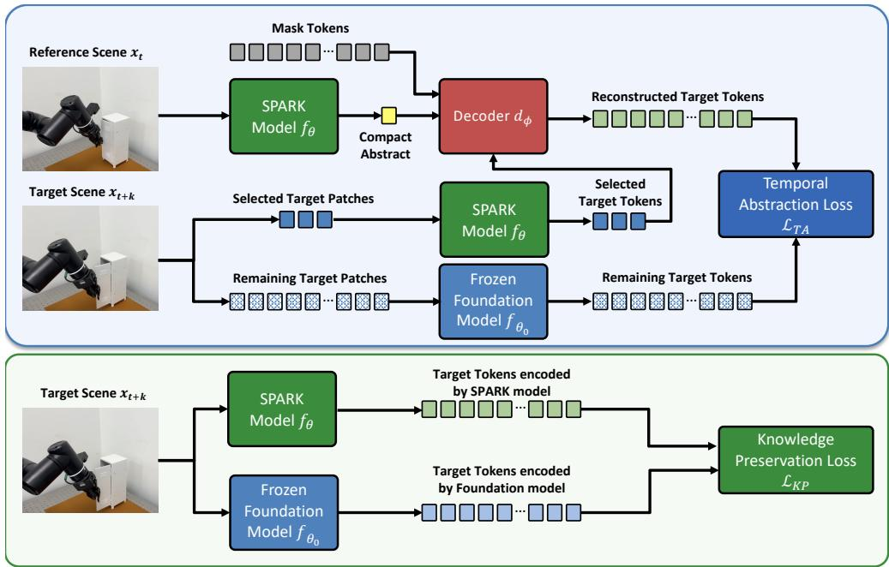
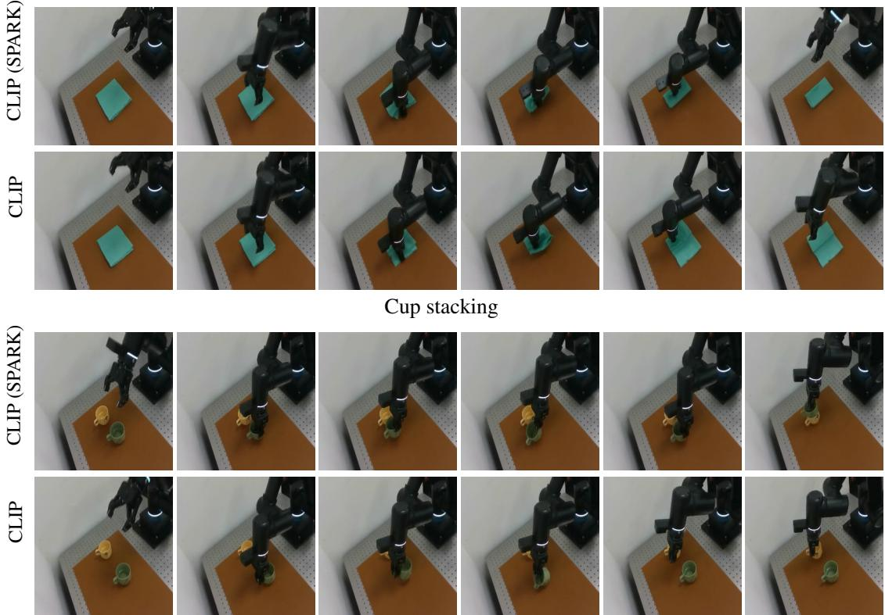
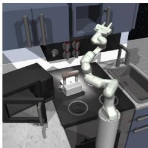
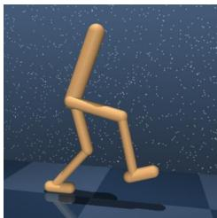
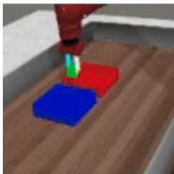

# SPARK: Simple Post-training for Adapting pRetrained Knowledge to Robot Control

Taekyung Kim1 Jeongeun Park2 Byeongho Heo1 Sungjoon Choi3 Sangdoo Yun1 Dongyoon Han1

1NAVER AI Lab 2Georgia Institute of Technology 3Korea University

{taekyung.k, bh.heo, sangdoo.yun, dongyoon.han}@navercorp.com jpark3456@gatech.edu sungjoon-choi@korea.ac.kr

Abstract: Large-scale representation learning has produced public foundation models that provide strong general-purpose visual features. However, their pretraining objectives are not designed for robot representation learning, so the resulting embeddings tend to emphasize global semantics rather than the temporally sensitive representations required for robot control. Training robot models from scratch is also undesirable due to the limited scale and high collection cost of robotics data, as well as the substantial computational burden of pre-training. In this paper, we propose SPARK (Simple Post-training for Adapting pRetrained Knowledge), a post-training method that adapts foundation models to robot control. SPARK is built on two principles: temporal abstraction, which encourages the encoder to derive compact features that preserve information essential for understanding temporal changes and action-relevant scene structure, and knowledge preservation, which aligns patch-level representations with those of the original foundation model to retain useful pretrained semantics. These objectives yield compact visual state representations that remain semantically meaningful while preserving useful prior knowledge. Experiments across multiple robotics benchmarks show that SPARK consistently improves success rates and generalization over vanilla foundation models, and further demonstrate that these gains transfer to real-world robot manipulation.

Keywords: Robot Representation Learning, Post-training

## 1 Introduction

Robot representation learning [1, 2, 3, 4, 5, 6] has primarily centered on capturing dynamics in spatiotemporal observations, producing representations effective for imitation learning and robot control. In parallel, general-purpose visual representation learning has increasingly emphasized visuallanguage alignment for broad transfer. From this perspective, conventional robot models remain limited, being largely optimized for narrow control distributions rather than language-grounded semantics.

Learning robot representations directly from paired video-language data offers a direct route to unifying embodied dynamics with language-level semantics. However, collecting robot vision-action data at scale [4, 7, 6] is expensive and typically limited to laboratory settings, making it difficult to cover diverse scenes, objects, and interactions. Therefore, prior work has turned to large-scale video data without robot actions to capture physical dynamics that may benefit downstream robot learning. While such approaches improve scalability and provide temporal supervision, they still lack the broad semantic coverage and vision-language alignment available in foundation models trained on web-scale corpora. This motivates a different strategy that adapts already well-aligned foundation models [8, 9, 10, 11, 12] to the requirements of robot control.

In this paper, we propose SPARK (Simple Post-training for Adapting pRetrained Knowledge), a post-training method that adapts foundation models and general-purpose vision models to robot control. The central goal of SPARK is to make pretrained representations more suitable for control without sacrificing the general visual knowledge acquired during large-scale pretraining. To this end, SPARK is built on two key principles: temporal abstraction and knowledge preservation. Temporal abstraction encourages the encoder to produce compact features that preserve information essential for understanding temporal changes by leveraging the prior knowledge acquired during large-scale pretraining. However, naively enforcing such compact abstraction can degrade useful prior knowledge inherited from large-scale pretraining. Thus, we adopt a retention objective that aligns the patch-wise representations of the adapted encoder with those of the original foundation model.

We empirically demonstrate that SPARK yields consistent improvements across multiple robotics benchmarks [13, 14, 15, 16]. Models adapted with SPARK yield higher success rates and better generalization than their vanilla models on average on robot manipulation tasks, highlighting that cost-efficient post-training can substantially facilitate the generalizability of the foundation model on robot control. Moreover, experiments on real-world robot tasks show that these gains extend beyond simulation. Consequently, SPARK presents a promising recipe for mitigating the mismatch between foundation models and the visual representations required for embodied intelligence.

## 2 Related Work

Pretrained Vision and Foundation Models. Large-scale vision and vision-language models, including the CLIP and SigLIP families [8, 9, 10] as well as self-supervised models such as DINO, DINOv2, MAE, SimCLR, and MoCo variants [17, 12, 18, 19, 20, 21, 22], provide strong generalpurpose visual features and have become standard backbones for many vision tasks. However, their objectives target recognition and language alignment rather than the temporally fine-grained structure crucial for control, motivating post-training recipes that adapt these models to robotic perception without pre-training from scratch.

Visual Representations in Robotics. Pretrained vision backbones are widely used to encode observations for downstream manipulation, navigation, and policy learning [6, 23], and even frozen generic features can yield strong representations for imitation learning and control [5]. To further improve transfer, robotics-oriented pretraining has exploited egocentric viewpoints and temporal structure through time-contrastive learning with language supervision [1], value-implicit pretraining [2], MAE style reconstruction on egocentric corpora [3, 4], language-guided semantic supervision [24, 25], and distillation of diverse foundation models into a single backbone [11]. However, these recipes typically demand substantial computational cost and paired language annotations, limiting their accessibility relative to web-scale foundation models.

Post-training and Adaptation. Post-training reduces the cost of adapting pretrained encoders to new domains or tasks. Parameter-efficient methods introduce small learnable components such as prompts and adapters [26, 27, 28] or apply low-rank updates [29], while in robotics prior work has used masked-autoencoding [18] reconstruction to enhance pretrained encoders for control [4], STP [30] learns content and motion features through spatiotemporal pixel prediction, and Lossless Adaptation [31] inserts parameter-efficient adapters to preserve the original representation. Our approach follows this spirit but targets the representation more directly. SPARK introduces a temporal abstraction loss that trains a single class token as a compact state, together with a knowledge preservation loss that aligns token-level features with those of the original foundation model.

  
Figure 1: Overview of SPARK (Simple Post-training for Adapting pRetrained Knowledge). SPARK encourages temporal abstraction of patch-wise semantics while preserving the foundation model’s pre-trained knowledge. Given a reference scene $x _ { t } ,$ the SPARK encoder $f _ { \theta }$ produces a class token as a compact abstraction of $x _ { t } ,$ from which the decoder predicts target token representations with hints from a few target patches. The Temporal Abstraction Loss ${ \mathcal { L } } _ { \mathrm { T A } }$ aligns these predictions with the target representations of a frozen foundation model $f _ { \theta _ { 0 } }$ , while the Knowledge Preservation Loss ${ \mathcal { L } } _ { \mathrm { K P } }$ aligns the target patch tokens of $f _ { \theta }$ and $f _ { \theta _ { 0 } }$ . This encourages the class token to serve as a compact visual state for control while retaining the patch-level semantics of the original foundation model.

## 3 Method

## 3.1 Overview

The goal of SPARK (Simple Post-training for Adapting pRetrained Knowledge) is to adapt pretrained foundation models to robot control without sacrificing the broad visual knowledge acquired during large-scale pretraining. To this end, SPARK is built on two complementary principles: temporal abstraction and knowledge preservation. Temporal abstraction encourages the encoder to derive compact features that preserve information essential for understanding temporal changes and actionrelevant scene structure. Knowledge preservation regularizes this adaptation so that the learned representation remains aligned with the semantically meaningful features of the original foundation model. Together, these principles enable pretrained representations to become more suitable for robot control without requiring training from scratch.

To realize temporal abstraction, SPARK trains the encoder so that a compact feature extracted from a reference observation can support the prediction of a temporally offset target scene. Specifically, the encoder processes a reference scene and produces patch tokens together with a class token, where the class token serves as a compact feature. A decoder then reconstructs token representations of the target scene from this compact feature, conditioned on only a small subset of visible target patches as hints. Because accurate prediction requires information that explains how the scene changes over time, this objective encourages the compact feature to preserve temporal and action-relevant structure rather than only static global semantics.

However, adapting the encoder solely through this abstraction objective can distort useful pretrained knowledge. To mitigate this issue, SPARK introduces a retention objective that aligns the patch-wise representations of the adapted encoder with those of the frozen original foundation model on the same input. This regularization preserves semantically meaningful local features while allowing the compact feature to specialize toward dynamic understanding for control. The overall pipeline is illustrated in Fig. 1.

## 3.2 Formulation

Encoding procedure. Let $f _ { \theta }$ denote the SPARK encoder and let $f _ { \theta _ { 0 } }$ denote the frozen foundation model used for initialization. We sample a reference scene $\boldsymbol { x } _ { t } \in \dot { \mathbb { R } ^ { 3 \times H \times W } }$ and a temporally offset target scene $\boldsymbol { x } _ { t + k } \in \mathbb { R } ^ { 3 \times H \times W }$ . We patchify both scenes into N non-overlapping patches, denoted by $\{ x _ { t } ^ { \bar { i } } \} _ { i = 1 } ^ { N }$ and $\{ x _ { t + k } ^ { i } \} _ { i = 1 } ^ { N }$ , respectively. The reference scene is processed by both the SPARK encoder $f _ { \theta }$ and the frozen encoder $f _ { \theta _ { 0 } }$ , yielding adapted token representations $\{ u _ { t } ^ { i } \} _ { i = 1 } ^ { N }$ and frozen token representations $\{ v _ { t } ^ { i } \} _ { i = 1 } ^ { N }$ . In addition, the SPARK encoder produces a class token $u _ { t } ^ { \mathrm { [ C L S ] } }$ , which serves as the compact feature associated with the reference scene. For the target scene, the frozen encoder processes all target patches to produce $\{ v _ { t + k } ^ { i } \} _ { i = 1 } ^ { N }$ , while the SPARK encoder processes only a subset of visible target patches indexed by $\dot { M } \subset \{ 1 , \ldots , N \}$ during temporal abstraction, where $| M | = \lfloor r N \rfloor$ for a visible ratio $r \in ( 0 , 1 )$ . This yields adapted target tokens $\{ u _ { t + k } ^ { i } \} _ { i \in M }$ which are used as hints for target-scene prediction. For knowledge preservation, the SPARK encoder additionally processes all target patches to produce $\{ u _ { t + k } ^ { i } \} _ { i = 1 } ^ { N }$

Temporal abstraction loss. The abstraction objective encourages the compact feature $u _ { t } ^ { \mathrm { [ C L S ] } }$ to retain the information required to predict the target scene. To this end, we reconstruct target token representations from the compact feature together with the visible target hints $\{ u _ { t + k } ^ { i } \} _ { i \in M }$ . Let $M ^ { c }$ denote the masked target-patch indices. We introduce learned mask tokens $\{ m _ { i } \} _ { i \in M ^ { c } }$ and feed the concatenation of the compact feature, visible target tokens, and mask tokens into a decoder $d _ { \phi }$ . The decoder predicts target token representations $\{ \hat { u } _ { t + k } ^ { i } \} _ { i \in M ^ { c } }$ for the masked regions. We then align these predicted target tokens with the corresponding frozen target representations produced by the original foundation model:

$$
\mathcal { L } _ { \mathrm { T A } } = \sum _ { i \in M ^ { c } } d \big ( \hat { u } _ { t + k } ^ { i } , v _ { t + k } ^ { i } \big ) ,\tag{1}
$$

where $d ( \cdot , \cdot )$ is a patch-level distance function. By requiring the compact feature to support prediction of the target scene, this loss encourages the encoder to abstract temporal and action-relevant information from the reference observation into a compact representation.

Knowledge preservation loss. While the abstraction loss specializes the representation toward temporal understanding, it may also distort the useful semantic structure inherited from the pretrained model. To prevent this drift, we introduce a retention loss that aligns the patch-wise representations of the adapted encoder with those of the frozen original encoder on the target scene:

$$
\mathcal { L } _ { \mathrm { K P } } = \sum _ { i = 1 } ^ { N } d ^ { \prime } \big ( u _ { t + k } ^ { i } , v _ { t + k } ^ { i } \big ) ,\tag{2}
$$

where $d ^ { \prime } ( \cdot , \cdot )$ is a patch-level distance function. Since $f _ { \theta _ { 0 } }$ is frozen, the resulting representations provide a stable semantic target during post-training. This regularization preserves general visual knowledge while allowing the adapted encoder to specialize in robot control.

Post-training objective. The overall SPARK objective combines temporal abstraction with knowledge preservation:

$$
\mathcal { L } _ { \mathrm { S P A R K } } = \mathcal { L } _ { \mathrm { T A } } + \alpha \mathcal { L } _ { \mathrm { K P } } ,\tag{3}
$$

where $\alpha > 0$ balances adaptation and preservation. Optimizing this objective yields compact visual features that capture temporal and action-relevant information while remaining grounded in the semantic knowledge of the original foundation model.

Table 1: Experimental results on vision-based robot policy learning across MetaWorld, DMC, and Franka Kitchen. We report the average performance of imitation learning agents trained upon representations of CLIP [8], DINOv2 [12], SigLIP [9], and Theia [11] post-trained on Kinetics-400 [32] dataset. Success rates (%) are reported for MetaWorld [14] and Franka Kitchen [15], and normalized scores are reported for DMC [13]. We report the gains of our method over the baseline.
<table><tr><td colspan="2">Method</td><td>MetaWorld</td><td>DMC</td><td>Franka Kitchen</td><td>Average</td></tr><tr><td rowspan="4">CLIP</td><td>Baseline</td><td>72.8±1.1</td><td>47.9±2.1</td><td>31.5±2.4</td><td>50.7</td></tr><tr><td>SPARK</td><td>77.7±7.0</td><td>50.6±0.9</td><td>39.8±5.6</td><td>56.0</td></tr><tr><td>Gain</td><td>+ 4.9</td><td>+ 2.7</td><td>+ 8.3</td><td>+5.3</td></tr><tr><td></td><td></td><td></td><td></td><td></td></tr><tr><td rowspan="3">SigLIP</td><td>Baseline</td><td>73.0±7.6</td><td>42.1±1.5</td><td>31.2±0.6</td><td>48.8</td></tr><tr><td>SPARK</td><td>76.9±6.8</td><td>42.6±1.8</td><td>42.2±2.4</td><td>53.9</td></tr><tr><td>Gain</td><td>+ 3.9</td><td>+ 0.5</td><td>+11.0</td><td>+ 5.1</td></tr><tr><td rowspan="3">DINOv2</td><td>Baseline</td><td>78.4±7.7</td><td>55.3±0.4</td><td>36.4±2.7</td><td>56.7</td></tr><tr><td>SPARK</td><td>83.2±5.5</td><td>58.3±2.4</td><td>40.7±2.7</td><td>60.7</td></tr><tr><td>Gain</td><td>+4.8</td><td>+3.0</td><td>+4.3</td><td>+ 4.0</td></tr><tr><td rowspan="3">Theia</td><td>Baseline</td><td>89.0±2.8</td><td>60.8±2.8</td><td>40.1±2.3</td><td>63.3</td></tr><tr><td>SPARK</td><td>89.2±7.4</td><td>69.3±1.4</td><td>44.3±2.6</td><td>67.6</td></tr><tr><td>Gain</td><td>+ 0.2</td><td>+ 8.5</td><td>+4.2</td><td>+4.3</td></tr></table>

## 4 Experiments

In this section, we evaluate the impact of the proposed method in vision-based policy learning for robotic manipulation across various environments [15, 14, 13], and validate that such improvements transfer to real-world demonstrations. Moreover, we compare our method against various robot representation learning methods, with additional comparisons to commonly used adaptation methods provided in the Appendix.

## 4.1 Vision-based Robot Policy Learning in Simulated Environments

We evaluate our method through imitation learning on robot manipulation and locomotion tasks across various simulated environments. Specifically, we evaluate on five tasks from each of the Franka Kitchen, MetaWorld, and DeepMind Control Suite (DMC) [13] benchmarks; details for the benchmarks and tasks are deferred to the Appendix. We compare our method against baselines built upon four different visual representations: CLIP [8], SigLIP [9], DINOv2 [12], and Theia [11], all post-trained on the Kinetics-400 [32] dataset. Table 1 summarizes the average performance of our method (SPARK) and the baselines across the three benchmarks. The results demonstrate that our method consistently outperforms the baselines across all three benchmarks and all four visual representations. In particular, SPARK improves the average performance by 5.3%p, 5.1%p, and 4.0%p over the CLIP, SigLIP, and DINOv2 baselines, respectively, and further boosts the performance by 8.5%p on DMC when built upon Theia, reaching 69.3% normalized score on DMC and 89.2% success rate on MetaWorld. Notably, our method achieves the largest gains on the Franka Kitchen benchmark, with average success rate improvements of 8.3%p, 11.0%p, 4.3%p and 4.2%p on CLIP, SigLIP, DINOv2, and Theia, respectively, suggesting that our method is particularly effective when accurate visual state grounding is critical for fine-grained manipulation. This highlights the effectiveness of explicitly encoding visual state representation for vision-based robot policy learning, regardless of the underlying visual backbone.

## 4.2 Vision-based Robot Policy Learning in Real-world Environments

Quantitative results. To evaluate whether the benefits of SPARK extend beyond simulation, we additionally conduct experiments on real-world robot manipulation tasks. We consider three imitation learning tasks: Cloth Folding, Cup Stacking, and Cabinet Opening. For each task, we collect 20 demonstration episodes for behavior cloning and evaluate policies learned from visual representations extracted by the frozen backbone. The robot operates at 20 Hz with a policy’s chunk size of 20. Following the same evaluation protocol as in the simulation, we compare the vanilla CLIP encoder with its SPARK-adapted counterpart with 20 trials for each task. The results are reported in Table 2. SPARK improves the success rate on all three tasks, increasing performance from 65.0 to 75.0 on Cloth Folding, from 45.0 to 55.0 on Cup Stacking, and from 50.0 to 55.0 on Cabinet Opening. Overall, these results show that the gains obtained by SPARK are not limited to simulation, but are transferable to real-world robot manipulation as well. This suggests that post-training foundation models with temporal abstraction and knowledge preservation improves the usefulness of pretrained visual representations in practical robotic settings.

Cloth Folding  
  
Figure 2: Real-world demonstration trajectories. Each row shows the temporal progression of a policy from the initial observation to intermediate interaction states and the final outcome. Across tasks, the SPARK-adapted policy exhibits stable approach, contact, and object manipulation behaviors, illustrating that the adapted visual representations capture control-relevant scene information that transfers reliably to real-world settings.

Table 2: Performance on real-world vision-based robot policy learning. Success rates (%) of imitation learning agents on three manipulation tasks: Cloth Folding, Cup Stacking, and Cabinet Opening. We compared CLIP [8] with our SPARK model, post-trained upon representations of CLIP on Kinetics-400 [32]. The results demonstrate the generalizability of SPARK in the real world.
<table><tr><td>Method</td><td>Cloth Folding</td><td>Cup Stacking</td><td>Cabinet Opening</td></tr><tr><td>CLIP</td><td>65.0</td><td>45.0</td><td>50.0</td></tr><tr><td>SPARK (CLIP)</td><td>75.0</td><td>55.0</td><td>55.0</td></tr></table>

Qualitative results. We further visualize representative real-world rollouts of the SPARK-adapted policy across multiple manipulation tasks in Fig. 2. Each row presents a temporal sequence from the initial scene, through intermediate interaction stages, to the final task outcome. The visualizations show that the policy maintains coherent manipulation progress throughout the rollout, including approach, contact, and task completion. Across different tasks and scene configurations, these examples suggest that SPARK produces visual representations that preserve the information most relevant for control, enabling robust real-world execution under variations in object pose, scene layout, and appearance.

## 4.3 Comparison to prior pretraining methods

We compare SPARK against representative robot-oriented representation learning methods on the MetaWorld benchmark [14], following the same imitation learning protocol as in Sec. 4.1. The baselines are grouped into two categories: self-supervised learning methods including R3M [1], VC-1 [4], and data4robotics [6], and methods with auxiliary language guidance including MVP [3], Voltron [24], and MPI [25]. As shown in Table 3, SPARKtrained Theia attains the best overall performance of 89.2%, surpassing all robot-specific baselines from both categories, while SPARK-trained DINOv2 (83.2%) is also competitive. Overall, adapting public foundation models with SPARK is more effective for downstream robotics tasks than training robot-specific representations from scratch, even when the latter benefit from auxiliary language supervision.

Table 3: Comparative analysis of vision-based robot policy learning on MetaWorld. We report the performance of imitation learning agents on Metaworld [14]. The success rates (%) are reported for all the tasks.
<table><tr><td>Methods</td><td>Architecture</td><td>Metaworld</td></tr><tr><td>Self-supervised Learning</td><td></td><td></td></tr><tr><td>R3M°</td><td>ViT-S</td><td>67.0</td></tr><tr><td>VC-1</td><td>ViT-B</td><td>86.4</td></tr><tr><td>data4robotics</td><td>ViT-B</td><td>87.0</td></tr><tr><td>Supervision with Aux. Language Guidance</td><td></td><td></td></tr><tr><td>R3M</td><td>ViT-S</td><td>69.2</td></tr><tr><td>MVP</td><td>ViT-S</td><td>84.6</td></tr><tr><td> $\scriptstyle \mathrm { V o l t r o n ^ { \ddag } }$ </td><td>ViT-S</td><td>68.7</td></tr><tr><td>MPI‡</td><td>ViT-S</td><td>85.7</td></tr><tr><td></td><td></td><td></td></tr><tr><td>SPARK Models</td><td></td><td></td></tr><tr><td>CLIP</td><td>ViT-B</td><td>77.7</td></tr><tr><td> $\mathrm { S i g L I P }$ </td><td>ViT-B</td><td>76.9</td></tr><tr><td> $\mathrm { D i N O v } 2$ </td><td>ViT-B</td><td>83.2</td></tr><tr><td>Theia</td><td>ViT-B</td><td>89.2</td></tr></table>

◦ Excludes language guidance from the vanilla recipe.

## 5 Analysis

SPARK as VLA vision tower. We examine whether SPARK representations also benefit visionlanguage-action (VLA) systems. We construct a VLA by attaching a randomly initialized action expert to a VLM with either vanilla SigLIP or SPARK-SigLIP as its vision tower and SmolLM2-360M [33] as its LLM decoder, and train the action expert from scratch on LIBERO-10 [16] with the entire VLM frozen. We consider two settings: an aligned VLM, where projector alignment is conducted on LLaVA-Pretrain [34] beforehand, and a non-aligned VLM, which skips this step. As shown in Table 4, SPARK-SigLIP consistently outperforms vanilla SigLIP in both settings. While projector alignment remains beneficial for absolute performance, the consistent

Table 4: Comparative analysis of vision towers on VLA systems for long-horizon tasks. We consider two settings: an aligned VLM setting, where projector alignment is first conducted on the LLaVA-Pretrain dataset of 558K image-caption pairs while the nonaligned VLM setting skips this step. In both settings, the action expert is trained from scratch on LIBERO-10 while the full VLM remains frozen. Success rates are reported over 500 rollouts with 50 rollouts per task.

<table><tr><td>Method</td><td colspan="2">Success rate (%)</td></tr><tr><td></td><td>Aligned VLM</td><td>Non-aligned VLM</td></tr><tr><td>SigLIP</td><td>39.2</td><td>29.5</td></tr><tr><td>SPARK (SigLIP)</td><td>41.4</td><td>31.2</td></tr></table>

SPARK gain across both settings indicates that its dynamic and action-relevant structure transfers to LLM-conditioned policy learning.

Vision-language alignment is preserved after SPARK post-training. A natural concern with any post-training procedure is that it may distort the foundation model’s original vision-language alignment, since the encoder is updated on a video corpus without any paired captions. To probe this directly, we compare image-text retrieval performance of SPARK-trained SigLIP against vanilla SigLIP on Flickr30K-1K [35] test, which contains 5,000 image-text pairs. We employ the original SigLIP text encoder for text token encoding. We report Recall@K (R@K), which measures the fraction of queries for which the correct match appears among the top-K retrieved candidates, with $K \in \{ 1 , 5 , 1 0 \}$ . As reported in Table 5, SPARK retains nearly all of vanilla SigLIP’s retrieval ability across both directions and all values of K. Specifically, the largest drop is -2.8%p at Image→Text

Table 5: SPARK preserves vision-language alignment. Image-Text and Text-Image retrieval on Flickr30K 1K test [35], which consists of 5,000 ground-truth pairs. We use the original SigLIP text encoder, so any drop is attributable to vision-side drift. ∆ denotes the difference between the SPARK model and its baseline.
<table><tr><td rowspan="2">Model</td><td colspan="3">Image → Text</td><td colspan="3">Text → Image</td></tr><tr><td>R@1</td><td>R@5</td><td>R@10</td><td>R@1</td><td>R@5</td><td>R@10</td></tr><tr><td>SigLIP</td><td>90.4</td><td>98.6</td><td>99.0</td><td>75.6</td><td>93.2</td><td>96.3</td></tr><tr><td>SPARK (SigLIP)</td><td>87.6</td><td>97.7</td><td>98.8</td><td>74.0</td><td>92.4</td><td>95.6</td></tr><tr><td>∆</td><td>-2.8</td><td>-0.9</td><td>-0.2</td><td>-1.6</td><td>-0.8</td><td>-0.7</td></tr></table>

Table 6: Per-loss ablation. We ablate each loss individually using SigLIP on Franka Kitchen. The success rates (%) are reported for all the tasks.
<table><tr><td>Variant</td><td></td><td></td><td></td><td></td><td>Knob1 on Light on Sdoor open Ldoor open Micro open | Average</td><td></td></tr><tr><td>SigLIP</td><td> $1 7 . 0 { \pm } 1 . 2 $ </td><td> $3 8 . 5 { \pm } 1 . 9 $ </td><td> $7 5 . 5 { \pm 3 . 4 }$ </td><td> $8 . 5 { \pm } 1 . 0 $ </td><td> $1 6 . 5 { \pm } 1 . 9$ </td><td> $3 1 . 2 { \pm } 0 . 6 $ </td></tr><tr><td> ${ \mathcal { L } } _ { \mathrm { T A } ^ { - } }$ </td><td> $5 . 5 { \pm } 1 . 9$ </td><td> $1 1 . 5 { \pm } 5 . 3 $ </td><td> $4 3 . 0 { \pm } 6 . 6 $ </td><td> $6 . 5 { \pm } 1 . 0 $ </td><td> $6 . 5 { \pm } 1 . 0 $ </td><td> $1 4 . 6 { \pm } 2 . 5 $ </td></tr><tr><td> ${ \mathcal { L } } _ { \mathrm { K P ^ { - } } } \mathrm { o n l y }$ </td><td>12.0±2.8</td><td> $1 9 . 5 { \pm } 1 . 9$ </td><td> $6 7 . 0 { \pm } 2 . 6 $ </td><td> $7 . 0 { \pm } 1 . 2 $ </td><td> $8 . 5 { \pm } 1 . 9$ </td><td> $2 2 . 8 { \pm } 0 . 7$ </td></tr><tr><td>SPARK</td><td>27.5±5.0</td><td> $\mathbf { 4 3 . 0 } \pm 5 . 0$ </td><td> ${ \bf 8 7 . 5 \pm 1 . 9 }$ </td><td> ${ \bf 2 0 . 0 { \pm } } 2 . 8$ </td><td> ${ \bf 3 3 . 0 { \pm } } 5 . 3$ </td><td> $4 2 . 2 { \pm } 2 . 4 $ </td></tr></table>

R@1, while R@5 and R@10 are within one point of vanilla in both directions. Despite reconstructiondriven post-training on video data, the vision encoder remains compatible with the original text encoder it was paired with at pretraining time. This indicates that our Knowledge Preservation loss successfully prevents the post-trained representation from drifting away from the language-aligned manifold of the underlying vision-language model.

Ablation study on losses. We ablate each loss individually using SigLIP on Franka Kitchen. As shown in Table $6 , \mathcal { L } _ { \mathrm { T A } ^ { - } }$ collapses performance across all five tasks, as the strong abstraction pressure has no semantic anchor. LKP-only anchors the representation and thus mitigates the degradation to some extent, but fails to improve control. Neither loss alone maintains the baseline, and only their combination surpasses it, validating that the two losses are mutually necessary components.

Comparison to various post-training recipes. We conduct comparative analysis with alternative post-training recipes on Franka Kitchen. We compared naive posttraining using masked autoencoding (MAE) [18, 4] and correspondence matching among consecutive scenes [36]. All the post-trained models are initialized by CLIP [8]. As shown in Table 7, standard MAE style post-training and correspondence matching style post-training, which focus on generic reconstruction and temporal correspondence respectively, perform worse than the baseline with averages of 23.0% and 25.5%. In contrast, SPARK attains an average success rate of 39.8%, substantially outperforming both the vanilla CLIP and other post-trained models. This highlights that explicitly enforcing temporal abstraction and knowledge preservation is more effective for adapting foundation models to robot control than generic reconstruction based objectives.

Table 7: Ablation study varying posttraining recipes. We compared our SPARK to other post-training recipes on Franka Kitchen [15] using CLIP [8] as an initial model. The success rates (%) are reported for all the tasks.
<table><tr><td>Post-training</td><td>Franka Kitchen</td></tr><tr><td>Baseline</td><td>31.5</td></tr><tr><td>Masked autoencoding</td><td>23.0</td></tr><tr><td>Correspondence matching</td><td>25.5</td></tr><tr><td>SPARK</td><td>39.8</td></tr></table>

Ablation study on masking strategy. We replace random masking with two structured variants based on the object-relevance criterion using [CLS] attention following AutoMAE [37], which either mask all object-relevant patches (i.e., object-aware masking) or always keep them as visible hints (i.e., object-preserving masking). As shown in Table 8, both variants fall far below random masking. This is because masking all object-relevant patches leaves only uninformative hints, breaking the reconstruction signal, while always keeping them lets the decoder bypass the class token. Random masking balances these issues, providing diverse coverage that forces the class token to capture scene-level temporal structure.

Table 8: Ablation study on masking strategies. We replace random masking with structured variants based on the object-relevance criterion following AutoMAE [37], using SigLIP on Franka Kitchen. The success rates (%) are reported for all the tasks.
<table><tr><td>Method</td><td>Masking strategy</td><td></td><td></td><td></td><td>Knob1 on Light on Sdoor open Ldoor open Micro open | Average</td><td></td><td></td></tr><tr><td>SigLIP</td><td></td><td> $1 7 . 0 { \pm } 1 . 2 $ </td><td> $3 8 . 5 { \pm } 1 . 9 $ </td><td> $7 5 . 5 { \pm 3 . 4 }$ </td><td> $8 . 5 { \pm } 1 . 0 $ </td><td> $1 6 . 5 { \pm } 1 . 9$ </td><td>一  $3 1 . 2 { \pm } 0 . 6 $ </td></tr><tr><td rowspan="4"></td><td>Object-aware masking</td><td> $8 . 5 { \pm } 1 . 0 $ </td><td> $2 0 . 0 { \pm } 3 . 3 $ </td><td> $6 0 . 0 { \pm } 5 . 4 $ </td><td> $8 . 5 { \pm } 1 . 0 $ </td><td> $1 0 . 0 { \pm } 1 . 6 $ </td><td> $2 1 . 4 { \pm } 1 . 2$ </td></tr><tr><td>SPARK Object-preserving masking</td><td> $1 2 . 5 { \pm } 2 . 5 $ </td><td> $2 0 . 5 { \pm } 6 . 8 $ </td><td> $7 2 . 5 { \pm } 4 . 4 $ </td><td> $9 . 5 { \pm } 1 . 9 $ </td><td> $1 0 . 5 { \pm } 1 . 0 $ </td><td> $2 5 . 1 \pm 2 . 1$ </td></tr><tr><td>Random masking</td><td> $2 7 . 5 { \pm } 5 . 0 $ </td><td> ${ \bf 4 3 . 0 { \pm } } 5 . 0 $ </td><td> ${ \bf 8 7 . 5 \pm 1 . 9 }$ </td><td> ${ \bf 2 0 . 0 { \pm } } 2 . 8$ </td><td> ${ \bf 3 3 . 0 { \pm } } 5 . 3$ </td><td> $4 2 . 2 { \pm } 2 . 4 $ </td></tr><tr><td></td><td></td><td></td><td></td><td></td><td></td><td></td></tr></table>

Table 9: Generalizability across post-training datasets. We post-train CLIP on Something-Something-V2 (SSv2), an egocentric hand-object interaction dataset, with the same configuration as Kinetics-400. The success rates (%) are reported for all the tasks on Franka Kitchen.
<table><tr><td>Method</td><td>Dataset</td><td></td><td></td><td>Knob1 on Light on Sdoor open Ldoor open Micro open | Average</td><td></td><td></td><td></td></tr><tr><td>CLIP</td><td></td><td> $2 3 . 0 { \pm } 2 . 6 $ </td><td> $2 9 . 5 { \pm } 4 . 7 $ </td><td> $6 9 . 5 { \pm } 4 . 4 $ </td><td> $1 3 . 5 { \pm } 3 . 4 $ </td><td>22.0±2.8|</td><td> $3 1 . 5 { \pm 2 . 4 }$ </td></tr><tr><td rowspan="2">SPARK</td><td>SSv2</td><td> $2 8 . 5 { \pm } 1 . 9$ </td><td> $3 7 . 0 { \pm } 6 . 8 $ </td><td> $7 8 . 0 { \pm } 3 . 7 $ </td><td> $\mathbf { 1 9 . 0 { \pm } } 4 . 2 $ </td><td> $1 5 . 0 { \pm } 3 . 8 $ </td><td> $3 5 . 5 { \pm } 1 . 1 $ </td></tr><tr><td> ${ \mathrm { K i n e t i c s } } { \cdot } 4 0 0$ </td><td> $3 1 . 5 { \pm } 1 . 9$ </td><td> $3 8 . 5 { \scriptstyle \pm 6 . 0 }$ </td><td> $7 4 . 5 { \pm } 1 1 . 4 $ </td><td> $1 8 . 0 { \pm } 2 . 0 $ </td><td> $2 9 . 0 { \pm } 6 . 2$ </td><td> ${ \bf 3 9 . 8 \pm 5 . 6 }$ </td></tr></table>

Generalizability across post-training datasets. To test whether SPARK depends on third-person video, we post-train CLIP on Something-Something-V2 (SSv2) [38], an egocentric hand-object interaction dataset, under the same configuration. SSv2-trained SPARK improves the baseline on most of the tasks and by 4.0%p on average, confirming that SPARK transfers to egocentric videos. The gain is smaller than that of Kinetics-400, likely due to narrower scene diversity of SSv2.

## 6 Discussion

Summary. In this paper, we proposed SPARK, a simple post-training method for adapting pretrained foundation models to robot control. SPARK is based on two key principles: temporal abstraction and knowledge preservation. Temporal abstraction encourages the learned representation to capture temporal changes relevant to control, while knowledge preservation prevents the adapted model from losing useful semantic knowledge inherited from large-scale pre-training. In this way, SPARK makes pretrained visual representations more suitable for robot control without requiring training from scratch. Experiments on multiple robot learning benchmarks show that SPARK consistently improves over vanilla pretrained backbones. We further show that these gains extend beyond simulation to real-world robot manipulation tasks. These results suggest that costefficient post-training is a practical way to improve the usefulness of foundation models for embodied intelligence.

Limitations and Future Work. While SPARK consistently improves over vanilla foundation models across multiple benchmarks, several limitations remain. First, although SPARK consistently improves each backbone over its baselines, the absolute downstream performance still depends substantially on the capacity of the underlying foundation model, indicating that post-training amplifies rather than replaces the capacity of the base representation. Second, our temporal abstraction is built on a relatively simple temporal formulation that predicts a single temporally offset scene from a reference observation. To address these limitations, promising directions for future work include extending the temporal formulation beyond a single offset scene, such as multi-step prediction, and integrating SPARK into full VLA systems [39, 40, 41, 42], where the vision tower is trained jointly with the policy.

## Appendix

• §A: Evaluation suites

• §B: Per-task Results of Vision-based Robot Policy Learning in Simulated Environments

• §C: Comparison to Representation Adaptation Methods

• §D: Implementation details

## A Evaluation suites

We evaluate on three vision-based robot learning benchmarks encompassing Franka Kitchen, DeepMind Control Suite, and MetaWorld, covering a total of 15 tasks. The environments and sampled tasks for each benchmark are shown in Fig. A.

DeepMind Control Suite [13] is a set of continuous control tasks with simulated robots. We use five imitation learning cases: Walker-stand, Walker-walk, Reacher-easy, Cheetah-run, and Finger-spin. We report the normalized scores for all tasks.

MetaWorld [14] is a suite of simulated robotic manipulation tasks with a Sawyer robot arm. We focus on a subset of five representative tasks: Assembly, Bin-picking, Button-press-topdown, Drawer-open, and Hammer. We measure the best success rates among the online evaluation trials.

Franka Kitchen [15] is a challenging robotic manipulation environment, which consists of a 9 DoF position-controlled Franka robot interacting with a kitchen scene. The environment contains various kitchenwares including an openable microwave, four turnable oven burners, an oven light switch, two hinged cabinets, and a sliding cabinet door. We consider the imitation learning evaluation setup with five imitation tasks: Knob1 on, Light on, Sdoor open, Ldoor open, and Micro open.

  
(a) Franka Kitchen

  
(b) DeepMind Control

  
(c) MetaWorld  
Figure A: Environments for evaluation. We visualize three vision-based robot learning benchmarks employed for the validation of our method: (a) Franka Kitchen [15], (b) DeepMind Control Suite [13], and (c) Metaworld [14].

## B Per-task Results of Vision-based Robot Policy Learning in Simulated Environments

We report the per-task results on DMC [13], MetaWorld [14], and Franka Kitchen [15] in Table A, B, and C, respectively, which decompose the aggregate results presented in the main paper. Across all three benchmarks and all four visual representations (CLIP [8], SigLIP [9], DINOv2 [12], and Theia [11]), SPARK improves the reported average performance over the corresponding baselines. Moreover, the negative per-task changes are isolated to a small number of backbone-task pairs and are outweighed by improvements elsewhere. This suggests that the aggregate improvements are not driven by a single outlier task, but instead reflect a consistent benefit across tasks and representations.

Table A: Experimental results on vision-based robot policy learning on DeepMind Control Suite (DMC). We report the performance of imitation learning agents on the DMC benchmark [13], which are trained upon representations of CLIP [8], DINOv2 [12], SigLIP [9], and Theia [11] post-trained on Kinetics-400 [32] dataset. The normalized scores are reported for all the tasks. We report the gains of our method over the baseline.
<table><tr><td colspan="2">Method</td><td>Walker-stand</td><td>Walker-walk</td><td>Reacher-easy</td><td>Cheetah-run</td><td>Finger-spin</td><td>Average</td></tr><tr><td rowspan="3">CLIP</td><td>Baseline</td><td>58.1±5.8</td><td>24.9±2.8</td><td>75.2±4.0</td><td>12.7±2.0</td><td>68.4±3.1</td><td>47.9±2.1</td></tr><tr><td>SPARK</td><td>62.0±3.5</td><td>29.5±4.5</td><td>75.6±4.7</td><td>22.0±2.1</td><td>63.7±1.6</td><td>50.6±0.9</td></tr><tr><td>Gain</td><td>+3.9</td><td>+4.6</td><td>+ 0.4</td><td>+ 9.3</td><td>-4.7</td><td>+ 2.7</td></tr><tr><td rowspan="3">SigLIP</td><td>Baseline</td><td>43.9±5.9</td><td>19.9±2.8</td><td>74.6±2.5</td><td>9.0±2.5</td><td>63.6±0.4</td><td>42.1±1.5</td></tr><tr><td>SPARK</td><td>45.2±6.2</td><td>17.5±2.4</td><td>75.2±3.0</td><td>8.4±2.1</td><td>66.8±1.2</td><td>42.6±1.8</td></tr><tr><td>Gain</td><td>+ 1.3</td><td>-2.4</td><td>+ 0.6</td><td>-0.6</td><td>+ 3.2</td><td>+ 0.5</td></tr><tr><td rowspan="3">DINOv2</td><td>Baseline</td><td>74.2±5.6</td><td>41.5±3.4</td><td>76.8±5.9</td><td>15.9±3.7</td><td>68.3±1.6</td><td>55.3±0.4</td></tr><tr><td>SPARK</td><td>78.8±3.5</td><td>45.2±5.0</td><td>74.3±6.5</td><td>22.3±2.9</td><td>70.8±1.0</td><td>58.3±2.4</td></tr><tr><td>Gain</td><td>+4.6</td><td>+3.7</td><td>-2.5</td><td>+ 6.4</td><td>+ 2.5</td><td>+ 3.0</td></tr><tr><td rowspan="3">Theia</td><td>Baseline</td><td>74.4±5.8</td><td>54.7±8.5</td><td>79.1±5.5</td><td>26.7±4.4</td><td>69.1±1.2</td><td>60.8±2.8</td></tr><tr><td>SPARK</td><td>87.7±3.4</td><td>70.0±8.0</td><td>83.0±3.8</td><td>38.0±4.5</td><td>67.5±0.7</td><td>69.3±1.4</td></tr><tr><td>Gain</td><td>+ 13.3</td><td>+ 15.3</td><td>+3.9</td><td>+ 11.3</td><td>-1.6</td><td>+ 8.5</td></tr></table>

Table B: Experimental results on vision-based robot policy learning on MetaWorld. We report the performance of imitation learning agents on MetaWorld [14], which are trained upon representations of CLIP [8], DINOv2 [12], SigLIP [9], and Theia [11] post-trained on Kinetics-400 [32] dataset. The success rates (%) are reported for all the tasks. We report the gains of our method over the baseline.
<table><tr><td colspan="2">Method</td><td>assembly</td><td>bin-picking</td><td>button-press</td><td>drawer-open</td><td>hammer</td><td>Average</td></tr><tr><td rowspan="3">CLIP</td><td>Baseline</td><td>55.2±6.6</td><td>63.2±7.7</td><td>58.4±13.4</td><td>100.0±0.0</td><td>87.2±15.6</td><td>72.8±1.1</td></tr><tr><td>SPARK</td><td>72.0±12.0</td><td>63.2±7.0</td><td>58.8±14.5</td><td>100.0±0.0</td><td>94.4±6.1</td><td>77.7±7.0</td></tr><tr><td>Gain</td><td>+ 16.8</td><td>+ 0.0</td><td>+ 0.4</td><td>0.0</td><td>+7.2</td><td>+4.9</td></tr><tr><td rowspan="3">SigLIP</td><td>Baseline</td><td>69.6±9.2</td><td>52.0±12.3</td><td>59.2±15.6</td><td>100.0±0.0</td><td>84.0±9.4</td><td>73.0±7.6</td></tr><tr><td>SPARK</td><td>74.6±10.3</td><td>60.1±9.5</td><td>58.5±12.7</td><td>100.0±0.0</td><td>91.5±5.8</td><td>76.9±6.8</td></tr><tr><td>Gain</td><td>+ 5.0</td><td>+ 8.1</td><td>-0.7</td><td>0.0</td><td>+7.5</td><td>+ 3.9</td></tr><tr><td rowspan="3">DINOv2</td><td>Baseline</td><td>64.8±5.9</td><td>70.4±14.9</td><td>64.0±19.4</td><td>100.0±0.0</td><td>92.8±5.9</td><td>78.4 ±7.7</td></tr><tr><td>SPARK</td><td>80.8±5.2</td><td>67.2±7.2</td><td>68.8±16.3</td><td>100.0±0.0</td><td>99.2±1.8</td><td>83.2 ±5.5</td></tr><tr><td>Gain</td><td>+ 16.0</td><td>- 3.2</td><td>+4.8</td><td>0.0</td><td>+ 6.4</td><td>+ 4.8</td></tr><tr><td rowspan="3">Theia</td><td>Baseline</td><td>88.8±8.7</td><td>80.8±4.4</td><td>79.2±5.2</td><td>100.0±0.0</td><td>96.0±5.7</td><td>89.0±2.8</td></tr><tr><td>SPARK</td><td>87.2±5.9</td><td>81.6±6.1</td><td>86.4±9.6</td><td>100.0±0.0</td><td>100.0±0.0</td><td>89.2±7.4</td></tr><tr><td>Gain</td><td>-1.6</td><td>+ 0.8</td><td>+7.2</td><td>0.0</td><td>+ 4.0</td><td>+ 0.2</td></tr></table>

## C Comparison to Representation Adaptation Methods

We compare SPARK against representation adaptation methods, STP [30] and Lossless Adaptation [31], using SigLIP [9] as the initial model on Franka Kitchen in Table D. STP falls below the baseline on average, consistent with our view that re-training how to encode can distort the pretrained representations, while Lossless Adaptation performs on par with it. In contrast, SPARK improves every task and outperforms both methods by a large margin, as it learns to integrate the prior knowledge into a compact state rather than re-training them.

## D Implementation details

Initialization and post-training setup. For post-training, we initialize the SPARK encoder from public foundation models, including CLIP [8], DINOv2 [12], SigLIP [9], and Theia [11]. Unless otherwise stated, post-training is conducted on Kinetics-400 [32] for 50 epochs. Following repeated sampling [43, 44], this corresponds to an effective training length of 200 epochs. We use AdamW [45] with a batch size of 1536 and train on dynamic scenes at a resolution of 224 × 224. Frames are sampled at 30 FPS, and the temporal offset between the reference and target scenes is uniformly sampled between 4 and 96 frames. We apply random resized cropping and horizontal flipping, using the same crop for both reference and target scenes. The target scene is masked with a ratio of 0.9. The decoder consists of eight Vision Transformer blocks. All remaining hyperparameters follow the default pretraining settings of the corresponding backbone.

Table C: Experimental results on vision-based robot policy learning on Franka Kitchen. We report the performance of imitation learning agents on Franka Kitchen [15], which are trained upon representations of CLIP [8], DINOv2 [12], SigLIP [9], and Theia [11] post-trained on Kinetics-400 [32] dataset. The success rates (%) are reported for all the tasks. We report the gains of our method over the baselines.
<table><tr><td colspan="2">Method</td><td>Knob1 on</td><td>Light on</td><td>Sdoor open</td><td>Ldoor open</td><td>Micro open</td><td>Average</td></tr><tr><td>CLIP</td><td>Baseline SPARK Gain</td><td>23.0±2.6 31.5±1.9 + 8.5</td><td>29.5±4.7 38.5±6.0 + 9.0</td><td>69.5±4.4 74.5±11.4 + 5.0</td><td>13.5±3.4 18.0±2.0 +4.5</td><td>22.0±2.8 29.0±6.2 +7.0</td><td>31.5±2.4 39.8±5.6 + 8.3</td></tr><tr><td>SigLIP</td><td>Baseline SPARK Gain</td><td>17.0±1.2 27.5±5.0 + 10.5</td><td>38.5±1.9 43.0±5.0 + 4.5</td><td>75.5±3.4 87.5±1.9 + 12.0</td><td>8.5±1.0 20.0±2.8 + 11.5</td><td>16.5±1.9 33.0±5.3 + 16.5</td><td>31.2±0.6 42.2±2.4 + 11.0</td></tr><tr><td>DINOv2</td><td>Baseline SPARK Gain</td><td>26.0±4.3 21.0±4.2 -5.0</td><td>38.5±2.5 51.0±8.4 + 12.5</td><td>71.0±6.8 81.5±2.5 + 10.5</td><td>9.5±2.5 17.0±2.0 +7.5</td><td>37.0±6.2 33.0±3.5 - 4.0</td><td>36.4 ±2.7 40.7±2.7 + 4.3</td></tr><tr><td>Theia</td><td>Baseline SPARK Gain</td><td>33.5±10.5 35.0±2.6 + 1.5</td><td>35.5±6.6 56.0±6.5 + 20.5</td><td>82.5±4.7 75.0±5.3 -7.5</td><td>27.5±4.7 34.5±2.5 + 7.0</td><td>14.0±2.0 21.0±2.6 + 7.0</td><td>40.1±2.3 44.3±2.6 +4.2</td></tr></table>

Table D: Comparison with representation adaptation methods. All methods are initialized from SigLIP [9]. The success rates (%) are reported for all the tasks on Franka Kitchen [15].
<table><tr><td>Method</td><td>Knob1 on</td><td>Light on</td><td>Sdoor open</td><td>Ldoor open</td><td>Micro open</td><td>Average</td></tr><tr><td>SigLIP</td><td>17.0±1.2</td><td>38.5±1.9</td><td>75.5±3.4</td><td>8.5±1.0</td><td>16.5±1.9</td><td>31.2±0.6</td></tr><tr><td>STP</td><td>14.0±3.7</td><td>34.0±4.3</td><td>56.5±6.0</td><td>14.5±2.5</td><td>12.0±1.6</td><td>26.2±2.1</td></tr><tr><td>Lossless Adaptation</td><td>17.5±5.3</td><td>37.5±5.3</td><td>78.5±6.6</td><td>9.0±2.0</td><td>12.5±3.4</td><td>31.0±1.6</td></tr><tr><td>SPARK</td><td>27.5±5.0</td><td>43.0±5.0</td><td>87.5±1.9</td><td>20.0±2.8</td><td>33.0±5.3</td><td>42.2±2.4</td></tr></table>

Policy learning setup. For downstream control, each agent consists of a frozen visual encoder and a policy network trained with behavior cloning. The policy takes as input the compact visual feature extracted from the encoder, together with proprioceptive input when available. For Franka Kitchen, the policy network is implemented as a two-layer MLP with batch normalization. For MetaWorld and DMC, we follow the policy-learning protocols of [4]. Unless otherwise stated, the visual encoder is frozen after post-training and only the policy network is optimized.

Benchmark-specific settings. For Franka Kitchen, we evaluate five imitation learning tasks following prior protocols [1, 5]. We use either the left or right camera at a resolution of 224 × 224 without depth input. Training runs for 20,000 steps, with online evaluation every 1,000 steps. We report the best success rate during training, averaged over four random seeds. For MetaWorld and DMC, we follow the setup of [4]. Proprioceptive input is provided for all benchmarks except DMC. Each agent is trained for 100 epochs and evaluated online every 5 epochs. We report normalized scores for DMC and best success rates for MetaWorld, averaged across five random seeds.

## References

[1] S. Nair, A. Rajeswaran, V. Kumar, C. Finn, and A. Gupta. R3M: A universal visual representation for robot manipulation. In 6th Annual Conference on Robot Learning, 2022. URL https: //openreview.net/forum?id=tGbpgz6yOrI.

[2] Y. J. Ma, S. Sodhani, D. Jayaraman, O. Bastani, V. Kumar, and A. Zhang. VIP: Towards universal visual reward and representation via value-implicit pre-training. In The Eleventh International Conference on Learning Representations, 2023. URL https://openreview. net/forum?id=YJ7o2wetJ2.

[3] I. Radosavovic, T. Xiao, S. James, P. Abbeel, J. Malik, and T. Darrell. Real-world robot learning with masked visual pre-training. In Proceedings of The 6th Conference on Robot Learning, volume 205 of Proceedings ofMachine Learning Research, pages 416–426. PMLR, 14–18 Dec 2023. URL https://proceedings.mlr.press/v205/radosavovic23a.html.

[4] A. Majumdar, K. Yadav, S. Arnaud, Y. J. Ma, C. Chen, S. Silwal, A. Jain, V.-P. Berges, T. Wu, J. Vakil, P. Abbeel, J. Malik, D. Batra, Y. Lin, O. Maksymets, A. Rajeswaran, and F. Meier. Where are we in the search for an artificial visual cortex for embodied intelligence? In Advances in Neural Information Processing Systems, volume 36, 2023. URL https: //openreview.net/forum?id=6qLzQeFGio.

[5] S. Parisi, A. Rajeswaran, S. Purushwalkam, and A. Gupta. The unsurprising effectiveness of pre-trained vision models for control. In Proceedings of the 39th International Conference on Machine Learning, volume 162 of Proceedings of Machine Learning Research, pages 17359–17371. PMLR, 17–23 Jul 2022. URL https://proceedings.mlr.press/v162/ parisi22a.html.

[6] S. Dasari, M. K. Srirama, U. Jain, and A. Gupta. An unbiased look at datasets for visuo-motor pre-training. In Conference on Robot Learning. PMLR, 2023.

[7] K. Grauman, A. Westbury, E. Byrne, Z. Chavis, A. Furnari, R. Girdhar, J. Hamburger, H. Jiang, M. Liu, X. Liu, M. Martin, T. Nagarajan, I. Radosavovic, S. K. Ramakrishnan, F. Ryan, J. Sharma, M. Wray, M. Xu, E. Z. Xu, C. Zhao, S. Bansal, D. Batra, V. Cartillier, S. Crane, T. Do, M. Doulaty, A. Erapalli, C. Feichtenhofer, A. Fragomeni, Q. Fu, A. Gebreselasie, C. González, J. Hillis, X. Huang, Y. Huang, W. Jia, W. Khoo, J. Koláˇr, S. Kottur, A. Kumar, F. Landini, C. Li, Y. Li, Z. Li, K. Mangalam, R. Modhugu, J. Munro, T. Murrell, T. Nishiyasu, W. Price, P. Ruiz, M. Ramazanova, L. Sari, K. Somasundaram, A. Southerland, Y. Sugano, R. Tao, M. Vo, Y. Wang, X. Wu, T. Yagi, Z. Zhao, Y. Zhu, P. Arbeláez, D. Crandall, D. Damen, G. M. Farinella, C. Fuegen, B. Ghanem, V. K. Ithapu, C. V. Jawahar, H. Joo, K. Kitani, H. Li, R. Newcombe, A. Oliva, H. S. Park, J. M. Rehg, Y. Sato, J. Shi, M. Z. Shou, A. Torralba, L. Torresani, M. Yan, and J. Malik. Ego4D: Around the world in 3,000 hours of egocentric video. In Proceedings ofthe IEEE/CVF Conference on Computer Vision and Pattern Recognition (CVPR), pages 18995–19012, June 2022.

[8] A. Radford, J. W. Kim, C. Hallacy, A. Ramesh, G. Goh, S. Agarwal, G. Sastry, A. Askell, P. Mishkin, J. Clark, et al. Learning transferable visual models from natural language supervision. In International Conference on Machine Learning, pages 8748–8763. PMLR, 2021.

[9] X. Zhai, B. Mustafa, A. Kolesnikov, and L. Beyer. Sigmoid loss for language image pre-training. In Proceedings of the IEEE/CVF International Conference on Computer Vision (ICCV), pages 11975–11986, October 2023.

[10] M. Tschannen, A. Gritsenko, X. Wang, M. F. Naeem, I. Alabdulmohsin, N. Parthasarathy, T. Evans, L. Beyer, Y. Xia, B. Mustafa, O. Hénaff, J. Harmsen, A. Steiner, and X. Zhai. SigLIP 2: Multilingual vision-language encoders with improved semantic understanding, localization, and dense features. arXiv preprint arXiv:2502.14786, 2025.

[11] J. Shang, K. Schmeckpeper, B. B. May, M. V. Minniti, T. Kelestemur, D. Watkins, and L. Herlant. Theia: Distilling diverse vision foundation models for robot learning. In Conference on Robot Learning (CoRL), 2024.

[12] M. Oquab, T. Darcet, T. Moutakanni, H. V. Vo, M. Szafraniec, V. Khalidov, P. Fernandez, D. Haziza, F. Massa, A. El-Nouby, M. Assran, N. Ballas, W. Galuba, R. Howes, P.-Y. Huang, S.-W. Li, I. Misra, M. Rabbat, V. Sharma, G. Synnaeve, H. Xu, H. Jégou, J. Mairal, P. Labatut, A. Joulin, and P. Bojanowski. DINOv2: Learning robust visual features without supervision. Transactions on Machine Learning Research, 2024. URL https://openreview.net/forum? id=a68SUt6zFt.

[13] S. Tunyasuvunakool, A. Muldal, Y. Doron, S. Liu, S. Bohez, J. Merel, T. Erez, T. Lillicrap, N. Heess, and Y. Tassa. dm\_control: Software and tasks for continuous control. Software Impacts, 6:100022, 2020. doi:10.1016/j.simpa.2020.100022.

[14] T. Yu, D. Quillen, Z. He, R. Julian, K. Hausman, C. Finn, and S. Levine. Meta-World: A benchmark and evaluation for multi-task and meta reinforcement learning. In Conference on Robot Learning, 2020.

[15] A. Gupta, V. Kumar, C. Lynch, S. Levine, and K. Hausman. Relay policy learning: Solving longhorizon tasks via imitation and reinforcement learning. In Proceedings of the Conference on Robot Learning, volume 100 of Proceedings of Machine Learning Research, pages 1025–1037. PMLR, 30 Oct–01 Nov 2020. URL https://proceedings.mlr.press/v100/gupta20a. html.

[16] B. Liu, Y. Zhu, C. Gao, Y. Feng, Q. Liu, Y. Zhu, and P. Stone. LIBERO: Benchmarking knowledge transfer for lifelong robot learning. In Advances in Neural Information Processing Systems, volume 36, pages 44776–44791. Curran Associates, Inc., 2023. doi:10.52202/075280-1939.

[17] M. Caron, H. Touvron, I. Misra, H. Jégou, J. Mairal, P. Bojanowski, and A. Joulin. Emerging properties in self-supervised vision transformers. In Proceedings of the IEEE/CVF International Conference on Computer Vision, 2021.

[18] K. He, X. Chen, S. Xie, Y. Li, P. Dollár, and R. Girshick. Masked autoencoders are scalable vision learners. In Proceedings of the IEEE/CVF Conference on Computer Vision and Pattern Recognition, 2022.

[19] T. Chen, S. Kornblith, M. Norouzi, and G. Hinton. A simple framework for contrastive learning of visual representations. In International Conference on Machine Learning, 2020.

[20] K. He, H. Fan, Y. Wu, S. Xie, and R. Girshick. Momentum contrast for unsupervised visual representation learning. In Proceedings of the IEEE/CVF Conference on Computer Vision and Pattern Recognition (CVPR), June 2020.

[21] X. Chen, H. Fan, R. Girshick, and K. He. Improved baselines with momentum contrastive learning. arXiv preprint arXiv:2003.04297, 2020.

[22] X. Chen, S. Xie, and K. He. An empirical study of training self-supervised vision transformers. In Proceedings of the IEEE/CVF International Conference on Computer Vision (ICCV), pages 9640–9649, October 2021.

[23] S. James, Z. Ma, D. R. Arrojo, and A. J. Davison. RLBench: The robot learning benchmark & learning environment. IEEE Robotics and Automation Letters, 5(2):3019–3026, 2020

[24] S. Karamcheti, S. Nair, A. S. Chen, T. Kollar, C. Finn, D. Sadigh, and P. Liang. Language-driven representation learning for robotics. In Robotics: Science and Systems (RSS), 2023.

[25] J. Zeng, Q. Bu, B. Wang, W. Xia, L. Chen, H. Dong, H. Song, D. Wang, D. Hu, P. Luo, H. Cui, B. Zhao, X. Li, Y. Qiao, and H. Li. Learning manipulation by predicting interaction. In Proceedings ofRobotics: Science and Systems (RSS), 2024.

[26] K. Zhou, J. Yang, C. C. Loy, and Z. Liu. Learning to prompt for vision-language models. International Journal ofComputer Vision (IJCV), 2022.

[27] K. Zhou, J. Yang, C. C. Loy, and Z. Liu. Conditional prompt learning for vision-language models. In IEEE/CVF Conference on Computer Vision and Pattern Recognition (CVPR), 2022.

[28] P. Gao, S. Geng, R. Zhang, T. Ma, R. Fang, Y. Zhang, H. Li, and Y. Qiao. CLIP-Adapter: Better vision-language models with feature adapters. International Journal of Computer Vision, 132 (2):581–595, 2024.

[29] E. J. Hu, Y. Shen, P. Wallis, Z. Allen-Zhu, Y. Li, S. Wang, L. Wang, and W. Chen. LoRA: Low-rank adaptation of large language models. In International Conference on Learning Representations, 2022. URL https://openreview.net/forum?id=nZeVKeeFYf9.

[30] J. Yang, B. Liu, J. Fu, B. Pan, G. Wu, and L. Wang. Spatiotemporal predictive pre-training for robotic motor control. International Journal of Computer Vision, 134:354, 2026. doi: 10.1007/s11263-026-02948-3.

[31] M. Sharma, C. Fantacci, Y. Zhou, S. Koppula, N. Heess, J. Scholz, and Y. Aytar. Lossless adaptation of pretrained vision models for robotic manipulation. In The Eleventh International Conference on Learning Representations, 2023. URL https://openreview.net/forum? id=5IND3TXJRb-.

[32] W. Kay, J. Carreira, K. Simonyan, B. Zhang, C. Hillier, S. Vijayanarasimhan, F. Viola, T. Green, T. Back, P. Natsev, et al. The Kinetics human action video dataset. arXiv preprint arXiv:1705.06950, 2017.

[33] L. Ben Allal, A. Lozhkov, E. Bakouch, G. Martín Blázquez, G. Penedo, L. Tunstall, A. Marafioti, H. Kydlícek, A. Piqueres Lajarín, V. Srivastav, J. Lochner, C. Fahlgren, X.-S. Nguyen,ˇ C. Fourrier, B. Burtenshaw, H. Larcher, H. Zhao, C. Zakka, M. Morlon, C. Raffel, L. von Werra, and T. Wolf. SmolLM2: When smol goes big – data-centric training of a small language model. arXiv preprint arXiv:2502.02737, 2025.

[34] H. Liu, C. Li, Q. Wu, and Y. J. Lee. Visual instruction tuning. In Advances in Neural Information Processing Systems, 2023.

[35] P. Young, A. Lai, M. Hodosh, and J. Hockenmaier. From image descriptions to visual denotations: New similarity metrics for semantic inference over event descriptions. Transactions of the Associationfor Computational Linguistics, 2:67–78, 2014.

[36] A. Gupta, J. Wu, J. Deng, and L. Fei-Fei. Siamese masked autoencoders. In Advances in Neural Information Processing Systems, 2023.

[37] H. Chen, W. Zhang, Y. Wang, and X. Yang. Improving masked autoencoders by learning where to mask. In Pattern Recognition and Computer Vision (PRCV), 2023. doi:10.1007/ 978-981-99-8543-2\_31.

[38] R. Goyal, S. Ebrahimi Kahou, V. Michalski, J. Materzynska, S. Westphal, H. Kim, V. Haenel, I. Fruend, P. Yianilos, M. Mueller-Freitag, F. Hoppe, C. Thurau, I. Bax, and R. Memisevic. The "something something" video database for learning and evaluating visual common sense. In Proceedings ofthe IEEE International Conference on Computer Vision (ICCV), Oct 2017.

[39] M. J. Kim, K. Pertsch, S. Karamcheti, T. Xiao, A. Balakrishna, S. Nair, R. Rafailov, E. P. Foster, P. R. Sanketi, Q. Vuong, T. Kollar, B. Burchfiel, R. Tedrake, D. Sadigh, S. Levine, P. Liang, and C. Finn. OpenVLA: An open-source vision-language-action model. In Proc. of the 8th Annual Conference on Robot Learning (CoRL), 2024. URL https://openreview.net/forum?id= ZMnD6QZAE6.

[40] K. Black, N. Brown, J. Darpinian, K. Dhabalia, D. Driess, A. Esmail, M. R. Equi, C. Finn, N. Fusai, M. Y. Galliker, D. Ghosh, L. Groom, K. Hausman, b. ichter, S. Jakubczak, T. Jones, L. Ke, D. LeBlanc, S. Levine, A. Li-Bell, M. Mothukuri, S. Nair, K. Pertsch, A. Z. Ren, L. X. Shi, L. Smith, J. T. Springenberg, K. Stachowicz, J. Tanner, Q. Vuong, H. Walke, A. Walling, H. Wang, L. Yu, and U. Zhilinsky. π0.5: a vision-language-action model with open-world generalization. In Proceedings of The 9th Conference on Robot Learning, volume 305 of Proceedings of Machine Learning Research, pages 17–40. PMLR, 27–30 Sep 2025. URL https://proceedings.mlr.press/v305/black25a.html.

[41] J. Zheng, J. Li, Z. Wang, D. Liu, X. Kang, Y. Feng, Y. Zheng, J. Zou, Y. Chen, J. Zeng, T. Wang, Y.-Q. Zhang, J. Liu, and X. Zhan. X-VLA: Soft-prompted transformer as scalable cross-embodiment vision-language-action model. In Proc. of the Fourteenth International Conference on Learning Representations (ICLR), 2026. URL https://openreview.net/ forum?id=kt51kZH4aG.

[42] NVIDIA, J. Bjorck, F. Castañeda, N. Cherniadev, X. Da, R. Ding, L. Fan, Y. Fang, D. Fox, F. Hu, S. Huang, J. Jang, Z. Jiang, J. Kautz, K. Kundalia, L. Lao, Z. Li, Z. Lin, K. Lin, G. Liu, E. Llontop, L. Magne, A. Mandlekar, A. Narayan, S. Nasiriany, S. Reed, Y. L. Tan, G. Wang, Z. Wang, J. Wang, Q. Wang, J. Xiang, Y. Xie, Y. Xu, Z. Xu, S. Ye, Z. Yu, A. Zhang, H. Zhang, Y. Zhao, R. Zheng, and Y. Zhu. GR00T N1: An open foundation model for generalist humanoid robots. arXiv preprint arXiv:2503.14734, 2025.

[43] C. Feichtenhofer, H. Fan, B. Xiong, R. Girshick, and K. He. A large-scale study on unsupervised spatiotemporal representation learning. In Proceedings of the IEEE/CVF Conference on Computer Vision and Pattern Recognition, pages 3299–3309, 2021.

[44] E. Hoffer, T. Ben-Nun, I. Hubara, N. Giladi, T. Hoefler, and D. Soudry. Augment your batch: Improving generalization through instance repetition. In Proceedings ofthe IEEE/CVF Conference on Computer Vision and Pattern Recognition, 2020.

[45] I. Loshchilov and F. Hutter. Decoupled weight decay regularization. In International Conference on Learning Representations, 2019.