# SPINSCI: MASK-CONDITIONED SPATIAL-TEMPORAL SPIN TRANSFORMER FOR VIDEO SNAPSHOT COMPRESSIVE IMAGING

Seungki Hong Zhishuai Zhang Taekwang Jang

ETH AI Center

ETH Zurich, Switzerland

## ABSTRACT

Video snapshot compressive imaging (SCI) recovers multiple frames from one spatiotemporally coded measurement. This paper proposes SpinSCI, a maskconditioned Spatial-Temporal Spin Transformer whose Mask-Conditioned Ising Refinement Block (MC-IRB) combines attention logits and sensing information to form signed spin couplings. Finite mean-field updates gate residual feature refinement. Physics-guided initialization and final data consistency incorporate the measurement model. Compared with HiSViT , SpinSCI achieves average PSNR gains of 0.51 dB, 0.23 dB, and 0.04 dB on small-scale gray, mid-scale color, and large-scale color benchmarks, respectively, with 16.9% fewer parameters, 21.0– 21.6% fewer FLOPs, 17.1–49.9% lower latency, and 62.3–63.3% lower peak memory. Relative to DU-9stg, average PSNR differs by at most 0.13 dB across these benchmarks, with 28.2–28.7% fewer FLOPs, 64.6–71.7% lower inference latency, and 30.1–35.0% lower peak memory. Qualitative comparisons on the real benchmark further show recovery of fine details and textures. Code and reference checkpoints are available at github.com/skethz/SpinSCI.

## 1 INTRODUCTION

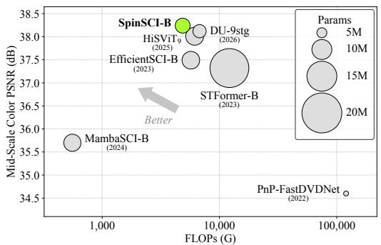

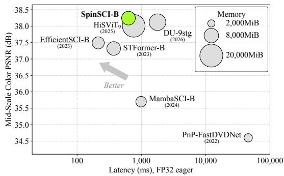  
Figure 1: Mid-scale color PSNR versus FLOPs (left) and FP32 eager inference latency (right) for all methods (Table 5). Circle diameter represents parameter count on the left and circle area represents peak allocated memory on the right.

High-speed imaging captures rapid motion but faces bandwidth, storage, and cost constraints (Song et al., 2025). Video snapshot compressive imaging (SCI) encodes multiple frames into one measure ment using time-varying masks, as in Coded Aperture Compressive Temporal Imaging (CACTI) (Llull et al., 2013). Reconstruction is therefore a severely underdetermined inverse problem related to compressed sensing (Candes et al., 2006; Donoho, 2006).

Prior model-based and learned methods (Liu et al., 2019; Qiao et al., 2020; Wang et al., 2021; Yuan et al., 2022; Wang et al., 2023a;b;c; Cao et al., 2024; Pan et al., 2024; Wang et al., 2025) improve reconstruction, yet spatial masking and temporal integration complicate detail recovery and frame separation (Wang et al., 2025). In attention-based reconstruction, logits encode feature affinity, while coding masks specify each frame’s contribution to the measurement. These cues motivate token refinement conditioned on sensing information.

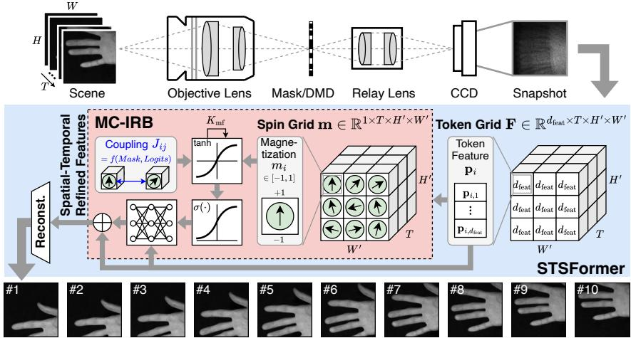  
Figure 2: Illustration of the SpinSCI video SCI pipeline. A single snapshot encoded by CACTI (Llull et al., 2013) is input to SpinSCI. In the Spatial-Temporal Spin Transformer (STSFormer), token features $\mathbf { p } _ { i }$ are extracted, and the Mask-Conditioned Ising Refinement Block (MC-IRB) performs differentiable mean-field inference for $K _ { \mathrm { m f } }$ steps to estimate magnetizations $m _ { i } \in [ - 1 , 1 ]$ , which are used to refine the spatial and temporal attention features. After post-processing, the video is reconstructed. Here, $d _ { \mathrm { f e a t } } = 2 5 6$ denotes the token feature width. # denotes the frame number and a representative example from the Hand dataset (Yuan et al., 2022) $( 5 1 2 \times 5 1 2 \times 4 0 )$ in the real benchmark is used at a compression rate of 10.

SpinSCI coordinates this refinement through Ising-model-inspired interactions. The Mask-Conditioned Ising Refinement Block (MC-IRB) derives signed couplings from pre-softmax attention logits and sensing inputs: the coding masks, normalized initial estimate, and mask normalizer. Local fields encode each token’s evidence; positive and negative couplings favor agreement and opposition between latent spins. Finite mean-field updates produce magnetizations that gate learned residual corrections to the attention output.

MC-IRB refines the parallel spatial and temporal branches of a Spatial-Temporal Spin Transformer (STSFormer). Physics-guided initialization and final data consistency incorporate the sensing model (Figure 2).

This work makes the following key contributions:

• SpinSCI introduces MC-IRB, which uses mask-conditioned positive and negative couplings to favor agreement and opposition between latent spins, respectively. Finite mean-field inference converts these interactions into spatial and temporal gates that guide residual feature corrections; removing the couplings or their signs lowers PSNR (Section 4.2).

• SpinSCI achieves competitive reconstruction quality on the small-scale gray, mid-scale color, and large-scale color benchmarks and the real benchmark, with low parameter counts, FLOPs, inference latency, and memory usage (Figure 1).

## 2 RELATED WORK

Vision Transformers. Self-attention (Vaswani et al., 2017) extends to images through ViT (Dosovit skiy et al., 2021) and Swin (Liu et al., 2021), and to video through local windows (Liu et al., 2022) or space–time factorization (Bertasius et al., 2021). Building on non-local similarity (Buades et al., 2005; Dabov et al., 2007; Dong et al., 2014), STFormer (Wang et al., 2023b) separates spatial and temporal attention into parallel branches. HiSViT (Wang et al., 2025) uses sequential cross-scale attention with pooled keys/values, hierarchical branches, and a gated self-modulated feed-forward network (FFN). SpinSCI combines parallel branches and pooled-key/value attention with mask-conditioned spin interactions for residual feature refinement.

Mask-Aware Reconstruction and Mask Co-Design. MetaSCI (Wang et al., 2021) uses exposurenormalized, mask-modulated inputs and per-mask parameter adaptation. Res2former (Wang et al., 2023c) jointly learns structural masks and reconstruction to improve dynamic range under temporal multiplexing. SpinSCI requires neither per-mask parameter updates nor physical-mask optimization. It conditions refinement on the supplied mask, normalized initial estimate, and mask normalizer to guide mask-awarefeature refinement during reconstruction.

Deep Unfolding and Further Related Work. Differential Unfolding (DU) (Zhang et al., 2026) alternates full reconstruction stages with lightweight stages that refine changes in intermediate representations; Table C.2 compares its published scores with our evaluation of the released ninestage checkpoint. Appendix E discusses deep unfolding, other learned video SCI methods, unrolled mean-field inference, energy-based, signed, and gated attention, and mask-conditioned reconstruction, and states how SpinSCI differs from each.

## 3 METHOD

## 3.1 OVERVIEW

Video SCI. A snapshot $\mathbf { y } \in \mathbb { R } ^ { H \times W }$ encodes T frames $\mathbf { x } _ { t } \in \mathbb { R } ^ { H \times W }$ through masks $\Phi _ { t }$ :

$$
\mathbf { y } = \sum _ { t = 1 } ^ { T } \Phi _ { t } \odot \mathbf { x } _ { t } + \mathbf { n } ,\tag{1}
$$

Here, $H , W$ are the spatial dimensions, t indexes frames, ⊙ denotes element-wise multiplication, and n is measurement noise.

Sensing and Learned Refinement. SpinSCI uses a learned prior to resolve temporal ambiguity. Initialization and final correction act in the measurement domain; MC-IRB conditions feature refinement on $\Phi _ { i }$ , the normalized initial estimate $\overline { { \mathbf { x } } } ^ { ( 0 ) }$ ), and mask normalizer $\Phi _ { s }$ . Throughout, $\epsilon = 1 0 ^ { - 8 }$

The initial estimate $\widehat { \mathbf { x } } ^ { ( 0 ) }$ and per-pixel mask normalizer Φ are constructed as described in Section 3.3. MC-IRB follows four steps: conditioning, signed-coupling construction, mean-field inference, and residual gating. Sections 3.2 and 3.3 define the refiner and its backbone integration (Figure 3).

## 3.2 MASK-CONDITIONED ISING REFINEMENT BLOCK (MC-IRB)

Following the Ising model of statistical physics, each post-attention token $\mathbf { p } _ { i } \in \mathbb { R } ^ { d _ { \mathrm { f e a t } } }$ carries a latent binary spin. A refinement group contains $n = 4 9$ spatial positions, including padding, or $n = T$ temporal positions. For spins $\mathbf { s } \in \{ - 1 , + 1 \} ^ { n }$ , pairwise couplings $J _ { i j }$ and local fields $h _ { i }$ define

$$
E ( \mathbf { s } ) = - \sum _ { i < j } J _ { i j } s _ { i } s _ { j } - \sum _ { i } h _ { i } s _ { i } .\tag{2}
$$

The energy is lower when spins joined by a positive coupling take the same sign, spins joined by a negative coupling take opposite signs, and each spin follows the sign of its field. Mean-field inference approximates each spin by its mean, the magnetization $m _ { i } \in [ - 1 , 1 ]$ , computed from its field and the magnetizations of its partners. These magnetizations determine refinement gates.

Physical Conditioning (BuildCond). Per-sample normalization controls the initial-estimate scale:

$$
\overline { { \mathbf { x } } } ^ { ( 0 ) } = \frac { \widehat { \mathbf { x } } ^ { ( 0 ) } } { \operatorname* { m a x } \bigl ( \operatorname* { m e a n } _ { t , h , w } | \widehat { \mathbf { x } } ^ { ( 0 ) } | , \epsilon \bigr ) } .\tag{3}
$$

Nearest-neighbor resizing preserves mask values; bilinear resizing maps the estimate and exposure normalizer to the token grid. After resizing, the normalizer is repeated across frames and concatenated with the mask and normalized initial estimate to form

$$
\mathbf { C } = \left[ \Phi _ { \downarrow } , \overline { { \mathbf { x } } } _ { \downarrow } ^ { ( 0 ) } , ( \Phi _ { s } ) _ { \downarrow } \right] , \qquad \mathbf { c } _ { i } = [ \phi _ { i } , u _ { i } , d _ { i } ] \in \mathbb { R } ^ { 3 } ,\tag{4}
$$

Here, ↓ denotes token-grid resizing, $u _ { i } = \bar { x } _ { i } ^ { ( 0 ) }$ , and $d _ { i } = \phi _ { s , i }$ . Shared across blocks, C supplies each token with its coding-mask value, normalized initial estimate, and spatial exposure normalizer.

(a)

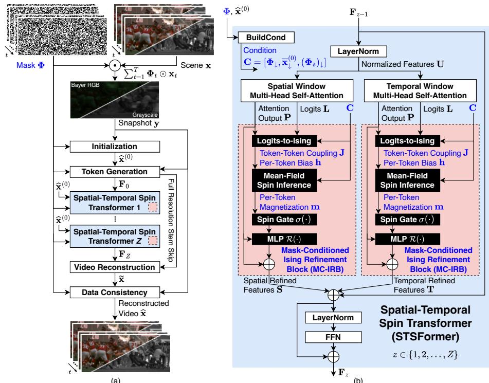  
Figure 3: Overall architecture of SpinSCI. (a) The snapshot y and coding masks Φ provide a physics-guided initialization $\widehat { \mathbf { x } } ^ { ( 0 ) }$ . Token generation is followed by Z STSFormer blocks and video reconstruction, with a full-resolution stem skip supplied to the decoder. A final data-consistency correction maps the decoder output xe to the reconstructed video xb. (b) Spatial and temporal attention operate in parallel. MC-IRB uses the shared conditioning tensor C and attention logits L to form signed spin interactions and generate gates for residual feature corrections. The spatial branch combines native and pooled-key/value heads; only native-resolution heads supply its MC-IRB logits. The refined branch outputs are combined with the input features, followed by a residual feed-forward module.

Logits-to-Ising. The two native spatial heads or all four temporal heads form H. The head-averaged logits are

$$
\overline { { \mathbf { L } } } = \frac { 1 } { \vert \mathcal { H } \vert } \sum _ { a \in \mathcal { H } } \mathbf { L } ^ { \left( a \right) } .\tag{5}
$$

Reusing pre-softmax logits ties refinement to affinities already computed for attention. Differences in sensing information define a penalty applied before centering:

$$
\Pi _ { i j } = \lambda _ { \phi } | \phi _ { i } - \phi _ { j } | + \lambda _ { u } | u _ { i } - u _ { j } | + \lambda _ { d } | d _ { i } - d _ { j } | .\tag{6}
$$

For valid-pair indicators $v _ { i j } = v _ { j i } \in \{ 0 , 1 \}$ with $v _ { i i } = 1$ , conditioned logits and row means are

$$
\widetilde { J } _ { i j } = v _ { i j } ( \overline { { L } } _ { i j } - \Pi _ { i j } ) , \qquad n _ { i } = \sum _ { j } v _ { i j } , \qquad \mu _ { i } = \frac { 1 } { n _ { i } } \sum _ { j } \widetilde { J } _ { i j } .\tag{7}
$$

Centering measures relative affinity; remasking, symmetrization, and diagonal removal produce valid, reciprocal interactions without self-coupling:

$$
J _ { i j } ^ { \mathrm { c t r } } = v _ { i j } ( \widetilde { J } _ { i j } - \mu _ { i } ) , \qquad J _ { i j } = \gamma v _ { i j } \mathbf { 1 } [ i \neq j ] \frac { J _ { i j } ^ { \mathrm { c t r } } + J _ { j i } ^ { \mathrm { c t r } } } { 2 } .\tag{8}
$$

The learned weights $\lambda _ { \phi } , \lambda _ { u } , \lambda _ { d }$ and scale γ are clamped nonnegative. Diagonal entries enter the row means before removal. The resulting signed J is symmetric, with zeros on the diagonal and at invalid token pairs; its rows need not sum to zero.

Mean-Field Spin Inference. Learned affine projections encode token and sensing evidence into initial magnetization and local field:

$$
\begin{array} { r } { m _ { i } ^ { ( 0 ) } = \operatorname { t a n h } \big ( \mathbf { w } _ { m } ^ { \top } [ \mathbf { p } _ { i } ; \mathbf { c } _ { i } ] + b _ { m } \big ) , \qquad h _ { i } = \mathbf { w } _ { h } ^ { \top } [ \mathbf { p } _ { i } ; \mathbf { c } _ { i } ] + b _ { h } , } \end{array}\tag{9}
$$

Here, $[ \cdot ; \cdot ]$ concatenates inputs, ${ \mathbf w } _ { h } , { \mathbf w } _ { m } \in \mathbb { R } ^ { d _ { \mathrm { f e a t } } + 3 }$ , and $b _ { h } , b _ { m } \in \mathbb { R } .$ . The field retains unary evidence at each update; learned initialization supplies an input-dependent starting state for finite-step inference.

With h and J fixed, $K _ { \mathrm { m f } }$ updates propagate interactions:

$$
m _ { i } ^ { ( \ell + 1 ) } = \operatorname { t a n h } \left( \beta \left[ h _ { i } + \sum _ { j } J _ { i j } m _ { j } ^ { ( \ell ) } \right] \right) , \qquad \ell = 0 , \dots , K _ { \mathrm { m f } } - 1 ,\tag{10}
$$

The learned $\beta \geq 0$ is clamped nonnegative. Positive couplings favor agreement between latent spins; negative couplings favor opposite signs. Invalid pairs contribute zero, and tanh bounds every iterate to $[ - 1 , 1 ]$ . The fixed update budget coordinates gates through pairwise evidence with predictable computation.

Spin Gate and Residual MLP. Final magnetizations control correction strength through

$$
g _ { i } = \sigma \Bigl ( \kappa m _ { i } ^ { ( K _ { \mathrm { m f } } ) } \Bigr ) , \qquad \sigma ( - \kappa ) \le g _ { i } \le \sigma ( \kappa ) ,\tag{11}
$$

where $\sigma$ is sigmoid and the learned $\kappa \geq 0$ is clamped nonnegative. The residual MLP R uses LayerNorm–Linear–GELU–Linear with 64 hidden units. Zero initialization of its final affine layer makes MC-IRB initially the identity:

$$
\mathbf { p } _ { i }  \mathbf { p } _ { i } + g _ { i } \mathcal { R } ( \mathbf { p } _ { i } ) .\tag{12}
$$

The MLP supplies a learned feature correction, and the gate regulates its strength. Within each branch, signed spin interactions make the gates of tokens in the same group depend on one another (Section 4.2). Residual addition preserves the attention output as the base. The correction magnitude $g _ { i } { \big | } | { \mathcal { R } } ( \mathbf { p } _ { i } ) { \big | } |$ depends on both gate and residual; $m _ { i } = 0 \mathrm { g i v e s } g _ { i } = 1 / 2$

Appendix A provides sensing and refinement proofs and specifies Lean verification coverage. Appendix B.5 shows that, in a trained temporal block, the magnetizations nearly minimize the pairwise term of Equation (2).

## 3.3 SPINSCI ARCHITECTURE

SpinSCI applies token generation, $Z = 9$ STSFormer blocks, decoding, and final data consistency to produce xb from $\widehat { \mathbf { x } } ^ { ( 0 ) }$ x(0).

Initialization. For $\begin{array} { r } { \mathcal { A } ( \mathbf { x } ; \boldsymbol { \Phi } ) = \sum _ { t } \Phi _ { t } \odot \mathbf { x } _ { t } , } \end{array}$ , an exposure-aware back-projection initializes the video:

$$
\begin{array} { r l } & { \widehat { \mathbf { x } } ^ { ( 0 ) } = \mathcal { A } ^ { \top } ( \mathbf { y } ; \pmb { \Phi } ) = \{ \pmb { \Phi } _ { t } \odot \mathbf { y } \} _ { t = 1 } ^ { T } , } \\ & { \widehat { \mathbf { x } } ^ { ( 0 ) }  \widehat { \mathbf { x } } ^ { ( 0 ) } + \mathcal { A } ^ { \top } ( \frac { \mathbf { y } - \mathcal { A } ( \widehat { \mathbf { x } } ^ { ( 0 ) } ; \pmb { \Phi } ) } { \pmb { \Phi } _ { s } + \epsilon } ; \pmb { \Phi } ) . } \end{array}\tag{13}
$$

The normalizer Φ is $\textstyle \sum _ { t } \Phi _ { t }$ with zeros replaced by one; it equals mask energy at binary-mask exposed pixels. Back-projection and exposure-normalized correction supply a sensing-informed starting point for learned reconstruction. Bayer initialization applies this operation independently on the four RGGB sub-grids before re-interleaving.

Token Generation. A 3D stem embeds $[ \widehat { \mathbf { x } } ^ { ( 0 ) } , \Phi , \mathbf { y } / ( \Phi _ { s } + \epsilon ) ]$ , with the normalized measurement repeated across frames, into 128-channel features. Spatial downsampling halves resolution and sets $d _ { \mathrm { f e a t } } = 2 5 6 \colon$

$$
{ \bf F } _ { 0 } \in \mathbb { R } ^ { d _ { \mathrm { f e a t } } \times T \times H ^ { \prime } \times W ^ { \prime } } , \qquad H ^ { \prime } = { \frac { H } { 2 } } , W ^ { \prime } = { \frac { W } { 2 } } .\tag{14}
$$

Joint embedding exposes coding and measurement information before attention. Downsampling reduces attention cost while preserving temporal length; full-resolution stem features supply a decoder skip. One $3 \times 3 \times 3$ convolution in each of the stem, downsampler, and decoder uses rank-32 factorization: a 32-channel convolution followed directly by $\mathrm { ~ a ~ } 1 \times 1 \times \mathrm { ~ 1 ~ }$ projection.

STSFormer. Following STFormer (Wang et al., 2023b), block z supplies $\mathbf { U } = \mathrm { L a y e r N o r m } ( \mathbf { F } _ { z - 1 } )$ to parallel spatial and temporal branches. The branches model complementary within-frame and across-frame dependencies before feature fusion.

The spatial branch uses four heads with key/value pooling factors (1, 1, 2, 4) (Wang et al., 2025). Across successive blocks, both native heads alternate between unshifted $7 \times 7$ windows and windows with three-token cyclic shifts to exchange information across window boundaries; M excludes wrap-around pairs (Liu et al., 2021). For native head a,

$$
\mathbf { L } ^ { ( a ) } = \frac { \mathbf { Q } ^ { ( a ) } ( \mathbf { K } ^ { ( a ) } ) ^ { \top } } { \sqrt { d _ { h } ^ { \mathrm { s p } } } } + \mathbf { B } ^ { ( a ) } + \mathbf { M } , \qquad \mathbf { P } ^ { ( a ) } = \mathrm { s o f t m a x } ( \mathbf { L } ^ { ( a ) } ) \mathbf { V } ^ { ( a ) } ,\tag{15}
$$

Here, Q, K, V are query/key/value projections and B is learned relative-position bias. The other heads retain queries at token-grid resolution and pool keys/values into $8 \times 8$ windows, broadening context with 64 keys per query and no cyclic shifts. Concatenated head outputs are projected to $d _ { \mathrm { f e a t } }$ Spatial MC-IRB uses only native-head logits, whose square matrices index the same tokens on both axes for pairwise spin interactions.

Temporal attention acts over $\mathbf { U } _ { h , w } \in \mathbb { R } ^ { T \times d _ { \mathrm { f e a t } } }$ , using four heads with total inner width $d _ { \mathrm { f e a t } } / 2$ to reduce projection and attention cost. Thus $d _ { h } ^ { \mathrm { s p } } = 6 4$ and $d _ { h } ^ { \mathrm { t m p } } = 3 2$ , with temporal logits

$$
\mathbf { L } ^ { ( a ) } = \frac { \mathbf { Q } ^ { ( a ) } ( \mathbf { K } ^ { ( a ) } ) ^ { \top } } { \sqrt { d _ { h } ^ { \mathrm { t m p } } } } + \mathbf { B } _ { \mathrm { t m p } } ^ { ( a ) } .\tag{16}
$$

The temporal relative-position bias $\mathbf { B } _ { \mathrm { t m p } } ^ { ( a ) } \in \mathbb { R } ^ { T \times T }$ is indexed by frame displacement from $2 T - 1$ learned values per head; no shifted-window mask applies. Temporal MC-IRB uses logits averaged across all four heads and refines the attention output projected to $d _ { \mathrm { f e a t } }$

Refined branch outputs S, T fuse before the residual FFN:

$$
\mathbf { F } _ { \mathrm { s t } } = \mathbf { F } _ { z - 1 } + \mathbf { S } + \mathbf { T } , \qquad \mathbf { F } _ { z } = \mathbf { F } _ { \mathrm { s t } } + \mathrm { F F N } ( \mathrm { L a y e r N o r m } ( \mathbf { F } _ { \mathrm { s t } } ) ) .\tag{17}
$$

The inverted residual FFN (Sandler et al., 2018) expands width to $2 d _ { \mathrm { f e a t } }$ , applies depthwise $3 \times 3 \times 3$ mixing, and projects back, with GELU after expansion and depthwise convolution. Pointwise layers mix channels, while depthwise convolution adds local space–time interactions at low cost.

Video Reconstruction. A transposed 3D convolution upsamples the final features; concatenation with the stem skip recovers local detail before grayscale/RGB decoding into $\widetilde { \mathbf { x } } .$ . The reported models are trained with the final reconstruction loss in Equation (21) alone, without intermediate supervision.

Data Consistency. Grayscale reconstruction corrects the decoder’s measurement mismatch:

$$
\widehat { \mathbf { x } } = \widetilde { \mathbf { x } } + \mathbf { \mathcal { A } } ^ { \top } \left( \frac { \mathbf { y } - \mathbf { \mathcal { A } } ( \widetilde { \mathbf { x } } ; \boldsymbol { \Phi } ) } { \boldsymbol { \Phi } _ { s } + \epsilon } ; \boldsymbol { \Phi } \right) .\tag{18}
$$

For exposed binary-mask pixels, this multiplies the measurement residual by $\epsilon / ( \Phi _ { s } + \epsilon )$ in exact arithmetic; zero-exposure pixels cannot be corrected.

For RGB output, B samples RGGB sites and $B ^ { \top }$ scatters corrections back:

$$
\begin{array} { r l } & { \mathbf { r } = \mathbf { y } - \boldsymbol { \mathcal { A } } ( \mathcal { B } \widetilde { \mathbf { x } } _ { \mathrm { r g b } } ; \boldsymbol { \Phi } ) , } \\ & { \widehat { \mathbf { x } } _ { \mathrm { r g b } } = \widetilde { \mathbf { x } } _ { \mathrm { r g b } } + \mathcal { B } ^ { \top } \boldsymbol { \mathcal { A } } ^ { \top } \left( \frac { \mathbf { r } } { \Phi _ { s } + \epsilon } ; \boldsymbol { \Phi } \right) . } \end{array}\tag{19}
$$

Only observed color sites change; other RGB values retain the decoder prediction.

## 3.4 COMPUTATIONAL COMPLEXITY

For $N = T H ^ { \prime } W ^ { \prime }$ tokens, spatial attention uses 49 native or 64 pooled keys per query. Temporal attention uses $T$ keys; each MC-IRB takes $K _ { \mathrm { m f } } = 3$ updates.

Sensing operations cost O(T HW). Fixed-width stem and decoder convolutions cost $O ( N d _ { \mathrm { f e a t } } ^ { 2 } )$

Attention, residual MLPs, and mean-field interactions give the Z-block cost

$$
O \big ( Z N \big [ d _ { \mathrm { f e a t } } ^ { 2 } + 6 4 d _ { \mathrm { f e a t } } + d _ { \mathrm { f e a t } } ( 4 9 + 6 4 + T ) + ( 1 + K _ { \mathrm { m f } } ) ( 4 9 + T ) \big ] \big ) .\tag{20}
$$

For fixed windows, spatial cost is linear in pixel count, while temporal attention is quadratic in $T .$ Counts include padding and full inference, excluding training-only heads; component costs appear in Appendix C.

## 4 EXPERIMENTS

## 4.1 EXPERIMENTAL SETUP

Datasets. Training uses DAVIS2017 (Pont-Tuset et al., 2017). Evaluation covers six small-scale gray, six mid-scale color, and four large-scale color sequences (Yuan et al., 2022; Wang et al., 2023a;b; Pan et al., 2024). The real benchmark includes Hand (Yuan et al., 2022), Water Balloon, Domino (Qiao et al., 2020), and Pendulum Ball. Dimensions and protocols are in Appendix C.

Evaluation Metrics. PSNR and SSIM (Wang et al., 2004) are computed using the evaluation code provided by Yuan et al. (2021); efficiency is assessed by parameter count, FLOPs, inference latency, and peak memory.

Efficiency Measurement. All methods use FP32 eager inference on an NVIDIA GH200 with batch size 1 and $T = 8 .$ . Gray and mid-scale color latency is the CUDA-synchronized median for one full frame. Large-scale latency is estimated as 24 times the median for one tile. Peak allocated GPU memory is measured over the same frame or tile. One multiply–accumulate counts as one FLOP. Appendix C.1 reports the BF16 compiled comparison.

Implementation Details. PyTorch training uses four NVIDIA H200 GPUs. SpinSCI-B uses the architecture in Section 3.3, $\dot { K } _ { \mathrm { m f } } = 3 .$ , and a 64-unit residual MLP.

Training uses 200 epochs, with 256 × 256 gray crops (global batch 10) and $5 1 2 \times 5 1 2$ color crops (global batch 2). Muon (Jordan et al., 2024) updates eligible matrix weights and Adam (Kingma & Ba, 2015) the remainder, with cosine learning-rate decay from $2 \times 1 0 ^ { - 4 } { \mathrm { t o } } 1 0 ^ { - 6 }$ . The MSE loss (Cao et al., 2024) is

$$
\mathcal { L } _ { \mathrm { M S E } } = \frac { 1 } { T C _ { \mathrm { o u t } } H W } \left. \widehat { \mathbf { x } } - \mathbf { x } \right. _ { F } ^ { 2 } ,\tag{21}
$$

where $C _ { \mathrm { o u t } } = 1$ for gray and 3 for RGB. BF16/FP32 mixed precision (Micikevicius et al., 2018) accelerates training; gradient clipping (Pascanu et al., 2013) stabilizes optimization.

## 4.2 ABLATION STUDIES

Ablations test spatial/temporal refinement, interacting gates, and explicit mask conditioning. Appendix B provides additional comparisons, control definitions, and the repeated-run protocol.

Controlled Protocol. Variants share DAVIS2017 (Pont-Tuset et al., 2017), 80 epochs, batch 20, 128 × 128 crops, seed 2447, loss, optimizer, schedule, initialization, stem skip, and final data consistency. EMA weights are tested on six midscale color sequences at compression rate 8. All models use nine blocks except the ten-block capacity control.

Table 1: Spatial and temporal MC-IRB ablation at 80 epochs, seed 2447. Efficiency uses $5 1 \dot { 2 } \times 5 1 2$ inputs, $T = 8 ,$ , and BF16 compiled inference (Appendix C.1).
<table><tr><td>Spatial MC-IRB</td><td>Temporal MC-IRB</td><td>PSNR (dB)</td><td>Params (M)</td><td>FLOPs (G)</td><td>Latency (ms)</td><td>Memory (MiB)</td></tr><tr><td>-</td><td>-</td><td>36.68</td><td>6.86</td><td>4528</td><td>117</td><td>4280</td></tr><tr><td>-</td><td>√</td><td>36.91</td><td>7.16</td><td>4690</td><td>134</td><td>4282</td></tr><tr><td>√</td><td>-</td><td>36.84</td><td>7.16</td><td>4694</td><td>135</td><td>4282</td></tr><tr><td>√</td><td>V</td><td>37.07</td><td>7.47</td><td>4856</td><td>150</td><td>4284</td></tr></table>

Spatial and Temporal Refinement. Compared with the backbone without MC-IRB, spatial-only and temporal-only refinement improve PSNR by 0.16 and 0.23 dB; combining both yields a 0.39 dB gain (Table 1). The full model uses 8.9% more parameters and 7.2% more FLOPs than the backbone.

Interactions, Gates, and Capacity. MC-IRB improves PSNR over fixed, conditioned, and fieldonly gates by 0.29, 0.20, and 0.23 dB (Table 2). Setting J = 0 retains the nonlinear field-to-gate mapping and reduces PSNR by 0.21 dB; replacing J with |J| reduces it by 0.14 dB while preserving entrywise coupling magnitudes. These comparisons support adaptive signed interactions. The tenblock backbone remains 0.20 dB lower despite slightly higher parameter and FLOP counts. At the released full-training checkpoint, permuting the temporal couplings or replacing them with |J| lowers mid-scale color PSNR by 1.04 and 0.80 dB (Appendix B.5).

Iteration Count. Three mean-field updates exceed one by 0.09 dB and match five at this training budget, supporting the selected $K _ { \mathrm { m f } } = 3 ( \mathrm { T a b l e } 2 )$ .

Table 2: Complete MC-IRB design comparisons at 80 epochs. Table B.2 reports sample SDs and paired intervals for selected rows. $\Delta$ is full-model PSNR minus variant PSNR, in dB. FLOPs follow the THOP convention in Appendix C; equal counts do not imply equal executed computation.
<table><tr><td>Variant</td><td>PSNR (dB)</td><td> $\Delta$ </td><td>Params (M)</td><td>FLOPs (G)</td></tr><tr><td>Full MC-IRB,  $K _ { \mathrm { m f } } = 3$ </td><td>37.07</td><td></td><td>7.47</td><td>4856</td></tr><tr><td>Without  ${ \bf M C } { \bf - I R B }$ </td><td>36.68</td><td>+0.39</td><td>6.86</td><td>4528</td></tr><tr><td>Without MC-IRB,  $Z = 1 0$ </td><td>36.87</td><td>+0.20</td><td>7.53</td><td>4880</td></tr><tr><td>Residual MLP, fixed  $g _ { i } = 1 / 2$ </td><td>36.78</td><td>+0.29</td><td>7.46</td><td>4851</td></tr><tr><td>Conditioned gate without mean-field inference</td><td>36.87</td><td>+0.20</td><td>7.47</td><td>4856</td></tr><tr><td>Sigmoid gate on h only</td><td>36.84</td><td>+0.23</td><td>7.47</td><td>4856</td></tr><tr><td> $\bar { K _ { \mathrm { m f } } } = 0$ </td><td>36.81</td><td>+0.26</td><td>7.47</td><td>4856</td></tr><tr><td>No interactions,  $\mathbf { J } = 0$ </td><td>36.86</td><td>+0.21</td><td>7.46</td><td>4853</td></tr><tr><td>Unsigned couplings, existing control</td><td>36.93</td><td>+0.14</td><td>7.47</td><td>4856</td></tr><tr><td>Entrywise |J| control</td><td>36.93</td><td>+0.14</td><td>7.47</td><td>4856</td></tr><tr><td> $K _ { \mathrm { m f } } = 1$ </td><td>36.98</td><td>+0.09</td><td>7.47</td><td>4856</td></tr><tr><td> $K _ { \mathrm { m f } } = 5$ </td><td>37.07</td><td>0.00</td><td>7.47</td><td>4856</td></tr><tr><td>No pairwise conditioning in J</td><td>36.90</td><td>+0.17</td><td>7.47</td><td>4856</td></tr><tr><td>No unary conditioning in h and  $\mathbf { m } ^ { ( 0 ) }$ </td><td>36.89</td><td>+0.18</td><td>7.47</td><td>4856</td></tr><tr><td>Mask penalty off,  $\lambda _ { \phi } = 0$ </td><td>36.96</td><td>+0.11</td><td>7.47</td><td>4856</td></tr><tr><td>Initial-estimate penalty off,  ${ \lambda } _ { u } = 0$ </td><td>36.95</td><td>+0.12</td><td>7.47</td><td>4856</td></tr><tr><td>No row-centering</td><td>37.03</td><td>+0.04</td><td>7.47</td><td>4856</td></tr><tr><td>No symmetrization</td><td>37.06</td><td>+0.01</td><td>7.47</td><td>4856</td></tr></table>

Sensing Context. Removing pairwise or unary conditioning reduces PSNR by 0.17 and 0.18 dB; removing the mask or initial-estimate penalty gives 0.11 and 0.12 dB reductions. These comparisons support sensing context in both pairwise compatibilities and unary spin states.

Centering and Symmetry. Removing row-centering or symmetrization changes PSNR by only 0.04 or 0.01 dB, respectively. Their principal rationale remains structural: centering expresses affinity relative to a valid row’s mean, while symmetrization defines reciprocal couplings for an undirected Ising energy.

Training Budget. Gains over the backbone without MC-IRB persist at 40/80/200 epochs (0.45/0.39/0.37 dB; Appendix B.1).

Explicit Mask Conditioning. Removing mask channels reduces PSNR by 0.13–0.19 dB on the training mask and 0.30–0.38 dB on the unseen binary mask (Table 3). The larger transfer gaps support explicit conditioning beyond the mask-dependent initialization and final correction retained by all controls.

Table 3: Mask-conditioning and operator comparisons, PSNR in dB. Rows give the training configuration and columns the test mask. All channel-removal variants retain the correct masks in initialization and final data consistency. Appendix B.2 describes the operators.
<table><tr><td>Configuration</td><td>Benchmark binary</td><td>Unseen binary</td><td>Gaussian</td></tr><tr><td>Full model</td><td>37.07</td><td>37.07</td><td>18.08</td></tr><tr><td>Φ, Φs removed from C</td><td>36.94</td><td>36.77</td><td></td></tr><tr><td>Also removed from the stem input</td><td>36.88</td><td>36.69</td><td>一</td></tr><tr><td>Training with random binary masks</td><td>37.10</td><td></td><td></td></tr><tr><td>Training with per-sample Gaussian masks</td><td>27.12</td><td>27.13</td><td>35.96</td></tr></table>

The full model keeps 37.07 dB on the unseen binary mask, and each checkpoint performs best on the operator family it was trained with: 37.07 dB for binary training on binary masks and 35.96 dB for Gaussian training on Gaussian masks. Training with random binary masks improves PSNR by 0.03 dB to 37.10 dB.

Repeatability. Across five training seeds, the full model obtains 37.07 ± 0.10 dB (mean ± sample SD). Paired gains over field-only gating, $\mathbf { J } = 0 ,$ and |J| are 0.26, 0.24, and 0.19 dB, with pointwise 95% intervals above zero. Appendix B.4 details the paired protocol and interval assumptions.

Table 4: Reconstruction quality and computational cost on the small-scale gray benchmark at compression rate 8. Latency and peak memory use FP32 eager inference for all methods. The best and second-best PSNR/SSIM are bold and underlined, respectively.
<table><tr><td rowspan="2">Method</td><td colspan="4">Params FLOPs Latency Memory</td><td rowspan="2">Aerial</td><td rowspan="2">Crash PSNR SSIM PSNR SSIM PSNR SSIM PSNR SSIM PSNR SSIM PSNR SSIM PSNR SSIM</td><td rowspan="2">Drop</td><td rowspan="2">Kobe</td><td rowspan="2">Runner</td><td rowspan="2">Traffic</td><td rowspan="2">Average</td></tr><tr><td>(M)</td><td>(G)</td><td>(ms)</td><td>(MiB)</td></tr><tr><td>PnP-FastDVDNet</td><td>2.48</td><td>29605</td><td>2834</td><td>842</td><td>27.980.897</td><td>27.32 0.925</td><td>41.82 0.989</td><td>32.73 0.947</td><td>36.29 0.962</td><td>27.95 0.932</td><td>32.350.942</td></tr><tr><td>EfficientSCI-B</td><td>8.82</td><td>1424</td><td>50</td><td>1382</td><td>31.50 0.953</td><td>31.13 0.971</td><td>45.18 0.995</td><td>35.76 0.974</td><td>43.05 0.988</td><td>32.30 0.968</td><td>36.480.975</td></tr><tr><td>STFormer-B</td><td>19.49</td><td>3060</td><td>83</td><td>1883</td><td>31.56 0.953</td><td>31.06 0.970</td><td>45.080.995</td><td>35.53 0.973</td><td>42.64 0.988</td><td>32.15 0.967</td><td>36.34 0.974</td></tr><tr><td>HiSViT9</td><td>8.99</td><td>1536</td><td>178</td><td>4904</td><td>31.67 70.957</td><td>31.62 0.976</td><td>45.55 0.995</td><td>36.24 0.976</td><td>43.84 0.991</td><td>33.06 0.973</td><td>37.00 0.978</td></tr><tr><td>DU-9stg</td><td>6.67</td><td>1690</td><td>437</td><td>2647</td><td>32.27 0.961</td><td>32.47 0.978</td><td>45.99 0.995</td><td>36.51 10.978</td><td>44.75 0.991</td><td>33.45 0.974</td><td>37.57 0.980</td></tr><tr><td>SpinSCI-B</td><td>7.47</td><td>1214</td><td>132</td><td>1850</td><td>33.48 0.967</td><td>32.83 0.978</td><td>45.67 0.995</td><td>35.71 0.974</td><td>43.87 0.991</td><td>33.50 0.973</td><td>37.51 0.980</td></tr></table>

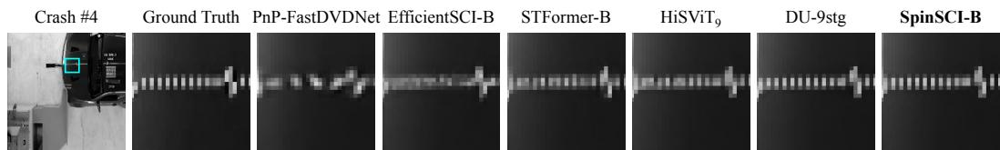  
Figure 4: Qualitative comparison on frame 4 of the Crash sequence from the small-scale gray benchmark. The first panel shows the full ground-truth frame with the selected region marked in cyan. Subsequent panels show enlarged crops using nearest-neighbor interpolation.

Table 5: Reconstruction quality and computational cost on the mid-scale color benchmark at compression rate 8. Latency and peak memory use FP32 eager inference for all methods. The best and second-best PSNR/SSIM are bold and underlined, respectively.
<table><tr><td rowspan="2">Method</td><td colspan="4">Params FLOPs Latency Memory</td><td rowspan="2">Beauty</td><td rowspan="2">Bosphorus</td><td rowspan="2">Jockey</td><td rowspan="2">Runner</td><td rowspan="2">ShakeNDry</td><td rowspan="2">Traffic</td><td rowspan="2">Average 1 PSNR SSIM PSNR SSIM PSNR SSIM PSNR SSIM PSNR SSIM PSNR SSIM</td></tr><tr><td>(M)</td><td>(G)</td><td>(ms)</td><td>PSNR SSIM</td></tr><tr><td>PnP-FastDVDNet</td><td>2.48 120077</td><td></td><td>45907</td><td>2664</td><td>35.27 0.972</td><td>37.24 0.978</td><td>35.63 0.950</td><td>38.22 0.965</td><td>33.71 0.969</td><td>27.49 0.915</td><td>34.600.955</td></tr><tr><td>EfficientSCI-B</td><td>8.83</td><td>5702</td><td>213</td><td>5570</td><td>37.51 0.979</td><td>40.89 0.988</td><td>38.49 0.969</td><td>42.73 0.985</td><td>35.19 0.953</td><td>30.13 0.943</td><td>37.49 0.970</td></tr><tr><td>MambaSCI-B</td><td>8.59</td><td>557</td><td>990</td><td>4206</td><td>36.95 0.979</td><td>38.62 0.982</td><td>36.54 0.960</td><td>40.02 0.977</td><td>34.55 0.950</td><td>27.52 0.904</td><td>35.70 0.959</td></tr><tr><td>STFormer-B</td><td>19.49</td><td>12156</td><td>371</td><td>7081</td><td>37.37 0.981</td><td>40.39 0.988</td><td>38.32 0.968</td><td>42.45 0.985</td><td>35.15 0.956</td><td>30.24 0.939</td><td>37.32 0.970</td></tr><tr><td>HiSViT9</td><td>8.99</td><td>6146</td><td>760</td><td>19462</td><td>37.75 0.981</td><td>41.50 0.990</td><td>39.29 0.972</td><td>43.270.986</td><td>35.490.958</td><td>30.76 0.946</td><td>38.010.972</td></tr><tr><td>DU-9stg</td><td>6.67</td><td>6763</td><td>1781</td><td>10517</td><td>37.90 0.981</td><td>41.65 0.990</td><td>39.31 0.973</td><td>43.55 0.987</td><td>35.72 0.960</td><td>30.560.945</td><td>38.120.973</td></tr><tr><td>SpinSCI-B</td><td>7.47</td><td>4856</td><td>630</td><td>7151</td><td>38.04 0.982</td><td>42.05 0.991</td><td>39.30 0.973</td><td>43.51 0.987</td><td>35.83 0.961</td><td>30.72 0.945</td><td>38.24 0.973</td></tr></table>

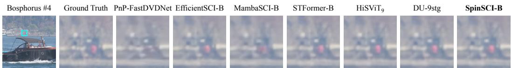  
Figure 5: Qualitative comparison on frame 4 of the Bosphorus sequence from the mid-scale color benchmark. The first panel shows the full ground-truth frame with the selected region marked in cyan. Subsequent panels show enlarged crops using nearest-neighbor interpolation.

Learned Temporal Interactions. At the fixed checkpoint, removing temporal couplings reduces PSNR by 0.101 dB, while replacing them with their entrywise absolute values or a validity-preserving permutation reduces PSNR by 0.795 and 1.036 dB, respectively (Table B.3). The permutation preserves coupling symmetry and spectrum. These results support the functional contribution of coupling signs and token correspondence to temporal refinement.

## 4.3 COMPARISON WITH STATE-OF-THE-ART METHODS

Baselines. Comparisons include PnP-FastDVDNet (Yuan et al., 2022), EfficientSCI-B (Wang et al., 2023a), MambaSCI-B (Pan et al., 2024), STFormer-B (Wang et al., 2023b), HiSViT9 (Wang et al., 2025), and DU-9stg (Zhang et al., 2026). MambaSCI is designed for quad-Bayer measurements and has no reported grayscale scores.

Quantitative and Qualitative Results. Tables 4 to 6 report PSNR/SSIM and computational cost. Small-scale gray and mid-scale color baseline scores come from the respective papers; evaluated on our masks, the official HiSViT checkpoints reproduce their reported PSNR within 0.005 dB. For DU-9stg on mid-scale color, the measured PSNR/SSIM are used because the measured mean PSNR is 0.18 dB below the reported value. Large-scale color scores use the released checkpoints. Appendix C details the quality and profiling protocols.

Table 6: Large-scale color at compression rate 8. All methods use FP32 eager inference. Latency is estimated as 24 times the single-tile median. Memory is the single-tile peak. Best and second-best PSNR/SSIM are bold and underlined.
<table><tr><td>Method</td><td colspan="3">Params FLOPs Latency Memory</td><td></td><td>Football</td><td>Hummingbird</td><td></td><td>Messi</td><td>Swinger</td><td>Average</td></tr><tr><td></td><td>(M)</td><td>(G)</td><td>(ms)</td><td>(MiB)</td><td>PSNR SSIM</td><td>1 PSNR</td><td></td><td></td><td></td><td>SSIM PSNR SSIM PSNR SSIM PSNR SSIM</td></tr><tr><td>PnP-FastDVDNet</td><td></td><td>2.48 956866</td><td>369528</td><td>891</td><td>37.42 0.982</td><td>38.51</td><td>0.979</td><td>33.54 0.979</td><td>28.26 0.930</td><td>34.430.967</td></tr><tr><td>EfficientSCI-B</td><td>8.83</td><td>45100</td><td>1634</td><td>1841</td><td>40.33 0.989</td><td>40.41</td><td>0.974</td><td>34.85 0.974</td><td>29.450.940</td><td>36.26 0.969</td></tr><tr><td>MambaSCI-B</td><td>8.59</td><td>4405</td><td>7673</td><td>1309</td><td>35.910.974</td><td>31.67</td><td>0.641</td><td>29.09 0.923</td><td>27.01 0.900</td><td>30.92 0.859</td></tr><tr><td>STFormer-B</td><td>19.49</td><td>96071</td><td>2616</td><td>2416</td><td>40.640.990</td><td>40.43</td><td>0.974</td><td>34.870.976</td><td>29.590.943</td><td>36.380.971</td></tr><tr><td>HiSViT9</td><td>8.99</td><td>48977</td><td>8377 14814</td><td>6503</td><td>42.25 0.993</td><td>41.48</td><td>0.989</td><td>36.39 0.986</td><td>30.43 0.954</td><td>37.640.980</td></tr><tr><td>DU-9stg</td><td>6.67</td><td>53893 38402</td><td>4200</td><td>3731</td><td>42.34 0.993 2424 41.68 0.992</td><td>41.99</td><td>0.991</td><td>36.71 0.986</td><td>30.16 0.950</td><td>37.80 0.980</td></tr><tr><td>SpinSCI-B</td><td>7.47</td><td></td><td></td><td></td><td></td><td>41.99</td><td>0.992</td><td>37.07 0.987</td><td>29.98 0.947</td><td>37.68 0.979</td></tr></table>

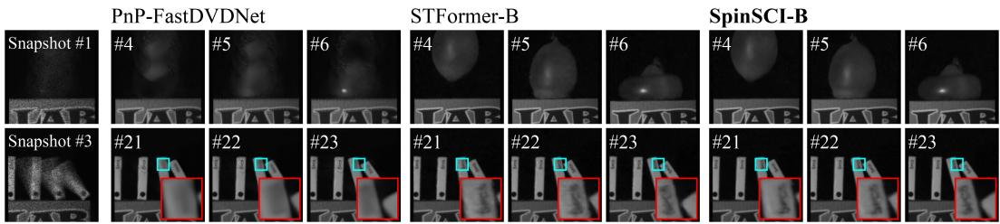  
Figure 6: Qualitative comparison on Water Balloon (Qiao et al., 2020) (512 × 512 × 10) and Domino (Qiao et al., 2020) (512 × 512 × 60) in the real benchmark at compression rate 10. # denotes the frame number. Only baselines with officially released real-data checkpoints are shown.

Compared with HiSViT , SpinSCI-B achieves average PSNR gains of 0.51 and 0.23 dB on smallscale gray and mid-scale color, and comparable PSNR on large-scale color (+0.04 dB), with 16.9% fewer parameters, 21.0–21.6% fewer FLOPs, 17.1–49.9% lower FP32 eager latency, and 62.3–63.3% lower peak memory. Relative to DU-9stg, SpinSCI-B’s average PSNR differs by at most 0.13 dB across these benchmarks, with more parameters (7.47M versus 6.67M), 28.2–28.7% fewer FLOPs, 64.6–71.7% lower inference latency, and 30.1–35.0% lower peak memory.

Figures 4 to 6 show representative reconstructions. Figures D.20–D.22 in Appendix D cover all gray/color sequences. The displayed DU-9stg reconstructions use the shared-mask evaluation described in Appendix C.

Full-frame reconstructed videos for datasets in the real benchmark at compression rates of 10 and 50 are shown as frame sequences in Appendices D.1–D.2.

Limitations. The current MC-IRB implementation materializes pre-softmax attention logits to construct spin couplings, limiting direct compatibility with FlashAttention-style kernels (Dao et al., 2022). However, SpinSCI-B achieves fewer FLOPs, lower inference latency, and lower peak memory than HiSViT9 and DU-9stg with comparable PSNR.

## 5 CONCLUSION

SpinSCI combines visual affinity and sensing information through signed spin interactions. Finite mean-field inference coordinates residual refinement within the spatial and temporal branches, while physics-guided initialization and final data consistency incorporate the sensing model. Formal analysis establishes coupling symmetry, bounded magnetizations and gates, and binary-mask measurementresidual reduction. Benchmark comparisons show higher PSNR than HiSViT9 on small-scale gray and mid-scale color (comparable on large-scale color) with fewer parameters, comparable PSNR to DU-9stg, and fewer FLOPs, lower inference latency, and lower peak memory than both methods.

## AI USE STATEMENT

Generative AI tools were used to assist with writing and checking formatting compliance. The authors reviewed all AI-assisted changes and take responsibility for the final content of this work, including text, claims, and artifacts produced with the aid of generative AI.

## ETHICS STATEMENT

This work uses public video snapshot compressive imaging datasets and standard benchmark protocols and does not involve human subjects or private data. The authors have read and commit to the ICLR Code of Ethics.

## REPRODUCIBILITY STATEMENT

The model architecture, mask-conditioned refinement computations, and data-consistency operations are specified in Section 3. Section 4.1 describes the datasets, training settings, loss, evaluation metrics, and efficiency protocol; Sections 4.2 and 4.3 describe the ablation and comparison settings. Appendices A–D provide proofs and verification coverage, additional ablations and statistical reporting, implementation details, and qualitative comparisons, respectively. Appendix E extends the related-work discussion. Code and reference checkpoints are available at github.com/skethz/SpinSCI.

## REFERENCES

Shaojie Bai, J. Zico Kolter, and Vladlen Koltun. Deep Equilibrium Models. In NeurIPS, 2019.

Gedas Bertasius, Heng Wang, and Lorenzo Torresani. Is Space-Time Attention All You Need for Video Understanding? In ICML, pp. 813–824, 2021.

A. Buades, B. Coll, and J. M. Morel. A Review of Image Denoising Algorithms, with a New One. Multiscale Modeling & Simulation, 4(2):490–530, 2005. doi: 10.1137/040616024.

Yuanhao Cai, Jing Lin, Xiaowan Hu, Haoqian Wang, Xin Yuan, Yulun Zhang, Radu Timofte, and Luc Van Gool. Mask-guided Spectral-wise Transformer for Efficient Hyperspectral Image Reconstruction. In CVPR, pp. 17502–17511, 2022a.

Yuanhao Cai, Jing Lin, Haoqian Wang, Xin Yuan, Henghui Ding, Yulun Zhang, Radu Timofte, and Luc Van Gool. Degradation-Aware Unfolding Half-Shuffle Transformer for Spectral Compressive Imaging. In NeurIPS, 2022b.

E.J. Candes, J. Romberg, and T. Tao. Robust Uncertainty Principles: Exact Signal Reconstruction From Highly Incomplete Frequency Information. IEEE Transactions on Information Theory, 52 (2):489–509, 2006. doi: 10.1109/TIT.2005.862083.

Miao Cao, Lishun Wang, Mingyu Zhu, and Xin Yuan. Hybrid CNN-Transformer Architecture for Efficient Large-Scale Video Snapshot Compressive Imaging. IJCV, 132(10):4521–4540, 2024. doi: 10.1007/s11263-024-02101-y.

Ziheng Cheng, Ruiying Lu, Zhengjue Wang, Hao Zhang, Bo Chen, Ziyi Meng, and Xin Yuan. BIRNAT: Bidirectional Recurrent Neural Networks with Adversarial Training for Video Snapshot Compressive Imaging. In ECCV, pp. 258–275, 2020.

Ziheng Cheng, Bo Chen, Guanliang Liu, Hao Zhang, Ruiying Lu, Zhengjue Wang, and Xin Yuan. Memory-Efficient Network for Large-scale Video Compressive Sensing. In CVPR, pp. 16246– 16255, 2021.

Kostadin Dabov, Alessandro Foi, Vladimir Katkovnik, and Karen Egiazarian. Image Denoising by Sparse 3-D Transform-Domain Collaborative Filtering. IEEE TIP, 16(8):2080–2095, 2007. doi: 10.1109/TIP.2007.901238.

Tri Dao, Daniel Y. Fu, Stefano Ermon, Atri Rudra, and Christopher Ré. FlashAttention: Fast and Memory-Efficient Exact Attention with IO-Awareness. In Advances in Neural Information Processing Systems (NeurIPS), 2022. doi: 10.52202/068431-1189.

Weisheng Dong, Guangming Shi, Xin Li, Yi Ma, and Feng Huang. Compressive Sensing via Nonlocal Low-Rank Regularization. IEEE TIP, 23(8):3618–3632, 2014. doi: 10.1109/TIP.2014.2329449.

D.L. Donoho. Compressed Sensing. IEEE Transactions on Information Theory, 52(4):1289–1306, 2006. doi: 10.1109/TIT.2006.871582.

Alexey Dosovitskiy, Lucas Beyer, Alexander Kolesnikov, Dirk Weissenborn, Xiaohua Zhai, Thomas Unterthiner, Mostafa Dehghani, Matthias Minderer, Georg Heigold, Sylvain Gelly, Jakob Uszkoreit, and Neil Houlsby. An Image is Worth 16x16 Words: Transformers for Image Recognition at Scale. In ICLR, 2021.

Xiaochen Han, Bo Wu, Zheng Shou, Xiao-Yang Liu, Yimeng Zhang, and Linghe Kong. Tensor FISTA-Net for Real-Time Snapshot Compressive Imaging. In AAAI, volume 34, pp. 10933–10940, 2020. doi: 10.1609/aaai.v34i07.6726.

Benjamin Hoover, Yuchen Liang, Bao Pham, Rameswar Panda, Hendrik Strobelt, Duen Horng Chau, Mohammed J. Zaki, and Dmitry Krotov. Energy Transformer. In NeurIPS, 2023.

Keller Jordan, Yuchen Jin, Vlado Boza, Jiacheng You, Franz Cesista, Laker Newhouse, and Jeremy Bernstein. Muon: An Optimizer for Hidden Layers in Neural Networks, 2024.

Diederik P Kingma and Jimmy Ba. Adam: A Method for Stochastic Optimization. In ICLR, 2015. doi: 10.48550/arXiv.1412.6980.

Lean project. Lean 4, version 4.33.1. Official versioned release, 2026.

Yang Liu, Xin Yuan, Jinli Suo, David J. Brady, and Qionghai Dai. Rank Minimization for Snapshot Compressive Imaging. IEEE TPAMI, 41(12):2990–3006, 2019. doi: 10.1109/TPAMI.2018. 2873587.

Ze Liu, Yutong Lin, Yue Cao, Han Hu, Yixuan Wei, Zheng Zhang, Stephen Lin, and Baining Guo. Swin Transformer: Hierarchical Vision Transformer using Shifted Windows. In ICCV, pp. 9992–10002, 2021. doi: 10.1109/ICCV48922.2021.00986.

Ze Liu, Jia Ning, Yue Cao, Yixuan Wei, Zheng Zhang, Stephen Lin, and Han Hu. Video Swin Transformer. In CVPR, pp. 3192–3201, 2022. doi: 10.1109/CVPR52688.2022.00320.

Ziwei Liu, Xiaoxiao Li, Ping Luo, Chen Change Loy, and Xiaoou Tang. Semantic Image Segmentation via Deep Parsing Network. In ICCV, pp. 1377–1385, 2015.

Patrick Llull, Xuejun Liao, Xin Yuan, Jianbo Yang, David Kittle, Lawrence Carin, Guillermo Sapiro, and David J. Brady. Coded Aperture Compressive Temporal Imaging. Opt. Express, 21(9): 10526–10545, May 2013. doi: 10.1364/OE.21.010526.

Ruiying Lu, Ziheng Cheng, Bo Chen, and Xin Yuan. Motion-Aware Dynamic Graph Neural Network for Video Compressive Sensing. IEEE TPAMI, 46(12):7850–7866, 2024. doi: 10.1109/TPAMI. 2024.3395804.

Jiawei Ma, Xiao-Yang Liu, Zheng Shou, and Xin Yuan. Deep Tensor ADMM-Net for Snapshot Compressive Imaging. In ICCV, pp. 10222–10231, 2019. doi: 10.1109/ICCV.2019.01032.

Ziyi Meng, Xin Yuan, and Shirin Jalali. Deep Unfolding for Snapshot Compressive Imaging. IJCV, 131(11):2933–2958, 2023. doi: 10.1007/s11263-023-01844-4.

Paulius Micikevicius, Sharan Narang, Jonah Alben, Gregory Diamos, Erich Elsen, David Garcia, Boris Ginsburg, Michael Houston, Oleksii Kuchaiev, Ganesh Venkatesh, and Hao Wu. Mixed Precision Training. In ICLR, 2018. doi: 10.48550/arXiv.1710.03740.

Zhenghao Pan, Haijin Zeng, Jiezhang Cao, Yongyong Chen, Kai Zhang, and Yong Xu. MambaSCI: Efficient Mamba-UNet for Quad-Bayer Patterned Video Snapshot Compressive Imaging. In NeurIPS, 2024. doi: 10.52202/079017-2544.

Razvan Pascanu, Tomas Mikolov, and Yoshua Bengio. On the difficulty of training Recurrent Neural Networks. In ICML, pp. 1310–1318, 2013. doi: 10.48550/arXiv.1211.5063.

Jordi Pont-Tuset, Federico Perazzi, Sergi Caelles, Pablo Arbeláez, Alex Sorkine-Hornung, and Luc Van Gool. The 2017 DAVIS Challenge on Video Object Segmentation. arXiv:1704.00675, 2017. doi: 10.48550/arXiv.1704.00675.

Mu Qiao, Ziyi Meng, Jiawei Ma, and Xin Yuan. Deep learning for video compressive sensing. APL Photonics, 5(3):030801, 03 2020. doi: 10.1063/1.5140721.

Zihan Qiu, Zekun Wang, Bo Zheng, Zeyu Huang, Kaiyue Wen, Songlin Yang, Rui Men, Le Yu, Fei Huang, Suozhi Huang, Dayiheng Liu, Jingren Zhou, and Junyang Lin. Gated Attention for Large Language Models: Non-linearity, Sparsity, and Attention-Sink-Free. In NeurIPS, 2025.

Hubert Ramsauer, Bernhard Schäfl, Johannes Lehner, Philipp Seidl, Michael Widrich, Lukas Gruber, Markus Holzleitner, Thomas Adler, David Kreil, Michael K. Kopp, Günter Klambauer, Johannes Brandstetter, and Sepp Hochreiter. Hopfield Networks is All You Need. In ICLR, 2021.

Mark Sandler, Andrew Howard, Menglong Zhu, Andrey Zhmoginov, and Liang-Chieh Chen. MobileNetV2: Inverted Residuals and Linear Bottlenecks. In CVPR, pp. 4510–4520, 2018.

Yunfeng Song, Mengyuan Liu, and Xin Yuan. Deep learning based video snapshot compressive imaging of Leidenfrost droplets. iOptics, 1(2):100020, 2025. doi: 10.1016/j.iopt.2025.100020.

The mathlib community. mathlib4, version 4.33.1. Official versioned source, 2026.

Ashish Vaswani, Noam Shazeer, Niki Parmar, Jakob Uszkoreit, Llion Jones, Aidan N Gomez, Łukasz Kaiser, and Illia Polosukhin. Attention is All you Need. In NeurIPS, volume 30, 2017.

Lishun Wang, Miao Cao, and Xin Yuan. EfficientSCI: Densely Connected Network with Space-time Factorization for Large-scale Video Snapshot Compressive Imaging. In CVPR, pp. 18477–18486, 2023a. doi: 10.1109/CVPR52729.2023.01772.

Lishun Wang, Miao Cao, Yong Zhong, and Xin Yuan. Spatial-Temporal Transformer for Video Snapshot Compressive Imaging. IEEE TPAMI, 45(7):9072–9089, 2023b. doi: 10.1109/TPAMI. 2022.3225382.

Ping Wang, Lishun Wang, and Xin Yuan. Deep Optics for Video Snapshot Compressive Imaging. In ICCV, pp. 10612–10622, 2023c. doi: 10.1109/ICCV51070.2023.00977.

Ping Wang, Yulun Zhang, Lishun Wang, and Xin Yuan. Hierarchical Separable Video Transformer for Snapshot Compressive Imaging. In Computer Vision – ECCV 2024, pp. 104–122. Springer, 2025. doi: 10.1007/978-3-031-73004-7\_7.

Zhengjue Wang, Hao Zhang, Ziheng Cheng, Bo Chen, and Xin Yuan. MetaSCI: Scalable and Adaptive Reconstruction for Video Compressive Sensing. In CVPR, pp. 2083–2092, 2021. doi: 10.1109/CVPR46437.2021.00212.

Zhou Wang, A.C. Bovik, H.R. Sheikh, and E.P. Simoncelli. Image Quality Assessment: From Error Visibility to Structural Similarity. IEEE TIP, 13(4):600–612, 2004. doi: 10.1109/TIP.2003.819861.

Zhuoyuan Wu, Jian Zhang, and Chong Mou. Dense Deep Unfolding Network with 3D-CNN Prior for Snapshot Compressive Imaging. In ICCV, pp. 4872–4881, 2021. doi: 10.1109/ICCV48922. 2021.00485.

Jianbo Yang, Xin Yuan, Xuejun Liao, Patrick Llull, David J. Brady, Guillermo Sapiro, and Lawrence Carin. Video Compressive Sensing Using Gaussian Mixture Models. IEEE TIP, 23(11):4863–4878, 2014. doi: 10.1109/TIP.2014.2344294.

Tianzhu Ye, Li Dong, Yuqing Xia, Yutao Sun, Yi Zhu, Gao Huang, and Furu Wei. Differential Transformer. In ICLR, 2025.

Jianfu Yin, Nan Wang, Binliang Hu, Yao Wang, and Quan Wang. Degradation-Aware Deep Unfolding Network with Transformer Prior for Video Compressive Imaging. Signal Processing, 227:109660, 2025. doi: 10.1016/j.sigpro.2024.109660.

Xin Yuan, David J. Brady, and Aggelos K. Katsaggelos. Snapshot Compressive Imaging: Theory, Algorithms, and Applications. IEEE Signal Processing Magazine, 38(2):65–88, 2021. doi: 10.1109/MSP.2020.3023869.

Xin Yuan, Yang Liu, Jinli Suo, Frédo Durand, and Qionghai Dai. Plug-and-Play Algorithms for Video Snapshot Compressive Imaging. IEEE TPAMI, 44(10):7093–7111, 2022. doi: 10.1109/ TPAMI.2021.3099035.

Muyuan Zhang, Jiancheng Zhang, Haijin Zeng, and Yin-Ping Zhao. Differential Unfolding: Efficient Unfolding Reconstruction for Video Snapshot Compressive Imaging. arXiv preprint arXiv:2606.24153, 2026.

Shuai Zheng, Sadeep Jayasumana, Bernardino Romera-Paredes, Vibhav Vineet, Zhizhong Su, Dalong Du, Chang Huang, and Philip H. S. Torr. Conditional Random Fields as Recurrent Neural Networks. In ICCV, pp. 1529–1537, 2015.

Siming Zheng and Xin Yuan. Unfolding Framework with Prior of Convolution-Transformer Mixture and Uncertainty Estimation for Video Snapshot Compressive Imaging. In ICCV, pp. 12692–12703, 2023. doi: 10.1109/ICCV51070.2023.01170.

## A MATHEMATICAL PROPERTIES OF SPINSCI

This appendix analyzes the sensing operator, data-consistency correction, and Mask-Conditioned Ising Refinement Block (MC-IRB). The analysis follows SpinSCI with nine transformer blocks, conditioning on the back-projected initialization, three mean-field updates per refiner, and a final data consistency correction with unit step size. All theorems concern exact real arithmetic. Reconstruction quality remains an empirical property of the learned prior.

The companion Lean development (Lean project, 2026; The mathlib community, 2026) checks the identities and conditional results identified in Section A.8. Mathematical assumptions are stated separately from implementation observations.

Notation. The derivations omit boldface from vector and tensor symbols used in the main paper. The operators $\mathcal { A } _ { \Phi } x$ and $\mathcal { A } _ { \Phi } ^ { \top } y$ denote $\mathcal { A } ( \mathbf { x } ; \Phi )$ and $\boldsymbol { \mathcal { A } } ^ { \top } ( \mathbf { y } ; \boldsymbol { \Phi } )$ , respectively. The initial estimate is written as $x ^ { ( 0 ) } = \widehat { \mathbf { x } } ^ { ( 0 ) }$ , and its normalized version as $u = \overline { { \mathbf { x } } } ^ { ( 0 ) }$ . For the current binary masks, the supplied normalizer d corresponds to $\Phi _ { s } ; D$ denotes the mask energy before the zero-exposure safeguard. The generic correction $z \mapsto z ^ { + }$ specializes to the main paper’s final grayscale update with $z = { \bf \bar { x } } , z ^ { + } = { \widehat { \bf x } } .$ , and $\alpha = 1$ . For color reconstruction, X and $X ^ { + }$ correspond to $\widetilde { \mathbf { x } } _ { \mathrm { r g b } }$ and $\widehat { \mathbf { x } } _ { \mathrm { r g l } }$

## A.1 SENSING, ADJOINT, AND MASK NORMALIZATION

Let Ω be the spatial pixel set and $t \in \{ 1 , \ldots , T \}$ index frames. A grayscale or mosaic video is $\boldsymbol { x } \in \mathbb { R } ^ { T \times | \Omega | }$ and its measurement is $y \in \mathbb { R } ^ { | \Omega | }$ . For fixed masks Φ,

$$
( \mathcal { A } _ { \Phi } x ) _ { p } = \sum _ { t } \Phi _ { t , p } x _ { t , p } , \qquad ( \mathcal { A } _ { \Phi } y ) _ { t , p } = \Phi _ { t , p } y _ { p } , \qquad D _ { p } = \sum _ { t } \Phi _ { t , p } ^ { 2 } .\tag{A.1}
$$

Proposition A.1 (Adjoint and diagonal measurement operator). Under the standard Euclidean inner products,

$$
\langle \mathcal { A } _ { \Phi } x , y \rangle = \langle x , \mathcal { A } _ { \Phi } ^ { \top } y \rangle , \qquad ( \mathcal { A } _ { \Phi } \mathcal { A } _ { \Phi } ^ { \top } y ) _ { p } = D _ { p } y _ { p } .\tag{A.2}
$$

Furthermore, $D _ { p } \geq 0 ,$ andfor binary masks $\begin{array} { r } { D _ { p } = \sum _ { t } \Phi _ { t , p } . } \end{array}$

Proof. The first identity follows by interchanging the finite sums: $\begin{array} { r l } { \sum _ { p } ( \sum _ { t } \Phi _ { t , p } x _ { t , p } ) y _ { p } } & { = } \end{array}$ $\begin{array} { r } { \sum _ { p , t } x _ { t , p } \big ( \Phi _ { t , p } y _ { p } \big ) } \end{array}$ . Substituting the adjoint into the forward operator gives $\begin{array} { r } { \sum _ { t } \dot { \Phi } _ { t , p } ( \Phi _ { t , p } y _ { p } ) = D _ { p } y _ { p } } \end{array}$ The remaining statements follow from nonnegativity of squares and $b ^ { 2 } = b$ for $b \in \{ 0 , 1 \}$ □

The implementation computes the sum of mask values and replaces a zero sum by one. For binary masks this supplied normalizer is

$$
d _ { p } = \left\{ \begin{array} { l l } { D _ { p } , } & { D _ { p } > 0 , } \\ { 1 , } & { D _ { p } = 0 . } \end{array} \right.\tag{A.3}
$$

Thus the code’s normalizer is distinguished from the true energy D at unexposed pixels. For nonbinary masks, using the sum of squared mask values with the same zero-exposure safeguard preserves the unit-step residual factor derived below. The results first allow a supplied d with positive denominators and then specialize to binary masks.

## A.2 DATA CONSISTENCY AND INITIALIZATION

For $\epsilon > 0$ and a supplied normalizer satisfying $d _ { p } + \epsilon > 0$ at every pixel, define a correction of an arbitrary estimate z by

$$
z ^ { + } = z + \alpha \mathcal { A } _ { \Phi } ^ { \top } \left( \frac { y - \mathcal { A } _ { \Phi } z } { d + \epsilon } \right) .\tag{A.4}
$$

Division is pixelwise. This is a measurement-domain preconditioned correction; it is also a gradient step for the weighted quadratic with weight diag $( ( d + \epsilon ) ^ { - 1 } )$ .

Proposition A.2 (Exact residual update). For $r = y - A _ { \Phi } z$

$$
r _ { p } ^ { + } = \left( 1 - \frac { \alpha D _ { p } } { d _ { p } + \epsilon } \right) r _ { p } .\tag{A.5}
$$

$I f 0 \le \alpha D _ { p } / ( d _ { p } + \epsilon ) \le 2$ at every pixel, then $| r _ { p } ^ { + } | \leq | r _ { p } | ;$ , and hence $\lVert \boldsymbol { r } ^ { + } \rVert _ { 2 } \leq \lVert \boldsymbol { r } \rVert _ { 2 }$ . With binary masks and the current $\alpha = 1$ , exposed pixels satisfy

$$
r _ { p } ^ { + } = \frac { \epsilon } { D _ { p } + \epsilon } r _ { p } , \qquad 0 < \frac { \epsilon } { D _ { p } + \epsilon } < 1 .\tag{A.6}
$$

At $D _ { p } = 0 ,$ , the measurement residual is unchanged.

Proof. Applying $\mathcal { A } _ { \Phi }$ to Equation $( \mathsf { A } . 4 )$ and using $\mathcal { A } _ { \Phi } \mathcal { A } _ { \Phi } ^ { \top } = \mathrm { d i a g } ( D )$ yields Equation (A.5). For $q \in [ 0 , 2 ] , | 1 - q | \leq 1 \}$ ; multiplication by $\left| r _ { p } \right|$ gives the pointwise inequality. Squaring and summing gives the Euclidean inequality. If $D _ { p } > 0 , \dot { d } _ { p } = D _ { p }$ and $1 - D _ { p } / ( \bar { D _ { p } } + \bar { \epsilon } ) = \bar { \epsilon } / ( \bar { D _ { p } } + \epsilon ) \in ( 0 , 1 \bar { ) }$ When $D _ { p } = 0$ , the multiplier in Equation (A.5) equals one. □

Remark A.3 (Scope and bounded nonbinary masks). For $0 \leq \Phi _ { t , p } \leq 1 , \Phi _ { t , p } ^ { 2 } \leq \Phi _ { t , p }$ gives $0 \leq$ $D _ { p } \ \leq \ d _ { p }$ under mask-sum normalization with zero sums replaced by one. Thus $\alpha = 1$ yields $0 \dot { \leq } D _ { p } \dot { / } ( d _ { p } + \epsilon ) < 1$ , and Proposition A.2 ensures residual nonincrease. The guarantee concerns the explicit correction; $\epsilon > 0$ need not give exact measurement consistency, and residual reduction does not certify clean-video recovery, particularly under measurement noise. Positive learned step sizes alone do not ensure the proposition’s upper bound; SpinSCI uses fixed $\alpha = 1$

The initializer uses $z = A _ { \Phi } ^ { \top } y$ followed by a unit correction. Its residual is therefore

$$
y _ { p } - ( A _ { \Phi } x ^ { ( 0 ) } ) _ { p } = \left( 1 - \frac { D _ { p } } { d _ { p } + \epsilon } \right) ( 1 - D _ { p } ) y _ { p } .\tag{A.7}
$$

This follows by inserting $\mathcal { A } _ { \Phi } z \ : = \ : D y$ into Equation (A.5). In the idealized case $\epsilon = 0$ , with $d _ { p } = D _ { p } > 0$ , the initializer reduces to $x _ { t , p } ^ { ( 0 ) } = \Phi _ { t , p } y _ { p } / D _ { p }$ . Neither form can identify the temporal decomposition uniquely without additional prior information.

## A.3 BAYER SAMPLING AND RGB CORRECTION

Let $c ( p ) \in \{ R , G , B \}$ specify the RGGB color sampled at pixel p. Define the color-sampling operator B and its adjoint by

$$
\begin{array} { r } { ( \boldsymbol { B } \boldsymbol { X } ) _ { t , p } = \boldsymbol { X } _ { c ( p ) , t , p } , \qquad ( \boldsymbol { B } ^ { \top } \boldsymbol { \delta } ) _ { c , t , p } = \mathbf { 1 } [ c = c ( p ) ] \delta _ { t , p } . } \end{array}\tag{A.8}
$$

Consequently $B B ^ { \top } = I$ on mosaic videos. For a prior RGB output X with mosaic $z = B X$ , let $z ^ { + }$ be its corrected mosaic and set $X ^ { + } = X + B ^ { \top } ( z ^ { \top } - z )$

Proposition A.4 (Observed-channel correction). The corrected RGB estimate satisfies $B X ^ { + } = z ^ { + }$ and $\mathbf { \bar { \chi } } _ { c , t , p } ^ { + } = X _ { c , t , p }$ whenever $c \neq c ( p )$ . Its measurement residual under $\mathcal { A } _ { \Phi } \mathcal { B }$ obeys Equation (A.5).

Proof. Sampling the scattered correction returns $z ^ { + } - z$ because exactly one color is selected at each pixel. Thus $\bar { B } \bar { X ^ { + } } = z + ( z ^ { + } - z ) = z ^ { + }$ . The scatter is zero in all other channels. Applying the forward operator to this equality gives the residual claim. □

The four-subgrid initializer is the same pixelwise initialization after a permutation of pixel indices; it does not mix the RGGB subgrids. The current implementation requires even spatial dimensions for this rearrangement.

## A.4 CONDITIONING AND COUPLING CONSTRUCTION

For the active back-projection conditioning mode, define the per-sample scale and conditioning signal before spatial interpolation as

$$
a = \operatorname* { m a x } \left( \frac { 1 } { T | \Omega | } \sum _ { t , p } | x _ { t , p } ^ { ( 0 ) } | , \epsilon \right) , \quad \quad u _ { t , p } = x _ { t , p } ^ { ( 0 ) } / a .\tag{A.9}
$$

Token features have width $d _ { \mathrm { f e a t } } = 2 5 6$ , and C denotes the main paper’s conditioning tensor. After nearest-neighbor resizing of Φ and bilinear resizing of $u , d ,$ a token receives $c _ { i } = [ \bar { \phi _ { i } } , u _ { i } , d _ { i } ] \in \mathbb { R } ^ { 3 }$ The order is relevant to the learned projections. The variable called lambda\_res in the code weights differences of u in this mode.

Let n denote the number of token positions in one refinement group. The active configuration uses $n = 4 9$ in each spatial window (including padding where needed) and $n = T$ in each temporal sequence. For one such group, let $v _ { i j } \in \{ 0 , 1 \}$ be the valid-pair indicator, with $v _ { i j } = v _ { j i }$ and $v _ { i i } = 1$ The active configuration has signed coupling, symmetrization enabled, and top-k sparsification disabled. Spatial logits are averaged over the two native-resolution heads; pooled-head logits are not used to construct the spatial Ising matrix. Temporal logits are averaged over all four temporal heads. Writing this head average as ${ \overline { { L } } } ,$

$$
\Pi _ { i j } = \lambda _ { \phi } | { \phi } _ { i } - { \phi } _ { j } | + \lambda _ { u } | u _ { i } - u _ { j } | + \lambda _ { d } | d _ { i } - d _ { j } | ,\tag{A.10}
$$

$$
\widetilde { J } _ { i j } = v _ { i j } ( \overline { { L } } _ { i j } - \Pi _ { i j } ) , \qquad n _ { i } = \sum _ { j } v _ { i j } , \qquad \mu _ { i } = \frac { 1 } { n _ { i } } \sum _ { j } \widetilde { J } _ { i j } ,\tag{A.11}
$$

$$
J _ { i j } ^ { \mathrm { c t r } } = v _ { i j } ( \widetilde { J } _ { i j } - \mu _ { i } ) , \qquad J _ { i j } = \gamma v _ { i j } \mathbf { 1 } [ i \neq j ] \frac { J _ { i j } ^ { \mathrm { c t r } } + J _ { j i } ^ { \mathrm { c t r } } } { 2 } .\tag{A.12}
$$

The parameters $\lambda _ { \phi } , \lambda _ { u } , \lambda _ { d } , \gamma$ denote effective nonnegative values obtained by clamping learned scalars. The diagonal is included in centering and removed subsequently. A finite negative attention mask sentinel is replaced by zero on invalid pairs before centering.

Proposition A.5 (Coupling invariants). Each centered intermediate row satisfies $\begin{array} { r } { \sum _ { j } J _ { i j } ^ { \mathrm { c t r } } = 0 } \end{array}$ . The final matrix has $J _ { i i } = 0 , J _ { i j } = 0 i f v _ { i j } = 0$ , and $J = J ^ { \top }$ . Itsfinal row sums need not vanish.

Proof. Since $n _ { i } \geq 1$ , summation over valid pairs subtracts exactly $n _ { i } \mu _ { i }$ , which equals the row sum of ${ \cal \tilde { J } }$ . The two final indicators set the diagonal and invalid pairs to zero. Symmetry follows from $v _ { i j } = v _ { j i }$ and $J _ { i j } ^ { \mathrm { c t r } } + J _ { j i } ^ { \mathrm { c t r } } = J _ { j i } ^ { \mathrm { c t r } } + J _ { i j } ^ { \mathrm { c t r } }$ . For a counterexample to zero final row sums, consider three mutually valid tokens, $\overline { { L } } = 0 , \gamma = \lambda _ { u } = 1$ , other penalty weights zero, and $\boldsymbol { u } = ( 0 , 0 , 1 )$ ). Direct evaluation gives

$$
J = \left( \begin{array} { c c c } { { 0 } } & { { 1 / 3 } } & { { - 1 / 2 } } \\ { { 1 / 3 } } & { { 0 } } & { { - 1 / 2 } } \\ { { - 1 / 2 } } & { { - 1 / 2 } } & { { 0 } } \end{array} \right) , \qquad \sum _ { j } J _ { 1 j } = - 1 / 6 .\tag{A.13}
$$

This matrix and the nonzero row sum are also checked in Lean.

Remark $_ { \mathrm { A } . 6 }$ (Interpretation of the pairwise penalty). Before symmetrization, the change due to a penalty $\Pi _ { i j }$ is relative to its valid-row average $\boldsymbol { \mu } _ { i } ^ { \Pi }$ . Let $\mu _ { i } ^ { L }$ denote the corresponding average of $\overline { { L } } _ { i j }$ Then $( \overline { { L } } _ { i j } - \Pi _ { i j } ) - ( \mu _ { i } ^ { L } - \mu _ { i } ^ { \Pi } ) = ( \overline { { L } } _ { i j } - \mu _ { i } ^ { L } ) - ( \Pi _ { i j } - \overline { { \mu } } _ { i } ^ { \Pi } )$ . Thus a larger raw disagreement term does not imply that every final signed coupling becomes smaller in magnitude. The example above even creates a positive coupling from zero logits. The construction supports attractive and repulsive latent-spin interactions.

## A.5 ISING INTERPRETATION AND MEAN-FIELD STATIONARITY

For fixed h, J during one refiner, define spins $s _ { i } \in \{ - 1 , + 1 \}$ , energy and Gibbs law

$$
E ( s ) = - \sum _ { i } h _ { i } s _ { i } - \frac { 1 } { 2 } \sum _ { i , j } J _ { i j } s _ { i } s _ { j } , \qquad p ( s ) = \mathcal { Z } ^ { - 1 } e ^ { - \beta E ( s ) } , \quad \beta \ge 0 .\tag{A.14}
$$

Since $J$ is symmetric with zero diagonal, $\begin{array} { r } { \frac { 1 } { 2 } \sum _ { i , j } J _ { i j } s _ { i } s _ { j } = \sum _ { i < j } J _ { i j } s _ { i } s _ { j } } \end{array}$ , so this energy equals the main paper’s Hamiltonian. The partition function $\begin{array} { r } { \mathcal { Z } = \sum _ { s \in \{ - 1 , + 1 \} ^ { n } } e ^ { - \beta E ( s ) } } \end{array}$ is positive since it is a finite sum of positive terms. For a factorized distribution $\begin{array} { r } { { \dot { q } } ( s ) \equiv \prod _ { i } q _ { i } ( s _ { i } ) } \end{array}$ with interior means $m _ { i } \in ( - 1 , 1 )$ , let

$$
q _ { i } ( \pm 1 ) = \frac { 1 \pm m _ { i } } { 2 } , \qquad \psi ( t ) = \frac { 1 + t } { 2 } \log \frac { 1 + t } { 2 } + \frac { 1 - t } { 2 } \log \frac { 1 - t } { 2 } .\tag{A.15}
$$

Expanding $\mathrm { K L } ( q \| p )$ yields, up to log $\mathcal { Z }$

$$
\mathcal { F } ( m ) = - \beta \sum _ { i } h _ { i } m _ { i } - \frac { \beta } { 2 } \sum _ { i , j } J _ { i j } m _ { i } m _ { j } + \sum _ { i } \psi ( m _ { i } ) .\tag{A.16}
$$

Indeed, factorization gives $\begin{array} { r } { \mathbb E _ { q } [ \log q ] = \sum _ { i } \psi ( m _ { i } ) } \end{array}$ and $\mathbb { E } _ { q } [ s _ { i } s _ { j } ] = m _ { i } m _ { j }$ for $i \neq j ;$ the diagonal terms are absent. This finite Gibbs-to-variational expansion is a written derivation. The Lean coverage concerns the scalar stationarity result below and the symmetry identity used in its interaction field.

Proposition A.7 (Mean-field self-consistency). Every interior stationary point ofEquation (A.16) satisfies

$$
m _ { i } = \operatorname { t a n h } \left( \beta \left( h _ { i } + \sum _ { j } J _ { i j } m _ { j } \right) \right) .\tag{A.17}
$$

Forfixed other means, this is the unique stationary value ofcoordinate $i .$

Proof. Symmetry and a zero diagonal make the coordinate derivative

$$
\frac { \partial \mathcal { F } } { \partial m _ { i } } = - \beta \left( h _ { i } + \sum _ { j } J _ { i j } m _ { j } \right) + \frac { 1 } { 2 } \log \frac { 1 + m _ { i } } { 1 - m _ { i } } .\tag{A.18}
$$

Setting it to zero and solving the log-odds equation gives the displayed tanh identity. The second coordinate derivative is $1 / ( 1 ^ { - } - m _ { i } ^ { 2 } ) ^ { - } > 0 \mathrm { o n } ( - 1 , 1 )$ , so there is only one stationary coordinate value. Alternatively, the probabilities proportional to $e ^ { x } , e ^ { - x }$ have mean tanh x and log odds $2 x ,$ where $x = \beta ( h _ { i } + \textstyle \sum _ { j } J _ { i j } m _ { j } )$ □

A simultaneous update of every coordinate is the synchronous mean-field iteration implemented by MC-IRB. Coordinate stationarity does not imply that each synchronous iteration decreases the variational objective.

## A.6 FINITE-STEP BOUNDS AND RESIDUAL GATES

Given fixed feature and conditioning vectors $[ p _ { i } ; c _ { i } ] .$ , the refiner uses

$$
h _ { i } = w _ { h } ^ { \top } [ p _ { i } ; c _ { i } ] + b _ { h } ,
$$

$$
m _ { i } ^ { ( 0 ) } = \operatorname { t a n h } ( \boldsymbol { w } _ { m } ^ { \top } [ p _ { i } ; c _ { i } ] + b _ { m } ) ,\tag{A.19}
$$

$$
m _ { i } ^ { ( \ell + 1 ) } = \mathrm { t a n h } \left( \beta \big ( h _ { i } + \sum _ { j } J _ { i j } m _ { j } ^ { ( \ell ) } \big ) \right) , \qquad g _ { i } = \sigma \big ( \kappa m _ { i } ^ { ( K _ { \mathrm { m f } } ) } \big ) ,\tag{A.20}
$$

where σ denotes the sigmoid function, the effective $\beta , \kappa \geq 0$ are clamped learned scalars, and $K _ { \mathrm { m f } } = 3$ in the current configuration.

Proposition A.8 (Bounds and identity initialization). Every finite real mean-field iterate lies in $( - 1 , { 1 } ) ^ { n }$ . In particular,

$$
\sigma ( - \kappa ) \leq g _ { i } \leq \sigma ( \kappa ) , \qquad m _ { i } = 0 \implies g _ { i } = 1 / 2 .\tag{A.21}
$$

For the token-wise residual $M L P \ \mathcal { R } ( p _ { i } )$ and any norm homogeneous over real scalars,

$$
\| p _ { i } + g _ { i } \mathcal { R } ( p _ { i } ) - p _ { i } \| = g _ { i } \| \mathcal { R } ( p _ { i } ) \| .\tag{A.22}
$$

When the final affine layer of R has zero weights and zero bias, the refinement block is exactly the identity.

Proof. tanh maps every finite real argument into $( - 1 , 1 )$ , covering the initializer and all subsequent iterations by induction. Multiplying $m _ { i } \in [ - 1 , 1 ]$ by $\kappa \geq 0 \mathrm { g i v e s } - \kappa \leq \kappa m _ { i } \leq \kappa ;$ monotonicity of σ gives the gate interval. Its value at zero is $1 / 2$ . The norm equality follows by homogeneity and positivity of $g _ { i } . \mathsf { A }$ zero final affine map gives $\mathcal { R } ( p _ { i } ) = 0$ regardless of the gate. □

At initialization, $\kappa = 1$ gives approximate bounds 0.269 and 0.731. These numerical limits are not fixed throughout training because κ is learned. A neutral magnetization does not close the gate, and ordering gates alone does not order correction magnitudes across different tokens.

## A.7 A SUFFICIENT CONDITION FOR MEAN-FIELD CONVERGENCE

For the fixed mean-field map $f ( m ) = \operatorname { t a n h } ( \beta ( h + J m ) )$ , with coordinatewise tanh and the induced Euclidean operator norm $\| \bar { J } \| _ { 2 }$

$$
\| f ( m ) - f ( \widetilde { m } ) \| _ { 2 } \leq \beta \| J \| _ { 2 } \| m - \widetilde { m } \| _ { 2 } .\tag{A.23}
$$

Theorem A.9 (Conditional convergence). $I f q = \beta \| J \| _ { 2 } < 1$ , then $f$ has a uniquefixed point $m ^ { \star }$ and its iterates converge to m⋆ from every initialization. Moreover,

$$
\| f ^ { K } ( m ^ { ( 0 ) } ) - m ^ { \star } \| _ { 2 } \leq q ^ { K } \| m ^ { ( 0 ) } - m ^ { \star } \| _ { 2 } .\tag{A.24}
$$

Proof. The scalar derivative tanh $\operatorname { \mathrm { \Omega } } ^ { \prime } ( a ) = 1 / \cosh ^ { 2 } ( a )$ lies in [0, 1], so scalar tanh is 1-Lipschitz. Squaring and summing the coordinate bounds gives 1-Lipschitz continuity in the Euclidean norm. Composition with the affine map yields the preceding bound. The contraction mapping theorem on the complete finite-dimensional Euclidean space gives existence, uniqueness, and convergence. Iterating the Lipschitz inequality against the fixed point yields the geometric error bound. □

Appendix B.5 evaluates this condition on the trained checkpoints. Regardless of $q ,$ finite mean-field outputs remain bounded as in Proposition A.8.

## A.8 FORMAL VERIFICATION COVERAGE

<table><tr><td>Lean module</td><td>Checked content</td></tr><tr><td>Physics</td><td>Finite sensing/adjoint identities; mask energy; exact residual update; pointwise nonincrease; unit-step residual factor; initialization residual; selected-color scatter and sampling.</td></tr><tr><td>Couplings</td><td>Valid-row centering; zero diagonal; invalid-pair exclusion; symmetry; centered- penalty algebra; exact three-token counterexamples.</td></tr><tr><td>Ising</td><td>Binary probabilities and tanh mean; entropy derivative; scalar stationary-point equivalence; symmetric interaction-field identity.</td></tr><tr><td>Bounds</td><td>Magnetization/gate bounds; neutral gate; gated-residual norm; zero-residual identity.</td></tr><tr><td>Stability</td><td>Scalar/vector Lipschitz bounds; Euclidean matrix action; finite-step error bound; unique fixed point and convergence under  $\beta \| J \| _ { 2 } < 1 \quad$ </td></tr></table>

The proof project pins Lean 4.33.1 and mathlib 4.33.1. Its verification script builds every module and audits the transitive axioms of every named theorem, allowing only the standard foundations propext, Classical.choice, and Quot.sound. The archive contains the source, dependency manifest, verification script, and audit report. The full finite Gibbs-to-variational reduction, full-image summation of the pointwise sensing bounds, and coordinatewise assembly of the Bayer operator are explained in the written proofs; their primitive identities are checked as described in the table.

Separate local CPU probes instantiate the copied grayscale and color source, check operator identities, and confirm masked-coupling invariants. These probes use random tensors and the Conv3d feedforward path. They do not verify trained checkpoints, reconstruction accuracy, CUDA/Triton kernels, mixed-precision numerical behavior, or the complete training program.

## B ABLATION RESULTS AND CONFIRMATORY PROTOCOL

This appendix presents additional training-budget and mask comparisons, control definitions, the repeated-run protocol, and fixed-checkpoint mechanism diagnostics.

## B.1 TRAINING BUDGET

The MC-IRB design comparisons and shared protocol are reported in Section 4.2. Table B.1 compares the full model and the backbone without MC-IRB at three training budgets.

Table B.1: Full-model and no-MC-IRB PSNR at three training budgets. All rows follow the controlled protocol of Section 4.2 (128 × 128 crops), varying only the number of epochs; Table 5 uses the full training setting with 512 × 512 color crops. ∆ is full-model PSNR minus no-MC-IRB PSNR, in dB.
<table><tr><td>Training epochs</td><td>Full PSNR</td><td>No-MC-IRB PSNR</td><td>∆</td></tr><tr><td>40</td><td>35.27</td><td>34.82</td><td>+0.45</td></tr><tr><td>80</td><td>37.07</td><td>36.68</td><td>+0.39</td></tr><tr><td>200</td><td>38.11</td><td>37.74</td><td>+0.37</td></tr></table>

The full-model advantage is 0.45, 0.39, and 0.37 dB at 40, 80, and 200 epochs (Table B.1). The gain persists under the shared schedule.

## B.2 MASK CONDITIONING AND OPERATOR SHIFT

The mask-conditioning comparisons are reported in Table 3 (Section 4.2). Removing explicit channels does not remove all mask information: the initial estimate and the final correction still depend on the coding masks. Consequently, these variants test the incremental value of explicit channels beyond the retained sensing operations.

Table 3 separates a new mask realization from a new operator distribution. Both checkpoints change by at most 0.01 dB between the benchmark binary mask and the unseen binary mask, and the full model keeps 37.07 dB on both. Each checkpoint performs best on the operator family it was trained with: binary training gives the best binary results, and Gaussian training gives 35.96 dB on the Gaussian mask.

Nonbinary Operators. For nonbinary masks, the mask energy is $\begin{array} { r } { D _ { p } = \sum _ { t } \Phi _ { t , p } ^ { 2 } . } \end{array}$ . The Gaussianmask training sampler clips its samples to [0, 1] and uses the temporal mask sum as $d _ { p } ,$ , with zero sums replaced by one. This construction satisfies $0 \leq D _ { p } \leq d _ { p }$ , so the unit-step data-consistency correction retains residual nonincrease under the existing mask-sum normalization (Remark A.3). Equality between the normalizer and the mask energy is therefore unnecessary for this guarantee.

Calibrated Masks and the Real Benchmark. The real benchmark is reconstructed with separate checkpoints for compression rates 10 and 50, each trained with the calibrated real mask (Appendix C). This follows Table 3, where each checkpoint performs best on the operator family it was trained with. As a deliberate operator mismatch, applying the calibrated mask to reference videos with the checkpoint trained on binary benchmark masks gives 19.04 dB; this floating-point operator never appeared in its training. The naturally captured measurements lack aligned references, so Figure 6 and Appendices D.1–D.2 assess them qualitatively.

## B.3 CONTROLS THAT ISOLATE THE MECHANISM

The following definitions distinguish residual capacity, local gating, and pairwise interactions. Matching PSNR or parameter counts alone does not establish that two controls implement the same forward operation.

Residual Capacity Without Adaptive Gating. The residual MLP, its normalization, and its zeroinitialized last layer are retained, while the gate is fixed to $g _ { i } = 1 / 2$ for every token. This matches the neutral-magnetization gate value and tests whether additional token-wise residual capacity is sufficient to explain the gain. A comparison only against removing MC-IRB would remove this residual path and the spin mechanism together.

Exact No-Interaction Gate. The full MC-IRB retains its field projection, gate scale, residual MLP, normalization, and initialization, but its coupling matrix is set to zero. For $K _ { \mathrm { m f } } \geq 1$ , the update then gives

$$
m _ { i } ^ { ( K _ { \mathrm { m f } } ) } = \operatorname { t a n h } ( \beta h _ { i } ) , \qquad g _ { i } = \sigma ( \kappa \operatorname { t a n h } ( \beta h _ { i } ) ) .\tag{B.1}
$$

This control retains the full model’s nonlinear field-to-gate mapping. It differs from a bare $\sigma ( h _ { i } )$ gate and from $K _ { \mathrm { m f } } = 0$ , which gates the learned initial magnetization. The confirmatory protocol requires training each variant from scratch.

Unsigned Couplings With Preserved Magnitudes. The entrywise-absolute control applies $J _ { i j } ^ { \mathrm { a b s } } =$ $| J _ { i j } |$ after the full coupling construction, without recentering afterward. This preserves symmetry, the zero diagonal, invalid-pair exclusion, and each coupling’s absolute magnitude, while removing repulsive interactions. A comparison between independently trained variants measures the effect of the sign constraint on the learned model; it is distinct from modifying signs only at test time. The existing unsigned control and the entrywise-absolute control are reported separately in Table 2.

Capacity and Cost. Parameters and FLOPs for the three additional controls are counted with batch size 1, $T = 8$ , and $5 1 2 \times 5 1 2$ inputs. Unused refiner parameters and computations are omitted from the fixed-gate and exact no-interaction implementations. The entrywise-absolute control retains the full parameterization. FLOPs follow the main paper’s THOP convention, which omits functional attention and mean-field matrix products. The ten-block backbone is a near match in parameters and FLOPs. The profiling protocol uses the complete inference path, bypasses disabled computations in simplified gates, and distinguishes instantiated parameters from those that contribute to the output.

Iteration Count. SpinSCI uses $K _ { \mathrm { m f } } = 3 ;$ the comparisons in Table 2 also consider 0, 1, and 5 updates. Increasing the update count need not monotonically improve PSNR. Any further selection requires validation quality and measured inference cost under the same 80-epoch schedule. Test results are reserved for evaluating the selected configuration.

## B.4 CONFIRMATORY TRAINING AND STATISTICAL REPORTING

The confirmatory protocol uses five training seeds, fixed before their outcomes are inspected. Table B.2 reports their means, sample SDs, and paired intervals. The full model obtains $3 7 . 0 \bar { 7 } \pm 0 . 1 0$ dB PSNR (mean ± sample SD).

These runs use the same ablation settings as Section 4.2: DAVIS2017 (Pont-Tuset et al., 2017), 80 training epochs, batch size 20, and $1 2 \bar { 8 } \times 1 2 8$ crops, with the same optimizer, loss, learning-rate schedule, test inputs, and metric aggregation. The endpoint is the exponential-moving-average checkpoint at 80 epochs. This ablation protocol is separate from the 200-epoch final training on four NVIDIA H200 GPUs, which uses $2 5 6 \times 2 5 6$ gray crops with global batch size 10 and $5 1 2 \times 5 1 2$ color crops with global batch size 2.

The paired control group comprises no MC-IRB at nine blocks, the ten-block capacity control, the fixed-gate residual MLP, the existing conditioned gate, the existing field-only gate, and the exact J = 0 control. Their mean differences and confidence intervals are reported in Table B.2. Signedcoupling and explicit-conditioning comparisons, together with the spatial-only and temporal-only configurations, use the same reporting rules.

The paired-comparison protocol specifies matched initialization for shared layers of equal shape and controls data-order and augmentation randomness independently of model construction. This preserves the paired minibatch sequence when modules differ. Training settings and the checkpoint rule are fixed before the runs; validation data determine model settings. Test PSNR is not used to select checkpoints or training budgets.

Let $\boldsymbol { r } _ { s , v }$ denote the benchmark-average PSNR for training seed s and variant v, using the same aggregation rule as the main benchmark. For a comparison with the full model, define

$$
\delta _ { s , v } = r _ { s , \mathrm { f u l l } } - r _ { s , v } , \qquad \bar { \delta } _ { v } = \frac { 1 } { S } \sum _ { s = 1 } ^ { S } \delta _ { s , v } , \qquad s _ { \delta , v } = \sqrt { \frac { 1 } { S - 1 } \sum _ { s = 1 } ^ { S } ( \delta _ { s , v } - \bar { \delta } _ { v } ) ^ { 2 } } .\tag{B.2}
$$

Model scores are reported as mean ± sample SD, with $S = 5$ . A paired Student-t interval for the mean PSNR difference is

$$
\overline { { { \delta } } } _ { v } \ \pm \ t _ { 0 . 9 7 5 , S - 1 } \frac { s _ { \delta , v } } { \sqrt { S } } .\tag{B.3}
$$

This interval treats independent training seeds as the sampling units and assumes that their paired differences are approximately normally distributed. With five seeds it is a small-sample summary; individual seed differences are not reported here. The interval is conditional on the fixed benchmark and mask set, not a population interval over all possible videos or sensors. Frames, patches, sequences, and masks from the same trained model are not additional independent training replicates.

The comparison of full MC-IRB with the sigmoid gate on h only is the primary accuracy contrast. The other reported intervals are also pointwise. A joint superiority assessment requires two-sided paired tests with Holm adjustment across the prespecified contrasts. No fixed PSNR threshold, including 0.05 dB, substitutes for measured uncertainty or practical relevance.

Table B.2: Repeated-run evaluation of selected variants from Tables 2 and 3. PSNR is reported as mean ± sample SD over five training seeds, at 80 epochs. $\Delta$ is calculated as the full-model mean minus the variant mean on the same evaluation masks. Intervals are pointwise paired 95% Student-t confidence intervals.
<table><tr><td>Variant</td><td>PSNR (dB) mean ± sample SD</td><td>Paired  $\Delta$  (dB)</td><td>95% interval for ∆</td></tr><tr><td>Full MC-IRB,  $K _ { \mathrm { m f } } = 3$ </td><td> $3 7 . 0 7 \pm 0 . 1 0$ </td><td></td><td></td></tr><tr><td>Without  ${ \bf M } { \bf C } { \bf - I R B }$ </td><td> $3 6 . 6 6 \pm 0 . 0 9$ </td><td>+0.41</td><td>[+0.226, +0.591]</td></tr><tr><td> $\mathrm { W i t h o u t M C - I R B } , Z = 1 0$ </td><td> $3 6 . 9 0 \pm 0 . 0 8$ </td><td>+0.17</td><td>[-0.023, +0.355]</td></tr><tr><td>Residual MLP, fixed  $g _ { i } = 1 / 2$ </td><td> $3 6 . 7 2 \pm 0 . 1 0$ </td><td>+0.35</td><td>[+0.133, +0.567]</td></tr><tr><td>Conditioned gate without mean-field inference</td><td> $3 6 . 8 6 \pm 0 . 0 7$ </td><td>+0.21</td><td>[+0.079, +0.350]</td></tr><tr><td>Sigmoid gate on h only</td><td> $3 6 . 8 1 \pm 0 . 0 9$ </td><td>+0.26</td><td>[+0.061, +0.452]</td></tr><tr><td>No interactions,  $\mathbf { J } = 0$ </td><td> $3 6 . 8 3 \pm 0 . 0 8$ </td><td>+0.24</td><td>[+0.062, +0.425]</td></tr><tr><td>Entrywise |J| control</td><td> $3 6 . 8 8 \pm 0 . 1 0$ </td><td>+0.19</td><td>[+0.025, +0.355]</td></tr><tr><td>Unseen binary mask (variants from Table 3)</td><td></td><td></td><td></td></tr><tr><td>Φ, Φs removed from C</td><td> $3 6 . 8 1 \pm 0 . 0 8$ </td><td>+0.26</td><td>[+0.054, +0.470]</td></tr><tr><td>Also removed from the stem input</td><td> $3 6 . 7 2 \pm 0 . 0 9$ </td><td>+0.35</td><td>[+0.251, +0.454]</td></tr></table>

The full-model SD describes variation across seeds; paired intervals quantify uncertainty in the mean advantage over each control. The primary field-only-gate comparison yields a 0.26 dB gain with a 95% interval of [0.061, 0.452] dB. The J = 0 and $| \mathbf { J } |$ comparisons give 0.24 and 0.19 dB gains, with intervals of [0.062, 0.425] and [0.025, 0.355] dB, respectively. Their positive lower bounds support pairwise and signed interactions under the stated analysis. All listed intervals are pointwise.

## B.5 MECHANISM DIAGNOSTICS AND THEIR INTERPRETATION

Table B.3 reports fixed-checkpoint measurements over all 192 frames in the six mid-scale color sequences. Spatial and temporal statistics pool valid positions across nine blocks; spatial padding is excluded. The reference reconstruction reproduces the Table 5 average of 38.2430 dB before rounding. Selected frames and the permutation seed are fixed before inspecting the resulting error maps.

Interaction Activity and Feature Correction. Negative entries constitute 51.95% and 55.46% of nonzero valid spatial and temporal couplings, so both branches learn signed interactions. The learned scales concentrate pairwise interaction in the temporal branch: spatial γ is zero in seven blocks, the third block has $\kappa = 0 .$ , and the first has $\kappa = 0 . 0 0 9$ , so spatial coupling interventions leave PSNR unchanged to four decimal places at this checkpoint. Spatial MC-IRB acts here through its sensing-conditioned gates and residual ${ \mathrm { { M L P } } } ;$ in Table 1, adding spatial MC-IRB to the backbone improves PSNR by 0.16 dB. The mean relative gated-residual norms are 0.219 spatially and 0.242 temporally, so both branches apply substantial feature corrections.

Reliance on Temporal Pair Structure. Setting temporal J = 0, replacing it with |J|, or permuting it reduces PSNR by 0.101, 0.795, and 1.036 dB, respectively. Each intervention changes only the named branch. The fixed permutation preserves valid-pair masks, padding membership, symmetry, and spectrum while leaving features and local fields in place. These results show that reconstruction relies on the learned temporal interactions.

Magnetization and Gate Maps. Figure B.2 shows MC-IRB states for the six fixed frames of Figure B.1. Temporal block 3 learns a large mask weight, $\lambda _ { \phi } = 3 . 3 9$ , and its couplings are organized by exposure state: over all 192 frames, the mean coupling is +0.35 between frames that share a token’s mask value and −0.53 between frames that do not. The magnetizations settle into the matching two-group configuration, $m _ { i } \approx - 1$ for measured tokens $( \phi _ { i } = 1 )$ and $m _ { i } \approx + 1$ for unmeasured tokens $( \phi _ { i } = 0 )$ , with Pearson correlation −1.00 between $m _ { i }$ and $\phi _ { i }$ . Their signs agree with couplings that carry 99.9% of $\textstyle \sum _ { i , j } | J _ { i j } |$ , so the mean-field state nearly minimizes the pairwise term of Equation (2). The block therefore identifies, in every frame, the tokens that lack a measurement and refines them more strongly: their gates are 0.59 rather than 0.41, and their gated updates are 1.93× larger. The small-scale gray checkpoint learns the same organization in temporal block 2, with 99.9% of the coupling weight satisfied and 1.56× larger updates for unmeasured tokens. Mask transitions, in contrast, do not organize the gates: as a score for tokens whose mask value changes between consecutive frames, the gates of these two blocks reach an AUC of 0.49, and the gates of all blocks stay within 0.45–0.54, whereas the same gates identify unmeasured tokens with an AUC of 1.00. Deeper blocks direct their updates to image structure: in spatial block 8, the Spearman correlation between gated updates and ground-truth gradient magnitude is 0.41 for mid-scale color and 0.73 for small-scale gray, and Figure B.2 shows these updates concentrating on object contours and textured regions.

Reconstruction Errors. Figure B.1 shows ground-truth and full-model reconstruction crops from the six fixed frames, together with absolute Bayer-domain error maps on a shared scale. Table B.3 reports the corresponding per-sequence PSNR.

Effect of Final Data Consistency. For $\rho ( z ) = \| \mathbf { y } - \mathbf { \mathcal { A } } _ { \Phi } z \| _ { 2 } / ( \| \mathbf { y } \| _ { 2 } + \epsilon )$ , the final correction reduces mean $\rho$ from $3 . 4 7 5 \times 1 0 ^ { - 3 }$ to $5 . 3 0 7 \times \mathrm { i } 0 ^ { - 8 }$ , consistent with the binary-mask sensing identity up to numerical precision. PSNR increases from 38.2111 to 38.2430 dB. Both changes are measured directly. Applying the same correction to the official HiSViT checkpoints on the benchmark masks raises their PSNR by only 0.04 dB on small-scale gray $( 3 7 . 0 0 \to 3 7 . 0 \bar { 3 } \mathrm { d B } )$ and 0.03 dB on mid-scale color (38.01 → 38.04 dB), so SpinSCI-B leads by 0.48 and 0.20 dB when both methods use it.

Convergence on Trained Checkpoints. Section A establishes sensing identities, coupling symmetry, finite-step bounds, and a sufficient convergence condition (Theorem A.9). Evaluated over every refinement group of every test snapshot of the released gray and color checkpoints, the condition $\beta \| \mathbf { J } \| _ { 2 } < 1$ holds throughout in 9 of the 12 temporal blocks with active coupling, so their mean-field updates are contractions with a unique fixed point. In the other three, the Jacobian of the update at the reached magnetizations has spectral norm below one in more than 99.999% of groups. These three include the strongly coupled first temporal block of each model, whose three-step magnetizations satisfy the fixed-point equation to within 0.02 in every group and form the two-group configuration of Figure B.2.

Table B.3: Fixed-checkpoint mechanism diagnostics on the six mid-scale color sequences. Statistics pool valid positions across blocks and examples; coupling fractions exclude diagonal and zero entries. Parameter ranges follow the listed order, and SDs describe token variation. Each intervention changes only the named branch. Per-sequence PSNR values are listed for Beauty, Bosphorus, Jockey, Runner, ShakeNDry, and Traffic, in that order. Figure B.1 shows reconstruction crops and absolute error maps.
<table><tr><td colspan="3">Internal MC-IRB statistics</td></tr><tr><td>Measurement</td><td>Spatial</td><td>Temporal</td></tr><tr><td rowspan="3">Effective  $\beta , \gamma , \kappa$  (range for each)</td><td>[0.168, 1.594]</td><td>[0.179, 1.203]</td></tr><tr><td>[0.000, 0.928]</td><td>[0.000, 0.359]</td></tr><tr><td>[0.000, 3.576]</td><td>[0.052, 3.718]</td></tr><tr><td rowspan="2">Effective  $\lambda _ { \phi } , \lambda _ { u } , \lambda _ { d }$  (range for each)</td><td>[0.000, 3.638]</td><td>[0.000, 5.455]</td></tr><tr><td>[0.000, 0.753]</td><td>[0.000, 0.630]</td></tr><tr><td>Negative-coupling fraction (%)</td><td>[0.000, 0.011]</td><td>[0.000, 0.000]</td></tr><tr><td>RMS(h)</td><td>51.95 4.540</td><td>55.46 1.650</td></tr><tr><td> $\mathrm { R M S } \big ( \mathrm { \mathbf { J } } \mathbf { m } ^ { ( K _ { \mathrm { m f } } - 1 ) } \big )$ </td><td>24.720</td><td>1.103</td></tr><tr><td>Final magnetization mi (mean ± SD)</td><td> $0 . 4 5 5 \pm 0 . 6 9 9$ </td><td> $0 . 0 9 9 \pm 0 . 6 9 0$ </td></tr><tr><td>Gate  $g _ { i } \ ( \mathrm { m e a n } \pm \mathrm { S D } )$ </td><td> $0 . 6 5 9 \pm 0 . 1 7 9$ </td><td></td></tr><tr><td>Fraction with  $\left| { m _ { i } } \right| > 0 . 9 5 \left( \% \right)$ </td><td>22.91</td><td> $0 . 5 7 3 \pm 0 . 1 8 8$ </td></tr><tr><td>Fraction with  $g _ { i } < 0 . 0 5 ( \% )$ </td><td>0.00</td><td>21.29 0.00</td></tr><tr><td>Fraction with  $g _ { i } > 0 . 9 5 ( \% )$ </td><td>1.95</td><td>0.86</td></tr><tr><td>Mean  $\| { \mathcal { R } } ( \mathbf { p } _ { i } ) \| _ { 2 }$ </td><td>3.985</td><td>7.110</td></tr><tr><td>Mean  $g _ { i } \| \mathcal { R } ( \mathbf { p } _ { i } ) \| _ { 2 }$ </td><td>2.829</td><td></td></tr><tr><td>Mean  $g _ { i } \| \mathcal { R } ( \mathbf { p } _ { i } ) \| _ { 2 } / ( \| \mathbf { p } _ { i } \| _ { 2 } + \epsilon )$ </td><td>0.219</td><td>4.075 0.242</td></tr><tr><td>Fixed-checkpoint coupling interventions</td><td></td><td></td></tr><tr><td>Evaluation condition</td><td>Spatial change</td><td>Temporal change</td></tr><tr><td></td><td>PSNR (dB)</td><td>PSNR (dB)</td></tr><tr><td>Unmodified checkpoint (shared reference)  $\mathbf { J } = 0$ </td><td>38.2430</td><td>38.2430</td></tr><tr><td>Entrywise |J|</td><td>38.2430</td><td>38.1423</td></tr><tr><td></td><td>38.2430</td><td>37.4478</td></tr><tr><td> $P \mathbf { J } \bar { P } ^ { \top }$  (validity-preserving permutation)</td><td>38.2430</td><td>37.2072</td></tr><tr><td>Full-model reconstruction quality</td><td></td><td></td></tr><tr><td>Model</td><td></td><td>Per-sequence PSNR (dB)</td></tr><tr><td rowspan="2">Full model</td><td></td><td>38.04 / 42.05 / 39.30</td></tr><tr><td></td><td>43.51 / 35.83 / 30.72</td></tr><tr><td>Final data-consistency correction</td><td></td><td></td></tr><tr><td>Output</td><td>PSNR (dB)</td><td>Mean ρ</td></tr><tr><td>Decoder prediction  $\widetilde { \mathbf { x } }$ </td><td>38.2111</td><td> $3 . 4 7 5 \times 1 0 ^ { - 3 }$ </td></tr><tr><td>Corrected video x</td><td>38.2430</td><td> $5 . 3 0 7 \times 1 0 ^ { - 8 }$ </td></tr></table>

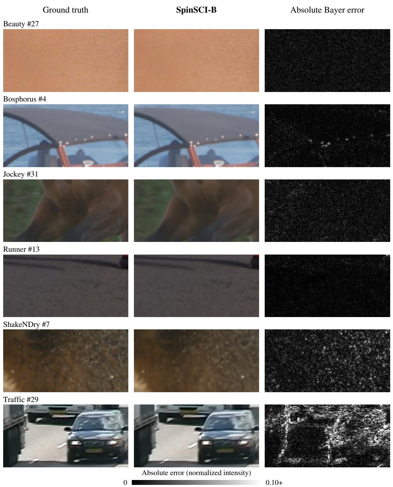  
Figure B.1: Ground truth, SpinSCI-B reconstructions, and absolute Bayer-domain reconstruction errors for the six fixed frames in the mid-scale color benchmark; # denotes the frame number. Each panel uses the same central $1 9 2 \times 9 6$ crop. Error maps use a shared intensity scale from 0 to 0.10, with larger errors shown in white. Errors are computed before display clipping; PSNR in Table B.3 is averaged over all frames and full images of each sequence.

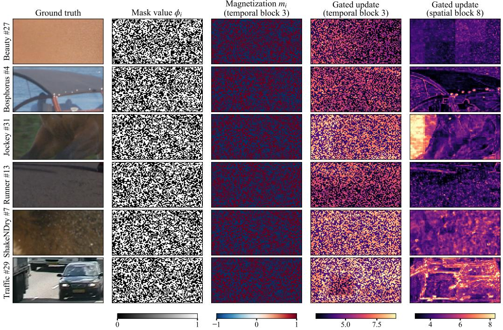  
Figure B.2: MC-IRB states of SpinSCI-B on the six fixed mid-scale color frames of Figure B.1, using the same central 192 × 96 crop. Columns show the ground truth, the mask value $\phi _ { i }$ on the token grid (1 for a measured token), the final magnetization $m _ { i }$ and the gated update $g _ { i } { \| \mathcal { R } ( \mathbf { p } _ { i } ) \| _ { 2 } }$ of temporal block 3, and the gated update of spatial block 8. In temporal block 3, $m _ { i }$ ≈ $1 - 2 \phi _ { i }$ , so the gate $g _ { i } = \sigma ( \kappa m _ { i } )$ is 0.41 for measured and 0.59 for unmeasured tokens. Each column uses one color scale for all six frames; update scales span the 1st to 99th percentiles.

## C IMPLEMENTATION AND EVALUATION DETAILS

This appendix specifies dataset dimensions, implementation details, and the evaluation protocol.

Datasets. Training uses DAVIS2017 (Pont-Tuset et al., 2017). The evaluation uses common video SCI datasets (Yuan et al., 2022; Wang et al., 2023a;b; Pan et al., 2024). The small-scale gray benchmark comprises six sequences (Aerial (Ma et al., 2019), Crash (Ma et al., 2019), Drop (Liu et al., 2019), Kobe (Yang et al., 2014), Runner (Liu et al., 2019), and Traffic (Yang et al., 2014)) at 256 × 256 resolution and compression rate 8. The mid-scale color benchmark comprises six sequences (Yuan et al., 2022) (Beauty, Bosphorus, Jockey, Runner, ShakeNDry, and Traffic) of size $5 1 2 \times 5 1 2 \times 3 \times 3 2$ (RGB, 32 frames). The large-scale color benchmark comprises four sequences (Yuan et al., 2022): Football $( 8 2 2 \times 1 9 2 0 \times 3 \times 4 8 )$ , Hummingbird $( 1 0 8 0 \times 1 9 2 0 \times 3 \times 4 0 )$ Messi $( 1 0 8 0 \times 1 9 2 0 \times 3 \times 4 8 )$ , and Swinger $( 1 0 8 0 \times 1 9 2 0 \times 3 \times 4 0 )$ . The real benchmark uses Hand (Yuan et al., 2022) (512×512×40; Figure 2), Water Balloon (Qiao et al., $2 0 2 0 ) ( 5 1 2 \times 5 1 2 \times 1 0 )$ and Domino (Qiao et al., 2020) $( 5 1 2 \times 5 1 \bar { 2 } \times 6 0 )$ (Figure 6), and Pendulum Ball $( 5 1 2 \times 5 1 2 \times 4 0 ;$ Appendix D.1), all at a compression rate of 10. Appendices D.1–D.2 provide the reconstructions at compression rates of 10 and 50.

Evaluation Metrics. PSNR and SSIM (Wang et al., 2004) are computed using the evaluation code provided by Yuan et al. (2021); efficiency is assessed by parameter count, FLOPs, inference latency, and peak memory.

Attention and Feed-Forward Implementation. The pooled spatial heads use $8 \times 8$ key windows with pooling factors two and four, corresponding to $1 6 \times 1 6$ and $3 2 \times 3 2$ query windows. They retain queries at token resolution and do not use native-window cyclic shifts. Spatial MC-IRB operates within native $7 \times 7$ windows using logits from the two unpooled heads. Bottom and right zero padding completes attention and refinement windows; padded positions participate in both operations, and $v _ { i j }$ excludes only shifted-window wrap-around pairs. Temporal projections use inner width $d _ { \mathrm { f e a t } } / 2$ and return to $d _ { \mathrm { f e a t } }$ before refinement. The inverted residual FFN comprises pointwise expansion to $2 d _ { \mathrm { f e a t } } , \mathrm { a }$ depthwise $3 \times 3 \times 3$ convolution, and pointwise projection, with GELU after the first two operations.

Bayer Implementation. RGGB selectors implement the sampling and correction operators in Section A.3, preserving the selected-color update.

Component Costs. Spatial attention products cost $O ( N ( d _ { \mathrm { f e a t } } / 4 ) ( 2 \cdot 4 9 + 2 \cdot 6 4 ) )$ , ignoring boundary-padding overhead: two heads use 49 native keys per query and two use 64 pooled keys. The linear projections cost $O ( N d _ { \mathrm { f e a t } } ^ { 2 } )$ . Temporal attention adds $\bar { O } ( N T d _ { \mathrm { f e a t } } )$ for its attention products. Spatial and temporal MC-IRBs together cost $O ( 6 4 N d _ { \mathrm { f e a t } } + N ( \mathrm { \dot { 1 } } + K _ { \mathrm { m f } } ) ( 4 9 + T ) )$ , with 64 hidden units in each residual MLP. The inverted residual FFN costs $O ( N d _ { \mathrm { f e a t } } ^ { 2 } )$ for its fixed expansion ratio and convolution kernel size.

Efficiency Protocol. All cross-method runtime comparisons in the main paper (Figure 1 and Tables 4 to 6) use FP32 eager inference on an NVIDIA GH200 (144 GB), batch size 1, and $T = 8$ . cuDNN benchmarking and matrix-multiplication TF32 are disabled; cuDNN TF32 is enabled. Each native forward is timed from its GPU-resident input using a CUDA-synchronized wall clock. $\mathrm { H i S V i T _ { 9 } }$ starts from its prepared network input. Peak memory is the maximum GPU memory allocated after warm-up, including weights and resident inputs. Checkpoint loading and file I/O are excluded. The MC-IRB ablation in Table 1, which compares SpinSCI variants only, uses BF16 compiled inference (Appendix C.1).

Gray and mid-scale color use $2 5 6 \times 2 5 6$ and $5 1 2 \times 5 1 2$ frames. EfficientSCI-B, STFormer-B, $\mathrm { H i S V i T _ { 9 } , }$ , and MambaSCI-B use three warm-ups, followed by 40 timed calls on gray or 20 on mid-scale color where evaluated. SpinSCI-B uses three warm-ups and ten timed calls, DU-9stg five and twenty, and PnP-FastDVDNet one and three. Large-scale latency is estimated for all methods as 24 times the median for one $2 7 2 \times 3 2 0$ tile, covering a $1 0 8 0 \times 1 9 2 0$ snapshot padded to height 1088. The table reports standalone tile peak memory. In separate end-to-end measurements that include all 24 forwards and output assembly, SpinSCI-B takes 4,187 ms and DU-9stg 14,822 ms. SpinSCI-B peaks at 2,694 MiB with the inputs and assembled output resident.

Parameters count all instantiated model parameters. FLOPs count one THOP module-level multiply– accumulate as one FLOP, omitting unregistered functional attention products and elementwise operations. SpinSCI uses the equivalent cuDNN depthwise convolution for counting and the Triton depthwise implementation for timing. Large-scale FLOPs cover a full frame; for $\mathrm { H i S V i T _ { 9 } , }$ , they cover the complete tiled reconstruction.

PnP-FastDVDNet is timed over its complete iterative reconstruction: 90 ADMM iterations for grayscale, or 90 GAP iterations with CPU demosaicing for color. Its FLOPs use the PyTorch operator level counter over the same complete reconstruction, again counting one multiply–accumulate as one FLOP. At $2 5 6 \times 2 5 6$ , this includes 90 denoiser passes of 329 G each; a per-pass figure would understate total cost by that factor.

Checkpoint and Quality Provenance. Small-scale gray and mid-scale color baseline PSNR/SSIM are taken from the respective papers, except as noted below for DU-9stg. SpinSCI uses the benchmark masks and test videos distributed with the official HiSViT release; the files have identical SHA-256 hashes. With these masks, the official $\mathrm { H i S V i T _ { 9 } }$ checkpoints, evaluated with the same code and FP32 eager settings as SpinSCI-B, reproduce the reported PSNR within 0.005 dB (Table C.1). SpinSCI-B and $\mathrm { H i S V i T _ { 9 } }$ are therefore compared on identical snapshot measurements. MambaSCI is designed for quad-Bayer color measurements and its paper does not report grayscale results, so it is omitted from the grayscale benchmark. Large-scale baseline quality uses official-checkpoint evaluations at compression rate 8.

SpinSCI-B uses the released non-EMA weights and FP32 eager inference on the simulated benchmarks. The mean PSNR/SSIM is 37.51/0.980 for small-scale gray (160 frames), 38.24/0.973 for mid-scale color (192 frames), and 37.68/0.979 for large-scale color (176 frames). Gray and mid-scale color use the benchmark masks. The large-scale binary masks use seed 2447 and are shared by SpinSCI-B, $\mathrm { H i S V i T _ { 9 } , }$ and DU-9stg. Color metrics use the RGGB mosaic of unclipped SpinSCI-B predictions. Frames are averaged within each sequence, then sequences are weighted equally. Large-scale SpinSCI-B quality uses full-frame inference.

Table C.1: Official HiSViT checkpoints on the SpinSCI benchmark masks and test videos, evaluated with the same code and FP32 eager settings as SpinSCI-B. Values are PSNR (dB)/SSIM. Measured SSIM uses the CACTI implementation applied to SpinSCI-B; the official HiSViT test script gives 0.978 on small-scale gray.
<table><tr><td>Benchmark</td><td>HiSViT9 reported</td><td>HiSViT9 measured</td><td>SpinSCI-B</td></tr><tr><td>Small-scale gray</td><td>37.00/0.978</td><td>37.00/0.977</td><td>37.51/0.980</td></tr><tr><td>Mid-scale color</td><td>38.01/0.972</td><td>38.01/0.972</td><td>38.24/0.973</td></tr></table>

DU-9stg Results. Table C.2 compares reported PSNR with FP32 eager checkpoint measurements under the shared evaluation protocol. Reported gray PSNR/SSIM are retained because the average PSNR difference is below 0.1 dB; measured mid-scale color PSNR/SSIM are used because the difference exceeds this threshold. The color gap persists with the supplied mask and remains unexplained. Large-scale scores are measured because this four-sequence benchmark is unreported.

Table C.2: DU-9stg reported (Zhang et al., 2026) versus measured average PSNR (dB). Differences are measured minus reported; a dash denotes an unreported result.
<table><tr><td>Benchmark</td><td>Reported</td><td>Measured</td><td>Difference</td></tr><tr><td>Small gray</td><td>37.57</td><td>37.523</td><td>-0.047</td></tr><tr><td>Mid color</td><td>38.30</td><td>38.117</td><td>-0.183</td></tr><tr><td>Large color</td><td></td><td>37.799</td><td></td></tr></table>

Real-Benchmark Protocol. Baseline comparisons use only officially released checkpoints for real-data reconstruction. SpinSCI uses EMA checkpoints trained with the calibrated real mask, at 260,000 updates for compression rate 10 and 130,000 updates for compression rate 50, with FP32 eager inference.

Training Details. Muon (Jordan et al., 2024) updates eligible matrix weights; AdamW with zero weight decay updates the remaining parameters, yielding the Adam (Kingma & Ba, 2015) update. Mixed-precision training uses BF16 computation and FP32 accumulation. Earlier video SCI work (Cao et al., 2024) reports only minor PSNR reduction under FP16/FP32 mixed precision.

## C.1 BF16 COMPILED INFERENCE

BF16 compiled inference wraps each model’s forward pass in torch.compile with its default Inductor backend and runs it under torch.autocast with BF16.

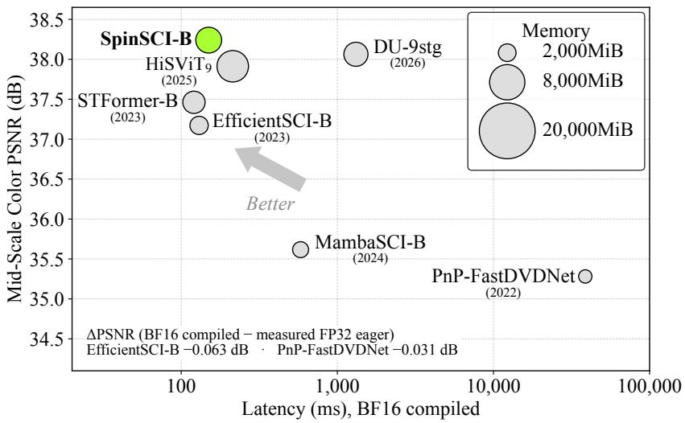  
Figure C.1: Mid-scale color PSNR versus inference latency under BF16 autocast and default Inductor compilation for all seven methods. Circle area is proportional to peak allocated GPU memory. The annotated PSNR differences compare BF16 compiled and FP32 eager checkpoint evaluations on the same six sequences.

Table C.3: Mid-scale color reconstruction under BF16 compiled inference. Each score is a sixsequence average. Latency is per snapshot and memory is peak GPU allocation.
<table><tr><td>Method</td><td>PSNR (dB)</td><td>SSIM</td><td>Latency (ms)</td><td>Memory (MiB)</td></tr><tr><td>PnP-FastDVDNet</td><td>35.28</td><td>0.958</td><td>38,732.4</td><td>1,139</td></tr><tr><td>EfficientSCI-B</td><td>37.17</td><td>0.968</td><td>130.2</td><td>2,143</td></tr><tr><td>MambaSCI-B</td><td>35.62</td><td>0.958</td><td>581.7</td><td>1,639</td></tr><tr><td>STFormer-B</td><td>37.46</td><td>0.970</td><td>120.7</td><td>3,188</td></tr><tr><td>HiSViT9</td><td>37.91</td><td>0.972</td><td>213.8</td><td>6,368</td></tr><tr><td>DU-9stg</td><td>38.06</td><td>0.972</td><td>1,315.6</td><td>3,726</td></tr><tr><td>SpinSCI-B</td><td>38.24</td><td>0.973</td><td>150</td><td>4,284</td></tr></table>

Each timing uses five warm-ups and 20 timed reconstructions after compilation on an NVIDIA GH200. SpinSCI-B averages 38.243 dB in FP32 eager inference and 38.237 dB in BF16 compiled inference. EfficientSCI-B and PnP-FastDVDNet lose 0.063 and 0.031 dB, respectively, relative to their measured FP32 eager scores. MambaSCI-B uses native quad-Bayer measurements; the other methods use RGGB.

MC-IRB ablation. Under BF16 autocast and default Inductor compilation, the backbone, temporal only, spatial-only, and full variants take 117, 134, 135, and 150 ms, respectively. Their peak allocations are 4,280, 4,282, 4,282, and 4,284 MiB.

## D ADDITIONAL QUALITATIVE RESULTS

This section presents full-frame reconstructions for the Domino (Qiao et al., 2020), Hand (Yuan et al., 2022), Pendulum Ball, and Water Balloon (Qiao et al., 2020) datasets in the real benchmark at compression rates of 10 and 50. Real SpinSCI reconstructions use EMA weights with FP32 eager inference. Figures D.20 to D.22 provide qualitative comparisons covering all sequences in the small-scale gray, mid-scale color, and large-scale color benchmarks, respectively, with one selected frame per sequence. Simulated SpinSCI results use the ordinary model weights evaluated in Tables 4–6.

## D.1 REAL BENCHMARK AT COMPRESSION RATE 10

Real-benchmark comparisons include only baselines with officially released checkpoints for real-data reconstruction.

PnP-FastDVDNet  
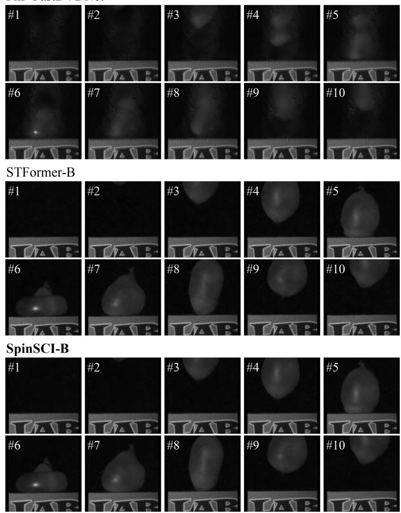  
Figure D.1: The first column shows snapshots from the Water Balloon dataset (Qiao et al., 2020) $( 5 \bar { 1 } 2 \times 5 1 2 \times 1 0 )$ in the real benchmark at a compression rate of 10. Columns 2–6 show the corresponding reconstructed frames. Here, $\#$ denotes the frame number.

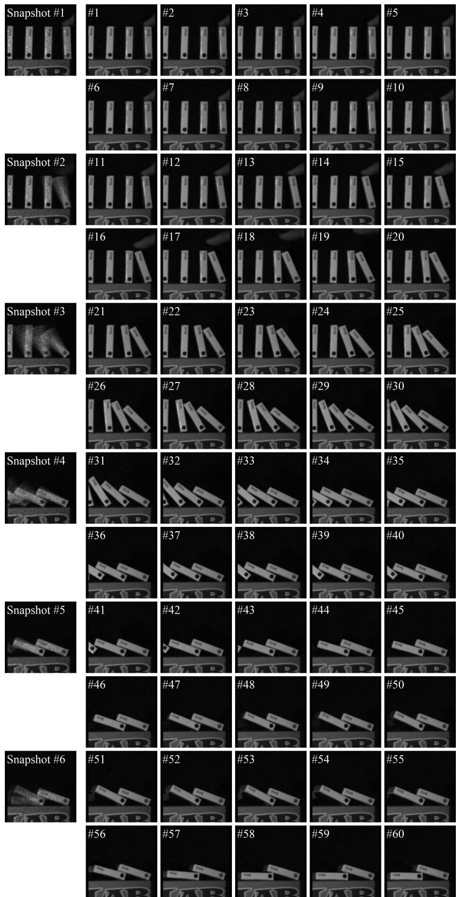  
Figure D.2: The first column shows snapshots from the Domino dataset (Qiao et al., 2020) (512 × $5 1 2 \times 6 0 )$ in the real benchmark at a compression rate of 10. Columns 2–6 show the corresponding reconstructed frames. Here, $\#$ denotes the frame number.

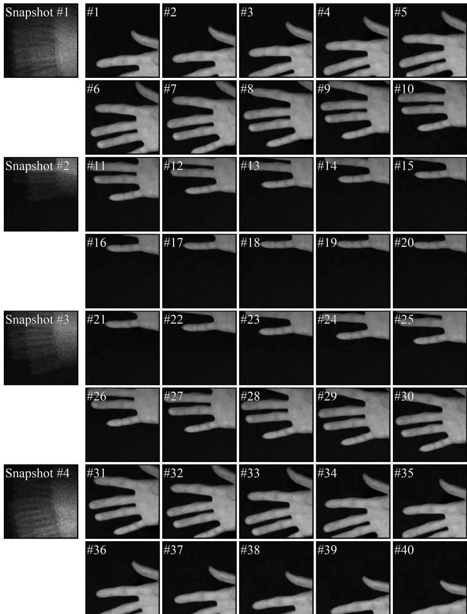  
Figure D.3: The first column shows snapshots from the Hand dataset (Yuan et al., 2022) (512 × $5 1 2 \times 4 0 )$ in the real benchmark at a compression rate of 10. Columns 2–6 show the corresponding reconstructed frames. Here, $\#$ denotes the frame number.

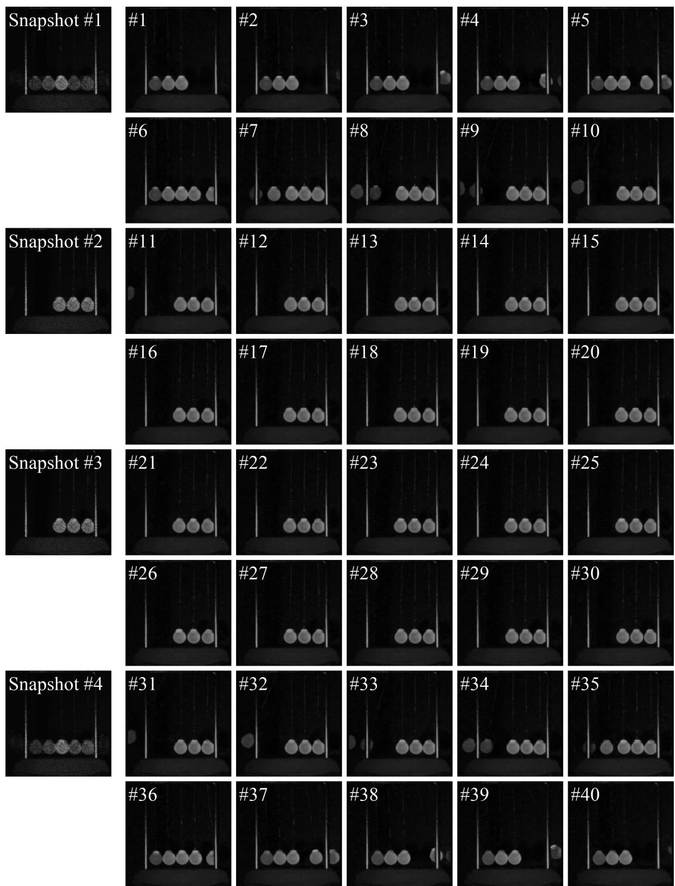  
Figure D.4: The first column shows snapshots from the Pendulum Ball dataset $( 5 1 2 \times 5 1 2 \times 4 0 )$ in the real benchmark at a compression rate of 10. Columns 2–6 show the corresponding reconstructed frames. Here, # denotes the frame number.

D.2 REAL BENCHMARK AT COMPRESSION RATE 50  
  
Figure D.5: The first column shows snapshots from the Domino dataset (Qiao et al., 2020) (512 × $5 1 \bar { 2 } \times 3 0 0 )$ in the real benchmark at a compression rate of 50. Columns 2–6 show the corresponding reconstructed frames. Here, # denotes the frame number.

  
Figure D.6: The first column shows snapshots from the Domino dataset (Qiao et al., 2020) (512 × $5 1 \bar { 2 } \times 3 0 0 )$ in the real benchmark at a compression rate of 50. Columns 2–6 show the corresponding reconstructed frames. Here, # denotes the frame number.

  
Figure D.7: The first column shows snapshots from the Domino dataset (Qiao et al., 2020) (512 × $5 1 \bar { 2 } \times 3 0 0 )$ in the real benchmark at a compression rate of 50. Columns 2–6 show the corresponding reconstructed frames. Here, # denotes the frame number.

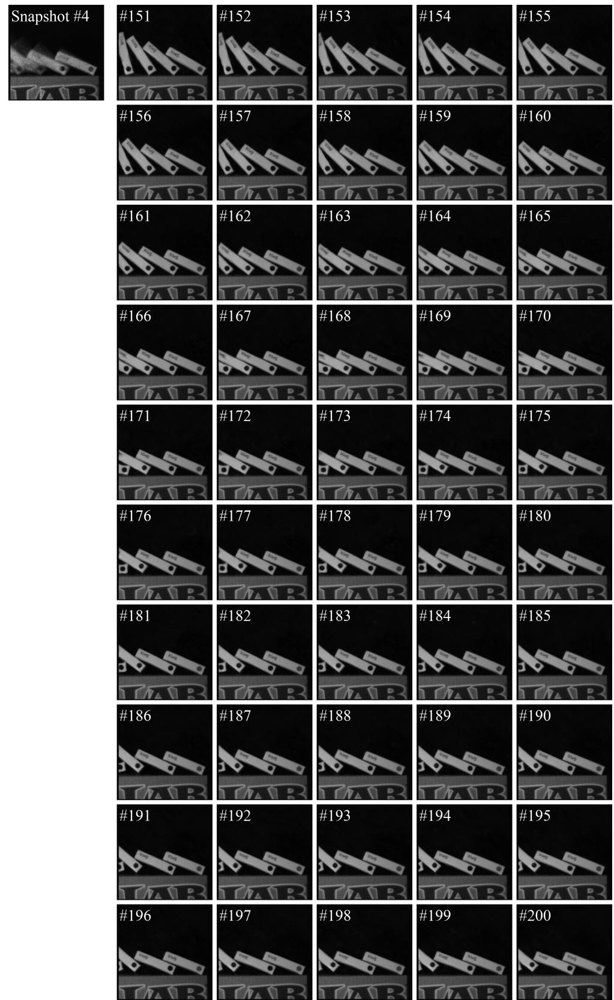  
Figure D.8: The first column shows snapshots from the Domino dataset (Qiao et al., 2020) (512 × $5 1 2 \times 3 0 0 )$ in the real benchmark at a compression rate of 50. Columns 2–6 show the corresponding reconstructed frames. Here, # denotes the frame number.

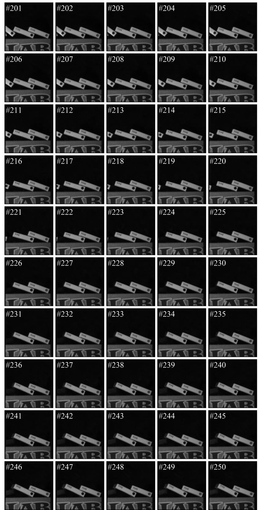  
Figure D.9: The first column shows snapshots from the Domino dataset (Qiao et al., 2020) (512 × $5 1 2 \times 3 0 0 )$ in the real benchmark at a compression rate of 50. Columns 2–6 show the corresponding reconstructed frames. Here, # denotes the frame number.

  
Figure D.10: The first column shows snapshots from the Domino dataset (Qiao et al., 2020) (512 × $5 1 2 \times 3 0 0 )$ in the real benchmark at a compression rate of 50. Columns 2–6 show the corresponding reconstructed frames. Here, # denotes the frame number.

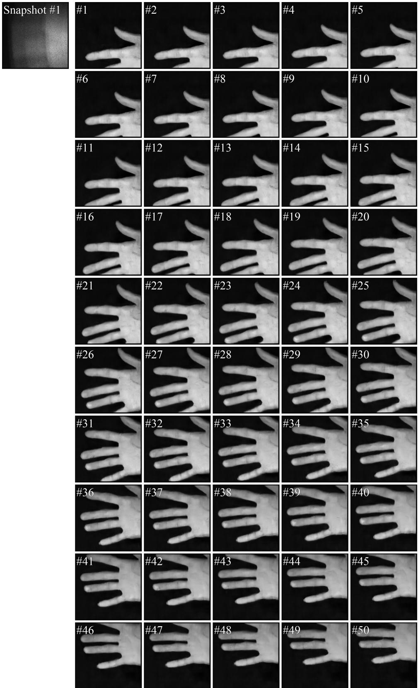  
Figure D.11: The first column shows snapshots from the Hand dataset (Yuan et al., 2022) (512 × $5 1 \hat { 2 } \times 2 0 0 )$ in the real benchmark at a compression rate of 50. Columns 2–6 show the corresponding reconstructed frames. Here, # denotes the frame number.

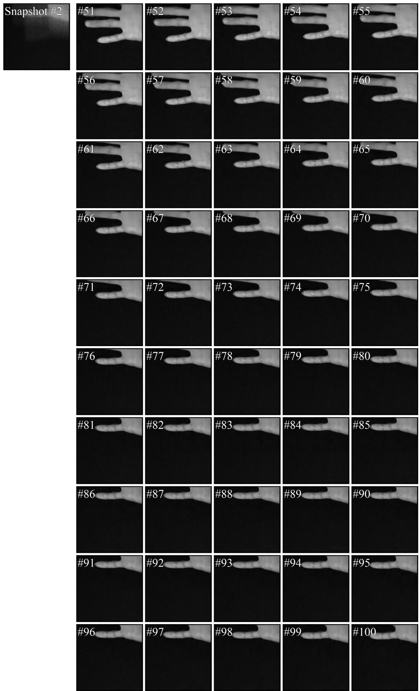  
Figure D.12: The first column shows snapshots from the Hand dataset (Yuan et al., 2022) (512 × $5 1 \hat { 2 } \times 2 0 0 )$ in the real benchmark at a compression rate of 50. Columns 2–6 show the corresponding reconstructed frames. Here, # denotes the frame number.

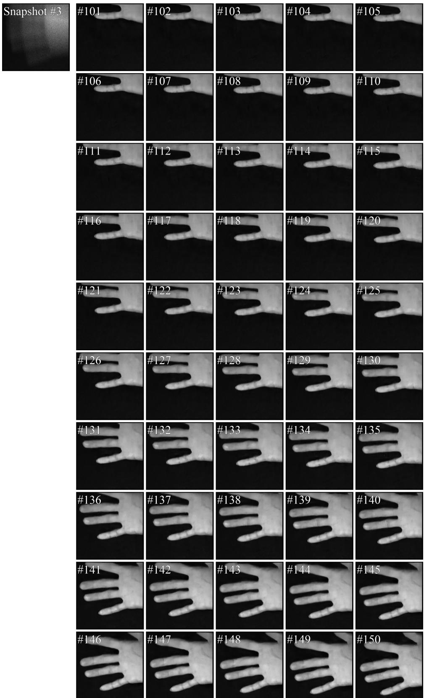  
Figure D.13: The first column shows snapshots from the Hand dataset (Yuan et al., 2022) (512 × $5 1 \hat { 2 } \times 2 0 0 )$ in the real benchmark at a compression rate of 50. Columns 2–6 show the corresponding reconstructed frames. Here, # denotes the frame number.

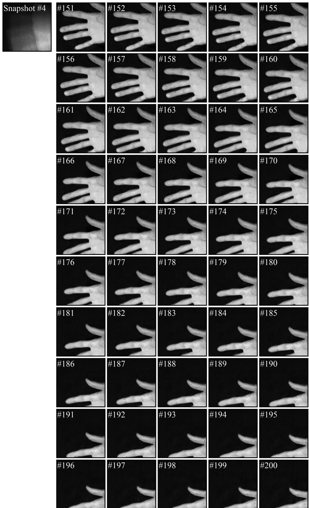  
Figure D.14: The first column shows snapshots from the Hand dataset (Yuan et al., 2022) (512 × $5 1 \hat { 2 } \times 2 0 0 )$ in the real benchmark at a compression rate of 50. Columns 2–6 show the corresponding reconstructed frames. Here, # denotes the frame number.

  
Figure D.15: The first column shows snapshots from the Pendulum Ball dataset $( 5 1 2 \times 5 1 2 \times 2 0 0 )$ in the real benchmark at a compression rate of 50. Columns 2–6 show the corresponding reconstructed frames. Here, # denotes the frame number.

  
Figure D.16: The first column shows snapshots from the Pendulum Ball dataset $( 5 1 2 \times 5 1 2 \times 2 0 0 )$ in the real benchmark at a compression rate of 50. Columns 2–6 show the corresponding reconstructed frames. Here, # denotes the frame number.

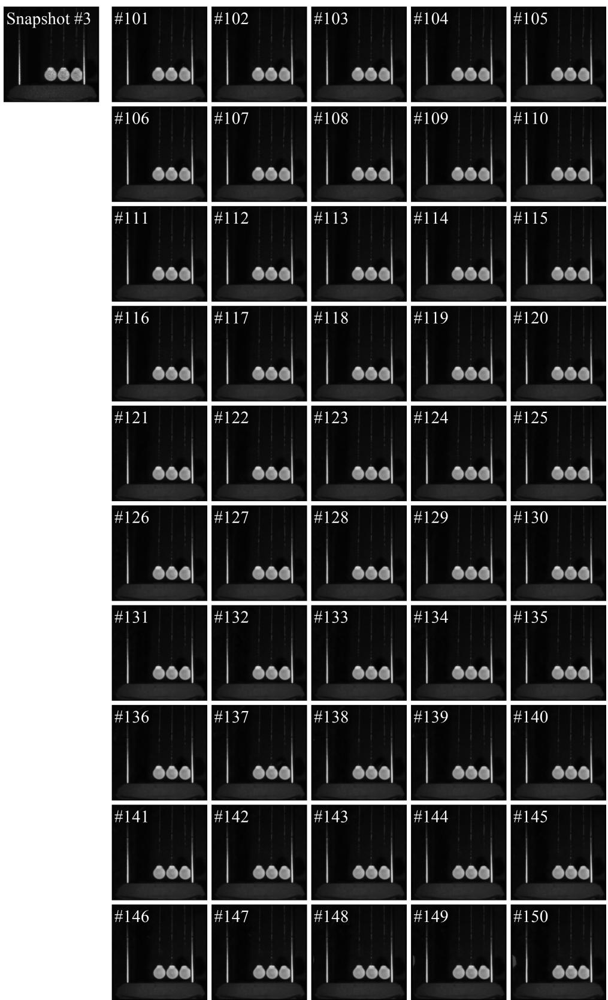  
Figure D.17: The first column shows snapshots from the Pendulum Ball dataset $( 5 1 2 \times 5 1 2 \times 2 0 0 )$ in the real benchmark at a compression rate of 50. Columns 2–6 show the corresponding reconstructed frames. Here, # denotes the frame number.

  
Figure D.18: The first column shows snapshots from the Pendulum Ball dataset $( 5 1 2 \times 5 1 2 \times 2 0 0 )$ in the real benchmark at a compression rate of 50. Columns 2–6 show the corresponding reconstructed frames. Here, # denotes the frame number.

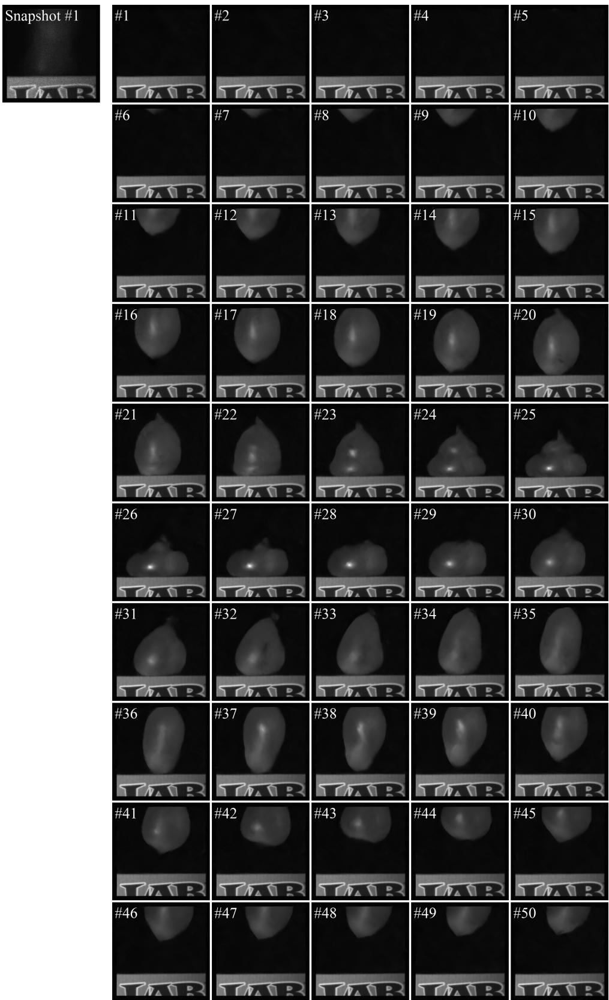  
Figure D.19: The first column shows snapshots from the Water Balloon dataset (Qiao et al., 2020) $( 5 \bar { 1 } 2 \times 5 1 2 \times 5 0 )$ in the real benchmark at a compression rate of 50. Columns 2–6 show the corresponding reconstructed frames. Here, # denotes the frame number.

## D.3 SMALL-SCALE GRAY COMPARISON

Ground Truth  
PnP-FastDVDNet  
EfficientSCI-B  
STFormer-B  
HiSViT9  
DU-9stg  
SpinSCI-B  
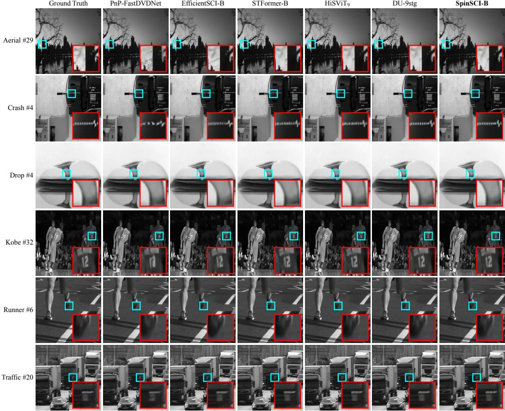  
Figure D.20: Qualitative comparisons covering all six small-scale gray benchmark sequences: Aerial, Crash, Drop, Kobe, Runner, and Traffic. Nearest-neighbor interpolation is used to zoom in on the cropped regions. # denotes the frame number.

## D.4 MID-SCALE COLOR COMPARISON

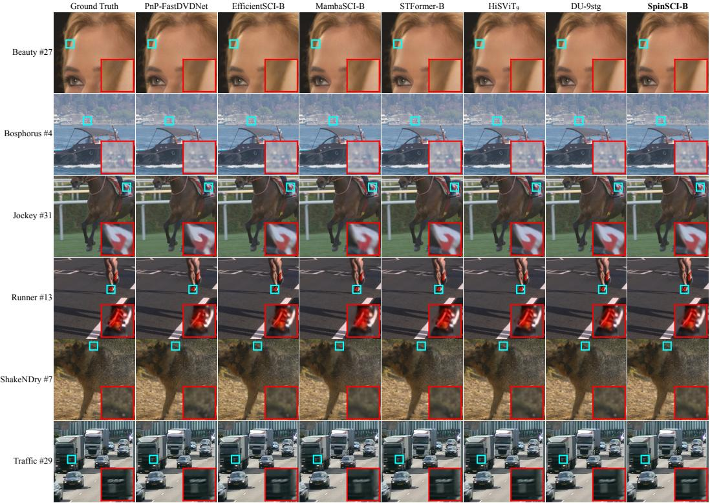  
Figure D.21: Qualitative comparisons covering all six mid-scale color benchmark sequences: Beauty, Bosphorus, Jockey, Runner, ShakeNDry, and Traffic. Nearest-neighbor interpolation is used to zoom in on the cropped regions. # denotes the frame number.

## D.5 LARGE-SCALE COLOR COMPARISON

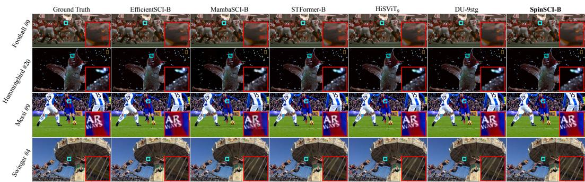  
Figure D.22: Qualitative comparisons covering all four large-scale color benchmark sequences: Football, Hummingbird, Messi, and Swinger. Nearest-neighbor interpolation is used to zoom in on the cropped regions. # denotes the frame number.

## E EXTENDED RELATED WORK

This section extends Section 2. For each line of work, it states how MC-IRB or SpinSCI differs.

Unrolled Mean-Field Inference. CRF-as-RNN (Zheng et al., 2015) and the Deep Parsing Network (Liu et al., 2015) unroll mean-field updates of conditional random fields as network layers for semantic segmentation. Their potentials act on per-pixel label distributions, and the unrolled updates produce the segmentation output. MC-IRB applies a fixed number of mean-field updates to one scalar latent spin per post-attention token. Its couplings are built from pre-softmax attention logits after the sensing penalty in Eq. (6), row-centering, and symmetrization, and its magnetizations only set the strength of a residual feature correction. The block output therefore remains a feature map.

Energy-Based Views of Attention. Modern Hopfield networks (Ramsauer et al., 2021) interpret softmax attention as an update of a continuous associative-memory energy. The Energy Transformer (Hoover et al., 2023) designs a network whose forward pass descends an energy over token representations, and deep equilibrium models (Bai et al., 2019) solve for layer fixed points. In these models, the energy or fixed point governs the token representations themselves. In MC-IRB, the Ising energy in Eq. (2) is defined over auxiliary binary spins, and its mean-field magnetizations act only as gates. The attention output is computed as usual and remains the base of the residual update.

Signed and Gated Attention. Differential Transformer (Ye et al., 2025) subtracts two softmax attention maps, so that the effective attention weights can be negative. Gated Attention (Qiu et al., 2025) multiplies the attention output by a sigmoid gate computed from each token alone. Both change how values are weighted or scaled. MC-IRB leaves the attention weights and values unchanged. Its signed couplings act between gates: through the mean-field updates, the gate of each token depends on the states of the other tokens in its group, and the couplings and fields are conditioned on the coding masks, the normalized initial estimate, and the exposure normalizer. In Table 2, the field-only sigmoid gate and the J = 0 control are the closest analogues of an independently gated output.

Deep Unfolding for SCI. Deep unfolding methods unroll an iterative solver and replace its prior step with a learned network, alternating data-fidelity updates with learned denoising. Examples include Deep Tensor ADMM-Net (Ma et al., 2019), Tensor FISTA-Net (Han et al., 2020), the dense deep unfolding network of Wu et al. (2021), the unfolding framework of Meng et al. (2023), the convolution–Transformer mixture prior of Zheng & Yuan (2023), and the degradation-aware unfolding network of Yin et al. (2025). Differential Unfolding (Zhang et al., 2026) reduces cost by alternating full stages with lightweight stages that refine changes in intermediate representations. In these methods, the mask enters each stage through the measurement operator. SpinSCI is not unrolled. It uses the measurement model once for initialization and once for final data consistency, and additionally supplies the mask to every MC-IRB as a conditioning signal.

Other Learned Video SCI. BIRNAT (Cheng et al., 2020) reconstructs frames with bidirectional recurrent networks and adversarial training, and RevSCI (Cheng et al., 2021) uses reversible 3D convolutions to reduce training memory for large-scale inputs. MadyGraph (Lu et al., 2024) passes messages among space–time pixels with a graph neural network whose neighbors are selected by motion-aware dynamic sampling. Its graph is built from features alone, whereas MC-IRB conditions its signed couplings on the masks through the sensing penalty in Eq. (6). Cao et al. (2024) combine CNN and Transformer components for efficient large-scale reconstruction. EfficientSCI (Wang et al., 2023a), STFormer (Wang et al., 2023b), MambaSCI (Pan et al., 2024), and HiSViT (Wang et al., 2025) are compared in Section 4.3. In these networks, the mask mainly enters through the input formed from the measurement. SpinSCI also forms its input from the measurement and mask, and additionally conditions each refinement block on them.

Mask-Conditioned Reconstruction. We call a reconstruction network mask-conditioned when the coding masks condition its intermediate operations, so that one set of trained weights adapts to the mask supplied at test time without per-mask fine-tuning or mask optimization. Most prior video SCI methods use the mask in other ways: to form the network input, in the data-fidelity steps of deep unfolding, for per-mask parameter adaptation in MetaSCI (Wang et al., 2021), or for joint learning of the mask and the reconstruction in Res2former (Wang et al., 2023c). In spectral SCI, MST (Cai et al., 2022a) derives a mask-guided modulation for its spectral-wise attention, and DAUHST (Cai et al., 2022b) estimates degradation parameters from the mask and measurement to guide its unfolding stages. In video SCI, the degradation-aware unfolding network of Yin et al.

(2025) likewise uses the physical mask in the estimates that guide its iterations. These methods are mask-conditioned in the above sense, but their conditioning modulates individual features or stages rather than pairwise interactions. To our knowledge, SpinSCI is the first video SCI method in which the masks condition pairwise interactions inside a refinement module, through the sensing penalty in Eq. (6) and the sensing features in the unary fields. Removing these explicit mask channels lowers PSNR by 0.13–0.19 dB on the training mask and by 0.30–0.38 dB on an unseen binary mask, although the mask-dependent initialization and final data consistency are kept (Table 3).