# Same Physics, Different Gradients: A State-of-the-Art Report on Differentiable Physics Simulation

Lei Shu1, Zizhou Huang2, Yunuo Chen3, Yifei Li4, Tao Du5, Minchen Li6, Tuur Stuyck7, Miles Macklin7, Kui Wu8, Bo Zhu9, Yin Yang10, Ming C. Lin11, Alberta Longhini1, Rika Antonova12, Leonidas Guibas1, Gordon Wetzstein1, Jeannette Bohg1 and Chenfanfu Jiang

1Stanford University 2Courant Institute, New York University 3University of California, Los Angeles 4Massachusetts Institute of Technology 5Tsinghua University 6Carnegie Mellon University 7NVIDIA 8LightSpeed Studios, Tencent America 9Georgia Institute of Technology 10University of Utah 11University of Maryland, College Park 12University of Cambridge

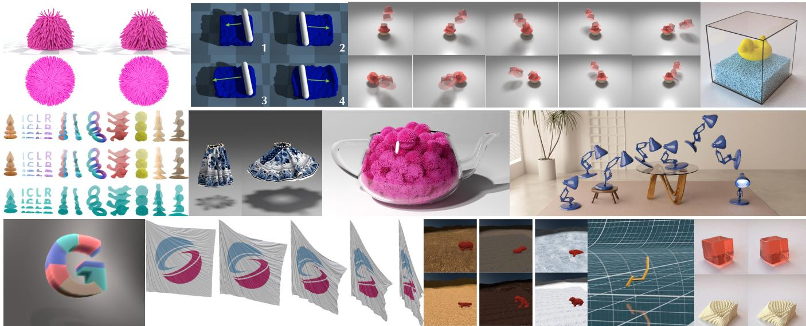  
Figure 1: Recovering material parameters from video, designing a body and its controller together, and learning a constitutive law from observed motion are applications in which gradients propagated through a simulator can support optimization. This report organizes the field by two questions that engines answer differently and rarely state explicitly, rather than by such applications: what the backward pass differentiates (Section 4), and what it does at contact (Section 5). Images reproduced, cropped or letterboxed but otherwise unaltered, from [HHD∗21, LDW∗23, CLYY24, MCD∗23, LQC∗23, WMS∗23, GSX∗24, SSZ∗25,LHB∗25,MGRKS26].

## Abstract

Differentiable simulation propagates derivatives through a physics simulator, turning animation, system identification, control, and computational design into gradient-based optimization. Engines differ in the physics they model and, less visibly, in which mathematical object they differentiate. We separate two questions the literature conflates. The referent is which object the returned derivative belongs to: the finite computation that executed, the converged equation it approximates, or the continuous dynamics. The realization describes the organization of the backward pass: automatically generated differentiation, an equation-level adjoint solve, or a custom adjoint. The referent defines the target against which exactness is assessed; the implementation determines how accurately that target is approximated. Cost depends on the realization together with how the states needed by the backward pass are retained or recovered.

Crossing the axes places every method and engine we classify in a cell, separates claims the literature merges, and shows that the apparent trade-off between exactness and memory follows from how methods have been built rather than from a constraint. A second, orthogonal taxonomy covers contact, where the map is non-smooth.

We then ask whether a correct gradient helps. Four mechanisms by which useful gradients are lost are cataloged and measured on one testbed, where the advantage of the exact derivative over the equation-level adjoint depends on where the fitting target comes from as much as on the solver budget, and we review the evidence that zeroth-order methods can outperform simulator gradients in the regimes where those mechanisms act. The model classes, systems techniques and applications are surveyed through this lens, and we close with a reporting checklist, a released diagnostic that computes it, and a research agenda.

Keywords: differentiable simulation, adjoint methods, automatic differentiation, physics-based animation, contact, inverse problems, survey.

## 1. Introduction

Physically based animation is built on a forward map. A scene is described by geometry and their parameters θ (masses, stiffnesses, rest shapes, friction coefficients, control signals, boundary conditions), and a time integrator advances a state st to $\mathbf { s } _ { t + 1 }$ until a trajectory has been produced. Four decades of graphics research have made this map fast, stable, and expressive enough to carry feature films and real-time games.

Most of the questions practitioners ask, however, run in the opposite direction. An animator wants the wind field that makes a piece of cloth do what the storyboard says, an engineer wants the gripper geometry that achieves a grasp, and a vision researcher wants the material parameters that explain a video of a falling object. Each of these is an inverse problem posed on top of a forward simulator, and simulator derivatives often make its solution substantially more efficient, particularly when the number of optimization variables is large.

Differentiable simulation is the practice of making those derivatives available. Spacetime constraints [WK88, Coh92] posed trajectory authoring as a constrained optimization over a discretized trajectory, and keyframe control of smoke and of particle systems [TMPS03, MTPS04, WMT06] differentiated the discrete fluid solvers directly and a cloth solver through a swapped integrator, both long before the term existed; the same period produced gradientdriven and sampling-driven methods for steering rigid-body simulations toward authored outcomes [PSE∗00, PSE03, TJ08]. More recently, general-purpose automatic differentiation (AD) frameworks [PGM∗19, BFH∗18], GPU-resident simulation, and domainspecific compilers [HLA∗19, HAL∗20] have expanded the scale and range of simulators for which derivatives can be computed efficiently, and a large, fast-moving literature has grown around the possibility.

Two gaps run through that literature, and together they organize this report. The first is between the derivative an engine computes and the derivative its user expects: differentiating the finite solver and differentiating the equation it approximates target different mathematical objects. Their agreement requires conditions on both the forward solution and its sensitivities. The second is between obtaining a derivative and obtaining useful optimization progress. Even an exact gradient can be ineffective for finite-step optimization, while pathwise derivatives can be biased estimators for stochastic objectives with discontinuities. Neither difficulty is universal; identifying the regimes in which a returned derivative is both appropriate and useful is a central purpose of this report.

The two gaps are not equally consequential. The first decides what a method is entitled to claim, and it is always a question of fact: an engine either returns the derivative of what it ran or it does not. How much that costs an optimizer is a separate matter, and our own measurement in Section 7 finds the cost concentrated at the tightest solver budgets, and how far above them it persists to depend on where the fitting target comes from. The referent decides what you may claim and whether a gradient check can pass, while the horizon, the contact treatment and the conditioning usually decide whether the optimization works.

Beyond its size, the literature is difficult to navigate because two papers may both claim to present “a differentiable simulator” for deformable bodies with contact, agree on the physical model, agree on the discretization, and still compute meaningfully different derivatives, because they differentiate different mathematical objects. Neither is thereby incorrect. One may backpropagate through every Newton iteration that was executed; another may apply the implicit function theorem to the equation those iterations were trying to solve. For a smooth, locally regular solution branch, the two sensitivities approach one another when both the iterates and their parameter sensitivities converge to that branch. A small forward residual alone does not establish agreement, and disagreement at a finite iteration budget is a consequence of the differentiated object rather than necessarily an implementation error. Comparisons that ignore this distinction end up attributing to the physics, or to the contact model, differences that originate in the differentiation strategy.

## 1.1. Scope

This report surveys differentiable physics simulation: methods that propagate derivatives through the numerical solution of the equations of motion of rigid bodies, articulated systems, deformable solids, cloth, and fluids. We treat differentiable rendering as adjacent rather than in scope. It is a mature subfield with its own surveys and courses [KBM∗20, ZJL20], its discontinuities are of a different character (visibility rather than contact), and the techniques developed for them [LADL18, LHJ19, VSJ22] address visibility boundaries; their applicability to contact requires separate analysis. Mitsuba 2 [NDVZJ19] provides infrastructure for differentiable rendering; visibility derivatives are addressed in separate work. We do discuss the seam where the two meet (Section 9.5), because videoto-physics pipelines require both and because the composition raises questions neither field answers alone.

We also distinguish differentiable simulation from learned simulation. Graph-network surrogates [BPL∗16, SGGP∗20, PFSGB21, LWT∗19, GBH23], structure-preserving networks [CGH∗20], and physics-informed networks [RPK19] often expose derivatives through their neural components, and a learned surrogate can serve as the forward model of a PDE-constrained inverse problem, with the inverse solved by gradient descent through the network [ZLW22]. Their rollouts may nevertheless require differentiation through numerical integration, and discrete structural operations may introduce additional difficulties. We reference these models where they interact with numerical solvers, as surrogates, correction terms, or baselines, but do not survey learned simulators as a separate class.

## 1.2. Contributions

This report contributes:

• A two-axis taxonomy (Section 4) separating the referent of a derivative from the realization of its backward pass. The referent defines the target for an exactness claim; the realization and a separate state-recovery policy determine the computational and storage costs. Crossing these choices explains why exactness and low memory are not fundamentally incompatible, and identifies the assumptions and costs of the methods that combine them.

• An orthogonal taxonomy of discontinuity treatments (Section 5) for contact, friction, and collision, classifying methods by the mathematical fiction they adopt where the true map is non-smooth, and by the bias and variance that fiction introduces.

• A critical account of gradient quality (Section 7) that separates derivative correctness from practical optimization progress, identifies four distinct mechanisms that impair gradient-based optimization, and maps published mitigations onto them.

• A cross-cutting comparison of physical model families (Section 6), systems techniques (Section 8), and engines (Table 7) on a common set of axes.

• A reporting checklist (Section 10) that would make differentiable simulators comparable, and a research agenda (Section 11) organized around the gaps the taxonomy exposes.

## 2. Related Surveys, Literature Selection, and Organization

## 2.1. Related surveys

Differentiable simulation has been reviewed before, most directly by Newbury et al. [NCH∗24], who discuss gradient construction, dynamics and contact models, integrators, engines, and robotics applications, and, as one strand of a broader tutorial treatment of physics-based deep learning, by Thuerey et al. [THH∗21]. We refine this mechanism-oriented view by separating derivative referents, backward realizations, and state recovery. These distinctions help explain computational cost, failure modes, and differences that are obscured by engine-level comparisons. They also remain useful as software packages change. We give particular attention to whether the returned derivatives improve the optimization for which they are computed, drawing on evidence of challenging regimes [MFSK21, SSZT22] rather than assuming that derivative availability guarantees useful progress.

## 2.2. Literature selection

Differentiable simulation is developed in parallel in graphics, robotics and machine learning, so we searched DBLP, Crossref, arXiv, the ACM Digital Library and Google Scholar for differentiable, gradient-based or adjoint combined with simulation, physics, solver, contact, cloth, fluid and related task terms, and then followed the references and citations of each included work. Expansion stopped when a full round added no new differentiation strategy, contact treatment or application class. A work was included if it contributes a differentiable simulator or component, provides evidence about one, or supplies background the argument depends on. Work that is differentiable only because it is a neural network, and applications that use an engine without reporting on its derivatives, were excluded.

## 2.3. Organization of this report

Section 3 fixes notation and reviews the material the rest of the report assumes: the simulation map, forward and reverse mode, and the distinction between continuous and discrete adjoints. Section 4 develops the first taxonomy, separating the referent of a derivative from the realization of the backward pass, and is the conceptual core of the report; Table 2 crosses the two axes and Section 4.4 gives guidance on choosing a cell. Section 5 develops the second, orthogonal taxonomy for contact and other discontinuities, summarized in Table 3. Readers interested only in the classification may stop after these two sections.

Section 6 surveys the physical model families through the lens of the two taxonomies, and Section 7 takes up gradient quality, which we regard as the most consequential and least settled part of the subject. Section 8 covers systems and implementation and compares the major engines in Table 7. Section 9 surveys applications, Section 10 evaluation practice and our proposed reporting checklist, and Section 11 the open problems the taxonomy exposes.

Table 1: Notation used throughout this report.
<table><tr><td>Symbol</td><td>Meaning</td></tr><tr><td> $\mathbf { s } _ { t } = \left( \mathbf { x } _ { t } , \mathbf { v } _ { t } \right)$ </td><td>simulation state at step t: positions, velocities</td></tr><tr><td> $\boldsymbol \theta \in \mathbb { R } ^ { p }$ </td><td>parameters being optimized (material, shape, . . .)</td></tr><tr><td> $\Phi$ </td><td>one time step of the simulator, Eq. (1)</td></tr><tr><td> $\mathbf { g }$ </td><td>residual defining an implicit step, Eq. (2)</td></tr><tr><td> $E$ </td><td>incremental potential minimized by a step</td></tr><tr><td> $\mathcal { L }$ </td><td>scalar objective on the trajectory</td></tr><tr><td> $T$ </td><td>number of time steps</td></tr><tr><td> $K$ </td><td>solver iterations executed per step</td></tr><tr><td> $n , p$ </td><td>state and parameter dimension</td></tr><tr><td> $A _ { t } , B _ { t }$ </td><td>step Jacobians  $\partial \Phi / \partial \mathbf { s } _ { t } , \partial \Phi / \partial \theta$ </td></tr><tr><td> $\bar { \bf s } _ { t }$ </td><td>adjoint state  $\left( \mathrm { d } \mathcal { L } / \mathrm { d } \mathbf { s } _ { t } \right) ^ { - }$  厂</td></tr><tr><td> $U _ { j } , U _ { j } ^ { * }$   $\phi , \lambda$ </td><td>block update and its Jacobian-transpose action contact gap function and normal impulse</td></tr></table>

## 3. Background and Notation

This section fixes the notation used throughout, collected in Table 1, and the two distinctions the rest of the report rests on: forward against reverse mode, and the continuous against the discrete adjoint.

## 3.1. The simulation map

We write a simulation as a composition of T time steps. A step advances the state $\mathbf { s } _ { t } \in \mathbb { R } ^ { n }$ , typically positions and velocities $\mathbf { s } _ { t } = \left( \mathbf { x } _ { t } , \mathbf { v } _ { t } \right)$ , under parameters $\theta \in \mathbb { R } ^ { p }$ . We fold into θ whatever is being optimized, including a control sequence or the weights of a controller that emits one; in the latter case a step depends on θ through the control it receives, and the form below is unchanged:

$$
\begin{array} { r } { \mathbf { s } _ { t + 1 } = \Phi ( \mathbf { s } _ { t } ; \theta ) , \qquad t = 0 , \ldots , T - 1 . } \end{array}\tag{1}
$$

Explicit time dependence is suppressed in the notation: Φ may denote $\Phi _ { t } .$ , for example when selecting the control at step t from a sequence. All step Jacobians below refer to that step’s map. An objective $\mathcal { L }$ is evaluated on the trajectory, either terminally or as a running cost, and the quantity we want is dL/dθ.

A central difficulty is that the time step is often specified by equations that must be solved numerically. Explicit schemes evaluate update formulas directly, although stiffness can impose restrictive time steps. Many implicit schemes used for stiff cloth and constrained systems [BW98] instead define the next state through a residual equation,

$$
\mathbf { g } ( \mathbf { s } _ { t + 1 } ; \mathbf { s } _ { t } , \pmb \theta ) = \mathbf { 0 } .\tag{2}
$$

Semi-implicit schemes may use explicit sequential updates or linear solves and need not require a nonlinear solve. For variational formulations with an appropriate incremental potential, a step can instead be characterized as a selected local minimizer of E(s; st,θ). This characterization is not equivalent to an arbitrary residual equation.

A simulator runs neither of these directly. It runs a solver for them: Newton with a linear solve, projective dynamics [BML∗14], Gauss–Seidel or Jacobi sweeps, extended position-based dynamics (XPBD) projections [MMC16], block coordinate descent [CLYY24], or, for a grid fluid, a pressure projection whose Poisson system is solved by conjugate gradients to a tolerance. It runs for a finite and usually small number of iterations.

The three referents of Section 4 diverge in this gap between (1) and (2), between the step we write down and the finite computation we execute.

## 3.2. Forward and reverse mode

Given the per-step Jacobians, the chain rule assembles the trajectory derivative. For now, assume that s0 is independent of θ and that $\dot { \mathcal { L } }$ depends on θ only through the trajectory. Writing $A _ { t } = \partial \Phi / \partial \mathbf { s } _ { t }$ and $B _ { t } = \partial \Phi / \partial \theta$ evaluated at step t, the sensitivity of the final state is

$$
{ \frac { \mathrm { d } \mathbf { s } _ { T } } { \mathrm { d } \theta } } = \sum _ { t = 0 } ^ { T - 1 } A _ { T - 1 } A _ { T - 2 } \cdot \cdot \cdot \cdot A _ { t + 1 } B _ { t } ,\tag{3}
$$

where the factors are ordered by descending index, as the noncommuting product requires. An empty product is the identity, so the $t = T - 1$ summand is $B _ { T - 1 }$ . The two modes of accumulation differ in which end of that product they start from. Beginning at the parameter end, with $B _ { t } ,$ , and multiplying by each $A _ { k }$ as k increases isforward mode: it propagates an $n \times p$ sensitivity matrix alongside the state as time advances, costing $O ( p )$ simulation-equivalents but requiring no storage of history. Beginning instead at the objective end and multiplying backward in time is reverse mode, or the discrete adjoint: one introduces an adjoint state $\bar { \mathbf { s } } _ { t } = \left( \mathbf { d } \mathcal { L } / \mathbf { d } \mathbf { s } _ { t } \right) ^ { \top }$ , the total derivative of the objective with respect to the state at step t including everything downstream of it. Initialize $\bar { \bf s } _ { T } = ( \partial \mathcal { L } / \partial { \bf s } _ { T } ) ^ { \top }$ and $\bar { \theta } = 0 .$ , and sweep backward for $t = T - 1 , \ldots , 0 .$

$$
\bar { \mathbf { s } } _ { t } = A _ { t } ^ { \top } \bar { \mathbf { s } } _ { t + 1 } + \left( \frac { \partial \mathcal { L } } { \partial \mathbf { s } _ { t } } \right) ^ { \top } , \qquad \bar { \boldsymbol { \theta } } \mathrel { \mathop { \mathbf { \theta } } } \mathrel { \mathop { = } } B _ { t } ^ { \top } \bar { \mathbf { s } } _ { t + 1 } ,\tag{4}
$$

where the second term is the direct dependence of a running cost on $\mathbf { s } _ { t }$ and vanishes for a terminal objective, costing O(1) simulationequivalents independent of p, but requiring access to the forward trajectory in reverse order. If the initial state is parameterized, (3) additionally contains $A _ { T - 1 } \cdot \cdot \cdot A _ { 0 } { \mathrm { d } } { \bf s } _ { 0 } / { \mathrm { d } } \theta$ , and the parameter gradient includes $( \mathrm { d } \mathbf { s } _ { 0 } / \mathrm { d } \theta ) ^ { \top } \bar { \mathbf { s } } _ { 0 }$ . If the objective is extended to include direct parameter dependence, also add $( \partial \mathcal { L } / \partial \theta ) ^ { \top }$ to the column gradient.

For the inverse problems that motivate differentiable simulation, $p$ is large (a per-element material field, a control sequence, a mesh parameterization) and $\mathcal { L }$ is scalar, so reverse mode is the relevant regime and its memory cost is the binding constraint. This asymmetry between computational work and storage motivates the systems discussion of Section 8; checkpointing [GW00] is a common way to make reverse accumulation feasible when a full tape cannot be retained (Table 7).

A thorough treatment of AD itself is outside our scope; see Griewank and Walther [GW08] for the standard reference, and Baydin et al. [BPRS18] and Margossian [Mar19] for surveys; for the broader program of differentiable programming in scientific computing, see Innes et al. [IEF∗19] and the position piece of Ramsundar et al. [RKV21].

## 3.3. Two adjoints: continuous and discrete

The PDE-constrained optimization literature distinguishes two ways to form an adjoint, and the distinction recurs under other names throughout this report. One may differentiate then discretize: derive the adjoint PDE analytically from the continuous equations of motion, then discretize that adjoint. Or one may discretize then differentiate: take the discrete forward scheme as the definition and differentiate it exactly.

A continuous adjoint is derived before choosing its discretization. For a scalar objective, its evaluation often costs a small number of forward solves and is largely independent of the number of design parameters, while still depending on mesh resolution, time stepping, and solver accuracy. A separately discretized continuous adjoint need not equal the derivative of the chosen discrete forward map. This mismatch can impair optimization and finite-difference agreement; it does not necessarily correspond to the gradient of another scalar objective. Consistent forward–adjoint discretizations can remove the mismatch in appropriate settings [MMY21].

A discrete adjoint instead differentiates a specified discrete object. That object may be the discrete equations or the finite solver used to approximate them, which is the distinction developed in Section 4.1. McNamara et al. [MTPS04] explicitly select a discrete formulation, treating projection and diffusion as linear operators. Agreement with finite differences therefore depends on the differentiated object, solver accuracy, and the usual smoothness and finitedifference conditions.

Most methods surveyed here differentiate discrete objects. In physically based differentiable rendering, methods such as Li et al. [LADL18] first derive the rendering-integral derivative, including visibility-boundary terms, and then construct Monte Carlo estimators. This provides a related example of differentiating before numerical estimation.

## 4. A Two-Axis Taxonomy of Backward Passes

This section states the organizing claim of this report. Consider a stiff implicit step: the integrator defines $\mathbf { s } _ { t + 1 }$ as a root of (2), and a solver produces an approximation to that root in K iterations. Two questions are needed to interpret a returned gradient, and the literature often answers only the second while appearing to answer the first.

Which object is the derivative of? The finite computation the solver actually executed, the exact root that computation was approximating, or the continuous dynamics the discretization itself approximates. We call this the referent, and it decides what “exact” can mean.

How is the backward pass realized? By recording the forward computation and generating its reverse operations, by solving equation-level adjoint systems, or by supplying custom operator adjoints. We call this the realization; together with state recovery it determines the cost.

These are distinct questions: a referent can admit several implementations, and a realization can serve more than one referent. Our realization labels are operational categories rather than an exhaustive Cartesian product of construction choices, as Section 4.2 makes explicit. Two methods can target the same derivative by different means, or target different derivatives while both referring to “the gradient.” Table 2 crosses the labels; we call this the referent/realization distinction.

## 4.1. Axis A: the referent

A1, the executed computation. Treat the step as the literal sequence of K solver iterations and differentiate that computation. On a differentiable execution branch, with correct derivative rules, this targets the sensitivity of the output produced by the forward pass whether or not the solve converged. It is the referent directly tested by finite differences of the production configuration, subject to truncation error, roundoff, and stability of the execution branch.

One qualification is used throughout the tables. A step often contains a linear solve run to a tolerance, a pressure projection or the inner solve of a Newton iteration, whose derivative the backward pass takes as that of the exact linear operator rather than of the iterations that approximated it. We mark such methods A1\*: exact for an idealized program in which the linear solves are exact operators, which is not the program that ran. How far the derivative of that idealization is from the derivative of the finite-tolerance program is not given by the solver tolerance alone, since the conditioning of the system and the sensitivity of the residual to the parameters enter as well, and it is to be checked at the production configuration like any other gap; a finite-difference check of an $\mathbf { A } 1 ^ { * }$ method is subject to that gap as well as finite-difference and floating-point error. The unqualified label is kept for programs whose every solve is differentiated as it ran. The referent distinction of this section emphasizes truncated nonlinear iteration, where the sensitivities can differ substantially; the asterisk records that reading a linear solve as exact is an assumption.

The guarantee is narrower than often stated: it is exact for the executed program, not for the physics. A program containing a branch, a discrete collision-detection query, or a non-differentiable primitive returns the derivative of the branch that was taken, or a convention chosen by the framework at a kink. Nor is such an object guaranteed to be a subgradient. With the common convention Re $. \mathrm { U } ^ { \prime } ( 0 ) = 0$ differentiating the identity written as ReLU(x) − ReLU(−x) returns 0 at the origin, where the function is differentiable with derivative 1; the composition rule is not required to land in the subdifferential of the composite. What AD returns at a kink depends on local derivative conventions and need not be a derivative of the composite function; calling it “the true sensitivity” without qualification overstates what was computed.

A2, the converged equation. Treat the step as a selected root of (2). If the residual is continuously differentiable near that root and its state Jacobian is nonsingular, the implicit function theorem gives the local root sensitivity:

$$
\frac { \partial \mathbf { s } _ { t + 1 } } { \partial \boldsymbol { \theta } } = - \left( \frac { \partial \mathbf { g } } { \partial \mathbf { s } _ { t + 1 } } \right) ^ { - 1 } \frac { \partial \mathbf { g } } { \partial \boldsymbol { \theta } } ,\tag{5}
$$

with st held fixed, so the left-hand side is the step Jacobian $B _ { t }$ of Section 3.2. Nothing about the solver trajectory enters. The following distinction is used throughout the report. At the exact root, (5) gives the sensitivity of that root branch. An implementation typically evaluates the formula at the state where the solver stopped and solves the adjoint system only to a finite tolerance. Three quantities must therefore be distinguished: the converged-root derivative targeted by A2, the vector returned by the implemented implicit backward pass, and the derivative of the finite computation targeted by A1. These quantities generally differ at finite tolerances, although equality is possible in special cases. Their discrepancy depends on local conditioning and residual sensitivities, as well as forward and adjoint solve accuracy. Jacobian modifications introduce another approximation; for example, DiffXPBD [SC23] projects derivative blocks to be positive definite. Section 7 compares the returned equation-level vector with the derivative of the executed computation and measures their optimization consequences.

This is the referent of the optimization-layer literature, where OptNet [AK17] differentiates a quadratic program through its Karush–Kuhn–Tucker (KKT) conditions, cvxpylayers [AAB∗19] generalizes this to convex cones, deep equilibrium models [BKK19] differentiate a fixed point without unrolling it, and modular libraries [BBC∗22] package the pattern.

In interactive simulation, the forward solver is often stopped at a small iteration budget. The resulting state is then the output of the finite solver, whereas A2 targets a root of its defining equation. Evaluating the implicit derivative at this state generally approximates that root sensitivity and need not match the derivative of the finite solver. Section 7 examines this distinction at the iteration budgets used by the forward simulation.

The dependence on convergence is quantitative. Under appropriate local regularity conditions, inexact implicit differentiation and residual-correction analyses can bound the error using forward and adjoint residuals together with conditioning constants. For a smooth, uniformly attractive fixed-point map with suitable derivative regularity, Christianson [Chr94] shows that an adjoint iteration evaluated at the final forward state converges at a rate controlled by the contraction factor. This result does not establish derivative accuracy from the forward stopping tolerance alone. Reporting a bound or an empirical sensitivity check at the production solver configuration would make the practical approximation explicit.

A3, the continuous dynamics. Derive the adjoint of the continuous equations of motion and then discretize that adjoint. A separately chosen adjoint discretization need not produce the derivative of the chosen discrete forward map, so agreement with finite differences of that map is not automatic. Appropriate paired discretizations can recover consistency [MMY21]. The continuous formulation remains useful when the discretization changes with the design or when the continuous problem is the intended optimization target.

The early graphics adjoints should not all be assigned to A3. McNamara et al. [MTPS04] explicitly choose a discrete adjoint, treating their linear projection and diffusion solves as exact operators; this is $\mathbf { A } 1 ^ { * }$ under our convention. Treuille et al. [TMPS03] differentiate the steps of their discrete fluid simulation. Wojtan et al. [WMT06] use an integrator-swapping approximation, deriving a fully implicit adjoint for a linearized-implicit cloth forward solver. Li et al. [LHB∗25] take a continuous route for flow maps. The classification follows what each method differentiates rather than its use of the word adjoint.

Outside graphics the row is well populated, and the machinelearning literature has already compared continuous and discrete adjoints in practice. Neural ODEs [CRBD18] are an A3 method in the strict sense: rather than backpropagating through the ODE solver, which the paper considers and rejects for its memory cost, they treat the solver as a black box and use an approach that “computes gradients by solving a second, augmented ODE backwards in time”, an adjoint derived from the continuous dynamics and discretized afterward. Later work outside graphics shows the consequences of the referent distinction. Gholaminejad et al. [GKB19] showed that this “optimize-then-discretize approach may lead to divergent training due to inconsistent gradients for small time step sizes”, and proposed recovering consistency by differentiating the discretization instead, at the cost of storing or recomputing the forward trajectory; Zhuang et al. [ZDL∗20] reach the same conclusion from the checkpointing side, finding that “the adjoint method has numerical errors in reverse-mode integration” and recovering accuracy by checkpointing. These studies expose two distinct numerical issues: inconsistency between the continuous and discrete adjoints, and instability when reconstructing the forward trajectory by backward integration. Checkpointing addresses state reconstruction, while differentiating the discrete scheme or using a consistent forward–adjoint pair addresses the derivative mismatch. A fixed production discretization makes consistency with that discretization a natural objective; continuous adjoints remain useful when the continuous model is the desired target or the mesh changes with the design.

## 4.2. Axis B: the realization

The realization describes how the backward pass is organized. Two useful attributes are how derivatives are constructed (automatically, manually, or by a hybrid of the two) and what computation produces them, such as reversing operations or solving adjoint equations. Locality and state recovery are further attributes; neither follows from who writes the code.

We retain three operational categories for the systems comparison: B1 for automatically generated differentiation, B2 for equationlevel sensitivity or adjoint solves, and B3 for custom operator-level adjoints. These labels are not a Cartesian product of construction and locality. B2 includes both implicit derivatives of discrete equations and discretized continuous sensitivity or adjoint equations. When this equation-level solve organizes the backward pass, B2 takes precedence regardless of how its Jacobians are constructed. Exact linear primitives inside an otherwise differentiated program are recorded by A1\*. Locality-aware AD [MGRKS26] illustrates that automatic construction can exploit mesh structure without by itself establishing a complete block-local simulator backward pass.

Labelling rule. Tables 4 and 5 were labeled by the following procedure, stated so that it can be applied to an engine we have not seen.

1. Unit. The label describes the organization of the backward pass of one time step as a whole, not every operator inside it. A hand-derived adjoint that calls automatic differentiation for a local Jacobian-vector product, or a tape that wraps a handwritten kernel, keeps the label of its organizing structure.

2. Referent. Identify the nonlinear solve the step runs and ask whether the backward pass differentiates its iterations (A1), the equation it was solving, by the implicit function theorem at whatever iterate was reached (A2), or a continuous model (A3). A linear solve run to tolerance, the pressure projection of a fluid step or the inner solve of a Newton step, that the backward pass differentiates as the exact operator makes the label A1\*, exact for the idealized program in which that solve is exact; this is how ΦFlow appears in Table 5, its pressure solve differentiated as converged and the rest of its step as executed. A backward pass that deliberately differentiates a different model or objective is marked surr.; its surrogate referent is described explicitly rather than assigned to A1, A2, or A3 for the production forward map.

3. Realization. Use B2 when the backward pass is organized around equation-level sensitivity or adjoint solves, including discretized continuous adjoint equations. Otherwise, use B1 for a backward pass generated by an AD framework or compiler, and B3 for custom operator-level adjoints. For B3, state whether the operators reverse discrete operations or implement a continuous adjoint; a continuous adjoint counts as B3 rather than B2 when its discretization is built on the forward solver’s own maps and structures rather than solved as a separate equation. In the A1/A1\* operation-mirroring case, the backward pass can reuse the forward solver’s structure, including transposed linear solves; this is not a guarantee for every B3 method.

4. Components. If a step combines different referents or realizations, identify the component motivating the primary label and state the remaining components in the note. For example, de Avila Belbute-Peres et al. [BPSA∗18], Liang et al. [LLK19], and Qiao et al. [QLKL20] combine framework differentiation with an implicitly differentiated contact or collision-response layer. Their primary label describes that layer, while the note records the surrounding differentiation. Computational cost can motivate which component is emphasized, but does not make the remaining components share its mathematical referent. List both when a single label would obscure this distinction.

5. State. Record separately what the backward pass keeps (the State column), since the realization does not determine it.

A third question, where the state the backward pass linearizes at comes from, is kept out of this axis. The state must be held, recomputed from a checkpoint, or recovered by running the map backward, and that choice sets the storage asymptotics. It is orthogonal to both of the questions above (two methods identical in construction and in backward computation can differ in it by a factor of the solver depth), so it is reported separately, as its own column in Tables 4 and 5. Memory does not follow from a realization label.

B1, recorded. Generate the backward pass with an AD framework or compiler, retaining or recomputing the intermediate values it needs. Fully stored reverse mode is one implementation, and the category spans a spectrum of engineering. At one end, simulators are written directly in an array framework such as PyTorch or JAX and inherit its generated reverse pass and residual-storage rules [PGM∗19, BFH∗18]; JAX MD [SC21] and Brax [FFR∗21] are prominent examples, the latter built around simple rigid-body physics so that thousands of unrolled environments run on an accelerator. At the other end are domain-specific compilers that generate adjoint code by source transformation. Diff-Taichi [HAL∗20] is the canonical instance in graphics: it extends the Taichi language [HLA∗19] with a “megakernel” reverse mode that preserves the arithmetic intensity and parallelism of the forward kernels, which operator-level taping can fail to preserve. Its reported gains over an equivalent formulation in a generalpurpose array framework are attributed by its authors to this structural preservation rather than to any difference in the mathematics. NVIDIA Warp [Mac22] follows a similar compiled-kernel philosophy, and Tiny Differentiable Simulator and its successors [HMC∗21] take the recorded route while embedding learned augmentations inside the engine rather than as residual corrections outside it. The most recent engines consolidate: Genesis [Gen24] and Newton [The25] both build a multi-physics, GPU-resident stack, differentiable for part of their physics, on a compiled-kernel foundation, and Newton in particular is built on Warp, one of the systems in Table 7. That consolidation means the realization axis is being settled by infrastructure decisions: whichever backward pass the shared substrate supports is the one most downstream work will use.

Without recomputation, retaining $O ( n )$ data for each of K iterations over T steps requires $O ( T K n )$ memory. The actual tape constants and problem size determine whether this exceeds device capacity. Checkpointing [GW00] stores selected states and recomputes intervening segments. The optimality of a binomial schedule assumes a specified storage and execution-cost model, including a known step count; the achievable trade-off also depends on recomputation cost, checkpoint size, and whether the horizon is known in advance. Thus O(TKn) describes fully stored unrolling, not an unavoidable property of B1.

The same trade-off drives the adjoint formulation of neural ODEs [CRBD18], for which checkpointing variants, one of them adaptive, exist [GKB19, ZDL∗20]. Compiler-level quantization of simulation state [HLY∗21] suggests a possible route to reducedprecision trajectory storage. That work evaluates quantized forward simulation; using such storage for a backward pass additionally requires analysis of reconstruction and gradient errors. Checkpointing also interacts badly with solvers whose iterates are not reproducible, such as anything using atomics with nondeterministic ordering or randomized sweep orders, because the recomputed segment is then a slightly different trajectory than the one differentiated, and keeping the executed-computation guarantee literally would require reproducing it bit for bit.

Tool-built differentiation can also exploit structure. Several works [FFLW∗26,HSK24,THB∗26] show that derivative generation for mesh-based computation can be made more efficient, YASPS by making the mesh relations explicit in a differentiable intermediate representation. Symbolic and mesh-aware derivative generation can accelerate forward solvers; extending these structures to trajectory-level sensitivities requires additional backward-pass machinery. et al. [MGRKS26] demonstrate automatic locality-aware differentiation of mesh-based computations on the GPU: derivatives are taken per element by forward-mode AD, confined to registers and shared memory, and assembled into sparse gradients and Jacobians, so the tool exploits the mesh’s locality rather than treating the computation as a flat trace. That narrows the gap between a recorded and a rederived realization from the recorded side, and suggests the two are better seen as ends of a spectrum in how much forward structure the backward pass is allowed to know about.

B2, resolved. Obtain sensitivities or adjoints by solving linear equations derived from the defining model, rather than reversing the finite nonlinear solver. For A2, (5) is evaluated at the final state, so the nonlinear solver’s K iterates need not be stored. For A3, continuous sensitivity or adjoint equations are discretized and solved; their trajectory-state requirements depend on the time integration and recovery policy. Real2Sim [HBBC19] and neural ODEs [CRBD18] are examples of this latter organization.

Solving an A2 adjoint system does not require assembling or factorizing it. A matrix-free Krylov method needs only Jacobianvector and vector-Jacobian products, which for most simulators are as cheap as a forward force evaluation, and this is how the approach scales to problems where an explicit Jacobian would not fit. For the A2 case, the required adjoint solve is defined by the equation or subsystem differentiated implicitly, and its coupling range follows from that subsystem, not from the label. When the equation is the whole implicit step, as for DiffPD, ADD or DiffXPBD, the system (5) couples every degree of freedom at once, and even matrix-free each Krylov iteration is a product over the whole mesh. When it is a contact layer, the solve couples the active set: Qiao et al. [QLKL20] apply it per impact zone, whose extent depends on the connected contact structure. The cost that follows is therefore a property of the whole-step case, and there it is a loss for forward methods whose performance argument is that they never form a global system: a Gauss–Seidel, XPBD or block coordinate descent step visits one vertex or constraint at a time and never couples the whole mesh in a single operation, while an equation-level backward pass for the same step does. For a forward method that already assembles and factorizes a global matrix, as Newton or projective dynamics does, the backward can reuse factorization work, as in DiffPD [DWM∗22], while its additional cost depends on the adjoint iterations and contact treatment; for one designed to avoid the global system, the backward pass introduces a coupling and a cost profile that the forward pass avoids. B2 also requires local regularity for classical implicit differentiation. Buckling and degenerate constraints can produce singular or ill-conditioned Jacobians, while contact transitions may instead invalidate smoothness or active-set stability. These conditions must be checked for the actual time-discrete system; static buckling does not by itself imply a singular dynamic-step Jacobian.

B3, rederived. Construct custom operator-level adjoints using the structure of the differentiated model. In the $\mathrm { { A l / A l ^ { * } } }$ operationmirroring case, let $\mathbf { s } ^ { ( j ) } = U _ { i } ( \mathbf { s } ^ { ( j - 1 ) } ; \theta )$ for $j = 1 , \dots , m$ , and define $U _ { j } ^ { \ast } ( \bar { \mathbf { s } } ; \mathbf { s } ^ { ( j - 1 ) } ) = [ D _ { \mathbf { s } } U _ { j } ( \mathbf { s } ^ { ( j - 1 ) } ; \pmb { \theta } ) ] ^ { \top } \bar { \mathbf { s } }$ . The reverse sweep applies these Jacobian-transpose actions in the order $j = m , \ldots , 1 ;$

$$
\bar { \mathbf { s } } ^ { ( 0 ) } = [ D _ { \mathbf { s } } U _ { 1 } ] ^ { \top } \cdots [ D _ { \mathbf { s } } U _ { m } ] ^ { \top } \bar { \mathbf { s } } ^ { ( m ) } ,\tag{6}
$$

with each Jacobian evaluated at its own forward input. Each reverse update also accumulates $[ D _ { \theta } U _ { j } ] ^ { \top } \bar { \mathbf { s } } ^ { ( j ) }$ into the parameter gradient. For block-local updates this can avoid assembling an additional global adjoint system. Custom operators implementing a continuous adjoint form a separate A3 case and need not mirror discrete forward operations.

For the discrete operation-mirroring case, B1 and B3 can differentiate the same object while differing in how the backward pass is constructed. B1 obtains it from an AD framework or compiler; B3 supplies custom operator adjoints. The latter can avoid a generic primitive-level tape but may still store states, replay data, and control-flow decisions. McNamara et al. [MTPS04] provide an example: they derive the adjoints of fluid-step stages by hand and apply them in reverse order, treating projection and diffusion as exact linear operators. Under our convention this is $\mathbf { A } 1 ^ { * } { \times } \mathbf { B } 3$ . A compiler-generated version with the same operators and derivative conventions can target the same derivative; finiteiteration and finite-tolerance implementations need to be checked separately. ADD [GHZ 20], by contrast, uses an equation-level adjoint and is B2.

B3 is broader than the block composition. Most of the entries Tables 2, 4 and 5 place under B3 mirror some other structure: the operation sequence of a fluid step, the recursion of an articulatedbody algorithm, or custom continuous-adjoint operators for flow maps. Many graphics solvers have no block structure. Newton with a sparse direct factorization, preconditioned conjugate gradients and multigrid are global by design, and they remain the norm offline. For these A1 still exists, as the derivative of the Newton or Krylov iterations that ran, and B3 still applies, as the adjoint of that iteration. Christianson’s reverse accumulation instead iterates the adjoint equation at the converged point and discards the executed iterates, so it sits with A2 [Chr94]. A Krylov recurrence or a multigrid cycle is a composition of matrix-vector products, smoothers and transfers, each with a transpose. The memory advantage is absent: the inputs of each iteration’s adjoint are global vectors, so there is no blocklocal object to shrink the stored state to, and the saving that block mirroring offers is specific to solvers that decompose, which Section 4.3 returns to. If an inner linear system is solved accurately and differentiated as an exact operator, A1\* records that idealization. A direct factorization still incurs floating-point error. With an accurate inner solve, the truncated outer Newton iteration may dominate the difference between the finite-solver and root sensitivities, but its magnitude also depends on conditioning, residual sensitivity, and backward-solve accuracy.

For the block-local operation-mirroring case, a custom adjoint can remove the need for a backward-only global system, but it does not remove the need for state. Each local Jacobian must still be evaluated at the input seen by its forward update, so that input must be retained, recomputed, or recovered. The reverse sweep for vertex block descent [SJW∗26] stores nine doubles, or 72 bytes, of replay data per active vertex per sweep. The reported approximately 4 KB per vertex per sweep uses a different accounting: it is an empirical peak of total allocations, including mesh and other data. The reported storage still scales linearly with K|V|. Removing that K dependence requires a state-recovery strategy, which a block decomposition does not supply. McNamara et al. [MTPS04] likewise handderive their operator adjoints while storing the forward trajectory.

Custom adjoints are not tied to one referent. In the discrete case, the fluid adjoints of McNamara et al. [MTPS04] and Takahashi et al. [TLQL21] mirror the stages of a fluid step, while Qiao et al. [QLKL21b] differentiate the executed Gauss–Seidel iterations of an articulated-body contact solver. A transposed pressure solve treated as an exact linear operator is recorded by A1\*, rather than by an unqualified claim of exactness for the finite solver; McNamara et al. are an explicit example. Custom continuous adjoints instead belong to A3.

An equation-level adjoint is classified as B2, whether its ingredients are hand-derived or generated automatically. DiffPD [DWM∗22] and DiffCloth [LDW∗23] are examples: DiffPD reuses the factorized forward matrix in its local–global adjoint iteration. In DiffCloth, the contact-free adjoint uses the elastic step Hessian, while frictional contact adds contact-response derivative terms to the global system. ADD [GHZ∗20] solves an adjoint system built from its integrator residual; Nimble [WOL∗21] differentiates its contact problem; and DiffXPBD [SC23] assembles derivative blocks and uses conjugate gradients, with a positive-definite modification of those blocks. Solving a system iteratively does not change its equation-level target, although solver tolerances and matrix modifications affect the returned approximation.

All of these methods use the solver’s structure, and they differ in which object they differentiate.

The cost of a custom adjoint is implementation and maintenance effort. It needs derivative actions for the operations it uses, supplied analytically, by local AD, or by another suitable interface. Datadependent branches and line searches require retaining or reproducing the executed decisions and differentiating the corresponding smooth branch; they do not by themselves rule out a custom adjoint. A black-box routine without a derivative interface remains an obstacle. Changing an integrator can require new custom derivative code, whereas a framework-generated realization can often reuse the framework’s differentiation support.

## 4.3. The cells of the grid

Table 2 crosses the two axes, and the following observations draw on it.

Which cells are occupied, and why. Table 2 reflects both the methods surveyed and our operational labeling convention. Equationlevel adjoints are assigned to B2 even when AD constructs their Jacobian products; automatic implicit differentiation already exists [BBC∗22]. Discretized continuous adjoint solves can also occupy A3×B2, as in Real2Sim [HBBC19]. B3 may instead organize a discrete or continuous adjoint as custom operator-level updates. An empty cell is therefore not, by itself, evidence of mathematical impossibility or an unimplemented construction. Methods should be compared by differentiated object, backward organization, and state requirements. The remainder of this section focuses on discrete custom adjoints that mirror forward operations.

Exactness is assessed relative to a referent. A1 targets the finite executed computation, A1\* an idealized program with exact linear primitives, A2 a selected root of the discrete equations, and A3 the continuous dynamics. A target does not guarantee that an implementation attains it: finite tolerances, discretization, modified Jacobians, and nonsmooth operations may introduce additional qualifications. The corresponding sensitivities generally differ, but can coincide in special cases. When two methods return different gradients for the same nominal simulator, both the referent and the accuracy of its implementation should therefore be checked.

Memory is decided by state recovery. A1 does not imply a tape; that it usually has meant one is an artifact of how A1 has been realized. Nor does the realization settle memory on its own. A discrete operation adjoint needs the state its forward operation saw; continuous adjoints likewise need an appropriate forward-state representation. These states can be obtained by several policies: retain them, recompute them from checkpoints, or recover them by running the map backward. The state-recovery policy helps determine the storage asymptotics and is reported separately from both axes. Conflating it with the realization makes a constant-factor saving read as an asymptotic one.

Discrete custom adjoints can mirror the forward solver’s operations without assembling an additional global system. They may retain the trajectory, as in the early fluid adjoints, or recover the required states by recomputation or reversibility. McNamara et al. [MTPS04] provide an A1\*×B3 example because their linear stages are differentiated as exact operators; Qiao et al. [QLKL21b] reverse executed contact iterations. Two useful structures are reversible updates and block-local compositions, but neither replaces the need to specify the state-recovery policy.

The first structure is reversible reconstruction. If an update has a usable inverse, its intermediate states can be recovered during the backward pass instead of retained. Recovering the same linearization states and using the same local derivative conventions can reproduce the derivative of the corresponding stored-state computation. Numerical instability, rounding, and non-injective updates can prevent this in practice. Related constructions have been developed in machine learning, numerical integration, and molecular dynamics.

Reversible residual networks recompute activations instead of keeping them [GRUG17], which makes activation storage independent of the number of reversible blocks, while activations at non-reversible layers must still be stored. The symplectic adjoint method [MMY21] takes a related but distinct route for neural ODEs: it retains time-step states as checkpoints, discards the per-step computation graph, recomputes the required stages, and uses a matching discrete adjoint to recover the gradient of the numerical forward scheme. Its memory reduction comes from checkpointing and recomputation rather than from requiring the forward Runge–Kutta method to be reversible.

Stam [Sta22] applies it to the adjoint of a physical simulation, with a bitwise-reversible integrator he traces to Levesque and Verlet and to Rein and Tamayo, one that retraces its own path bitwise, with the reverse step of the adjoint method as the stated application. His paper mixes fixed-point with floating-point arithmetic because a pure float trajectory is not exactly reversible. Greener’s reversible molecular simulation [Gre25] reconstructs moleculardynamics states by reverse-time simulation and matches taped reverse-mode AD in the reported gradient checks at small step counts. Its force-field training experiments, however, use 200-step gradient truncation. This both limits exploding gradients and reduces reverse computation; for the water-model setup, losses spaced 2000 steps apart require reversing only one tenth of the forward steps under that truncation policy. The reported training cost should therefore not be read as the cost of exact full-trajectory differentiation.

The reversible methods above are one construction that recurs across fields for the same reason. It was developed in machine learning, numerical integration and molecular dynamics rather than in graphics.

The second is mirroring the solver’s block structure, as Shu et al. [SJW∗26] do on Vertex Block Descent [CLYY24]; analogous operator-level reverse implementations can be constructed for projective dynamics [BML∗14] and XPBD [MMC16], provided the derivatives of their local updates are defined. Projective dynamics additionally requires differentiating its global linear solve.

The two structures have different requirements. Reversing an update requires both an inverse and sufficient numerical stability in the backward direction. A contraction $s _ { t + 1 } = a s _ { t }$ , with $0 < a < 1$ , is invertible, but its inverse amplifies state errors by 1/a per step. Some projections and dissipative contact maps are non-injective; branching alone does not imply non-invertibility, and smooth block updates may also be singular. These properties must be checked for the actual update map. Periodic snapshots can limit drift during reverse reconstruction, as in Greener [Gre25]. Block-local differentiation instead requires derivative actions for the local updates, which can be derived by hand or generated by AD; data-dependent decisions may need to be retained or replayed. The largest reported reversesweep VBD run also checkpoints across time steps.

Their memory behavior depends on state recovery. Reversible reconstruction can keep a small active reverse workspace, but Greener [Gre25] also retains periodic coordinate/velocity snapshots and random seeds. With a fixed snapshot interval, total snapshot storage grows with the trajectory length; the method should not be described as strictly constant-memory for arbitrary horizons. Blocklocal adjoints reduce the data needed per update but do not remove it: the reported reverse-sweep replay storage remains linear in $K | V | \ [ \mathrm { S J W ^ { * } } 2 6 ]$ . Both structures can avoid a backward-only global system in suitable implementations, while their total memory must be compared under explicitly matched checkpointing, truncation, and replay policies.

For the stiff, contact-rich solvers emphasized in this report, stable reverse reconstruction can be difficult, while block-local adjoints provide another way to reduce storage constants [SJW∗26], and per-step checkpointing with recomputation yet another [QLKL21b]. More generally, A1 and low memory are compatible through recomputation, at potentially substantial additional computational cost. Block structure and reversibility can improve this trade-off, but neither is necessary for an executed-computation derivative to use little memory. The breadth of efficient implementations across graphics solvers remains an open question.

A custom adjoint need not mirror a discrete block decomposition. An A3×B3 method implements a discretized continuous adjoint, potentially exploiting structures already maintained by its forward solver; Section 6.4 discusses the flow-map example. Its consistency and state requirements must be assessed for that continuous referent rather than inferred from the discrete block-local case.

## 4.4. Using the taxonomy

The referent should follow the intended optimization problem and the solver regime. A2 is attractive when a root of the discrete equations is the intended target and the forward and adjoint solves approximate its sensitivity accurately. This requires checking conditioning and derivative accuracy rather than relying on a tight forward tolerance alone. When a fixed finite iteration budget is part of the model being optimized, A1 directly targets that computation. An approximate A2 gradient may still be useful, but its target and approximation should be stated and evaluated at the production solver configuration.

The realization should follow the solver’s structure, development constraints, and memory budget. A custom adjoint can exploit regular structure but requires implementation and maintenance effort. Automatically generated differentiation is often convenient for rapidly changing solvers, and checkpointing can reduce its storage requirements. An equation-level sensitivity or adjoint solve is attractive when its target is appropriate and the required adjoint system can be solved efficiently, especially when forward factorizations or preconditioners can be reused. None of these labels alone determines locality or memory.

Classifying an engine. First identify the derivative target: executed iterations, an idealized program with exact linear operators, a regular root of discrete equations, continuous dynamics, or a stated surrogate. Then identify the organizing computation: equationlevel sensitivity or adjoint solves (B2), otherwise framework- or compiler-generated differentiation (B1), or custom operator-level adjoints (B3). Record automatic, manual, or hybrid construction and the relevant local or global operators separately. Finally, state what is retained or recovered: a tape, trajectory states, checkpoints, replay data, or reverse-reconstructed states. Mixed components and finite-tolerance qualifications belong in the notes to Tables 4 and 5. The diagnostic in Section 10 measures the resulting behavior at the production configuration.

We do not offer a ranking. Every published comparison we examined that appears to establish one sets a particular implementation against another at a particular problem size, and the axes above suggest such results are evidence about a cell rather than about a method.

Table 2: The two axes crossed. Rows identify derivative targets; columns are operational categories for the organization of the backward pass. Exactness must be assessed against the row’s target and the implementation’s numerical qualifications. Construction may be automatic, manual, or hybrid within these categories. Memory depends on retained states, recomputation, checkpointing, and solver workspace, not on the column alone. Discrete custom adjoints can exploitforward operator or block structure without necessarily eliminating trajectory storage. A3 includes both equation-level solves and custom continuousadjoint operators. Empty entries reflect the labeling convention and the examples selected, not impossibility claims. Entries are representative, not exhaustive
<table><tr><td></td><td>B1 recorded generated reverse operations; fully stored unrolling O(TKn)</td><td>B2 resolved equation-level sensitivity or adjoint solves; memory depends on target and state recovery</td><td>B3 rederived custom operator-level adjoints; memory depends on state recovery</td></tr><tr><td>A1 executed computation targets the finite program on a differentiable branch; A1* treats internal linear solves as exact</td><td>DiffTaichi [HAL*20], Brax [FFR*21], JAX MD [SC21], SP- Nets [SF18], Neural- Sim [HMC*21]</td><td>no representative listed: the equation-level solve for an implicit step normally targets A2</td><td>via the operator sequence, trajectory stored or checkpointed: adjoint fluid control [MTPS04] (A1*), Takahashi et al. [TLQL21] (A1*), Qiao et al. [QLKL21b], ChainQueen [HLS* 19], sym- plectic adjoint [MMY21] via reversibility: reversible nets [GRUG17], bitwise-reversible integrator [Sta22] (state recov- ery), reversible MD [Gre25] (untruncated formu- lation; training uses 200-step truncation)</td></tr><tr><td>A2 converged equation targets a regular root; accuracy also depends on forward/adjoint solves and Jacobian modifications</td><td>automatic construction is possible; an equation-level adjoint is labeled B2</td><td>OptNet [AK17], cvxpylay- ers [AAB*19], DEQ [BKK19], Le Lidec et al. [LLMdMM*24], DiffPD [DWM*22], ADD [GHZ*20], Nim- ble [WOL*21], DiffXPBD [SC23] (modified Jacobian)</td><td>equation-level adjoints are assigned to B2, includ- ing hand-constructed ones</td></tr><tr><td>A3 continuous dynamics differentiate then dis- cretize</td><td>generated components are possible; classification fol- lows the organizing adjoint computation</td><td>Real2Sim [HBBC19]: continu- ous sensitivity/adjoint equations discretized with BDF2; neural ODEs [CRBD18]: augmented ad- joint ODE</td><td>flow-map adjoints [LHB*25]; consistency and state requirements depend on the custom continuous-adjoint operators</td></tr></table>

## 5. Discontinuity: Contact, Friction, and Collision

The taxonomy of Section 4 concerns how a derivative is obtained from a computation, assuming the relevant local derivatives exist. Contact can violate that assumption. This section develops an additional, orthogonal axis: what a method does where the simulation map is non-smooth. An engine makes a choice on each axis, and conflating them is a recurring source of confusion, because a paper that improves contact gradients and a paper that improves solver adjoints may both be described as “better gradients” while addressing different deficiencies. Figure 2 shows what a solver is asked to resolve in this regime, where individual contact laws and changes in the active set both matter. The section is restricted to discontinuity arising from contact, friction and collision in solids. Fluids have discontinuities of their own, in the merging and splitting of free surfaces and in the discrete operators that track them; McNamara et al. [MTPS04] met one in the fast-marching redistancing of a level set and derived its adjoint by observing that the algorithm is locally continuous, and we do not treat that class further.

## 5.1. Sources of non-smoothness in contact

At the position level, a discrete rigid-contact constraint can be written using the gap φ at the constrained configuration and the normal impulse λ over the step: $0 \leq \phi \perp \lambda \geq 0 .$ , meaning that at each contact either the bodies are separated with zero normal impulse, or they are touching with a non-negative normal impulse. Velocity-level time-stepping formulations instead pair the impulse with a schemespecific normal-velocity residual, which may include gap stabilization or restitution; the gap formula is not a universal time-stepping law. Coulomb friction couples tangential impulse to normal impulse through a cone, together with a maximum-dissipation or equivalent stick–slip condition. The resulting time-stepping schemes, in the tradition of Stewart and Trinkle [ST96] and Anitescu and Potra [AP97], are linear or nonlinear complementarity problems. The same formulation underpins contact-implicit trajectory optimization [PCT14], which optimizes through contact by treating the complementarity conditions as constraints rather than by differentiating a forward solve, and is a major alternative for contact-rich trajectory optimization.

This creates three distinct obstacles, and different methods address different ones.

1. Non-smoothness at fixed topology. Even with a fixed set of candidate contacts, the solution has distinct branches (separating, sticking, sliding). Locally unique, non-degenerate solutions admit branch derivatives, but derivatives can differ or fail to exist at mode boundaries.

2. Discrete events. Contact modes and event times can change under parameter perturbations. Differentiating each step at its current active set can give the correct local derivative of the discrete trajectory when the branch sequence is stable. Matching continuous-time impact sensitivities also requires eventtime dependence when the discrete contact treatment omits it. The earliest rigid-body control work already shows the effect: Popovic et al. [´ PSE∗00] plot the simulation function of a particle bouncing off a polygonal obstacle as piecewise smooth, discontinuous wherever the impulse switches facet, and vary the surface normals to narrow the gaps between the smooth pieces of the feasible exit set, and use curvature-adapted polygonal approximations of curved obstacles so that a first-order prediction still serves. Positions may remain continuous in time while impact velocities jump; facet or event-sequence changes can also make the parameter-to-output map discontinuous. Saltation matrices and event-time sensitivities address isolated transversal events with a locally stable event sequence; grazing and simultaneous impacts require separate treatment.

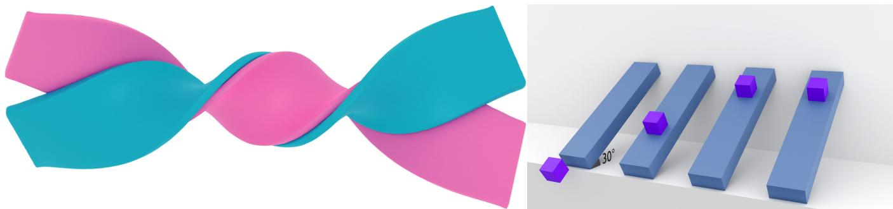  
Figure 2: What a contact solver is asked to resolve, and why contact modes matter. Left, two elastic beams twisted around one another, 97 thousand vertices between them, in sustainedfrictional contact along the whole interface while they buckle. The active pairs change along the trajectory. Local branch derivatives can remain valid despite these temporal changes, but may poorly predict finite parameter updates that change the contact sequence. Right, an elastic cub released on an incline at four friction coefficients. Whether it sticks or slides is decided by the friction cone. At a regular stick–slip transition, the branch derivatives can differ (Section 5.1). Images reproduced, cropped but otherwise unaltered,from [CLYY24] under the authors’ CC BY 4.0 license.

3. Gradient collapse in the model. Some physically meaningful sensitivities are zero or undefined regardless of the numerical treatment. A ball resting on a table has no gradient of final position with respect to initial height, once dropped from any height that leads to rest at the same place. The information is absent from the dynamics themselves rather than lost in discretization, so this is a modeling limit and no differentiation scheme recovers it.

Much of the literature’s disagreement about “correct” contact gradients comes from prioritizing different obstacles.

## 5.2. Complementarity branch derivatives

The most direct approach differentiates the complementarity formulation on a stable active set. For a locally unique, non-degenerate solution, the corresponding active-set equations define a smooth local solution map. De Avila Belbute-Peres et al. [BPSA∗18] embedded an LCP solver as a differentiable layer, computing gradients by differentiating the LCP’s complementarity conditions at the solution in the manner of [AK17]. Nimble [WOL∗21] develops analytic LCP derivatives that exploit active-set structure, together with optional complementarity-aware heuristic directions. These heuristics depart from the local derivative in some contact regimes, including cases where the true local gradient is zero, to provide an optimization signal.

Zhong et al. [ZHB22] ask directly whether these gradients are correct in the sense their users assume. They examine what differentiable contact simulators return with respect to position, velocity and control, and find discrepancies that ordinary use does not reveal. Their checks complement the diagnostics of Section 7.

The forward simulation in this family is a hard-contact simulation with no artificial compliance, an advantage when the downstream task depends on accurate contact mechanics. Velocity-level complementarity does not eliminate interpenetration in practice, since the constraint is imposed on velocities and drift is corrected by stabilization, but the penetration that remains is a discretization error rather than a modeling parameter traded against gradient smoothness. Under the stated regularity assumptions, the returned object is a branch Jacobian. At a mode boundary, the method must specify its generalized derivative or heuristic selection. A valid local derivative need not provide an effective direction for crossing into another contact mode.

## 5.3. Compliant and penalty relaxation

Another strategy relaxes hard contact. Penalty and spring-damper laws are simple examples; their differentiability depends on the chosen activation and friction regularization. The convex contact solver of MuJoCo [TET12] uses a relaxed optimization model, while the original Brax [FFR∗21] uses Baumgarte-stabilized velocity-level collision impulses. These are distinct contact models, rather than interchangeable spring-damper laws. Le Lidec et al. [LLJM∗24] compare the models of MuJoCo, Drake, Bullet, DART, ODE and RaiSim and the qualitative differences they induce. Analytically differentiable formulations such as ADD [GHZ∗20] use compliant contact with explicit friction smoothing to obtain analytical gradients by adjoint sensitivity analysis for multibody systems.

The trade-off between compliance and gradient behavior depends on the system. Increasing stiffness can worsen conditioning in multiscale problems, with the effect depending on the time step, masses, constraint geometry, and preconditioning, so stiffness alone does not determine the condition number. Constraint formulations with compliance [TNGF15, MMC16] soften that trade for the forward solve by writing the constraint with its compliance α, the inverse of its stiffness, rather than with the stiffness itself: the multiplier system carries $\alpha / h ^ { 2 }$ on its diagonal, which tends to zero as the constraint stiffens. At fixed time step and with bounded constraint and mass operators, this avoids the penalty matrix’s growing entries. The condition number can still be unbounded: with redundant or degenerate constraints the system approaches singularity as $\alpha  0 ,$ although that ill-conditioning comes from the constraint Jacobian rather than from growing penalty entries. DiffXPBD [SC23] constructs an adjoint for compliant constraint dynamics, but the works reviewed here do not establish a systematic comparison of backward conditioning between compliance-form and penalty-form equations. Paulus et al. [PGS∗26] address a different aspect: DiffMJX improves numerical gradient accuracy with adaptive integration, while contacts from distance (CFD) supplies modified contact derivatives. Section 5.7 discusses this forward/backward decoupling.

## 5.4. Barrier and interior-point formulations

A third family approximates contact with barrier potentials on the strictly feasible, non-intersecting domain. Incremental Potential Contact (IPC) [LFS∗20] combines these potentials with continuous collision detection (CCD) and a feasibility-preserving line search to maintain intersection-free and inversion-free configurations. The codimensional extension [LKJ21] covers cloth, rods, and points.

For differentiable simulation this is a convenient starting point, with the following regularity. On the feasible domain, the contact potential is $C ^ { 1 }$ and piecewise $C ^ { 2 } ,$ , with pieces determined by geometric feature configurations. Away from feature-transition boundaries, a stationary point with a nonsingular Hessian admits implicit differentiation. At a smooth local minimizer the true Hessian is positive semidefinite, and it is positive definite if the minimizer is non-degenerate; the barrier alone does not ensure this. Nor does piecewise $C ^ { 2 }$ regularity alone guarantee Newton convergence. IPC modifies element Hessians to obtain descent directions and uses a CCD-filtered line search to keep iterates feasible [LFS∗20]; local convergence additionally depends on regularity and non-degeneracy.

Those devices make the forward solve robust. They do not change the derivative of the minimizer, which is still given by (5) with the unprojected Hessian, and nothing in the backward pass calls for the projected one. The adjoint system is a linear solve rather than a descent step, so it needs the true Hessian to be non-singular rather than positive definite, and a pivoted symmetric or LU factorization handles an indefinite matrix, at the price of not reusing the forward solver’s Cholesky factors. The adjoint system should therefore be assembled from the unprojected Hessian. Huang et al. [HTG∗24] do this: their adjoint system is built from the stiffness and mass matrices of the discretization; projection is confined to the Newton update and applied only when the unprojected direction fails to descend, and the barrier stiffness is held fixed, since adapting it would require differentiating through the update. Under those choices, the conditions for exactness are the ones (5) always carries, a converged and non-degenerate minimizer. A backward pass that instead reuses the projected matrix the forward solver factorized returns an approximation to that derivative. With no projection it uses the original derivative system; otherwise the result is generally perturbed, with error depending on the projection, the right-hand side, and the conditioning of the original and modified systems. Reading that result as the exact derivative of some other object would require naming the residual whose Jacobian the projected matrix is, and we are not aware of a formulation that does so. The shortcut returns an approximation to the A2 derivative, and the reporting checklist of Section 10 asks for this to be stated. Barrier stiffness and small gaps can create widely separated curvature scales and difficult linear solves. IPC’s discussion of unnecessary ill-conditioning concerns the choice of barrier stiffness, rather than a universal loss of invertibility as a gap closes. Related barrier-based work on rigid bodies [FLS∗21], on affine bodies [LKL∗22], on projective dynamics with the barrier recast as a positional constraint [LMY∗22], on a geometric contact potential with localized support [HPF∗25], and on multibody systems in which contact, friction and nonlinear joint constraints are all potentials of one minimization [CLL∗22], uses related contact potentials on the feasible domain, subject to the geometric regularity qualifications above.

Barrier width and stiffness affect both contact response and its sensitivities. Adaptive stiffness is common, while some differentiable implementations hold it fixed. If a parameter-dependent stiffness update is part of the computation being differentiated, its derivative must be included. Quantitative errors in contact-time sensitivities cannot be bounded by barrier width alone; impact transversality and conditioning also matter. Motivated by the locking of IPC’s CCD-filtered line search as much as by conditioning costs, recent work drops the barrier altogether, enforcing non-penetration as a constraint through an augmented Lagrangian solver fed by continuous collision detection [ZLL26]; that recovers the solver’s effi ciency but reintroduces an explicit active set, and with it the question of Section 5.2 for whoever differentiates the step. Its sensitivities remain branch-wise under a stable active set, including when the constrained optimality conditions are differentiated implicitly; mode boundaries require an additional derivative convention or event treatment.

## 5.5. Randomized smoothing and stochastic estimators

Randomization can smooth an objective, a transition map, or a collision query; these choices generally define different optimization problems. For an objective $f ,$ one may consider $\mathbb { E } _ { \varepsilon } [ f ( \theta + \varepsilon ) ]$ , which can be smooth even when f is discontinuous. A score-function or likelihood-ratio estimator [Wil92] differentiates this expectation without differentiating the simulator. A pathwise estimator instead uses simulator derivatives and is a distinct construction: it is unbiased only when differentiation and expectation can be interchanged without missing boundary contributions. Section 7 discusses this comparison [PRPD18, SSZT22].

Le Lidec et al. [LLSM∗24] apply randomized smoothing to optimal control of non-smooth dynamical systems, and Montaut et al. [MLLB∗23] apply it specifically to collision detection, obtaining useful derivatives of a quantity that is combinatorial in nature. Pang et al. [PSYT23] study both randomized and deterministic smoothing of quasi-dynamic contact models, including a log-barrier formulation, for contact-rich manipulation planning. Their analysis illustrates how smoothing can supply informative slopes in otherwise flat regions. Smoothing local dynamics before rollout is generally different from smoothing the full rollout objective.

Under suitable integrability conditions and a regular smoothing distribution, score-function estimators require no simulator derivatives. Sampling introduces computational cost and variance, whose magnitude depends on noise scale, dimension, objective, estimator, and baseline. Variance need not increase monotonically with the smoothing scale.

## 5.6. Event-aware and time-of-impact gradients

A smaller body of literature addresses event-time dependence directly. For an isolated transversal impact with a locally stable event sequence, trajectory sensitivity includes a contribution from dτ/dθ and the impact update. An event-time model or detector makes this contribution available; geometric collisions often use CCD, while simpler systems can use analytic event equations. Grazing and simultaneous impacts require separate treatment. Zhong et al. [ZHDB23] differentiate collision timing and geometry, and Werling et al. [WOL∗21] include an approximation to continuous-time elastic-collision sensitivities. Cloth methods [LLK19, LDW∗23] that differentiate the detected contact system can still have valid local discrete derivatives; agreement with continuous-time event sensitivities is a separate question.

The works reviewed here provide fewer event-aware implementations than fixed-branch or smoothed contact derivatives. This describes the reviewed coverage only and does not rank the families’ maturity.

## 5.7. Decoupling the forward and backward contact model

One option cuts across the families above: the contact model used in the forward pass and the contact model differentiated in the backward pass need not be the same. Surrogate directions can provide optimization signals even when they differ from the gradient of the forward objective; their convergence properties require separate analysis. For example, CFD modifies contact derivatives while leaving the forward contact model unchanged [PGS∗26]. Dojo [HLCB∗22] provides a related equation-based construction: the forward solve approaches hard contact, while smooth sensitivities can be evaluated at a cached, more relaxed central-path state. These differentiate the relaxed equations rather than the final hardercontact step, so both complementarity parameters should be reported. The approach has reached hardware. Song et al. [SKS25] run the forward pass in a non-differentiable simulator and take the gradient from a simplified single-rigid-body model aligned to its state, and transfer the resulting quadrupedal policy to a real robot. Schwarke et al. [SKB∗25], who reach hardware with a single analytically smoothed simulator instead, note that decoupling separates the choices of forward realism and backward smoothing, but adds the cost of maintaining and aligning two models.

The idea predates its contact-focused instances by two decades. Wojtan et al. [WMT06] introduce an integrator-swapping approximation so that the adjoint of a linearized implicit cloth step becomes tractable: the backward pass differentiates a different scheme than the forward pass runs, and is accepted on a consistency argument, the two schemes agreeing to second order with a local $O ( \Delta t ^ { 3 } )$ discrepancy the authors quantify, rather than because it is the adjoint of the executed forward scheme. This earlier instance indicates that the decoupling is a general structural option, and one to expect in settings other than contact.

The returned vector need not be the gradient of the forward objective, and it need not be a conservative field. A scalar surrogate objective should therefore not be assumed without establishing one. Standard exact-gradient convergence results do not apply directly: guarantees require additional conditions, such as sufficient descent alignment or controlled bias. Decoupling can improve optimization in the regimes discussed in Section 7, while requiring separate checks of derivative accuracy and optimization behavior.

## 6. Physical Model Families

With the taxonomy and contact treatments in place, we survey the model classes. Each subsection asks what the model’s structure implies for differentiation. The physics itself is covered by the standard simulation literature. Figure 3 shows the two families where that structure bites hardest.

## 6.1. Rigid and articulated bodies

Rigid-body dynamics is widely studied in robotics. Its state is often smaller than a deformable state, making recorded AD practical for many tasks, although long or batched rollouts can still be memorybound. Brax [FFR∗21] and Degrave et al. [DHDw19] use recorded differentiation. Qiao et al. [QLKL20] combine recorded operations with equation-based derivatives of the integration and impact-zone solves; the latter locally linearize the rigid-body geometry. Contact is a major source of difficulty, while smooth articulated dynamics also offers substantial opportunities for structured differentiation.

Three structural points recur in every engine in this family.

The first is the choice of coordinates. Maximal coordinates carry a full pose per body and impose joints as constraints, giving a large but sparse and uniformly structured system; reduced coordinates parameterize the unconstrained degrees of freedom of a kinematic tree and satisfy its joints by construction. The mass matrix may be dense if formed explicitly, but recursive algorithms can avoid assembling or solving a dense system. The choice propagates into the backward pass. Maximal coordinates make the constraint Jacobian explicit, so the object equation-level differentiation needs is explicit, which suits formulations such as Dojo’s [HLCB∗22]. The unified Newton barrier method [CLL∗22] goes the other way and makes an articulated step take the form of an IPC step, with nonlinear joint constraints as potentials beside contact and friction in one minimization, so the regularity qualifications of Section 5.4 also apply. Reduced coordinates reduce the number of unknowns, while introducing chain-rule dependencies through the joint parameterization; the resulting cost depends on how these dependencies are evaluated.

The second is that articulated systems have a recursive structure, the articulated-body and recursive Newton–Euler algorithms of Featherstone’s spatial vector algebra, whose adjoint is itself recursive. The recursion assumes a kinematic tree; a loop is closed by an explicit constraint and falls back to the constrained formulation. Qiao et al. [QLKL21b] exploit this, deriving the adjoint of the spatial-algebra recursion to obtain gradients in time linear in the number of links rather than through a recorded tape, and recomputing intermediates during the backward pass instead of taping them. Their construction is the adjoint of the executed computation taken module by module, including the Gauss–Seidel iterations of the contact solve as they ran, with per-step checkpoints recomputed in the backward pass.

The third point concerns rotations, whose local variations lie in a tangent space. Generic AD differentiates the chosen coordinate program; it does not automatically supply a manifold-aware gradient. Quaternion normalization, orthogonality constraints, retractions, or Lie-algebra coordinates must be represented explicitly and interpreted consistently. Romanyà-Serrasolsas et al. [RSCO25] derive rotation-dynamics derivatives using Lie-algebra structure, simplifying their implementation and improving conditioning.

## 6.2. Deformable solids

Deformables are where the choice of referent matters most, because the state dimension is large and the solvers are iterative and truncated. The exception is explicit integration, as in Chain-Queen [HLS∗19] and the MPM examples of DiffTaichi [HAL∗20], where there is no implicit time-step root solve. The explicit-step equation and executed program have matching derivatives only when their constitutive and decomposition primitives are differentiated consistently; custom rules, such as those for an iterative SVD, require a separate declaration; the continuous referent A3 remains distinct, since the discretization error is untouched, and only the realization and the tape remain to be chosen.

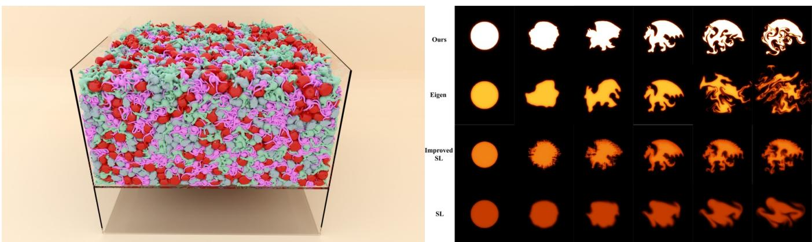

Table 3: Treatments of contact discontinuity. This axis is orthogonal to both axes of Table 2: an engine can combine a cell there with one or more treatments here. “Obstacle addressed” refers to the enumeration in Section 5.1.
<table><tr><td>Family</td><td>Mechanism</td><td>Obstacle addressed</td><td>Principal cost</td><td>Representative work</td></tr><tr><td>Complementarity branch derivatives</td><td>differentiate a regular active- set LCP, NCP or constrained</td><td>(1)</td><td>mode-boundary selection; flat contact regimes</td><td>[BPSA*18, WOL*21,QLKL20]</td></tr><tr><td>Compliant / penalty</td><td>solution map relax hard constraints or regularize contact forces</td><td>(1)</td><td>stiffness-smoothness trade- off; altered physics</td><td>[TET12,GHZ*20,DHDw19]</td></tr><tr><td>Barrier / interior point</td><td>barrier potential on the feasi- ble domain; piecewise smooth</td><td>(1)</td><td>stiffness and conditioning; derivatives of any stiffness</td><td>[LFS*20,LKJ21,HTG*24]</td></tr><tr><td>Randomized smooth ing</td><td>geometry smooth an objective, transi- tion map, or collision query</td><td>(1), (2)</td><td>updates sampling cost; variance; smoothing bias</td><td>[LLSM*24,MLLB*23,PSYT23,SSZT22</td></tr><tr><td>Event-aware / time-of- impact</td><td>differentiate regular event times and impact updates</td><td>(2)</td><td>event detection and sensitiv- ity; often CCD for collisions</td><td>[PSE*00, LLK19, HAL*20, ZHDB23, WOL*21]</td></tr><tr><td>Forward/backward decoupling</td><td>(approximated in Nimble) backward differentiates a different model than the</td><td>(1), (3, partially)</td><td>may not be the forward objective&#x27;s gradient</td><td>[PGS*26, SKS25,HLCB*22]</td></tr></table>

Figure 3: The two modelfamilies where the choice ofreferent bites hardest, and why. Left, deformables at the scale thefield now works at: every one ofthese bodies is soft, they are in sustained mutual contact, and the solver is truncated to a fixed iteration budget, which is the regime where the converged equation and the executed computation stop agreeing (Section 6.2). Right, the same smoke plume under four schemes. The differences are large and come from the numerics rather than from the physics being modeled, which is the sense in which a fluid solver’s structure decides what its adjoint can be (Section 6.4). Images reproduced, cropped but otherwise unaltered,from [CLYY24,LHB∗25].

Finite element formulations with implicit integration [SB12] give the residual form (2) directly, and the equation-level referent applies cleanly at a regular converged solution of the Newton solve. Projective dynamics [BML∗14] replaces the Newton solve with a local– global alternation whose global step is a prefactorized linear solve; DiffPD [DWM∗22] exploits this structure, reusing the prefactorized operator within the adjoint solve, reducing the cost of backward linear algebra without implying equal forward and backward runtimes. Position-based dynamics [MHHR07] and their compliant extension XPBD [MMC16] are sequences of constraint projections that avoid assembling and solving a global system, and DiffXPBD [SC23] differentiates that formulation through a trajectory adjoint targeting the implicit step equation rather than the finite projection sequence. Its backward pass projects derivative blocks to positive definiteness, so it can approximate that target derivative even when the forward solve has converged. Qiao et al. [QLKL21a] extend differentiable simulation to coupled soft multi-body systems. Vertex Block Descent [CLYY24] performs coupled per-vertex updates in Gauss– Seidel order, with independent parallel updates within suitable color classes. This local update structure supports the reverse-sweep adjoint of Shu et al. [SJW∗26].

Local update structure creates opportunities for efficient operatorlevel reverse passes. Equation-level adjoints expose the coupling of the step equations, but can also be solved matrix-free or with block preconditioners. The comparison therefore depends on the solver and state-recovery strategy, rather than on whether a global matrix is explicitly assembled.

Local projection and stencil updates appear in contact and hyperelasticity solvers [LMY∗22, LLJ∗23], and in unified particle constraint solvers [MMCK14]. Their coupling differs: penetrationfree projective dynamics retains a global step solved by aggregated Jacobi iterations, stencil descent combines local results through a sweep, and Newton or multigrid methods [WLF∗20, LFP21] require treatment of global or interlevel dependencies. A differentiable musculoskeletal simulation with inertial musculotendons [WVY∗22] sits on the same axes, as an adjoint method over integrators that include BDF1 and SDIRK2, with joint torques rather than muscle excitations as the differentiated parameters.

Table 4: Representative methods grouped by physical model. Ref.: A1 executed computation, A2 converged equation, A3 continuous dynamics (Section 4.1). Real.: B1 framework-generated reverse; B2 equation-level adjoint, including a discretized continuous adjoint; B3 custom operator-level adjoint composition (Section 4.2). For hybrid engines these labels identify the main documented backward construction; custom solves and recorded remainders are noted and do not imply exactness ofthefull engine. A1\* treats an internal linear solve as exact;finite primal and adjoint tolerances still cause error. A2a marks an additional approximation in the derivative system. surr. marks a returned direction that need not differentiate theforward objective; it can still have a specified surrogate target. State describes recovery: tape, recorded reverse-pass intermediates; trajectory, states and required auxiliary data per step; checkpoint, selected states with recomputation; recompute, per-step intermediates regenerated from saved states; final state, converged state of each step plus required auxiliary data, not just the rollout endpoint; replay, sweeps rerun from saved inputs; reverse, state recovered by reversing the map. These choices do not specify a unique memory cost. none and not stated indicate no reverse-state store or an unreported strategy. Contact follows Table 3 where applicable. Alternatives are noted in the final column. The realization is n/a when there is no backward pass, including forward sensitivities; shooting alone does not determine the realization. Methods that only consume a simulator appear in Sections 7 and 9.
<table><tr><td>Method</td><td>Ref.</td><td>Real.</td><td>State</td><td>Contact</td><td>Notes and primary use</td></tr><tr><td colspan="6">Control of simulation before general-purpose AD</td></tr><tr><td>Spacetime constraints [WK88]</td><td>n/a</td><td>n/a</td><td>n/a</td><td>n/a</td><td>dynamics posed as constraints, not as a forward map</td></tr><tr><td>Interactive spacetime [Coh92]</td><td>n/a A1*</td><td>n/a</td><td>n/a</td><td>n/a n/a</td><td>spacetime windows; same formulation forward sensitivities of the discrete operators, treating linear</td></tr><tr><td>Smoke keyframes [TMPS03]</td><td></td><td>n/a</td><td>none</td><td></td><td>solves as exact</td></tr><tr><td>Adjoint fluid control [MTPS04]</td><td>A1*</td><td>B3</td><td>trajectory</td><td>n/a</td><td>discrete adjoint, chosen over the continuous one; trajectory stored</td></tr><tr><td>Cloth keyframes [WMT06]</td><td>surr.</td><td>B2</td><td>trajectory</td><td>penalty (repul- sive springs)</td><td>adjoint of the full backward Euler scheme swapped in for the linearized implicit step the forward runs (Section 5.7)</td></tr><tr><td>Rigid-body sketching [PSE03]</td><td>A1</td><td>n/a</td><td>not stated</td><td>impulse</td><td>multiple-shooting parameter estimation; derivatives by auto- matic differentiation of the simulation function; no backward pass described</td></tr><tr><td>Neural ODE [CRBD18]</td><td>A3</td><td>B2</td><td>reverse</td><td>n/a</td><td>continuous equation-level adjoint integrated backwards; reconstructs states with finite-tolerance error</td></tr><tr><td>ANODE [GKB19]</td><td>A1</td><td>B1</td><td>checkpoint</td><td>n/a</td><td>checkpoints and differentiates the discretization to avoid inconsistencies from continuous backsolve</td></tr><tr><td>Reversible MD [Gre25]</td><td>A1</td><td>B3</td><td>reverse</td><td>n/a</td><td>reconstructed states; snapshots and seeds stored; training truncates gradients</td></tr><tr><td>Reversible integrator [Sta22]</td><td>A1</td><td>B3</td><td>reverse</td><td>n/a</td><td>bitwise state recovery by fixed-point updates; the adjoint differentiates the underlying unrounded Verlet map</td></tr><tr><td colspan="6">Rigid and articulated bodies</td></tr><tr><td>Degrave et al. [DHDw19]</td><td>A1</td><td>B1</td><td>tape</td><td>softened LCP, Gauss-Seidel</td><td>early end-to-end engine in an AD framework; the projected iterations are differentiated as executed</td></tr><tr><td>LCP layer [BPSA*18]</td><td>A2</td><td>B2</td><td>final state</td><td>projection complementarity</td><td>2D engine; LCP embedded as a differentiable layer by the method of OptNet; explicit remainder of the step recorded in PyTorch</td></tr><tr><td>Qiao et al. [QLKL20]</td><td>A2ª</td><td>B2</td><td>final state</td><td>nonlinear con- straints / CCD</td><td>impact-zone derivatives locally linearize rigid-body geometry; remaining operations recorded</td></tr><tr><td>Nimble [WOL*21]</td><td>A2</td><td>B2</td><td>final state</td><td>complementarity</td><td>analytic active-set LCP derivatives; optional heuristic contact directions and approximate elastic-impact sensitivities</td></tr><tr><td>Qiao et al. [QLKL21b]</td><td>A1</td><td>B3</td><td>recompute</td><td>complementarity</td><td>module-by-module adjoint, including the executed Gauss— Seidel contact iterations; recomputes rather than tapes</td></tr><tr><td>ADD [GHZ*20]</td><td>A2</td><td>B2</td><td>final state</td><td>compliant, smoothed</td><td>analytic adjoint of a specific implicit multibody integrator</td></tr><tr><td>Brax [FFR*21]</td><td>A1</td><td>B1</td><td>tape</td><td>impulse (Baum- garte)</td><td>massively parallel rollouts on accelerators</td></tr><tr><td>Dojo [HLCB*22]</td><td>surr.</td><td>B2</td><td>final state (relaxed,</td><td>barrier / IP</td><td>cached central-path sensitivity; relaxed A2 target may differ from the harder forward step</td></tr><tr><td>Zhong et al. [ZHDB23]</td><td>A1</td><td>B1</td><td>κ&gt; 0) tape</td><td>impulse, TOI</td><td>corrects gradients when the contact normal is not fixed, by continuous collision detection; PyTorch and Taichi implemen-</td></tr><tr><td>NeuralSim [HMC*21]</td><td>A1</td><td>B1</td><td>tape (CppAD path)</td><td>penalty / NCP</td><td>tations unrolled engine with learned augmentations embedded inside</td></tr><tr><td>Paulus et al. [PGS*26]</td><td>A1</td><td>B1</td><td>checkpoint</td><td>penalty / decou-</td><td>it DiffMJX: adaptive integration with checkpointed AD; op-</td></tr><tr><td>Song et al. [SKS25]</td><td>surr.</td><td>B1</td><td>tape</td><td>pled decoupled</td><td>tional CFD supplies surrogate contact derivatives non-differentiable forward, single-rigid-body model differenti-</td></tr><tr><td>Le Lidec et al. [LLMdMM*24]</td><td>A2</td><td>B2</td><td>final state</td><td>complementarity</td><td>ated in PyTorch for the gradient; reaches hardware highly efficient differentiable robotics simulation at speed</td></tr></table>

Table 5: Table 4 continued: deformables, cloth andfluids. Columns are as in Table 4.
<table><tr><td>Method</td><td>Ref.</td><td>Real.</td><td>State</td><td>Contact</td><td>Notes and primary use</td></tr><tr><td>Deformable solids</td><td></td><td></td><td></td><td></td><td></td></tr><tr><td>ChainQueen [HLS*19]</td><td>A1</td><td>B3</td><td>trajectory</td><td>grid-mediated</td><td>hand-derived CUDA MPM backward; cached per-step states; TensorFlow reference is an alternative B1 path</td></tr><tr><td>DiffTaichi [HAL*20]</td><td>A1</td><td>B1</td><td>tape</td><td>impulse with TOI (rigid, mass-spring);</td><td>source-transformation AD preserving megakernel paral- lelism; custom primitive derivatives must be declared</td></tr><tr><td>Real2Sim [HBBC19]</td><td>A3</td><td>B2</td><td>trajectory</td><td>grid boundary (MPM) n/a</td><td>continuous adjoint discretized with BDF2 for viscoelastic</td></tr><tr><td>DiffPD [DWM*22]</td><td>A2</td><td>B2</td><td>final state</td><td>penalty / complemen-</td><td>fitting; direct-sensitivity alternative reuses the projective-dynamics factorization in the back- ward</td></tr><tr><td>Qiao et al. [QLKL21a]</td><td>A1</td><td>B1</td><td>recompute</td><td>tarity dry friction</td><td>coupled soft multi-body systems; projective-dynamics step differentiated with CppAD, per-step state stored,</td></tr><tr><td>DiffXPBD [SC23]</td><td>A2ª</td><td>B2</td><td>trajectory</td><td>compliant</td><td>intermediates recomputed implicit-step adjoint with derivative blocks projected to</td></tr><tr><td>Huang et al. [HTG*24]</td><td>A2</td><td>B2</td><td>final state</td><td>barrier / IP</td><td>positive definiteness; states and derivative data stored differentiable time-dependent deformation with contact</td></tr><tr><td>Musculotendons [WVY*22]</td><td>not</td><td>not</td><td>not stated</td><td>n/a</td><td>adjoint method over a musculotendon integrator (BDF1 and</td></tr><tr><td></td><td>stated</td><td>stated</td><td></td><td></td><td>SDIRK2 available), differentiating joint torques; the adjoint itself is not described</td></tr><tr><td>Reverse-sweep VBD [SJW*26] Cloth and codimensional objects</td><td>A1</td><td>B3</td><td>replay, O(K|V|)</td><td>barrier / penalty</td><td>local 3×3 adjoint solves; no tape and no global system</td></tr><tr><td>Liang et al. [LLK19]</td><td>A2</td><td>B2</td><td>final state</td><td>constrained QP</td><td>QP collision response and linear solve differentiated implic-</td></tr><tr><td>DiffCloth [LDW*23]</td><td>A2</td><td>B2</td><td>final state</td><td>CCD dry friction</td><td>itly, remainder recorded explicit treatment of the non-smooth friction cone</td></tr><tr><td>Fluids and hybrid methods</td><td></td><td></td><td></td><td></td><td></td></tr><tr><td>SPNets [SF18]</td><td>A1</td><td>B1</td><td>tape</td><td>SDF projection, one- way</td><td>differentiable position-based fluid dynamics</td></tr><tr><td>DiffFR [LXY*23]</td><td>surr.</td><td>n/a</td><td>none</td><td>penalty</td><td>forward-mode sensitivity hand-derived through the DFSPH pressure iterations, kept only for fluid particles adjacent to</td></tr><tr><td>ΦFlow [HKT20]</td><td>A1*</td><td>B1</td><td>tape</td><td>n/a</td><td>the rigid body; two-way SPH coupling; rigid-body control recorded Eulerian operators with an equation-level pressure adjoint; finite solve tolerances cause error</td></tr><tr><td>Solver-in-the-loop [UBF*20]</td><td>A1/ A1*</td><td>B1</td><td>tape</td><td>n/a</td><td>learned corrections through time stepping; the CG- initialization experiment differentiates a finite solver iter-</td></tr><tr><td>Takahashi et al. [TLQL21]</td><td></td><td></td><td></td><td></td><td>ation sequence hand-derived adjoint of each executed step through a vari- ational pressure solve; states stored; the advection adjoint</td></tr></table>

Two recent graphics results extend the scope of differentiable deformable solvers. Daviet et al. [DSSL25] learn quadrature rules for implicit grid cells and combine them with mixed finite elements, enabling differentiation as the represented domain evolves. This extends beyond fixed mesh topology; earlier mesh-based differentiable FEM already supports geometry and shape parameters [HTG∗24]. Shen et al. [SSZ∗25] carry mixed second-order information through the simulation for locomotion. The report’s axes concern first derivatives, and the same questions recur, largely unexamined, for second derivatives.

Material-model identification is a related thread: Hahn et al. [HBBC19] estimate viscoelastic parameters from captured motion, and more recent work learns constitutive laws directly [MCD∗23], using the simulator’s differentiability to supervise a neural material model from observed dynamics.

## 6.3. Cloth and codimensional objects

Cloth combines large state, stiff implicit integration [BW98], and frequent collision-topology changes in contact-rich tasks, so it can stress both taxonomic axes at once.

Wojtan et al. [WMT06] gave an early differentiable cloth simulator, with an approximate adjoint obtained by swapping the integrator, later followed by Liang et al. [LLK19], differentiating through a QP-based collision response. DiffCloth [LDW∗23] descends from a different pair, the projective dynamics with dry frictional contact of Ly et al. [LJBBD20] and the DiffPD backward [DWM∗22], and adds an explicit treatment of the non-smooth friction cone, which matters because sticking and sliding are branches of Section 5.1’s first obstacle and transitions between them can affect cloth optimization. DiffAvatar [LCL∗24] demonstrates differentiability with respect to the cloth pattern space, and PhysAvatar [ZZY∗24] recovers garment material from video through a C-IPC solver with finite-difference gradients.

The persistent difficulty is self-collision. A garment’s active contacts depend on its configuration and the parameters being optimized, and their number can vary substantially across steps. The candidate count is bounded by the finite mesh but can grow quadratically with its complexity. This variability complicates sparse assembly and state storage. Branch derivatives remain locally valid under regularity and stable contact sequences, although they may poorly predict finite mode changes or omit continuous-time event sensitivities. Whether adjoint solves dominate, and whether fixedcapacity allocation is practical, depends on the implementation and workload.

Codimensional formulations [LKJ21] address the forward problem for cloth, rods, and points within one intersection-free framework, and inherit the feasible-domain regularity that makes the barrier family attractive to differentiate. Changing contacts does not by itself destroy this regularity; conditioning, geometric degeneracies, and implementation costs still require assessment at the resolutions of interest.

## 6.4. Fluids

Fluids split along two axes that the practice of the field tends to merge: the view taken of the continuum, Eulerian at fixed locations or Lagrangian on moving material, and the spatial discretization, grids, meshes, particles or particle-grid hybrids. The pairings that dominate graphics are Eulerian solvers on grids and Lagrangian solvers on particles, but neither is forced; Eulerian solvers have been built on unstructured Voronoi cells with Delaunay tetrahedral duals [BBB10]. Eulerian solvers often compose advection, projection, and diffusion operators, providing natural units for derivative implementations. Projection and diffusion may be linear for fixed coefficients and boundaries, while advection, limiters, and free-surface handling can introduce nonlinear or nonsmooth dependencies. Derivative-based fluid control arrived early in graphics, by propagating derivatives of the discrete fluid operators forward, treating linear solves as exact [TMPS03] and, a year later, by the adjoint [MTPS04], though the topology changes of thin features [WTGT10] introduce discrete decisions that require separate treatment when differentiating a fluid solver. ΦFlow [HKT20] provides a modern differentiable Eulerian solver, and the solver-in-theloop line of work [UBF∗20] uses differentiability to train corrections that interact with the solver over multiple steps rather than in isolation. Beyond supplying gradients, the differentiable solver there trains a learned component through the time-stepping loop.

One recent fluid result is a realization of the kind Section 4.2 describes under B3. Li et al. [LHB∗25] observe that a bidirectional flow map solver and its adjoint share the same map: the forward pass transports impulse variables along it, and the backward pass transports adjoint variables back along the same map. Solving the adjoint equations directly on that map avoids both differentiating the intermediate numerical steps and storing them, which is a rederived realization reached through the structure of the flow map rather than through a block decomposition.

Particle methods may use explicit updates or iterative constraint and pressure solves, as in SPNets [SF18]. Neighbor lists are discrete data structures, but list changes need not make the physical map nonsmooth when contributions vanish smoothly at the support boundary. Cutoff rules, truncation, and neighbor-capacity limits determine the relevant derivative behavior. DiffFR [LXY∗23] differentiates an SPH solver with two-way fluid-rigid coupling in forward mode, by hand through the DFSPH pressure iterations, and reports that the full derivative is unstable after contact; it keeps only the fluid particles adjacent to the rigid body in the gradient, a localization its authors note departs from the physical ground truth, so Table 5 lists the returned vector as a surrogate direction. Hybrid methods, the material point method (MPM) in particular [JST∗16, SSC∗13], combine particle-grid transfers with constitutive updates and are amenable to differentiation on regular branches. Transfer smoothness depends on the interpolation kernels and support treatment. Yield transitions, contact, and spectral degeneracies may require custom or regularized derivatives, as illustrated by the custom SVD gradients in DiffTaichi [HAL∗20]. ChainQueen [HLS∗19] demonstrates differentiable MPM for elastic solids, DiffTaichi [HAL∗20] ships MPM examples for solids and a liquid, and PlasticineLab’s benchmark [HHD∗21] is likewise soft bodies. The particle-grid machinery carries over to fluids, and FluidLab [XZX∗23] takes it to liquids. Recorded MPM differentiation can store per-particle and per-grid data at each step, making long rollouts memory-intensive unless checkpointing or other state-recovery strategies are used.

## 6.5. Coupling and multiphysics

Solid–fluid coupling adds interface constraints whose differentiation is not simply the composition of the two media’s derivatives: even one-way coupling with sub-grid boundary conditions needs its own adjoint terms [TLQL21], and the reason generalizes to every coupled system. DiffFR [LXY∗23] meets the same difficulty from the twoway side, with SPH boundary particles carrying the coupling forces, and answers it by localizing the derivative to the fluid around the body (Section 6.4).

A monolithic scheme treats both media as one coupled system. Its derivative is an instance of Section 4 applied to that system, with interface terms included in the coupled Jacobian. Partitioned schemes retain separate solvers for the media. In a sequential Gauss–Seidel scheme, for example, one solves the fluid with the solid held fixed and then the solid with the fluid held fixed, possibly repeating the alternation; other partitioned schemes use different update schedules.

For an iterated partitioned scheme, the question of Section 4 recurs at the coupling level. Differentiating the converged coupled equations requires the coupled state to satisfy those equations, whereas differentiating a finite executed sequence targets the composition of its block updates. Those block derivatives may be recorded, generated, or derived; an exact derivative of the composition does not require two runtime tapes. Partitioned multiphysics adjoints already have an established literature, including discrete adjoints for block-coupled solvers [BGK∗22]. A more specific direction suggested by the taxonomy is to study exact derivatives of coupling iterations truncated by design while preserving the structure of each constituent solver.

## 6.6. Model class and cell

Read by group rather than by row, Tables 4 and 5 show a pattern across model classes.

Rigid and articulated systems often have fewer state variables per instance than deformable or fluid models, but long horizons and large batches can still create substantial memory pressure. Contact is a major source of difficulty in many rigid-body applications. Deformable models often combine large states with truncated iterative solves, making both storage and the distinction between executed and equation-level derivatives important. Cloth adds changing contact and friction states, which complicate both global adjoint solves and recorded computations. Eulerian fluid solvers often compose explicit operators with a pressure solve, whose derivative may be obtained implicitly or by differentiating its iterations. Their memory cost still grows with grid resolution and rollout length. Hybrid particle–grid methods require substantial per-step information, while transfers, constitutive models, plasticity, and contact can introduce additional differentiability issues.

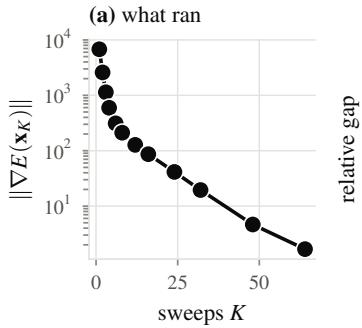

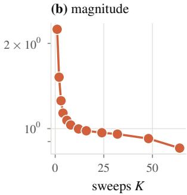

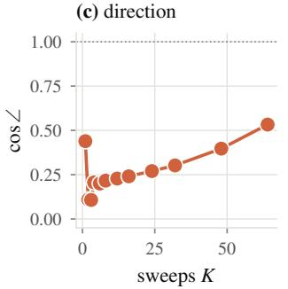

(d) does it matter  
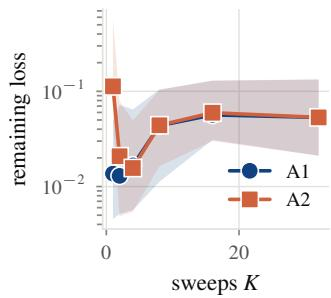  
Figure 4: The report’s running example, one implicit step followed from what is computed to what it costs. Two mass-spring chains stepped with implicit Euler and solved by K Gauss–Seidel sweeps; panels (a) to (c) take one step at $k = 2 \times 1 0 ^ { 5 }$ , panel (d) fits random stiffness fields near $6 \times 1 0 ^ { 3 }$ on a shorter, pinned chain over twelve steps. (a) what ran: the residual falls with the budget but does not vanish, so the iterate the sweeps reached (A1) and the root they approach (A2) are two different objects to differentiate. (b) the relative norm of the vector difference between the two gradients is of order one across the plotted range. (c) they disagree in direction too, the cosine sitting between 0.1 and 0.55, so the two are nearly orthogonal. (d) and, for a target the same solver generated, it makes almost no difference to the optimization: from two sweeps onward no stable advantage is separable, median and interquartile range overforty seeds. Panels (b) and (c) are large at the stiff setting; (d) shows no separation between A1 and A2 for its fitting problem from two sweeps on. For this reason the report separates which derivative a method returnsfrom whether it helps.

The choice of referent and realization should therefore follow the solver’s convergence, memory, and accuracy requirements rather than the physics label alone. Opportunities for local reverse updates depend on the actual update dependencies, including any global solves, rather than on whether a model unifies several material types. A tightly converged deformable solve can support an equation-level derivative; for a rigid solver truncated for real time, an equationlevel adjoint evaluated at the last iterate generally need not equal the derivative of the executed computation.

## 7. Gradient Quality

The sections above concern obtaining a derivative, and this section asks whether the derivative helps. There is now substantial evidence that gradient-based optimization through a differentiable simulator can be outperformed by zeroth-order methods that never touch the simulator’s derivatives [MFSK21, SSZT22], on problems where the gradients are computed correctly by any of the definitions in Section 4. A survey that cataloged differentiation techniques without confronting this would misrepresent the state of the art.

We find it useful to separate four mechanisms. They have different causes, diagnostics, and remedies, although the literature frequently groups them under bad gradients. Figures 5, 6, and 7 illustrate the associated diagnostics on a small testbed, with the literature providing broader evidence. In particular, the contact experiment demonstrates sensitivity amplification associated with repeated wall encounters; it does not establish chaos or an asymptotic law for gradient variance. The testbed illustrates these effects rather than determining their prevalence or magnitude at graphics scale.

## 7.1. Mechanism 1: non-convergence bias

If the forward solver is truncated and the backward pass evaluates an equation-level adjoint (referent A2) at the final iterate, the returned vector generally differs from the derivative of the executed computation. For a fixed problem this mismatch is deterministic: repeated evaluation of the same solve does not remove it, and optimizing the outer objective does not ensure that the inner solve converges. The mismatch can decrease as the forward solve converges, but a small forward residual alone does not certify gradient accuracy. Bounds also depend on the conditioning of the residual Jacobian, the parameter sensitivity of the residual, and the regularity of the solver’s convergence. Tight-tolerance validation can therefore miss discrepancies that appear at production iteration budgets [SJW∗26].

We measured this mechanism directly, and Figure 5 reports the result. The experiment is small so that the exact derivative of the executed computation can be derived by hand rather than taken on trust from a differentiation framework. A chain of $n = 2 4$ point masses $( m = 1$ , rest length 1) sits under gravity −9.8 with no vertex pinned and is stepped with implicit Euler at $h = 1 / 6 0 ;$ the parameter is the vector of 23 per-spring stiffnesses, the loss is squared distance to a target configuration, and the solver is a sequential Gauss–Seidel sweep of per-vertex Newton updates. Stiffness sensitivity in this unpinned test depends on the initial deformation and relative velocities. An unstressed chain with a common initial velocity under uniform gravity undergoes stiffness-independent free fall. Relative gradient diagnostics therefore require a nonzero reference sensitivity; normalization by the converged gradient would be undefined in that degenerate case. The optimization of Table 6 uses $n = 1 6$ with the first vertex pinned, a horizon of 12 steps, 120 steps of normalized gradient descent with a step of 3% of ∥θ∥, and 40 random instances. Code is provided as supplementary material. Within the iteration budget a real-time solver actually runs, the discrepancy exceeds the magnitude of the gradient itself once the material is stiff. The disagreement is also directional, which matters more for optimization. At one to ten sweeps the equation-level adjoint of the stiff chain is nearly orthogonal to the true derivative of the executed solve, with cos∠ falling to between 0.1 and 0.3. A positive cosine against the true derivative makes the negative of the returned vector a descent direction, which guarantees only that a sufficiently small step along it decreases the objective, and says nothing about the step sizes an optimizer actually takes or about convergence. At these cosines it is a very inefficient direction. Repeatedly averaging the same deterministic biased vector does not remove the discrepancy. Across the stiffnesses we swept the effect is governed by stiffness, so it is easy to miss on the soft test cases that gradient checks typically use; we did not vary the problem size and so claim nothing about how it scales with that.

A near-orthogonal gradient may still be usable, so we also measured what the bias costs an optimizer. Fitting random stiffness fields on a shorter chain by gradient descent through the same solver over twelve steps, changing only which gradient the optimizer is given, produces Table 6 over 40 random problem instances.

The result is narrower than Figure 5 suggests, and we report the gap between the two. At a single sweep the exact gradient is decisively better: the equation-level adjoint leaves roughly eight times more loss and wins on only four of forty instances. From two sweeps onward, with the target generated at the same K, we could not separate them, win rates hovering around a coin flip, which with a median and a win rate over forty seeds is consistent with a modest advantage either way rather than evidence of equivalence. Figure 4 puts that beside the angle: the gradients disagree in direction at budgets where the outcomes already coincide, with a median cosine over the forty instances of 0.51 at two sweeps (interquartile range 0.38 to 0.66) and 0.61 at four (0.55 to 0.78); from eight sweeps on, where the median is 0.95, both directions and outcomes agree. A gradient can be substantially wrong in direction and still drive the optimization about as well.

Two limits on that reading are built into the design. Normalized steps remove the magnitude of the gradient from the update, so the comparison measures the usefulness of two directions under one update rule, and an optimizer that uses the magnitude, a line search or a quasi-Newton method, could weigh them differently. For the same-K target columns of Table 6, changing K also changes the target-generating solver. Comparisons across those columns therefore do not isolate the effect of a larger budget on fixed target data. Within this target construction, the two referents produced similar reported outcomes from two sweeps upward, but not at one sweep.

The third limit is the target itself, and the two further groups of columns in Table 6 measure it. When the target is the endpoint of a solve run to convergence and the fit runs K sweeps, so that the model that generated the target and the model being fitted differ at the true parameters by the forward truncation error, the exact derivative wins on every instance up to four sweeps, by two orders of magnitude at two and four, and the two referents become indistinguishable only from about sixteen sweeps on. Against an external target that no finite stiffness field reaches under gravity, A1 wins on every instance up to eight sweeps, by a smaller margin from two sweeps on, while at thirty-two sweeps A2 finishes lower on every instance, by about two percent. On this testbed, these results suggest that the equation-level direction is adequate when the fitted model can match the target at the parameters it is heading for, and misleading when matching the target means compensating the truncation bias; the single-step instance of Appendix A, where A2 loses on every seed at four sweeps, is the same effect. Which case an application is in depends on where its target comes from, which is a reason to measure item (iii) of the checklist rather than assume it.

Diagnostic: compare against finite differences of the executed simulator, not of an idealized one, at the production iteration count. Remedy: converge the forward solve, or adopt the executedcomputation referent.

(a) distance from convergence  
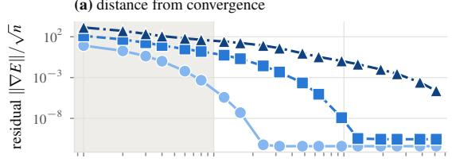

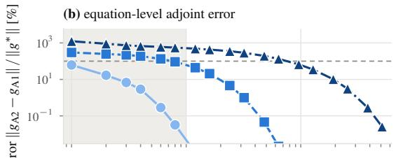  
(c) direction agreement

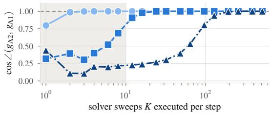  
Figure 5: Mechanism 1 measured. A mass-spring chain is stepped with implicit Euler and solved by K Gauss–Seidel sweeps of per-vertex Newton updates, a one-dimensional instance of vertex block descent [CLYY24]; the parameter is the vector of per-spring stiffnesses. We compare the exact derivative of the K sweeps that actually executed, referent A1, against the equation-level adjoint, referent A2, evaluated as an implementation evaluates it: at the iterate the K sweeps reached, as if the residual there had vanished. (a) how far the truncated solve is from convergence. (b) the norm of the difference between the two gradients, relative to the gradient of the same solve run to convergence; above the dashed line the discrepancy is larger than the quantity being estimated. (c) the cosine ofthe angle between them, which indicates whether the negative returned vector is a local descent direction for the executed objective. Actual progress also depends on step size, curvature, and the optimizer. The shaded band marks the one to ten sweeps a real-time deformable solver actually runs. Within that band the two derivatives agree well for compliant material from two sweeps on, but for the stiffest material $( k = 2 \times 1 0 ^ { 5 } )$ the equation-level adjoint is nearly orthogonal to the true derivative of the executed computation, and agreement is recovered only after hundreds of sweeps; at $k = 2 \times 1 0 ^ { 4 }$ a few dozen suffice. Theforward sensitivity was differentiated by hand through the executed arithmetic and checked against central differences of the same pipeline to a relative error below 4 × 10−6.

## 7.2. Mechanism 2: horizon-induced ill-conditioning

Equation (3) contains products of T − t − 1 state-transition Jacobians. Uniform contraction can make these products decay, while sustained expansion along relevant directions can make them grow. The resulting vanishing or growing sensitivities are properties of the differentiated dynamics and cannot be removed merely by changing the differentiation implementation. Stiffness introduces disparate time scales, but its effect on discrete sensitivities depends on the integrator, time step, scaling, and spectrum. It does not by itself imply growth of the condition number of At or of the gradient; on this report’s converged implicit-Euler chain the condition number of A does grow roughly linearly with $k \ ( 5 . 5 \times 1 0 ^ { 3 } , 7 . 6 \times 1 0 ^ { 4 }$ and $7 . 9 \times 1 0 ^ { 5 }$ at $k = 2 \times 1 0 ^ { 3 } , 2 \times 1 0 ^ { 4 }$ and $2 \times 1 0 ^ { 5 } )$ . Figure 6 examines horizon-dependent sensitivity and precision disagreement on the chain of Figure 5; it does not measure every Jacobian product or establish a condition-number bound. The accumulated sensitivity does not explode: over three hundred steps it varies by a factor of fifteen, so “exploding gradients” is the wrong diagnosis here. Instead, the agreement between the double- and single-precision derivatives degrades as the horizon grows. When the same differentiated realarithmetic recurrence is evaluated in double and in single precision, with the implementation differing only in arithmetic precision, their cosine is one to four figures out to twenty steps and to three at forty (the vectors differ by one and five percent in norm), and then they separate, the cosine between them falling to 0.79 at eighty steps, 0.64 at a hundred and sixty and 0.48 at three hundred and twenty on the run reported; a rerun on other hardware gives 0.65 and 0.25 at the last two, so the collapse is reproducible and its exact value is not. Two controls locate the source of the disagreement. Running the trajectory in double and only the sensitivity recurrence in single leaves the cosine above 0.999 at every horizon: sensitivity arithmetic alone is not the dominant source of the directional disagreement in this experiment. Running the trajectory in single and the sensitivity in double reproduces the collapse to within 0.003 in cosine. The single-precision forward pass follows a trajectory that differs from the double-precision one by a relative $1 0 ^ { - 7 }$ at the first step and $1 0 ^ { - 4 }$ by eighty, a difference the loss barely registers, at most two parts in ten thousand, while the derivative evaluated along its rounded states points in a different direction. The horizon enters twice: the dynamics amplify a rounding-level perturbation of the trajectory by three orders of magnitude, and the gradient map amplifies the result to an order-one change of direction while the objective moves by $1 0 ^ { - 4 }$ . For this parameterization, the derivative is more sensitive to the rounded forward states than the objective value is. The mixed-precision controls associate the observed dis agreement primarily with the forward trajectory; the size of the total parameter sensitivity alone does not bound every state-transition Jacobian product. The gradient norms here are small in the units of the problem, between $5 \times 1 0 ^ { - 8 }$ and $3 \times 1 0 ^ { - 5 }$ . We use cosine to isolate directional disagreement. Relative norm errors are also scaleinvariant, and both directional and relative diagnostics require care when a gradient is close to the numerical noise floor.

Table 6: What the equation-level referent costs an optimizer, and how much that depends on where the target came from. Loss remaining after 120 gradient descent steps, as a fraction of the initial loss, median over 40 random instances of the fitting problem (a 16-vertex chain over twelve steps), with the fraction of instances on which A2 finished lower; lower is better. Three constructions of the target, everything else identical: the endpoint the same solver at the same K producesfrom the true stiffnessfield, so that thefit can reach it exactly; the endpoint a solve run to convergence (2000 sweeps) produces,fitted with K sweeps; and the rest configuration, which no stiffness field reaches under gravity. Within-row comparisons isolate the choice of gradientfor each target construction. Across-budget comparisons for same-K targets also change the target-generating solver; comparisons for converged or external targets isolate the budget onl ifinstances and target data are heldfixed.
<table><tr><td rowspan="2">K</td><td colspan="3">target generated at the same K</td><td colspan="3">target generated converged</td><td colspan="3">external target</td></tr><tr><td>A1</td><td>A2</td><td>A2 wins</td><td>A1</td><td>A2</td><td>A2 wins</td><td>A1</td><td>A2</td><td>A2 wins</td></tr><tr><td>1</td><td> $1 . 4 \times 1 0 ^ { - 2 }$ </td><td> $1 . 1 \times 1 0 ^ { - 1 }$ </td><td>10%</td><td> $1 . 5 \times 1 0 ^ { - 1 }$ </td><td> $9 . 7 \times 1 0 ^ { - 1 }$ </td><td>0%</td><td> $8 . 2 \times 1 0 ^ { - 4 }$ </td><td> $4 . 7 \times 1 0 ^ { - 1 }$ </td><td>0%</td></tr><tr><td>2</td><td> $1 . 3 \times 1 0 ^ { - 2 }$ </td><td> $2 . 1 \times 1 0 ^ { - 2 }$ </td><td>38 %</td><td> $3 . 7 \times 1 0 ^ { - 3 }$ </td><td> $8 . 9 \times 1 0 ^ { - 1 }$ </td><td>0%</td><td> $5 . 9 \times 1 0 ^ { - 4 }$ </td><td> $1 . 2 \times 1 0 ^ { - 3 }$ </td><td>0%</td></tr><tr><td>4</td><td> $1 . 7 \times 1 0 ^ { - 2 }$ </td><td> $1 . 6 \times 1 0 ^ { - 2 }$ </td><td>48 %</td><td> $2 . 3 \times 1 0 ^ { - 3 }$ </td><td> $4 . 6 \times 1 0 ^ { - 1 }$ </td><td>0%</td><td> $3 . 9 \times 1 0 ^ { - 4 }$ </td><td> $7 . 4 \times 1 0 ^ { - 4 }$ </td><td>0%</td></tr><tr><td>8</td><td> $4 . 4 \times 1 0 ^ { - 2 }$ </td><td> $4 . 4 \times 1 0 ^ { - 2 }$ </td><td>45 %</td><td> $2 . 6 \times 1 0 ^ { - 2 }$ </td><td> $4 . 3 \times 1 0 ^ { - 2 }$ </td><td>28 %</td><td> $4 . 0 \times 1 0 ^ { - 4 }$ </td><td> $6 . 1 \times 1 0 ^ { - 4 }$ </td><td>0%</td></tr><tr><td>16</td><td> $5 . 7 \times 1 0 ^ { - 2 }$ </td><td> $6 . 0 \times 1 0 ^ { - 2 }$ </td><td>40%</td><td> $5 . 2 \times 1 0 ^ { - 2 }$ </td><td> $5 . 3 \times 1 0 ^ { - 2 }$ </td><td>35 %</td><td> $6 . 7 \times 1 0 ^ { - 4 }$ </td><td> $7 . 0 \times 1 0 ^ { - 4 }$ </td><td>12 %</td></tr><tr><td>32</td><td> $5 . 3 \times 1 0 ^ { - 2 }$ </td><td> $5 . 3 \times 1 0 ^ { - 2 }$ </td><td>38 %</td><td> $5 . 3 \times 1 0 ^ { - 2 }$ </td><td> $5 . 3 \times 1 0 ^ { - 2 }$ </td><td>38 %</td><td> $6 . 9 \times 1 0 ^ { - 4 }$ </td><td> $6 . 7 \times 1 0 ^ { - 4 }$ </td><td>100 %</td></tr></table>

In single precision, the sensitivity recurrence approximates the derivative of the real-arithmetic operations evaluated along rounded forward states; it is not the exact derivative of the floating-point rounding map. The horizon at which small perturbations of those states substantially change the derivative’s direction marks a precision limitation for this implementation. Whether optimization still benefits past that point is a separate question, which a change of direction does not settle on its own, as Table 6 shows for Mechanism 1. On this testbed the point is near eighty steps; a production simulator in single precision, the common case on the GPU, has its own trajectory sensitivity and will reach it earlier or later, and the diagnostic carries over where the number does not. A gradient-norm monitor shows nothing unusual in this experiment. Diagnostic: compare the gradient against the same gradient computed in higher precision, and treat the horizon at which they part as the point beyond which the gradient is precision-limited and should be tested before it is relied on. Remedy: truncate the horizon, which trades bias for conditioning; this is the core of short-horizon actor–critic methods [XMN∗22], which learn a value function to terminate the backpropagation window, and of adaptive-horizon variants [GSX∗24] that choose the truncation point from the observed dynamics.

## 7.3. Mechanism 3: chaos and variance amplification

Some contact-rich and turbulent systems exhibit chaotic sensitivity. In such systems, a derivative of an individual rollout can be large and mathematically correct while being difficult to use for optimizing an expectation over initial conditions or noise. Under suitable assumptions, pathwise gradient variance can grow rapidly, including exponentially with horizon, even when the gradient of the expectation remains modest. Metz et al. [MFSK21] document this across several domains and give it its clearest statement; Parmas et al. [PRPD18] identified the same effect in model-based policy search earlier and proposed combining pathwise and likelihood-ratio estimators to control it. Suh et al. [SSZT22] sharpen the analysis for simulators specifically, showing that the first-order estimator’s advantage over a zeroth-order one depends on the smoothness of the underlying landscape and can be reversed in the discontinuous or stiff contact examples they study.

Figure 7(b) measures gradient-spread amplification on the chain, and the conditions under which it appears are part of the result. Launched at a single wall, the chain bounces once and departs; an ensemble of launches perturbed by $1 0 ^ { - 6 }$ returns gradients whose spread stays at its forty-step level for as long as we ran it. With a second wall behind it, so that it bounces repeatedly, the spread climbs roughly seventy-fold between forty and thirteen hundred steps, doubling every two hundred. In this testbed, the two-wall trajectories show increasing gradient spread over the tested horizons, whereas the single-wall trajectories show no comparable growth. This comparison associates the observed amplification with repeated wall encounters under these settings; it does not establish that recurrence is necessary for amplification, or that a single contact cannot amplify sensitivities. It also does not establish chaos: we have not measured a Lyapunov exponent. Nor does it establish the exponential variance growth of Metz et al.’s analysis, which requires an appropriate statistical and horizon-dependent assessment. Diagnostic: compare the variance of the pathwise estimator against a zeroth-order baseline at the horizon in use. If the former is larger, treat it as a warning that is not by itself conclusive, since bias, the quantity each estimator targets and the cost of each evaluation enter the comparison too. Remedy: interpolate between first- and zeroth-order estimators [SSZT22, PRPD18], or smooth the objective (Section 5).

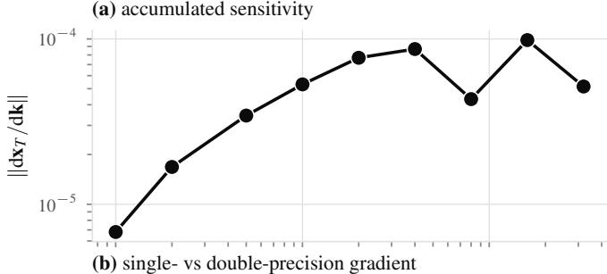

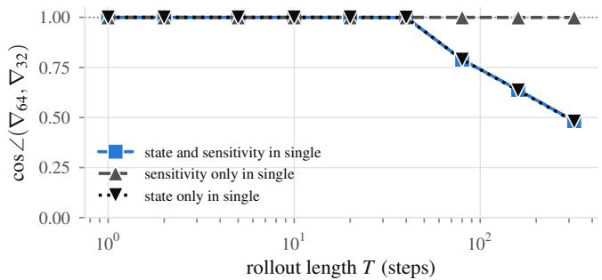  
Figure 6: Mechanism 2 measured, on the mass-spring chain of Figure 5 stepped with implicit Euler and eight Gauss–Seidel sweeps. Per-spring stiffnesses are the parameters and the sensitivity is propagatedforward through the executed arithmetic, so the experiment tests sensitivity to the forward states and arithmetic precision without introducing a reverse-mode implementation. (a), the accumulated sensitivity ∥dxT/dk∥ varies by a factor of fifteen over three hundred steps: it does not explode, and the loss-gradient norm, not shown, rises by less than three orders of magnitude while the loss rises by eight and a half, so neither would alarm a monitor. (b), the cosine between derivatives obtainedfrom the same sensitivity recurrence in double and in single precision, with two controls that separate the two places rounding can enter. With state and sensitivity both in single, agreement holds to four figures out to twenty steps and three at forty, and then falls: 0.79 at eighty, 0.64 at a hundred and sixty, 0.48 at three hundred and twenty (the last two vary with hardware; see text). With the trajectory in double and only the sensitivity recurrence in single, the cosine stays above 0.999 throughout. With the trajectory in single and the sensitivity in double, the fall is reproduced to within 0.003 in cosine. The disagreement therefore comes from the single-precision trajectory, which differs from the double one by a relative $1 0 ^ { - 4 }$ at eighty steps while the loss differs by about two parts in ten thousand (at most $2 . 2 \times 1 0 ^ { - 4 } ) .$ : the gradient isfar more sensitive to the trajectory than the objective is. The final contraction of the sensitivity with the loss gradient is done in double in every variant, so that it does not enter the comparison.

## 7.4. Mechanism 4: contact-induced gradient collapse

Distinct from variance, a contact-only objective can have a region in which its local derivative is zero because no contact occurs within the horizon. This does not imply that every task loss is flat before contact, or that contact information is confined to a measure-zero set. In the penalty model of Figure 7(a), with accumulated contact energy as the objective and launch velocity as the parameter, the derivative is identically zero for launches that do not reach the wall: five of the sixty sampled velocities. Gradients can be nonzero throughout the active-contact region, rather than only at its boundary.

This plot illustrates the local support of the contact-energy derivative. If the nonnegative contact energy is minimized, its zero-contact plateau is already a global minimum; the plot alone therefore does not demonstrate optimization failure. For a task whose successful solution requires establishing contact, a locally constant contactdependent term can nevertheless leave an optimizer without a useful local signal. Changing the derivative referent or its implementation cannot change the exact derivative of a locally constant function. Diagnostic: examine near-zero gradients in relation to the task objective, including whether successful solutions require leaving such regions. Remedy: possible responses include smoothing [PSYT23, LLSM∗24], global or population-based search [AYJB23], and forward/backward decoupling (Section 5.7). Non-local repulsive terms, such as those in Repulsive Shells [SSRC24], can extend geometric sensitivity beyond a contact neighborhood, but do not guarantee informative gradients for every task or parameterization.

## 7.5. Summary of the evidence

For contact-rich, long-horizon tasks, improving derivative exactness alone may not improve optimization when estimator variance or a lack of useful local information is the limiting factor. In smooth, short-horizon inverse problems with deliberately truncated forward solves, non-convergence mismatch can instead be important. These task labels do not determine the dominant mechanism: identifiability, objective conditioning, model discrepancy, and noise can also limit optimization. Our own measurement bounds how much follows from that: exactness was decisive at the tightest iteration budget and, for a target the same truncated solver generated, not above it, despite a large angle between the gradients; for a target from a converged solve or from outside the simulator it stayed decisive up to four and eight sweeps. A substantial derivative mismatch is therefore not sufficient for exactness to decide the outcome.

The comparison in Suh et al. [SSZT22] is further qualified by Onoda et al. [OPYM26], who emphasize per-step inverse-variance weighting on standard robotics control benchmarks. In their experiments, controlling variance was more consequential than explicit empirical-bias detection. This qualifies a narrative centered on discontinuity-driven estimator switching, but variance reduction alone does not identify chaos as the cause or establish a conclusion about deployed robotics in general. The result suggests diagnosing the limiting source of gradient error or variability on the task, rather than inferring it from the presence of contact.

The consequence for how results are reported is that a differentiable simulator paper demonstrating improved gradient accuracy and one demonstrating improved task performance make different claims, and the second does not follow from the first. We take this up in Section 10.

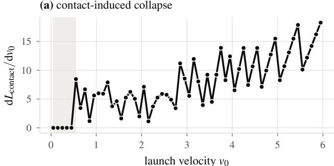

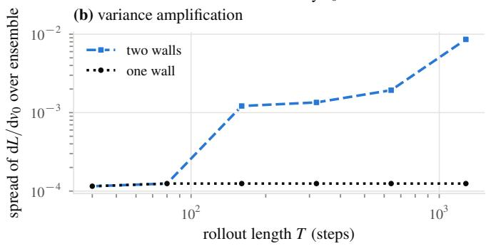  
Figure 7: Contact-gradient support and sensitivity amplification in the massspring contact testbed $( k = 2 \times 1 0 ^ { 4 }$ , eight sweeps, no gravity, wall stiffness $\dot { 2 } \times 1 0 ^ { 5 } ) ,$ with launch velocity as the single parameter and accumulated contact energy as the objective. Panel (a) uses a 120-step rollout; panel (b) varies the horizon. (a) the derivative against launch velocity: below the velocity at which a vertex reaches the wall within the horizon (shaded), no contact occurs and the derivative is zero; gradients can be nonzero in the active-contact region. This is a derivative-support diagnostic, not evidence that minimizing contact energy fails in the zero-contact region. (b) spread (standard deviation) of the same derivative over an ensemble of launches perturbed by $1 0 ^ { - 6 } .$ . Between two walls, repeated bounces are associated with roughly seventy-fold growth in spread over the tested horizons. With one wall, the chain bounces once and the spread remains approximatelyflat. These observations do not establish chaos or show that repeated contact is necessaryfor sensitivity amplification.

## 8. Systems and Implementation

Turning a differentiation strategy into a usable simulator is largely a systems problem, and a substantial fraction of the engineering effort in this field has gone into it.

## 8.1. Memory

As discussed in Section 3.2, reverse mode can evaluate scalar-loss gradients efficiently but may require substantial storage or recomputation. Memory is often a binding constraint for large graphics simulations. Three responses recur.

Checkpointing [GW00] stores state at selected steps and recomputes intervening segments during the backward sweep, and is common wherever memory binds. As Section 4.2 notes, the achievable point on the memory–recomputation curve follows from the schedule rather than from a single law: storing $O ( \sqrt { T } )$ states costs a constant number of extra forward sweeps, whereas O(logT) states costs a recomputation factor that grows logarithmically as well, under the usual uniform-step-cost model. ACA [ZDL∗20] supports adaptive ODE stepping by storing accepted states and step sizes and recomputing local differentiation graphs. This is distinct from choosing an optimal sparse checkpoint schedule under a fixed memory budget.

Recomputation of derived quantities can reduce storage for quantities reconstructible from the state, at the cost of additional work. The tradeoff depends on reconstruction cost, memory traffic, and the hardware. Hand-derived adjoints can expose these opportunities, but AD compilers, custom derivative rules, and rematerialization policies can exploit them as well, since a recorded computation can still be recomputed.

Avoiding a general tape does not imply avoiding all trajectory storage. Equation-level differentiation can avoid retaining inner solver iterates, although a time-dependent adjoint still requires access to forward states and other information needed to evaluate its local derivatives. A structural adjoint of the executed updates instead retains or reconstructs the inputs required by those updates. Reverse-sweep VBD [SJW∗26] reports a $7 1 \times$ memory reduction relative to its unrolled-AD baseline on the stated benchmark. Its replay record contains nine doubles, or 72 bytes, per vertex per sweep; the approximately four-kilobyte normalized peak allocation reported in the same study includes other allocations and is a different memory measure. The reported allocation scales linearly with $K | V | .$ , and the largest rollout is checkpointed every five steps. The backward computation, the data retained within a step, and the checkpoint schedule across time should therefore be reported separately. The referent and realization constrain these choices, but do not uniquely determine the complete memory budget.

## 8.2. Parallelism and locality

A mathematically correct backward pass may have less favorable memory locality or parallelism than its forward pass and therefore achieve lower throughput. Preserving useful structure can help, but performance depends on the implementation and must be measured. DiffTaichi’s central technical contribution $[ \mathrm { H A L } ^ { * } 2 0 ]$ is a sourcetransformation reverse mode that keeps the megakernel structure intact, and the reverse-sweep formulation $[ \mathrm { S J W ^ { * } } 2 6 ]$ applies the same principle to a hand-derived backward, making it a mirror of the forward sweep, so a colored Gauss–Seidel forward pass yields a colored Gauss–Seidel backward pass with identical parallelism.

Nondeterministic floating-point reductions can perturb both the forward trajectory and the recomputation of checkpointed segments. If replay differs from the original execution, the resulting derivative may change, especially in sensitive or contact-rich dynamics. The size of that change should be measured. Depending on the required replay fidelity, deterministic reductions or saved branch and state information may be needed.

## 8.3. Precision

Derivative computations can be more sensitive to finite precision than objective values. For compatible nonsingular matrices, the condition number of a product is bounded by the product of the individual condition numbers, but need not equal it; sensitivity also depends on the directions excited and on the forward states at which derivatives are evaluated. Single precision may therefore be adequate for a forward observable while giving a substantially different gradient. Mixed precision should target the dominant error source. In Figure 6, double-precision sensitivity accumulation along a singleprecision trajectory does not remove the observed disagreement, whereas a double-precision trajectory with single-precision sensitivity propagation retains close agreement. These controls motivate reporting forward and derivative precision separately, together with task-specific error measurements.

## 8.4. Engines

Tables 4 and 5 place the methods on the two taxonomic axes. Table 7 instead compares particular software implementations: how the backward pass is constructed, what information is retained or recomputed, and where the reported implementation runs. These categories should not be read as a necessary equivalence between a hand-derived adjoint and low memory use. Generated and traced derivatives can also use custom rules, code generation, and checkpointing, while hand-derived trajectory adjoints still require forward information.

## 9. Applications

This section reads the literature through the two axes rather than by task. Figure 8 shows three uses of simulator gradients corresponding to the application classes below.

## 9.1. System identification and real-to-sim

System identification inverts the simulator against observation. Given a recording of a real object deforming or colliding, differentiable simulation can be used to fit model parameters to the observations. Hahn et al. [HBBC19] estimate viscoelastic parameters from captured deformation; Huang et al. [HTG∗24] estimate hyperelastic parameters and friction coefficient from captured animation sequence; gradSim [JMG∗21] composes a differentiable simulator with a differentiable renderer to identify physical parameters from video alone, without intermediate state supervision; PhysAvatar $\mathrm { [ } Z Z \mathrm { Y } ^ { * } 2 4 \mathrm { ] }$ fits the density, stretching and bending stiffness of a garment to multi-view video of a dressed person by running a C-IPC cloth simulator inside the loop, with the three-parameter gradient taken by finite differences because no analytic gradient of that solver was available.

Many system-identification tasks admit short-horizon objectives and smooth parameterizations, but contact, long observation windows, and poorly identifiable parameters can also make these problems difficult. For forward solves truncated by design, the derivative mismatch of Section 7 is one relevant source of error. Table 6 fits a material field and separates the two referents up to four or eight sweeps when the target comes from a converged solve or from outside the simulator, respectively, and only at a single sweep when the same truncated solver generated the target. The usefulness of derivative exactness therefore has to be measured at the solver budget and target construction used by the application.

The first of two recurring issues is identifiability: an observed trajectory can constrain some parameter combinations tightly while leaving others weakly determined. A point estimate alone does not express that uncertainty. Transient observations can help distinguish effects such as stiffness and damping, but the result depends on the excitation and observation model. Derivative access supports local Gauss–Newton or Fisher-information approximations to parameter uncertainty. Computing and interpreting these approximations still requires a noise model, sufficient identifiability or explicit regularization, and additional Jacobian products and linear solves; a scalarloss adjoint does not provide a covariance matrix almost for free.

The second is that the model class bounds the achievable fit: when a real material is not in the family the simulator can express, optimization can at best fit the observations within that model class; convergence to a global best fit is not guaranteed. Learning the constitutive law itself [MCD∗23] attacks this directly, using differentiability to supervise a neural material model from observed motion rather than only fitting coefficients of a prescribed constitutive family.

## 9.2. Control and policy learning

Control is a prominent application of simulator gradients, which supply a pathwise policy gradient through the dynamics in place of a score-function estimator. Results in practice are mixed, for the reasons of Section 7. Successful methods address different limitations: PODS [MPH∗21] uses a Gauss–Newton policy update assembled from first derivatives of the simulator and reward curvature, rather than second derivatives of the dynamics; SHAC [XMN∗22] truncates backpropagation with a learned value function; AHAC [GSX∗24] adapts its horizon using a dynamics-Jacobian threshold intended to avoid stiff contact gradients; and GIPPO combines an analytic-gradient-informed target-policy update with PPO updates [SZS∗23]. Wiedemann et al. [WWL∗23] train trajectory-tracking controllers for aerial vehicles on analytic policy gradients, and Li et al. [LXY∗23] control rigid bodies through two-way fluid coupling, optimizing release states and training neural controllers on the localized forward-mode gradient of Section 6.4. Antonova et al. [AYJB23] use local gradients within a broader global-search strategy. Evidence of practical transfer includes Schwarke et al. [SKB∗25], who train a quadrupedal locomotion policy with short-horizon analytic gradients and a learned critic and transfer it to hardware zero-shot. This demonstrates transfer for their task and training setup; it does not by itself establish that the simulator gradients are unbiased or that model exploitation is absent.

These methods use simulator gradients in different ways: curvature approximations improve the update, truncation and learned values control the backpropagation horizon, combined analytic and PPO updates manage stochastic gradient quality, and global search reduces reliance on a single local basin. They therefore cannot all be reduced to horizon control or to Mechanisms 2 and 3. A practitioner has to determine which limitation dominates the task and which part of the optimization procedure addresses it. Improving derivative accuracy can help, but does not replace these choices.

## 9.3. Inverse design and fabrication

Differentiable simulation makes design an optimization over shape, material, and the actions that use them. Applications include co-design of robot morphology or material and control [SZD∗19, XCZ∗21], cavity design of pneumatic actuators [GKB∗24], shape interpolation for underwater swimmers [MDZ∗21], garment pattern design and recovery [Wan18, LCL∗24, CLK∗25, LYD∗25], knife-trajectory optimization for cutting [HMN∗21], grasp synthesis [TWH∗22], deployable structures [PKLI∗19, RKP∗22], shock protecting structures [HPZ24], trajectory optimization for cabledriven and underwater soft robots [BBPC19, DHW∗21], and locomotion benchmarks [WMS∗23]. Two further instances optimize through an MPM equilibrium rather than a dynamic rollout: a topology optimization method that computes adjoint sensitivities through the force-equilibrium solve [LLL∗21], and a folding-wing aerial vehicle whose bistable mechanism is designed by optimizing through a quasi-static MPM equilibrium and validated in dynamics by forward simulation only [LML∗21]. Differentiating with respect to shape [TZZ21, HTG∗24] rather than material is a distinct problem, since the parameter changes the domain and therefore the discretization; Ye et al. [YGW∗26] and PhysiOpt [ZJT∗25] sidestep it by keeping the discretization fixed and moving vertices or densities within it. The equilibrium-design examples are quasi-static, whereas swimming and locomotion involve dynamic trajectories. Shockprotecting microstructures are optimized through nonlinear equilibrium homogenization and evaluated with separate transient drop simulations and physical tests. Short horizons and smooth equilibria can simplify sensitivity analysis, but gradient reliability still depends on conditioning, contact transitions, and solver convergence.

Table 7: Differentiable simulation systems viewed as software, complementing Tables 4 and 5. Backward construction describes how derivative computations are implemented. Backward memory lists principal retained information, not a complete allocation bound: forward states, contact data, and linear-solver data may also be required or recomputed. The absence ofan inner-iteration tape does not imply constant rollout memory. Backend and AD coverage depend on the solver and version. Entries summarize the cited descriptions and supported derivative paths.
<table><tr><td>System</td><td>Backward construction</td><td>Backward memory</td><td>Execution backend</td></tr><tr><td>DiffTaichi [HAL*20]</td><td>compiler source transformation</td><td>tape, with checkpointing</td><td>Taichi; CPU and CUDA</td></tr><tr><td>Warp [Mac22]</td><td>compiler source transformation</td><td>kernel-launch tape and re- quired data</td><td>CPU and CUDA</td></tr><tr><td>Brax [FFR*21]</td><td>framework tracing (JAX/XLA)</td><td>saved residuals; optional rematerialization</td><td>CPU, GPU and TPU; parallel envs</td></tr><tr><td>JAX MD [SC21]</td><td>framework tracing (JAX/XLA)</td><td>saved residuals; optional rematerialization</td><td>CPU, GPU and TPU</td></tr><tr><td>ΦFlow [HKT20]</td><td>backend AD; custom implicit solve derivatives</td><td>backend- and solver-dependent data</td><td>pluggable array backend</td></tr><tr><td>Genesis [Gen24]</td><td>kernel source transformation (Taichi lineage)</td><td>saved state and derivative data</td><td>GPU and CPU backends; differentiable MPM path</td></tr><tr><td>Newton [The25]</td><td>Warp-generated derivatives for supported solvers</td><td>solver-dependent saved data</td><td>CUDA (CPU on macOS); MuJoCo Warp is not differentiable</td></tr><tr><td>NeuralSim [HMC*21]</td><td>templated AD; taped reverse mode or CppADCodeGen</td><td>backend-dependent tape or generated-code state</td><td>CPU</td></tr><tr><td>Nimble [WOL*21]</td><td>hand-derived analytic LCP gradi- ents</td><td>per-step Jacobians from the step&#x27;s inputs and LCP parti- tion; no inner-iteration tape</td><td>CPU</td></tr><tr><td>Dojo [HLCB*22]</td><td>implicit differentiation at a re- laxed central-path point</td><td>per-step states and implicit- derivative data; no inner- iteration tape</td><td>CPU</td></tr><tr><td>ADD [GHZ*20] DiffPD [DWM*22]</td><td>hand-derived integrator adjoint hand-derived, applied through the</td><td>per-step state, no tape per-step state, no tape</td><td>CPU CPU</td></tr><tr><td>DiffCloth [LDW*23]</td><td>reused forward factorization</td><td></td><td></td></tr><tr><td></td><td>adjoint vector from a global solve, with per-step contact handling</td><td>per-step state, no tape</td><td>CPU</td></tr><tr><td>DiffXPBD [SC23]</td><td>hand-derived trajectory adjoint</td><td>forward states and derivative quantities; sparse adjoint solve</td><td>CPU, multi-core</td></tr><tr><td>DiffIPC [HTG*24]</td><td>hand-derived integrator adjoint</td><td>per-step state, no tape</td><td>CPU</td></tr><tr><td>Reverse-sweep</td><td>hand-derived reverse sweep of</td><td>nine-double replay record per vertex per sweep; total alloca-</td><td>CUDA</td></tr><tr><td>VBD [SJW*26]</td><td>block updates</td><td>tion scales as K|V|; the 106- body rollout is checkpointed</td><td></td></tr></table>

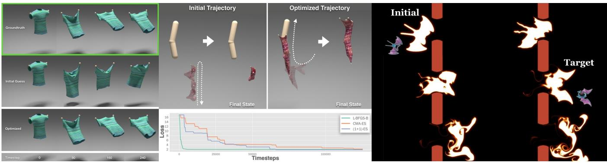  
Figure 8: Three uses of a simulator gradient, as their authors report them. Left, material parameters recovered from observed cloth motion by optimizing through the simulator, the inverse problem of Section 9.1. Middle, a trajectory optimized through frictional contact; the loss curve beneath compares the analytic gradient against two zeroth-order optimizers on the same task, which is the comparison item 7 of our checklist asks every paper to report. Right, smoke steered from one silhouette through fixed obstacles into another, by optimizing the forces with an adjoint taken on the flow map. Keyframe control of fluids is an early application ofdifferentiable simulation. The illustrated result uses the recent continuous-adjointflow-map method [LHB∗25], corresponding to referent A3 in Section 4.1. None ofthe three results is ours. Images reproduced, cropped or letterboxed but otherwise unaltered,from [LDW∗23, LHB∗25].

Co-design evaluates morphology and control against a shared objective. Evaluating each body only with a controller tuned for another body can confound their contributions. Joint updates, alternating optimization, and nested controller optimization are all ways to account for this dependence. Differentiable simulators provide sensitivities for both sets of variables $[ \mathrm { S } \mathrm { Z D } ^ { * } 1 9 , \mathrm { X C Z } ^ { * } 2 1 ]$ ; the gains reported by Xu et al. [XCZ∗21] reflect their parameterization and optimization method as well as the co-design formulation, and cannot be attributed to joint optimization alone.

Fabrication imposes requirements beyond simulated performance, including available materials, minimum feature sizes, assembly, and tolerances. Some admit continuous differentiable constraints; others involve discrete choices or uncertain manufacturing processes. Physical validation extends beyond deployable structures and microstructures [PKLI∗19, CPSP21, RKP∗22, HPZ24], not all of it gradient-based: examples include the bistable aerial vehicle [LML∗21], pneumatic actuators [GKB∗24], and garment design [Wan18]. These examples show that fabrication can be included in differentiable design, while robustness to tolerances and the combination of discrete and continuous manufacturing constraints remain important practical challenges.

## 9.4. Animation authoring

An early application closely tied to the graphics community is making simulation controllable. Spacetime constraints [WK88, Coh92] posed animation as a constrained optimization over the whole trajectory; differentiating the solver itself made keyframe control of fluids and particle systems tractable, first with derivatives propagated forward [TMPS03] and then with the adjoint [MTPS04, WMT06]. A closely related use is reconstruction rather than authoring: enforcing physical consistency on motion estimated from video, either through an explicit contact-and-dynamics optimization [RGH∗20] or by driving a simulated character to track the estimate [YWS 21]. Modern differentiable simulators are a direct continuation of the spacetime line with vastly greater capacity.

Little recent work is aimed at authoring. Most recent work addresses control and design, where the objective is a scalar that an algorithm can minimize unattended. An animator’s objective is instead partly unstated, revised on seeing the result, and expressed as constraints at particular moments rather than as a quantity to minimize over a trajectory. This motivates three authoring requirements that are not consistently evaluated in recent differentiable-engine papers.

The first is latency. Spacetime constraints were interactive in ambition [Coh92]; a differentiable solve taking minutes is a batch tool, whereas an authoring loop needs a useful partial answer in the time it takes to drag a keyframe. The second is locality of edit. An animator who fixes frame 40 may expect earlier frames to survive. This locality can be enforced by freezing a trajectory prefix, restricting optimization variables, or adding constraints; it does not follow from the gradient alone. The third is that the objective is revised in response to what the artist sees, so the optimization is repeated against a changing objective. Motion sketching [PSE03] and interactive rigid-body manipulation [PSE∗00] already addressed these concerns, the first locality of edit and the second latency. Connecting such authoring interfaces to modern differentiable engines, while measuring latency and edit locality, remains a useful research direction. These requirements complement the gradient-quality questions of Section 7: a well-conditioned gradient alone does not specify an interactive workflow.

## 9.5. Coupling with rendering and neural scene representations

The most recent thread composes differentiable simulation with differentiable rendering, so that physical parameters can be optimized against raw video. Gradient-based optimization requires usable derivatives or declared surrogate rules through the chosen simulation–rendering interface. The conditioning of their composition affects numerical stability and optimization performance, rather than being a prerequisite for the chain rule itself. ∇Sim [JMG∗21] demonstrated the pipeline on synthetic data. Early works laid the foundation for recovering physical properties from visual data by introducing correspondence-free material reconstruction using sparse surface constraints [WMC∗20] and optimizing meshless elastic objects against multi-view captures [CTS∗22]. PAC-NeRF [LQC∗23] recovers geometry and then identifies material parameters from multi-view video by coupling a continuum simulator to a neural radiance field; PhysGaussian [XZQ∗24] attaches continuum mechanics to Gaussian splats [KKLD23] for physically grounded dynamics of captured scenes. PhysDreamer [ZYW∗24] differentiates through MPM and Gaussian rendering to fit material properties to video generated from a learned dynamics prior. Related work simulates neural object representations directly [LCYG∗23].

The composition itself has received little study. Rendering discontinuities (visibility) and simulation discontinuities (contact) are different in character, and the strategies for handling discontinuities developed for one [LADL18, LHJ19] do not obviously transfer to the other. A gradient that must traverse both is subject to both sets of pathologies, and we are not aware of a systematic study of the composition.

Composition also creates implementation constraints. When the simulator and renderer use different frameworks, state transfer and backward interfaces must be implemented explicitly, and memory and runtime depend on both components and their coupling. The intermediate mesh, particles, or Gaussian cloud [KKLD23] needs a defined derivative path from physical state to rendered observations, with the corresponding vector–Jacobian products in the backward pass; the representation need not be invertible or differentiable as an inverse map. Representation choice therefore affects both physical fidelity and the cost of the composed optimization.

The newest work in this direction inverts the usual order, using a generative prior to propose a plausible object and a differentiable simulator to make it physically consistent. Zhan et al. [ZJT∗25] optimize the shape directly in the latent space of the 3D generator to improve physical compliance. Li et al. [LYD∗25] reconstruct a simulation-ready garment from a single image this way, combining a diffusion prior with differentiable cloth. PAT3D [LHL∗26] applies simulation-based refinement to complete scene layouts, pairing generative models that propose the objects and a vision-language model that infers their support relations with a differentiable rigid-body simulator that drives the scene to an intersection-free static equilibrium under gravity. We expect this pairing to become common, because the two parts are complementary: the generative model supplies a plausible starting point in a space too large to search, and the simulator supplies the constraint that the result has to be physical. It also raises the requirements on gradient quality, since the simulator is now being asked to correct a proposal it did not produce.

## 10. Evaluation, Benchmarks, and a Reporting Checklist

## 10.1. Existing benchmarks

Benchmarks have appeared for specific domains, including PlasticineLab for soft-body manipulation [HHD∗21], FluidLab for fluids $[ \mathrm { X Z X ^ { * } } 2 3 ]$ and SoftZoo for locomotion [WMS∗23], and Newbury et al. [NCH 24] tabulate existing engines’ design choices and features side by side. Table 8 summarizes them. They are valuable, but almost all measure task performance, which confounds the quality of the gradients with the capability of the optimizer, the expressiveness of the policy class, and the fidelity of the physics.

## 10.2. Gaps

We see three specific gaps. First, there is no standard gradient accuracy benchmark: a set of problems with reference derivatives against which an engine’s Jacobians can be checked. Second, comparisons rarely control for the referent, so an equation-level engine with a tightly converged solver and an executed-computation engine with a loose one are compared as if the difference were physical. Third, the memory/accuracy trade-off is almost never reported as a curve, though it is the quantity a practitioner most needs.

A reference suite can begin with small, controlled problems. Central differences of the executed simulator provide one reference on a smooth branch. For a well-scaled smooth scalar loss, the idealized error model $O ( h ^ { 2 } ) + O ( \varepsilon / h )$ gives an optimal-step error of order $\varepsilon ^ { 2 / 3 }$ , where ε is the evaluation precision. This is not a universal relative-error guarantee: derivative scales, cancellation, solver noise, and event changes matter, and a step-size sweep is needed to assess a particular check. The chain diagnostic reports agreement of order $\bar { 1 } 0 ^ { - 7 }$ . Closed-form spring, impact, or elastic-bar examples give another reference, provided the analytic solution matches the declared continuous or discrete model and its event convention. Finally, equation-level derivatives can serve as limiting references for iterative programs when both the primal iterates and their sensitivities converge under suitable regularity conditions. Driving the primal residual to machine tolerance alone does not guarantee that the A1 and A2 derivatives coincide. Sweeping tolerance or iteration count can reveal their gap, alongside the residual and conditioning.

The supplementary material contains the seed of such a suite: gradcheck, a small NumPy package that takes any engine exposing a loss, its returned gradient and a declared referent, and reports the numbers of the checklist below on the reference problems of Section 7; Appendix A shows its output for the chain under both referents. A suite along those lines would fix a small number of configurations per family, publish the reference derivatives, and ask an engine for three numbers at its own production settings: the relative error of the returned gradient, the cosine of its angle to the reference, and the memory and wall-clock cost of obtaining it. The angle matters separately from the magnitude, as Section 7 shows, and the cost matters because tighter primal and adjoint solves can reduce some convergence errors. Roundoff, finite-difference error, discretization error, and deliberate smoothing or surrogate bias require separate controls. Implementation checks can use a reference matched to each declared model. Cross-engine comparisons additionally require compatible physical problems, discretizations, and settings; declaring the referent in Table 2 is necessary but not sufficient.

## 10.3. A reporting checklist

We propose that papers presenting differentiable simulators report the following.

1. Referent and realization. Which object is the returned derivative exact with respect to, and how is the backward pass obtained (Table 2)? These are separate answers and both are needed.

2. Forward solver tolerance and iteration count used in every reported experiment. Report the tolerance that ran, not the one the method supports.

3. Implementation, referent gap, and usefulness. A single finite-difference check assumes the executed computation is the intended referent and so scores A2, A3 and decoupled backward passes against a target they did not choose. At the production configuration and iteration budget, report relative errors for (i) and (ii), and task performance for (iii): (i) agreement with the method’s own declared referent, in two parts that must not be merged: the returned vector against an independent evaluation of the same object at the same state, which checks implementation accuracy subject to conditioning and precision, and the returned vector against the declared target. For A2 this target is the converged-root sensitivity, so evaluation at a truncated iterate introduces a convergence gap; for A1 the target remains the finite executed program. (ii) Agreement with finite differences of the executed simulator includes numerical checking error and, for methods that are not A1, a possible referent gap. In particular, for an $\mathbf { A } 1 ^ { * }$ method it measures the gap between the idealized program with exact linear solves and the finite-tolerance program that ran, subject to the numerical accuracy of the check; and (iii) whether it helps, against a baseline at equal budget, stating the budget in both queries and wallclock, since a backward pass is rarely the one forward pass that query counting assumes. A deliberate surrogate should still be checked against an independent implementation of its declared backward rule. An exact-referent comparison is marked not applicable only where that rule has no such referent; its discrepancy from the executed simulator remains useful to report.

4. Contact treatment on the axis of Table 3, including any smoothing parameter and whether forward and backward use the same model. This includes solid–solid contact and fluid– solid or multiphysics interfaces where relevant. Fluid and coupled problems also have other sources of gradient instability (Section 6.4). Objective slices are complementary diagnostics, rather than substitutes for derivative checks or a description of interface treatment.

5. Gradient-evaluation memory and time relative to forward, as measured, stating the AD mode and whether the timing includes the primal evaluation, together with the state-recovery strategy by name (stored, checkpointed and recomputed, or recovered by reversing the map) and how memory scales with the solver depth, since that is what the strategy decides and the realization label does not.

Table 8: Task benchmarks and a cross-engine survey for differentiable simulation. The task evaluations combine gradient behavior with the optimizer, policy class, and physical model; the Newbury et al. row summarizes engine features. Together they provide useful comparisons, but not a shared cross-engine protocolfor reference-Jacobian accuracy at matched solver settings.
<table><tr><td>Suite</td><td>Domain</td><td>Underlying simulator</td><td>What it reports, and what it does not</td></tr><tr><td>PlasticineLab [HHD*21]</td><td>soft-body manipulation</td><td>MPM elastoplastic, on DiffTaichi</td><td>task reward across manipulation goals; no reference derivatives</td></tr><tr><td>FluidLab [XZX*23]</td><td>complex fluid manipula- tion</td><td>differentiable fluid engine</td><td>task reward on multi-material fluid tasks; non-smooth landscapes discussed, gradients not measured against a reference</td></tr><tr><td>SoftZoo [WMS*23]</td><td>soft robot co-design</td><td>MPM, multiple environ- ments</td><td>co-design performance across morphologies and terrains, with gradient-landscape examples; no shared reference-Jacobian protocol</td></tr><tr><td>Brax [FFR*21]</td><td>rigid-body control</td><td>its own engine</td><td>throughput and policy return at scale; simple physics chosen for speed</td></tr><tr><td>DiSECt [HMN*21]</td><td>robotic cutting</td><td>dedicated cutting simula- tor</td><td>parameter fits against real cutting data; a system-identification benchmark in effect</td></tr><tr><td>Newbury et al. [NCH*24]</td><td>cross-engine survey</td><td>none (engines tabulated)</td><td>survey of engines’ design choices and features; not a task benchmark or a reference-Jacobian protocol</td></tr></table>

6. Behavior under horizon length. Estimator variance against T where the task is stochastic. Gradient norm alone is not enough: in Figure 6 the state sensitivity varies by a factor of fifteen and the loss-gradient norm rises by less than three orders while the loss rises by eight and a half. These magnitudes alone do not reveal the gradient’s directional disagreement with a higher-precision evaluation; report that agreement too and give the horizon at which it breaks.

7. A zeroth-order baseline on the same task and budget. Given the evidence in Section 7, a differentiable simulator paper that does not compare against not using the gradients has not established that the gradients help.

## 11. Open Problems and Research Agenda

Convergence-aware adjoints. Perturbation bounds for implicit derivatives at approximate solutions already exist under regularity assumptions, including the analysis of Blondel et al. [BBC∗22]. Practical estimates must account for conditioning, the primal residual, and the adjoint-solve residual. A remaining challenge is to turn such bounds into inexpensive diagnostics for stiff, contact-rich simulators and to distinguish error in an approximate A2 derivative from the separate A1–A2 referent gap of a finite solver program.

Structure-preserving adjoints. A solver’s structure, block or otherwise, determines what its adjoint can look like; the reverse sweep on vertex block descent [SJW∗26] is one instance, and DiffTaichi’s source transformation [HAL∗20], which keeps the megakernel structure through the backward, is an older one from the other end of the realization axis. A compiler-level challenge is to extend automatic derivation to broader classes of solver-specific adjoints, including their state-recovery policies, while retaining efficient operator structure. This could reduce per-solver implementation effort and combine automatic construction with explicitly preserved operator locality.

Combining reversibility and block structure. Section 4.3 distinguishes reversible state recovery from block mirroring. Hybrid recovery and stored snapshots already provide ways to combine reconstruction with saved states. The boundary does not coincide with the split between conservative and dissipative physics: a dissipative step can be invertible but numerically unstable to reverse, while projection can discard information, and active-set branching need not by itself destroy invertibility. An open systems question is how to choose reconstruction, recomputation, and storage automatically for individual components of stiff contact solvers, with explicit bounds on numerical error and measured memory savings.

Gradients through changing contact topology. Event-aware differentiation must handle changes in event ordering, simultaneous contacts, and grazing configurations. Making these treatments robust and efficient at the scale of cloth self-collision remains a challenge.

Solver design for differentiation. Backward-pass requirements already influence simulator design, for example in Diff-Taichi [HAL∗20] and Dojo [HLCB∗22]. A further goal is to design solvers with quantitative guarantees on adjoint conditioning and tunable forward/backward accuracy trade-offs, while retaining useful physical models and throughput.

A gradient-accuracy suite. Section 10 outlines a common reference-gradient protocol. Its value depends on multiple engines reporting comparable errors, costs, and referents. Constructing reliable references near events and under poor conditioning is a technical task as well as a coordination problem.

Standard gradient diagnostics. The four mechanisms of Section 7 have distinct diagnostics, which are not consistently reported together. A library that reports which mechanism is limiting a given optimization would reduce misattributed effort.

Robotics and embodied AI. Robotics motivates both highthroughput simulation and accurate contact sensitivities. Engines and frameworks such as Brax in its current release [FFR∗21], Warp, Genesis, and Newton [Mac22,Gen24,The25] contain different backends with different differentiation and contact capabilities; they cannot be classified collectively as a tape over one contact model. In particular, a framework’s support for differentiation does not imply that every backend supports it. Barrier and complementarity formulations [HLCB∗22, HTG∗24] can require coupled solves within each environment, but this does not preclude parallelism across independent environments. Assessing their throughput and physical accuracy requires matched tasks, tolerances, hardware, and backend versions, rather than a universal ranking by contact family.

Three questions remain open. First, parameters identified through a truncated solver can compensate for its numerical error, so their transfer to another solver or to hardware requires validation. The hardware demonstrations of Schwarke et al. [SKB∗25] and Song et al. [SKS25] show successful policy transfer with smoothing or decoupled forward/backward models. They do not establish that referent-induced parameter-identification bias has been removed. Second, the contact-rich examples in Section 7 illustrate cases where local gradients offer limited benefit. A systematic comparison at matched budgets is needed to identify which tasks benefit from them. Third, deformable and multi-material manipulation [HHD∗21, XZX∗23, HMN∗21] offers a potential advantage for reverse-mode sensitivities: a backward pass returns the sensitivity of a scalar loss to a large number of state and material parameters at once, where coordinate finite differences require a number of evaluations proportional to the parameter dimension. Randomdirection estimators can use a dimension-independent number of queries per sample, but their variance and sample requirements can grow with dimension. Shape, as distinct from material or control, has been treated as a differentiable quantity in its own right [XCZ∗21, YGW∗26] with open-loop or low-dimensional controllers, while joint material-and-policy optimization already has a precedent [SZD∗19]. Scaling it to robust physical deployment across diverse whole-body tasks remains a useful target.

Composition with generative and neural representations. Coupling to radiance fields and Gaussian splats is advancing quickly. PAC-NeRF [LQC∗23] differentiates through simulation, whereas PhysGaussian [XZQ∗24] uses physics to animate captured Gaussian scenes; PhysDreamer [ZYW∗24] also differentiates through simulation and Gaussian rendering to fit dynamics to generated video. These pipelines motivate joint diagnostics of simulation and rendering sensitivities, including the effects of visibility, contact, and material conditioning. Generative proposals also make it important to distinguish physical consistency from agreement with a learned visual prior.

## 12. Conclusion

Differentiable simulation has moved in a few years from a specialized technique for controlling simulations to a broad infrastructure layer under inverse problems in graphics, vision, and robotics. Its literature is correspondingly heterogeneous, and this report has argued that much of the heterogeneity is organized by a question that is rarely asked explicitly, namely what is being differentiated. Answering it separates the derivative’s referent from its realization. The executed computation, a discrete equation, or a continuous model determines the target of differentiation and the meaning of exactness. Recording operations, solving adjoint equations, or constructing custom operators determines how that derivative is evaluated; memory and runtime additionally depend on state recovery, solver budgets, and hardware. These distinctions complement the choice of physical model: two engines can compute the same derivative differently, or report gradients with different mathematical referents.

Exact differentiation of an executed program does not require storing every intermediate value. Checkpointing and recomputation provide general memory–time trade-offs; reversible state recovery and solver-specific block adjoints exploit additional structure. Reversibility can eliminate some stored states when reconstruction is stable, although practical snapshots or irreversible operations retain storage costs. Block mirroring can reduce storage per update without eliminating dependence on solver depth. Claims of memory efficiency should therefore specify the state-recovery strategy, scaling variable, and numerical reconstruction error, rather than infer mem ory use from the realization label alone.

Table 9: The reporting checklist computed by the released diagnostic for the chain under both referents. Item (i) is split into an implementation part and a convergence part. The A1 zero in (i-b) denotes its finite-program target, not equality with the converged-equation derivative. Item (iii) uses two query budgets with wall-clock beside them. (v) uses this four-sweep configuration, distinctfrom Figure 6, and is reportedfor A1 only because the A2 engine provides no single-precision path; (vi) is the diagnostic’s generic flat fraction, which is zero on this chain; the chain has no contact, so this says nothing about contact-induced flatness. Absence of contact does not rule out otherflat directions.
<table><tr><td>Checklist item</td><td>A1</td><td>A2</td></tr><tr><td>(i-a) implementation: relative error to an independent evaluation of the returned vector at the same state</td><td>as (ii)</td><td> $5 \times 1 0 ^ { - 1 6 }$ </td></tr><tr><td>(i-b) convergence gap: relative error to the declared referent&#x27;s target</td><td>0</td><td>0.47</td></tr><tr><td>(ii) relative error to executed finite differences</td><td> $2 \times 1 0 ^ { - 7 }$ </td><td>1.0</td></tr><tr><td>(ii) cosine to executed finite differ- ences</td><td>1.000</td><td>0.184</td></tr><tr><td>(iii) median remaining loss after 120 gradient steps</td><td>0.27</td><td>0.76</td></tr><tr><td>(iii) zeroth-order at equal queries, two forwards per gradient step: remaining loss / gradient wins</td><td>0.45 / 100%</td><td>0.40 / 0%</td></tr><tr><td>(iii) zeroth-order at equal queries, measured cost per gradient step (5.8 and 2.2 forwards): remaining loss / gradient wins</td><td>0.36 / 95%</td><td>0.41 / 0%</td></tr><tr><td>(iii) wall-clock, gradient run / zeroth-order at two forwards / at measured cost (s)</td><td>11 / 3 / 10</td><td>2/2/3</td></tr><tr><td>(iv) gradient-evaluation time / for- ward</td><td>4.8</td><td>1.2</td></tr><tr><td>(v) cosine float64/float32 at T = 1, 20, 320</td><td>1.000, 1.000, 0.9998</td><td>n/a</td></tr><tr><td>(vi) flat fraction of parameter space</td><td>0%</td><td>0%</td></tr></table>

The field’s implicit assumption that more exact gradients produce better optimization survives only in a narrower regime than it is usually granted. It can fail when other mechanisms limit progress in contact-rich, long-horizon tasks. In our smooth, short-horizon chain experiment, designed to isolate Mechanism 1, exactness was decisive at the tightest solver budgets, and how far up the budget its advantage persisted depended on where the target came from: one sweep for a target the same truncated solver generated, four to eight for a converged or external one. Which regime a given problem is in is currently left to practitioners’ intuition. Making that distinction measurable, through the diagnostics and reporting standards we have proposed, would be a useful contribution.

## A. The diagnostic on the chain

Table 9 is the output of the released diagnostic for the chain of Figure 5 under both referents, on the same forward pass: one implicit step at the moderately stiff setting $( k \approx 2 \times 1 0 ^ { 4 } )$ , four Gauss–Seidel sweeps, with the squared distance to the rest configuration as the loss. The A1 engine returns the exact derivative of the four sweeps that ran; the A2 engine evaluates the equation-level adjoint at the iterate they reached. Item (i) is reported in two parts that a single number would confuse. The implementation part compares the returned vector with an independent evaluation of the same object at the same state: for the A2 engine, the same equation-level linearization at the truncated iterate, evaluated by a dense forward-sensitivity solve. The reported agreement is of order $1 0 ^ { - 1 5 }$ . Attainable agreement depends on conditioning, arithmetic, and the independent implementation. The convergence part compares the returned vector with the same adjoint on a solve run to convergence, and the 0.47 it reports is the gap between the iterate the engine differentiated at and the root its referent assumes, not an error in the engine. For an A1 engine the implementation part coincides with item (ii). Item (iii) uses the normalized descent of Table 6 against a (1+1) evolution strategy over twenty random stiffness fields, at two query budgets and with wall-clock reported beside them: under the report’s convention each gradient step is charged two forward passes; under the measured budget it is charged one forward plus the gradientevaluation-to-forward time ratio of item (iv), a total of 5.8 forwards for the A1 engine here and 2.2 for A2, since forward-mode sensitivity through four sweeps costs several forwards while the adjoint costs about one. This comparison uses different AD modes and is not an intrinsic cost ratio between A1 and A2.

Item (ii) separates numerical agreement for A1 from the A1–A2 mismatch at this truncated iterate: the A1 result agrees with finite differences to order $1 0 ^ { - 7 }$ , whereas the A2 result has a cosine of 0.18 to that reference. Item (iii) is a harder instance than Table 6, a single stiff step toward a target the simulator did not generate; there the equation-level direction loses to the zeroth-order baseline on every seed at either budget, while the executed derivative beats it on every seed at the convention budget and on nineteen of twenty when the baseline is given the evaluations the measured cost of a gradient step buys. The wall-clock row qualifies the query budgets: the A1 gradient run took eleven seconds against three for the baseline it beat at the convention budget and ten for the baseline at the measured budget, so the convention margin is partly bought with time, and the measured budget is, for this engine, close to a comparison at matched running time as well. That is the external-target case of Table 6 at a single step. The same-K columns of that table are the milder setting, and the diagnostic reports which of the two regimes a problem is in. Adding an engine is one adapter exposing a loss, its returned gradient and a declared referent; whatever an engine cannot provide is reported as not applicable rather than scored.

## References

[AAB∗19] AGRAWAL A., AMOS B., BARRATT S. T., BOYD S. P., DIAMOND S., KOLTER J. Z.: Differentiable Convex Optimization Layers. In Advances in Neural Information Processing Systems (2019), vol. 32, pp. 9558–9570.

[AK17] AMOS B., KOLTER J. Z.: OptNet: Differentiable Optimization as a Layer in Neural Networks. In Proceedings of the 34th International Conference on Machine Learn-

ing (2017), vol. 70 of Proceedings of Machine Learning Research, pp. 136–145.

[AP97] ANITESCU M., POTRA F. A.: Formulating Dynamic Multi-Rigid-Body Contact Problems with Friction as Solvable Linear Complementarity Problems. Nonlinear Dynamics 14, 3 (1997), 231–247. doi:10.1023/a: 1008292328909.

[AYJB23] ANTONOVA R., YANG J., JATAVALLABHULA K. M., BOHG J.: Rethinking Optimization with Differentiable Simulation from a Global Perspective. In Proceedings of The 6th Conference on Robot Learning (2023), vol. 205 of Proceedings ofMachine Learning Research, pp. 276–286.

[BBB10] BROCHU T., BATTY C., BRIDSON R.: Matching Fluid Simulation Elements to Surface Geometry and Topology. ACM Transactions on Graphics 29, 4 (2010), 1–9. doi: 10.1145/1778765.1778784.

[BBC∗22] BLONDEL M., BERTHET Q., CUTURI M., FROSTIG R., HOYER S., LLINARES-LÓPEZ F., PEDREGOSA F., VERT J.-P.: Efficient and Modular Implicit Differentiation. In Advances in Neural Information Processing Systems 35 (2022), pp. 5230–5242. doi:10.52202/068431-0 378.

[BBPC19] BERN J., BANZET P., PORANNE R., COROS S.: Trajectory Optimization for Cable-Driven Soft Robot Locomotion. In Robotics: Science and Systems XV (2019). doi:10.15607/rss.2019.xv.052.

[BFH∗18] BRADBURY J., FROSTIG R., HAWKINS P., JOHNSON M. J., KATARIYA Y., LEARY C., MACLAURIN D., NEC-ULA G., PASZKE A., VANDERPLAS J., WANDERMAN-MILNE S., ZHANG Q.: JAX: Composable Transformations of Python+NumPy Programs, 2018. Software, https://github.com/jax-ml/jax.

[BGK∗22] BURGHARDT O., GOMES P., KATTMANN T., ECONOMON T. D., GAUGER N. R., PALACIOS R.: Discrete Adjoint Methodology for General Multiphysics Problems: A Modular and Efficient Algorithmic Outline with Implementation in an Open-Source Simulation Software. Structural and Multidisciplinary Optimization 65, 1 (2022), 28. doi:10.1007/s00158-021-03117-5.

[BKK19] BAI S., KOLTER J. Z., KOLTUN V.: Deep Equilibrium Models. In Advances in Neural Information Processing Systems (2019), vol. 32.

[BML∗14] BOUAZIZ S., MARTIN S., LIU T., KAVAN L., PAULY M.: Projective Dynamics: Fusing Constraint Projections for Fast Simulation. ACM Transactions on Graphics 33, 4 (2014). doi:10.1145/2601097.2601116.

[BPL∗16] BATTAGLIA P. W., PASCANU R., LAI M., REZENDE D. J., KAVUKCUOGLU K.: Interaction Networks for Learning about Objects, Relations and Physics. In NIPS (2016), pp. 4502–4510.

[BPRS18] BAYDIN A. G., PEARLMUTTER B. A., RADUL A. A., SISKIND J. M.: Automatic Differentiation in Machine Learning: a Survey. Journal of Machine Learning Research 18, 153 (2018), 1–43.

[BPSA∗18] BELBUTE-PERES F. D. A., SMITH K. A., ALLEN K. R., TENENBAUM J., KOLTER J. Z.: End-to-End Differentiable Physics for Learning and Control. In Advances in Neural Information Processing Systems (2018), vol. 31, pp. 7178–7189.

[BW98] BARAFF D., WITKIN A.: Large Steps in Cloth Simulation. In Proceedings of SIGGRAPH ’98 (1998), pp. 43–54. doi:10.1145/280814.280821.

[CGH∗20] CRANMER M., GREYDANUS S., HOYER S., BATTAGLIA P., SPERGEL D., HO S.: Lagrangian Neural Networks, 2020. arXiv:2003.04630v2.

[Chr94] CHRISTIANSON B.: Reverse accumulation and attractive fixed points. Optimization Methods and Software 3, 4 (1994), 311–326. doi:10.1080/105567894088 05572.

[CLK∗25] CHEN H.-Y., LARIONOV E., KAVAN L., LIN G., ROBLE D., SORKINE-HORNUNG O., STUYCK T.: Dress anyone: Automatic physically-based garment pattern refitting. Proceedings of the ACM on Computer Graphics and Interactive Techniques 8, 4 (2025), 1–17. doi:10.1145/37 47858.

[CLL∗22] CHEN Y., LI M., LAN L., SU H., YANG Y., JIANG C.: A Unified Newton Barrier Method for Multibody Dynamics. ACM Transactions on Graphics 41, 4 (2022), 1–14. doi:10.1145/3528223.3530076.

[CLYY24] CHEN A. H., LIU Z., YANG Y., YUKSEL C.: Vertex Block Descent. ACM Transactions on Graphics 43, 4 (2024), 1–16. doi:10.1145/3658179.

[Coh92] COHEN M. F.: Interactive spacetime control for animation. In Proceedings of the 19th annual conference on Computer graphics and interactive techniques (1992), pp. 293–302. doi:10.1145/133994.134083.

[CPSP21] CHEN T., PANETTA J., SCHNAUBELT M., PAULY M.: Bistable auxetic surface structures. ACM Trans. Graph 40, 4 (July 2021). URL: https://doi.org/10.114 5/3450626.3459940, doi:10.1145/3450626. 3459940.

[CRBD18] CHEN R. T. Q., RUBANOVA Y., BETTENCOURT J., DU-VENAUD D.: Neural Ordinary Differential Equations. In Advances in Neural Information Processing Systems (2018), vol. 31.

[CTS∗22] CHEN H.-Y., TRETSCHK E., STUYCK T., KADLECEK P., KAVAN L., VOUGA E., LASSNER C.: Virtual elastic objects. In 2022 IEEE/CVF Conference on Computer Vision and Pattern Recognition (CVPR) (2022), IEEE, pp. 15806–15816.

[DHDw19] DEGRAVE J., HERMANS M., DAMBRE J., WYFFELS F.: A Differentiable Physics Engine for Deep Learning in Robotics. Frontiers in Neurorobotics 13 (2019), 6. doi:10.3389/fnbot.2019.00006.

[DHW∗21] DU T., HUGHES J., WAH S., MATUSIK W., RUS D.: Underwater Soft Robot Modeling and Control With Differentiable Simulation. IEEE Robotics and Automation Letters 6, 3 (2021), 4994–5001. doi:10.1109/lra.2021.3 070305.

[DSSL25] DAVIET G., SHEN T., SHARP N., LEVIN D. I.: Neurally Integrated Finite Elements for Differentiable Elasticity on Evolving Domains. ACM Transactions on Graphics 44, 2 (2025), 1–17. doi:10.1145/3727874.

[DWM∗22] DU T., WU K., MA P., WAH S., SPIELBERG A., RUS D., MATUSIK W.: DiffPD: Differentiable Projective Dynamics. ACM Transactions on Graphics 41, 2 (2022), 1–21. doi:10.1145/3490168.

[FFLW∗26] FERNÁNDEZ-FERNÁNDEZ J. A., LÖSCHNER F., WEST-HOFEN L., LONGVA A., BENDER J.: SymX: Energybased Simulation from Symbolic Expressions. ACM Transactions on Graphics 45, 1 (2026), 1–19. doi: 10.1145/3764928.

[FFR∗21] FREEMAN C. D., FREY E., RAICHUK A., GIRGIN S., MORDATCH I., BACHEM O.: Brax - A Differentiable Physics Engine for Large Scale Rigid Body Simulation In NeurIPS Datasets and Benchmarks (2021), vol. 1.

[FLS∗21] FERGUSON Z., LI M., SCHNEIDER T., GIL-URETA F., LANGLOIS T., JIANG C., ZORIN D., KAUFMAN D. M., PANOZZO D.: Intersection-free Rigid Body Dynamics. ACM Transactions on Graphics 40, 4 (2021), 1–16. doi: 10.1145/3450626.3459802.

[GBH23] GRIGOREV A., BLACK M. J., HILLIGES O.: HOOD: Hierarchical Graphs for Generalized Modelling of Clothing Dynamics. In Proceedings of the IEEE/CVF Conference on Computer Vision and Pattern Recognition (2023), pp. 16965–16974.

[Gen24] GENESIS AUTHORS: Genesis: A Generative and Universal Physics Engine for Robotics and Be-

yond, 2024. Software, https://github.com/ Genesis-Embodied-AI/genesis-world.

[GHZ∗20] GEILINGER M., HAHN D., ZEHNDER J., BÄCHER M., THOMASZEWSKI B., COROS S.: ADD: analytically differentiable dynamics for multi-body systems with frictional contact. ACM Transactions on Graphics 39, 6 (2020), 190:1–190:15. doi:10.1145/3414685.34 17766.

[GKB19] GHOLAMINEJAD A., KEUTZER K., BIROS G.: AN-ODE: Unconditionally Accurate Memory-Efficient Gradients for Neural ODEs. In Proceedings of the Twenty-Eighth International Joint Conference on Artificial Intelligence (2019), pp. 730–736. doi:10.24963/ijcai. 2019/103.

[GKB∗24] GJOKA A., KNOOP E., BÄCHER M., ZORIN D., PANOZZO D.: Soft pneumatic actuator design using differentiable simulation. In ACM SIGGRAPH 2024 Conference Papers (New York, NY, USA, 2024), SIGGRAPH ’24, Association for Computing Machinery. URL: https://doi.org/10.1145/3641519.365746 7, doi:10.1145/3641519.3657467.

[Gre25] GREENER J. G.: Reversible molecular simulation for training classical and machine-learning force fields. Proceedings of the National Academy of Sciences 122, 22 (2025), e2426058122. doi:10.1073/pnas.2426 058122.

[GRUG17] GOMEZ A. N., REN M., URTASUN R., GROSSE R. B.: The Reversible Residual Network: Backpropagation Without Storing Activations. In Advances in Neural Information Processing Systems (2017), vol. 30.

[GSX∗24] GEORGIEV I., SRINIVASAN K., XU J., HEIDEN E., GARG A.: Adaptive Horizon Actor-Critic for Policy Learning in Contact-Rich Differentiable Simulation. In Proceedings of the 41st International Conference on Machine Learning (2024), vol. 235 of Proceedings of Machine Learning Research, pp. 15418–15437.

[GW00] GRIEWANK A., WALTHER A.: Algorithm 799: revolve: an implementation of checkpointing for the reverse or adjoint mode of computational differentiation. ACM Transactions on Mathematical Software 26, 1 (2000), 19–45. doi:10.1145/347837.347846.

[GW08] GRIEWANK A., WALTHER A.: Evaluating Derivatives: Principles and Techniques of Algorithmic Differentiation, 2nd ed. SIAM, 2008.

[HAL∗20] HU Y., ANDERSON L., LI T.-M., SUN Q., CARR N., RAGAN-KELLEY J., DURAND F.: DiffTaichi: Differentiable Programming for Physical Simulation. In ICLR (2020).

[HBBC19] HAHN D., BANZET P., BERN J. M., COROS S.: Real2Sim: visco-elastic parameter estimation from dynamic motion. ACM Transactions on Graphics 38, 6 (2019), 236:1–236:13. doi:10.1145/3355089.33 56548.

[HHD∗21] HUANG Z., HU Y., DU T., ZHOU S., SU H., TENEN-BAUM J. B., GAN C.: PlasticineLab: A Soft-Body Manipulation Benchmark with Differentiable Physics. In ICLR (2021).

[HKT20] HOLL P., KOLTUN V., THUEREY N.: Learning to Control PDEs with Differentiable Physics. In ICLR (2020).

[HLA∗19] HU Y., LI T.-M., ANDERSON L., RAGAN-KELLEY J., DURAND F.: Taichi: a language for high-performance computation on spatially sparse data structures. ACM Transactions on Graphics 38, 6 (2019), 201:1–201:16. doi:10.1145/3355089.3356506.

[HLCB∗22] HOWELL T. A., LE CLEAC’H S., BRÜDIGAM J., CHEN Q., SUN J., KOLTER J. Z., SCHWAGER M., MANCH-ESTER Z.: Dojo: A Differentiable Physics Engine for Robotics, 2022. arXiv:2203.00806v5 (revised 2025). doi:10.48550/ARXIV.2203.00806.

[HLS∗19] HU Y., LIU J., SPIELBERG A., TENENBAUM J. B., FREEMAN W. T., WU J., RUS D., MATUSIK W.: Chain-Queen: A Real-Time Differentiable Physical Simulator for Soft Robotics. In 2019 International Conference on Robotics and Automation (ICRA) (2019), pp. 6265–6271. doi:10.1109/icra.2019.8794333.

[HLY∗21] HU Y., LIU J., YANG X., XU M., KUANG Y., XU W., DAI Q., FREEMAN W. T., DURAND F.: QuanTaichi: a compiler for quantized simulations. ACM Transactions on Graphics 40, 4 (2021), 182:1–182:16. doi:10.1145/ 3450626.3459671.

[HMC∗21] HEIDEN E., MILLARD D., COUMANS E., SHENG Y., SUKHATME G. S.: NeuralSim: Augmenting Differentiable Simulators with Neural Networks. In 2021 IEEE International Conference on Robotics and Automation (ICRA) (2021), pp. 9474–9481. doi:10.1109/icra4 8506.2021.9560935.

[HMN∗21] HEIDEN E., MACKLIN M., NARANG Y., FOX D., GARG A., RAMOS F.: DiSECt: A Differentiable Simulation Engine for Autonomous Robotic Cutting. In Robotics: Science and Systems XVII (2021). doi:10.15607 /rss.2021.xvii.067.

[HPF∗25] HUANG Z., PAIK M., FERGUSON Z., PANOZZO D., ZORIN D.: Geometric contact potential. ACM Trans. Graph. 44, 4 (July 2025). URL: https://doi.org/ 10.1145/3731142, doi:10.1145/3731142.

[HPZ24] HUANG Z., PANOZZO D., ZORIN D.: Optimized shockprotecting microstructures. ACM Trans. Graph. 43, 6 (Nov. 2024). URL: https://doi.org/10.1145/ 3687765, doi:10.1145/3687765.

[HSK24] HERHOLZ P., STUYCK T., KAVAN L.: A mesh-based simulation framework using automatic code generation. ACM Transactions on Graphics 43, 6 (2024), 1–17. doi: 10.1145/3687986.

[HTG∗24] HUANG Z., TOZONI D. C., GJOKA A., FERGUSON Z., SCHNEIDER T., PANOZZO D., ZORIN D.: Differentiable solver for time-dependent deformation problems with contact. ACM Transactions on Graphics 43, 3 (2024), 1–30. doi:10.1145/3657648.

[IEF∗19] INNES M., EDELMAN A., FISCHER K., RACKAUCKAS C., SABA E., SHAH V. B., TEBBUTT W.: A Differentiable Programming System to Bridge Machine Learning and Scientific Computing., 2019. arXiv:1907.07587.

[JMG∗21] JATAVALLABHULA K. M., MACKLIN M., GOLEMO F., VOLETI V., PETRINI L., WEISS M., CONSIDINE B., PARENT-LÉVESQUE J., XIE K., ERLEBEN K., PAULL L., SHKURTI F., NOWROUZEZAHRAI D., FIDLER S.: gradSim: Differentiable simulation for system identification and visuomotor control. In ICLR (2021).

[JST∗16] JIANG C., SCHROEDER C., TERAN J., STOMAKHIN A., SELLE A.: The material point method for simulating continuum materials. In ACM SIGGRAPH 2016 Courses (2016), pp. 1–52. doi:10.1145/2897826.292734 8.

[KBM∗20] KATO H., BEKER D., MORARIU M., ANDO T., MAT-SUOKA T., KEHL W., GAIDON A.: Differentiable Rendering: A Survey., 2020. arXiv:2006.12057.

[KKLD23] KERBL B., KOPANAS G., LEIMKÜHLER T., DRETTAKIS G.: 3D Gaussian Splatting for Real-Time Radiance Field Rendering. ACM Transactions on Graphics 42, 4 (2023), 1–14. doi:10.1145/3592433.

[LADL18] LI T.-M., AITTALA M., DURAND F., LEHTINEN J.: Differentiable Monte Carlo ray tracing through edge sampling. ACM Transactions on Graphics 37, 6 (2018), 1–11. doi:10.1145/3272127.3275109.

[LCL∗24] LI Y., CHEN H.-Y., LARIONOV E., SARAFIANOS N., MATUSIK W., STUYCK T.: DiffAvatar: Simulation-Ready Garment Optimization with Differentiable Simulation. In 2024 IEEE/CVF Conference on Computer Vision

and Pattern Recognition (CVPR) (2024), IEEE, pp. 4368– 4378.

[LCYG∗23] LE CLEAC’H S., YU H.-X., GUO M., HOWELL T., GAO R., WU J., MANCHESTER Z., SCHWAGER M.: Differentiable Physics Simulation of Dynamics-Augmented Neural Objects. IEEE Robotics and Automation Letters 8, 5 (2023), 2780–2787. doi:10.1109/lra.2023.325 7707.

[LDW∗23] LI Y., DU T., WU K., XU J., MATUSIK W.: DiffCloth: Differentiable Cloth Simulation with Dry Frictional Contact. ACM Transactions on Graphics 42, 1 (2023), 1–20. doi:10.1145/3527660.

[LFP21] LARIONOV E., FAN Y., PAI D. K.: Frictional Contact on Smooth Elastic Solids. ACM Transactions on Graphics 40, 2 (2021), 1–17. doi:10.1145/3446663.

[LFS∗20] LI M., FERGUSON Z., SCHNEIDER T., LANGLOIS T. R., ZORIN D., PANOZZO D., JIANG C., KAUFMAN D. M.: Incremental potential contact: intersection-and inversionfree, large-deformation dynamics. ACM Transactions on Graphics 39, 4 (2020), 49. doi:10.1145/3386569. 3392425.

[LHB∗25] LI Z., HE J., BÖRCSÖK B., ZHANG T., CHEN D., DU T., LIN M. C., TURK G., ZHU B.: An Adjoint Method for Differentiable Fluid Simulation on Flow Maps. In Proceedings of SIGGRAPH Asia 2025 (2025). doi:10 .1145/3757377.3763903.

[LHJ19] LOUBET G., HOLZSCHUCH N., JAKOB W.: Reparameterizing discontinuous integrands for differentiable rendering. ACM Transactions on Graphics 38, 6 (2019), 1–14. doi:10.1145/3355089.3356510.

[LHL∗26] LIN G., HUANG K., LIU M., GAO R., CHEN H., CHEN L., LU B., KOMURA T., LIU Y., ZHU J.-Y., LI M.: PAT3D: Physics-Augmented Text-to-3D Scene Generation. In ICLR (2026). arXiv:2511.21978.

[LJBBD20] LY M., JOUVE J., BOISSIEUX L., BERTAILS-DESCOUBES F.: Projective Dynamics with Dry Frictional Contact. ACM Transactions on Graphics 39, 4 (2020). doi:10.1145/3386569.3392396.

[LKJ21] LI M., KAUFMAN D. M., JIANG C.: Codimensional incremental potential contact. ACM Transactions on Graphics 40, 4 (2021), 1–24. doi:10.1145/3450626.34 59767.

[LKL∗22] LAN L., KAUFMAN D. M., LI M., JIANG C., YANG Y.: Affine body dynamics: fast, stable and intersectionfree simulation of stiff materials. ACM Transactions on Graphics 41, 4 (2022), 67:1–67:14. doi:10.1145/35 28223.3530064.

[LLJ∗23] LAN L., LI M., JIANG C., WANG H., YANG Y.: Secondorder Stencil Descent for Interior-point Hyperelasticity. ACM Transactions on Graphics 42, 4 (2023), 1–16. doi: 10.1145/3592104.

[LLJM∗24] LE LIDEC Q., JALLET W., MONTAUT L., LAPTEV I., SCHMID C., CARPENTIER J.: Contact Models in Robotics: A Comparative Analysis. IEEE Transactions on Robotics 40 (2024), 3716–3733. doi:10.1109/tro. 2024.3434208.

[LLK19] LIANG J., LIN M. C., KOLTUN V.: Differentiable Cloth Simulation for Inverse Problems. In Advances in Neural Information Processing Systems (2019), vol. 32, pp. 771– 780.

[LLL∗21] LI Y., LI X., LI M., ZHU Y., ZHU B., JIANG C.: Lagrangian–Eulerian Multidensity Topology Optimization with the Material Point Method. International Journalfor Numerical Methods in Engineering 122, 14 (2021), 3400–3424. doi:10.1002/nme.6668.

[LLMdMM∗24] LE LIDEC Q., MONTAUT L., DE MONT-MARIN Y., SCHRAMM F., BIRÉ E., CARPENTIER J.: Highly-Efficient Differentiable Simulation for Robotics, 2024.

arXiv:2409.07107v3 (revised 2026). doi:10.48550 /ARXIV.2409.07107.

[LLSM∗24] LE LIDEC Q., SCHRAMM F., MONTAUT L., SCHMID C., LAPTEV I., CARPENTIER J.: Leveraging randomized smoothing for optimal control of nonsmooth dynamical systems. Nonlinear Analysis: Hybrid Systems 52 (2024), 101468. doi:10.1016/j.nahs.2024.101468.

[LML∗21] LI X., MCWILLIAMS J., LI M., SUNG C., JIANG C.: Soft Hybrid Aerial Vehicle via Bistable Mechanism. In ICRA (2021), pp. 7107–7113. doi:10.1109/ICRA4 8506.2021.9561434.

[LMY∗22] LAN L., MA G., YANG Y., ZHENG C., LI M., JIANG C.: Penetration-free projective dynamics on the GPU. ACM Transactions on Graphics 41, 4 (2022), 1–16. doi: 10.1145/3528223.3530069.

[LQC∗23] LI X., QIAO Y.-L., CHEN P. Y., JATAVALLABHULA K. M., LIN M., JIANG C., GAN C.: PAC-NeRF: Physics Augmented Continuum Neural Radiance Fields for Geometry-Agnostic System Identification. In International Conference on Learning Representations (ICLR) (2023).

[LWT∗19] LI Y., WU J., TEDRAKE R., TENENBAUM J. B., TOR-RALBA A.: Learning Particle Dynamics for Manipulating Rigid Bodies, Deformable Objects, and Fluids. In ICLR (2019).

[LXY∗23] LI Z., XU Q., YE X., REN B., LIU L.: DiffFR: Differentiable SPH-Based Fluid-Rigid Coupling for Rigid Body Control. ACM Transactions on Graphics 42, 6 (2023), 1– 17. doi:10.1145/3618318.

[LYD∗25] LI X., YU C., DU W., JIANG Y., XIE T., CHEN Y., YANG Y., JIANG C.: Dress-1-to-3: Single Image to Simulation-Ready 3D Outfit with Diffusion Prior and Differentiable Physics. ACM Transactions on Graphics 44, 4 (2025), 1–16. doi:10.1145/3731177.

[Mac22] MACKLIN M.: Warp: A High-Performance Python Framework for GPU Simulation and Graphics, 2022. NVIDIA GPU Technology Conference; software, https://github.com/NVIDIA/warp.

[Mar19] MARGOSSIAN C. C.: A review of automatic differentiation and its efficient implementation. WIREs Data Mining and Knowledge Discovery 9, 4 (2019), e1305. doi: 10.1002/widm.1305.

[MCD∗23] MA P., CHEN P. Y., DENG B., TENENBAUM J. B., DU T., GAN C., MATUSIK W.: Learning Neural Constitutive Laws from Motion Observations for Generalizable PDE Dynamics. In Proceedings of the 40th International Conference on Machine Learning (2023), vol. 202 of Proceedings ofMachine Learning Research, pp. 23279–23300.

[MDZ∗21] MA P., DU T., ZHANG J. Z., WU K., SPIELBERG A., KATZSCHMANN R. K., MATUSIK W.: DiffAqua: a differentiable computational design pipeline for soft underwater swimmers with shape interpolation. ACM Transactions on Graphics 40, 4 (2021), 132:1–132:14. doi: 10.1145/3450626.3459832.

[MFSK21] METZ L., FREEMAN C. D., SCHOENHOLZ S. S., KACH-MAN T.: Gradients are Not All You Need., 2021. arXiv:2111.05803.

[MGRKS26] MAHMOUD A. H., GOEL R., RAGAN-KELLEY J., SOLOMON J.: Locality-Aware Automatic Differentiation on the GPU for Mesh-Based Computations. ACM Transactions on Graphics 45, 4 (2026), 1–18. doi: 10.1145/3811338.

[MHHR07] MÜLLER M., HEIDELBERGER B., HENNIX M., RAT-CLIFF J.: Position Based Dynamics. Journal of Visual Communication and Image Representation 18, 2 (2007), 109–118. doi:10.1016/j.jvcir.2007.01.005.

[MLLB∗23] MONTAUT L., LE LIDEC Q., BAMBADE A., PETRÍK V., SIVIC J., CARPENTIER J.: Differentiable Collision Detection: a Randomized Smoothing Approach. In 2023

IEEE International Conference on Robotics and Automation (ICRA) (2023), pp. 3240–3246. doi:10.1109/ icra48891.2023.10160251.

[MMC16] MACKLIN M., MÜLLER M., CHENTANEZ N.: XPBD: position-based simulation of compliant constrained dynamics. In MIG (2016), pp. 49–54. doi:10.1145/ 2994258.2994272.

[MMCK14] MACKLIN M., MÜLLER M., CHENTANEZ N., KIM T.- Y.: Unified particle physics for real-time applications. ACM Transactions on Graphics 33, 4 (2014), 1–12. doi: 10.1145/2601097.2601152.

[MMY21] MATSUBARA T., MIYATAKE Y., YAGUCHI T.: Symplectic Adjoint Method for Exact Gradient of Neural ODE with Minimal Memory. In Advances in Neural Information Processing Systems (2021), vol. 34, pp. 20772–20784.

[MPH∗21] MORA M. A. Z., PEYCHEV M., HA S., VECHEV M., COROS S.: PODS: Policy Optimization via Differentiable Simulation. In Proceedings ofthe 38th International Conference on Machine Learning (2021), vol. 139 of Proceedings ofMachine Learning Research, pp. 7805–7817.

[MTPS04] MCNAMARA A., TREUILLE A., POPOVIC´ Z., STAM J.: Fluid control using the adjoint method. ACM Transactions on Graphics 23, 3 (2004), 449–456. doi:10.1145/10 15706.1015744.

[NCH∗24] NEWBURY R., COLLINS J., HE K., PAN J., POSNER I., HOWARD D., COSGUN A.: A Review of Differentiable Simulators. IEEE Access 12 (2024), 97581–97604. doi: 10.1109/access.2024.3425448.

[NDVZJ19] NIMIER-DAVID M., VICINI D., ZELTNER T., JAKOB W.: Mitsuba 2: a retargetable forward and inverse renderer. ACM Transactions on Graphics 38, 6 (2019), 203:1–203:17. doi:10.1145/3355089.3356498.

[OPYM26] ONODA K., PARMAS P., YAGUCHI M., MATSUO Y.: Does “Do Differentiable Simulators Give Better Policy Gradients?” Give Better Policy Gradients? In International Conference on Learning Representations (ICLR) (2026). arXiv:2604.18161.

[PCT14] POSA M., CANTU C., TEDRAKE R.: A Direct Method for Trajectory Optimization of Rigid Bodies Through Contact. The International Journal ofRobotics Research 33, 1 (2014), 69–81. doi:10.1177/0278364913506757.

[PFSGB21] PFAFF T., FORTUNATO M., SANCHEZ-GONZALEZ A., BATTAGLIA P. W.: Learning Mesh-Based Simulation with Graph Networks. In ICLR (2021).

[PGM∗19] PASZKE A., GROSS S., MASSA F., LERER A., BRADBURY J., CHANAN G., KILLEEN T., LIN Z., GIMELSHEIN N., ANTIGA L., DESMAISON A., KÖPF A., YANG E. Z., DEVITO Z., RAISON M., TEJANI A., CHILAMKURTHY S., STEINER B., FANG L., BAI J., CHINTALA S.: PyTorch: An Imperative Style, High-Performance Deep Learning Library. In Advances in Neural Information Processing Systems (2019), vol. 32, pp. 8024–8035.

[PGS∗26] PAULUS A., GEIST A. R., SCHUMACHER P., MUSIL V., RAPPENECKER S., MARTIUS G.: Differentiable Simulation of Hard Contacts with Soft Gradients for Learning and Control. In International Conference on Learning Representations (ICLR) (2026). arXiv:2506.14186.

[PKLI∗19] PANETTA J., KONAKOVIC´ -LUKOVIC´ M., ISVORANU F., BOULEAU E., PAULY M.: X-Shells: a new class of deployable beam structures. ACM Transactions on Graphics 38, 4 (2019), 83:1–83:15. doi:10.1145/3306346. 3323040.

[PRPD18] PARMAS P., RASMUSSEN C. E., PETERS J., DOYA K.: PIPPS: Flexible Model-Based Policy Search Robust to the Curse of Chaos. In Proceedings of the 35th International Conference on Machine Learning (2018), vol. 80 of Proceedings of Machine Learning Research, pp. 4065–4074.

[PSE∗00] POPOVIC´ J., SEITZ S. M., ERDMANN M., POPOVIC´ Z., WITKIN A.: Interactive manipulation of rigid body simulations. In Proceedings of the 27th annual conference on Computer graphics and interactive techniques - SIG-GRAPH ’00 (2000), pp. 209–217. doi:10.1145/34 4779.344880.

[PSE03] POPOVIC´ J., SEITZ S. M., ERDMANN M.: Motion sketching for control of rigid-body simulations. ACM Transactions on Graphics 22, 4 (2003), 1034–1054. doi: 10.1145/944020.944025.

[PSYT23] PANG T., SUH H. J. T., YANG L., TEDRAKE R.: Global Planning for Contact-Rich Manipulation via Local Smoothing of Quasi-Dynamic Contact Models. IEEE Transactions on Robotics 39, 6 (2023), 4691–4711. doi: 10.1109/tro.2023.3300230.

[QLKL20] QIAO Y.-L., LIANG J., KOLTUN V., LIN M. C.: Scalable Differentiable Physics for Learning and Control. In Proceedings of the 37th International Conference on Machine Learning (2020), vol. 119 of Proceedings of Machine Learning Research, pp. 7847–7856.

[QLKL21a] QIAO Y.-L., LIANG J., KOLTUN V., LIN M. C.: Differentiable Simulation of Soft Multi-body Systems. In Advances in Neural Information Processing Systems (2021), vol. 34, pp. 17123–17135.

[QLKL21b] QIAO Y.-L., LIANG J., KOLTUN V., LIN M. C.: Efficient Differentiable Simulation of Articulated Bodies. In Proceedings of the 38th International Conference on Machine Learning (2021), vol. 139 of Proceedings of Machine Learning Research, pp. 8661–8671.

[RGH∗20] REMPE D., GUIBAS L. J., HERTZMANN A., RUSSELL B., VILLEGAS R., YANG J.: Contact and Human Dynamics from Monocular Video. In Computer Vision – ECCV 2020 (2020), Lecture Notes in Computer Science, pp. 71– 87. doi:10.1007/978-3-030-58558-7\_5.

[RKP∗22] REN Y., KUSUPATI U., PANETTA J., ISVORANU F., PEL-LIS D., CHEN T., PAULY M.: Umbrella meshes: Elastic mechanisms for freeform shape deployment. ACM Trans. Graph. 41, 4 (jul 2022). URL: https://doi.org/10 .1145/3528223.3530089, doi:10.1145/3528 223.3530089.

[RKV21] RAMSUNDAR B., KRISHNAMURTHY D., VISWANATHAN V.: Differentiable Physics: A Position Piece., 2021. arXiv:2109.07573.

[RPK19] RAISSI M., PERDIKARIS P., KARNIADAKIS G.: Physicsinformed neural networks: A deep learning framework for solving forward and inverse problems involving nonlinear partial differential equations. Journal of Computational Physics 378 (2019), 686–707. doi:10.1016/j.jcp. 2018.10.045.

[RSCO25] ROMANYÀ-SERRASOLSAS M., CASAFRANCA J. J., OTADUY M. A.: Painless Differentiable Rotation Dynamics. ACM Transactions on Graphics 44, 4 (2025), 1–13. doi:10.1145/3730944.

[SB12] SIFAKIS E., BARBICˇ J.: FEM simulation of 3D deformable solids: a practitioner’s guide to theory, discretization and model reduction. In SIGGRAPH Courses (2012), pp. 20:1–20:50. doi:10.1145/2343483.23 43501.

[SC21] SCHOENHOLZ S. S., CUBUK E. D.: JAX, M.D. A framework for differentiable physics. Journal ofStatistical Mechanics: Theory and Experiment 2021, 12 (2021), 124016. doi:10.1088/1742-5468/ac3ae9.

[SC23] STUYCK T., CHEN H.-Y.: DiffXPBD: Differentiable Position-Based Simulation of Compliant Constraint Dynamics. Proceedings of the ACM on Computer Graphics and Interactive Techniques 6, 3 (2023), 51:1–51:14. doi:10.1145/3606923.

[SF18] SCHENCK C., FOX D.: SPNets: Differentiable Fluid Dynamics for Deep Neural Networks. In Proceedings of

The 2nd Conference on Robot Learning (2018), vol. 87 of Proceedings ofMachine Learning Research, pp. 317–335.

[SGGP∗20] SANCHEZ-GONZALEZ A., GODWIN J., PFAFF T., YING R., LESKOVEC J., BATTAGLIA P. W.: Learning to Simulate Complex Physics with Graph Networks. In Proceedings of the 37th International Conference on Machine Learning (2020), vol. 119 of Proceedings of Machine Learning Research, pp. 8459–8468.

[SJW∗26] SHU L., JIANG Y., WU K., YANG Y., GUIBAS L., JIANG C.: Differentiate the Solver, Not the Equation: Reverse-Sweep Adjoints for Block Implicit Simulation, 2026. arXiv:2608.08559.

[SKB∗25] SCHWARKE C., KLEMM V., BAGAJO J., SLEIMAN J. P., GEORGIEV I., TORRES J. T., HUTTER M.: Learning Deployable Locomotion Control via Differentiable Simulation. In Proceedings of The 9th Conference on Robot Learning (2025), vol. 305 of Proceedings of Machine Learning Research, pp. 3665–3684. arXiv:2404.02887.

[SKS25] SONG Y., KIM S., SCARAMUZZA D.: Learning Quadruped Locomotion Using Differentiable Simulation. In Proceedings of The 8th Conference on Robot Learning (2025), vol. 270 of Proceedings ofMachine Learning Research, pp. 258–271. arXiv:2403.14864v4.

[SSC∗13] STOMAKHIN A., SCHROEDER C., CHAI L., TERAN J., SELLE A.: A material point method for snow simulation. ACM Transactions on Graphics 32, 4 (2013), 1–10. doi: 10.1145/2461912.2461948.

[SSRC24] SASSEN J., SCHUMACHER H., RUMPF M., CRANE K.: Repulsive shells. ACM Trans. Graph. 43, 4 (2024). doi: 10.1145/3658174.

[SSZ∗25] SHEN S., SHAO T., ZHOU K., JIANG C., ANDREWS S., ZORDAN V., YANG Y.: Elastic Locomotion with Mixed Second-order Differentiation. In Proceedings of the Special Interest Group on Computer Graphics and Interactive Techniques Conference Conference Papers (2025), pp. 1– 11. doi:10.1145/3721238.3730685.

[SSZT22] SUH H. J., SIMCHOWITZ M., ZHANG K., TEDRAKE R.: Do Differentiable Simulators Give Better Policy Gradients? In Proceedings ofthe 39th International Conference on Machine Learning (2022), vol. 162 of Proceedings of Machine Learning Research, pp. 20668–20696.

[ST96] STEWART D. E., TRINKLE J. C.: An Implicit Time-Stepping Scheme for Rigid Body Dynamics with Inelastic Collisions and Coulomb Friction. International Journal for Numerical Methods in Engineering 39, 15 (1996), 2673–2691. doi:10.1002/(sici)1097-0207(19 960815)39:15<2673::aid-nme972>3.0.co; 2-i.

[Sta22] STAM J.: An Exact Bitwise Reversible Integrator, 2022. arXiv:2207.07695 [cs.GR]. doi:10.48550/ARXIV. 2207.07695.

[SZD∗19] SPIELBERG A., ZHAO A., DU T., HU Y., RUS D., MA-TUSIK W.: Learning-In-The-Loop Optimization: End-To-End Control And Co-Design Of Soft Robots Through Learned Deep Latent Representations. In Advances in Neural Information Processing Systems (2019), vol. 32, pp. 8282–8292.

[SZS∗23] SON S., ZHENG L., SULLIVAN R., QIAO Y.-L., LIN M.: Gradient Informed Proximal Policy Optimization. In Advances in Neural Information Processing Systems 36 (2023), pp. 8788–8814. doi:10.52202/075280-0 384.

[TET12] TODOROV E., EREZ T., TASSA Y.: MuJoCo: A physics engine for model-based control. In 2012 IEEE/RSJ International Conference on Intelligent Robots and Systems (2012), pp. 5026–5033. doi:10.1109/iros.2012 .6386109.

[THB∗26] TANG X., HUANG K., BERNSTEIN G., LI M., LI T.- M.: YASPS: A Symbolic Framework for Extensible,

High-Performance IPC Simulation. ACM Transactions on Graphics 45, 4 (2026), 1–35. doi:10.1145/381132 7.

[The25] THE NEWTON CONTRIBUTORS: Newton: GPUaccelerated physics simulation for robotics and simulation research, 2025. Linux Foundation project, initiated by Disney Research, Google DeepMind and NVIDIA; https: //github.com/newton-physics/newton.

[THH∗21] THUEREY N., HOLZSCHUH B., HOLL P., KOHL G., LINO M., LIU Q., SCHNELL P., TROST F.: Physicsbased Deep Learning, 2021. arXiv:2109.05237v4 (revised 2025).

[TJ08] TWIGG C. D., JAMES D. L.: Backward steps in rigid body simulation. ACM Transactions on Graphics 27, 3 (2008), 1–10. doi:10.1145/1360612.1360624.

[TLQL21] TAKAHASHI T., LIANG J., QIAO Y.-L., LIN M. C.: Differentiable Fluids with Solid Coupling for Learning and Control. Proceedings ofthe AAAI Conference on Artificial Intelligence 35, 7 (2021), 6138–6146. doi:10.1609/ aaai.v35i7.16764.

[TMPS03] TREUILLE A., MCNAMARA A., POPOVIC´ Z., STAM J.: Keyframe control of smoke simulations. ACM Transactions on Graphics 22, 3 (2003), 716–723. doi:10.114 5/882262.882337.

[TNGF15] TOURNIER M., NESME M., GILLES B., FAURE F.: Stable Constrained Dynamics. ACM Transactions on Graphics 34, 4 (2015), 1–10. doi:10.1145/2766969.

[TWH∗22] TURPIN D., WANG L., HEIDEN E., CHEN Y.-C., MACKLIN M., TSOGKAS S., DICKINSON S., GARG A.: Grasp’D: Differentiable Contact-Rich Grasp Synthesis for Multi-Fingered Hands. In Computer Vision – ECCV 2022 (2022), Lecture Notes in Computer Science, pp. 201–221. doi:10.1007/978-3-031-20068-7 \_12.

[TZZ21] TOZONI D. C., ZHOU Y., ZORIN D.: Optimizing contactbased assemblies. ACM Trans. Graph. 40, 6 (Dec. 2021). URL: https://doi.org/10.1145/3478513.34 80552, doi:10.1145/3478513.3480552.

[UBF∗20] UM K., BRAND R., FEI Y. R., HOLL P., THUEREY N.: Solver-in-the-Loop: Learning from Differentiable Physics to Interact with Iterative PDE-Solvers. In Advances in Neural Information Processing Systems (2020), vol. 33, pp. 6111–6122.

[VSJ22] VICINI D., SPEIERER S., JAKOB W.: Differentiable signed distance function rendering. ACM Transactions on Graphics 41, 4 (2022), 1–18. doi:10.1145/352822 3.3530139.

[Wan18] WANG H.: Rule-free sewing pattern adjustment with precision and efficiency. ACM Transactions on Graphics (TOG) 37, 4 (2018), 1–13. doi:10.1145/3197517. 3201320.

[Wil92] WILLIAMS R. J.: Simple Statistical Gradient-Following Algorithms for Connectionist Reinforcement Learning. Machine Learning 8, 3-4 (1992), 229–256. doi:10.1 007/BF00992696.

[WK88] WITKIN A., KASS M.: Spacetime Constraints. In Proceedings of SIGGRAPH ’88 (1988), pp. 159–168. doi: 10.1145/54852.378507.

[WLF∗20] WANG X., LI M., FANG Y., ZHANG X., GAO M., TANG M., KAUFMAN D. M., JIANG C.: Hierarchical Optimization Time Integration for CFL-Rate MPM Stepping. ACM Transactions on Graphics 39, 3 (2020), 1–16. doi:10.1145/3386760.

[WMC∗20] WEISS S., MAIER R., CREMERS D., WESTERMANN R., THUEREY N.: Correspondence-free material reconstruction using sparse surface constraints. In Proceedings of the IEEE/CVF Conference on Computer Vision and Pattern Recognition (2020), pp. 4686–4695.

[WMS∗23] WANG T.-H., MA P., SPIELBERG A. E., XIAN Z., ZHANG H., TENENBAUM J. B., RUS D., GAN C.: Soft-Zoo: A Soft Robot Co-design Benchmark For Locomotion In Diverse Environments. In ICLR (2023).

[WMT06] WOJTAN C., MUCHA P. J., TURK G.: Keyframe control of complex particle systems using the adjoint method. In Symposium on Computer Animation (2006), pp. 15–23. doi:10.2312/SCA/SCA06/015-023.

[WOL∗21] WERLING K., OMENS D., LEE J., EXARCHOS I., LIU K.: Fast and Feature-Complete Differentiable Physics for Articulated Rigid Bodies with Contact. In Robotics: Science and Systems XVII (2021). doi:10.15607 /rss.2021.xvii.034.

[WTGT10] WOJTAN C., THÜREY N., GROSS M., TURK G.: Physics-inspired topology changes for thin fluid features. ACM Transactions on Graphics 29, 4 (2010), 50:1–50:8. doi:10.1145/1778765.1778787.

[WVY∗22] WANG Y., VERHEUL J., YEO S.-H., KALANTARI N. K., SUEDA S.: Differentiable Simulation of Inertial Musculotendons. ACM Transactions on Graphics 41, 6 (2022), 1–11. doi:10.1145/3550454.3555490.

[WWL∗23] WIEDEMANN N., WÜEST V., LOQUERCIO A., MÜLLER M., FLOREANO D., SCARAMUZZA D.: Training Efficient Controllers via Analytic Policy Gradient. In 2023 IEEE International Conference on Robotics and Automation (ICRA) (2023), pp. 1349–1356. doi:10.1109/ icra48891.2023.10160581.

[XCZ∗21] XU J., CHEN T., ZLOKAPA L., FOSHEY M., MATUSIK W., SUEDA S., AGRAWAL P.: An End-to-End Differentiable Framework for Contact-Aware Robot Design. In Robotics: Science and Systems XVII (2021). doi: 10.15607/rss.2021.xvii.008.

[XMN∗22] XU J., MAKOVIYCHUK V., NARANG Y., RAMOS F., MATUSIK W., GARG A., MACKLIN M.: Accelerated Policy Learning with Parallel Differentiable Simulation. In International Conference on Learning Representations (ICLR) (2022).

[XZQ∗24] XIE T., ZONG Z., QIU Y., LI X., FENG Y., YANG Y., JIANG C.: PhysGaussian: Physics-Integrated 3D Gaussians for Generative Dynamics. In 2024 IEEE/CVF Conference on Computer Vision and Pattern Recognition (CVPR) (2024), pp. 4389–4398. doi:10.1109/cvpr5 2733.2024.00420.

[XZX∗23] XIAN Z., ZHU B., XU Z., TUNG H.-Y., TORRALBA A., FRAGKIADAKI K., GAN C.: FluidLab: A Differentiable Environment for Benchmarking Complex Fluid Manipulation. In ICLR (2023).

[YGW∗26] YE X., GAO X., WU K., PAN Z., KOMURA T.: SDRS: Shape-Differentiable Robot Simulator. IEEE Transactions on Robotics 42 (2026), 1309–1329. doi:10.1109/ tro.2025.3636344.

[YWS∗21] YUAN Y., WEI S.-E., SIMON T., KITANI K., SARAGIH J.: SimPoE: Simulated Character Control for 3D Human Pose Estimation. In 2021 IEEE/CVF Conference on Computer Vision and Pattern Recognition (CVPR) (2021), pp. 7155–7165. doi:10.1109/cvpr46437.2021. 00708.

[ZDL∗20] ZHUANG J., DVORNEK N. C., LI X., TATIKONDA S., PAPADEMETRIS X., DUNCAN J. S.: Adaptive Checkpoint Adjoint Method for Gradient Estimation in Neural ODE. In Proceedings of the 37th International Conference on Machine Learning (2020), vol. 119 of Proceedings of Machine Learning Research, pp. 11639–11649.

[ZHB22] ZHONG Y. D., HAN J., BRIKIS G. O.: Differentiable Physics Simulations with Contacts: Do They Have Correct Gradients w.r.t. Position, Velocity and Control?, 2022. arXiv:2207.05060.

[ZHDB23] ZHONG Y. D., HAN J., DEY B., BRIKIS G. O.: Improving Gradient Computation for Differentiable Physics Sim-

ulation with Contacts. In Proceedings of The 5th Annual Learning for Dynamics and Control Conference (2023), vol. 211 of Proceedings of Machine Learning Research, pp. 128–141.

[ZJL20] ZHAO S., JAKOB W., LI T.-M.: Physics-Based Differentiable Rendering: From Theory to Implementation. In ACM SIGGRAPH 2020 Courses (2020). doi:10.114 5/3388769.3407454.

[ZJT∗25] ZHAN X., JAMBON C., THOMPSON E., NG K., KON-AKOVIC´ LUKOVIC´ M.: Physiopt: Physics-driven shape optimization for 3d generative models. In Proceedings of the SIGGRAPH Asia 2025 Conference Papers (New York, NY, USA, 2025), SA Conference Papers ’25, Association for Computing Machinery. URL: https:// doi.org/10.1145/3757377.3763884, doi: 10.1145/3757377.3763884.

[ZLL26] ZHENG J., LUO Z., LI M.: Robust and Efficient Penetration-Free Elastodynamics without Barriers. ACM Transactions on Graphics 45, 5 (2026), 1–20. doi: 10.1145/3811035.

[ZLW22] ZHAO Q., LINDELL D. B., WETZSTEIN G.: Learning to Solve PDE-constrained Inverse Problems with Graph Networks. In International Conference on Machine Learning (ICML), PMLR 162 (2022), pp. 26895–26910.

[ZYW∗24] ZHANG T., YU H.-X., WU R., FENG B. Y., ZHENG C., SNAVELY N., WU J., FREEMAN W. T.: Phys-Dreamer: Physics-Based Interaction with 3D Objects via Video Generation. In Computer Vision – ECCV 2024 (2024), vol. 15060 of Lecture Notes in Computer Science, Springer, pp. 388–406. doi:10.1007/978-3-031 -72627-9\_22.

[ZZY∗24] ZHENG Y., ZHAO Q., YANG G., YIFAN W., XIANG D., DUBOST F., LAGUN D., BEELER T., TOMBARI F., GUIBAS L., WETZSTEIN G.: PhysAvatar: Learning the Physics of Dressed 3D Avatars from Visual Observations. In Computer Vision – ECCV 2024 (2024), Lecture Notes in Computer Science, pp. 262–284. doi:10.1007/97 8-3-031-72913-3\_15.