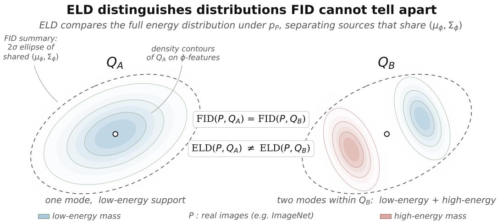
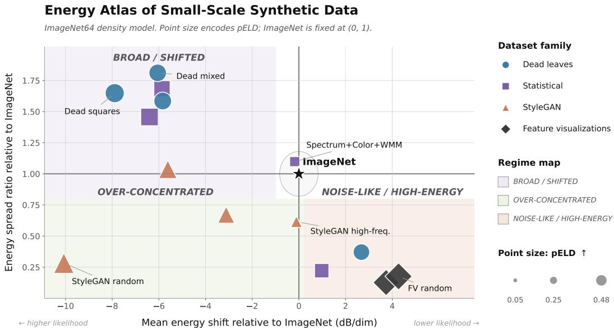
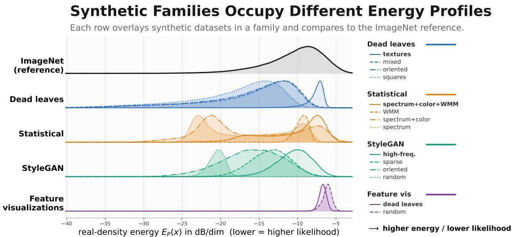
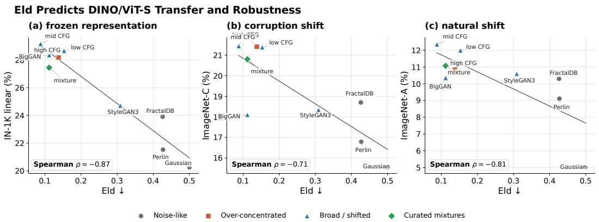
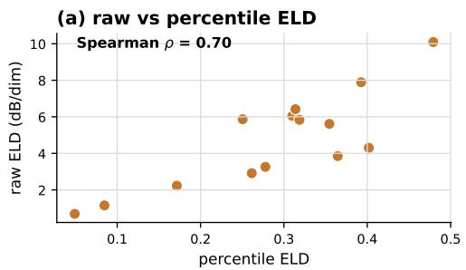
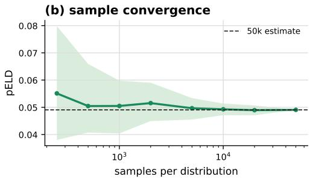
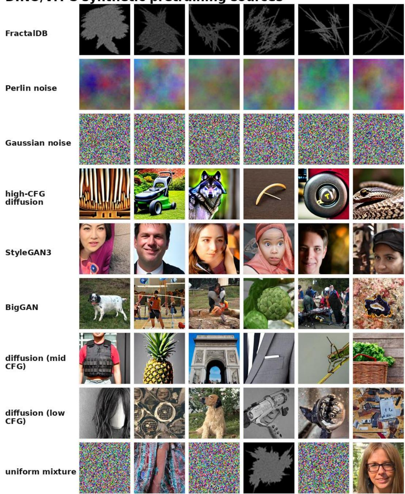
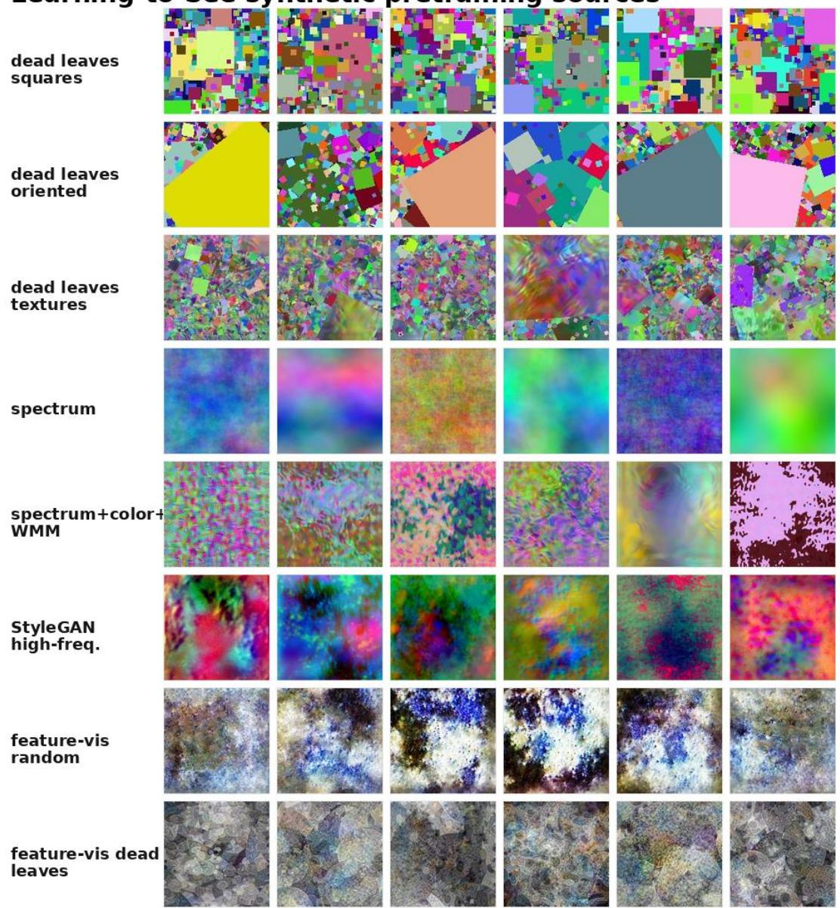

# Shaping Useful Noise: Energy Distributions Predict Visual Pretraining Quality

Ching Lam Choi1 Antonio Torralba1 Phillip Isola1 Stefanie Jegelka1,2

1CSAIL, Department of EECS, Massachusetts Institute of Technology

2School of CIT, MCML, MDSI, Technical University of Munich

{chinglam, torralba, phillipi}@mit.edu, stefanie.jegelka@tum.de

## Abstract

Synthetic data can scale visual pretraining, but current selection criteria only partially explain which datasets train strong representations. We propose using the energy profile of a dataset—the distribution of log-probability levels it occupies under a normalised real-image density model—as an audit and curation principle for synthetic data. To operationalise this view, we introduce Energy-Level Distribution Distance (ELD), which compares real and synthetic energy distributions. Real images span sparse high-likelihood scenes and dense low-likelihood textures, so useful synthetic data should cover this energy range rather than collapse to likely but low-variation samples. Across diverse synthetic datasets, ELD exposes mismatches missed by FID and predicts pretraining performance beyond FID, LPIPS variation, and feature-space recall, including across CNN and ViT self-supervised settings. We then use ELD to resample and mix synthetic sources, matching the real-image energy histogram while preserving diversity and improving downstream transfer.

Project page: chinglamchoi.github.io/papers/noiseAudits Code: github.com/chinglamchoi/shaping-useful-noise

## 1 Introduction

Synthetic visual pretraining turns data choice into a distributional design problem: models can be trained on simulations, procedural images, generator samples, or mixtures thereof, each inducing different visual statistics. Yet current selection criteria often reduce this choice to sample realism or feature-space similarity. These criteria are useful, but they compress datasets into distances, neighbourhoods or low-order feature summaries, and do not ask where samples lie in the probability landscape of real images. This missing axis matters because natural images do not occupy a single typical likelihood level. Normalised density models reveal a broad, content-dependent energy distribution, where sparse simple scenes and dense textured scenes occupy different likelihood regimes (Guth et al., 2026; Kadkhodaie et al., 2024). This echoes classical natural-image statistics, which show that real images have structured spectral, wavelet and sparsity properties far from white noise (Burton & Moorhead, 1987; Field, 1987; Ruderman, 1997; Simoncelli, 2005; Portilla & Simoncelli, 2000). A synthetic dataset may therefore match real feature moments while exposing a learner to the wrong likelihood regimes; selecting only the most likely samples may likewise remove complex variation that real data contains. We ask whether synthetic data should be selected and designed to match the distribution oflikelihood levels occupied by real images.

## 1.1 Our Contributions

We make four contributions around a common claim: beyond visual realism or feature-space similarity, the energy shape ofsynthetic data is a useful predictor and design principlefor visual pretraining.

  
Figure 1: ELD distinguishes synthetic pretraining datasets FID cannot. Self-supervised pretraining benefits when synthetic data spans the full likelihood spectrum of real images; sources with identical FID can carry very different energy distributions, which ELD detects.

First, we formalise this design axis through Energy-Level Distribution Distance (ELD), together with a percentile variant, which compares real and synthetic datasets through their normalised real-image log-probability distributions. Unlike mean likelihood, ELD measures the full energy profile of a dataset. It penalises synthetic data that drifts into low-likelihood, noise-like regions, as well as data that collapses towards high-likelihood but low-variation samples. This makes ELD complementary to feature-space metrics such as FID, LPIPS variation and recall, which measure moments, perceptual distances or coverage rather than probability-level structure.

Second, we use ELD to audit a broad suite of procedural, statistical, feature-visualisation and generator-based synthetic datasets. The audit reveals three recurring regimes: noise-like datasets that sit in low-likelihood regions, over-concentrated datasets that collapse around high-likelihood but low-variation samples, and broad-but-shifted datasets that span many energy levels while missing the real profile. These regimes expose why feature-space metrics can be incomplete: two datasets may have similar FID, LPIPS variation or recall while presenting very different likelihood structure to the learner. Third, we show that this structure is predictive, not merely descriptive: ELD explains pretraining utility beyond standard metrics, including across CNN and ViT self-supervised settings. Finally, we turn the audit into an intervention. By resampling within synthetic pools and mixing across generators, we match the real-image energy histogram without sacrificing feature diversity, yielding synthetic training sets with stronger downstream transfer.

## 1.2 Related Work

Synthetic data for visual pretraining. Synthetic visual data has been explored through several generation mechanisms: simulation and domain randomisation for transfer to real environments (Tobin et al., 2017), fractal and procedural image datasets for pretraining without photographs (Kataoka et al., 2020), structured noise and statistical image models for contrastive representation learning (Baradad Jurjo et al., 2021), and text-to-image generators for large-scale synthetic representation learning (Tian et al., 2023). These works establish a rich design space for synthetic pretraining data. Our focus is not to introduce a new generator, but to identify a distribution-level property that predicts which generated datasets are useful across modern self-supervised objectives.

Distribution metrics for generated data. Most metrics compare real and generated distributions in a learned feature space. FID fits Gaussian approximations to Inception features (Heusel et al., 2017); KID uses a kernel distance (Binkowski et al.´ , 2018); precision and recall estimate fidelity and coverage (Kynkäänniemi et al., 2019; Naeem et al., 2020); and LPIPS measures perceptual similarity with deep features (Zhang et al., 2018). These metrics capture fidelity and diversity, but recent work shows their sensitivity to feature choice and Gaussian assumptions (Jayasumana et al., 2024). ELD is orthogonal to these criteria: it compares probability-level structure under a real-image density model rather than distances or moments in representation space.

  
Figure 2: Small-scale energy audit. Synthetic datasets scored under a grayscale ImageNet64 density model. Axes show mean energy shift and spread relative to ImageNet, while point size denotes PELD. The atlas provides a coarse diagnostic view of the regimes expanded in Figure 3: noise-like sources are shifted toward high-energy regions, over-concentrated sources occupy too narrow a likelihood band, and broad/shifted sources cover a wider range but remain displaced from the real energy profile.

Image likelihoods and energy structure. Energy-based models describe data by negative log density, but calibrated image likelihoods are hard to estimate (Hinton et al., 1986; LeCun et al., 2006; Song & Kingma, 2021). Normalising flows give exact likelihoods through invertible transformations (Rezende & Mohamed, 2015; Dinh et al., 2014, 2017), while diffusion and score-based models estimate image distributions through denoising dynamics (Sohl-Dickstein et al., 2015; Ho et al., 2020; Song et al., 2021). Recent normalised density estimators enable direct analysis of natural-image likelihoods; Guth et al. (2026) show that real-image log probabilities are broad, content-dependent, and approximately Gumbel-like. We use this likelihood-level view as a diagnostic and curation principle: it identifies which synthetic datasets are mismatched and how to reshape them.

## 2 Energy Structure of Natural and Synthetic Images

A useful synthetic pretraining distribution should reproduce more than the visual appearance of real images. We focus on one structural axis: the distribution of likelihood levels assigned to a dataset by a normalised real-image density model. This energy distribution is rich in natural images; it is not determined by FID or other moment-based feature-space metrics, and separates synthetic sources into three regimes with distinct measurable signatures.

## 2.1 The Energy Distribution of Natural Images

Let P be a real-image distribution and $p _ { P }$ a normalised density model fitted to $P .$ The real-image energy $E _ { P } ( x ) = - \bar { \log { p _ { P } ( x ) } }$ scores how typical x is under the model: low for images $p _ { P }$ assigns high likelihood, high for images $p _ { P }$ assigns low likelihood. The pushforward $( \check { E _ { P } } ) _ { \# } \bar { P }$ records how often real images occur at each likelihood level. This energy distribution is broad: Guth et al. (2026) show that on ImageNet it is approximately Gumbel-like, with sparse simple scenes at the low-energy/high-likelihood end and dense textured scenes forming a high-energy/low-likelihood tail, consistent with the statistical inhomogeneity of natural images (Field, 1987; Ruderman, 1997; Simoncelli, 2005; Portilla & Simoncelli, 2000).

  
Figure 3: Energy mismatch is structured. Synthetic sources differ in how they depart from ImageNet: some collapse into narrow high-likelihood bands, others extend into low-likelihood tails, and others remain broad but displaced. Effective synthetic pretraining may require matching the full probability-level profile of natural images, not simply maximising likelihood or feature realism.

The implication for synthetic pretraining is concrete. A useful synthetic distribution should expose the learner to the same range of likelihood levels as real data, not merely maximise average likelihood. Pushing $\mathbb { E } _ { Q } [ \log p _ { P } ]$ upward can collapse Q to the mode of $p _ { P } ;$ ignoring likelihood can place mass arbitrarily far in the high-energy tail. Either failure appears as a mismatch in $( E _ { P } ) _ { \# } Q .$ . The relevant comparison is therefore not a scalar summary such as mean likelihood, but the full energy profiles $( E _ { P } ) _ { \# } P$ and $( E _ { P } ) _ { \# } Q$ , which Section 3.1 measures.

## 2.2 Feature Moments Do Not Determine Energy Profiles

FID compares the means and covariances of a fixed feature map. These moments need not determine how samples occupy energy levels, as in Figure 1. For example, under the identity feature map, let

$$
\begin{array} { r } { Q _ { 1 } = \frac 1 2 \delta _ { - 1 } + \frac 1 2 \delta _ { 1 } , \qquad Q _ { 2 } = \frac 1 4 \delta _ { - \sqrt { 2 } } + \frac 1 2 \delta _ { 0 } + \frac 1 4 \delta _ { \sqrt { 2 } } . } \end{array}
$$

Both have mean zero and variance one, and therefore identical FID to any fixed reference. Under the normalised density $p ( x ) = Z ^ { - 1 } \exp ( - x ^ { 4 } )$ , however, $Q _ { 1 }$ has energy $1 + \log Z$ almost surely, whereas $Q _ { 2 }$ has energies log Z and 4 + log Z with equal probability. Thus identical feature moments can conceal different energy profiles. Appendix A gives the general statement.

## 2.3 A Diagnostic Taxonomy of Synthetic Energy Mismatch

If FID does not determine energy matching, the remaining question is empirical: do synthetic datasets differ along this axis? Figure $^ 2$ visualises representative sources scored under a shared real-image density model $p _ { P } .$ . Let $\mu _ { P } , \sigma _ { P }$ denote the mean and standard deviation of $E _ { P }$ on real data, and $\mu _ { Q } , \sigma _ { Q }$ the corresponding quantities for a synthetic source. Three regimes recur. Noise-like datasets have $\mu _ { Q } - \mu _ { P }$ large and positive relative to $\sigma _ { P } .$ , placing mass in the high-energy tail: the real model rates these images as implausible. Over-concentrated datasets have small $\sigma _ { Q } / \sigma _ { P }$ , often with $\mu _ { Q } \leq \mu _ { P } ;$ samples may be individually plausible, but occupy too narrow a slice of natural-image structure. Broad/shifted datasets have substantial mismatch in either spread or location, with $| \mu _ { Q } - \mu _ { P } |$ and/or $\sigma _ { Q } / \sigma _ { P }$ far from the real reference. Mixed cases interpolate between these regimes. Figure 3 shows the same regimes at the level of full energy distributions, making the shift, compression, and tail mismatches visible beyond the two summary statistics.

These diagnostics depend on the calibration of $p _ { P } ;$ Section 3.1 introduces a percentile-rank variant that removes this dependence. As shown in Section 2.2, datasets in different regimes can have similar FID despite different energy arrangements, and Section 4.2 confirms this empirically. These regimes show why “realism” is incomplete for synthetic pretraining: a dataset can be too unlikely, too concentrated near high-likelihood regions, or mismatched across likelihood levels. The target is the full real-image energy distribution, not a scalar likelihood or feature-moment score.

## 3 ELD: Energy-Level Distribution Distance

Section 2.2 shows that feature-moment metrics do not determine a dataset’s energy profile. We now define a metric that compares datasets along this axis directly.

## 3.1 Definition and Estimation

Given a normalised real-image density model $p _ { P }$ with energy $E _ { P } ( x ) = - \log p _ { P } ( x )$ , the Energy-Level Distribution Distance between real and synthetic distributions $P , Q$ is

$$
\mathrm { E L D } ( P , Q ) = { \cal W } _ { 1 } \big ( ( E _ { P } ) _ { \# } P , ( E _ { P } ) _ { \# } Q \big ) ,\tag{1}
$$

the Wasserstein-1 distance between their one-dimensional energy distributions. In one dimension, $W _ { 1 }$ equals the integral distance between empirical CDFs (Villani, 2021), making ELD simple to estimate from sorted energy scores. We use $W _ { 1 }$ rather than KL because it remains well-defined under support mismatch and returns a distance in the units of the energy score.

Raw energies depend on the calibration of $p _ { P } .$ , so we also use a percentile version. Let $F _ { P }$ denote the CDF of real-image energies $E _ { P } ( x )$ for $x \sim P$ . We replace each energy by its real-energy rank $F _ { P } ( E _ { P } ( x ) ) \in [ 0 , 1 ]$ . By construction, $( F _ { P } \circ E _ { P } ) _ { \# } P = \bar { \mathrm { U n i f } } ( 0 , 1 )$ , so

$$
\mathrm { { p E L D } } ( P , Q ) = { \cal W } _ { 1 } \big ( \mathrm { U n i f } ( 0 , 1 ) , ( F _ { P } \circ E _ { P } ) _ { \# } Q \big ) .\tag{2}
$$

For a continuous real-energy CDF $F _ { P }$ , the probability integral transform yields uniform real-energy percentiles $u ( x ) = F _ { P } ( E _ { P } ( x ) )$ ). In finite samples, we estimate $F _ { F }$ from a real calibration set; independent real samples are therefore only approximately uniform. PELD is bounded in $[ 0 , 1 / 2 ]$ and invariant to strictly increasing recalibrations of the energy score applied consistently to real and synthetic samples. At the population level, if $F _ { P }$ is strictly increasing on the combined real and synthetic energy support, it vanishes exactly when their energy distributions coincide. This removes score-scale dependence, but not changes in image ordering induced by a different scorer. Unless otherwise stated, we report PELD as ELD. Raw ELD is expressed in the units of its energy score; our plotted energies use dB per dimension.

We instantiate $p _ { P }$ with the normalised ImageNet density estimator of Guth et al. (2026), trained using a diffusion-inspired dual-score-matching objective. It directly provides tractable image log-density estimates, without requiring sampling from the scorer. Once energies are computed, ELD requires only empirical CDFs; Section 4.2 shows that a few thousand samples per distribution suffice for stable rankings and evaluates robustness to the choice of density scorer. The main cost is energy evaluation, amortised across all synthetic datasets scored under the same $p _ { P }$

## 3.2 Interpreting ELD

ELD turns the qualitative regimes of Section 2.3 into a single distributional discrepancy. If a synthetic dataset is shifted into the high-energy tail, compressed around high-likelihood modes, or broad but displaced from the real profile, its empirical energy CDF departs from that of real images. The Wasserstein distance integrates these departures across the full likelihood axis, so the metric penalises datasets that are too unlikely, too concentrated, or likely at the wrong frequencies. This is the distinction missed by mean likelihood: ELD does not reward making every sample as likely as possible, but rather matching how real images populate likelihood levels.

This interpretation also clarifies the role of ELD. Rather than replacing semantic or feature-space coverage metrics, ELD isolates a complementary question: whether a dataset populates the same likelihood levels as real images under a shared density model. Two datasets may match in energy profile while differing in semantics or feature diversity; conversely, they may look similar to feature moment metrics while occupying very different regions of the real-image likelihood axis. We therefore report ELD alongside FID, LPIPS variation, and recall in Section 4.2. Figure 3 illustrates the measured object: when scored by the same ImageNet density model, synthetic families induce distinct energy profiles with different shifts, spreads, and tail structure relative to ImageNet.

  
Figure 4: ELD predicts DINO/ViT-S downstream quality. Across the self-supervised synthetic pretraining suite, lower ELD is associated with stronger frozen ImageNet-1K linear-probe accuracy and better robustness on ImageNet-C and ImageNet-A. Points are colored by the energy-regime taxonomy, showing that high-ELD noise-like sources occupy the weak-transfer end of the trend, while lower-ELD diffusion and mixture sources cluster among the strongest representations.

## 4 Energy Shape Predicts Pretraining Utility

Sections 2.2 and 3.2 argue that energy structure is an axis FID does not see and that ELD measures it. We now ask whether this axis matters: across a broad suite and self-supervised recipes, ELD predicts downstream accuracy beyond FID, LPIPS variation, and recall.

## 4.1 Experimental Setup

We ask two questions: does ELD predict how well a synthetic dataset trains visual representations, and how does its held-out predictive accuracy compare with that of FID, LPIPS variation, and recall? We evaluate this in two complementary pretraining settings. The first is a self-supervised setting using DINO-style ViT pretraining (Caron et al., 2021). The second follows the setting of Baradad Jurjo et al. (2021), where synthetic datasets are used directly as pretraining sources under the original CNN/contrastive evaluation protocol. In both settings, we score each synthetic dataset under the same metric suite and regress downstream accuracy on these metrics. Appendix B.2 visualizes samples from the corresponding DINO/ViT-S and Learning-to-See synthetic sources.

Synthetic pretraining data. The suite spans the regimes of Section 2.3: procedural and noiselike sources from Baradad Jurjo et al. (2021), including dead leaves, statistical image models, feature visualizations, and untrained StyleGAN variants; classical synthetic pretraining sources such as FractalDB, Perlin noise, and Gaussian noise; generator-based sources including StyleGAN3, BigGAN, and diffusion/latent-diffusion samples at varied guidance or sampling settings; and curated mixtures such as StableRep and uniform mixtures (Baradad Jurjo et al., 2021; Kataoka et al., 2022; Karras et al., 2021; Brock et al., 2019; Rombach et al., 2022; Tian et al., 2023).

Pretraining recipes. Our first recipe is DINO with ViT-S under fixed hyperparameters across datasets (Caron et al., 2021). To connect with earlier synthetic-data pretraining work, we also run the “Learning to See by Looking at Noise” protocol using its corresponding CNN-based recipe and synthetic dataset families (Baradad Jurjo et al., 2021).

Evaluation. For the self-supervised setting, we evaluate ImageNet-1K representation quality using SimCLR-style linear probing and fine-tuning (Chen et al., 2020). For the Learning-to-See setting, we follow the original ImageNet100 evaluation protocol of Baradad Jurjo et al. (2021). In both settings, we additionally evaluate distribution shift on ImageNet-C and ImageNet-A (Hendrycks & Dietterich, 2019; Hendrycks et al., 2021); for Learning-to-See, these shift evaluations are restricted to the ImageNet100 class subset and resized to the encoder input resolution. For each pretraining dataset we compute ELD against ImageNet alongside FID, LPIPS, and Improved Recall (Heusel et al., 2017; Zhang et al., 2018; Kynkäänniemi et al., 2019). Table 1 reports DINO/ViT-S, while Table 3 reports the Learning-to-See setting. We use DINO/ViT-S as the modern self-supervised protocol and Learning-to-See as a complementary small-scale replication with classical synthetic pretraining.

Table 1: Self-supervised setting. Dataset metrics and DINO/ViT-S accuracy; metrics are computed against ImageNet, and evaluation reports ImageNet-1K linear/FT plus ImageNet-C/A robustness.
<table><tr><td rowspan="2">Dataset</td><td colspan="4">Data metrics</td><td colspan="4">DINO/ViT-S downstream</td></tr><tr><td></td><td></td><td></td><td>ELD↓ FID↓ LPIPS↑ Recall ↑</td><td>IN-1K Lin.%↑ IN-1K FT%↑ IN-C%↑ IN-A% ↑</td><td></td><td></td><td></td></tr><tr><td>Noise-like</td><td></td><td></td><td></td><td></td><td></td><td></td><td></td><td></td></tr><tr><td>FractalDB</td><td>.426</td><td>1254</td><td>.260</td><td>.018</td><td>23.91</td><td>56.66</td><td>18.70</td><td>10.30</td></tr><tr><td>Perlin noise</td><td>.427</td><td>1922</td><td>.208</td><td>.000</td><td>21.53</td><td>55.38</td><td>16.79</td><td>9.11</td></tr><tr><td>Gaussian noise</td><td>.500</td><td>2145</td><td>.237</td><td>.000</td><td>20.26</td><td>52.26</td><td>15.53</td><td>5.01</td></tr><tr><td>Over-concentrated</td><td></td><td>481</td><td></td><td></td><td></td><td></td><td></td><td></td></tr><tr><td>diffusion (high CFG)</td><td>.138</td><td></td><td>.342</td><td>.020</td><td>28.18</td><td>59.34</td><td>21.41</td><td>10.84</td></tr><tr><td>Broad / shifted</td><td></td><td>1148</td><td></td><td></td><td></td><td></td><td></td><td></td></tr><tr><td>StyleGAN3</td><td>.309 .112</td><td>566</td><td>.305 .303</td><td>.001 .101</td><td>24.71</td><td>57.49</td><td>18.34</td><td>10.59</td></tr><tr><td>BigGAN</td><td>.088</td><td>459</td><td></td><td></td><td>28.36 29.17</td><td>58.97 59.57</td><td>18.10</td><td>10.35</td></tr><tr><td>diffusion (mid CFG) diffusion (low CFG)</td><td>.153</td><td>1129</td><td>.338 .297</td><td>.030 .022</td><td>28.67</td><td>59.60</td><td>21.44 21.38</td><td>12.35</td></tr><tr><td></td><td></td><td></td><td></td><td></td><td></td><td></td><td></td><td>11.99</td></tr><tr><td>Curated mixtures</td><td></td><td></td><td></td><td></td><td></td><td></td><td></td><td></td></tr><tr><td>uniform mixture</td><td>.112</td><td>616</td><td>.294</td><td>.023</td><td>27.45</td><td>57.61</td><td>20.80</td><td>11.07</td></tr></table>

## 4.2 ELD Predicts Downstream Quality Beyond FID

We next test whether probability-level mismatch predicts pretraining utility in a modern selfsupervised setting. Table 1 reports DINO/ViT-S models pretrained on each synthetic source, with ImageNet-1K linear probing, ImageNet-1K fine-tuning, and ImageNet-C/A robustness. Across this suite, ELD is consistently negatively associated with downstream performance: lower ELD corresponds to higher frozen ImageNet-1K linear accuracy (Spearman $\rho = - 0 . 8 7 , p = 0 . 0 0 2 )$ higher ImageNet-1K fine-tuning accuracy $( \rho = - 0 . 7 8 , \ p = 0 . 0 1 4 )$ , and better robustness on ImageNet-C $( \rho = - 0 . 7 1 , p = 0 . 0 3 2 )$ and ImageNet-A $( \rho = - 0 . 8 1 , p = 0 . 0 0 8 )$ . These results support the directional prediction of Section 2.3: sources whose energy profiles depart from the real-image likelihood distribution yield weaker transferable representations. Figure 4 visualises the trend, with regimes organizing the scatter from high-ELD noise-like sources at the weak-transfer end to lower-ELD diffusion and mixture sources among the strongest models.

Held-out prediction. FID and recall also correlate with transfer on the DINO suite. To compare predictive utility, we fit a separate univariate linear regression for each metric, omitting one dataset at a time and predicting its downstream accuracy. ELD gives the lowest prediction error for DINO linear accuracy among the four evaluated metrics (Table 2). This advantage persists after excluding Gaussian noise, Perlin noise, and FractalDB: ELD’s mean absolute error is 0.99 percentage points, compared with 1.66 for FID, 1.47 for LPIPS variation, and 3.27 for recall. Full comparisons and analyses appear in Appendix B.3.

Table 2: Leave-one-dataset-out DINO prediction MAE (percentage points ↓).
<table><tr><td>DINO linear evaluation</td><td>ELD</td><td>FID</td><td>LPIPS</td><td>Recall</td></tr><tr><td>All sources (n = 9)</td><td>0.82</td><td>0.91</td><td>1.67</td><td>4.53</td></tr><tr><td>Without noise-like sources (n = 6)</td><td>0.99</td><td>1.66</td><td>1.47</td><td>3.27</td></tr></table>

We also evaluate ELD in the classical synthetic-pretraining setting of Baradad Jurjo et al. (2021). Table 3 reports the small-scale synthetic families under the original ImageNet100 transfer protocol, augmented with ImageNet-C/A evaluations. This benchmark is heterogeneous by construction: dead leaves, statistical models, untrained StyleGANs, and feature visualizations differ not only in energy profile but also in construction mechanism and semantics. Comparing across heterogeneous synthetic sources, the pooled correlations remain directionally consistent: lower ELD is associated with higher ImageNet-A accuracy (Spearman $\rho = - 0 . 2 6 )$ and weakly with higher ImageNet-C accuracy $( \rho = - 0 . 1 5 )$ . ImageNet-A accuracy is computed on the intersection with the trained ImageNet100 classes; examples outside this label set are excluded from the evaluation denominator.

Table 3: Learning-to-See synthetic-pretraining setting. Dataset metrics and downstream accuracy for the small-scale families from Baradad Jurjo et al. (2021). Evaluation follows the original ImageNet protocol and adds ImageNet-C/A robustness with the same representations.
<table><tr><td rowspan="2">Dataset</td><td colspan="4">Data metrics</td><td colspan="4">Learning-to-See downstream</td></tr><tr><td>ELD↓</td><td>FID↓</td><td>LPIPS↑</td><td>Recall↑</td><td></td><td></td><td></td><td>IN Lin.%↑ IN FT%↑ IN-C%↑ IN-A% ↑</td></tr><tr><td>Dead leaves</td><td></td><td></td><td></td><td></td><td></td><td></td><td></td><td></td></tr><tr><td>dead-leaves squares</td><td>.393</td><td>1480</td><td>.316</td><td>.005</td><td>38.60</td><td>67.52</td><td>27.23</td><td>3.24</td></tr><tr><td>dead-leaves oriented</td><td>.319</td><td>1390</td><td>.299</td><td>.035</td><td>40.90</td><td>68.48</td><td>25.12</td><td>3.97</td></tr><tr><td>dead-leaves mixed</td><td>.310</td><td>1310</td><td>.301</td><td>.074</td><td>40.84</td><td>68.86</td><td>25.00</td><td>3.82</td></tr><tr><td>dead-leaves textures</td><td>.261</td><td>1340</td><td>.241</td><td>.084</td><td>41.00</td><td>68.20</td><td>27.93</td><td>3.83</td></tr><tr><td>Statistical image models</td><td></td><td></td><td></td><td></td><td></td><td></td><td></td><td></td></tr><tr><td>spectrum</td><td>.314</td><td>1560</td><td>.159</td><td>.003</td><td>30.70</td><td>62.20</td><td>24.57</td><td>3.68</td></tr><tr><td>WMM</td><td>.172</td><td>1520</td><td>.152</td><td>.003</td><td>34.08</td><td>63.30</td><td>16.90</td><td>3.53</td></tr><tr><td>spectrum+color</td><td>.251</td><td>1290</td><td>.258</td><td>.001</td><td>37.88</td><td>65.18</td><td>27.82</td><td>4.12</td></tr><tr><td>spectrum+color+WMM</td><td>.049</td><td>1210</td><td>.228</td><td>.010</td><td>38.84</td><td>65.62</td><td>30.28</td><td>4.56</td></tr><tr><td>Untrained StyleGAN</td><td></td><td></td><td></td><td></td><td></td><td></td><td></td><td></td></tr><tr><td>StyleGAN random</td><td>.479</td><td>1420</td><td>.279</td><td>.000</td><td>35.30</td><td>64.82</td><td>29.10</td><td>4.41</td></tr><tr><td>StyleGAN high-freq.</td><td>.085</td><td>1320</td><td>.268</td><td>.002</td><td>39.62</td><td>66.21</td><td>29.84</td><td>4.38</td></tr><tr><td>StyleGAN sparse</td><td>.278</td><td>1240</td><td>.305</td><td>.001</td><td>38.76</td><td>66.16</td><td>27.23</td><td>3.24</td></tr><tr><td>StyleGAN oriented</td><td>.355</td><td>903</td><td>.272</td><td>.007</td><td>39.08</td><td>65.84</td><td>27.70</td><td>3.38</td></tr><tr><td>Feature visualizations</td><td></td><td></td><td></td><td></td><td></td><td></td><td></td><td></td></tr><tr><td>feature-vis random</td><td>.402</td><td>1590</td><td>.252</td><td>.000</td><td>35.26</td><td>66.22</td><td>22.89</td><td>2.65</td></tr><tr><td>feature-vis dead leaves</td><td>.365</td><td>1400</td><td>.223</td><td>.001</td><td>38.70</td><td>68.00</td><td>32.04</td><td>4.71</td></tr></table>

## ELD Is Stable Under Calibration and Sampling

  
Figure 5: ELD is robust to estimation choices. Raw and percentile distances agree with a Spearman coefficient of 0.7; subsampling shows stable estimates after a few thousand scored samples.

The within-family comparisons are particularly informative. Among dead-leaves variants, lower ELD tracks stronger early ImageNet transfer $( \rho = - 0 . 8 0$ for linear accuracy), with the lowest-ELD texture variant achieving the best linear accuracy and ImageNet-C accuracy in the group. Among statistical image models, ELD ranks both ImageNet linear and fine-tuned transfer strongly $( \rho = - 0 . 8 0$ for each), and the best energy match, spectrum+color+WMM, is also the strongest source on ImageNet linear transfer, fine-tuning, ImageNet-C, and ImageNet-A. The untrained StyleGAN family shows the same pattern for ImageNet transfer: lower ELD is associated with stronger linear accuracy $( \rho = - 0 . 8 0 )$ and fine-tuned accuracy $( \rho = - 1 . 0 0 ) $ , with the high-frequency variant attaining the best transfer scores. For the two feature-visualization sources, the lower-ELD dead-leaves variant is better on every downstream metric. ELD provides a consistent directional signal especially when comparing synthetic sources within a shared family.

Together, the two experimental settings support the regime picture of Section 2.3. ELD does not subsume all factors governing synthetic pretraining: semantic coverage, augmentation compatibility, and feature diversity remain important. Instead, it isolates a complementary axis of mismatch, namely whether a synthetic source places probability mass at the likelihood levels occupied by real images. The DINO/ViT-S results show that this axis predicts transfer and robustness in a modern self supervised protocol, while the Learning-to-See results show that the same signal remains interpretable in a classical small-scale synthetic-pretraining setting, especially within matched generator families. This is the role of ELD in our analysis: not a universal replacement for feature-space metrics, but a probability-level diagnostic that explains a structured component of downstream variation.

Table 4: Neural-scorer sensitivity on the DINO suite. The first column compares dataset rankings; the remaining columns correlate pELD with ImageNet-1K accuracy.
<table><tr><td>Scorer</td><td>Agreement with Guth  $\rho$ </td><td>Linear  $\rho$ </td><td>Fine-tuning  $\rho$ </td></tr><tr><td>Guth dual-score model</td><td>1.00</td><td>-0.87</td><td>-0.78</td></tr><tr><td>DenseFlow</td><td>0.89</td><td>-0.85</td><td>-0.78</td></tr><tr><td>Diffusion VLB</td><td>0.91</td><td>-0.77</td><td>-0.72</td></tr></table>

Estimation robustness. Figure 5 verifies that the reported percentile version is not an artefact of calibration or sample size. Raw energy-space distance and percentile ELD are strongly aligned across datasets, indicating that rank calibration preserves the relevant ordering while removing dependence on the absolute scale of the density model. Subsampling shows that ELD estimates stabilise after a few thousand scored examples, well below the sample sizes used in the main experiments.

Robustness to the neural scorer. We recompute pELD for the nine DINO sources with two additional neural scoring constructions, calibrating each against its own ImageNet reference. Dataset rankings closely agree with those of the primary Guth scorer (Spearman $\rho = 0 . 8 9 \mathrm { - } 0 . 9 1 )$ , and lower pELD remains associated with stronger transfer (Table 4). This supports the stability of the observed signal across the tested neural scorers.

## 5 Energy-Aware Curation for Synthetic Data

ELD suggests a constructive use beyond evaluation: synthetic data can be shaped to match the probability-level profile of real images. Natural images occupy a broad energy spectrum containing both simple high-likelihood scenes and dense low-likelihood structure (Guth et al., 2026; Field, 1987; Ruderman, 1997; Simoncelli, 2005). Filtering only for the highest-likelihood samples can therefore discard variation present in real data. The goal is to make synthetic pretraining data populate real-image likelihood levels in the right proportions, not only to retain the most probable samples.

Because real-energy percentiles are uniform under a continuous reference CDF, a simple curation rule is to resample synthetic data so that its percentile histogram is approximately uniform. In practice, we can score a candidate pool under $p _ { P } ,$ bin samples by their real-energy percentiles, and draw a balanced training stream across bins, with complementary diversity criteria guiding selection within each band. This changes the composition of the selected set without retraining a generator. Reweighting cannot recover energy bands absent from the candidate pool; such gaps require additional sources or generation settings. For mixtures, the same principle becomes a small convex design problem: choose source weights whose combined energy histogram best matches the real one under a convex histogram discrepancy, such as discretised Wasserstein-1 distance. Thus the audit becomes prescriptive: over-concentrated sources can be supplemented with underrepresented higher-energy structure; noise-like sources can be downweighted in favour of candidates in reference-supported energy bands; and broad but shifted sources can contribute where they fill missing likelihood bands. These interventions target energy occupancy, while semantic and feature-space diagnostics remain necessary to assess the resulting composition.

Controlled offline curation. Energy-profile matching is an alternative to selecting only the highestlikelihood images. We compare source-balanced uniform selection, top-likelihood filtering, and ELDguided selection from a common pool spanning BigGAN, StyleGAN3, and three diffusion settings, using the same selected-set budget across strategies. Top-likelihood filtering retains the lowest-energy candidates; ELD-guided selection seeks to match the full ImageNet energy-percentile histogram. No generator retraining or downstream model fitting is required for this offline intervention.

We evaluate the selected sets using frozen ImageNet-pretrained ResNet features (Table 5). ELDguided selection improves both reported nearest-neighbour distance diagnostics and increases effective class coverage and feature rank relative to uniform selection. Top-likelihood filtering performs worse on all four diagnostics. Thus matching energy occupancy can retain useful feature diversity that likelihood maximisation discards. These are offline proxy results; matched pretraining experiments are deferred to future work to further establish a transfer gain caused by the intervention.

Table 5: Controlled offline curation from a common source pool at equal selected-set budget. Frozenfeature diagnostics favour ELD-guided selection over uniform and top-likelihood selection. NN denotes the cosine-distance nearest-neighbour diagnostic.
<table><tr><td>Selection</td><td>NN mean ↓</td><td>NNp95↓</td><td>Eff. classes ↑</td><td>Eff. rank ↑</td></tr><tr><td>Uniform</td><td>0.634</td><td>0.784</td><td>116.445</td><td>59.175</td></tr><tr><td>Top likelihood</td><td>0.660</td><td>0.788</td><td>82.940</td><td>34.132</td></tr><tr><td>ELD-guided</td><td>0.621</td><td>0.780</td><td>128.001</td><td>71.828</td></tr></table>

More broadly, ELD reframes synthetic-data construction as distributional engineering. Given a synthetic pool with cached energies and features, we may select samples to match the real energy histogram while imposing complementary feature-coverage or diversity constraints within each band. The selected distribution $Q _ { \mathrm { s e l } }$ should satisfy

$$
( E _ { P } ) _ { \# } Q _ { \mathrm { s e l } } \approx ( E _ { P } ) _ { \# } P ,
$$

while retaining useful variation along dimensions not determined by energy alone. This seeks to restore under-covered likelihood bands, rather than merely keep the most likely samples. It turns common design choices—which samples to retain, which generators to mix, and which prompts or guidance scales to use—into ways of redistributing mass along the real-image energy axis. The target along this axis is the full probability-level profile of natural images; energy matching complements, rather than replaces, semantic and task-specific selection criteria.

## 6 Conclusion

Discussion and Limitations. ELD makes synthetic data inspectable at the level of likelihood structure, revealing which parts of a reference probability landscape samples occupy. It complements FID, recall, and LPIPS variation: feature moments can miss energy-profile differences, while energy matching alone does not guarantee semantic coverage, diversity, label quality, or task relevance. Combining these criteria supports audits of both likelihood structure and feature-space realism and coverage. The reference data and density model are part of the experimental specification, so ELD should be reported with its scorer. Percentile calibration removes strictly increasing score recalibrations; our cross-scorer analyses support robustness across the tested neural scoring constructions. Our experiments focus on visual pretraining; supervised-label efficiency, aesthetic fidelity, and human preference may require additional task-aware criteria. CLIP-style multimodal pretraining further motivates joint audits of visual, linguistic, and image–text alignment structure.

Synthetic data is not characterised by visual realism or feature-space similarity alone; its position in the real-image probability landscape also matters. ELD measures this axis by comparing the distribution of likelihood levels induced by real and synthetic data under a shared density model. We show that synthetic sources occupy distinct energy regimes that feature moments do not determine, and that these regimes are predictive of downstream pretraining quality in the studied settings. Our controlled curation study demonstrates a practical intervention through improved frozen-feature diagnostics; matched pretraining runs can test how these gains translate into transfer. Since the mismatch is structured, ELD is also prescriptive: it identifies likelihood bands that are missing, overrepresented, or shifted, enabling resampling and mixing strategies that better match the reference energy profile. More broadly, this supports a design view of synthetic data: generators, filters, and mixtures can be selected for how they populate the real-image likelihood spectrum, alongside their realism, diversity, and task relevance.

## Acknowledgments

This work was partially completed during C.L.’s visit to the Technical University of Munich, supported by the Munich Center for Machine Learning (MCML). S.J. was supported by an Alexander von Humboldt professorship. A.T. was supported by the ONR MURI grant N000142612255. This work was further supported by a Packard Fellowship to P.I., along with the ONR MURI grant N00014-22-1-2740.

## References

Baradad Jurjo, M., Wulff, J., Wang, T., Isola, P., and Torralba, A. Learning to see by looking at noise. Advances in Neural Information Processing Systems, 34:2556–2569, 2021. 2, 6, 7, 8

Binkowski, M., Sutherland, D. J., Arbel, M., and Gretton, A. Demystifying mmd gans. ´ arXiv preprint arXiv:1801.01401, 2018. 2

Brock, A., Donahue, J., and Simonyan, K. Large scale GAN training for high fidelity natural image synthesis. In International Conference on Learning Representations, 2019. URL https: //openreview.net/forum?id=B1xsqj09Fm. 6

Burton, G. J. and Moorhead, I. R. Color and spatial structure in natural scenes. Applied optics, 26(1): 157–170, 1987. 1

Caron, M., Touvron, H., Misra, I., Jégou, H., Mairal, J., Bojanowski, P., and Joulin, A. Emerging properties in self-supervised vision transformers. In Proceedings of the IEEE/CVF international conference on computer vision, pp. 9650–9660, 2021. 6

Chen, T., Kornblith, S., Norouzi, M., and Hinton, G. A simple framework for contrastive learning of visual representations. In III, H. D. and Singh, A. (eds.), Proceedings of the 37th International Conference on Machine Learning, volume 119 of Proceedings ofMachine Learning Research, pp. 1597–1607. PMLR, 13–18 Jul 2020. URL https://proceedings.mlr.press/v119/chen20j. html. 6

Dinh, L., Krueger, D., and Bengio, Y. Nice: Non-linear independent components estimation. arXiv preprint arXiv:1410.8516, 2014. 3

Dinh, L., Sohl-Dickstein, J., and Bengio, S. Density estimation using real NVP. In International Conference on Learning Representations, 2017. URL https://openreview.net/forum?id= HkpbnH9lx. 3

Field, D. J. Relations between the statistics of natural images and the response properties of cortical cells. Journal ofthe Optical Society ofAmerica A, 4(12):2379–2394, 1987. 1, 3, 9

Guth, F., Kadkhodaie, Z., and Simoncelli, E. P. Learning normalized image densities via dual score matching. In The Thirty-ninth Annual Conference on Neural Information Processing Systems, 2026. URL https://openreview.net/forum?id=wtYcS4kxpF. 1, 3, 5, 9

Hendrycks, D. and Dietterich, T. Benchmarking neural network robustness to common corruptions and perturbations. In International Conference on Learning Representations, 2019. URL https: //openreview.net/forum?id=HJz6tiCqYm. 6

Hendrycks, D., Zhao, K., Basart, S., Steinhardt, J., and Song, D. Natural adversarial examples. In Proceedings of the IEEE/CVF conference on computer vision and pattern recognition, pp. 15262–15271, 2021. 6

Heusel, M., Ramsauer, H., Unterthiner, T., Nessler, B., and Hochreiter, S. Gans trained by a two time-scale update rule converge to a local nash equilibrium. In Guyon, I., Luxburg, U. V., Bengio, S., Wallach, H., Fergus, R., Vishwanathan, S., and Garnett, R. (eds.), Advances in Neural Information Processing Systems, volume 30. Curran Associates, Inc., 2017. URL https://proceedings.neurips.cc/paper\_files/paper/2017/file/ 8a1d694707eb0fefe65871369074926d-Paper.pdf. 2, 6

Hinton, G. E., Sejnowski, T. J., et al. Learning and relearning in boltzmann machines. Parallel distributed processing: Explorations in the microstructure ofcognition, 1(282-317):2, 1986. 3

Ho, J., Jain, A., and Abbeel, P. Denoising diffusion probabilistic models. In Larochelle, H., Ranzato, M., Hadsell, R., Balcan, M., and Lin, H. (eds.), Advances in Neural Information Processing Systems, volume 33, pp. 6840–6851. Curran Associates, Inc., 2020. URL https://proceedings.neurips.cc/paper\_files/paper/2020/file/ 4c5bcfec8584af0d967f1ab10179ca4b-Paper.pdf. 3

Jayasumana, S., Ramalingam, S., Veit, A., Glasner, D., Chakrabarti, A., and Kumar, S. Rethinking fid: Towards a better evaluation metric for image generation. In Proceedings of the IEEE/CVF Conference on Computer Vision and Pattern Recognition (CVPR), pp. 9307–9315, June 2024. 2

Kadkhodaie, Z., Guth, F., Simoncelli, E. P., and Mallat, S. Generalization in diffusion models arises from geometry-adaptive harmonic representations. In The Twelfth International Conference on Learning Representations, 2024. URL https://openreview.net/forum?id=ANvmVS2Yr0. 1

Karras, T., Aittala, M., Laine, S., Härkönen, E., Hellsten, J., Lehtinen, J., and Aila, T. Alias-free generative adversarial networks. Advances in neural information processing systems, 34:852–863, 2021. 6

Kataoka, H., Okayasu, K., Matsumoto, A., Yamagata, E., Yamada, R., Inoue, N., Nakamura, A., and Satoh, Y. Pre-training without natural images. In Proceedings of the Asian Conference on Computer Vision, 2020. 2

Kataoka, H., Hayamizu, R., Yamada, R., Nakashima, K., Takashima, S., Zhang, X., Martinez-Noriega, E. J., Inoue, N., and Yokota, R. Replacing labeled real-image datasets with auto-generated contours. In Proceedings ofthe IEEE/CVF conference on computer vision and pattern recognition, pp. 21232–21241, 2022. 6

Kynkäänniemi, T., Karras, T., Laine, S., Lehtinen, J., and Aila, T. Improved precision and recall metric for assessing generative models. Advances in neural information processing systems, 32, 2019. 2, 6

LeCun, Y., Chopra, S., Hadsell, R., Ranzato, M., Huang, F., et al. A tutorial on energy-based learning. Predicting structured data, 1(0), 2006. 3

Naeem, M. F., Oh, S. J., Uh, Y., Choi, Y., and Yoo, J. Reliable fidelity and diversity metrics for generative models. In International conference on machine learning, pp. 7176–7185. PMLR, 2020. 2

Portilla, J. and Simoncelli, E. P. A parametric texture model based on joint statistics of complex wavelet coefficients. International journal ofcomputer vision, 40(1):49–70, 2000. 1, 3

Rezende, D. and Mohamed, S. Variational inference with normalizing flows. In International conference on machine learning, pp. 1530–1538. PMLR, 2015. 3

Rombach, R., Blattmann, A., Lorenz, D., Esser, P., and Ommer, B. High-resolution image synthesis with latent diffusion models. In Proceedings ofthe IEEE/CVF conference on computer vision and pattern recognition, pp. 10684–10695, 2022. 6

Ruderman, D. L. Origins of scaling in natural images. Vision research, 37(23):3385–3398, 1997. 1, 3, 9

Simoncelli, E. P. 4.7 statistical modeling of photographic images. Handbook ofVideo and Image Processing, 9, 2005. 1, 3, 9

Sohl-Dickstein, J., Weiss, E., Maheswaranathan, N., and Ganguli, S. Deep unsupervised learning using nonequilibrium thermodynamics. In International conference on machine learning, pp. 2256–2265. pmlr, 2015. 3

Song, Y. and Kingma, D. P. How to train your energy-based models. arXiv preprint arXiv:2101.03288, 2021. 3

Song, Y., Sohl-Dickstein, J., Kingma, D. P., Kumar, A., Ermon, S., and Poole, B. Score-based generative modeling through stochastic differential equations. In International Conference on Learning Representations, 2021. URL https://openreview.net/forum?id=PxTIG12RRHS. 3

Tian, Y., Fan, L., Isola, P., Chang, H., and Krishnan, D. Stablerep: Synthetic images from text-to-image models make strong visual representation learners. In Oh, A., Naumann, T., Globerson, A., Saenko, K., Hardt, M., and Levine, S. (eds.), Advances in Neural Information Processing Systems, volume 36, pp. 48382–48402. Curran Associates, Inc., 2023. URL https://proceedings.neurips.cc/paper\_files/paper/2023/file/ 971f1e59cd956cc094da4e2f78c6ea7c-Paper-Conference.pdf. 2, 6

Tobin, J., Fong, R., Ray, A., Schneider, J., Zaremba, W., and Abbeel, P. Domain randomization for transferring deep neural networks from simulation to the real world. In 2017 IEEE/RSJ international conference on intelligent robots and systems (IROS), pp. 23–30. IEEE, 2017. 2

Zhang, R., Isola, P., Efros, A. A., Shechtman, E., and Wang, O. The unreasonable effectiveness of deep features as a perceptual metric. In Proceedings ofthe IEEE conference on computer vision and pattern recognition, pp. 586–595, 2018. 2, 6

Villani, C. Topics in optimal transportation, volume 58. American Mathematical Soc., 2021. 5

## A Feature Moments and Energy Profiles

Proposition. Let $\phi : \mathcal { X }  \mathbb { R } ^ { d }$ be a measurable feature map, and let $E _ { P } : \mathcal { X } $ R be a fixed reference energy. Let ν be a feature distribution with finite second moments. Suppose there exist measurable selections $x ^ { - } , x ^ { + } : \mathbb { R } ^ { d }  \mathcal { X }$ such that

$$
\phi ( x ^ { - } ( z ) ) = \phi ( x ^ { + } ( z ) ) = z \qquad \mathrm { f o r } \nu { \mathrm { - a l m o s t e v e r y } } z .
$$

Define $Q ^ { \pm } = ( x ^ { \pm } ) _ { \# } \nu .$ . Then $Q ^ { - }$ and $Q ^ { + }$ have identical feature distributions, and hence identical FID to any fixed reference with finite feature second moments. Their energy profiles nevertheless differ whenever

$$
( E _ { P } \circ x ^ { - } ) _ { \# } \nu \not = ( E _ { P } \circ x ^ { + } ) _ { \# } \nu .
$$

Moreover, suppose the induced energies have finite first moments. If a measurable feature set $Z$ has mass $\nu ( Z ) = \alpha$ , the selections agree outside $Z ,$ and

$$
E _ { P } ( x ^ { + } ( z ) ) - E _ { P } ( x ^ { - } ( z ) ) \ge \Delta > 0 \qquad \mathrm { f o r } \ \nu \mathrm { - a l m o s t } \mathrm { e v e r y } \ z \in Z ,
$$

then

$$
W _ { 1 } \big ( ( E _ { P } ) _ { \# } Q ^ { - } , ( E _ { P } ) _ { \# } Q ^ { + } \big ) \geq \alpha \Delta .
$$

Proof. By construction, $\phi _ { \# } Q ^ { - } = \phi _ { \# } Q ^ { + } = \nu .$ . Thus both distributions have the same feature mean and covariance, yielding identical FID to any fixed reference. Their energy pushforwards are $( E _ { P } ) _ { \# } Q ^ { \pm } = ( E _ { P } \circ x ^ { \dot { \pm } } ) _ { \# } \nu ,$ which differ under the stated hypothesis.

For the quantitative claim, agreement outside Z gives

$$
\begin{array} { r l } & { \mathbb { E } _ { Q ^ { + } } [ E _ { P } ] - \mathbb { E } _ { Q ^ { - } } [ E _ { P } ] = \displaystyle \int _ { Z } \left( E _ { P } ( x ^ { + } ( z ) ) - E _ { P } ( x ^ { - } ( z ) ) \right) d \nu ( z ) } \\ & { \qquad \ge \alpha \Delta . } \end{array}
$$

The Wasserstein-1 distance is at least the absolute difference of the means, proving the bound. □ The proposition establishes that feature moments do not determine energy occupancy. Conversely, matching an energy profile does not determine the image distribution or guarantee semantic coverage; the two diagnostics therefore provide complementary information.

## B Experiments

Compute details. All density scoring, metric computation, and downstream training jobs were run on NVIDIA V100 GPUs. Energy scores are computed once per dataset and reused across all ELD analyses; after scoring, ELD itself is computed from sorted one-dimensional energy values and is negligible compared with image scoring or representation training.

Table 6: Coarse regime diagnostics. Mean shift and spread separate the main regimes; PELD captures distributional mismatch beyond these summaries.
<table><tr><td>Regime</td><td># datasets</td><td>Mean shift</td><td>Mean spread</td><td>Mean PELD</td></tr><tr><td>Over-concentrated</td><td>3</td><td>-4.43</td><td>0.52</td><td>.281</td></tr><tr><td>Broad / shifted</td><td>7</td><td>-5.41</td><td>1.47</td><td>.284</td></tr><tr><td>Noise-like / high-energy</td><td>4</td><td>2.92</td><td>0.22</td><td>.300</td></tr></table>

## B.1 Diagnostics

Simple diagnostics give a coarse regime map, not a substitute for ELD. Mean energy shift and spread ratio provide a useful low-dimensional summary of how a source departs from ImageNet: they separate compression, displacement, and high-energy mismatch. Table 6 shows that these summaries recover the coarse regimes used in the main text. However, they do not determine the full energy distribution. Sources within the same regime can have different tail structure and different PELD, so the Wasserstein comparison remains necessary for quantifying residual distributional mismatch.

Table 7: Simple surrogate energies do not reproduce ELD. Feature- and DCT-based density surrogates fail to recover the ranking induced by the learned ImageNet density model, indicating that ELD is not reducible to generic feature novelty or low-level image-statistics mismatch.
<table><tr><td>Surrogate energy model</td><td>Description</td><td>Spearman  $\rho$  with PELD</td></tr><tr><td>ResNet-feature Gaussian</td><td>Diagonal Gaussian on frozen features</td><td>-0.22</td></tr><tr><td>DCT Gaussian</td><td>Diagonal Gaussian on low-frequency DCT coefficients</td><td>-0.28</td></tr><tr><td>DCT-GMM</td><td>GMM on PCA-compressed DCT coefficients</td><td>-0.26</td></tr></table>

Generic feature-density energies are not substitutes for ELD. We also test whether simpler surrogate energy models reproduce the ranking induced by the learned ImageNet density. Specifically, we fit three lightweight alternatives on ImageNet: a diagonal Gaussian over frozen ResNet-18 features, a diagonal Gaussian over low-frequency greyscale DCT coefficients, and a Gaussian mixture model over PCA-compressed DCT features. Table 7 reports their rank agreement with the primary scorer on the small-scale synthetic suite. These simple surrogates do not recover its dataset ordering, supporting the use of the learned real-image density scorer for this audit. Their rank correlations with primary PELD are negative or near zero: $\rho = - 0 . 2 2$ for ResNet-feature Gaussian energy, $\rho = - 0 . 2 8$ for diagonal DCT-Gaussian energy, and $\rho = - 0 . 2 6$ for DCT-GMM energy. This suggests that ELD is not merely measuring generic feature outlierness, spectrum mismatch, or distance from simple image statistics. The choice of $p _ { P }$ matters: ELD is intended to compare datasets under a real-image density model, not under arbitrary feature-space novelty scores.

## B.2 Synthetic Source Visualizations

Figures 6 and 7 show sampled images from the synthetic sources used in the DINO/ViT-S and Learning-to-See experiments. The visual differences across sources are substantial, but visual appearance alone does not determine the energy profile: visually diverse generators can still be shifted or compressed along the real-image likelihood axis, while simpler sources can occupy distinct energy regimes. These grids provide qualitative context for the quantitative energy audit in the main text.

Table 8: Sensitivity of DINO linear prediction to source exclusion. Each row repeats leave-onedataset-out fitting within the retained subset. It does not evaluate transfer to the omitted family.
<table><tr><td>DINO subset</td><td>n</td><td>ELD</td><td>FID</td><td>LPIPS</td><td>Recall</td></tr><tr><td>All sources</td><td>9</td><td>0.82</td><td>0.91</td><td>1.67</td><td>4.53</td></tr><tr><td>Without noise-like</td><td>6</td><td>0.99</td><td>1.66</td><td>1.47</td><td>3.27</td></tr><tr><td>Without GANs</td><td>7</td><td>1.06</td><td>1.17</td><td>1.63</td><td>1.34</td></tr><tr><td>Without diffusion</td><td>6</td><td>1.07</td><td>0.46</td><td>2.26</td><td>4.08</td></tr><tr><td>Without uniform mixture</td><td>8</td><td>0.76</td><td>0.96</td><td>1.75</td><td>4.95</td></tr></table>

## B.3 Held-Out Prediction and Source-Exclusion Analyses

We examine whether the DINO linear-accuracy prediction result depends on particular synthetic sources. Table 8 compares ELD, FID, LPIPS variation, and recall on the full suite and after excluding noise-like sources, GANs, diffusion sources, or the uniform mixture. Within each retained subset, we repeat leave-one-dataset-out prediction using a separate ordinary least-squares regression with an intercept for each metric, with no hyperparameter tuning. Each evaluated dataset is excluded from regression fitting. MAE is measured in accuracy percentage points. These comparisons assess sensitivity to source composition, not training-seed variability or generalisation to an omitted family.

ELD has the lowest MAE on the full suite and after excluding noise-like sources, GANs, or the uniform mixture. In particular, its advantage after removing noise-like sources supports a predictive signal beyond the separation of obvious low-quality datasets. The comparison remains familydependent: FID performs better after diffusion sources are removed. These small-suite analyses support energy occupancy as a useful predictor of DINO linear transfer across several source compositions, alongside its diagnostic interpretation.

DINO/ViT-S synthetic pretraining sources  
  
Figure 6: DINO/ViT-S synthetic pretraining sources. This grid highlights the range from noise and procedural structure to generator samples; ELD measures how these sources populate ImageNet likelihood levels.

Learning-to-See synthetic pretraining sources  
  
Figure 7: Learning-to-See synthetic pretraining sources. This grid visualises the range from dead-leaves and statistical textures to untrained StyleGAN and feature-visualization samples; ELD measures how these families populate ImageNet likelihood levels.