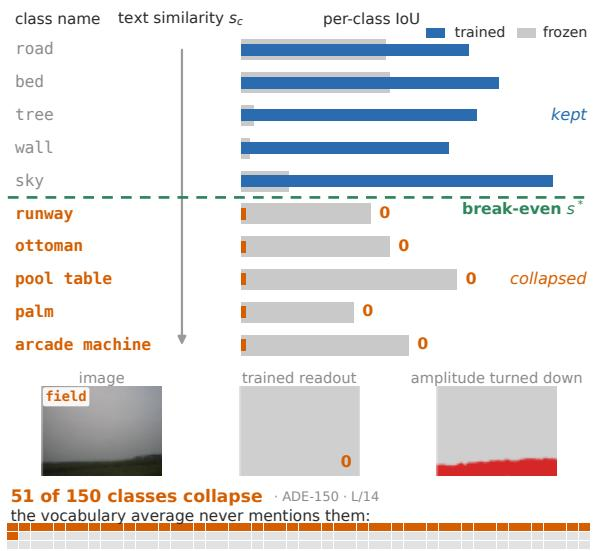
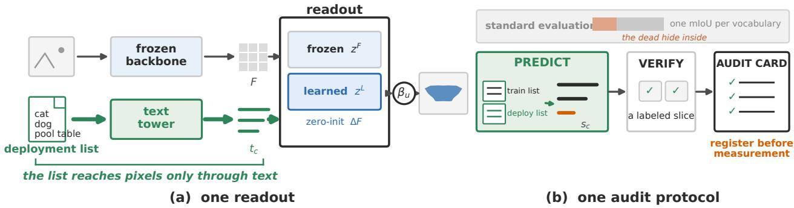
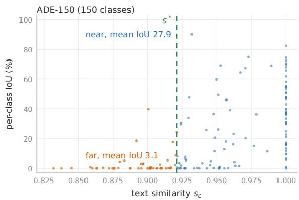
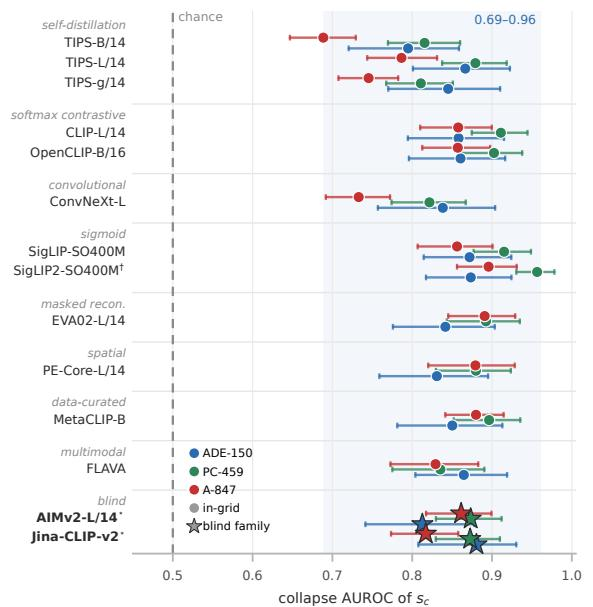
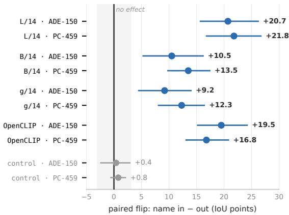
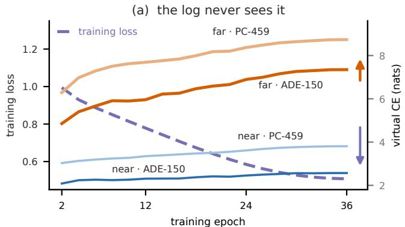
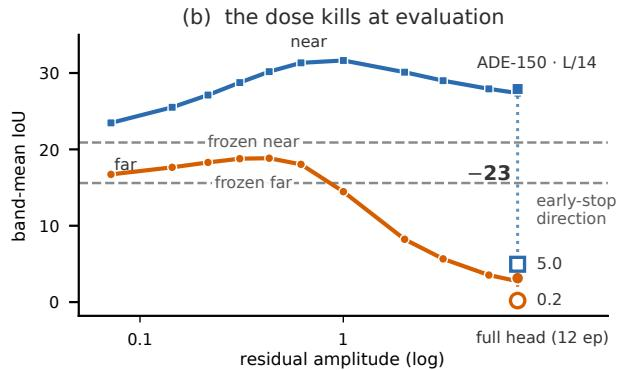
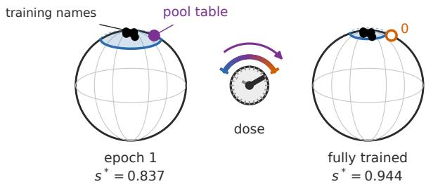
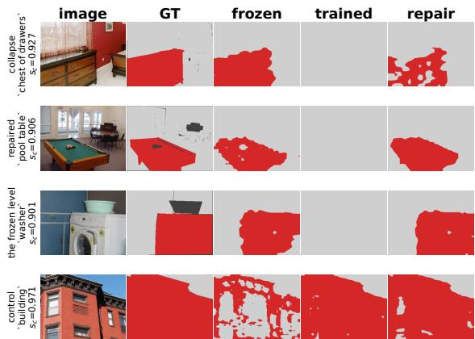

# Text Alone Predicts Which Classes a Segmentation Readout Keeps

David Yan Southeast University davidyan@seu.edu.cn

## Abstract

An open-vocabulary segmentation readout silently loses a class deployed beyond its training categories. It still emits masks with high confidence, but the class never wins a single pixel. The training loss falls anyway, and mIoU can even rise while classes die. We show that which classes collapse is written in the class-name list alone. Before any image is seen, we rank each class’s collapse riskfrom its text similarity to the training vocabulary alone. The ranking holds at AUROC 0.69–0.96 across nine modelfamilies, twelve backbones and eight pretraining recipes. Two further families, measured only after the predictions were written down, land in the same band. What the list writes, it can rewrite. With identical images and a class’s counterpart moved in or out of the training list, retraining flips that class’s gain over the frozen baseline by 21 IoU points; swapping in unrelated names changes nothing. Wefind a vocabulary-distance mechanism behind the collapse. Collapsed classes lose every vote to near-name neighbors, but in thefrozenfeatures they survive. Turning down the readout’s amplitude, or stopping training early, brings them back, up to +16 points, without retraining; trained with its amplitude held down, the readout never collapses.

## 1. Introduction

Open-vocabulary segmentation promises to segment every class on the deployer’s list: a hospital’s own taxonomy, a warehouse’s inventory labels, and classes no benchmark covers. Each name on such a list is someone’s request. The masks come back with high confidence, but some of the classes never appear in the output. No standard metric reports it. We call this vocabulary-support collapse. On ADE-150, 51 of the 150 classes collapse (Fig. 1). Ask for all 150, and a third never appear. No training list keeps every class alive, since every list leaves some classes out and every deployment brings new ones. Before deployment, no one can tell which classes will die. Finding out means deploying the model, then checking it on new images with new labels. The dead classes surface only once the model ships. The hospital never sees the class it asked for, and nothing tells it.

  
Figure 1. The list alone says which classes die. ADE-150 classes sorted by text similarity to the training list; below the break-even point they win no pixels (red), and turning the readout’s amplitude down brings them back.

The training vocabulary is a second list, written before training begins. It already says which classes will die. The readout, a trained mask head over frozen features, scores a pixel as $\langle F _ { u } , t _ { c } \rangle$ . Frozen features can already be read with arbitrary class names, though at coarse spatial resolution [55, 66]. Training raises the seen classes’ scores [11, 60], and every deployment class is either helped or hurt. How close a class’s name sits to the nearest training name decides whether the readout keeps it. Is a trained readout’s “help-orhurt” predictable from text alone, and controllable through the training vocabulary? Both become possible without deployment, new images, or new labels, because a vocabulary enters the readout only through its text embeddings. A single text similarity, $s _ { c } = \operatorname* { m a x } _ { j } \cos ( t _ { c } , t _ { j } ^ { \mathrm { t r a i n } } )$ , the proximity to the nearest training name, ranks each class’s collapse risk before any image is seen. The ranking even has a breakeven point that the list itself predicts. Below the point, the readout loses the class and keeps its confidence. The list also causes the deaths it predicts: with the images held fixed, moving one name in or out flips that class between kept and collapsed. The two lists already answer both questions.

Our contributions.

• Text alone predicts which classes a readout keeps. We show that a class’s text similarity to the training vocabulary, the first text-only predictor of per-class collapse, ranks its collapse risk across nine families, twelve backbones, and eight pretraining recipes. The predictions were pre-registered before measurement.

• The training vocabulary causes the collapse. We run the first experiment that treats a training vocabulary as the intervention axis: with the images held fixed, moving a class’s counterpart in or out of the training list flips that class by 21 IoU points; swapping in unrelated names changes nothing. The training vocabulary becomes a design choice.

• Collapsed classes are outvoted, and the vote has a knob. We trace the collapse to the vote itself: pixels go to the highest-scoring name; training turns the readout up along the seen names, until far classes lose every vote to near-name neighbors; in the frozen features they survive. One appended name steals the same vote and drains a victim class. The knob is the readout’s amplitude: turning it down brings the lost classes back, up to +16 points, without retraining; held down during training, it prevents the collapse.

One mechanism runs through all three results: what the list predicts, what one moved name rewrites, and what the knob returns. We call it the vocabulary-distance mechanism (VDM). The training vocabulary itself is the object of study, much as datamodels made the individual training sample one [24]: here it is measured, attacked, and intervened on with images held fixed. A readout deployed past its training vocabulary can be audited before the first image runs. The two text files alone map which classes will die, and a labeled slice certifies the rest. Every analysis built on a dead class inherits its absence. We release the audit itself as VDM-Bench.1 Which classes die has always been written in the training vocabulary; now it can be read and rewritten before anything runs.

## 2. Related Work

Two families, one unmeasured axis. OVSS readouts are either training-free surgeries on frozen CLIP [45] (MaskCLIP [66], SCLIP [55], NACLIP [21], Proxy-CLIP [28], DouC [63]) or trained heads adding adapters and cost aggregation (SAN [60], CAT-Seg [11], SED [59],

FC-CLIP [62]). DouC steadies frozen CLIP by fusing two frozen branches and never trains; we train a readout, then give its frozen evidence back, undoing the collapse the training made. Both families are judged by a single mIoU, and which classes can be trusted is never measured.

The statistic is old; the use is new. The max-cosine of a class name to the training vocabulary is a known statistic put to other uses: OVSNet [32] builds hard benchmarks from it, OVSeg [30] splits seen from unseen classes by hand, FG-OVD [4] varies the query names in detection, and MESS [5] even reports the training-vocabulary variant’s positive correlation with per-class IoU, as a benchmark characterization, never as a predictor. DAC [56] calibrates fine-tuned CLIP classifiers by the same proximity, and at K=1 its score is order-equivalent to ours. Name engineering has filled the deployment side [37, 43, 48, 61]; on the training side, the vocabulary has never been an experimental axis [58]: its membership has never been intervened on with the images held fixed. Here the coordinate does three new things: it predicts per-class collapse from text before any image is seen, tests the list as a cause, and prices a certificate. Risk contro certifies samples and pixels [2, 3]; ensemble uncertainty filters individual segmentations at population scale [40]; we certify classes, over an entire deployed vocabulary. The readout–representation gap we find in dense prediction is surfacing concurrently in other modalities: negation, spatial relations, VQA utilization [29, 33, 53]. A 3D-fusion cousin keeps what argmax drops by retaining the top-k ladder [18].

## 3. One readout, one text similarity, one audit protocol

Which classes can be trusted is measurable before deployment.

One readout, trained once. Given image x and target vocabulary V, a frozen spatially-aware encoder (TIPSv2 [8]) gives dense features F and a text encoder gives unit class vectors tc. The readout is built to isolate what training changes (Fig. 2a): a frozen branch keeps the pretrained scores fixed, and a learning branch adds a small correction through a zero-initialized residual. Both branches score pixel–class pairs by a scaled cosine to the name’s text vector. Training starts from the frozen readout, and every deviation from it is training’s own effect. One training run on COCO-Stuff-171 [7, 31] serves every deployment. The readout is evaluated on deployment vocabularies drawn from four source datasets (ADE20K [65], Pascal Context [39], PASCAL VOC [17], Cityscapes [12]).

One text similarity, one gate. Which classes does a trained readout keep? The answer must come before any image is seen, so we look where readout and vocabulary meet, the text embedding. A target class’s text similarity to the training vocabulary is the cosine to its nearest training name,

  
Figure 2. The audit setup. (a) One readout: the class list reaches pixels only through text embeddings. (b) One audit protocol: rank the names from the text file, verify with a labeled slice of the list, register the card before measurement.

  
Figure 3. Text alone separates kept from collapsed.

$$
s _ { c } = \operatorname* { m a x } _ { j } \cos \left( t _ { c } , t _ { j } ^ { \mathrm { t r a i n } } \right) .\tag{1}
$$

A class with a near name in the list inherits that name’s supervision; a class with none stands alone (Fig. 3). The ranking has a break-even point, $s ^ { * } ;$ below it a class is far, above it near. The learned branch’s correction only reaches the seen names. The further a vocabulary sits from the training list, the more the readout leans on the frozen branch, so the two branches’ scores fuse as $z _ { u , c } = z _ { u , c } ^ { L } + \beta _ { u } z _ { u , c } ^ { F }$ . The best $\beta _ { u }$ per vocabulary, the oracle, drifts with that distance, and finding it would need target labels. The gate instead reads $\beta _ { u }$ off the learned branch’s own scores: a pixel unsure of every training name leans on the frozen branch. Set once on source held-out classes, the gate matches the per-vocabulary oracle within 0.3 mIoU, without any target labels.

KeepCert, the audit protocol, predicts from text and verifies on a labeled slice. Given a frozen backbone, a readout trained on a source seen vocabulary $\mathcal { V } _ { \mathrm { t r a i n } } .$ and a target vocabulary V, the audit returns a subset A $\subseteq \mathcal { V }$ and a certificate. At least a 1−α share of the accepted classes clear a per-class IoU bar with confidence 1−δ, and the random unit is the class. KeepCert delivers the relative form of this promise: a certified lift over the vocabulary’s base rate. The absolute form is priced in the experiments. The protocol is the predict-then-audit split of audited conformal prediction [67], instantiated per class (Fig. 2b). Predict reads only the text, ranking every target class by $s _ { c }$ and proposing the nested candidate sets $A _ { t } = \{ c : s _ { c } \geq t \}$ . Setting $t = s ^ { * }$ from the list alone misses the nominal level on held-out classes. Verify spends labels, labeling m calibration classes, choosing t on them alone, and certifying the rest out of sample, with m the certificate’s explicit price [26]. Text supplies the ranking, labels buy the guarantee.

## 4. Experiments

Throughout, a class counts as collapsed when its adapteronly IoU falls below 1%. On ADE-150, half of the collapsed classes win exactly zero pixels. Training trades far classes for near ones (Tab. 1). The average can look healthier as coverage dies: on a second backbone (TIPS-B/14), the ADE-150 average climbs from 15.0 to 20.8 while its deadclass count rises from 12 to 39. On ADE-150, 28 of the 51 dead read above 10 IoU before training. They were alive before training killed them. Full derivations, per-cell tables, protocols and controls are in the supplementary material.

## 4.1. Text similarity alone ranks collapse risk before any image is seen

The text similarity outranks every cheaper coordinate. Across nine families, twelve backbones and eight recipes, the text similarity, computed from the two lists alone, ranks collapse at AUROC 0.69–0.96 (Tab. 2, Fig. 4). Below the break-even point, collapse is the norm; on the near side IoU grows with the similarity. Pretraining concept frequency [52] trails by +0.21 AUROC on whether a class is ever emitted (11/11 held-out folds), string overlap falls further behind (Tab. 3). The strongest visual alternative needs labels that do not exist at audit time, and still loses. The ranking is not a seen-versus-unseen split: within the classes that have no identifiable training counterpart at all, the coordinate still ranks the collapse (mean AUROC 0.71). Selection asks more than ranking [40]. On all 42 cells, the kept set is strictly cleaner than the full vocabulary at every coverage below

Table 1. Training trades far classes for near ones, and the divide is field-wide. Cross-vocabulary mIoU (%). Frozen row: value readout, trained row: patch. Third row: the same run stopped early (epoch 1). Fourth row: classes below 1% IoU before and after training.
<table><tr><td rowspan="2">method (backbone, train)</td><td colspan="2">seen / near</td><td colspan="4"> $\mathrm { f a r }$ </td></tr><tr><td>PAS-20</td><td>PC-59</td><td>ADE-150</td><td>PC-459</td><td>A-847</td><td>OpenBench [32]</td></tr><tr><td>frozen readout (TIPS-L/14)</td><td>82.5</td><td>36.1</td><td>23.7</td><td>8.6</td><td>9.9</td><td>28.2</td></tr><tr><td>trained readout (TIPS-L/14, COCO-171)</td><td>95.8</td><td>54.5</td><td>20.5</td><td>9.1</td><td>4.5</td><td>9.7</td></tr><tr><td>stopped early</td><td>90.0</td><td>47.9</td><td>28.3</td><td>13.2</td><td>11.2</td><td>23.0</td></tr><tr><td>classes scoring below 1% IoU (before → after training)</td><td>0→0</td><td>0→1</td><td>12→51</td><td> $1 2 2 \substack {  } 2 2 3$ </td><td> $3 9 4 \mathrm {  } 6 7 9$ </td><td>14→70</td></tr><tr><td>PEARL (CLIP-B, free) [42]</td><td>86.9</td><td>38.5</td><td>19.4</td><td>7.7</td><td>7.1</td><td>26.0</td></tr><tr><td>CorrCLIP (MetaCLIP-L, free) [64]</td><td>91.5</td><td>50.8</td><td>30.7</td><td>13.8</td><td>13.4</td><td>34.7</td></tr><tr><td>CAT-Seg (CLIP-L, ft) [11]</td><td>97.0</td><td>63.3</td><td>37.8</td><td>23.8</td><td>15.9</td><td>35.5</td></tr><tr><td>SED (ConvNeXt-L, ft) [59]</td><td>96.1</td><td>60.9</td><td>35.2</td><td>22.1</td><td>13.7</td><td>33.5</td></tr><tr><td>FC-CLIP (ConvNeXt-L, ft) [62]</td><td>94.7</td><td>48.2</td><td>28.4</td><td>12.4</td><td>13.2</td><td>29.4</td></tr></table>

Table 2. Text similarity ranks collapse on nine families, and the ranking transfers to two more measured only after the predictions were written down. Each cell spans the row’s backbones and the far vocabularies (ADE-150, PC-459, A-847; two for Jina-CLIPv2). ⋆: blind families; † held-out checkpoint of a covered recipe.
<table><tr><td rowspan="2">recipe (backbones)</td><td rowspan="2">AUROC</td><td colspan="2">collapse rate</td></tr><tr><td>far</td><td>near</td></tr><tr><td>self-distillation (TIPS-B/L/g/14)</td><td>0.69-0.88</td><td>0.56–0.92</td><td>0.18-0.65</td></tr><tr><td>softmax contrastive (CLIP-L, OpenCLIP-B)</td><td>0.86-0.91</td><td>0.74-0.99</td><td>0.34-0.80</td></tr><tr><td>convolutional (ConvNeXt-L)</td><td>0.73-0.84</td><td>0.49-0.87</td><td>0.09-0.47</td></tr><tr><td>sigmoid (SigLIP-SO400M, SigLIP2†)</td><td>0.86-0.96</td><td>0.90–0.99</td><td>0.38-0.84</td></tr><tr><td>masked reconstruction (EVA02-L)</td><td>0.84–0.89</td><td>0.92-0.99</td><td>0.43-0.86</td></tr><tr><td>spatial (PE-Core-L)</td><td>0.83-0.88</td><td>0.93-0.99</td><td>0.62-0.91</td></tr><tr><td>data-curated (MetaCLIP-B)</td><td>0.85-0.90</td><td>0.78-0.99</td><td>0.42-0.83</td></tr><tr><td>masked multimodal (FLAVA)</td><td>0.83-0.86</td><td>0.90-1.00</td><td>0.48-0.88</td></tr><tr><td>AIMv2-L/14*</td><td>0.81-0.87</td><td>0.79-0.98</td><td>0.31-0.82</td></tr><tr><td>Jina-CLIP-v2*</td><td>0.87-0.88</td><td>0.58–0.89</td><td>0.05-0.21</td></tr></table>

  
Figure 4. Every cell of the bench, ranked from text alone. Whiskers: 95% bootstrap CIs.

100%. Deployed with the kept set, no class dies silently.

It transfers across four boundaries it was never tuned for. Published pipelines we never trained keep it (SED [59] 0.68–0.70, FC-CLIP 0.70–0.74 AUROC). Deployment scale keeps it (LVIS-1203, five towers, 0.72–0.88 [20]). A second task keeps it, open-vocabulary detection [38].

Table 3. No rival coordinate beats the text similarity. Collapse AUROC (L/14). The centroid row is paired with $s _ { c }$ on its centroidqualified subset $( s _ { c }$ there: 0.87/0.91). On the full 30-cell grid nothing beats max-cos significantly.
<table><tr><td>coordinate</td><td>ADE-150</td><td>PC-459</td><td>needs beyond the two lists</td></tr><tr><td>Sc (max-cos; ours)</td><td>0.87</td><td>0.88</td><td rowspan="4">GT masks + labels</td></tr><tr><td>visual-distance centroid</td><td>0.79</td><td>0.76</td></tr><tr><td>concept frequency</td><td>0.49</td><td>0.69</td></tr><tr><td>string overlap (Jaccard)</td><td>0.55</td><td>0.43</td></tr><tr><td>name length</td><td>0.38</td><td>0.34</td></tr></table>

Translated into Chinese, Spanish, French or German, the same deployment list keeps it (0.82–0.88). The ordering is the lists’ own, and transfers with them.

Text alone also counts the collapse; three frontier LLMs fall short. Across 64 held-out cells, the collapsed share tracks a text-computed far mass at Spearman 0.905 with slope 1.01, nearly the rate itself, while shuffled lists give 0.017. Three frontier LLMs shown only the two name lists fall short of a free cosine, and spelling the mechanism out to them makes them worse. The list alone carries it.

A predictor can be wrong, be calibrated, and then transfer; a report cannot. The prediction was registered before measurement, and held blind on a new checkpoint of a covered recipe and on two families measured only after the predictions were written down. It failed twice on LVIS-1203 (within-benchmark superiority does not transfer), was corrected, and re-registered. It has held since: first on PC-459, then 13/13 blind at both ends on a deterministic split of A-847, and 13/13 again from an external registry, written down before the complement vocabulary was ever measured. Our prediction has been wrong, been calibrated, and transferred. Which classes collapse, on whose pipeline, in which language, and how many. The list answers all four.

## 4.2. A class’s gain flips by 21 IoU when its counterpart leaves training

Same images, same recipe. Only the name’s membership moves. We run the first intervention on a training vocabulary alone (Fig. 5). COCO-171 is split into two disjoint halves, one readout trained per half on the same images with the other half’s pixels ignored; for a target class whose COCO counterpart is identifiable $( \cos \geq 0 . 9 7 )$ , the paired difference between the two readouts isolates that name’s membership in the list, so the VDM is a consequence of the training list. The flip is large and asymmetric. Membership holds the class at the frozen readout’s level (+2.6); absence destroys it (−18.2). The name’s power falls on the absent. A control arm swapping in unrelated names, same size, different composition, leaves the gain at zero.

  
Figure 5. One name decides the flip. Identical images, architecture, and recipe; only the counterpart’s membership in the training vocabulary moves.

Table 4. A second list writes the same flip. Paired gain difference, counterpart in − out of the training half (IoU points, L/14; images and recipe fixed). Every 95% CI excludes zero.
<table><tr><td>ADE-150 halved — registered before training</td><td></td></tr><tr><td>→ PC-459</td><td>+11.6</td></tr><tr><td>→ A-847</td><td>+21.3</td></tr><tr><td>→ COCO-171</td><td>+10.6</td></tr><tr><td>far names appended, no supervision: all 43 collapse  $( \Delta - 2 . 5 )$ </td><td></td></tr></table>

The name and its pixels act as a pair, and each fails alone. Far names appended to the list without pixels never learn to win, and every one collapses (Tab. 4). With every pixel still supervised, swapping the training name for a far-embedded substitute collapses the class, and all twenty substitutes inherit the pixels. Membership also rescues: re-adding the predicted classes’ counterparts to the list halves the harm exactly on the named half and leaves the rest untouched. The same effect holds at single-name granularity: removing one name from the training list kills that class, a paired drop of 39 to 86 IoU points across the four we tested. The lever reaches past the removed class: removing the single dominant name sky from training lifts the adapter-only mIoU on ADE-150 from 20.5 to 46.9, because that class had been eating the others’ pixels. An edit to a text file before training decides which classes the readout keeps.

## 5. The Vocabulary-Distance Mechanism

Training loss falls the whole time the far band dies. The VDM makes the two curves one process, in four pieces, each carrying a way to kill it. ${ \cal S } = \operatorname { s p a n } \{ t _ { j } ^ { \mathrm { t r a i n } } \}$ is the training-

text span.

## 5.1. Why text alone predicts which classes collapse. Training writes only in S

Kill it by finding one class outside the span that training improves. Under softmax cross-entropy over the source seen classes, the update to a pixel’s feature is a residual-weighted combination of the training text vectors, $\begin{array} { r } { \Delta F _ { u } = \sum _ { j } ( \bar { p } _ { u , j } - y _ { u , j } ) t _ { j } ^ { \mathrm { t r a i n } } } \end{array}$ , so it lies in their span for a dot-product readout. The scaled cosine adds a projection orthogonal to the current feature, and the update’s in-span energy share stays above 99.8%. A deployment-only class is never the label, so its positive-term gradient is identically zero and no training-loss curve can see it collapse.

Only the part of a deployment class’s name that overlaps the training span drags the class. On a frozen backbone the readout is a linear classifier on fixed features, and such classifiers keep growing in norm as Θ(log t) long after the direction has converged [25, 34, 51]. The scalar loss therefore falls while the far band’s virtual cross-entropy (the true class’s probability on its own pixels, which training never optimizes) rises (Fig. 6a). On two of six benchmarks, A-847 and a rebuilt stress set [32], the frozen readout’s far band beats its near band by +1.5 and +9.9 IoU, while every trained readout orders near over far on all six. Training writes the distance ordering. Holding images and pixel supervision fixed, we swap only which name each of twenty training-class pairs is supervised under. At evaluation the pixels follow the name the class trained under (capture 73.2%), not the semantically correct one (0.3%). A class’s fate is its position relative to the list.

The forecast. The margin model turns position into a forecast, and the break-even is the list’s. Each training name keeps alive a spherical cap on the name-embedding sphere (Fig. 7), whose half-angle is arccos s∗. Inside a cap, a class lives; outside all caps, it dies. Formally, if training amplifies the in-span directions at rate κ and attenuates the rest at rate λ, the per-class margin gain is affine with a single zero crossing,

$$
\mathrm { g a i n } _ { c } \approx a ( s _ { c } - s ^ { * } ) , \qquad s ^ { * } = \lambda / \kappa ,\tag{2}
$$

so a class is predicted to collapse when its text similarity to the training vocabularyfalls below the break-even point. The whole geometry then reduces to one question: where the break-even sits. The list answers it from its own structure. How tightly its own names cluster predicts $s ^ { * }$ to within 0.013 on average across nine families (worst family 0.04), and the prediction, written down before either was measured, holds on the two further families (AIMv2, Jina). Text alone forecasts both which classes die and where the break-even sits.

The break-even cannot be moved without touching the list’s geometry or the dose. The choice of names cannot move it, nor the optimizer’s path, nor the frame of the space;

Figure 6. One dose axis, two views. (a) Training loss falls while the far band’s own loss, never optimized, rises. (b) At evaluation the same axis reads as the residual’s amplitude. The far band dies along it, and at full dose the early direction alone flips both bands (open markers).  
  
Figure 7. Training closes the cap the list keeps alive.

only the dose moves it, and, within the list, only its size, with diminishing returns. One object underlies all of this, a spherical cap the list keeps alive, whose radius the list itself sets. The cap is a predictor, not only a description. We wrote down the break-even of 38 never-measured heads before evaluating any of them, and all 38 landed within ±0.02; at negative doses the relation inverts, and on the far-dominated vocabulary the gain ordering flips sign and the collapse list empties. The cap pins the band, not the point.

## 5.2. Why one knob repairs the collapse. The damage concentrates on one amplitude axis

Kill it with one effective repair that leaves amplitude free. What training keeps growing, once the direction has converged, is the margin’s amplitude, so the dose is the residual amplitude. How much a head collapses is set by $\| \Delta F \|$ (monotone within each of three backbones, $\rho = - 1 . 0 0 / -$ $1 . 0 0 / - 0 . 9 0$ , over fourteen heads); the repair/damage divide sits at unit relative amplitude $\mathrm { R M S } ( \Delta F ) / \mathrm { R M S } ( F ) { \approx } 1$ , the scale where the training equilibrium balances weight growth against decay [27]. When the residual is held near the frozen scale during training, its amplitude crests at 1.5 and settles at 1.02, on the divide itself. At this dose the far band dips as the amplitude crests and returns as it settles (rank correlation −0.78 along the run), while at full dose the damage remains after the amplitude recedes. Two of the three deployment vocabularies end the held-down run within 7% of their first-epoch far level; the third keeps a slow leak. The dose also moves the break-even, not only the damage. At fixed recipe it climbs with the residual dose and saturates. The cap closes as training proceeds, and it closes in text order, far classes first. Two epochs of training already suffice. The per-class virtual cross-entropy at epoch 2 ranks the eventual dead at AUROC 0.930 (ADE-150) and 0.926 (PC-459). The largest drop lands in the first interval, and the decay is monotone from there. Collapse is immediate specialization. Early stopping therefore pulls the cap back. The first two pieces couple exactly where the damage begins.

The rival. Direction modulates, amplitude decides. At one and the same amplitude, the fully trained head’s own, swapping the residual’s direction from the final checkpoint’s to the early checkpoint’s lands both bands at the opposite end (Fig. 6b). Direction alone costs 23 IoU, more than the repair recovers. The directions that spare far classes live only on the early, low-amplitude checkpoints. Reaching them is what turning the amplitude down does. Amplitude is the dose axis; it decides which directions are reachable; direction only modulates the damage at a fixed dose. Necessity, not just correlation. Zeroing the update’s out-of-span component leaves the collapse intact, while every effective repair constrains amplitude. The vehicle is in-span amplitude growth. The same knob writes the harm and its predictability at once. At zero trained amplitude the collapse list is anti-ordered (collapse AUROC below chance), and predictability grows monotonically with the dose. Amplitude decides how much damage; it does not decide where the lost pixels go.

## 5.3. Where the lost pixels go. Attractor basins set by text geometry and class mass

Kill it by predicting the sinks from the images instead, or by excising the sinks and returning the pixels. Far pixels funnel into the attractor classes of the training vocabulary, the sinks of the text manifold (cf. neural collapse [41]; the hubness cousin in zero-shot classification [14, 46, 49] offers no account of per-class collapse in a deployed vocabulary). Attractor load tracks two inseparable factors, text centrality and the pixel mass itself. Text geometry nominates the candidates, class mass picks the winners. Excising the top attractor names, the highest-mass names, or random names at training time leaves the collapse unchanged (all CIs through zero). The sink’s identity is replaceable, only the span must have one. The same names recur as sinks across towers, and the division of labor is clean. Text distance decides who becomes vulnerable, visual proximity and class mass decide who eats the pixels; the sinks are steerable from the list alone. The image side offers no competing account. Corrupting the images outright moves the near−far gap by ≤1.8 points against an 11.7–24.8 vocabulary-side span, and masking the top-12 measured attractors returns almost none of the collapsed pixels. The basin re-forms around the next names.

## 5.4. What collapse is. Every vote lost, the features survive

Kill it with a probe that reads nothing, or a decoy that steals nothing. Each pixel goes to the highest-scoring name: the deployment vocabulary’s classes compete, and a collapsed class is one that never wins. An oracle linear readout on the same frozen patches reaches 30.4 IoU over the far band, nearly double the frozen readout’s level. On the collapsed classes it reaches 28.6 where the trained readout scores 0.11 (shuffle control ≈0); a wider probe battery agrees [1, 13], supervised or training-free. The features carry what the task needs; the trained readout takes almost none of it. Fed the collapsed classes’ own pixels, the deployed readout returns the true class for almost none of them, and the name that wins instead is a near-vocabulary neighbor in 93%/96% of cases (a palm’s pixels go to tree, a pool table’s to table). The pixels are stolen by near names. The theft is silent. Below $s ^ { * }$ the readout’s top-1 confidence stays 0.52 while the true class’s own score sits at 0.038. The confidence is read off the nearest seen name,

$$
\operatorname * { m a x } _ { c ^ { \prime } } p _ { u , c ^ { \prime } } ^ { L } \approx \phi ( s _ { c } ) , \qquad \phi \mathrm { m o n o t o n e ~ i n c r e a s i n g }\tag{3}
$$

, a map of how seen-like the pixel is, not of whether it is right. The same silence replicates on the rebuilt stress set, where the far band’s confidence sits at 0.45 against the frozen readout’s 0.67 while its win rate falls from 0.44 to 0.04. Collapse is the mirror image of neural collapse [41]: there, training collapses the features onto class means; here the features stay readable and the assignment collapses onto the training vocabulary’s nearest names.

The attack. The competition can be stolen. The competition is also a regulator: a BCE readout with no softmax competition collapses every far class and halves the near ones (two families). What runs on names can be stolen from the text file alone. One near-name decoy appended to the deployment vocabulary, no training, no weights, no image or model output queried (an image-level cousin exists in openset classification [47]), drains its victim class at inference, the stolen IoU growing monotonically with the decoy’s text proximity (+8.49; controls null). Attackers who never see the coordinate rediscover the near-name region on their own. An exhaustive sweep over the 1,459 real names, ranked by the model’s response alone, lands its successful attacks at median cosine 0.95 and drains 13.1 IoU; a gradient-guided search over three-word strings [16, 50, 69] drains 24.2, 93% of what a free continuous vector can steal. The region does not bound crafted blends: 12 of 150 searches steal from outside it (max 31.7), a second attack surface the coordinate does not cover. The same one line drains CAT-Seg, SED and FC-CLIP, and even a promptable concept decoder with no native competition (SAM 3 [9]), once victim and decoy are made to compete on the same weights; even the frozen readout is drained. The attack surface is the shared-vocabulary competition itself, and training only sharpens it. Renames steer the same competition in both directions. A collapsed class revives without touching an image (flag→banner, 0→28.5 IoU), and a healthy class drains under a farther synonym (curtain→drape, 54.9→21.6). At scale (32 collapsed classes, three rename rules), crossing the break-even is neither sufficient nor necessary (tank→storage tank revives while its similarity drops). What revives a class is escaping its local rival, and the coordinate’s blind spot is exactly where that competition lives.

## 6. One knob undoes the collapse

Turning the amplitude down brings the lost classes back. The mechanism predicts its own repair. What training turns up, turning back down should undo [6]. It does. Stopping training at epoch 1 recovers +16.2 far IoU on ADE-150, and a zero-training variant that projects the residual back to its epoch-1 amplitude recovers +15.3, with no retraining and no labels (Tab. 5, Fig. 8). The turn works because the directions that spare far classes live only on the early, low-amplitude checkpoints, and turning the amplitude down reaches them. The knob returns what the frozen features kept. Three of the four repairs bring the far band back to the frozen level or beyond on all three vocabularies, and the early-stopped readout overtakes the frozen one on all-vocabulary mIoU on five of the six vocabularies.

The repair zoo is one knob. Four repairs from four literatures (early stopping, amplitude projection, quadratic penalty, residual-amplitude constraint) all climb the same axis, and the monotone amplitude–collapse relation predicts where each setting lands. Interpolating back toward the frozen weights is known to recover average robustness [57]. The dose axis turns that heuristic into a mechanism. It says where to stop, at unit relative amplitude, and what returns, per-class survival. Off the axis, nothing moves. Temperature scaling [19] is exactly the fusion-path coefficient, a monotone rescaling that never reorders a selection [44]. Logit adjustment [10, 36, 68] steers by class priors, a different axis. Adapting at deployment moves the axis backward.

Table 5. One knob undoes the collapse. Far-band IoU below the break-even point (L/14, adapter-only). Top block absolute. Arms below are paired ∆ against the full head, blue at or past the frozen level. The last row adapts the trained readout on the unlabeled deployment stream (test-time adaptation, TTA).
<table><tr><td>far-band IoU</td><td>ADE-150</td><td>PC-459</td><td>A-847</td></tr><tr><td>frozen (no training)</td><td>15.59</td><td>5.69</td><td>8.68</td></tr><tr><td>full head (12 ep)</td><td>3.14</td><td>0.61</td><td>0.99</td></tr><tr><td colspan="4">paired ∆far vs full head, four repairs, one axis</td></tr><tr><td>early stopping (epoch 1)</td><td>+16.2</td><td>+8.1</td><td>+8.3</td></tr><tr><td>amplitude projection</td><td>+15.3</td><td>+6.5</td><td>+8.1</td></tr><tr><td>residual-amplitude constraint</td><td>+15.3</td><td>+7.1</td><td>+8.0</td></tr><tr><td>soft quadratic penalty</td><td>+8.7</td><td>+3.3</td><td>+4.3</td></tr><tr><td colspan="4">paired ∆far vs full head, the same knob, installed during training</td></tr><tr><td>residual L2 brake (no labels, no bank)</td><td>+8.4</td><td>+3.1</td><td>+4.0</td></tr><tr><td>name-bank KL (900 held-out names)</td><td>+15.4</td><td>+6.6</td><td>+7.3</td></tr><tr><td>off the axis, at deployment entropy minimization (TTA)</td><td>-2.0</td><td>-0.5</td><td>-0.4</td></tr></table>

Entropy minimization on the unlabeled stream [15, 54] sharpens the winners, and the far band sinks further on all three vocabularies while the average falls with it. The knob needs no per-class steering either. One global fusion turn beats per-class oracle tuning.

The same knob, installed during training, prevents the collapse. A causal axis works in both directions. Holding the residual near the frozen scale during training should prevent what turning it down afterwards repairs, and it does. An L2 brake on ∆F, no labels and no third list, lifts the far band by $+ 8 . 4 / + 3 . 1 / + 4 . 0$ on the three far vocabularies (pre-registered). The near side rises with it (+2.1–+4.5), a Pareto move the post-hoc knob does not make. A name-bank variant, KL toward frozen predictions over 900 held-out names, doubles the far gain to +15.4 on ADE-150, past the frozen level, and the same untuned λ holds on two further backbone families. Trained on a second list base, the ADE-150 half-vocabularies of the flip experiment, the name bank gains +3.5–+5.0 on the far band of both held-out vocabularies. All four pre-registered cells pass, while steering only the residual’s direction changes nothing. Prevention cannot buy information, and on A-847 even the stronger arm reaches only the frozen level (8.0 vs 8.7). Post-hoc knobs refund to this level, and prevention lands near it. Only supervision adds what the frozen features do not already carry.

A lift is certified where it exists and refused where it does not. What the knob cannot buy is the boundary itself. Spending the label budget toward the deployment vocabulary lifts only the near side and leaves the far side unmoved. The boundary is priced by supervision, not by budget allocation. KeepCert issues the first certificates of per-class dense risk on a deployed vocabulary. On the far vocabularies the accepted set beats the vocabulary base rate by +0.13 to +0.28, a lift certified in 18–86% of calibration splits; on the near vocabulary (PC-59) the realized gain is positive, yet the certificate is withheld in ≥97% of splits, refused, correctly. The absolute form is refused outright, every far cell at $\alpha { = } 0 . 2 \ ( 0 / 1 0 )$ , and the refusal is priced, not incidental. With $Q _ { 0 } , Q _ { 1 }$ as the gate’s firing rates on bad and good classes, the certificate requires

  
Figure 8. Collapse and repair, up close. Four ADE-150 cases, drawn from the classes the coordinate marks for collapse; the repair column turns the residual amplitude down, no retraining.

$$
\begin{array} { r c l } { { R ( A ) \ \leq \ \alpha } } & { { \Longleftrightarrow } } & { { Q _ { 1 } \ \geq \ c Q _ { 0 } , } } \\ { { } } & { { } } & { { } } \\ { { } } & { { \mathrm { w i t h } } } & { { c \ = \ { \frac { \left( 1 - \alpha \right) \left( 1 - \pi \right) } { \alpha \pi } } } } \end{array}\tag{4}
$$

. At our base rates c≈16/94, the measured label-free supply falls ∼6× short; a confidence score at MSP AUROC 0.97 certifies nothing. Calibration is not certifiability. Labels buy what no label-free score can, at a per-class price falling with vocabulary size, and the property that makes the attack possible is the one that makes verification possible. The deployment vocabulary arbitrates the competition.

## 7. Conclusion

The shape of the boundary. The boundary is measured on both sides. One text similarity and one label budget measure what a readout keeps, what a knob refunds or prevents, and what no label-free score can certify. The scope throughout is the frozen-backbone, trained-readout regime, with a small labeled calibration set. An older science asks the same question of a crowded niche. Coexistence thins past a limiting similarity [22, 23, 35], and the break-even falls as the training vocabulary grows, decelerating, as though the vocabulary metric admitted only so much separation. A new vocabulary’s risk is readable before training and its certificate priceable afterwards. The boundary is an information budget with a measured location. The field scores a readout by its average; the average cannot say which classes die. The training vocabulary itself becomes an object, written before training, read before any image, edited with a text editor.

## LLM Usage Statement

This work is author-driven: the research questions, hypotheses, method designs, experimental protocols, evaluation criteria, analyses, and conclusions were conceived, directed, and validated by the authors, who also ran every experiment. LLM-based assistance (Claude, Anthropic) was limited to language polishing of author-written text—grammar, phrasing, and style—and contributed no scientific ideas, code, experiments, results, or interpretations. The authors reviewed every edit and take full responsibility for the content.

## References

[1] Guillaume Alain and Yoshua Bengio. Understanding intermediate layers using linear classifier probes, 2016. arXiv:1610.01644. 7

[2] Anastasios N. Angelopoulos et al. Conformal risk control, 2022. arXiv:2208.02814. 2

[3] Stephen Bates et al. Distribution-free, risk-controlling prediction sets. J. ACM, 2021. 2

[4] Lorenzo Bianchi, Fabio Carrara, Nicola Messina, Claudio Gennaro, and Fabrizio Falchi. The devil is in the fine-grained details: Evaluating open-vocabulary object detectors for finegrained understanding. In CVPR, 2024. arXiv:2311.17518. 2

[5] Benedikt Blumenstiel, Johannes Jakubik, Hilde Kuhne, and¨ Michael Vossing. What a MESS: Multi-domain evaluation of¨ zero-shot semantic segmentation. In NeurIPS Datasets and Benchmarks, 2023. arXiv:2306.15521. 2

[6] Alex Buna, Fanghui Liu, and Patrick Rebeschini. Computeoptimal pretrain–fine-tune in ridge gradient descent, 2026. arXiv:2609.16262. 7

[7] Holger Caesar, Jasper Uijlings, and Vittorio Ferrari. COCO-Stuff: Thing and stuff classes in context. In CVPR, 2018. 2

[8] Bingyi Cao, Koert Chen, Kevis-Kokitsi Maninis, Kaifeng Chen, Arjun Karpur, Ye Xia, Sahil Dua, Tanmaya Dabral, Guangxing Han, Bohyung Han, Joshua Ainslie, Alex Bewley, Mithun Jacob, Rene Wagner, Washington Ramos, Krzysztof´ Choromanski, Mojtaba Seyedhosseini, Howard Zhou, and Andre Araujo. TIPSv2: Advancing vision-language pretrain-´ ing with enhanced patch-text alignment. In CVPR, 2026. arXiv:2604.12012. 2

[9] Nicolas Carion et al. SAM 3: Segment anything with concepts, 2025. arXiv:2511.16719. 7

[10] Wei-Lun Chao, Soravit Changpinyo, Boqing Gong, and Fei Sha. An empirical study and analysis of generalized zero-shot learning for object recognition in the wild. In ECCV, 2016. arXiv:1605.04253. 7

[11] Seokju Cho et al. CAT-Seg: Cost aggregation for openvocabulary semantic segmentation. In CVPR, 2024. 1, 2, 4

[12] Marius Cordts, Mohamed Omran, Sebastian Ramos, Timo Rehfeld, Markus Enzweiler, Rodrigo Benenson, Uwe Franke, Stefan Roth, and Bernt Schiele. The cityscapes dataset for semantic urban scene understanding. In CVPR, 2016. 2

[13] MohammadReza Davari, Nader Asadi, Sudhir Mudur, Rahaf Aljundi, and Eugene Belilovsky. Probing representation forgetting in supervised and unsupervised continual learning. In CVPR, 2022. arXiv:2203.13381. 7

[14] Georgiana Dinu, Angeliki Lazaridou, and Marco Baroni. Improving zero-shot learning by mitigating the hubness problem. In ICLR Workshop, 2015. 6

[15] Chandler Timm C. Doloriel, Yunbei Zhang, Sarthak Kumar Maharana, Muhammad Salman Siddiqui, Tor Kristian Stevik, Fadi Al Machot, Kristian Hovde Liland, and Habib Ullah. Towards continual test-time adaptation of vision-language models in open-vocabulary semantic segmentation, 2026. arXiv:2608.29923. 8

[16] Javid Ebrahimi, Anyi Rao, Daniel Lowd, and Dejing Dou. Hotflip: White-box adversarial examples for text classification. In ACL, 2018. 7

[17] Mark Everingham, Luc Van Gool, Christopher K. I. Williams, John Winn, and Andrew Zisserman. The PASCAL visual object classes (VOC) challenge. IJCV, 2010. 2

[18] Silas Kwabla Gah and Ebenezer Owusu. Beyond argmax: A mechanistic study of semantic retention in frozen foundationmodel composition for generalized few-shot 3D segmentation, 2026. 2

[19] Chuan Guo, Geoff Pleiss, Yu Sun, and Kilian Q. Weinberger. On calibration of modern neural networks. In ICML, 2017. arXiv:1706.04599. 7

[20] Agrim Gupta, Piotr Dollar, and Ross Girshick. LVIS: A´ dataset for large vocabulary instance segmentation. In CVPR, 2019. 4

[21] Sina Hajimiri et al. Pay attention to your neighbours: Training-free open-vocabulary semantic segmentation. In WACV, 2025. arXiv:2404.08181. 2

[22] Garrett Hardin. The competitive exclusion principle. Science, 131(3409):1292–1297, 1960. 8

[23] G. Evelyn Hutchinson. Homage to santa rosalia, or why are there so many kinds of animals? The American Naturalist, 93(870):145–159, 1959. 8

[24] Andrew Ilyas, Sung Min Park, Logan Engstrom, Guillaume Leclerc, and Aleksander Madry. Datamodels: Predicting predictions from training data. In ICLR, 2022. 2

[25] Ziwei Ji and Matus Telgarsky. Directional convergence and alignment in deep learning. In NeurIPS, 2020. 5

[26] Jannik Kossen, Sebastian Farquhar, Yarin Gal, and Tom Rainforth. Active testing: Sample-efficient model evaluation. In ICML, 2021. arXiv:2103.05331. 3

[27] Atli Kosson, Bettina Messmer, and Martin Jaggi. Rotational equilibrium: How weight decay balances learning across neural networks. In ICML, 2024. arXiv:2305.17212. 6

[28] Mengcheng Lan et al. ProxyCLIP: Proxy attention improves CLIP for open-vocabulary segmentation. In ECCV, 2024. 2

[29] Guangyuan Li, Tianming Du, Yan Jiang, et al. Readout blindness: VLM scores miss the spatial direction their frozen encoders retain, 2026. arXiv:2610.06324. 2

[30] Feng Liang et al. Open-vocabulary semantic segmentation with mask-adapted CLIP. In CVPR, 2023. arXiv:2210.04150. 2

[31] Tsung-Yi Lin, Michael Maire, Serge Belongie, James Hays, Pietro Perona, Deva Ramanan, Piotr Dollar, and C. Lawrence´ Zitnick. Microsoft COCO: Common objects in context. In ECCV, 2014. 2

[32] Yong Liu, Songli Wu, Sule Bai, Jiahao Wang, Yitong Wang, and Yansong Tang. Stepping out of similar semantic space for open-vocabulary segmentation. In ICCV, 2025. arXiv:2506.16058. 2, 4, 5

[33] Chen-Yi Lu, Yueh-Shao Chen, and Somali Chaterji. What CLIP knows but cannot say: Recovering negation from frozen intermediate features, 2026. arXiv:2607.23271. 2

[34] Kaifeng Lyu and Jian Li. Gradient descent maximizes the margin of homogeneous neural networks. In ICLR, 2020. arXiv:1906.05890. 5

[35] Robert MacArthur and Richard Levins. The limiting similarity, convergence, and divergence of coexisting species. The American Naturalist, 101(921):377–385, 1967. 8

[36] Aditya Krishna Menon, Sadeep Jayasumana, Ankit Singh Rawat, Himanshu Jain, Andreas Veit, and Sanjiv Kumar. Long-tail learning via logit adjustment. In ICLR, 2021. arXiv:2007.07314. 7

[37] Sachit Menon and Carl Vondrick. Visual classification via description from large language models. In ICLR, 2023. 2

[38] Matthias Minderer et al. Simple open-vocabulary object detection with vision transformers. In ECCV, 2022. 4

[39] Roozbeh Mottaghi, Xianjie Chen, Xiaobai Liu, Nam-Gyu Cho, Seong-Whan Lee, Sanja Fidler, Raquel Urtasun, and Alan Yuille. The role of context for object detection and semantic segmentation in the wild. In CVPR, 2014. 2

[40] Tobias Norajitra, Tobias Nonnenmacher, Tobias Haueise, Fabian Isensee, Maximilian Zenk, et al. Ensemble-based uncertainty enables large-scale 3d segmentation quality control in population imaging. Medical Image Analysis, 116: 104351, 2027. 2, 3

[41] Vardan Papyan, X. Y. Han, and David L. Donoho. Prevalence of neural collapse during the terminal phase of deep learning training. PNAS, 117(40):24652–24663, 2020. 6, 7

[42] Gensheng Pei, Xiruo Jiang, Xinhao Cai, Tao Chen, Yazhou Yao, and Byeungwoo Jeon. PEARL: Geometry aligns semantics for training-free open-vocabulary semantic segmentation, 2026. CVPR 2026. 4

[43] Sarah Pratt, Ian Covert, Rosanne Liu, and Ali Farhadi. What does a platypus look like? Generating customized prompts for zero-shot image classification. In ICCV, 2023. 2

[44] Stephan Rabanser and Nicolas Papernot. What does it take to build a performant selective classifier? In NeurIPS, 2025. arXiv:2510.20242. 7

[45] Alec Radford et al. Learning transferable visual models from natural language supervision. In ICML, 2021. 2

[46] Milos Radovanoviˇ c, Alexandros Nanopoulos, and Mirjana´ Ivanovic. Hubs in space: Popular nearest neighbors in high-´ dimensional data. JMLR, 11:2487–2531, 2010. 6

[47] Shuhuai Ren, Lei Li, Xuancheng Ren, Guangxiang Zhao, and Xu Sun. Delving into the openness of CLIP. In Findings of ACL, 2023. arXiv:2206.01986. 7

[48] Karsten Roth et al. Waffling around for performance: Visual classification with random words and broad concepts. In ICCV, 2023. 2

[49] Shota Sato, Hajime Kiyama, Tosho Hirasawa, and Mamoru Komachi. When modality gap reduction fails: Predictionlevel hubness in CLIP, 2026. EMNLP 2026 Main. 6

[50] Taylor Shin, Yasaman Razeghi, Robert L. Logan IV, Eric Wallace, and Sameer Singh. Autoprompt: Eliciting knowledge from language models with automatically generated prompts. In EMNLP, 2020. 7

[51] Daniel Soudry, Elad Hoffer, Mor Shpigel Nacson, Suriya Gunasekar, and Nathan Srebro. The implicit bias of gradient descent on separable data. Journal of Machine Learning Research, 19(70):1–57, 2018. arXiv:1710.10345. 5

[52] Vishaal Udandarao, Ameya Prabhu, Adhiraj Ghosh, Yash Sharma, Philip H. S. Torr, Adel Bibi, Samuel Albanie, and Matthias Bethge. No “zero-shot” without exponential data: Pretraining concept frequency determines multimodal model performance. In NeurIPS, 2024. arXiv:2404.04125. 3

[53] Anat Veikherman, Mor Ventura, Nitay Calderon, et al. Encoded but unused: Bounding the sources of VLM errors, 2026. arXiv:2610.29241. 2

[54] Dequan Wang, Evan Shelhamer, Shaoteng Liu, Bruno Olshausen, and Trevor Darrell. Tent: Fully test-time adaptation by entropy minimization. In ICLR, 2021. 8

[55] Feng Wang et al. SCLIP: Rethinking self-attention for dense vision-language inference. In ECCV, 2024. 1, 2

[56] Shuoyuan Wang et al. Open-vocabulary calibration for finetuned CLIP. In ICML, 2024. arXiv:2402.04655. 2

[57] Mitchell Wortsman et al. Robust fine-tuning of zero-shot models. In CVPR, 2022. 7

[58] Jianzong Wu et al. Towards open vocabulary learning: A survey. IEEE TPAMI, 2024. arXiv:2306.15880. 2

[59] Bin Xie et al. SED: A simple encoder-decoder for openvocabulary semantic segmentation. In CVPR, 2024. 2, 4

[60] Mengde Xu et al. Side adapter network for open-vocabulary semantic segmentation. In CVPR, 2023. 1, 2

[61] Yue Yang et al. Language in a bottle: Language model guided concept bottlenecks for interpretable image classification. In CVPR, 2023. 2

[62] Qihang Yu et al. Convolutions die hard: Open-vocabulary segmentation with single frozen convolutional CLIP. In NeurIPS, 2023. 2, 4

[63] Mohamad Zamini and Diksha Shukla. DouC: Dual-branch CLIP for training-free open-vocabulary segmentation, 2026. arXiv:2604.24997. 2

[64] Dengke Zhang, Fagui Liu, and Quan Tang. CorrCLIP: Reconstructing patch correlations in CLIP for open-vocabulary semantic segmentation, 2025. ICCV 2025 (Oral). 4

[65] Bolei Zhou, Hang Zhao, Xavier Puig, Sanja Fidler, Adela Barriuso, and Antonio Torralba. Scene parsing through ADE20K dataset. In CVPR, 2017. 2

[66] Chong Zhou, Chen Change Loy, and Bo Dai. Extract free dense labels from CLIP. In ECCV, 2022. 1, 2

[67] Yanfei Zhou, Rizal Fathony, Nam H. Nguyen, and Matteo Sesia. Audited conformal prediction for classification under unknown distribution shift, 2026. arXiv:2606.14909. 3

[68] Beier Zhu, Kaihua Tang, Qianru Sun, and Hanwang Zhang. Generalized logit adjustment: Calibrating fine-tuned models by removing label bias in foundation models. In NeurIPS, 2023. arXiv:2310.08106. 7

[69] Andy Zou, Zifan Wang, Nicholas Carlini, Milad Nasr, J. Zico Kolter, and Matt Fredrikson. Universal and transferable adversarial attacks on aligned language models, 2023. 7