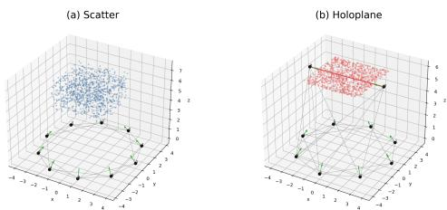
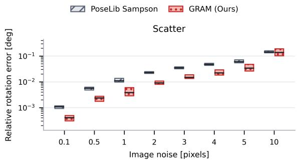
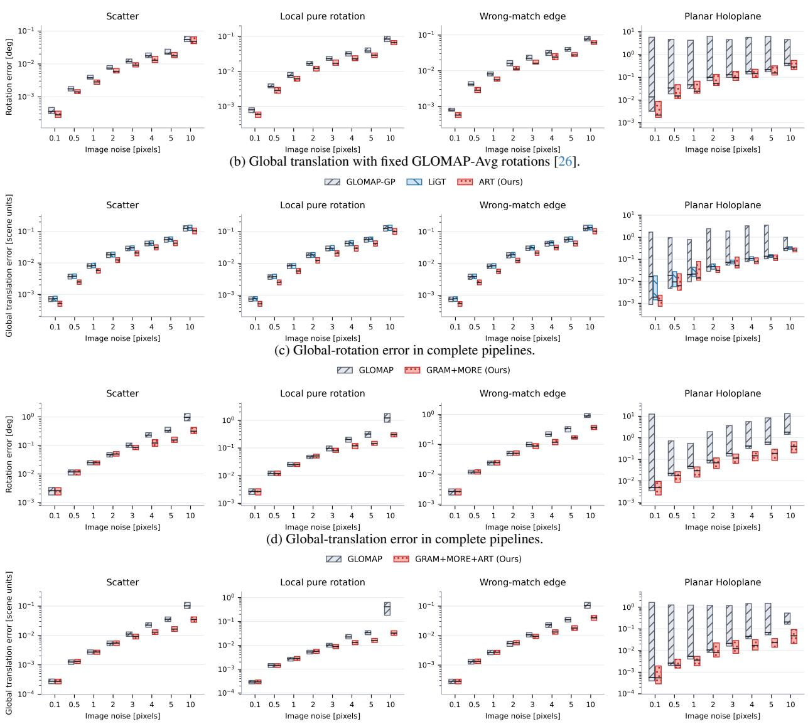

# Towards Rotation-Only Imaging Geometry: Multi-View Pose Estimation

Xinrui Li, Qi Cai, and Yuanxin Wu

Shanghai Key Laboratory ofNavigation and Location-based Services

School of Automation and Intelligent Sensing

Shanghai Jiao Tong University

Shanghai 200240, China

physalis@sjtu.edu.cn, qicaicn@gmail.com, yuanx\_wu@hotmail.com

## Abstract

Global structure-from-motion (SfM) commonly refines relative poses on individual image pairs and then estimates global rotations by rotation averaging. Pairwise refinement does not explicitly combine feature-level constraints with multi-view consistency during rotation initialization. We introduce Global Rotations from Aggregated Matches (GRAM), which estimates global rotations directly from initial relative rotations and inlier matches by minimizing edge-wise rotation-only algebraic residuals. GRAM replaces two-view relative-pose optimization and rotation averaging with a single stage. We further extend rotationonly imaging geometry to multiple views and develop Multiview Optimization with Rotation-only Reprojection Error (MORE) for nonlinear global rotation refinement. Analytical Rotation-guided Translation (ART) derives locally scaled triplet translations from Linear Global Translation (LiGT) constraints and recovers global translations using weighted least squares. Synthetic and real-world experiments demonstrate the accuracy, robustness, and efficiency of the proposed methods.

## 1. Introduction

Recovering camera poses from multiple images is a fundamental task in structure-from-motion (SfM). Conventional global SfM pipelines first estimate two-view geometry, refine pairwise relative poses, and recover global rotations through rotation averaging [23, 26]. This two-stage design inherently decouples feature observations from global consistency: pairwise relative refinement is isolated from global constraints, while subsequent rotation averaging operates blindly without revisiting raw feature matches.

Given camera rotations, Linear Global Translation (LiGT) [1–3] derives constraints from multi-view feature tracks using pose-only imaging geometry, stacks them into a global homogeneous system, and obtains its unitnorm least-squares solution by singular value decomposition (SVD). However, this single null-space formulation inherently couples all feature tracks, making it exceedingly difficult to locally isolate weak or corrupted constraints. While rotation-only imaging geometry [19] formulates reprojection residuals solely on the rotation manifold, it remains strictly limited to two-view geometry.

Motivated by these insights, we propose a robust global pose-estimation framework based on rotation-only imaging geometry. Our main contributions are:

• We introduce Global Rotations from Aggregated Matches (GRAM) to unify pairwise refinement and rotation averaging. By formulating edge-wise residuals directly upon global rotations, GRAM bypasses intermediate steps and efficiently initializes global rotations in a single stage.

• We extend the rotation-only imaging geometry to a multiview framework. By analytically deriving local LiGTbased triplet translations, Multi-view Optimization with Rotation-only Reprojection Error (MORE) further refines the global rotations.

• We introduce Analytical Rotation-guided Translation (ART), which embeds local LiGT-based triplet translations into a unified weighted linear system to analytically recover all global translations.

## 2. Related Work

Two-view pose estimation. Two-view initialization uses five- to eight-point solvers within RANSAC to estimate epipolar geometry from feature matches [10, 11, 20, 24, 27, 30]. Sampson-error optimization refines relative pose over inlier matches [26]. Kneip’s methods use spherical reprojection or eigenvalue objectives [13, 14]. Linear relativepose methods eliminate 3D structure [3]. Two-view Reprojection Residuals on the Rotation Manifold (TRRM) enable rotation-only optimization [19]. All operate on individual image pairs and do not use multi-view feature tracks.

Global rotation estimation. Global rotation methods either average two-view relative rotations or optimize directly from feature matches. Rotation averaging includes algebraic averaging [9], chordal averaging [21], $L _ { 1 }$ averaging [12], iterative reweighting [4], strong duality [8], lifted relaxation [7], and hybrid optimization [5]. Rotation-Only Bundle Adjustment (ROBA) [17] utilizes two-view residuals, while Global Reprojection Residual on the Rotation Manifold (GRRM) [19] aggregates two-view rotation-only reprojection errors. Both methods require traditional twoview estimation and rotation averaging for initialization.

Global translation estimation. Global translation methods use relative translation directions, feature tracks, or triplet geometry. Direction-based methods improve robustness through filtering and convex estimation [25, 35, 36]. LiGT solves a homogeneous system built from feature tracks [2], while Hybrid Explicit Translation Averaging (HETA) and GLOMAP jointly optimize global translations and 3D points [26, 32]. Moulon et al. [22] estimate triplet translations from trifocal geometry and jointly recover their scales and global translations using constrained $\ell _ { \infty }$ optimization.

Joint optimization. Bundle adjustment (BA) jointly refines camera poses and 3D points by minimizing reprojection error [34], whereas pose adjustment (PA) eliminates 3D structure and optimizes camera poses alone [2]. BA commonly serves as the final refinement stage of SfM systems [23, 26, 28, 33].

## 3. Mathematical Notation

All derivations use normalized camera coordinates. Camera i is represented by $( R _ { i } , t _ { i } )$ , with $\pmb { R } _ { i }$ the world-to-camera rotation and $\mathbf { \Delta } _ { t _ { i } }$ its world-frame center. For the relative pose, ${ \pmb R } _ { i j } = { \pmb R } _ { j } { \pmb R } _ { i } ^ { T }$ and $\mathbf { \delta t } _ { i j } = R _ { j } ( t _ { i } - t _ { j } )$

| · | denotes scalar absolute value or set cardinality, $\begin{array} { r l r l r l } { \| { \pmb v } \| } & { { } = } & { \| { \pmb v } \| _ { 2 } , } & { \hat { { \pmb v } } } & { { } = } & { { \pmb v } / \| { \pmb v } \| } \end{array}$ for $\begin{array} { r l } { \pmb { v } } & { { } \neq \quad \mathbf { 0 } . } \end{array}$ and $\begin{array} { r l r } { ( { \pmb v } ) _ { \times } { \pmb w } } & { { } = } & { { \pmb v } \ \times \ { \pmb w } . \qquad M _ { [ i , j ] } } \end{array}$ and $\pmb { v } _ { [ i ] }$ denote a matrix entry and a vector component, respectively. $\operatorname { c o l } ( A _ { 1 } , \dots , \dot { A _ { n } } ) \triangleq [ A _ { 1 } ^ { T } , \dots , A _ { n } ^ { T } ] ^ { T }$ denotes vertical stacking. d $\operatorname { i a g } ( A _ { 1 } , \ldots , A _ { n } )$ denotes block-diagonal assembly. For indexed blocks $\{ A _ { i } \} _ { i = 1 } ^ { n } , \mathrm { c o l } _ { i = 1 } ^ { n } ( A _ { i } )$ and $\mathrm { d i a g } _ { i = 1 } ^ { n } ( A _ { i } )$ denote vertical stacking and block-diagonal assembly, respectively. $[ A _ { i } ] _ { i = 1 } ^ { n }$ denotes horizontal block concatenation. Let $\mathbf { \Sigma } _ { q \left( R \right) } \mathbf { \Sigma } \in \mathbf { \Sigma } \mathbb { S } ^ { 3 }$ be the unit-quaternion representation of R. We define the $S O ( 3 )$ geodesic distance as $d _ { q } ( { \pmb R } _ { i } , { \pmb R } _ { j } ) = 2 \cos ^ { - 1 } \big ( \big | \mathrm { R e } \big ( { \pmb q } ( { \pmb R } _ { i } ) ^ { - 1 } \circ { \pmb q } ( { \pmb R } _ { j } ) \big ) \big | \big )$ , where ◦ denotes quaternion multiplication and $\operatorname { R e } ( \cdot )$ extracts the real part. For $\boldsymbol { B } \in \mathbb { R } ^ { 3 \times 3 }$ with SVD $\mathbf { \boldsymbol { B } } \mathbin { \stackrel { \cdot } { = } } \mathbf { \boldsymbol { U } } \Sigma V ^ { T }$ , its nearest rotation in the Frobenius norm is $\Pi _ { S O ( 3 ) } ( B ) =$ $\begin{array} { r } { U \operatorname { d i a g } \Bigl ( 1 , 1 , \operatorname* { d e t } ( U V ^ { T } ) \Bigr ) V ^ { T } } \end{array}$ . For $\pmb { A } \in \mathbb { R } ^ { m \times 3 } , e _ { \operatorname* { m i n } } ( \pmb { A } )$

denotes its analytically computed smallest right singular vector. For a unique smallest singular value, Cardano’s formula gives $\lambda _ { \operatorname* { m i n } } ( A ^ { T } A )$ , and all nonzero columns of $\operatorname { a d j } ( A ^ { T } A - \lambda _ { \operatorname* { m i n } } I )$ span the same one-dimensional null space. Normalizing the largest-norm column yields $e _ { \mathrm { m i n } } ( A )$ , with this choice made only for numerical stability [14, 19].

Let $X _ { k }$ be a 3D point and $\pmb { x } _ { i k } = ( u _ { i k } , v _ { i k } , 1 ) ^ { T }$ its normalized homogeneous observation in camera i. For ${ \textbf { * } } =$ $( y _ { 1 } , y _ { 2 } , y _ { 3 } ) ^ { T }$ with $y _ { 3 } \neq 0$ , define $\pi ( \pmb { y } ) = ( y _ { 1 } / y _ { 3 } , y _ { 2 } / y _ { 3 } ) ^ { T }$ Let $G = ( V , E )$ be the view graph and $\mathcal { M } _ { i j }$ the featurematch set between cameras i and $j$ . For nonzero coplanar vectors satisfying $\alpha { \hat { \mathbf { a } } } = \beta { \hat { \mathbf { b } } } + \gamma { \hat { \mathbf { c } } }$ with $\alpha , \beta , \gamma \ > \ 0 .$ , the vector sine rule gives

$$
\| ( \hat { b } ) _ { \times } \hat { c } \| \hat { a } = \| ( \hat { a } ) _ { \times } \hat { c } \| \hat { b } + \| ( \hat { a } ) _ { \times } \hat { b } \| \hat { c } .\tag{1}
$$

## 4. Preliminaries on Rotation-only Imaging Geometry

## 4.1. Pose-only Geometry

A point $X _ { k }$ observed by camera i satisfies

$$
z _ { i k } { \pmb x } _ { i k } = { \pmb R } _ { i } ( { \pmb X } _ { k } - { \pmb t } _ { i } ) ,\tag{2}
$$

where $z _ { i k } > 0$ is its depth. If cameras i and $j$ observe the same point, expressing both observations in camera j gives

$$
z _ { j k } { \pmb x } _ { j k } = z _ { i k } { \pmb R } _ { i j } { \pmb x } _ { i k } + { \pmb t } _ { i j } .\tag{3}
$$

For a nonzero baseline, positive depths require $\hat { \pmb { t } } _ { i j }$ to follow the chirality-consistent direction of $\mathbf { \Delta } _ { t _ { i j } }$ . Chirality selection [2, 19] fixes the sign of $\hat { \pmb { t } } _ { i j }$ . Let $\pmb { \theta } _ { k } ^ { i j } = ( R _ { i j } \pmb { x } _ { i k } ) _ { \times } \pmb { x } _ { j k } ,$ with x replaced by x˜ for noisy observations. Applying (1) yields the pose-only constraint [1]

$$
\begin{array} { r l } & { \| ( { \pmb R } _ { i j } { \pmb x } _ { i k } ) _ { \times } \hat { \pmb t } _ { i j } \| { \pmb x } _ { j k } = \| ( { \pmb x } _ { j k } ) _ { \times } \hat { \pmb t } _ { i j } \| { \pmb R } _ { i j } { \pmb x } _ { i k } } \\ & { + \| \pmb \theta _ { k } ^ { i j } \| \hat { \pmb t } _ { i j } . } \end{array}\tag{4}
$$

If $\| \pmb { t } _ { i j } \| > 0$ and $\| \pmb \theta _ { k } ^ { i j } \| > 0$ , the two camera centers and $X _ { k }$ form a nondegenerate chirality-consistent triangle. The analytical depths are

$$
z _ { i k } ^ { i j } = \frac { \| t _ { i j } \| \| ( \pmb { x } _ { j k } ) _ { \times } \hat { \pmb { t } } _ { i j } \| } { \| \pmb { \theta } _ { k } ^ { i j } \| } , \quad z _ { j k } ^ { i j } = \frac { \| t _ { i j } \| \| ( \pmb { R } _ { i j } \pmb { x } _ { i k } ) _ { \times } \hat { \pmb { t } } _ { i j } \| } { \| \pmb { \theta } _ { k } ^ { i j } \| } .\tag{5}
$$

For a track shared by views $i , j$ , and $l , z _ { i k } ^ { i j } = z _ { i k } ^ { i l }$ gives

$$
z _ { j k } ^ { i j } x _ { j k } = z _ { i k } ^ { i l } R _ { i j } x _ { i k } + t _ { i j } .\tag{6}
$$

For a triplet $( i , j , l )$ , LiGT [2] expresses this relation as

$$
\left( { B } _ { i j l } ^ { k } + C _ { i j l } ^ { k } \right) t _ { i } - { B } _ { i j l } ^ { k } t _ { l } - C _ { i j l } ^ { k } t _ { j } = 0 .\tag{7}
$$

where

$$
\begin{array} { r l } & { { \cal B } _ { i j l } ^ { k } = ( { \pmb x } _ { j k } ) _ { \times } { \pmb R } _ { i j } { \pmb x } _ { i k } ( \pmb { \theta } _ { k } ^ { i l } ) ^ { T } ( { \pmb x } _ { l k } ) _ { \times } { \pmb R } _ { l } , } \\ & { { \cal C } _ { i j l } ^ { k } = \| { \pmb \theta } _ { k } ^ { i l } \| ^ { 2 } ( { \pmb x } _ { j k } ) _ { \times } { \pmb R } _ { j } . } \end{array}\tag{8}
$$

## 4.2. Two-view Rotation-only Geometry

For $m _ { i j } = | { \mathcal { M } } _ { i j } |$ matches and a given relative rotation $R _ { i j }$ an observation matrix can be derived as [14, 19]:

$$
P _ { i j } = \sum _ { k = 1 } ^ { m _ { i j } } \pmb { \theta } _ { k } ^ { i j } ( \pmb { \theta } _ { k } ^ { i j } ) ^ { T } ,\tag{9}
$$

At the true rotation in noise-free data, $P _ { i j } \hat { t } _ { i j } = 0$ . With noisy matches, $e _ { \operatorname* { m i n } } ( P _ { i j } )$ analytically gives its unoriented minimum direction, and chirality selection [2, 19] fixes the sign to obtain $\hat { \pmb { t } } _ { i j } ^ { R } ( { \pmb { R } } _ { i j } )$ . Under noise-free, nondegenerate conditions, substituting $\hat { \pmb { t } } _ { i j } ^ { R } ( { \pmb { R } } _ { i j } )$ into (4) gives the two-view rotation-only constraint [19]

$$
\begin{array} { r l } & { { \cal Y } _ { j k } ^ { i j } \triangleq { \| ( { \pmb x } _ { j k } ) _ { \times } { \hat { \pmb t } } _ { i j } ^ { R } \| { \pmb R } _ { i j } { \pmb x } _ { i k } + \| { \pmb \theta } _ { k } ^ { i j } \| { \hat { \pmb t } } _ { i j } ^ { R } } } \\ & { \quad \quad = { \| ( { \pmb R } _ { i j } { \pmb x } _ { i k } ) _ { \times } { \hat { \pmb t } } _ { i j } ^ { R } \| { \pmb x } _ { j k } } . } \end{array}\tag{10}
$$

Thus, $\pi ( \boldsymbol { Y } _ { i k } ^ { i j } ) = \pi ( \boldsymbol { x } _ { j k } )$ . With noisy observations, replacing x by x˜ defines the Two-view Reprojection Residuals on the Rotation Manifold (TRRM)

$$
\begin{array} { r } { \pmb { E } _ { j k } ^ { i j } ( \pmb { R } _ { i j } ) = \pi \Big ( \widetilde { \pmb { Y } } _ { j k } ^ { i j } \Big ) - \pi ( \widetilde { \pmb { x } } _ { j k } ) \in \mathbb { R } ^ { 2 } . } \end{array}\tag{11}
$$

5. Multi-view Rotation-only Imaging Geometry

## 5.1. Global Rotation Constraints from Edge Observation Matrices

Given global rotations $\{ R _ { i } \} _ { i = 1 } ^ { n }$ , for each matched view pair $( i , j )$ not classified as RotationSingular [19], we define the observation matrix ${ P _ { i j } } ( R _ { j } R _ { i } ^ { T } )$ . Let $\mathbf { \Delta } m _ { s }$ ∗ denote the column of its adjugate corresponding to the largest diagonal element. The pairwise constraint residual is

$$
r _ { i j } ( R _ { j } R _ { i } ^ { T } ) = \frac { \Big | \mathrm { d e t } \Big ( P _ { i j } ( R _ { j } R _ { i } ^ { T } ) \Big ) \Big | } { \| m _ { s ^ { * } } \| _ { 2 } + \varepsilon _ { P } } ,\tag{12}
$$

where $\varepsilon _ { P } > 0$ prevents division by zero for rank-zero scene structures. With noisy observations, the Binet–Cauchy identity [19] gives $\begin{array} { r } { \mathrm { a d j } ( \mathbf { \dot { P } } _ { i j } ) _ { [ s , s ] } = \sum _ { u < v } [ ( \pmb { \theta } _ { u } ^ { i j } \times \pmb { \theta } _ { v } ^ { i j } ) _ { [ s ] } ] ^ { \tilde { 2 } } } \end{array}$ the accumulated projection energy along axis s. Equation (12) therefore uses the adjugate column associated with the maximum-energy axis and evaluates its regularized nullspace residual.

## 5.2. Rotation-Only Triplet Imaging Geometry

To extend two-view rotation-only imaging geometry to multiple views, we use LiGT constraints to recover the relative translations.

Theorem 1 (LiGT-Based Analytical Triplet Translation). For a triplet $\boldsymbol { \chi } = ( \eta , \zeta , \nu )$ satisfying the LiGT nondegeneracy conditions [2], choose a nonzero reference-baseline edge $( \eta , \zeta )$ and fix $\| \pmb { t } _ { \eta \zeta } \| _ { 2 } = 1$ . Let $\kappa _ { \chi }$ denote the valid tracks shared by all three views. Stacking both baseline orientations gives $\mathcal { B } _ { \chi } = \mathrm { c o l } _ { k \in \mathcal { K } _ { \chi } } ( B _ { \eta \nu \zeta } ^ { k } , - \mathbf { B } _ { \zeta \nu \eta } ^ { k } - C _ { \zeta \nu \eta } ^ { k } )$ and $\mathcal { C } _ { \chi } = \mathrm { c o l } _ { k \in \mathcal { K } _ { \chi } } ( C _ { \eta \nu \zeta } ^ { k } , C _ { \zeta \nu \eta } ^ { k } )$ . The symmetric weight matrix $\Omega _ { L } = \mathrm { d i a g } _ { k \in \mathcal { K } _ { v } } ( \omega _ { k } I _ { 3 } , \omega _ { k } I _ { 3 } ) , \omega _ { k } > 0 ,$ , makes the recovered triplet geometry invariant to exchanging η and ζ. For full-column-rank ${ \mathcal { C } } _ { \chi } ,$ let $\pmb { T } _ { \chi } = ( \mathcal { C } _ { \chi } ^ { T } \pmb { \Omega } _ { L } \mathcal { C } _ { \chi } ) ^ { - 1 } \mathcal { C } _ { \chi } ^ { T } \pmb { \Omega } _ { L } \pmb { \mathcal { B } } _ { \chi }$ The resulting LiGT-Based analytical triplet translation solution is

$$
\begin{array} { r l } & { \quad S _ { \chi } = \mathcal { B } _ { \chi } ^ { T } \Omega _ { L } ( \mathcal { B } _ { \chi } - \mathcal { C } _ { \chi } \mathbf { T } _ { \chi } ) , } \\ & { \quad t _ { \eta \zeta } ^ { R , L } = R _ { \zeta } e _ { \mathrm { m i n } } ( S _ { \chi } ) , } \\ & { \quad t _ { \eta \nu } ^ { R , L } = - R _ { \nu } T _ { \chi } e _ { \mathrm { m i n } } ( S _ { \chi } ) , } \\ & { \quad t _ { \zeta \nu } ^ { R , L } = - R _ { \nu } ( T _ { \chi } + I _ { 3 } ) e _ { \mathrm { m i n } } ( S _ { \chi } ) . } \end{array}\tag{13}
$$

With a unique minimum eigendirection of $\boldsymbol { S } _ { \boldsymbol { \chi } } ,$ , (13) gives the weighted least-squares solution up to a common sign.

Proof. Using $b _ { \eta p } = \pmb { t } _ { \eta } - \pmb { t } _ { p } , \mathrm { E q . } \ ( 7 )$ becomes

$$
\begin{array} { r } { B _ { \eta \nu \zeta } ^ { k } b _ { \eta \zeta } + C _ { \eta \nu \zeta } ^ { k } b _ { \eta \nu } = 0 . } \end{array}\tag{14}
$$

Applying Eq. (14) to the two baseline orientations $( \eta , \nu , \zeta )$ and $( \zeta , \nu , \eta )$ gives

$$
\begin{array} { r } { \left[ \begin{array} { c c } { B _ { \eta \nu \zeta } ^ { k } } & { C _ { \eta \nu \zeta } ^ { k } } \\ { - B _ { \zeta \nu \eta } ^ { k } - C _ { \zeta \nu \eta } ^ { k } } & { C _ { \zeta \nu \eta } ^ { k } } \end{array} \right] \left[ \pmb { b } _ { \eta \nu } \right] = \mathbf { 0 } . } \end{array}\tag{15}
$$

The second row follows from $b _ { \zeta \eta } ~ = ~ - b _ { \eta \zeta }$ and $\begin{array} { r l } { \boldsymbol { b } _ { \zeta \nu } } & { { } = } \end{array}$ $b _ { \eta \nu } - b _ { \eta \zeta }$ . Stacking Eq. (15) over $k \in \mathcal { K } _ { \chi }$ yields $B _ { \chi } b _ { \eta \zeta } +$ $\mathcal { C } _ { \chi } b _ { \eta \nu } = \mathbf { 0 }$ , where

$$
\begin{array} { c } { { \mathcal { B } _ { \chi } = \mathrm { c o l } _ { k \in \mathcal { K } _ { \chi } } \left( B _ { \eta \nu \zeta } ^ { k } , - B _ { \zeta \nu \eta } ^ { k } - C _ { \zeta \nu \eta } ^ { k } \right) , } } \\ { { \mathcal { C } _ { \chi } = \mathrm { c o l } _ { k \in \mathcal { K } _ { \chi } } \left( C _ { \eta \nu \zeta } ^ { k } , C _ { \zeta \nu \eta } ^ { k } \right) . } } \end{array}\tag{16}
$$

Let $\Omega _ { L } = \mathrm { d i a g } _ { k \in \mathcal { K } _ { \chi } } ( \omega _ { k } \pmb { I } _ { 3 } , \omega _ { k } \pmb { I } _ { 3 } )$ with $\omega _ { k } ~ > ~ 0$ . Under $\| \pmb { b } _ { \eta \zeta } \| _ { 2 } = 1$ , we obtain the following weighted least-squares problem:

$$
\operatorname* { m i n } _ { \| \pmb { b } _ { \eta \zeta } \| _ { 2 } = 1 , \pmb { b } _ { \eta \nu } } \quad \left\| \pmb { \Omega } _ { L } ^ { 1 / 2 } ( \pmb { B } _ { \chi } \pmb { b } _ { \eta \zeta } + \mathcal { C } _ { \chi } \pmb { b } _ { \eta \nu } ) \right\| _ { 2 } ^ { 2 } .\tag{17}
$$

For full-column-rank $\mathcal { C } _ { \chi }$ , define

$$
\pmb { T } _ { \chi } = ( \mathcal { C } _ { \chi } ^ { T } \pmb { \Omega } _ { L } \mathcal { C } _ { \chi } ) ^ { - 1 } \mathcal { C } _ { \chi } ^ { T } \pmb { \Omega } _ { L } \mathcal { B } _ { \chi } .\tag{18}
$$

For fixed $b _ { \eta \zeta }$ , minimization over $b _ { \eta \nu }$ gives $b _ { \eta \nu } = - T _ { \chi } b _ { \eta \zeta }$ Substituting it into Eq. (17) eliminates $b _ { \eta \nu } \mathrm { : }$

$$
\left. \boldsymbol { \Omega } _ { L } ^ { 1 / 2 } ( \mathcal { B } _ { \chi } - \mathcal { C } _ { \chi } \mathbf { T } _ { \chi } ) \boldsymbol { b } _ { \eta \zeta } \right. _ { 2 } ^ { 2 } = \boldsymbol { b } _ { \eta \zeta } ^ { T } S _ { \chi } \boldsymbol { b } _ { \eta \zeta } ,
$$

where

$$
\begin{array} { r l } & { { \pmb S } _ { \chi } = \mathcal { B } _ { \chi } ^ { T } \pmb { \Omega } _ { L } \mathcal { B } _ { \chi } - \mathcal { B } _ { \chi } ^ { T } \pmb { \Omega } _ { L } \mathcal { C } _ { \chi } ( \mathcal { C } _ { \chi } ^ { T } \pmb { \Omega } _ { L } \mathcal { C } _ { \chi } ) ^ { - 1 } \mathcal { C } _ { \chi } ^ { T } \pmb { \Omega } _ { L } \mathcal { B } _ { \chi } } \\ & { \quad \quad = \mathcal { B } _ { \chi } ^ { T } \pmb { \Omega } _ { L } ( \mathcal { B } _ { \chi } - \mathcal { C } _ { \chi } \pmb { T } _ { \chi } ) . } \end{array}\tag{19}
$$

Together with Eq. (19), Eq. (17) is reduced to

$$
\operatorname* { m i n } _ { \| \pmb { b } _ { \eta \zeta } \| _ { 2 } = 1 } \pmb { b } _ { \eta \zeta } ^ { T } \pmb { S } _ { \chi } \pmb { b } _ { \eta \zeta } .
$$

By the Rayleigh–Ritz theorem, ${ \pmb b } _ { \eta \zeta } = { \pmb e } _ { \mathrm { m i n } } ( { \pmb S } _ { \chi } )$ . Together with the eliminated relation $b _ { \eta \nu } = - T _ { \chi } b _ { \eta \zeta }$ and the closure $b _ { \zeta \nu } = b _ { \eta \nu } - b _ { \eta \zeta }$ , this gives

$$
b _ { \eta \nu } = - T _ { \chi } e _ { \mathrm { m i n } } ( { \cal S } _ { \chi } ) , \qquad b _ { \zeta \nu } = - ( T _ { \chi } + I _ { 3 } ) e _ { \mathrm { m i n } } ( { \cal S } _ { \chi } ) .
$$

The corresponding relative translations in the camera coordinate systems are

$$
\begin{array} { r l } & { t _ { \eta \zeta } ^ { R , L } = R _ { \zeta } b _ { \eta \zeta } = R _ { \zeta } e _ { \mathrm { m i n } } ( S _ { \chi } ) , } \\ & { t _ { \eta \nu } ^ { R , L } = R _ { \nu } b _ { \eta \nu } = - R _ { \nu } T _ { \chi } e _ { \mathrm { m i n } } ( S _ { \chi } ) , } \\ & { t _ { \zeta \nu } ^ { R , L } = R _ { \nu } b _ { \zeta \nu } = R _ { \nu } ( b _ { \eta \nu } - b _ { \eta \zeta } ) } \\ & { \quad \quad \quad = - R _ { \nu } ( \pmb { T } _ { \chi } + \pmb { I } _ { 3 } ) e _ { \mathrm { m i n } } ( S _ { \chi } ) . } \end{array}\tag{20}
$$

Since the two baseline orientations of each track share the same weight, exchanging η and ζ transforms $\left( b _ { \eta \zeta } , b _ { \eta \nu } \right)$ into $\left( - b _ { \eta \zeta } , b _ { \eta \nu } - b _ { \eta \zeta } \right)$ and only permutes the two residual blocks in Eq. (15). Hence, the LiGT-Based analytical triplet translation solution is invariant to choosing $( \eta , \zeta , \nu )$ or $( \zeta , \eta , \nu )$ as the ordered triplet. For full-column-rank $\mathcal { C } _ { \chi }$ and a simple smallest eigenvalue of $S _ { \chi }$ , the solution is unique up to a common sign. Equations (15)–(20) complete the proof of Theorem 1. □

If all three camera centers coincide, no nonzero reference-baseline edge exists and $\mathcal { C } _ { \chi } \mathrm { ~ \bf ~ = ~ } \mathrm { ~ \bf ~ 0 ~ }$ Hence, rank $. ( { \mathcal { C } } _ { \chi } ) ~ = ~ 0$ , and the triplet is excluded by the fullcolumn-rank condition.

Under noise, the choice of reference-baseline edge affects triplet-translation accuracy. We select it based on eigenvalue conditioning to avoid degeneracy.

For the selected reference-baseline edge (i, l), Theorem 1 gives $\mathbf { \Delta } _ { t _ { i l } } ^ { R , L }$ and $\mathbf { \Delta } _ { t _ { i j } } ^ { \check { R } , L }$ with a common local scale. After resolving the common sign using the chirality constraint [2], we use the analytical depth in (5) to write (6) as the rotationonly triplet constraint

$$
\begin{array} { r l } & { { \cal Y } _ { j i k } ^ { i l } \triangleq  { \Vert ( { \pmb t } _ { i l } ^ { R , L } ) _ { \times } } { \pmb x } _ { l k }  { \Vert } { \pmb R } _ { i j } { \pmb x } _ { i k } } \\ & { \quad +  { \Vert ( { \pmb x } _ { l k } ) _ { \times } } { \pmb R } _ { i l } { \pmb x } _ { i k }  { \Vert } { \pmb t } _ { i j } ^ { R , L } , } \\ & { \quad \quad \pi ( { \pmb Y } _ { j i k } ^ { i l } ) = \pi ( { \pmb x } _ { j k } ) . } \end{array}\tag{21}
$$

For noisy observations, replacing x by x˜ gives $\widetilde { \pmb { Y } } _ { j i k } ^ { i l }$ and the residual

$$
\epsilon _ { j i k } ^ { i l } = \pi ( \widetilde { \mathbf { Y } } _ { j i k } ^ { i l } ) - \pi ( \widetilde { \mathbf { x } } _ { j k } ) \in \mathbb { R } ^ { 2 } .\tag{22}
$$

Here, j is the target view, (i, l) is the reference-view pair, and k indexes the feature track. Since $\pi ( \alpha \tilde { Y } ) = \pi ( \tilde { Y } )$

the residual is invariant to a common nonzero translation scale and reduces to the TRRM residual in (11) when $j = l .$ For the selected tuples S and robust loss $\rho ,$ Multi-view Optimization with Rotation-only Reprojection Error (MORE) solves

$$
\{ R _ { i } ^ { * } \} _ { i = 1 } ^ { n } = \underset { { \pmb { R } } _ { i } \in S O ( 3 ) } { \arg \operatorname* { m i n } } \ \sum _ { ( j , k , i , l ) \in S } \rho \big ( \| \epsilon _ { j i k } ^ { i l } \| _ { 2 } ^ { 2 } + \| \epsilon _ { j l k } ^ { l i } \| _ { 2 } ^ { 2 } \big ) .\tag{23}
$$

## 5.3. Analytical Rotation-guided Global Translation

Theorem 1 analytically recovers triplet translations from global rotations and feature observations. We then follow the per-triplet registration formulation of Moulon et al. [22] to recover the global translations analytically.

Let $\mathcal { T } = \{ \chi _ { p } = ( i _ { p } , l _ { p } , j _ { p } ) \} _ { p = 1 } ^ { h }$ contain h valid triplets covering a connected camera graph, with $( i _ { p } , l _ { p } )$ the selected reference-baseline edge of $\chi _ { p }$ . Choose a reference camera r, set ${ \bf t } _ { r } = { \bf 0 }$ , and stack the translations to be estimated as $t = \mathrm { c o l } _ { i \neq r } ( \pmb { t } _ { i } ) \in \mathbb { R } ^ { 3 ( n - 1 ) }$ . For each $\chi _ { p }$ with coefficient $\alpha _ { p } \in \mathbb { R }$ , Theorem 1 gives

$$
\begin{array} { r } { \pmb q _ { p } = \mathrm { c o l } \big ( \pmb { R } _ { l _ { p } } \pmb e _ { \mathrm { m i n } } ( \pmb S _ { \chi _ { p } } ) , - \pmb R _ { j _ { p } } \pmb T _ { \chi _ { p } } \pmb e _ { \mathrm { m i n } } ( \pmb S _ { \chi _ { p } } ) \big ) . } \end{array}\tag{24}
$$

Let $\begin{array} { r } { { \bf E } _ { p , i _ { p } } = \mathrm { c o l } ( R _ { l _ { p } } , R _ { j _ { p } } ) , { \bf E } _ { p , l _ { p } } = \mathrm { c o l } ( - R _ { l _ { p } } , { \bf 0 } ) } \end{array}$ , and $E _ { p , j _ { p } } = \mathrm { { c o l } } ( \mathbf { 0 } , - { \tilde { R _ { j _ { p } } } } ) . \ { \dot { E _ { p , k } } } = { \dot { \mathbf { 0 } } }$ when $k \notin \{ \dot { i } _ { p } , l _ { p } , j _ { p } \}$ With $\pmb { { \cal E } } _ { p } = [ \pmb { { \cal E } } _ { p , k } ] _ { k = 1 , k \neq r } ^ { n }$ , the constraint is $\begin{array} { r } { { \pmb { E } } _ { p } { \pmb { t } } = \alpha _ { p } { \pmb { q } } _ { p } . } \end{array}$ Let ${ \pmb E } = \mathrm { c o l } _ { p = 1 } ^ { h } ( { \pmb E } _ { p } )$ and $Q = \mathrm { d i a g } _ { p = 1 } ^ { h } ( \pmb { q } _ { p } )$ . Setting $\alpha _ { 1 } =$ 1, write $Q = [ Q _ { 1 } Q _ { 2 } ]$ and $\alpha _ { 2 } = \mathrm { c o l } _ { p = 2 } ^ { h } ( \alpha _ { p } )$ . Define

$$
{ \pmb H } = [ { \pmb E } \ - { \pmb Q } _ { 2 } ] , \quad { \pmb d } = { \pmb Q } _ { 1 } , \quad { \pmb x } = \mathrm { c o l } ( { \pmb t } , { \pmb \alpha } _ { 2 } ) .\tag{25}
$$

Let $\Omega _ { A } \ \in \ \mathbb { R } ^ { 6 h \times 6 h }$ be the positive-definite weight matrix. For full-column-rank H, the solution is

$$
\begin{array} { r } { \begin{array} { c } { { \pmb { x } } ^ { \ast } = ( { \pmb { H } } ^ { T } \pmb { \Omega } _ { A } { \pmb { H } } ) ^ { - 1 } { \pmb { H } } ^ { T } \pmb { \Omega } _ { A } { \pmb { d } } , } \\ { { \pmb { t } } _ { \mathrm { A R T } } = \left[ { \pmb { I } } _ { 3 ( n - 1 ) } \mathbf { 0 } _ { 3 ( n - 1 ) \times ( h - 1 ) } \right] { \pmb { x } } ^ { \ast } , \qquad { \pmb { t } } _ { r } ^ { \ast } = \mathbf { 0 } . } \end{array} } \end{array}\tag{26}
$$

Equations (13) and (24)–(26) define Analytical Rotationguided Translation (ART). For fixed $\Omega _ { A } ,$ , global translations are recovered analytically from global rotations and feature observations. Finally, the sign of $t _ { \mathrm { A R T } }$ is resolved using the chirality constraint [2]. In contrast, Moulon et al. [22] estimate triplet translations through trifocal geometry and local BA, then register them globally using constrained $\ell _ { \infty }$ optimization.

## 6. Robust Global Pose Estimation

## 6.1. Global Rotation Initialization

GRAM initializes global rotations in three stages. First, edges satisfying $c _ { i j } = \mathrm { m e d i a n } _ { l } d _ { q } ( { \pmb R } _ { l i } { \pmb R } _ { j l } { \pmb R } _ { i j } , { \pmb I } ) < \tau _ { g }$ form the reliable edge set $\mathcal { E } _ { g } ,$ dividing the view graph into initial subgraphs. Second, within each subgraph C (with reliable edges $\mathcal { E } _ { g } ^ { \mathcal { C } }$ and an anchored view $a \in { \mathcal { C } } )$ , rotations are initialized via a $c _ { i j }$ -weighted minimum spanning tree (MST). They are then jointly refined by solving:

$$
\{ R _ { i } ^ { \mathcal { C } , * } \} _ { i \in \mathcal { C } } = \underset { { \pmb R _ { i } ^ { \mathcal { C } } } \in S O ( 3 ) } { \arg \operatorname* { m i n } } \ \sum _ { ( i , j ) \in \mathcal { E } _ { g } ^ { \mathcal { C } } } r _ { i j } \Big ( { \pmb R _ { j } ^ { \mathcal { C } } } ( { \pmb R _ { i } ^ { \mathcal { C } } } ) ^ { T } \Big ) ^ { 2 } .\tag{27}
$$

Third, we incrementally merge adjacent subgraphs A and B. Each cross-edge $( i , j )$ with $i \in \mathcal A$ and $j \in B$ yields an alignment candidate $Q _ { B \to A } ^ { ( i j ) } ~ = ~ ( R _ { j } ^ { B } ) ^ { T } R _ { i j } R _ { i } ^ { A }$ . The largest $d _ { q } .$ -cluster among them forms the reliable cross-edge set $\mathcal { T } _ { A B }$ . We project their mean onto $S O ( 3 )$ to initialize the shared alignment $Q _ { B  A } ,$ , and further refine it via:

$$
Q _ { B  { \cal A } } ^ { * } = \underset { Q \in { \cal S O } ( 3 ) } { \arg \operatorname* { m i n } } \sum _ { ( i , j ) \in \mathbb { Z } _ { A B } } r _ { i j } ( R _ { j } ^ { B } Q ( R _ { i } ^ { A } ) ^ { T } ) ^ { 2 } .\tag{28}
$$

This process repeats until all subgraphs are merged, as summarized in Algorithm 1.

Algorithm 1 GRAM: Global Rotations from Aggregated   
Matches   
Input: View graph $G = ( V , E )$ , relative rotations $\{ R _ { i j } \} _ { ( i , j ) \in E } ,$ inlier   
matches $\{ \bar { \mathcal { M } } _ { i j } \} _ { ( i , j ) \in E } ,$ and thresholds $\tau _ { g } , \tau _ { c } , \tau _ { r }$   
Output: Initial global rotations $\{ R _ { i } ^ { ( 0 ) } \} _ { i \in V }$ and reliable edge set $\mathcal { E } _ { \mathrm { r e g } }$   
1: $\bar { \mathcal { E } } _ { \mathrm { r e g } }  \{ ( i , j ) \in E : c _ { i j } < \tau _ { g } \} .$ ; form initial subgraphs   
2: Per subgraph, use $c _ { i j } { \bf - M S T } \quad { \cal E } _ { \mathrm { M S T } } ;$ apply (27) if   
max $\bar { \cdot } ( i , j ) \in \mathcal { E } _ { \mathrm { M S T } } , c _ { i j } > \tau _ { r }$   
3: Let A be the initial subgraph with the most views   
4: while an unmerged subgraph B is adjacent to $\boldsymbol { A }$ do   
5: Identify reliable cross-edges IAB via candidate clustering   
6: Align B to A by $( 2 8 ) ; \bar { \mathcal { E } _ { \mathrm { r e g } } }  \mathcal { E } _ { \mathrm { r e g } } \cup \mathcal { T } _ { A B }$ ; merge B into A   
7: end while   
8: return Assembled $\{ R _ { i } ^ { ( 0 ) } \} _ { i \in V }$ and $\mathcal { E } _ { \mathrm { r e g } }$

## 6.2. Global Rotation Refinement

Algorithm 2 MORE: Multi-view Optimization with   
Rotation-only Reprojection Error   
Input: Initial rotations $\{ R _ { i } ^ { ( 0 ) } \} _ { i = 1 } ^ { n }$ , reliable edges, and inlier matches   
Output: Refined global rotations $\{ R _ { i } ^ { * } \} _ { i = 1 } ^ { n }$   
1: Recover chirality-consistent local translations by Theorem 1   
2: For each observation $\tilde { \mathbf { x } } _ { j k } ,$ , select the valid three-view reference-view   
pair (i, l) maximizing $\| \pmb \theta _ { k } ^ { i l } \| .$ , or use the valid two-view case (i, j) by   
setting $l = j ,$ , and add $( j , \ddot { k } , i , l )$ to S.   
3: Optimize (23) from $\{ R _ { i } ^ { ( 0 ) } \}$

## 6.3. Analytical Global Translation Estimation

As summarized in Algorithm 3, ART performs robust triplet screening and IRLS weighting, with each weighted subproblem solved analytically. Parameter details are deferred to the supplement.

  
Figure 1. Synthetic 3D point configurations: spatial points and holoplane degeneracy (all finite 3D points lie on the same plane as the corresponding cameras) [19].

Algorithm 3 ART: Analytical Rotation-guided Translation   
Input: Global rotations $\{ R _ { i } \} _ { i = 1 } ^ { n } ,$ candidate triplets T, and inlier tracks   
Output: Global translations $t _ { \mathrm { A R T } }$   
1: Recover locally scaled triplet translations by Theorem 1   
2: Filter observations, recompute translations, and discard degenerate   
triplets   
3: $\bar { \tau ^ { \mathrm { r e t } } } $ Select triplets by robust confidence while preserving connec  
tivity   
4: Update $\Omega _ { A }$ by IRLS and evaluate (26) analytically after gauge fixing   
5: Resolve the common sign of $\mathbf { \delta } _ { t _ { \mathrm { A } } }$ using the chirality constraint   
6: return $t _ { \mathrm { A R T } }$

## 7. Experiments

## 7.1. Experimental Setup

Hardware. All experiments were run on Ubuntu 22.04 with an Intel Core i9-13900K CPU and 64 GB RAM. GLOMAP and our pipeline use one CPU core and single-threaded solvers.

Synthetic data. Following OpenGV [13], we simulate 10 cameras within a unit sphere, with rotation components uniformly sampled from [−0.5, 0.5] rad. The complete 45- edge view graph is generated from 1000 3D points shared across all views. We use images of size 2160 $\times 2 1 6 0$ with $f = 8 0 0$ px and add uniform noise $\mathcal { U } [ - \sigma , \sigma ]$ px for $\sigma \in$ $\{ 0 . 1 , 0 . 5 , 1 , 2 , 3 , 4 , 5 , 1 0 \}$ , with 500 Monte Carlo runs per level. We evaluate spatial scatter, local pure rotation, one corrupted matching edge, and holoplane degeneracy [19], as shown in Fig. 1.

Real data. We use six Strecha scenes [31] and 13 ETH3D scenes [29], all with accurate camera-pose ground truth.

Our pipeline. Using COLMAP [28] camera models and matches and GLOMAP [26] view-graph calibration, PoseLib’s Nistér five-point RANSAC [24] estimates initial relative poses and inliers without two-view nonlinear refinement. GRAM, MORE, and ART then recover global poses without global BA.

Compared methods. We mainly compare with GLOMAP [26] and its core modules. The standard LiGT formulation [2] is also included in the fixed-rotation globaltranslation comparison and is evaluated using the same verified tracks. All methods use the same fixed intrinsics. Additional baselines are reported in the supplementary material.

  
Figure 2. Two-view relative-rotation errors for PoseLib Sampson [16] and GRAM (IQRs and medians, log scale).

Metrics. Superscripts est and gt distinguish estimates from ground truth for global rotations $\mathbf { { \mathit { R } } } _ { i }$ and translations $\mathbf { } _ { t _ { i } . }$ . Using the $S O ( 3 )$ geodesic distance $d _ { q }$ from Section 3, the median global-rotation error in degrees is

$$
\begin{array} { r l } & { \pmb { Q } _ { R } ^ { \star } = \displaystyle \arg \operatorname* { m i n } _ { \pmb { Q } \in S O ( 3 ) } \sum _ { i = 1 } ^ { n } d _ { q } \big ( \pmb { R } _ { i } ^ { \mathrm { e s t } } \pmb { Q } , \pmb { R } _ { i } ^ { \mathrm { g t } } \big ) ^ { 2 } , } \\ & { e _ { R } = \displaystyle \operatorname* { m e d i a n } _ { 1 \leq i \leq n } \frac { 1 8 0 } { \pi } d _ { q } \big ( \pmb { R } _ { i } ^ { \mathrm { e s t } } \pmb { Q } _ { R } ^ { \star } , \pmb { R } _ { i } ^ { \mathrm { g t } } \big ) . } \end{array}\tag{29}
$$

With $s ^ { \star } > 0 , Q _ { t } ^ { \star } \in S O ( 3 )$ , and $\mathbf { c } ^ { \star } \in \mathbb { R } ^ { 3 }$ denoting the least-squares 7-DoF alignment to ground truth, the median global-translation error is

$$
e _ { t } = \operatorname* { m e d i a n } _ { 1 \leq i \leq n } \left\| s ^ { \star } Q _ { t } ^ { \star } t _ { i } ^ { \mathrm { e s t } } + c ^ { \star } - t _ { i } ^ { \mathrm { g t } } \right\| _ { 2 } .\tag{30}
$$

## 7.2. Synthetic Experiments

## 7.2.1. Two-view Relative Rotation

In the spatial-scatter setting, we compare GRAM with PoseLib Sampson, which applies five-point RANSAC followed by iterative Sampson-error relative-pose refinement. GRAM is evaluated using the pairwise relative rotations induced by its global rotations. Each boxplot in Fig. 2 summarizes 500 run-wise median errors over 45 image pairs. GRAM achieves lower median errors across all noise levels, with roughly a 60% reduction for $\sigma \leq 1$ px; the gap narrows as noise increases. Further comparisons [2, 13, 15, 19, 34] in the supplementary material show the same overall trend against additional baselines.

## 7.2.2. Global Rotation Initialization

We compare GLOMAP-Avg and GRAM across the four synthetic settings. GLOMAP-Avg applies GLOMAP rotation averaging to the relative rotations refined by PoseLib Sampson. As shown in Fig. 3(a), GRAM achieves lower median errors across all four settings. In the first three settings, the reduction is typically around 20%–30%. Under holoplane degeneracy, PoseLib Sampson becomes less reliable, and GLOMAP-Avg exhibits a pronounced upper tail. In contrast, component-wise consensus enables GRAM to remain stable with a compact error distribution. GRAM reduces the median error by about half or more at low noise and by roughly 20%–30% at higher noise levels. Further comparisons [4–8, 21] show the same overall advantage over additional rotation-averaging methods.

## 7.2.3. Global Translation with GLOMAP-Avg Rotations

Following the GLOMAP pipeline, GLOMAP-GP, LiGT, and ART use the same GLOMAP-Avg rotations as fixed inputs. Figure 3(b) shows that ART achieves the lowest median error among the three methods across all four settings and noise levels. In the first three settings, ART consistently gives the lowest median error, with a reduction of about 30%–40% for $\sigma \leq 2$ pixels compared with GLOMAP-GP and LiGT. As the image noise increases, the three methods become closer. Under holoplane degeneracy, all methods show larger median errors and wider error ranges. GLOMAP-GP exhibits a pronounced upper tail, whereas ART remains stable by jointly aligning LiGT-based triplet translations and retains the lowest median error. Further comparisons [23, 25, 32, 35, 36] show the same overall trend against additional baselines.

## 7.2.4. Global Rotation in Complete Pipelines

Conventional GLOMAP uses Nistér five-point RANSAC, $\ell _ { 2 }$ Sampson refinement, rotation averaging, GLOMAP-GP, native COLMAP reconstruction, and fixed-intrinsic global BA. Figure 3(c) shows comparable accuracy between the pipelines for $\sigma \ \leq \ 2$ pixels in the first three settings. At higher noise levels, GRAM+MORE increasingly outperforms GLOMAP, reducing the median error by roughly 50%–75% at $\sigma = 5 { - } 1 0$ pixels. Under holoplane degeneracy, errors accumulate through the conventional GLOMAP pipeline, leading to a pronounced upper tail. Our pipeline suppresses error propagation through robust rotation initialization and subsequent refinement, maintaining a compact error distribution. Our pipeline shows a more pronounced advantage in median error as noise increases, with reductions of about 60%–80% at $\sigma = 5 { - } 1 0$ pixels.

## 7.2.5. Global Translation in Complete Pipelines

As shown in Fig. 3(d), the two pipelines are comparable for $\sigma \leq 2$ pixels in the first three settings. From $\sigma = 4$ pixels onward, our pipeline reduces the median error by roughly 40% or more. Under holoplane degeneracy, GLOMAP exhibits a pronounced upper tail after BA. Our pipeline maintains a narrow error distribution owing to robust rotation initialization and translation estimation. The advantage becomes more pronounced as noise increases, with medianerror reductions of about 50%–75% at $\sigma = 5 { - } 1 0$ pixels.

  
Figure 3. Four global synthetic experiments. Boxes and black lines show IQRs and medians.

## 7.3. Real-World Experiments

## 7.3.1. Global Rotation Initialization

GLOMAP-Avg and GRAM follow the same rotationinitialization configurations as in the synthetic experiments. Table 1 shows lower GRAM median rotation error on all 19 scenes, with a median reduction of 47% and the largest reductions of about 65% on office, delivery\_area, and playground, respectively. Reliable components and cross-component consensus limit unstable two-view estimates. Further comparisons [4–8, 21] appear in the supplementary material.

## 7.3.2. Global Translation with Fixed Rotations

GLOMAP-GP, LiGT, and ART share GLOMAP’s two-view stage and rotation-averaging result. ART achieves the lowest median global-translation error on 16/19 scenes (Table 1). Across the 19 scenes, the median reduction over GLOMAP-GP is 55%, with the largest reductions on relief (97%), Castle-P19 (92%), Castle-P30 (89%), and Entry-P10 (74%). ART robustly recovers global translations by jointly aligning LiGT-based triplet translations. Further comparisons [23, 25, 32, 35, 36] appear in the supplementary material.

Table 1. Median errors for three experiments on real-world datasets.
<table><tr><td rowspan="2">Scene (Cams)</td><td colspan="2">Global Rotation Initialization (deg)</td><td colspan="3">Fixed-Rotation Global Translation (scene units)</td><td colspan="4">Complete Pipelines</td></tr><tr><td>GLOMAP-Avg[26]</td><td>GRAM</td><td>GLOMAP-GP[26]</td><td>LiGT[2]</td><td>ART</td><td>Rotation Error (deg) GLOMAP[26]</td><td>Our Pipeline</td><td>Global-Translation Error (scene units) GLOMAP[26]</td><td>Our Pipeline</td></tr><tr><td>Herz-Jesus-P25 (25)</td><td>0.0397</td><td>0.0327</td><td>0.0105</td><td>0.0445</td><td>0.0092</td><td>0.0284</td><td>0.0219</td><td>0.0055</td><td>0.0054</td></tr><tr><td>Herz-Jesus-P8 (8)</td><td>0.0207</td><td>0.0115</td><td>0.0055</td><td>0.0050</td><td>0.0049</td><td>0.0151</td><td>0.0110</td><td>0.0033</td><td>0.0025</td></tr><tr><td>Castle-P19 (19)</td><td>0.0920</td><td>0.0831</td><td>0.7017</td><td>5.5522</td><td>0.0532</td><td>0.0341</td><td>0.0725</td><td>0.0196</td><td>0.0469</td></tr><tr><td>Castle-P30 (30)</td><td>0.1022</td><td>0.1008</td><td>0.3553</td><td>3.9241</td><td>0.0402</td><td>0.0410</td><td>0.0343</td><td>0.0204</td><td>0.0188</td></tr><tr><td>Entry-P10 (10)</td><td>0.0269</td><td>0.0154</td><td>0.0325</td><td>0.0855</td><td>0.0083</td><td>0.0222</td><td>0.0141</td><td>0.0052</td><td>0.0050</td></tr><tr><td>Fountain-P11 (11)</td><td>0.0277</td><td>0.0143</td><td>0.0055</td><td>0.0051</td><td>0.0057</td><td>0.0273</td><td>0.0143</td><td>0.0023</td><td>0.0021</td></tr><tr><td>courtyard (38)</td><td>0.1956</td><td>0.1068</td><td>0.0320</td><td>4.2683</td><td>0.0355</td><td>0.0218</td><td>0.0270</td><td>0.0035</td><td>0.0089</td></tr><tr><td>delivery_area (44)</td><td>0.0545</td><td>0.0188</td><td>0.0231</td><td>0.8380</td><td>0.0104</td><td>0.0167</td><td>0.0176</td><td>0.0025</td><td>0.0045</td></tr><tr><td>electro (45)</td><td>0.0728</td><td>0.0325</td><td>0.5064</td><td>2.4214</td><td>0.1676</td><td>0.1161</td><td>0.0184</td><td>0.0405</td><td>0.0135</td></tr><tr><td>facade (76)</td><td>0.0596</td><td>0.0220</td><td>0.0263</td><td>8.5180</td><td>0.0183</td><td>0.0334</td><td>0.0188</td><td>0.0119</td><td>0.0056</td></tr><tr><td>kicker (31)</td><td>0.0716</td><td>0.0381</td><td>0.0329</td><td>1.7055</td><td>0.0227</td><td>0.0172</td><td>0.0128</td><td>0.1210</td><td>0.0023</td></tr><tr><td>meadow (15)</td><td>0.3308</td><td>0.1328</td><td>0.3490</td><td>2.8376</td><td>0.1468</td><td>0.0502</td><td>0.0386</td><td>0.0191</td><td>0.0178</td></tr><tr><td>office (26)</td><td>0.1526</td><td>0.0502</td><td>0.0169</td><td>0.4337</td><td>0.0076</td><td>0.0332</td><td>0.0332</td><td>0.0019</td><td>0.0016</td></tr><tr><td>pipes (14)</td><td>0.1044</td><td>0.0451</td><td>0.0102</td><td>0.0834</td><td>0.0056</td><td>0.0187</td><td>0.0170</td><td>0.0010</td><td>0.0009</td></tr><tr><td>playground (38)</td><td>0.0523</td><td>0.0184</td><td>0.0189</td><td>0.0730</td><td>0.0078</td><td>0.0220</td><td>0.0188</td><td>0.0015</td><td>0.0014</td></tr><tr><td>relief (31)</td><td>0.0290</td><td>0.0183</td><td>0.0552</td><td>0.1755</td><td>0.0015</td><td>0.0278</td><td>0.0132</td><td>0.0011</td><td>0.0009</td></tr><tr><td>relief_2 (31)</td><td>0.0265</td><td>0.0136</td><td>0.0052</td><td>0.3572</td><td>0.0019</td><td>0.0189</td><td>0.0125</td><td>0.0010</td><td>0.0008</td></tr><tr><td>terrace (23)</td><td>0.0254</td><td>0.0214</td><td>0.0036</td><td>0.0082</td><td>0.0057</td><td>0.0166</td><td>0.0170</td><td>0.0017</td><td>0.0042</td></tr><tr><td>terrains (42)</td><td>0.1746</td><td>0.1086</td><td>0.0083</td><td>0.1337</td><td>0.0071</td><td>0.0284</td><td>0.0254</td><td>0.0011</td><td>0.0011</td></tr><tr><td>Best / 19</td><td>0</td><td>19</td><td>2</td><td>1</td><td>16</td><td>4</td><td>15</td><td>4</td><td>15</td></tr></table>

Note: Rankings use unrounded values. Red and black boldface indicate the best and second-best results.

Table 2. Median pipeline runtime over real-world scenes.
<table><tr><td colspan="2">GLOMAP</td><td colspan="2">Ours</td></tr><tr><td>Stage</td><td>Time(s)</td><td>Stage</td><td>Time(s)</td></tr><tr><td>Sampson two-view refinement</td><td>8.330</td><td>GRAM</td><td>0.042</td></tr><tr><td>Rotation Avg.</td><td>0.002</td><td>MORE</td><td>0.621</td></tr><tr><td>GLOMAP-GP</td><td>7.526</td><td>ART</td><td>0.043</td></tr><tr><td>Triangulation</td><td>0.935</td><td></td><td></td></tr><tr><td>BA</td><td>2.850</td><td></td><td></td></tr><tr><td>Total</td><td>16.781</td><td>Total</td><td>0.809</td></tr></table>

## 7.3.3. Global Rotation and Translation in Complete Pipelines

Our pipeline recovers all cameras in all 19 scenes and yields lower rotation and translation errors than GLOMAP on 15/19 scenes each (Table 1). MORE lowers GRAM’s rotation error on 17/19 scenes, with a median scene-wise reduction of 28% and the largest reductions on terrains (77%), courtyard (75%), kicker (66%), and pipes (62%). Relative to GLOMAP, our pipeline reduces rotation and translation errors on electro by 84% and 67%, respectively, and translation error on kicker by 98%. Further comparisons with complete SfM systems [18, 23, 28, 33] are reported in the supplement.

## 7.3.4. Runtime

Table 2 compares the reported runtimes after the shared five-point RANSAC stage; this common stage is excluded from both totals. GLOMAP includes triangulation and fixed-intrinsic BA, whereas our pipeline ends after ART. Using the median of the corresponding per-scene runtime ratios, our pipeline is about 16× faster overall, while GRAM and ART are each more than 100× faster than

Sampson refinement and GLOMAP-GP, respectively. Detailed per-scene runtimes are provided in the supplementary material.

## 8. Conclusion

Extending rotation-only imaging geometry, GRAM and MORE employ optimization formulations for global rotation initialization and refinement, respectively, whereas ART utilizes analytical geometric solving to recover global translations. Synthetic and real-world experiments demonstrate complete, accurate, and robust global pose recovery under image noise, corrupted feature matches, local pure rotation, and planar degeneracy. Compared with conventional methods, our approach provides a substantial speed advantage as well. More broadly, our framework might provide a principled basis for streamlining redundant stages in conventional SfM pipelines and restructuring global pose estimation around geometry-driven optimization.

## References

[1] Qi Cai, Yuanxin Wu, Lilian Zhang, and Peike Zhang. Equivalent constraints for two-view geometry: Pose solution/pure rotation identification and 3d reconstruction. International Journal of Computer Vision, 127(2):163–180, 2018. 1, 2

[2] Qi Cai, Lilian Zhang, Yuanxin Wu, Wenxian Yu, and Dewen Hu. A pose-only solution to visual reconstruction and navigation. IEEE Transactions on Pattern Analysis and Machine Intelligence, 45(1):73–86, 2023. 2, 3, 4, 5, 6, 8

[3] Qi Cai, Xinrui Li, and Yuanxin Wu. Linear relative pose estimation founded on pose-only imaging geometry. arXiv:2401.13357, 2024. 1

[4] Avishek Chatterjee and Venu Madhav Govindu. Robust relative rotation averaging. IEEE Transactions on Pattern Anal ysis and Machine Intelligence, 40(4):958–972, 2018. 2, 6, 7

[5] Yu Chen, Ji Zhao, and Laurent Kneip. Hybrid rotation averaging: A fast and robust rotation averaging approach. In IEEE/CVF Conference on Computer Vision and Pattern Recognition, pages 10358–10367, 2021. 2

[6] Frank Dellaert. Factor graphs and GTSAM: A hands-on introduction. Technical Report GT-RIM-CP&R-2012-002, Georgia Institute of Technology, 2012.

[7] Frank Dellaert, David M. Rosen, Jing Wu, Robert Mahony, and Luca Carlone. Shonan rotation averaging: Global optimality by surfing so(p)n. In European Conference on Computer Vision, 2020. 2

[8] Anders Eriksson, Carl Olsson, Fredrik Kahl, and Tat-Jun Chin. Rotation averaging and strong duality. In IEEE/CVF Conference on Computer Vision and Pattern Recognition, pages 127–135, 2018. 2, 6, 7

[9] Venu Madhav Govindu. Lie-algebraic averaging for globally consistent motion estimation. In IEEE/CVF Conference on Computer Vision and Pattern Recognition, 2004. 2

[10] Richard Hartley. In defence of the 8-point algorithm. In Proceedings of IEEE International Conference on Computer Vision, pages 1064–1070, 1995. 1

[11] Richard Hartley and Andrew Zisserman. Multiple View Geometry in Computer Vision. Cambridge University Press, 2 edition, 2004. 1

[12] Richard Hartley, Khurrum Aftab, and Jochen Trumpf. L1 rotation averaging using the Weiszfeld algorithm. In IEEE/CVF Conference on Computer Vision and Pattern Recognition, pages 3041–3048, 2011. 2

[13] Laurent Kneip and Paul Furgale. OpenGV: A unified and generalized approach to real-time calibrated geometric vision. In IEEE International Conference on Robotics and Automation, pages 1–8, 2014. 1, 5, 6

[14] Laurent Kneip and Simon Lynen. Direct optimization of frame-to-frame rotation. In IEEE International Conference on Computer Vision, pages 2352–2359, 2013. 1, 2, 3

[15] Laurent Kneip, Roland Siegwart, and Marc Pollefeys. Finding the exact rotation between two images independently of the translation. In European Conference on Computer Vision, pages 696–709, Berlin, Heidelberg, 2012. Springer Berlin Heidelberg. 6

[16] Viktor Larsson and contributors. PoseLib - Minimal Solvers for Camera Pose Estimation, 2020. 6

[17] Seong Hun Lee and Javier Civera. Rotation-only bundle adjustment. In IEEE/CVF Conference on Computer Vision and Pattern Recognition, pages 424–433, 2021. 2

[18] Jiahao Li, Haochen Wang, Muhammad Zubair Irshad, Igor Vasiljevic, Matthew R. Walter, Vitor Campagnolo Guizilini, and Greg Shakhnarovich. FastMap: Revisiting dense and scalable structure from motion. arXiv preprint arXiv:2505.04612, 2025. 8

[19] Xinrui Li, Qi Cai, and Yuanxin Wu. Towards rotationonly imaging geometry: Rotation estimation. arXiv preprint arXiv:2511.12415, 2025. 1, 2, 3, 5, 6

[20] H. C. Longuet-Higgins. A computer algorithm for reconstructing a scene from two projections. Nature, 293(5828): 133–135, 1981. 1

[21] Daniel Martinec and Tomas Pajdla. Robust rotation and translation estimation in multiview reconstruction. In IEEE/CVF Conference on Computer Vision and Pattern Recognition, pages 1–8, 2007. 2, 6, 7

[22] Pierre Moulon, Pascal Monasse, and Renaud Marlet. Global fusion of relative motions for robust, accurate and scalable structure from motion. In Proceedings of the IEEE International Conference on Computer Vision, pages 3248–3255, 2013. 2, 4

[23] Pierre Moulon, Pascal Monasse, and Renaud Marlet. Adap tive structure from motion with a contrario model estimation. In Asian Conference on Computer Vision, pages 257–270, Berlin, Heidelberg, 2013. Springer Berlin Heidelberg. 1, 2, 6, 7, 8

[24] D. Nister. An efficient solution to the five-point relative pose problem. IEEE Transactions on Pattern Analysis and Ma chine Intelligence, 26(6):756–770, 2004. 1, 5

[25] Onur Ozyesil and Amit Singer. Robust camera location estimation by convex programming. In IEEE Conference on Computer Vision and Pattern Recognition, pages 2674– 2683, Boston, MA, USA, 2015. IEEE. 2, 6, 7

[26] Linfei Pan, Dániel Baráth, Marc Pollefeys, and Johannes L. Schönberger. Global structure-from-motion revisited. In European Conference on Computer Vision, pages 58–77, Berlin, Heidelberg, 2024. Springer-Verlag. 1, 2, 5, 7, 8

[27] Oscar Pizarro, Ryan M. Eustice, and Hanumant Singh. Relative pose estimation for instrumented, calibrated imaging platforms. In International Conference on Digital Image Computing: Techniques and Applications, 2003. 1

[28] Johannes L. Schönberger and Jan-Michael Frahm. Structurefrom-motion revisited. In IEEE/CVF Conference on Computer Vision and Pattern Recognition, pages 4104–4113, 2016. 2, 5, 8

[29] Thomas Schöps, Johannes L. Schönberger, Silvano Galliani, Torsten Sattler, Konrad Schindler, Marc Pollefeys, and Andreas Geiger. A multi-view stereo benchmark with highresolution images and multi-camera videos. In IEEE/CVF Conference on Computer Vision and Pattern Recognition, pages 3260–3269, 2017. 5

[30] Henrik Stewénius, Christopher Engels, and David Nistér. Recent developments on direct relative orientation. ISPRS Journal ofPhotogrammetry and Remote Sensing, 60(4):284– 294, 2006. 1

[31] C. Strecha, W. von Hansen, L. Van Gool, P. Fua, and U. Thoennessen. On benchmarking camera calibration and multi-view stereo for high resolution imagery. In IEEE/CVF Conference on Computer Vision and Pattern Recognition, pages 1–8, 2008. 5

[32] Peilin Tao, Hainan Cui, Mengqi Rong, and Shuhan Shen. Revisiting global translation estimation with feature tracks. In Proceedings of the IEEE/CVF Conference on Computer Vision and Pattern Recognition, pages 20686–20696, 2024. 2, 6, 7

[33] Peilin Tao, Hainan Cui, Diantao Tu, and Shuhan Shen. MGSfM: Multi-camera geometry driven global structurefrom-motion. In Proceedings ofthe IEEE/CVF International Conference on Computer Vision, 2025. 2, 8

[34] Bill Triggs, Philip F. McLauchlan, Richard I. Hartley, and Andrew W. Fitzgibbon. Bundle adjustment – a modern synthesis. In Vision Algorithms: Theory and Practice, pages 298–372, Berlin, Heidelberg, 2000. Springer Berlin Heidelberg. 2, 6

[35] Kyle Wilson and Noah Snavely. Robust global translations with 1dsfm. In European Conference on Computer Vision, pages 61–75. Springer International Publishing, 2014. 2, 6, 7

[36] Bingbing Zhuang, Loong-Fah Cheong, and Gim Hee Lee. Baseline desensitizing in translation averaging. In Proceedings of the IEEE Conference on Computer Vision and Pattern Recognition, pages 4539–4547, 2018. 2, 6, 7