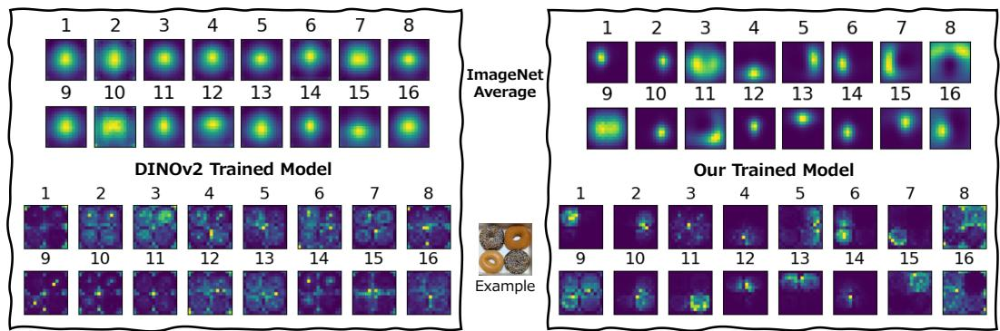
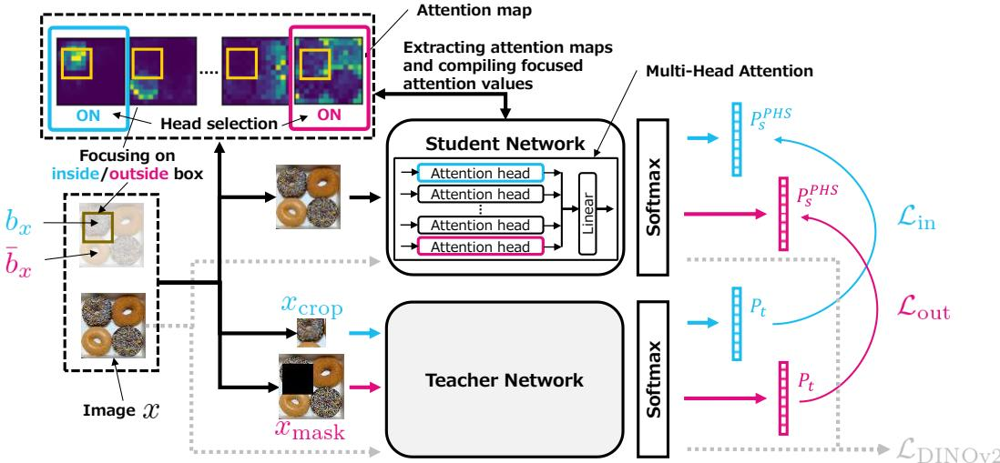
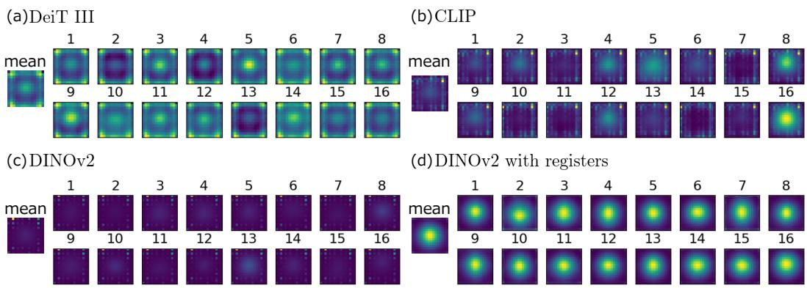
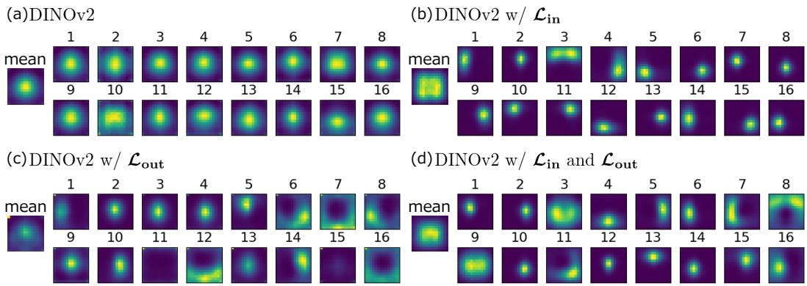
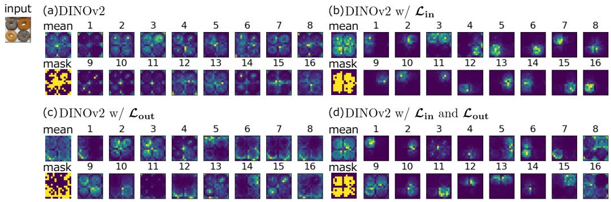
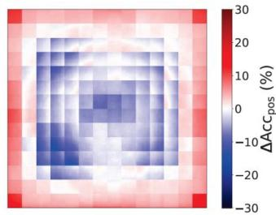
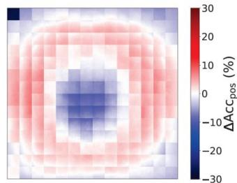
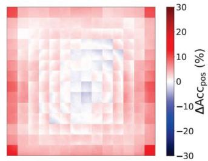
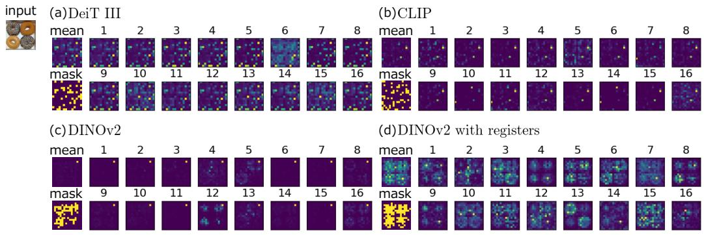
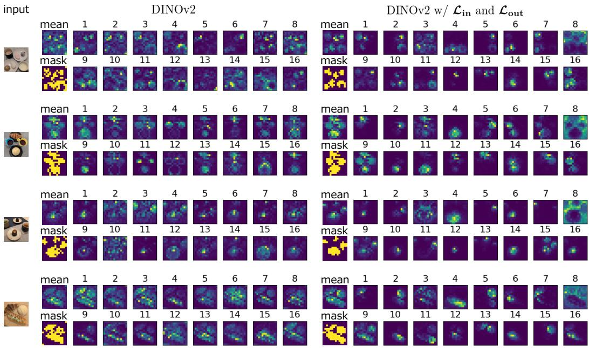

# Training Vision Transformers to Focus: Emergence of Spatial Attention Head Specialization

Yuji Nozawa Kioxia Corporation yuji1.nozawa@kioxia.com

Yu-Chieh Lin Kioxia Corporation yuchieh.lin@kioxia.com

Youyang Ng Kioxia Corporation youyang.ng@kioxia.com

## Abstract

Self-supervised learning in Vision Transformer models, such as DINO, enables robust visual perception without requiring labeled data by leveraging large-scale image datasets. However, these models lack a focusing mechanism during training, resulting in perceptual representations that are often ambiguous or overly similar. In this work, we introduce two visual focusing loss functions designed to establish correspondence between the model’s attention and specific regions within images. Specifically, we leverage the multi-head attention mechanism within the model to selectively steer the model’s focus, leading to the emergence of spatial attention head specialization, characterized by diverse and spatially focused perceptual capabilities without requiring annotations. Through both qualitative and quantitative evaluations, we demonstrate that our method substantially increases the spatial selectivity and diversity of attention heads, improving both interpretability and performance on dense prediction tasks such as zero-shot image segmentation.

  
Figure 1: Comparison of attention maps produced by the DINOv2 trained model and our trained model. For each model, we show the attention maps averaged over the validation set of the ImageNet 1k (Russakovsky et al., 2015) and the attention maps obtained from a single example image. Existing learned perceptual representations (left) in individual attention heads often tend to be ambiguous or overly similar within the example image and across images in the dataset, which limits their interpretability. In contrast, our method (right) selectively steers the focus, leading to the emergence of diverse and spatially focused perceptual capabilities. (Images: Visualization of 16 attention heads in the last layer of trained ViT-L/16-Reg model)

## 1 Introduction

Self-supervised learning has become a powerful paradigm in computer vision, enabling models to acquire rich and meaningful visual representations without the need for costly and time-consuming labeled data. Among various architectures, Vision Transformers (ViTs) (Dosovitskiy et al., 2021) have attracted considerable attention for their remarkable ability to capture long-range dependencies and complex visual patterns within images. Methods such as Self-Distillation with No Labels (DINO) (Caron et al., 2021) have demonstrated that large-scale unlabeled image datasets can effectively train ViTs to produce robust and transferable visual features. Despite these advances, a fundamental challenge remains: unlike supervised approaches that rely on explicit guidance via labels or self-supervised approaches that incorporate prior knowledge to guide attention, self-supervised ViT models without such explicit guidance or prior knowledge typically lack a focusing mechanism during training. Consequently, the learned perceptual representations often tend to be ambiguous or overly similar across attention heads, which limits their discriminative capacity and interpretability.

Addressing this limitation is crucial for extending the applicability of self-supervised ViTs, particularly in tasks that require dense representations such as object segmentation and interpretability analysis. To this end, we propose two visual focusing loss functions that establish correspondence between the model’s attention and specific regions within images during training. We refer to this correspondence as region-to-focus correspondence (ReFoCo). The first loss, the inside-focus loss, is designed to align the model’s focus on local regions within images with the cropped images of these corresponding regions. The second loss is inspired by weakly-supervised learning with masked images as proposed in Kumar Singh and Jae Lee (2017), where masking forces the model to focus not only on the most discriminative object parts, but also on other regions. Our proposed second loss, the outside-focus loss, is designed to achieve a similar effect in a self-supervised manner by associating partially masked images with the model’s focus on regions outside the masked parts.

Our approach leverages the multi-head attention mechanism in ViTs to selectively steer the model’s focus, and we find that diverse and spatially focused perceptual capabilities emerge in our trained model, as shown in Fig. 1. Our method also substantially improves the model’s interpretability.

We conduct extensive qualitative and quantitative evaluations to validate the effectiveness of our approach. The results demonstrate that incorporating our visual focusing losses substantially improves the model’s ability to localize and differentiate between various image regions. These improvements lead to higher zero-shot image segmentation performance, unsupervised object discovery performance, and multi-object image retrieval performance, along with clearer and more interpretable attention maps, highlighting the practical advantages of our method.

We note that while the proposed losses encourage the emergence of diverse and spatially focused perceptual capabilities, we observe a slight reduction in classification performance. Accordingly, our results should not be interpreted as demonstrating universally stronger global or dense representations. Rather, our method aims to introduce focusing mechanisms into self-supervised ViT learning without requiring annotations, encouraging attention heads to capture diverse and spatially focused visual information.

Overall, our contributions are as follows:

• We identify the ambiguity and similarity of perceptual representations present in current self-supervised ViT models, which limits their interpretability.

• We present a new direction for introducing focusing mechanisms into self-supervised ViTs learning without requiring annotations, using visual focusing loss functions that link representation learning more directly to visual understanding.

• We evaluate the performance of models trained using our visual focusing loss functions and demonstrate that they achieve higher zero-shot image segmentation performance, unsupervised object discovery performance, and multi-object image retrieval performance, while also producing more interpretable and meaningful attention maps.

## 2 Related work

Vision Transformers and self-supervised learning. The advent of ViTs (Dosovitskiy et al., 2021) has ushered in a paradigm shift in self-supervised learning. Leveraging their global receptive fields and adaptive attention mechanisms, ViTs effectively capture long-range dependencies that conventional convolutional neural networks (Simonyan and Zisserman, 2015; He et al., 2016) typically struggle to model. Techniques such as DINO (Caron et al., 2021) and iBOT (Zhou et al., 2022) have demonstrated that ViTs are effective at learning structured, semantically rich representations without the need for labeled data. Remarkably, both DINO and its successor, DINOv2 (Oquab et al., 2024), shows that ViTs can generate attention maps closely aligned with object boundaries, suggesting an emergent capacity for dense visual recognition.

Visual focusing mechanisms. However, existing self-supervised ViT methods often lack effective focusing mechanisms during training. Consequently, multiple attention heads tend to converge toward similar activation patterns, producing ambiguous or redundant representations (Bhojanapalli et al., 2021). Some approaches have attempted to mitigate this issue by promoting attention map diversification (Ren et al., 2025), employing block dropping (Bhojanapalli et al., 2021), or knowledge distillation (Wu et al., 2022) techniques to reduce redundancy. However, these strategies are typically indirect, relying on architectural heuristics rather than explicitly designed loss functions that encourage interpretability or spatial differentiation. Post-hoc explanation methods, such as attention rollout (Abnar and Zuidema, 2020; Jo et al., 2025) and gradient-based techniques (Selvaraju et al., 2017), can reveal where the model focuses after training but do not influence the training dynamics. Other efforts have introduced architectural modifications (Chen et al., 2023), add-on modules (Lee et al., 2021), or prior knowledge-guidance (Miao et al., 2022) to foster diversity across attention heads or enhance spatial localization. Yet these methods often require supervision or additional annotations, limiting their applicability in fully self-supervised settings.

In summary, although current methods successfully capture global structure and high-level semantics, they often lack mechanisms that promote diverse, meaningful, and discriminative attention across different image regions. The proposed visual focusing losses offer a principled approach to encourage spatial specialization, enhancing interpretability within self-supervised ViT frameworks. Integrating such focusing mechanisms that shape attention during training is a relatively unexplored direction with the potential to link self-supervised representation learning to transparent and spatially grounded visual reasoning.

Visual prompt techniques. Inspired by prompt engineering in natural language processing (Brown et al., 2020), a variety of visual prompts have been studied in computer vision to intuitively modify the behavior of models in a visual manner (Kirillov et al., 2023; Yang et al., 2023; Shtedritski et al., 2023; Zhuang et al., 2024; Jia et al., 2022; Park and Byun, 2024; Yoo et al., 2023; Bahng et al., 2022; Nozawa et al., 2025). In this work, to selectively steer the model’s focus, we leverage a visual prompting technique called prompt-guided attention head selection (PHS) (Nozawa et al., 2025). In PHS, the visual prompt is given as a set of binary values R assigned to each pixel in the image, where each value indicates whether it is included in the region of interest (ROI) or not. This has the advantage that the shape of the ROI is not restricted.

## 3 Proposed method

We consider self-supervised learning settings, such as DINO (Caron et al., 2021), where teacher and student models are used and training is performed by minimizing a loss function between the two models. To enable the model to acquire the ability to focus on the ROI, we propose to introduce two visual focusing loss functions as shown in Fig. 2.

First, we briefly introduce the PHS method (Nozawa et al., 2025) for modifying the model’s output using the ROI. Once the ROI R is specified, the attention heads that produce the largest outputs of attention maps within the ROI are selected. By applying the head selection method (Gong et al., 2021; Meng et al., 2022; Ni et al., 2024; Wu et al., 2022; Nicolicioiu et al., 2023; Basile et al., 2025) that emphasizes the outputs of the selected heads, the model’s overall output is modified to align with the ROI. Formally, let $\bar { H = \{ 1 , 2 , \dots , h \} }$ denote the set of the heads, and let $i _ { \mathrm { o n } } \subseteq H$ be the set of the selected heads. The Multi-Head Attention in the last attention layer, Linear $( [ \mathrm { h e a d } _ { 1 } , \mathrm { h e a d } _ { 2 } , \dots , \mathrm { h e a d } _ { h } ] )$ is then modified by replacing headi with headHSi , defined by

$$
\mathrm { h e a d } _ { i } ^ { \mathrm { H S } } = \left\{ \begin{array} { l l } { \mathrm { h e a d } _ { i } \times h / h _ { \mathrm { o n } } } & { \mathrm { i f } i \in i _ { \mathrm { o n } } , } \\ { 0 } & { \mathrm { i f } i \notin i _ { \mathrm { o n } } , } \end{array} \right.\tag{1}
$$

where $h _ { \mathrm { o n } } = | i _ { \mathrm { o n } } |$ is the number of the selected heads. As a result, for each input image $x ,$ the model’s output $P ( x )$ changes to $P ^ { \mathrm { P H S } } ( x , R )$ .

  
Figure 2: Overview of our proposed visual focusing loss functions ${ \mathcal { L } } _ { \mathrm { i n } }$ and ${ \mathcal { L } } _ { \mathrm { o u t } }$

Inside-focus loss. The first loss function aims to align the model’s focus on local areas within images with the cropped images of these corresponding areas. For each training image x, we designate a box $b _ { x }$ within the image as the ROI. Then, the cropped image corresponding to the box, denoted as $x _ { \mathrm { { c r o p } } } { \mathrm { { . } } }$ , is input to the teacher model. Meanwhile, the entire image is input to the student model. However, instead of simply providing the input to the student model, we apply the PHS (Nozawa et al., 2025) method, which enhances the intermediate outputs related to the ROI within the model as described above. The inside-focus loss function ${ \mathcal { L } } _ { \mathrm { i n } }$ is defined as the cross-entropy loss between the outputs of the teacher and student networks:

$$
\mathcal { L } _ { \mathrm { i n } } = - \frac { 1 } { B } \sum _ { x } P _ { \mathrm { t } } ( x _ { \mathrm { c r o p } } ) \log P _ { \mathrm { s } } ^ { \mathrm { P H S } } ( x , R = b _ { x } ) ,\tag{2}
$$

where $B$ is the batch size, the summation runs over the batch, P denotes the softmax output of the teacher network, and $P _ { \mathrm { s } } ^ { \mathrm { P H S } }$ represents the softmax output of the student network with PHS visually prompting the box $b _ { x }$ applied.

Outside-focus loss. To enable the model to focus not only on the most discriminative object or part but also on other regions, we introduce another loss function. Similar to the inside-focus loss function ${ \mathcal { L } } _ { \mathrm { i n } }$ , we designate a box $b _ { x }$ as the ROI for each image x. However, for the teacher model in this case, we input the image in which the region within the box is masked, denoted as $x _ { \mathrm { m a s k } }$ . For the student model, the entire image is input, similar to the case of ${ \mathcal { L } } _ { \mathrm { i n } }$ . The difference is the use of PHS, which utilizes the external region of the box, ${ \bar { b } } _ { x } ,$ as a visual prompt. The outside-focus loss function ${ \mathcal { L } } _ { \mathrm { o u t } }$ is then given by the following cross-entropy loss:

$$
\mathcal { L } _ { \mathrm { o u t } } = - \frac { 1 } { B } \sum _ { x } P _ { \mathrm { t } } ( x _ { \mathrm { m a s k } } ) \log P _ { \mathrm { s } } ^ { \mathrm { P H S } } ( x , R = \bar { b } _ { x } ) .\tag{3}
$$

We propose that by combining these visual focusing loss functions with conventional loss functions used in self-supervised learning, the model effectively acquire the ability to focus on various objects or regions within the images.

## 4 Experiments

## 4.1 Interpretability comparison of attention maps for conventional training methods

Since our training method utilizes attention maps via PHS, interpretability of the maps is crucial. To determine the training method adopted in our method, we compare the attention maps of four different training methods: DeiT III (Touvron et al., 2022), CLIP (Radford et al., 2021), DINOv2 (Oquab et al., 2024) and DINOv2 with registers (Darcet et al., 2024), utilizing publicly available pretrained models. DeiT III is a label-supervised training method for ViTs. CLIP is a text-supervised training method using contrastive learning on image-text pairs. DINOv2 with and without registers are self-supervised training methods to learn robust visual representations. DINOv2 with registers extends DINOv2 by introducing additional register tokens to get rid of high-norm tokens in attention maps, which is called artifacts (Darcet et al., 2024). More details about the pretrained models are described in Sec. C.1. Figure 3 shows the average of the attention maps and the head mean of them on the validation set of ImageNet-1k (Russakovsky et al., 2015). Artifacts are observed in the maps produced by DeiT III, CLIP, and DINOv2, which is consistent with Darcet et al. (2024), whereas the maps generated by DINOv2 with registers are clearer. Based on this result and extended analysis presented in Sec. D.1, we adopt DINOv2 with registers as the baseline training method.

  
Figure 3: Comparison of the average of attention maps on ImageNet-1k across four training method using pretrained models (a)-(d).

## 4.2 Training

We train ViT models with registers (Darcet et al., 2024) using DINOv2 (Oquab et al., 2024) as the baseline training method to study the effects of incorporating our proposed loss functions on the model’s performance. We mainly follow the learning process of DINOv2, but we replace the original DINOv2 loss $\mathcal { L } _ { \mathrm { D I N O v 2 } } = \mathcal { L } _ { \mathrm { D I N O } } + \mathcal { L } _ { \mathrm { i B O T } } + 0 . 1 \cdot \mathcal { L } _ { \mathrm { k o l e o } }$ with the following loss function:

$$
\begin{array} { r l } & { \mathcal { L } _ { \mathrm { f o c u s } } = ( 1 - w _ { \mathrm { i n } } - w _ { \mathrm { o u t } } ) \cdot \mathcal { L } _ { \mathrm { D I N O } } + w _ { \mathrm { i n } } \cdot \mathcal { L } _ { \mathrm { i n } } + w _ { \mathrm { o u t } } \cdot \mathcal { L } _ { \mathrm { o u t } } } \\ & { \qquad + \mathcal { L } _ { \mathrm { i B O T } } + 0 . 1 \cdot \mathcal { L } _ { \mathrm { k o l e o } } , } \end{array}\tag{4}
$$

where $w _ { \mathrm { i n } }$ and $w _ { \mathrm { o u t } }$ are the weights of the visual focusing loss functions ${ \mathcal { L } } _ { \mathrm { i n } }$ and ${ \mathcal { L } } _ { \mathrm { o u t } }$ in Eqs. (2) and (3), respectively. We note that the DINO loss ${ \mathcal { L } } _ { \mathrm { D I N O } }$ is a cross-entropy loss of the same type as ${ \mathcal { L } } _ { \mathrm { i n } }$ and ${ \mathcal { L } } _ { \mathrm { o u t } } ;$ therefore, its magnitude is comparable to that of ${ \mathcal { L } } _ { \mathrm { i n } }$ and $\mathcal { L } _ { \mathrm { o u t } } . ~ \mathcal { L } _ { \mathrm { i B O T } }$ is the iBOT loss (Zhou et al., 2022), $\mathcal { L } _ { \mathrm { k o l e o } }$ is the KoLeo loss (Sablayrolles et al., 2019), and for $w _ { \mathrm { i n } } ~ = ~ 0$ and $w _ { \mathrm { o u t } } = 0$ , Eq. (4) reduces to the DINOv2 loss. For each training image x, we designate one box $b _ { x } .$ , which is specified as a random local region within the image, analogous to the local crops used in DINO (Caron et al., 2021). We share the box $b _ { x }$ for the computation of both ${ \mathcal { L } } _ { \mathrm { i n } }$ and ${ \mathcal { L } } _ { \mathrm { o u t } }$ . Notably, because the boxes can be designated randomly during training, our approach requires only the images as training data and does not necessitate any ground truth data, such as the positional information of objects within the images. We train the ViT models on the train split of ImageNet-1k dataset (Russakovsky et al., 2015) without labels and use the teacher model in all evaluation experiments. Except for the continual learning discussed in Sec. D.2, the models are trained from scratch. Unless otherwise stated, we use ViT-L/16 with registers (ViT-L/16- Reg) (Darcet et al., 2024) and compare models trained under four different loss weight settings: (1) DINOv2 $( w _ { \mathrm { i n } } = 0 , w _ { \mathrm { o u t } } = 0 ) , ( 2 )$ DINOv2 with $\mathcal { L } _ { \mathrm { i n } } \left( w _ { \mathrm { i n } } = 0 . 1 , w _ { \mathrm { o u t } } = 0 \right) , ( 3 )$ DINOv2 with ${ \mathcal { L } } _ { \mathrm { o u t } }$ $( w _ { \mathrm { i n } } = 0 , w _ { \mathrm { o u t } } = 0 . 1 )$ , and (4) DINOv2 with ${ \mathcal { L } } _ { \mathrm { i n } }$ and $\mathcal { L } _ { \mathrm { o u t } } \left( w _ { \mathrm { i n } } = 0 . 0 5 , w _ { \mathrm { o u t } } = 0 . 0 5 \right)$ . More details about the training conditions are described in Sec. C.1.

Table 1: Zero-shot image segmentation performance. The DINOv2 model that integrates both ${ \mathcal { L } } _ { \mathrm { i n } }$ and ${ \mathcal { L } } _ { \mathrm { o u t } }$ outperforms the original DINOv2 model on both ImageNet-Segmentation and PASCAL VOC. (Model: ViT-L/16-Reg)
<table><tr><td></td><td colspan="3">ImageNet-Seg.</td><td colspan="2">PASCAL VOC</td></tr><tr><td>Loss</td><td colspan="6">mIoU (%)↑ Acc (%)↑ mAP (%)↑ mIoU (%)↑ Acc (%)↑ mAP (%)↑</td></tr><tr><td>DINOv2</td><td>63.67</td><td>80.69</td><td>85.39</td><td>58.10</td><td>75.28</td><td>84.79</td></tr><tr><td>w/  ${ \mathcal { L } } _ { \mathrm { i n } }$ </td><td>63.93</td><td>80.61</td><td>86.03</td><td>57.82</td><td>74.76</td><td>85.00</td></tr><tr><td>w/  $\mathcal { L } _ { \mathrm { o u t } }$ </td><td>63.65</td><td>80.94</td><td>84.69</td><td>58.23</td><td>75.73</td><td>84.97</td></tr><tr><td>w/  $\mathcal { L } _ { \mathrm { i n } } \& \mathcal { L } _ { \mathrm { o u t } }$ </td><td></td><td>67.29 83.20</td><td>86.43</td><td>60.68</td><td>77.36</td><td>85.27</td></tr></table>

## 4.3 Zero-shot image segmentation

To validate the ability of ViT models to focus on various regions within images, we evaluate their zero-shot image segmentation performance. We follow a standard protocol (Chefer et al., 2021) for evaluating the effectiveness of their heat maps. For each heat map, we compute the head mean of the attention maps, where we use the [CLS] tokens from each head in the last attention layer as the attention maps. We then binarize the heat map into a foreground/background segmentation map, where the patch mean of the heat map is used for the threshold value. We utilize two datasets, ImageNet-Segmentation (Guillaumin et al., 2014) and PASCAL VOC (Everingham et al., 2010), for the evaluation following Chefer et al. (2021) and Helbling et al. (2025). ImageNet-Segmentation consists of 4,276 single-label images from the validation set of ImageNet-1k (Russakovsky et al., 2015) with annotated segmentations from 445 categories. For the evaluation on PASCAL VOC, we utilize PASCAL VOC 2012 benchmark (Everingham et al., 2015) and evaluate on a multi-class split (1,449 images). In our multi-class split experiment, all annotated objects are considered as a single foreground.

Quantitative evaluation results. To investigate the impact of changes to the loss function, we quantitatively evaluate zero-shot image segmentation performance using three standard evaluation metrics: mean Intersection over Union (mIoU), pixel-wise accuracy (Acc), and mean Average Precision (mAP). Table 1 provides a comparison of zero-shot image segmentation performance for models trained using four different loss functions. The results indicate that the performance of the DINOv2 models with either ${ \mathcal { L } } _ { \mathrm { i n } }$ alone or ${ \mathcal { L } } _ { \mathrm { o u t } }$ alone is comparable to that of the original DINOv2 model. In contrast, the model with both ${ \mathcal { L } } _ { \mathrm { i n } }$ and ${ \mathcal { L } } _ { \mathrm { o u t } }$ outperforms all the other models across all the evaluation metrics.

## 4.4 Qualitative analysis and emergent abilities

Dataset-scale attention heads visualization. To investigate which regions of the images the models focus on, we visualize the average of the attention maps across the entire set of evaluation dataset images. Figure 4 shows the average of the attention maps and the head mean of them used as the heat map on the validation set of ImageNet-1k. As a result, we find that the visual loss functions qualitatively change the characteristics of attention maps.

Emergent focusing ability: Spatial Attention Head Specialization. As shown in Fig. 4(a), the attention maps of each head in the original DINOv2 model mainly concentrate their outputs around the center. In contrast, as illustrated in Fig. 4(b), the model with $\dot { \mathcal { L } } _ { \mathrm { i n } }$ shows substantial variety in the output locations across different heads. This visualizes the emergence of the ability for each head to focus on distinct spatial positions, and their information is integrated to produce the comprehensive heat map. Notably, the focus area of the heat map in this model is broader compared to that of the original model. In the model with ${ \mathcal { L } } _ { \mathrm { o u t } }$ , in addition to heads that primarily focus on the central region as seen in the original model, there also emerge heads that tend to avoid the center and focus on other regions. This behavior is considered to reflect the design of ${ \mathcal { L } } _ { \mathrm { o u t } }$ , which encourages attention to objects other than the most discriminative objects. Additionally, a large activation is observed in a single patch at the top-left corner, which is considered to be a type of artifact, as discussed in Darcet et al. (2024). As described above, by using ${ \mathcal { L } } _ { \mathrm { i n } }$ and ${ \mathcal { L } } _ { \mathrm { o u t } }$ , various attention behaviors emerge across different heads. In the model with both ${ \mathcal { L } } _ { \mathrm { i n } }$ and ${ \mathcal { L } } _ { \mathrm { o u t } }$ , we observe the coexistence of the attention maps observed in the model with ${ \mathcal { L } } _ { \mathrm { i n } }$ alone or ${ \mathcal { L } } _ { \mathrm { o u t } }$ alone, in addition to attention maps that focus on broader regions. We note that the artifacts seen in the model with ${ \mathcal { L } } _ { \mathrm { o u t } }$ alone are absent. While standard DINOv2 already exhibits content-based head specialization, with individual heads capturing different semantic features within an image, our method retains such content-based specialization while introducing an additional, complementary form of specialization across spatial regions. We refer to this phenomenon as the emergence of spatial attention head specialization.

  
Figure 4: Comparison of the average of attention maps on ImageNet-1k from head1 to head16 and their head mean. Each model is trained using one of four loss functions (a)-(d).

  
Figure 5: An example of attention maps for each model (a)-(d). The image in the top left is the “input”. The images labeled “mean” represent the head means of the attention maps used as heat maps, and the images labeled “mask” represent the segmentation masks.

## 4.5 Empirical analysis of segmentation capability

To understand how segmentation works on individual images, we analyze examples of attention maps for a specific input image, as shown in Fig. 5. In the case of the original DINOv2 model, we observe that all heads focus at least partially on the box behind the donuts, which leads to ambiguous segmentation. We speculate that the original model pays close attention to the box because part of the box is visible in the center of the input image. When ${ \mathcal { L } } _ { \mathrm { i n } }$ is introduced, we observe that the model focus on object regions corresponding to the parts discussed in the attention map averages in Fig. 4. For instance, head1, 7, 11, and 15 in Fig. 5(d) are able to focus primarily on each donut region in the image. Furthermore, when ${ \mathcal { L } } _ { \mathrm { o u t } }$ is introduced, as seen in head8 of Fig. 5(d), there emerge attention heads that focus on the box regions while avoiding the donuts area. This corresponds to the heads focusing on non-central regions on average, as discussed in Sec. 4.4.

## 4.6 Segmentation performance by position

As shown in Tab. 1, we find that the model with ${ \mathcal { L } } _ { \mathrm { i n } }$ and ${ \mathcal { L } } _ { \mathrm { o u t } }$ exhibits higher segmentation performance compared to the other models evaluated. To investigate the positional dependence of performance among the models, we calculate the accuracy at each position for each model and examine the changes in accuracy from the original model, referred to as $\Delta \mathrm { A c c } _ { \mathrm { p o s } }$ as shown in Fig. 6. The figure shows that ${ \mathcal { L } } _ { \mathrm { i n } }$ and $\mathcal { L } _ { \mathrm { o u t } }$ play complementary roles in improving segmentation accuracy. First, as shown in Fig. 6(a), the model with ${ \mathcal { L } } _ { \mathrm { i n } }$ alone decreases accuracy in the central region while improving accuracy in the peripheral regions. This result suggests that whereas the original DINOv2 model tends to focus on objects near the center, ${ \mathcal { L } } _ { \mathrm { i n } }$ encourages attention to various regions, which enhances segmentation performance in less salient peripheral areas while somewhat reducing focus on the center. In contrast, Fig. 6(b) shows that the model with ${ \mathcal { L } } _ { \mathrm { o u t } }$ alone exhibits improved accuracy in a ring-shaped region surrounding the center. This result can be interpreted as indicating that ${ \mathcal { L } } _ { \mathrm { o u t } }$ primarily enhances segmentation performance in regions surrounding central objects, which are typically located in the center. Although each of these two models shows improved segmentation performance in certain regions, the decline in accuracy around the central area results in overall performance comparable to the original DINOv2 model. Finally, Fig. 6(c) shows that the model with both ${ \mathcal { L } } _ { \mathrm { i n } }$ and ${ \mathcal { L } } _ { \mathrm { o u t } }$ successfully integrates the advantages of both loss functions. Furthermore, the accuracy drop observed in the central region in the models (a) and (b) is substantially mitigated in the model (c), resulting in an improvement in Acc.

(a) $\pmb { \mathcal { L } } _ { \mathbf { i n } }$  

(b) DINOv2 w/ Lout  

(c) DINOv2 w/ ${ \mathcal { L } } _ { \mathrm { i n } }$ and ${ \mathcal { L } } _ { \mathrm { o u t } }$  
  
Figure 6: Changes in segmentation accuracy at each position compared to the accuracy of the original DINOv2 model.

Table 2: Unsupervised object discovery performance. (Model: ViT-L/16-Reg)  
Table 3: ImageNet-1k classification performance. (Model: ViT-L/16-Reg)
<table><tr><td>Loss</td><td>VOC07</td><td>VOC12</td><td>COCO</td></tr><tr><td>DINOv2</td><td>58.6</td><td>63.3</td><td>45.4</td></tr><tr><td>w/  ${ \mathcal { L } } _ { \mathrm { i n } }$ </td><td>56.0</td><td>59.5</td><td>45.7</td></tr><tr><td>w/  ${ \mathcal { L } } _ { \mathrm { o u t } }$ </td><td>42.0</td><td>47.3</td><td>35.1</td></tr><tr><td>w/  $\mathcal { L } _ { \mathrm { i n } } \& \mathcal { L } _ { \mathrm { o u t } }$ </td><td>61.6</td><td>64.6</td><td>45.5</td></tr></table>

<table><tr><td>Loss</td><td>k-NN (%)</td><td>Linear (%)</td></tr><tr><td>DINOv2</td><td>81.7</td><td>82.6</td></tr><tr><td>w/  ${ \mathcal { L } } _ { \mathrm { i n } }$ </td><td>79.1</td><td>81.4</td></tr><tr><td>w/  ${ \mathcal { L } } _ { \mathrm { o u t } }$ </td><td>79.7</td><td>81.7</td></tr><tr><td>w/  ${ \mathcal { L } } _ { \mathrm { i n } }$  &amp;  ${ \mathcal { L } } _ { \mathrm { o u t } }$ </td><td>80.3</td><td>81.8</td></tr></table>

## 4.7 Unsupervised object discovery

The ability to focus on a wide range of areas within images is also considered effective for object discovery. Therefore, we evaluate the unsupervised object discovery performance of our trained models. For the evaluation, we use LOST (Siméoni et al., 2021), which infers bounding boxes for objects from the patch tokens of features in the attention layers. Following Darcet et al. (2024) and Jiang et al. (2025), we present the best results of Correct Localization (CorLoc) across the key, query, or value features over the last four attention layers, and details of the evaluation setup are described in Sec. C.2. We utilize three datasets, VOC07 trainval, VOC12 trainval (Everingham et al., 2010), and COCO 20k (Lin et al., 2014; Vo et al., 2020). Table 2 presents the performance of four trained models on the unsupervised object discovery task. We observe that using ${ \mathcal { L } } _ { \mathrm { i n } }$ or ${ \mathcal { L } } _ { \mathrm { o u t } }$ alone results in lower performance than the original DINOv2 model, except in the case of ${ \mathcal { L } } _ { \mathrm { i n } }$ on COCO. However, combining ${ \mathcal { L } } _ { \mathrm { i n } }$ and ${ \mathcal { L } } _ { \mathrm { o u t } }$ outperforms the original model in all the three datasets. This improvement through combination is consistent with the results in the zero-shot image segmentation task.

Table 4: Focus-Oriented Image Retrieval performance. (Model: ViT-L/16-Reg)
<table><tr><td colspan="2"></td><td>COCO</td><td>PASCAL VOC</td></tr><tr><td>Loss</td><td>Retrieval scheme</td><td></td><td>MP@100 (%) ↑MP@100 (%) ↑</td></tr><tr><td>DINOv2</td><td>Fixed per image</td><td>54.2</td><td>72.8</td></tr><tr><td>DINOv2</td><td>Visual prompt per object</td><td>55.2</td><td>74.2</td></tr><tr><td>w/  $\mathcal { L } _ { \mathrm { i n } } \ \& \ \mathcal { L } _ { \mathrm { o u t } }$ </td><td>Fixed per image</td><td>52.7</td><td>72.4</td></tr><tr><td>w/  $\mathcal { L } _ { \mathrm { i n } } \ \& \ \mathcal { L } _ { \mathrm { o u t } }$ </td><td>Visual prompt per object</td><td>55.9</td><td>75.8</td></tr></table>

## 4.8 Performance on other tasks

In addition to zero-shot image segmentation and unsupervised object discovery, we conduct additional experiments on two complementary tasks: a classification task and an image retrieval task.

Classification performance. We evaluate our models on the ImageNet-1k classification task with k-NN (k = 20) and linear probing. Table 3 presents the top-1 accuracy on the validation set of ImageNet-1k. For k-NN classification, we observe that the accuracy drops by approximately 1 − 3% when visual focusing loss functions are introduced compared to the original DINOv2 model. Our possible explanation for the performance drop is as follows. The classification task is formulated as a single-label problem, where images typically contain a dominant object near the center. This task setting aligns with local-to-global correspondence for single objects in DINO (Caron et al., 2021). In contrast, our proposed loss functions are designed to capture a wide range of regions and focus on various locations, and may therefore be less specialized for this setting. For linear probing classification, the accuracy difference between our visual focusing models and the original DINOv2 model is smaller than that observed with k-NN classification. This result suggests that training a linear classifier for classification purposes enables effective utilization of the frozen features that have been pretrained to focus.

Image retrieval performance. We also evaluate our models using an image retrieval task called focus-oriented image retrieval (FOIR) (Nozawa et al., 2025). FOIR task is a multi-object image retrieval task that evaluates whether models can retrieve appropriate images for each specified object in query images, where the query images may contain multiple objects. We utilize COCO (Lin et al., 2014) and PASCAL VOC (Everingham et al., 2010) datasets for evaluation. We use Mean Precision at k (MP@k) as an evaluation metric to measure the relevance of the top-k retrieved results. Table 4 presents MP@100 for each model and dataset. We evaluate models using two retrieval schemes. The first scheme, referred to as “Fixed per image”, utilizes a single retrieval result obtained by extracting one feature vector from each query image for image retrieval. The second scheme, “Visual prompt per object”, applies PHS during inference and specifies a bounding box for each object as a visual prompt, thereby obtaining retrieval results that focus on individual objects. First, the consistent performance gain of the visual prompt per object scheme over the fixed per image one across the models indicates that PHS is effective during inference. In a comparison between the models, under the fixed per image scheme, the original DINOv2 model outperforms the model with ${ \mathcal { L } } _ { \mathrm { i n } }$ and ${ \mathcal { L } } _ { \mathrm { o u t } } ;$ however, under the visual prompt per object scheme, the trend reverses, with the model with ${ \mathcal { L } } _ { \mathrm { i n } }$ and ${ \mathcal { L } } _ { \mathrm { o u t } }$ outperforming the original DINOv2 model. This result suggests that the feature representations of DINOv2 effectively capture global image characteristics, resulting in averaged retrieval performance over objects, while the model with ${ \mathcal { L } } _ { \mathrm { i n } }$ and ${ \mathcal { L } } _ { \mathrm { o u t } }$ , consistent with its training objective, exhibits its strengths when focusing on individual objects.

## 4.9 Additional results on model size variations

To evaluate the robustness of our method, we further examine its effectiveness across different model sizes. Table 5 presents the zero-shot image segmentation performance of the original DINOv2 model and the model with ${ \mathcal { L } } _ { \mathrm { i n } }$ and ${ \mathcal { L } } _ { \mathrm { o u t } }$ for $\mathrm { V i T - B } / 1 \bar { 6 } { \cdot } \mathrm { R e g }$ and $\bar { \mathrm { V i T - g } } / 1 6 { \cdot } \mathrm { R e g }$ , evaluated in the same manner as for ViT-L/16-Reg. These results demonstrate that our method consistently improves performance across all evaluated model sizes, confirming its robustness.

Table 5: Zero-shot image segmentation performance. (Model: ViT-{Size}/16-Reg)
<table><tr><td colspan="6">ImageNet-Seg. PASCAL VOC</td></tr><tr><td>Size</td><td>Loss</td><td colspan="6">mIoU (%)↑ Acc (%)↑ mAP (%)↑ mIoU (%)↑ Acc (%)↑ mAP (%)↑</td></tr><tr><td rowspan="2">B</td><td> $\mathrm { D I N O v } 2$ </td><td>68.32</td><td>83.81</td><td>87.63</td><td>62.20</td><td>78.14</td><td>86.46</td></tr><tr><td> $\mathrm { w } / \mathcal { L } _ { \mathrm { i n } } \& \mathcal { L } _ { \mathrm { o u t } }$ </td><td>69.33</td><td>84.40</td><td>87.84</td><td>62.98</td><td>78.65</td><td>86.77</td></tr><tr><td rowspan="2">g</td><td> $\mathrm { D I N O v } 2$ </td><td>63.37</td><td>80.53</td><td>85.20</td><td>58.34</td><td>75.55</td><td>84.85</td></tr><tr><td> $\mathrm { w } / \mathcal { L } _ { \mathrm { i n } } \& \mathcal { L } _ { \mathrm { o u t } }$ </td><td>67.61</td><td>83.31</td><td>86.86</td><td>61.31</td><td>77.65</td><td>86.09</td></tr></table>

## 5 Discussion

Local-to-global and region-to-focus correspondence. Our results highlight a distinction between conventional local-to-global correspondence (Caron et al., 2021) and region-to-focus correspondence introduced by our visual focusing losses. The main DINOv2 objective is based on local-to-global correspondence and is well suited to images containing a large dominant object, as it encourages correspondence between the global representation of the object and local representations of its parts. In contrast, our method is designed for images containing multiple objects or semantic regions, a common setting in natural images. To address this setting, in addition to establishing local-to-global correspondence, our proposed loss functions encourage correspondence between regional representations obtained through masking or cropping and selective attention toward the corresponding regions. As observed in our experiments, this encourages the emergence of spatial attention head specialization, with performance gains in zero-shot image segmentation, unsupervised object discovery, and multi-object image retrieval.

Practical implications. These properties may also have practical implications for interpretability and customizability. Distinct and spatially specialized attention heads can provide a more structured view of the visual information captured by the model, potentially facilitating the analysis of its behavior and failure cases. Moreover, such specialization may offer a straightforward mechanism for feature manipulation during inference. For example, the output features could be modified by dynamically disabling the signals from individual attention heads during inference, thereby potentially providing a mechanism for on-the-fly model customization. These possibilities could be useful in applications that require selective or dynamically varying visual focus, such as robotic vision and autonomous driving. However, we do not evaluate such applications in this work, and thei effectiveness remains an important direction for future investigation.

## 6 Conclusion

Our work addresses a key limitation of self-supervised ViT models by introducing visual focusing loss functions that establish correspondence between the model’s attention and specific regions within images. We find that diverse and spatially focused perceptual capabilities emerge in our trained model, enabling the model to leverage different attention heads to focus on distinct and meaningful image regions. This targeted focusing mechanism effectively mitigates the ambiguity and redundancy often observed in learned representations, thereby improving the interpretability of the model’s attention. Through comprehensive experiments, we demonstrate that our approach improves performance in zero-shot image segmentation, unsupervised object discovery, and multi-object image retrieval, while also producing clearer and more informative attention maps that support better visual understanding. Overall, these results highlight the potential of introducing focusing mechanisms into self-supervised representation learning without requiring annotations, providing a new direction for learning diverse and spatially focused visual information.

## References

Samira Abnar and Willem Zuidema. Quantifying Attention Flow in Transformers. In Proceedings ofthe 58th Annual Meeting ofthe Associationfor Computational Linguistics, pages 4190–4197, 2020.

Hyojin Bahng, Ali Jahanian, Swami Sankaranarayanan, and Phillip Isola. Exploring Visual Prompts for Adapting Large-Scale Models. arXiv preprint arXiv:2203.17274, 2022.

Lorenzo Basile, Valentino Maiorca, Diego Doimo, Francesco Locatello, and Alberto Cazzaniga. Head Pursuit: Probing Attention Specialization in Multimodal Transformers. In NeurIPS, 2025.

Srinadh Bhojanapalli, Ayan Chakrabarti, Daniel Glasner, Daliang Li, Thomas Unterthiner, and Andreas Veit. Understanding Robustness of Transformers for Image Classification. In ICCV, pages 10231–10241, 2021.

Tom Brown, Benjamin Mann, Nick Ryder, Melanie Subbiah, Jared D Kaplan, Prafulla Dhariwal, Arvind Neelakantan, Pranav Shyam, Girish Sastry, Amanda Askell, Sandhini Agarwal, Ariel Herbert-Voss, Gretchen Krueger, Tom Henighan, Rewon Child, Aditya Ramesh, Daniel Ziegler, Jeffrey Wu, Clemens Winter, Chri Hesse, Mark Chen, Eric Sigler, Mateusz Litwin, Scott Gray, Benjamin Chess, Jack Clark, Christopher Berner, Sam McCandlish, Alec Radford, Ilya Sutskever, and Dario Amodei. Language Models are Few-Shot Learners. In NeurIPS, pages 1877–1901, 2020.

Mathilde Caron, Hugo Touvron, Ishan Misra, Hervé Jegou, Julien Mairal, Piotr Bojanowski, and Armand Joulin. Emerging Properties in Self-Supervised Vision Transformers. In ICCV, 2021.

Hila Chefer, Shir Gur, and Lior Wolf. Transformer Interpretability Beyond Attention Visualization. In CVPR, pages 782–791, 2021.

Xiangyu Chen, Qinghao Hu, Kaidong Li, Cuncong Zhong, and Guanghui Wang. Accumulated Trivial Attention Matters in Vision Transformers on Small Datasets. In Proceedings of the IEEE/CVF Winter Conference on Applications of Computer Vision (WACV), pages 3984–3992, 2023.

Mehdi Cherti, Romain Beaumont, Ross Wightman, Mitchell Wortsman, Gabriel Ilharco, Cade Gordon, Christoph Schuhmann, Ludwig Schmidt, and Jenia Jitsev. Reproducible scaling laws for contrastive language-image learning. In CVPR, pages 2818–2829, 2023.

Marius Cordts, Mohamed Omran, Sebastian Ramos, Timo Rehfeld, Markus Enzweiler, Rodrigo Benenson, Uwe Franke, Stefan Roth, and Bernt Schiele. The Cityscapes Dataset for Semantic Urban Scene Understanding. In CVPR, pages 3213–3223, 2016.

Timothée Darcet, Maxime Oquab, Julien Mairal, and Piotr Bojanowski. Vision Transformers Need Registers. In ICLR, 2024.

Alexey Dosovitskiy, Lucas Beyer, Alexander Kolesnikov, Dirk Weissenborn, Xiaohua Zhai, Thomas Unterthiner, Mostafa Dehghani, Matthias Minderer, Georg Heigold, Sylvain Gelly, Jakob Uszkoreit, and Neil Houlsby. An Image is Worth 16x16 Words: Transformers for Image Recognition at Scale. In ICLR, 2021.

Mark Everingham, Luc Van Gool, Christopher K. I. Williams, John M. Winn, and Andrew Zisserman. The Pascal Visual Object Classes (VOC) Challenge. IJCV, 88(2):303–338, 2010.

Mark Everingham, S. M. Ali Eslami, Luc Van Gool, Christopher K. I. Williams, John Winn, and Andrew Zisserman. The Pascal Visual Object Classes Challenge: A Retrospective. IJCV, 111(1):98–136, 2015.

Hongyu Gong, Yun Tang, Juan Pino, and Xian Li. Pay Better Attention to Attention: Head Selection in Multilingual and Multi-Domain Sequence Modeling. In NeurIPS, 2021.

Matthieu Guillaumin, Daniel Küttel, and Vittorio Ferrari. ImageNet Auto-Annotation with Segmentation Propagation. IJCV, 110(3):328–348, 2014.

Bharath Hariharan, Pablo Arbeláez, Lubomir Bourdev, Subhransu Maji, and Jitendra Malik. Semantic contours from inverse detectors. In ICCV, pages 991–998, 2011.

Kaiming He, Xiangyu Zhang, Shaoqing Ren, and Jian Sun. Deep Residual Learning for Image Recognition. In CVPR, 2016.

Alec Helbling, Tuna Han Salih Meral, Benjamin Hoover, Pinar Yanardag, and Duen Horng Chau. ConceptAttention: Diffusion Transformers Learn Highly Interpretable Features. In International Conference on Machine Learning, 2025.

Menglin Jia, Luming Tang, Bor-Chun Chen, Claire Cardie, Serge Belongie, Bharath Hariharan, and Ser-Nam Lim. Visual Prompt Tuning. In ECCV, pages 709–727, 2022.

Nicholas Jiang, Amil Dravid, Alexei A Efros, and Yossi Gandelsman. Vision Transformers Don’t Need Trained Registers. In NeurIPS, 2025.

Sehyeong Jo, Gangjae Jang, and Haesol Park. GMAR: Gradient-Driven Multi-Head Attention Rollout for Vision Transformer Interpretability. In ICIP, pages 582–587, 2025.

Alexander Kirillov, Eric Mintun, Nikhila Ravi, Hanzi Mao, Chloe Rolland, Laura Gustafson, Tete Xiao, Spencer Whitehead, Alexander C. Berg, Wan-Yen Lo, Piotr Dollar, and Ross Girshick. Segment Anything. In ICCV, pages 4015–4026, 2023.

Krishna Kumar Singh and Yong Jae Lee. Hide-And-Seek: Forcing a Network to Be Meticulous for Weakly-Supervised Object and Action Localization. In ICCV, 2017.

Seung Hoon Lee, Seunghyun Lee, and Byung Cheol Song. Vision Transformer for Small-Size Datasets. arXiv preprint arXiv:2112.13492, 2021.

Tsung-Yi Lin, Michael Maire, Serge Belongie, James Hays, Pietro Perona, Deva Ramanan, Piotr Dollár, and C. Lawrence Zitnick. Microsoft COCO: Common Objects in Context. In ECCV, 2014.

Lingchen Meng, Hengduo Li, Bor-Chun Chen, Shiyi Lan, Zuxuan Wu, Yu-Gang Jiang, and Ser-Nam Lim. AdaViT: Adaptive Vision Transformers for Efficient Image Recognition. In CVPR, 2022.

Kevin Miao, Akash Gokul, Raghav Singh, Suzanne Petryk, Joseph Gonzalez, Kurt Keutzer, Trevor Darrell, and Colorado Reed. Prior Knowledge-Guided Attention in Self-Supervised Vision Transformers. arXiv preprint arXiv:2209.03745, 2022.

Kang Ni, Duo Wang, Zhizhong Zheng, and Peng Wang. MHST: Multiscale Head Selection Transformer for Hyperspectral and LiDAR Classification. IEEE Journal of Selected Topics in Applied Earth Observations and Remote Sensing, 17, 2024.

Armand Mihai Nicolicioiu, Andrei Liviu Nicolicioiu, Bogdan Alexe, and Damien Teney. Learning Diverse Features in Vision Transformers for Improved Generalization. In ICML Workshop on Spurious Correlations, Invariance and Stability, 2023.

Yuji Nozawa, Yu-Chieh Lin, Kazumoto Nakamura, and Youyang Ng. Prompt-Guided Attention Head Selection for Focus-Oriented Image Retrieval. In CVPR Workshops, pages 4170–4180, 2025.

Maxime Oquab, Timothée Darcet, Théo Moutakanni, Huy V. Vo, Marc Szafraniec, Vasil Khalidov, Pierre Fernandez, Daniel HAZIZA, Francisco Massa, Alaaeldin El-Nouby, Mido Assran, Nicolas Ballas, Wojciech Galuba, Russell Howes, Po-Yao Huang, Shang-Wen Li, Ishan Misra, Michael Rabbat, Vasu Sharma, Gabriel Synnaeve, Hu Xu, Herve Jegou, Julien Mairal, Patrick Labatut, Armand Joulin, and Piotr Bojanowski. DINOv2: Learning Robust Visual Features without Supervision. Transactions on Machine Learning Research, 2024.

Sungho Park and Hyeran Byun. Fair-VPT: Fair Visual Prompt Tuning for Image Classification. In CVPR, pages 12268–12278, 2024.

Alec Radford, Jong Wook Kim, Chris Hallacy, Aditya Ramesh, Gabriel Goh, Sandhini Agarwal, Girish Sastry, Amanda Askell, Pamela Mishkin, Jack Clark, Gretchen Krueger, and Ilya Sutskever. Learning transferable visual models from natural language supervision. In Proceedings ofthe 38th International Conference on Machine Learning, pages 8748–8763. PMLR, 2021.

Yuchen Ren, Zhengyu Zhao, Chenhao Lin, Bo Yang, Lu Zhou, Zhe Liu, and Chao Shen. Improving Adversarial Transferability on Vision Transformers via Forward Propagation Refinement. In CVPR, pages 25071–25080, 2025.

Olga Russakovsky, Jia Deng, Hao Su, Jonathan Krause, Sanjeev Satheesh, Sean Ma, Zhiheng Huang, Andrej Karpathy, Aditya Khosla, Michael Bernstein, Alexander C. Berg, and Li Fei-Fei. ImageNet Large Scale Visual Recognition Challenge. IJCV, 2015.

Alexandre Sablayrolles, Matthijs Douze, Cordelia Schmid, and Hervé Jégou. Spreading vectors for similarity search. In ICLR, 2019.

Ramprasaath R. Selvaraju, Michael Cogswell, Abhishek Das, Ramakrishna Vedantam, Devi Parikh, and Dhruv Batra. Grad-CAM: Visual Explanations From Deep Networks via Gradient-Based Localization. In ICCV, 2017.

Aleksandar Shtedritski, Christian Rupprecht, and Andrea Vedaldi. What does CLIP know about a red circle? Visual prompt engineering for VLMs. In ICCV, pages 11987–11997, 2023.

Oriane Siméoni, Gilles Puy, Huy V. Vo, Simon Roburin, Spyros Gidaris, Andrei Bursuc, Patrick Pérez, Renaud Marlet, and Jean Ponce. Localizing Objects with Self-Supervised Transformers and no Labels. In BMVC, 2021.

Oriane Siméoni, Huy V. Vo, Maximilian Seitzer, Federico Baldassarre, Maxime Oquab, Cijo Jose, Vasil Khalidov, Marc Szafraniec, Seung Eun Yi, Michael Ramamonjisoa, Francisco Massa, Daniel HAZIZA, Luca Wehrstedt, Jianyuan Wang, Timothée Darcet, Théo Moutakanni, Leonel Sentana, Claire Roberts, Andrea Vedaldi, Jamie Tolan, John Brandt, Camille Couprie, Julien Mairal, Herve Jegou, Patrick Labatut, and Piotr Bojanowski. DINOv3. Transactions on Machine Learning Research, 2026.

Karen Simonyan and Andrew Zisserman. Very Deep Convolutional Networks for Large-Scale Image Recognition. arXiv preprint arXiv:1409.1556, 2015.

Thomas Stegmüller, Tim Lebailly, Nikola Ðukic, Behzad Bozorgtabar, Tinne Tuytelaars, and Jean-Philippe ´ Thiran. A Simple Framework for Open-Vocabulary Zero-Shot Segmentation. In ICLR, 2025.

Hugo Touvron, Matthieu Cord, and Hervé Jégou. DeiT III: Revenge of the ViT. In ECCV, 2022.

Huy V. Vo, Patrick Pérez, and Jean Ponce. Toward unsupervised, multi-object discovery in large-scale image collections. In ECCV, 2020.

Haiyan Wu, Yuting Gao, Yinqi Zhang, Shaohui Lin, Yuan Xie, Xing Sun, and Ke Li. Self-supervised Models are Good Teaching Assistants for Vision Transformers. In PMLR, 2022.

Lingfeng Yang, Yueze Wang, Xiang Li, Xinlong Wang, and Jian Yang. Fine-Grained Visual Prompting. In NeurIPS, pages 24993–25006, 2023.

Seungryong Yoo, Eunji Kim, Dahuin Jung, Jungbeom Lee, and Sungroh Yoon. Improving Visual Prompt Tuning for Self-supervised Vision Transformers. In ICML, pages 40075–40092. PMLR, 2023.

Bolei Zhou, Hang Zhao, Xavier Puig, Sanja Fidler, Adela Barriuso, and Antonio Torralba. Scene Parsing Through ADE20K Dataset. In CVPR, pages 5122–5130, 2017.

Jinghao Zhou, Chen Wei, Huiyu Wang, Wei Shen, Cihang Xie, Alan Yuille, and Tao Kong. iBOT: Image BERT Pre-Training with Online Tokenizer. ICLR, 2022.

Jiedong Zhuang, Jiaqi Hu, Lianrui Mu, Rui Hu, Xiaoyu Liang, Jiangnan Ye, and Haoji Hu. FALIP: Visual Prompt as Foveal Attention Boosts CLIP Zero-Shot Performance. In ECCV, 2024.

## A Limitations

While our method can train the model to focus on diverse regions within an image, it does not allow explicit control over where each attention head focuses, as the regions of focus are determined implicitly during training. As a result, it is not possible to know in advance which regions each attention head will focus on until after training. Our method also increases the training time and introduces a trade-off between classification performance and performance improvements in zero-shot segmentation, object discovery, and FOIR tasks. Exploring other effective ways to utilize the visual focusing image representations obtained by our method remains an important direction for future work.

## B Societal impacts

In this study, we propose a self-supervised training method, and our trained models demonstrate high-performance segmentation across a wide range of areas within images. Our method can identify both salient and subtle objects in images, and it has potential applications such as medical imaging, autonomous driving, and defect detection. However, incorrect segmentation of subtle structures may lead to erroneous decisions, posing risks especially in scenarios where safety is critical. The ability to extract subtle visible information also has a risk of misuse, such as applying the method to privacy-invasive surveillance. To mitigate these concerns, we emphasize clear communication of limitations and intended use.

## C Details of training and evaluation setups

## C.1 Training

Most of the training hyperparameters are identical to those used in Oquab et al. (2024) for training ViT-L/16 on ImageNet-1k. Here, we describe the differences from that setting. Due to computational resource constraints, we train the models using 4 NVIDIA H200 GPUs (141GB of memory), instead of 32 NVIDIA A100 GPUs (80GB of memory). Correspondingly, the batch size per GPU is set to 128 for the base and large models, and 64 for the giant models. In addition, for the models with registers, the number of registers is set to 4.

Data augmentation. For each training image, following DINOv2, we apply multi-crop data augmentation, where global and local crops are generated using random resized cropping, together with standard augmentations such as horizontal flipping, color jittering, Gaussian blur, and solarization. The global crops are resized to $2 2 4 \times 2 2 4$ with scale = (0.32, 1.0) and $\mathrm { r a t i o } = ( 3 . 0 / 4 . 0 , 4 . 0 / 3 . 0 )$ while the local crops are resized to 96 × 96 with scale = (0.05, 0.32) and the same aspect-ratio range. When our loss functions ${ \mathcal { L } } _ { \mathrm { i n } }$ or ${ \mathcal { L } } _ { \mathrm { o u t } }$ are introduced, a box $b _ { x }$ for the PHS method is obtained as a region sampled via random resized cropping from the image, using the same setting as the local crops. We set the number of selected heads $h _ { \mathrm { o n } }$ during training to 5 in our main experiments as discussed in Sec. D.4. For ${ \mathcal { L } } _ { \mathrm { o u t } }$ , we also introduce randomness by selecting either the top or bottom edge of the visual-prompt box with equal probability for each batch and aligning the selected edge at the same height across all images in the batch.

Training from scratch. The number of training iterations is set to 500,000. We set the base learning rate, which is the learning rate for a batch size of 1024, to 0.004 for the base and large models, and 0.002 for the giant models for stable training. The training time for ViT-L/16-Reg is approximately 2 days and 22 hours for the DINOv2 model, 3 days and 21 hours for the model with ${ \mathcal { L } } _ { \mathrm { i n } } ,$ 4 days and 11 hours for the model with ${ \mathcal { L } } _ { \mathrm { o u t } }$ , and 5 days and 10 hours for the model with ${ \mathcal { L } } _ { \mathrm { i n } }$ and ${ \mathcal { L } } _ { \mathrm { o u t } }$

Pretrained models and continual learning. For our experiments about pretrained models in Sec. 4.1 and Sec. D.1, we compare DeiT III (Touvron et al., 2022), CLIP (Radford et al., 2021), DINOv2 (Oquab et al., 2024) and DINOv2 with registers (Darcet et al., 2024), utilizing publicly available pretrained models. For DeiT III, we use the ViT-L/16 pretrained on ImageNet-1k at a resolution of $2 2 4 \times 2 2 4$ . For CLIP, we use the OpenCLIP implementation (Cherti et al., 2023) and employ the ViT-L/14 image encoder pretrained by OpenAI (Radford et al., 2021). For DINOv2 and DINOv2 with registers, we use the ViT-L/14 and the ViT-L/14-Reg, respectively, both pretrained on the large-scale LVD-142M dataset. We discuss continual learning using pretrained models in Sec. D.2. To match the patch size of 14, we change the local crops size from 96 to 98. During the initial training stage of the DINO head only, the number of iterations is set to 50,000. In the subsequent stage, where the entire networks are trained, we also set the number of iterations to 50,000. Throughout training, the base learning rate is set to 0.0004, and the number of warmup epochs is set to 1. The training dataset is the train split of ImageNet-1k dataset (Russakovsky et al., 2015) as in training from scratch. The training time for the DINO head of ViT-L/14-Reg is approximately 11 hours, and the training time for the entire networks is approximately 9 hours for the DINOv2 model, 12 hours for the model with ${ \mathcal { L } } _ { \mathrm { i n } }$ , 13 hours for the model with ${ \mathcal { L } } _ { \mathrm { o u t } }$ , 16 hours for the model with ${ \mathcal { L } } _ { \mathrm { i n } }$ and ${ \mathcal { L } } _ { \mathrm { o u t } }$

## C.2 Evaluation

In all our evaluation experiments except unsupervised object discovery, the input images are resized to 224 × 224, whereas the unsupervised object discovery task does not involve resizing.

For the unsupervised object discovery task, we utilize three datasets, VOC07 trainval (5,011 images), VOC12 trainval (11,540 images) (Everingham et al., 2010), and COCO 20k (19,817 images) (Lin et al., 2014; Vo et al., 2020). Following Darcet et al. (2024) and Jiang et al. (2025), we present the best results of CorLoc across the key, query, or value features over the last four attention layers, sweeping over a manual bias term to the Gram matrix of features. We normalize the features and sweep the bias term over the range [−1, 0] with a step size of 0.01.

The evaluation procedure for k-NN and linear probing classification follows that of Oquab et al. (2024). For linear probing classification, we report the highest accuracy performing the following grid search of three parameters: learning rate in {0.0001, 0.0002, 0.0005, 0.001, 0.002, 0.005, 0.01, 0.02, 0.05, 0.1, 0.2, 0.3, 0.5}, number of output layers in {1, 4}, and concatenate average-pooled tokens in {yes, no}. The linear classifier is trained with SGD for 12,500 iterations.

For the FOIR task, the evaluation procedure follows that of Nozawa et al. (2025). When the retrieval scheme is Visual prompt per object, the number of selected heads at evaluation is set to 2. We use two datasets for this evaluation: COCO (Lin et al., 2014) and PASCAL VOC (Everingham et al., 2010). COCO dataset contains 80 object categories, and we use val2017 for query images (5,000 images) and train2017 for database images (118,287 images). PASCAL VOC dataset contains 20 object categories, and we use test2007 for query images (4,952 images) and trainval2007+2012 for database images (16,551 images).

## D Extended analyses

## D.1 Extended results on interpretability of attention maps for conventional training methods

In addition to our experiment in Sec. 4.1, we conduct extended analyses on the interpretability of attention maps obtained using four different training methods: DeiT III (Touvron et al., 2022), CLIP (Radford et al., 2021), DINOv2 (Oquab et al., 2024) and DINOv2 with registers (Darcet et al., 2024), utilizing publicly available pretrained models.

Table A1 presents a comparison of zero-shot image segmentation performance of each training method. This result shows that DINOv2 and DINOv2 with registers outperform the other methods. As shown in Fig. A1, the impact of these artifacts is substantial for DeiT III and CLIP, leading to low interpretability of the attention maps. In contrast, DINOv2 produces a single patch that appears to be an artifact, while the remaining patches capture meaningful image information, resulting in a meaningful mask. In DINOv2 with registers, the register tokens are effective in suppressing artifacts, and the object regions are captured more clearly.

## D.2 Continual learning in existing models

In this subsection, we consider applying our training method to continual learning in existing models. For the pretrained model, we utilize the publicly available backbone ViT-L/14-Reg weights pretrained by DINOv2 with registers (Darcet et al., 2024), which we evaluate in Sec. 4.1 and Sec. D.1. Since pretrained weights of the DINO head is not available, we first train the DINO head using DINOv2 with registers from scratch, while keeping the pretrained backbone frozen. After training the DINO head, we then perform training the entire networks, using each loss function with fewer iterations

Table A1: Zero-shot image segmentation performance comparison of four training methods (a)-(d).
<table><tr><td rowspan="2">Method</td><td colspan="3">ImageNet-Seg.</td><td colspan="2">PASCAL VOC</td></tr><tr><td>mIoU (%)↑ Acc (%)↑ mAP (%)↑ mIoU (%)↑ Acc (%)↑ mAP (%)↑</td><td></td><td></td><td></td><td></td></tr><tr><td>DeiT III (Touvron et al., 2022)</td><td>38.21</td><td>59.73</td><td>74.36</td><td>37.98 58.43</td><td>77.54</td></tr><tr><td>CLIP (Radford et al., 2021)</td><td>47.06</td><td>72.06</td><td>76.41</td><td>45.37 69.59</td><td>77.66</td></tr><tr><td>DINOv2 w/o reg. (Oquab et al., 2024)</td><td>52.35</td><td>76.14</td><td>82.29</td><td>52.75 74.40</td><td>83.88</td></tr><tr><td>DINOv2 w/ reg. (Darcet et al., 2024)</td><td>53.71</td><td>73.95</td><td>81.61</td><td>55.50 74.53</td><td>84.03</td></tr></table>

  
Figure A1: Examples of attention maps for four training methods (a)-(d).

than training from scratch. We use ImageNet-1k as the training dataset, as in the main experiments.   
Details of the training setup are described in Sec. C.1.

Table A2 presents a comparison of zero-shot image segmentation performance between the pretrained model and models further trained using four different loss functions. On ImageNet-Segmentation dataset, the performance improves with all loss functions used for continual learning, with the DINOv2 model with ${ \mathcal { L } } _ { \mathrm { i n } }$ and ${ \mathcal { L } } _ { \mathrm { o u t } }$ achieving the highest performance. On PASCAL VOC dataset, the DINOv2 loss, DINOv2 loss with ${ \mathcal { L } } _ { \mathrm { i n } }$ , and DINOv2 loss with ${ \mathcal { L } } _ { \mathrm { o u t } }$ all show performance degradation across all metrics. The discrepancy between the results on ImageNet-Segmentation and PASCAL VOC can be attributed to the domain gap between these datasets. While further training on ImageNet-1k improves performance on the in-domain dataset ImageNet-Segmentation, it results in degradation in the out-of-domain dataset PASCAL VOC. Notably, the DINOv2 loss with both ${ \mathcal { L } } _ { \mathrm { i n } }$ and ${ \mathcal { L } } _ { \mathrm { o u t } }$ improves performance on two out of three metrics, mIoU and mAP. This indicates that combination of ${ \mathcal { L } } _ { \mathrm { i n } }$ and ${ \mathcal { L } } _ { \mathrm { o u t } }$ exhibits stronger robustness to domain shifts and better generalization ability.

Table A2: Zero-shot image segmentation performance in continual learning setting. (Model: ViT-L/14-Reg)
<table><tr><td rowspan="2">Loss</td><td colspan="3">ImageNet-Seg.</td><td colspan="2">PASCAL VOC</td></tr><tr><td>mIoU (%)↑ Acc (%)↑ mAP (%)↑ mIoU (%)↑ Acc (%)↑ mAP (%)↑</td><td></td><td></td><td></td><td></td></tr><tr><td>Pretrained</td><td>53.71</td><td>73.95</td><td>81.61</td><td>55.50 74.53</td><td>84.03</td></tr><tr><td>DINOv2</td><td>54.90</td><td>74.76</td><td>82.15 53.07</td><td>72.14</td><td>83.23</td></tr><tr><td>w/  ${ \mathcal { L } } _ { \mathrm { i n } }$ </td><td>57.26</td><td>75.64</td><td>83.87</td><td>52.37 70.68</td><td>82.70</td></tr><tr><td>w/  $\mathcal { L } _ { \mathrm { o u t } }$ </td><td>60.90</td><td>78.79</td><td>84.71</td><td>55.04 73.32</td><td>84.24</td></tr><tr><td>w/  $\mathcal { L } _ { \mathrm { i n } } \& \mathcal { L } _ { \mathrm { o u t } }$ </td><td>61.63</td><td>78.86</td><td>85.40</td><td>55.70 73.30</td><td>84.73</td></tr></table>

Table A3: Unsupervised object discovery performance in continual learning setting. (Model: ViT-L/14-Reg)
<table><tr><td>Loss</td><td>VOC07</td><td>VOC12</td><td>COCO</td></tr><tr><td>Pretrained</td><td>56.2</td><td>60.2</td><td>43.0</td></tr><tr><td>DINOv2</td><td>57.0</td><td>61.4</td><td>44.6</td></tr><tr><td>w/  ${ \mathcal { L } } _ { \mathrm { i n } }$ </td><td>58.1</td><td>62.9</td><td>45.1</td></tr><tr><td>w/  ${ \mathcal { L } } _ { \mathrm { o u t } }$ </td><td>53.5</td><td>59.1</td><td>42.5</td></tr><tr><td>w/  $\mathcal { L } _ { \mathrm { i n } } \& \mathcal { L } _ { \mathrm { o u t } }$ </td><td>57.0</td><td>61.6</td><td>44.6</td></tr></table>

Table A4: Zero-shot image segmentation performance across different loss weights. (Model: ViT-L/16)
<table><tr><td rowspan="2">Loss weights  $( w _ { \mathrm { i n } } , w _ { \mathrm { o u t } } )$ </td><td colspan="3">ImageNet-Seg.</td><td colspan="3">PASCAL VOC</td></tr><tr><td>mIoU (%)↑ Acc (%)↑ mAP (%)↑ mIoU (%)↑ Acc (%)↑ mAP (%)↑</td><td></td><td></td><td></td><td></td><td></td></tr><tr><td>(0,0)</td><td>51.94</td><td>72.04</td><td>81.23</td><td>49.66</td><td>68.81</td><td>82.19</td></tr><tr><td>(0.05, 0)</td><td>60.97</td><td>78.71</td><td>84.76</td><td>56.17</td><td>73.76</td><td>83.90</td></tr><tr><td>(0.1,0)</td><td>60.79</td><td>78.46</td><td>83.73</td><td>56.04</td><td>73.54</td><td>83.02</td></tr><tr><td>(0, 0.05)</td><td>64.10</td><td>81.26</td><td>85.87</td><td>60.39</td><td>77.35</td><td>85.91</td></tr><tr><td>(0,0.1)</td><td>62.94</td><td>80.55</td><td>85.73</td><td>58.87</td><td>76.39</td><td>85.35</td></tr><tr><td>(0.05, 0.05)</td><td>65.77</td><td>82.21</td><td>86.29</td><td>59.57</td><td>76.53</td><td>85.35</td></tr><tr><td>(0.1,0.1)</td><td>63.65</td><td>80.67</td><td>85.48</td><td>57.97</td><td>75.28</td><td>84.39</td></tr></table>

For the unsupervised object discovery task, as shown in Tab. A3, we find that the models after continual learning, except for the model with ${ \mathcal { L } } _ { \mathrm { o u t } }$ alone, show improved performance compared to the pretrained model. We also find that the model with ${ \mathcal { L } } _ { \mathrm { i n } }$ alone has the highest performance in this task, while the original model and the model with ${ \mathcal { L } } _ { \mathrm { i n } }$ and ${ \mathcal { L } } _ { \mathrm { o u t } }$ perform at a similar level.

## D.3 Loss weights analysis

We investigate the effects of loss weights $( w _ { \mathrm { i n } } , w _ { \mathrm { o u t } } )$ in Eq. (4) that balance the DINO loss ${ \mathcal { L } } _ { \mathrm { D I N O } }$ and the two visual focusing loss functions ${ \mathcal { L } } _ { \mathrm { i n } }$ and ${ \mathcal { L } } _ { \mathrm { o u t } }$ on segmentation performance. In this experiment, we train ViT-L/16 with ${ \mathcal { L } } _ { \mathrm { i n } } .$ , one with ${ \mathcal { L } } _ { \mathrm { o u t } }$ , and one with ${ \mathcal { L } } _ { \mathrm { i n } }$ and ${ \mathcal { L } } _ { \mathrm { o u t } }$ with weights set to 0.05 and 0.1, respectively. The results in Tab. A4 show that introducing each weight of 0.05 leads to a substantial improvement in performance compared to the original DINOv2 model, whereas increasing the weights to 0.1 slightly degrades performance compared to 0.05. These findings indicate that simply increasing the weights of ${ \mathcal { L } } _ { \mathrm { i n } }$ and ${ \mathcal { L } } _ { \mathrm { o u t } }$ is not necessarily beneficial; rather, balancing between the visual focusing loss and the DINO loss is crucial for achieving optimal performance. We conduct these analyses on training the ViT model without registers and find that the resulting loss weights also perform well with the ViT model incorporating registers. Therefore, we apply these weights in the experiments presented in the main results of our paper.

## D.4 Analysis of the number of selected heads during training

The number of selected heads $h _ { \mathrm { o n } }$ during training is a hyperparameter of our training method. The number $h _ { \mathrm { o n } }$ refers to the number of heads selected during head selection in PHS, and it affects training through changes in the output of the student model $\breve { P } _ { \mathrm { s } } ^ { \mathrm { P H S } }$ . To investigate the effect of $h _ { \mathrm { o n } }$ on performance, we train ViT-L/16 by varying $h _ { \mathrm { o n } }$ across three settings: {2, 5, 8}. Tables A5 and A6 show the effect of $h _ { \mathrm { o n } }$ on the performance for the zero-shot image segmentation task and the FOIR task, respectively. For $h _ { \mathrm { o n } } = 2 .$ , the models achieve high performance on the segmentation task, whereas their performance on the FOIR task is relatively low. In the case of $h _ { \mathrm { o n } } = 8$ , while the model with ${ \mathcal { L } } _ { \mathrm { i n } }$ and ${ \mathcal { L } } _ { \mathrm { o u t } }$ exhibits high performance on the FOIR task, the performance is relatively low for other models and tasks. Since $h _ { \mathrm { o n } } = 5$ yields consistently high performance overall, we adopt $h _ { \mathrm { o n } } = 5$ . We find that the resulting value $h _ { \mathrm { o n } } = 5$ also performs well with the ViT model incorporating registers. Therefore, we apply $h _ { \mathrm { o n } } = 5$ in the experiments presented in the main results of our paper.

Table A5: Effect of $h _ { \mathrm { o n } }$ on zero-shot image segmentation performance. (Model: ViT-L/16)
<table><tr><td colspan="2"></td><td colspan="3">ImageNet-Seg.</td><td colspan="3">PASCAL VOC</td></tr><tr><td> $h _ { \mathrm { o n } }$ </td><td>Loss</td><td></td><td>mIoU (%)↑ Acc (%)↑ mAP (%)↑</td><td></td><td>mIoU (%)↑ Acc (%)↑ mAP (%)↑</td><td></td><td></td></tr><tr><td>一</td><td>DINOv2</td><td>51.94</td><td>72.04</td><td>81.23</td><td>49.66</td><td>68.81</td><td>82.19</td></tr><tr><td>2</td><td>w/  ${ \mathcal { L } } _ { \mathrm { i n } }$ </td><td>64.43</td><td>81.12</td><td>85.83</td><td>58.53</td><td>75.51</td><td>84.91</td></tr><tr><td>5</td><td>w/  ${ \mathcal { L } } _ { \mathrm { i n } }$ </td><td>60.79</td><td>78.46</td><td>83.73</td><td>56.04</td><td>73.54</td><td>83.02</td></tr><tr><td>8</td><td>w/  ${ \mathcal { L } } _ { \mathrm { i n } }$ </td><td>58.06</td><td>76.50</td><td>82.59</td><td>53.94</td><td>72.01</td><td>82.23</td></tr><tr><td>2</td><td>w/  ${ \mathcal { L } } _ { \mathrm { o u t } }$ </td><td>62.66</td><td>80.35</td><td>85.51</td><td>56.55</td><td>74.72</td><td>84.51</td></tr><tr><td>5</td><td>w/  ${ \mathcal { L } } _ { \mathrm { o u t } }$ </td><td>62.94</td><td>80.55</td><td>85.73</td><td>58.87</td><td>76.39</td><td>85.35</td></tr><tr><td>8</td><td>w/  ${ \mathcal { L } } _ { \mathrm { o u t } }$ </td><td>57.01</td><td>77.45</td><td>81.74</td><td>55.48</td><td>74.74</td><td>84.16</td></tr><tr><td>2</td><td>w/  $\mathcal { L } _ { \mathrm { i n } } \ \& \ \mathcal { L } _ { \mathrm { o u t } }$ </td><td>66.14</td><td>82.13</td><td>87.37</td><td>59.80</td><td>76.38</td><td>85.98</td></tr><tr><td>5</td><td>w/  $\mathcal { L } _ { \mathrm { i n } } \ \& \ \mathcal { L } _ { \mathrm { o u t } }$ </td><td>65.77</td><td>82.21</td><td>86.29</td><td>59.57</td><td>76.53</td><td>85.35</td></tr><tr><td>8</td><td>w/  $\mathcal { L } _ { \mathrm { i n } } \ \& \ \mathcal { L } _ { \mathrm { o u t } }$ </td><td>63.87</td><td>81.01</td><td>85.90</td><td>59.08</td><td>76.28</td><td>85.24</td></tr></table>

Table A6: Focus-Oriented Image Retrieval performance. (Model: ViT-L/16, Retrieval scheme: Visual prompt per object)
<table><tr><td></td><td></td><td>COCO PASCAL VOC</td></tr><tr><td> $h _ { \mathrm { o n } }$ </td><td>Loss</td><td>MP@100 (%) ↑MP@100 (%) ↑</td></tr><tr><td>一</td><td>DINOv2</td><td>55.1 73.9</td></tr><tr><td>2</td><td>w/  ${ \mathcal { L } } _ { \mathrm { i n } }$ </td><td>54.9 75.2</td></tr><tr><td>5 8</td><td> $\mathrm { { w } } / \mathcal { L } _ { \mathrm { { i n } } }$ </td><td>57.5 78.1</td></tr><tr><td></td><td>w/  ${ \mathcal { L } } _ { \mathrm { i n } }$ </td><td>56.7 77.6</td></tr><tr><td>2 5</td><td>w/  ${ \mathcal { L } } _ { \mathrm { o u t } }$ </td><td>49.4 69.5 55.8 76.0</td></tr><tr><td>8</td><td>w/  ${ \mathcal { L } } _ { \mathrm { o u t } }$  w/  ${ \mathcal { L } } _ { \mathrm { o u t } }$ </td><td>52.8 72.3</td></tr><tr><td>2</td><td>w/</td><td>54.2 74.0</td></tr><tr><td>5</td><td> $\mathcal { L } _ { \mathrm { i n } } \ \& \ \mathcal { L } _ { \mathrm { o u t } }$  w/  $\mathcal { L } _ { \mathrm { i n } } \ \& \ \mathcal { L } _ { \mathrm { o u t } }$ </td><td>55.6 75.4</td></tr><tr><td>8</td><td> $\mathrm { w } / \mathcal { L } _ { \mathrm { i n } } \& \mathcal { L } _ { \mathrm { o u t } }$ </td><td>77.9</td></tr><tr><td></td><td></td><td>56.8</td></tr></table>

## D.5 Additional qualitative results of attention maps

Figure A2 shows attention maps on additional example input images, similar to those in Fig. 5. It is confirmed that the properties of attention maps discussed in Sec. 4.5 are consistent across different examples.

## D.6 Entropy analysis of attention

To complement our qualitative visualizations of attention maps in Fig. 4, we additionally conduct a quantitative analysis of spatial attention head specialization. Specifically, we compute the Shannon entropy of the attention distribution underlying the attention maps. Table A7 shows the following two metrics: (1) Mean Per-Head Entropy: the entropy is first computed separately for each head and then averaged across heads, and (2) Entropy of Head-Averaged Attention: the attention distributions are first averaged across heads, after which the entropy is computed. These entropies are normalized, such that a uniform attention distribution has the maximum value of 1. We use models evaluated in Fig. 4 and report averages over the validation set of ImageNet-1k. Our $\mathcal { L } _ { \mathrm { i n } } \ \& \ \mathcal { L } _ { \mathrm { o u t } }$ model exhibits lower mean per-head entropy than the original DINOv2 model but high entropy after averaging attention across heads, indicating that individual heads produce spatially concentrated attention, while their aggregation covers a broad range of image regions. This result provides quantitative evidence of spatial specialization and diversity across attention heads.

  
Figure A2: Qualitative comparison of attention maps for the original DINOv2 model and the model with ${ \mathcal { L } } _ { \mathrm { i n } }$ and ${ \mathcal { L } } _ { \mathrm { o u t } }$ on example inputs. (Model: ViT-L/16-Reg)

Table A7: Entropy-based evaluation of spatial attention head specialization and diversity
<table><tr><td>Loss</td><td>Mean Per-Head Entropy Entropy of Head-Averaged Attention</td></tr><tr><td>DINOv2</td><td>0.8841 0.9265</td></tr><tr><td></td><td>0.9166</td></tr><tr><td>w/  $\mathcal { L } _ { \mathrm { i n } } \ \& \ \mathcal { L } _ { \mathrm { o u t } }$ </td><td>0.7492</td></tr></table>

## D.7 Supervised semantic segmentation

We evaluate supervised semantic segmentation using linear probing, following the setting of Siméoni et al. (2026). We conduct the evaluations on ADE20k (Zhou et al., 2017), Cityscapes (Cordts et al., 2016), and PASCAL VOC 2012 (VOC) (Everingham et al., 2015). For VOC, we train the models on the trainaug dataset (Hariharan et al., 2011). We perform a hyperparameter sweep varying the learning rate over $\{ 1 \times 1 0 ^ { - 4 } , 3 \times 1 0 ^ { - 4 } , 1 \times 1 0 ^ { - 3 } \}$ and weight decay over $\{ 1 \times 1 0 ^ { - \bar { 4 } } , 1 \stackrel { . } { \times } 1 \stackrel { . } { 0 } ^ { - 3 } \}$

Table A8 compares the supervised semantic segmentation performance of our ${ \mathcal { L } } _ { \mathrm { i n } }$ & ${ \mathcal { L } } _ { \mathrm { o u t } }$ model with that of the original DINOv2 model. In terms of model scaling, for both DINOv2 and our model, the Large variant outperforms the Base variant in supervised semantic segmentation. However, in the zero-shot segmentation setting of Tabs. 1 and 5, we observe the opposite trend, with the Base variant outperforming the Large variant. This trend is consistent with both previous work (Stegmüller et al., 2025) and our additional evaluation of the publicly available pretrained DINOv2 models under the same zero-shot segmentation protocol (Tab. A9).

Regarding method comparison in Tab. A8, our $\mathcal { L } _ { \mathrm { i n } } \ \& \ \mathcal { L } _ { \mathrm { o u t } }$ model consistently outperforms the original DINOv2 model across all three datasets for the Base model size. For the Large model size, the $\mathcal { L } _ { \mathrm { i n } } \ \& \ \mathcal { L } _ { \mathrm { o u t } }$ model demonstrates superior performance on Cityscapes, while the original DINOv2 model achieves better results on ADE20k and VOC. Nevertheless, the performance differences between the two models are small in the supervised semantic segmentation setting, with both achieving competitive results and exhibiting no clear performance advantage over one another. These findings clarify that the distinctive property of our model, namely spatial attention head specialization, enables the direct extraction of high-quality features from attention maps in a zero-shot setting while maintaining competitive performance on the supervised downstream task of semantic segmentation.

Table A8: Supervised semantic segmentation performance using linear probing. The evaluation metric is mIoU (%). (Model: ViT-{Size}/16-Reg)
<table><tr><td>Size</td><td>Loss</td><td>ADE20k Cityscapes VOC</td><td></td><td></td></tr><tr><td rowspan="2">B</td><td>DINOv2</td><td>30.80</td><td>54.63</td><td>66.82</td></tr><tr><td>w/  $\mathcal { L } _ { \mathrm { i n } } \ \& \ \mathcal { L } _ { \mathrm { o u t } }$ </td><td>31.14</td><td>55.30</td><td>68.66</td></tr><tr><td rowspan="2">L</td><td>DINOv2</td><td>43.15</td><td>64.25</td><td>81.13</td></tr><tr><td> $\mathrm { w } / \mathcal { L } _ { \mathrm { i n } } \& \mathcal { L } _ { \mathrm { o u t } }$ </td><td>42.17</td><td>64.82</td><td>80.89</td></tr></table>

Table A9: Zero-shot segmentation performance of publicly available DINOv2 pretrained models (Darcet et al., 2024). (Model: ViT-{Size}/16-Reg, Dataset: ImageNet-Seg.)
<table><tr><td colspan="3">Size mIoU (%)↑ Acc (%)↑ mAP (%)↑</td></tr><tr><td>B</td><td>65.63</td><td>82.50 85.69</td></tr><tr><td>L</td><td>53.71</td><td>73.95 81.61</td></tr><tr><td>g</td><td>55.56</td><td>75.47 82.41</td></tr></table>

Table A10: Comparison of the original model, our model in the main paper, and an additional model with PHS applied to the third-to-last attention block. Zero-shot segmentation is evaluated on ImageNet-Seg. (Model: ViT-L/16-Reg)
<table><tr><td rowspan="2"></td><td colspan="4">Zero-shot segmentation</td><td rowspan="2"></td></tr><tr><td>Loss</td><td>mIoU (%)↑ Acc (%)↑ mAP (%)↑ k-NN (%) Linear (%)</td><td></td><td></td></tr><tr><td>DINOv2</td><td></td><td>63.67</td><td>80.69</td><td>85.39</td><td>81.7</td><td>82.6</td></tr><tr><td>w/  $\mathcal { L } _ { \mathrm { i n } } \ : \& \ : \mathcal { L } _ { \mathrm { o u t } } ,$ </td><td>last block PHS</td><td>67.29</td><td>83.20</td><td>86.43</td><td>80.3</td><td>81.8</td></tr><tr><td>w/  $\mathcal { L } _ { \mathrm { i n } } \ : \& \ : \mathcal { L } _ { \mathrm { o u t } } ,$ </td><td>third-to-last block PHS</td><td>67.85</td><td>84.09</td><td>86.35</td><td>81.0</td><td>82.2</td></tr></table>

## D.8 Applying head selection beyond the last attention block

While our main experiments apply the head selection method to the last attention block of the student model, we further explore its application to other blocks and discuss the trade-off between the spatial task performance and classification performance. Since attention blocks can be interpreted as integrating information from the [CLS] token and patch tokens, we hypothesize that retaining standard attention blocks after the PHS-modified block allows spatially specialized attention information to propagate to the [CLS] representation used for classification.

As shown in Tab. A10, applying PHS to the third-to-last attention block with $h _ { \mathrm { o n } } = 2$ preserves high zero-shot segmentation performance while reducing the accuracy gaps relative to the original DINOv2 model to 0.7% for k-NN classification and 0.4% for linear probing. Although fully closing the classification gap remains an important direction for future work, we believe these additional results highlight the promise of our approach.