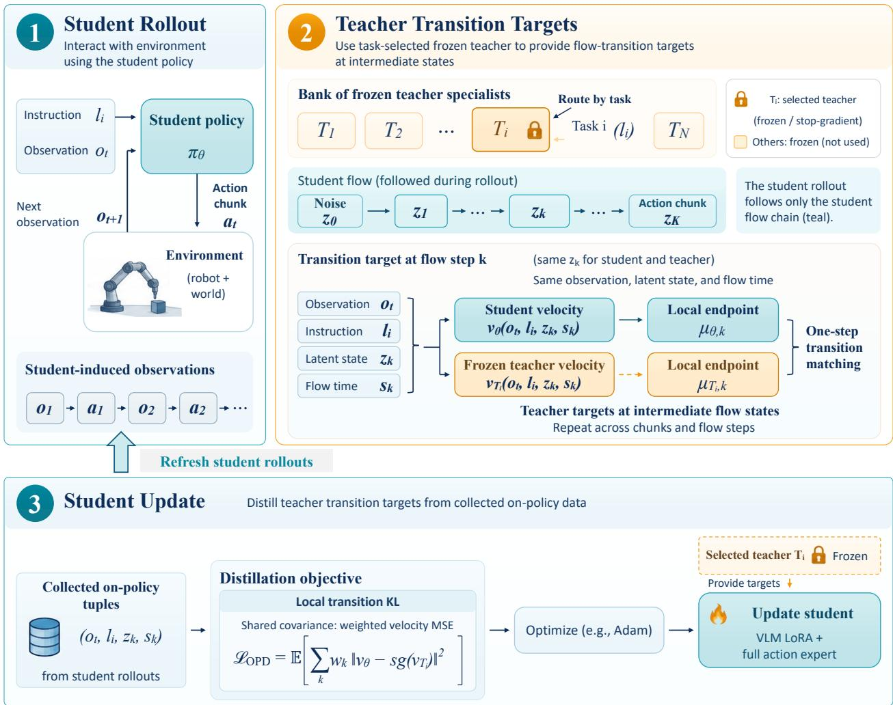
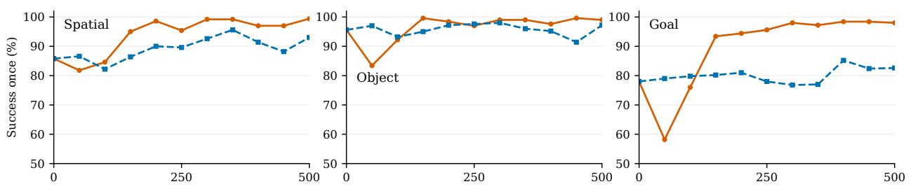
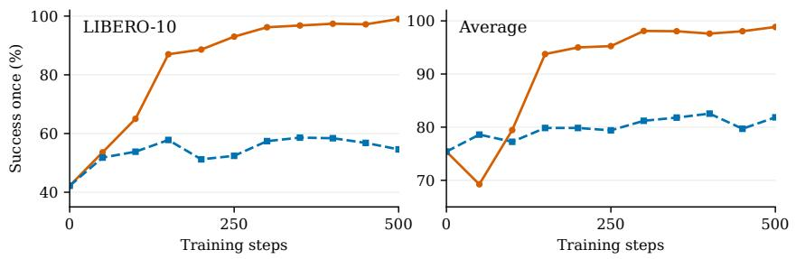
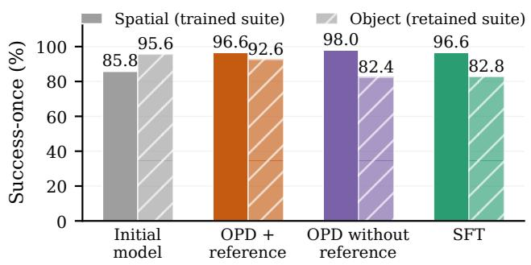
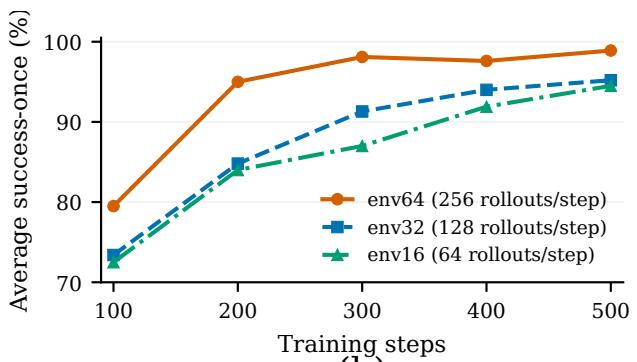
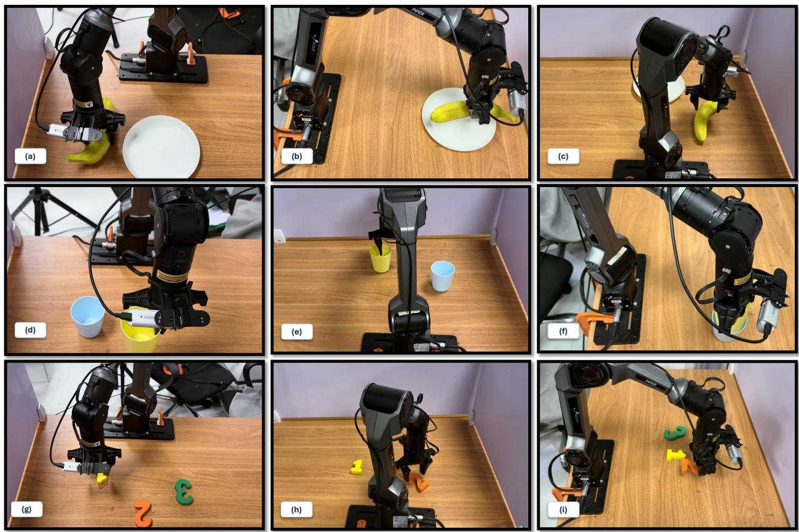

# VLA-MOPD: On-Policy Distillation for Multi-Task VLA Policy Consolidation

Yongxuan Lv<sup>1,2,∗</sup>, Zhen Fang<sup>1,∗</sup>, Lichen Man<sup>2,3,∗</sup>, Hao Li<sup>1</sup>, Pu Li<sup>2</sup>, Hengyi Wang<sup>1,2</sup>, Langfeng Cao<sup>1</sup>, Lin Chen<sup>1</sup>, Jie Huang<sup>1</sup>, Xiu Su<sup>2,3</sup>, Shan You<sup>2</sup>, Fei Wang<sup>2</sup>, Feng Zhao<sup>1,†</sup>

<sup>1</sup>University of Science and Technology of China, <sup>2</sup>ACE Robotics, <sup>3</sup>Central South University

<sup>∗</sup>Equal contribution, <sup>†</sup>Corresponding author

## Abstract

Physical intelligence requires embodied agents to ground language in observations and execute actions while retaining useful skills. Vision-language-action (VLA) policies ofer a shared interface, but task-specific post-training often produces separate specialists. Consolidation is dificult: mixed-task reinforcement learning provides sparse trajectory-level credit, while ofline distillation may miss student-visited observations and endpoint distillation does not supervise intermediate action-generation states. We introduce VLA Multi-teacher On-Policy Distillation (VLA-MOPD), a protocol for consolidating flow-matching VLA specialists. After acquiring task or suite experts, a shared student collects robot rollouts and queries the instruction-routed frozen teacher at each visited observation and intermediate ordinary diferential equation (ODE) state. Detached perflow-step transition targets supervise valid action chunks through a masked local matching loss; an optional reference-policy term supports retention on other tasks. Starting from one trajectory per LIBERO task, VLA-MOPD raises mean success-once from 75.4% to 98.9%, compared with 98.15% for endpoint action distillation. It improves mean RoboTwin 2.0 success from 73.0% to 89.3%; on a Piper robot, two consolidation rounds improve average success from 70.0% to 90.0%. In a near-matched Spatial-adaptation study, reference matching limits the Object suite decrease to 3.0 points, versus 13.2 without the reference term.

## Contents

Introduction 3   
2 Related Work . 4   
2.1 Vision-Language-Action Models 4   
2.2 Interactive and Reinforcement Learning for VLA Post-Training 4   
2.3 On-Policy Distillation for Multi-Teacher Consolidation 4   
3 Motivation: Decoupling Skill Acquisition and Consolidation 5   
4 Methodology 5   
4.1 Framework Overview 5   
4.2 Optimization Objective 6   
4.3 Reference-Policy Regularization for Retention 8   
5 Experiments 8   
5.1 Experimental Setup 8   
5.2 Main Results 9   
5.3 Ablations 9   
5.4 Real-World Experiment 11   
Conclusion 13   
Limitations 13   
Appendix 17   
A Implementation Details 17   
B From Reverse KL to ODE Step-Mean Matching 18   
C Real-World Evaluation Details 19

## 1 Introduction

Physical intelligence requires agents to connect language and perception to actions whose consequences change future observations. Embodied agents must therefore ground instructions in the current physical state and execute actions with feedback. PaLM-E incorporates visual and robot-state inputs into a language model for embodied reasoning, while SayCan grounds high-level plans in the feasibility of pretrained robot skills [10, 15].

VLA models provide a direct interface from observations and instructions to robot actions. RT-1 and RT-2 established large-scale language-conditioned control, while Open X-Embodiment broadened the available training data across institutions and embodiments [3, 30, 44]. Octo and OpenVLA provide reusable generalist initializations [18, 35]. Difusion- and flow-based policies generate continuous action chunks through an iterative trajectory [2, 7, 32]. Yet task-specific post-training often leaves improvements distributed across separate specialist checkpoints.

We study how to consolidate these specialists into one flow-matching VLA. A flow-matching VLA encounters two coupled trajectories: the outer robot trajectory, whose states are observations reached after executing action chunks, and the inner flow trajectory, whose ODE states transform noise into each action chunk. Fixed specialist demonstrations may miss observations reached by the changing student. Because closed-loop errors alter future states, the relevant training distribution is the student’s own occupancy. On-policy reinforcement learning (RL) naturally visits this distribution, but the multi-task Group Relative Policy Optimization (GRPO) baseline, which we refer to as MixRL [5, 20], assigns one binary success value to an entire rollout. This gives limited credit information for individual action chunks, especially before successful rollouts become common, and shared updates can encounter cross-task gradient interference [41].

Distillation provides direct teacher targets on student states. Classical interactive imitation learning such as Dataset Aggregation (DAgger) queries an expert for an action at each learner-induced observation [33]. In our setting, matching the teacher’s final action at these observations gives the endpoint action distillation baseline. We instead draw on DifusionOPD and Flow-OPD, which study local transition or vector-field matching in continuous generative models [12, 22], to provide denser supervision: the routed teacher supplies a detached per-flow-step transition target at every inner flow state. VLA-MOPD first acquires and freezes task or suite specialists, then lets a student collect robot rollouts and routes each instruction to its teacher. The student matches these targets across valid action chunks, including failed rollouts, while an optional reference term applies the same rule to a frozen copy of the initial policy on retained tasks.

We evaluate VLA-MOPD on four LIBERO suites and three RoboTwin 2.0 tasks [6, 26], as well as three tasks on a Piper robot. Starting from one demonstration per LIBERO task, mean success-once rises from 75.4% to 98.9%, compared with 98.15% for endpoint action distillation. The RoboTwin mean rises from 73.0% to 89.3%; on the Piper robot, two consolidation rounds raise average success from 70.0% to 90.0%. In a near-matched Spatial-adaptation comparison, reference matching limits the Object suite decrease to 3.0 points, versus 13.2 without the reference term.

Our contributions are (i) a two-stage recipe that decouples specialist acquisition from multi-task VLA consolidation; (ii) a local ODE transition matching objective evaluated at student-induced outer observations and inner flow states; and (iii) evidence of capability consolidation across simulated benchmarks and real-robot tasks, together with an analysis of retention.

## 2 Related Work

## 2.1 Vision-Language-Action Models

Scaling robot data and model capacity has produced policies that transfer across tasks, embodiments, and language instructions. RT-1 and RT-2 study large-scale real-robot and vision–language policy training, while Open X-Embodiment standardizes multi-institution robot data for cross-embodiment learning [3, 30, 44]. Octo and OpenVLA provide open generalist initializations; OpenVLA-OFT shows that action representation, chunking, and decoding choices afect downstream adaptation [17, 18, 35]. Difusion Policy and the $\pi _ { 0 }$ family instead generate continuous action sequences through difusion or flow matching [2, 7, 32]. Recent VLA designs explore partial reasoning–action decoupling, instruction tuning, hybrid difusion–autoregressive generation, fast–slow control, latent spatio-temporal reasoning, multi-frame modeling, execution-status monitoring, adaptive test-time compute, and motion-aware planning [4, 11, 19, 23–25, 27, 28, 39]. These works provide the policy and adaptation substrate for our study.

## 2.2 Interactive and Reinforcement Learning for VLA Post-Training

Interactive imitation learning addresses distribution shift by querying an expert on learner-induced observations. DAgger is the canonical example [33]; our setting retains this outer on-policy idea and adds targets at intermediate states of a continuous action generator. Recent embodied learning methods use environment interaction as additional supervision, including agentic reward verification for broader rollout exploration [21]; in VLA post-training, SimpleVLA-RL applies GRPO to an autoregressive action-token VLA, while $\pi _ { \mathrm { R L } }$ introduces Flow-Noise and Flow-SDE variants for Proximal Policy Optimization (PPO) or GRPO on flow-based $\pi _ { 0 }$ and $\pi _ { 0 . 5 }$ policies [5, 20]. VLA-OPD queries a frozen teacher for action-token distributions on student-visited states and optimizes a reverse Kullback–Leibler (KL) objective [43]. Residual controllers and lightweight actor–critic heads ofer other adaptation routes [16, 34, 36, 38].

Most of these methods emphasize task-specific adaptation or direct improvement from interaction. Our setting first acquires task- or suite-level specialists and then integrates them into one shared student, emphasizing consolidation across complementary capabilities.

## 2.3 On-Policy Distillation for Multi-Teacher Consolidation

Building on multi-teacher knowledge distillation [40], on-policy distillation (OPD) separates specialist acquisition from integration by training domain specialists and distilling them into one student on the student’s own rollouts. Language-model work uses dense token-level supervision for OPD [1, 8, 29, 37], while process-reward policy optimization provides intermediate reasoning-level credit for multi-step reasoning [9]. VLA-OPD applies this idea to an autoregressive action-token policy and matches token distributions at visited observations. Our student instead matches continuous flow-action transitions: the flow-matching action expert exposes intermediate ODE states and step means that provide the local targets used for consolidation.

MergeVLA instead preserves task-specific components through sparse task masks and composable action experts, whereas our focus is teacher-guided on-policy consolidation of a shared flow-matching policy [13].

For continuous generative models, DifusionOPD derives a closed-form per-step KL objective for difusion transitions. Flow-OPD adapts the same idea to flow matching: it routes student samples to the relevant specialist and uses vector-field discrepancies as dense feedback for policy-gradient updates [12, 22]. We transfer this transition-matching recipe to flow-matching VLA action experts: the outer robot rollout supplies visited observations, the inner flow trajectory supplies intermediate states, and the task-routed teacher supplies a target at each state.

## 3 Motivation: Decoupling Skill Acquisition and Consolidation

The consolidation objective must evaluate teacher targets where the student actually acts and generates action chunks. The following bound isolates the efect of replacing that joint state distribution with another one.

State-distribution mismatch. Let $\ell ( c , x )$ be a bounded per-state matching loss and let d and $\widetilde { d }$ be two observation–flow-state distributions. We measure their discrepancy by the total variation (TV) distance. If $0 \leq \ell \leq M$ , then

$$
\begin{array} { r } { \left| \mathbb { E } _ { d } [ \ell ] - \mathbb { E } _ { \widetilde { d } } [ \ell ] \right| \leq M \mathrm { T V } ( d , \widetilde { d } ) , } \end{array}\tag{1}
$$

which bounds how much the mismatch between the two state distributions can change the objective. This change-of-measure bound formalizes why student-induced states are the natural evaluation distribution for transition matching.

## Methodology

## 4.1 Framework Overview

Multi-task supervised fine-tuning (SFT) initializes $\pi _ { \theta _ { 0 } }$ ; supervised or RL adaptation produces frozen specialists $\pi _ { i } ^ { \mathrm { T } } = \pi _ { \phi _ { i } }$ for tasks or suites $i \in \mathcal { Z }$ . Figure 1 shows each consolidation iteration: one student rollout collection, task-routed transition labeling, and one student update. Its $z _ { k }$ denotes $x _ { t , k }$ below, and its local endpoint is the ODE step mean at flow step k. The trainable student parameters are its vision-language model (VLM) Low-Rank Adaptation (LoRA) modules and full action expert.

At decision step t, let $c _ { t } = ( o _ { t } , \ell _ { i } )$ contain the observation and task instruction. The flow-matching head generates a normalized action chunk in $\mathbb { R } ^ { H \times d }$ from Gaussian noise with an ODE solver. For $1 = s _ { 0 } > \dots > s _ { K } = 0$ , define $\delta _ { k } = s _ { k } - s _ { k + 1 }$ and the ODE step mean at flow step k

$$
\mu _ { \theta , k } ( x , c ) = x - \delta _ { k } v _ { \theta } ( x , s _ { k } , c ) , \qquad k = 0 , \ldots , K - 1 ,\tag{2}
$$

where $v _ { \theta }$ is the velocity field and $\mu _ { \boldsymbol { \theta } , k }$ is the ODE step mean. A frozen snapshot generates $x _ { t , 0 } \sim$ $\mathcal { N } ( 0 , I )$ and recursively applies $x _ { t , k + 1 } = \mu _ { \bar { \theta } , k } ( x _ { t , k } , c _ { t } )$ ; x<sub>t,K</sub> is decoded and executed for training rollouts. During evaluation, the controller may execute only a prefix before requesting a new action chunk. We store $c _ { t } ,$ the teacher identifier, and the full chain $x _ { t , 0 : K }$

At these states, the routed teacher supplies detached targets $\widehat { \mu } _ { i , t , k } = \mathrm { s g } [ \mu _ { \phi _ { i } , k } ( x _ { t , k } , c _ { t } ) ]$ , where $\mathrm { s g } [ \cdot ]$ denotes a stop-gradient. Teacher and student compute separate VLM prefixes but predict in shared normalized action coordinates. We cache targets, update only the student’s VLM LoRA and action expert, and refresh the student rollout after each update (Algorithm 1).

  
Figure 1 VLA-MOPD consolidation. Student rollouts provide observations and ODE states; the task-routed specialist labels transitions. The student matches these targets and refreshes rollouts. Velocity and ODE stepmean regression are Euler-equivalent; the transition-KL interpretation assumes shared Gaussian covariance (Eq. 4).

## 4.2 Optimization Objective

Following DifusionOPD [22], we start from a stochastic transition-KL view, then use direct transition matching for our deterministic ODE sampler. Let $d _ { i } ^ { \bar { \theta } } ( c )$ be the student snapshot’s observation– instruction distribution and $q _ { \bar { \theta } } ( x _ { 0 : K } \mid c )$ its ODE-chain law. At each stored $x _ { k }$ , we compare the student and frozen-teacher transitions. For a fixed snapshot ${ \bar { \theta } } ,$ the stochastic reference objective is

$$
\mathcal { L } _ { \mathrm { O P D } } ( \theta ; \bar { \theta } ) = \mathbb { E } _ { i \sim p ( i ) , \ c \sim d _ { i } ^ { \bar { \theta } } } \left[ \frac { 1 } { K } \sum _ { k = 0 } ^ { K - 1 } \mathrm { K L } \Bigl ( p _ { \theta , k } ( \cdot \ \vert \ x _ { k } , c ) \ \Vert \ p _ { i , k } ^ { \mathrm { T } } ( \cdot \ \vert \ x _ { k } , c ) \Bigr ) \right] .\tag{3}
$$

Here the student supplies both the robot observations and intermediate flow states, while the instruction selects the teacher.

Closed-form KL. For the closed-form transition calculation, first consider stochastic transitions with shared covariance. Write $p _ { \theta , k } = \mathcal { N } ( \mu _ { \theta , k } , \Sigma _ { k } )$ and $p _ { i , k } ^ { \mathrm { T } } = \mathcal N ( \mu _ { \phi _ { i } , k } , \Sigma _ { k } )$ , with both means

```tcl
Algorithm 1 VLA-MOPD: Specialist Acquisition and On-Policy Consolidation
Require: Multi-task SFT data $\mathcal { D } _ { \mathrm { S F T } }$ , specialist acquisition procedure A
Require: Teacher index set $\mathcal { T } _ { : }$ task sampling schedule $p ( i )$ , and flow schedule $s _ { 0 : K }$
1: $\theta _ { 0 }  \mathrm { S F T } ( \mathcal { D } _ { \mathrm { S F T } } ) ; \theta  \theta _ { 0 }$
2: for $i \in \mathcal { Z }$ do
3: $\phi _ { i }  A ( i )$ ; freeze $\phi _ { i }$
4: end for
5: $\theta _ { \mathrm { t r a i n } }  ( \theta _ { \mathrm { V L M - L o R A } } , \theta _ { \mathrm { a c t i o n } } )$
6: while the configured training budget remains do
7: $\bar { \theta }  \theta$
8: $\mathcal { D } _ { \mathrm { r o l l } }  \mathrm { R o l l o u t O D E } ( \pi _ { \bar { \theta } } , p ( i ) , s _ { 0 : K } )$
${ \mathcal { D } } _ { \mathrm { r o l l } } = \{ ( i , c , x _ { 0 : K } , m ) \}$ ; m keeps valid action chunks and masks terminated or padded
rows
9: for each $( i , c , x _ { 0 : K } , m ) \in \mathcal { D } _ { \mathrm { r o l l } }$ do
10: $e _ { i } ^ { \mathrm { T } } \gets \mathrm { P r e f i x } _ { \phi _ { i } } ( c )$ ▷ Teacher’s own VLM
11: for $k = 0 , \ldots , K - 1$ do
12: $\boldsymbol { v } _ { i , k } ^ { \mathrm { T } }  \mathrm { V e l o c i t y } _ { \phi _ { i } } ( \boldsymbol { x } _ { k } , \boldsymbol { s } _ { k } , \boldsymbol { c } ; \boldsymbol { e } _ { i } ^ { \mathrm { T } } )$
13: $\widehat { \mu } _ { i , k } \gets \mathrm { s g } [ x _ { k } - \delta _ { k } v _ { i , k } ^ { \mathrm { T } } ] ;$ ; cache $\widehat { \mu } _ { i , k }$
14: end for
15: end for
16: for each update minibatch $B \subset D _ { \mathrm { r o l l } }$ do
17: $e ^ { \mathrm { S } } \gets \mathrm { P r e f i x } _ { \theta } ( c _ { B } )$ $\triangleright$ Trainable student prefix
18: for $k = 0 , \ldots , K - 1$ do
19: $v _ { \theta , k } \gets \mathrm { V e l o c i t y } _ { \theta } ( x _ { B , k } , s _ { k } , c _ { B } ; e ^ { \mathrm { S } } )$
20: $\mu _ { \theta , k }  x _ { B , k } - \delta _ { k } v _ { \theta , k }$
21: end for
22: $\widehat { \mathcal { L } } _ { \mathrm { O D E } } \gets \mathrm { M a s k e d M e a n M a t c h } ( \mu _ { \theta } , \widehat { \mu } , m )$ ▷ Eq. 6
23: $\theta _ { \mathrm { t r a i n } } \gets \mathrm { U p d a t e } ( \theta _ { \mathrm { t r a i n } } , \nabla _ { \theta _ { \mathrm { t r a i n } } } \widehat { \mathcal { L } } _ { \mathrm { O D E } } )$
24: end for
25: end while
26: return $\pi _ { \theta }$
```

conditioned on the same $( x _ { k } , c )$ . Using the Euler parameterization $\mu _ { \theta , k } = x _ { k } - \delta _ { k } v _ { \theta } ( x _ { k } , s _ { k } , c )$ and $\mu _ { \phi _ { i } , k } = x _ { k } - \delta _ { k } v _ { \phi _ { i } } ( x _ { k } , s _ { k } , c )$ , the common state cancels and

$$
\begin{array} { r l } & { \mathrm { K L } \Big ( p _ { \theta , k } \| p _ { i , k } ^ { \mathrm { T } } \Big ) = \frac { 1 } { 2 } \Delta \mu _ { k } ^ { \intercal } \Sigma _ { k } ^ { - 1 } \Delta \mu _ { k } = \cfrac { \delta _ { k } ^ { 2 } } { 2 \sigma _ { k } ^ { 2 } } \| v _ { \theta } ( x _ { k } , s _ { k } , c ) - v _ { \phi _ { i } } ( x _ { k } , s _ { k } , c ) \| _ { F } ^ { 2 } \quad \mathrm { i f } \ \Sigma _ { k } = \sigma _ { k } ^ { 2 } I , } \end{array}\tag{4}
$$

where $\Delta \mu _ { k } = \mu _ { \theta , k } - \mu _ { \phi _ { i } , k }$ . This is an exact KL only for the stated stochastic Gaussian kernels.

Deterministic ODE matching. Our action generator instead uses deterministic Euler steps $x _ { k + 1 } =$ $\mu _ { \theta , k } ( x _ { k } , c )$ . As in the deterministic regime of DifusionOPD, we directly match the student and teacher ODE step means at the same stored student state:

$$
\begin{array} { r } { \ell _ { i , k } ^ { \mathrm { O D E } } ( x _ { k } , c ) = \frac { 1 } { 2 } \| \mu _ { \theta , k } ( x _ { k } , c ) - \mu _ { \phi _ { i } , k } ( x _ { k } , c ) \| _ { F } ^ { 2 } = \frac { \delta _ { k } ^ { 2 } } { 2 } \| v _ { \theta } ( x _ { k } , s _ { k } , c ) - v _ { \phi _ { i } } ( x _ { k } , s _ { k } , c ) \| _ { F } ^ { 2 } . } \end{array}\tag{5}
$$

This is a squared transition-matching surrogate, not a KL between deterministic kernels: distinct Dirac transitions have no finite KL.

VLA action-chunk objective. For each robot observation $c _ { t }$ , the student generates an $H \times d$ action chunk and stores its inner ODE states. We query the routed teacher at those states, detach its targets, and average Eq. 5 over flow steps and action elements:

$$
\mathcal { L } _ { \mathrm { O D E } } ( \theta ; \bar { \theta } ) = \mathbb { E } _ { i \sim p ( i ) , \ c \sim d _ { \bar { \theta } } ^ { \bar { \theta } } } \left[ \frac { 1 } { 2 K H d } \sum _ { k = 0 } ^ { K - 1 } \| \mu _ { \theta , k } ( x _ { k } , c ) - \mathrm { s g } [ \mu _ { \phi _ { i } , k } ( x _ { k } , c ) ] \| _ { F } ^ { 2 } \right] .\tag{6}
$$

Equation 6 uses uniform mean-space weighting, so its equivalent velocity error carries $\delta _ { k } ^ { 2 }$ but no inverse-covariance factor. Appendix A gives masking and normalization details; Appendix B expands the KL-to-ODE connection.

Frozen-snapshot projection. For a fixed stored state, write $J _ { \theta , k } = \partial v _ { \theta } ( x _ { k } , s _ { k } , c ) / \partial \theta$ . Diferentiating the velocity-field objective above gives the update direction

$$
\nabla _ { \boldsymbol { \theta } } \mathcal { L } _ { \mathrm { O D E } } = \mathbb { E } \left[ \frac { 1 } { K H d } \sum _ { k = 0 } ^ { K - 1 } \delta _ { k } ^ { 2 } J _ { \boldsymbol { \theta } , \boldsymbol { k } } ^ { \top } \big ( v _ { \boldsymbol { \theta } } ( \boldsymbol { x } _ { k } , \boldsymbol { s } _ { k } , \boldsymbol { c } ) - v _ { \boldsymbol { \phi } _ { i } } ( \boldsymbol { x } _ { k } , \boldsymbol { s } _ { k } , \boldsymbol { c } ) \big ) \right] ,\tag{7}
$$

where the expectation is over the frozen snapshot distributions in Eq. 3, valid terms are selected by the same mask as Eq. 10, and $q _ { \bar { \theta } }$ and $d _ { i } ^ { \theta }$ are not diferentiated. Thus, OPD performs a local projection of the student field on the student-induced outer and inner state distributions. The teacher labels every valid chunk at the student’s visited states, including failed rollouts; we diferentiate Eq. 6 directly through the student’s VLM LoRA and action expert with stored states and teacher targets fixed, then refresh the rollout snapshot.

## 4.3 Reference-Policy Regularization for Retention

To preserve capabilities outside the adaptation set, we freeze the starting policy $\pi _ { \mathrm { r e f } } = \pi _ { \theta _ { 0 } }$ and match its step means on retained-task observations, using the same rule as the specialists.

Let $\mathcal { D } _ { \mathrm { r e t a i n } }$ denote these retained-task observations and $q _ { \bar { \theta } } ( x _ { 0 : K } \mid c )$ the student snapshot’s ODE chain distribution. For valid chunks, the reference loss is

$$
\mathcal { L } _ { \mathrm { r e f } } ( \theta ; \bar { \theta } ) = \mathbb { E } \underset { x _ { 0 : K } \sim q _ { \bar { \theta } } ( \cdot | c ) } { \mathbb { E } } \left[ \frac { 1 } { 2 K H d } \sum _ { k = 0 } ^ { K - 1 } \| \mu _ { \theta , k } ( x _ { k } , c ) - \mathrm { s g } [ \mu _ { \theta _ { 0 } , k } ( x _ { k } , c ) ] \| _ { F } ^ { 2 } \right] .\tag{8}
$$

The combined objective is

$$
\begin{array} { r } { \mathcal { L } _ { \mathrm { t o t a l } } = \mathcal { L } _ { \mathrm { O D E } } + \beta \mathcal { L } _ { \mathrm { r e f } } , \qquad \beta \geq 0 . } \end{array}\tag{9}
$$

We call this reference mean matching. At each retained-task state, it is the local Gaussian-KL proxy induced by Eq. 4. Retained-task observations can come from environment resets without expert trajectories.

## 5 Experiments

## 5.1 Experimental Setup

We evaluate success-once throughout, counting an episode as successful if the task is completed at any point during execution, and report the unweighted mean when multiple suites or tasks are available. Student consolidation updates the VLM LoRA modules and the full action expert, while the remaining VLM parameters and all teacher parameters are frozen.

Table 1 Main results on LIBERO (success-once rate, %). VLA-MOPD is trained from a 1-traj-per-task student initialization. Published references use their reported backbones and data. The routed teacher is the RLinf multi-task PPO policy for Spatial, Object, and Goal, and its LIBERO-10-adapted checkpoint for LIBERO-10.
<table><tr><td>Method</td><td></td><td></td><td></td><td>Spatial Object Goal LIBERO-10 Avg.</td><td></td></tr><tr><td>Full dataset (50-traj)</td><td></td><td></td><td></td><td></td><td></td></tr><tr><td>Octo [35]</td><td>78.9</td><td>85.7</td><td>84.6</td><td>51.1</td><td>75.1</td></tr><tr><td>OpenVLA [18]</td><td>84.7</td><td>88.4</td><td>79.2</td><td>53.7</td><td>76.5</td></tr><tr><td>NORA [14]</td><td>92.2</td><td>95.4</td><td>89.4</td><td>74.6</td><td>87.9</td></tr><tr><td> $\pi _ { 0 } + \mathrm { F A S T } \left[ 2 , 3 1 \right]$ </td><td>96.4</td><td>96.8</td><td>88.6</td><td>60.2</td><td>85.5</td></tr><tr><td>π0.5 [32]</td><td>98.8</td><td>98.2</td><td>98.0</td><td>92.4</td><td>96.9</td></tr><tr><td>Our runs</td><td></td><td></td><td></td><td></td><td></td></tr><tr><td>Student initialization (base SFT, 1-traj)</td><td>85.8</td><td>95.6</td><td>78.0</td><td>42.2</td><td>75.4</td></tr><tr><td>Routed PPO teachers</td><td>97.4</td><td>99.2</td><td>98.6</td><td>98.8</td><td>98.5</td></tr><tr><td>Endpoint action distillation</td><td>99.0</td><td>99.2</td><td>96.8</td><td>97.6</td><td>98.2</td></tr><tr><td>VLA-MOPD (ours)</td><td>99.4</td><td>99.0</td><td>98.0</td><td>99.0</td><td>98.9</td></tr></table>

LIBERO. We use the four single-arm manipulation suites Spatial, Object, Goal, and LIBERO-10 from LIBERO [26]. To test the extreme data-scarcity setting, the student is initialized by SFT on a single trajectory per task (1-traj), i.e., one demonstration per task. The full-data reference setting uses 50 trajectories per task. Student checkpoint is obtained with the $\pi _ { 0 . 5 }$ SFT recipe in RLinf [42]. For Spatial, Object, and Goal, the teacher is RLinf’s PPO-trained multi-task checkpoint. The LIBERO-10 teacher is obtained by further training the same checkpoint on that suite with PPO for 120 steps. We use the standard LIBERO success-once evaluation protocol. Each LIBERO suite is evaluated on 500 episodes; we report one training seed and compare the same four-suite success rates across methods.

RoboTwin 2.0. We select three representative dual-arm tasks with diferent episode horizons from RoboTwin 2.0 [6]: Place Empty Cup, Pick Dual Bottles, and Stack Bowls Two. The common student initialization is a multi-task SFT model trained on 50 clean trajectories per task. The “Student initialization” row reports this checkpoint; VLA-MOPD further consolidates it with task-routed PPO teachers, while the teacher row reports the specialists themselves. Each RoboTwin task is evaluated on 100 episodes using the oficial task-specific limits, and we report success-once rates.

## 5.2 Main Results

LIBERO. Table 1 places published references alongside our controlled runs. Published references use their reported backbones, data, and evaluation protocols, while our method comparisons use the same initialization and update protocol; the average is the unweighted mean of the four suites.

RoboTwin 2.0. Table 2 reports the three-task RoboTwin results. Starting from the common 50-traj SFT student, VLA-MOPD improves the mean success-once rate from 73.0% to 89.3%, closing most of the gap to the routed teachers (94.0%).

## 5.3 Ablations

Training Eficiency. We compare VLA-MOPD and MixRL over the first 500 training steps, starting from the same multi-task SFT student. Figure 2 reports success-once rates for each LIBERO suite and their unweighted average. We measure eficiency by convergence in student optimizer steps under a matched run configuration. MixRL uses the GRPO algorithm implemented as RLinf’s π<sub>RL</sub> baseline [5, 42], with the same environment count and rollout count per optimizer step as the main VLA-MOPD run; we compare the two over the first 500 steps of each run. The recorded VLA-MOPD run improves non-monotonically from 75.4% at initialization to 98.1% by step 300 and 98.85% at the last recorded checkpoint; the early dip is visible in Figure 2. MixRL remains lower and oscillatory: at the shared step 400, it reaches 82.55% versus 97.6% for VLA-MOPD. The gap is largest on Goal and LIBERO-10. The gap is consistent with VLA-MOPD receiving teacher transition targets at each student observation and action chunk, while MixRL must discover successful trajectories from a terminal binary reward.

Table 2 Main results on RoboTwin 2.0 (success-once rate, %). Each entry is evaluated over 100 episodes.
<table><tr><td>Method</td><td>Place Empty Cup</td><td>Pick Dual Bottles</td><td>Stack Bowls Two</td><td>Avg.</td></tr><tr><td>Student initialization (50-traj SFT)</td><td>69.0</td><td>75.0</td><td>75.0</td><td>73.0</td></tr><tr><td>Routed PPO teachers</td><td>93.0</td><td>97.0</td><td>92.0</td><td>94.0</td></tr><tr><td>VLA-MOPD (ours)</td><td>87.0</td><td>93.0</td><td>88.0</td><td>89.3</td></tr></table>

Intermediate flow-state supervision. To isolate the efect of the supervision target, we compare VLA-MOPD with endpoint action distillation under the same training setup. Both methods collect observations through student on-policy rollouts; VLA-MOPD supervises intermediate flow transitions, whereas endpoint action distillation supervises only the final action. At 500 steps, endpoint action distillation reaches 98.15% average success, while VLA-MOPD reaches 98.9%. Spatial and Object are comparable (99.0% vs. 99.4%, and 99.2% vs. 99.0%, respectively); VLA-MOPD gains 1.2 points on Goal and 1.4 points on LIBERO-10. One possible explanation is that intermediate transition supervision helps on more compositional goals and longer-horizon tasks, where local action errors can accumulate across action chunks.

Forgetting and reference retention. This experiment considers selective adaptation: stronger teachers are available only for tasks targeted for improvement, while performance on other tasks should be retained. We use the Spatial specialist to improve Spatial and a frozen copy of the starting student as the reference on Object, without requiring an additional Object specialist. This ablation trains on Spatial and evaluates Object with reference OPD (β = 1), no-reference OPD (β = 0), and SFT. We define Object forgetting as the change from the common base, $\Delta _ { \mathrm { O b j e c t } } = S _ { \mathrm { O b j e c t } } ( \pi _ { \theta } ) - S _ { \mathrm { O b j e c t } } ( \pi _ { 0 } )$ ; negative values indicate forgetting. From checkpoints saved at fixed step intervals, we select snapshots with Spatial success as close as possible and compare their Object success (Figure 3(a)). From the 85.8% Spatial/95.6% Object base, the selected Spatial scores of 96.6%, 98.0%, and 96.6% yield Object scores of 92.6%, 82.4%, and 82.8% for reference OPD, no-reference OPD, and SFT. The Spatial scores difer by at most 1.4 percentage points. The corresponding Object drops are 3.0, 13.2, and 12.8 points; reference OPD reduces the drop by 10.2 points versus no-reference OPD.

Rollout-Budget Sensitivity. The 64-, 32-, and 16-environment settings collect 256, 128, and 64 trajectories per optimizer step. Figure 3(b) shows that the 64-env setting reaches 95.0% at step 200 and 98.1% at step 300, compared with 84.8/91.3% for the 32-env and 84.0/87.0% for the 16-env settings. The gap narrows by step 500, when the three settings reach 98.9%, 95.2%, and 94.5%. These curves characterize convergence per optimizer step under the three rollout-budget settings.



  
Figure 2 Convergence over the first 500 training steps. The five panels show success-once rates for the four LIBERO suites and their unweighted average. Points mark available evaluations. All suite scores use 500 evaluation episodes. MixRL and VLA-MOPD use matched per-step rollout budgets and are plotted at 50-step checkpoints without smoothing.

## 5.4 Real-World Experiment

We use real-world data from a Piper single-arm robot and consider three tasks: Pick Banana, Stack Cup, and Sort Number. The student is initialized by mixed-task $\mathrm { S F T }$ of a $\pi _ { 0 . 5 }$ model on the collected multi-task real-world demonstrations. For each task, we train a separate $\pi _ { 0 . 5 }$ teacher with single-task SFT on that task’s real-world demonstrations. The student then performs two rollout rounds; each round collects 50 trajectories per task. We use the resulting student observations and saved flow states as on-policy data for OPD, and train for one epoch after each rollout round. Over 30 evaluation trials per task, VLA-MOPD reaches 90.0%, compared with 70.0% for the student and 93.3% for the routed teacher. Task-wise rates are shown in Table 3.

  
(a)

  
(b)  
Figure 3 Retention and rollout-budget analyses. (a) Object retention at model snapshots selected for similar Spatial adaptation from checkpoints saved at fixed step intervals. The selected Spatial scores difer by at most 1.4 percentage points; Object success measures retention. (b) Average success during rollout-budget sensitivity with 64, 32, and 16 parallel environments.

  
Figure 4 Real-world experiment scenes. Rows show Pick Banana (a–c), Stack Cup (d–f), and Sort Number (g–i).

Table 3 Real-world experiment success-once rates (%; 30 trials per task).
<table><tr><td>Method</td><td>Pick Banana</td><td>Stack Cup</td><td>Sort Number</td><td> $\operatorname { A v g } .$ </td></tr><tr><td>Student</td><td>86.7</td><td>63.3</td><td>60.0</td><td>70.0</td></tr><tr><td>Teacher</td><td>100.0</td><td>96.7</td><td>83.3</td><td>93.3</td></tr><tr><td>VLA-MOPD</td><td>100.0</td><td>93.3</td><td>76.7</td><td>90.0</td></tr></table>

## 6 Conclusion

We present VLA-MOPD as a two-stage protocol for consolidating task or suite specialists into one flow-matching VLA. The student follows its own rollouts and receives local transition targets at the intermediate states of its action generator, connecting specialist supervision to the states encountered by the consolidated policy. Across the evaluated benchmarks and real-robot setting, the resulting student demonstrates efective multi-task capability consolidation and improves over its initialization.

## 7 Limitations

VLA-MOPD requires task or suite specialist teachers before consolidation. Acquiring and storing these teachers adds upfront training and maintenance cost, especially as the number of task families grows. The quality and task coverage of the available teachers also determine which capabilities the student can consolidate.

## References

[1] Rishabh Agarwal, Nino Vieillard, Yongchao Zhou, Piotr Stanczyk, Sabela Ramos Garea, Matthieu Geist, and Olivier Bachem. On-Policy Distillation of Language Models: Learning from Self-Generated Mistakes. In International Conference on Learning Representations (ICLR), 2024. URL https://arxiv.org/abs/ 2306.13649.

[2] Kevin Black et al. π<sub>0</sub>: A Vision-Language-Action Flow Model for General Robot Control. In Proceedings of Robotics: Science and Systems (RSS), 2025. URL https://arxiv.org/abs/2410.24164.

[3] Anthony Brohan et al. RT-1: Robotics Transformer for Real-World Control at Scale. In Proceedings of Robotics: Science and Systems (RSS), 2023.

[4] Hao Chen, Jiaming Liu, Chenyang Gu, Zhuoyang Liu, Renrui Zhang, Xiaoqi Li, Xiao He, Yandong Guo, Chi-Wing Fu, Shanghang Zhang, et al. Fast-in-Slow: A Dual-System VLA Model Unifying Fast Manipulation within Slow Reasoning. In Advances in Neural Information Processing Systems (NeurIPS), volume 38, 2025. URL https://arxiv.org/abs/2506.01953.

[5] Kang Chen, Zhihao Liu, Tonghe Zhang, Zhen Guo, Si Xu, Hao Lin, Hongzhi Zang, Xiang Li, Quanlu Zhang, Zhaofei Yu, Guoliang Fan, Tiejun Huang, Yu Wang, and Chao Yu. π<sub>RL</sub>: Online RL Fine tuning for Flow-based Vision-Language-Action Models. arXiv preprint arXiv:2510.25889, 2025. URL https://arxiv.org/abs/2510.25889.

[6] Tianxing Chen, Zanxin Chen, Baijun Chen, Zijian Cai, Yibin Liu, Qiwei Liang, Zixuan Li, Xianliang Lin, Yiheng Ge, Zhenyu Gu, et al. RoboTwin 2.0: A Scalable Data Generator and Benchmark with Strong Domain Randomization for Robust Bimanual Robotic Manipulation. In Proceedings of the 43rd International Conference on Machine Learning (ICML), volume 306 of Proceedings of Machine Learning Research, pages 13673–13699, 2026. URL https://proceedings.mlr.press/v306/chen26j.html.

[7] Cheng Chi et al. Difusion Policy: Visuomotor Policy Learning via Action Difusion. In Proceedings of Robotics: Science and Systems (RSS), 2023.

[8] DeepSeek-AI. DeepSeek-V4: Towards Highly Eficient Million-Token Context Intelligence. arXiv preprint arXiv:2606.19348, 2026. URL https://arxiv.org/abs/2606.19348.

[9] Ruiyi Ding, Yongxuan Lv, Xianhui Meng, Jiahe Song, Chao Wang, Chen Jiang, and Yuan Cheng. PRPO: Aligning Process Reward with Outcome Reward in Policy Optimization. arXiv preprint arXiv:2601.07182, 2026. URL https://arxiv.org/abs/2601.07182.

[10] Danny Driess, Fei Xia, Mehdi S. M. Sajjadi, Corey Lynch, Aakanksha Chowdhery, et al. PaLM-E: An embodied multimodal language model. In Proceedings of the 40th International Conference on Machine Learning (ICML), volume 202 of Proceedings of Machine Learning Research, pages 8469–8488, 2023. URL https://arxiv.org/abs/2303.03378.

[11] Zhen Fang, Zhuoyang Liu, Jiaming Liu, Hao Chen, Yu Zeng, Shiting Huang, Zehui Chen, Lin Chen, Shanghang Zhang, and Feng Zhao. DualVLA: Building a Generalizable Embodied Agent via Partial Decoupling of Reasoning and Action. arXiv preprint arXiv:2511.22134, 2025. URL https://arxiv.org/ abs/2511.22134.

[12] Zhen Fang, Wenxuan Huang, Yu Zeng, Yiming Zhao, Shuang Chen, Kaituo Feng, Yunlong Lin, Lin Chen, Zehui Chen, Shaosheng Cao, and Feng Zhao. Flow-OPD: On-Policy Distillation for Flow Matching Models. arXiv preprint arXiv:2605.08063, 2026. URL https://arxiv.org/abs/2605.08063.

[13] Yuxia Fu, Zhizhen Zhang, Yuqi Zhang, Zijian Wang, Zi Huang, and Yadan Luo. MergeVLA: Cross-Skill Model Merging Toward a Generalist Vision-Language-Action Agent. In Proceedings of the IEEE/CVF Conference on Computer Vision and Pattern Recognition (CVPR), 2026. URL https://openaccess.thecvf.com/content/CVPR2026/papers/Fu\_MergeVLA\_Cross-Skill\_Model\_ Merging\_Toward\_a\_Generalist\_Vision-Language-Action\_Agent\_CVPR\_2026\_paper.pdf.

[14] Chia-Yu Hung, Qi Sun, Pengfei Hong, Amir Zadeh, Chuan Li, U-Xuan Tan, Navonil Majumder, and Soujanya Poria. NORA: A Small Open-Sourced Generalist Vision Language Action Model for Embodied Tasks. arXiv preprint arXiv:2504.19854, 2025. URL https://arxiv.org/abs/2504.19854.

[15] Brian Ichter, Anthony Brohan, Yevgen Chebotar, Chelsea Finn, Karol Hausman, et al. Do as i can, not as i say: Grounding language in robotic afordances. In Proceedings of the 6th Conference on Robot Learning (CoRL), volume 205 of Proceedings of Machine Learning Research, pages 287–318, 2023. URL https://proceedings.mlr.press/v205/ichter23a.html.

[16] Tobias Johannink, Shikhar Bahl, Ashvin Nair, Jianlan Luo, Avinash Kumar, Matthias Loskyll, Juan Aparicio Ojea, Eugen Solowjow, and Sergey Levine. Residual Reinforcement Learning for Robot Control. In IEEE International Conference on Robotics and Automation (ICRA), pages 6023–6029, 2019. URL https://arxiv.org/abs/1812.03201.

[17] Moo Jin Kim, Chelsea Finn, and Percy Liang. Fine-Tuning Vision-Language-Action Models: Optimizing Speed and Success. In Proceedings of Robotics: Science and Systems (RSS), 2025. URL https: //arxiv.org/abs/2502.19645.

[18] Moo Jin Kim et al. OpenVLA: An Open-Source Vision-Language-Action Model. In Proceedings of the 8th Conference on Robot Learning (CoRL), volume 270 of Proceedings of Machine Learning Research, pages 2679–2713, 2025. URL https://proceedings.mlr.press/v270/kim25c.html.

[19] Hao Li, Shuai Yang, Yilun Chen, Xinyi Chen, Xiaoda Yang, Yang Tian, Hanqing Wang, Tai Wang, Dahua Lin, Feng Zhao, et al. Towards Eficient and Robust Manipulation via Multi-Frame Vision-Language-Action Modeling. In Proceedings of the AAAI Conference on Artificial Intelligence (AAAI-26), 2026. URL https://ojs.aaai.org/index.php/AAAI/article/view/38903.

[20] Haozhan Li, Yuxin Zuo, Jiale Yu, Yuhao Zhang, Zhaohui Yang, Kaiyan Zhang, Xuekai Zhu, Yuchen Zhang, Tianxing Chen, Ganqu Cui, Dehui Wang, Dingxiang Luo, Yuchen Fan, Youbang Sun, Jia Zeng, Jiangmiao

Pang, Shanghang Zhang, Yu Wang, Yao Mu, Bowen Zhou, and Ning Ding. SimpleVLA-RL: Scaling VLA Training via Reinforcement Learning. In International Conference on Learning Representations (ICLR), 2026. URL https://openreview.net/forum?id=TQhSodCM4r.

[21] Pu Li, Zhigang Lin, Qiang Wu, Yongxuan Lv, Fei Wang, and Shan You. Reward as An Agent for Embodied World Models. arXiv preprint arXiv:2606.19990, 2026. URL https://arxiv.org/abs/2606.19990.

[22] Quanhao Li, Junqiu Yu, Kaixun Jiang, Yujie Wei, Zhen Xing, Pandeng Li, Ruihang Chu, Shiwei Zhang, Yu Liu, and Zuxuan Wu. DifusionOPD: A Unified Perspective of On-Policy Distillation in Difusion Models. In Proceedings of the SIGGRAPH Asia 2026 Conference Papers, 2026. URL https://arxiv.org/abs/2605.15055. Accepted to the conference paper track.

[23] Wenhao Li, Xiu Su, Yichao Cao, Hongyan Xu, Xiaobo Xia, Shan You, Yi Chen, and Chang Xu. VLA-ATTC: Adaptive Test-Time Compute for VLA Models with Relative Action Critic Model. In Proceedings of the 43rd International Conference on Machine Learning (ICML), volume 306 of Proceedings of Machine Learning Research, pages 69960–69971. PMLR, 2026. URL https://icml.cc/virtual/2026/poster/ 61157.

[24] Wenhao Li, Xiu Su, Yu Han, Yichao Cao, Shan You, and Chang Xu. DSDyn-VLA: A Dual-Stream Dynamic Manipulation Framework with Motion Perception, Future Awareness, and Realtime Correction. arXiv preprint arXiv:2609.39198, 2026. URL https://arxiv.org/abs/2609.39198.

[25] Wenhao Li, Xiu Su, Dan Niu, Yichao Cao, Hongyan Xu, Zhe Qu, Lei Fan, Shan You, and Chang Xu. Sentinel-VLA: A Metacognitive VLA Model with Active Status Monitoring for Dynamic Reasoning and Error Recovery. In Proceedings of the 43rd International Conference on Machine Learning (ICML), volume 306 of Proceedings of Machine Learning Research, pages 69972–69983. PMLR, 2026. URL https://icml.cc/virtual/2026/poster/61750.

[26] Bo Liu, Yifeng Zhu, Chongkai Gao, Yihao Feng, Qiang Liu, Yuke Zhu, and Peter Stone. LIBERO: Benchmarking Knowledge Transfer for Lifelong Robot Learning. In Advances in Neural Information Processing Systems (NeurIPS), volume 36, 2023. URL https://arxiv.org/abs/2306.03310. Dataset and Benchmarks Track.

[27] Jiaming Liu, Hao Chen, Pengju An, Zhuoyang Liu, Renrui Zhang, Chenyang Gu, Xiaoqi Li, Ziyu Guo, Sixiang Chen, Mengzhen Liu, et al. HybridVLA: Collaborative Difusion and Autoregression in a Unified Vision-Language-Action Model. In International Conference on Learning Representations (ICLR), 2026. URL https://arxiv.org/abs/2503.10631.

[28] Zhuoyang Liu, Jiaming Liu, Hao Chen, Jiale Yu, Ziyu Guo, Chengkai Hou, Chenyang Gu, Xiangju Mi, Renrui Zhang, Kun Wu, et al. LaST : Latent Spatio-Temporal Chain-of-Thought for Robotic Vision-Language-Action Model. In Proceedings of the 43rd International Conference on Machine Learning (ICML), volume 306 of Proceedings of Machine Learning Research, 2026. URL https://icml.cc/ virtual/2026/poster/61887.

[29] Wenhan Ma, Jianyu Wei, Liang Zhao, Hailin Zhang, Bangjun Xiao, Lei Li, Qibin Yang, Bofei Gao, Yudong Wang, Rang Li, Jinhao Dong, Zhifang Sui, and Fuli Luo. MOPD: Multi-Teacher On-Policy Distillation for Capability Integration in LLM Post-Training. arXiv preprint arXiv:2606.30406, 2026. URL https://icml.cc/virtual/2026/78170. Presented at the ICML 2026 Workshop on RL from World Feedback (RLxF).

[30] Open X-Embodiment Collaboration. Open X-Embodiment: Robotic Learning Datasets and RT-X Models. In IEEE International Conference on Robotics and Automation (ICRA), 2024.

[31] Karl Pertsch, Kyle Stachowicz, Brian Ichter, Danny Driess, Suraj Nair, Quan Vuong, Oier Mees, Chelsea Finn, and Sergey Levine. FAST: Eficient Action Tokenization for Vision-Language-Action Models. In Proceedings of Robotics: Science and Systems (RSS), 2025. URL https://arxiv.org/abs/2501.09747.

[32] Physical Intelligence, Kevin Black, Noah Brown, et al. π<sub>0.5</sub>: A Vision-Language-Action Model with

Open-World Generalization. In Proceedings of the 9th Conference on Robot Learning (CoRL), 2025. URL https://arxiv.org/abs/2504.16054.

[33] Stephane Ross, Geofrey J. Gordon, and J. Andrew Bagnell. A reduction of imitation learning and structured prediction to no-regret online learning. In Proceedings of the Fourteenth International Conference on Artificial Intelligence and Statistics, volume 15 of Proceedings of Machine Learning Research, pages 627–635, 2011. URL https://proceedings.mlr.press/v15/ross11a.html.

[34] Tom Silver, Kelsey R. Allen, Joshua B. Tenenbaum, and Leslie P. Kaelbling. Residual Policy Learning. arXiv preprint arXiv:1812.06298, 2018. URL https://arxiv.org/abs/1812.06298.

[35] Octo Team, Dibya Ghosh, et al. Octo: An Open-Source Generalist Robot Policy. In Proceedings of Robotics: Science and Systems (RSS), 2024. URL https://arxiv.org/abs/2405.12213.

[36] Wenli Xiao, Haotian Lin, Andy Peng, Haoru Xue, Tairan He, Yuqi Xie, Fengyuan Hu, Jimmy Wu, Zhengyi Luo, Linxi Fan, Guanya Shi, and Yuke Zhu. Self-Improving Vision-Language-Action Models with Data Generation via Residual RL. In International Conference on Learning Representations (ICLR), 2026. URL https://iclr.cc/virtual/2026/poster/10008318.

[37] Xiaomi LLM-Core Team. MiMo-V2-Flash Technical Report. arXiv preprint arXiv:2601.02780, 2026. URL https://arxiv.org/abs/2601.02780.

[38] Charles Xu, Jost Tobias Springenberg, Michael Equi, Ali Amin, Adnan Esmail, Sergey Levine, and Liyiming Ke. RL Token: Bootstrapping Online RL with Vision-Language-Action Models. arXiv preprint arXiv:2604.23073, 2026. URL https://arxiv.org/abs/2604.23073.

[39] Shuai Yang, Hao Li, Bin Wang, Yilun Chen, Yang Tian, Tai Wang, Hanqing Wang, Feng Zhao, Yiyi Liao, and Jiangmiao Pang. Vision-Language-Action Instruction Tuning: From Understanding to Manipulation. In International Conference on Learning Representations (ICLR), 2026. URL https: //openreview.net/forum?id=tsxwloasw5.

[40] Shan You, Chang Xu, Chao Xu, and Dacheng Tao. Learning from multiple teacher networks. In Proceedings of the 23rd ACM SIGKDD International Conference on Knowledge Discovery and Data Mining, pages 1285– 1294. ACM, 2017. doi: 10.1145/3097983.3098135. URL https://doi.org/10.1145/3097983.3098135.

[41] Tianhe Yu, Saurabh Kumar, Abhishek Gupta, Sergey Levine, Karol Hausman, and Chelsea Finn. Gradient Surgery for Multi-Task Learning. In Advances in Neural Information Processing Systems (NeurIPS), volume 33, 2020. URL https://arxiv.org/abs/2001.06782.

[42] Hongzhi Zang et al. RLinf-VLA: A Unified and Eficient Framework for Reinforcement Learning of Vision-Language-Action Models. In Proceedings of Robotics: Science and Systems (RSS), 2026. URL https://www.roboticsproceedings.org/rss22/p089.html.

[43] Zhide Zhong, Haodong Yan, Junfeng Li, Junjie He, Tianran Zhang, and Haoang Li. VLA-OPD: Bridging Ofline SFT and Online RL for Vision-Language-Action Models via On-Policy Distillation. arXiv preprint arXiv:2603.26666, 2026. URL https://arxiv.org/abs/2603.26666.

[44] Brianna Zitkovich, Tianhe Yu, Sichun Xu, Peng Xu, Ted Xiao, Fei Xia, Jialin Wu, Paul Wohlhart, Stefan Welker, Ayzaan Wahid, Quan Vuong, Vincent Vanhoucke, Huong Tran, Radu Soricut, Anikait Singh, Jaspiar Singh, Pierre Sermanet, Pannag R. Sanketi, Grecia Salazar, Michael S. Ryoo, Krista Reymann, Kanishka Rao, Karl Pertsch, Igor Mordatch, Henryk Michalewski, Yao Lu, Sergey Levine, Lisa Lee, Tsang-Wei Edward Lee, Isabel Leal, Yuheng Kuang, Dmitry Kalashnikov, Ryan Julian, Nikhil J. Joshi, Alex Irpan, Brian Ichter, Jasmine Hsu, Alexander Herzog, Karol Hausman, Keerthana Gopalakrishnan, Chuyuan Fu, Pete Florence, Chelsea Finn, Kumar Avinava Dubey, Danny Driess, Tianli Ding, Krzysztof Marcin Choromanski, Xi Chen, Yevgen Chebotar, Justice Carbajal, Noah Brown, Anthony Brohan, Montserrat Gonzalez Arenas, and Kehang Han. RT-2: Vision-Language-Action Models Transfer Web Knowledge to Robotic Control. In Proceedings of the 7th Conference on Robot Learning (CoRL), volume 229 of Proceedings of Machine Learning Research, pages 2165–2183, 2023. URL https://proceedings.mlr.press/v229/zitkovich23a.html.

## Appendix

A Implementation Details
<table><tr><td>Field</td><td>Setting</td></tr><tr><td>Base policy</td><td>π0.5; multi-task SFT student initialization.</td></tr><tr><td>Student updates</td><td>Native VLM LoRA parameters and the full action expert; the re- maining VLM parameters are frozen.</td></tr><tr><td>Teacher bank</td><td>Frozen teacher checkpoints routed by the stored teacher identifier.</td></tr><tr><td>Conditioning</td><td>Teacher and student encode the same observation independently and each reuse their own prefix across flow steps.</td></tr><tr><td>Rollout</td><td>Student environment interaction; saved normalized ODE states for every action chunk. The evaluated flow configuration uses five solver</td></tr><tr><td>Action horizon</td><td>steps and the same step schedule for teacher and student targets. LIBERO action chunks contain 10 actions; RoboTwin uses an action</td></tr><tr><td>Objective</td><td>horizon of 50. Half squared ODE step-mean error, averaged over flow steps and valid model action elements.</td></tr><tr><td>Teacher targets</td><td>Computed on stored student states and cached before student opti-</td></tr><tr><td>Backward pass</td><td>mization. Shared trainable prefix graph; losses from all selected flow steps are</td></tr><tr><td>Rollout budget</td><td>averaged before backward. 64 training environments; four rollout epochs per optimizer step, one for each suite  $\mathrm { ( S p a t i a l / O b j e c t / G o a l / L I B E R O  – 1 0 ) }$  . The suite-specific</td></tr><tr><td>Actor batches</td><td>maximum steps are  $2 4 0 / 2 4 0 / 3 2 0 / 4 8 0$  , respectively. Microbatch size 8 and global batch size 1024.</td></tr><tr><td>Optimization</td><td>Adam with learning rate  $2 . 5 \times 1 0 ^ { - 5 } , ( \beta _ { 1 } , \beta _ { 2 } ) = ( 0 . 9 , 0 . 9 5 )$  , weight</td></tr><tr><td>Training schedule</td><td>decay 0.01, gradient clipping at  $1 . 0 ,$  and cosine decay. 1000 optimizer steps; results are reported over the first 500 steps.</td></tr><tr><td>OPD target computation</td><td>Checkpoints are saved every 50 steps; random seed 42. Teacher microbatch size  $4 ;$  all five flow steps are used;  $\beta = 0$  for the main consolidation experiments, with the teacher-ratio schedule fixed at zero. The forgetting ablation compares reference matching  $( \beta = 1 )$ </td></tr></table>

The implementation uses the configured five-step flow\_ode schedule; the cached teacher target and student prediction use the same normalized step coordinates. The action dimension d in Eq. 6 denotes the model’s internal normalized action representation, which can exceed the number of robot control coordinates. Matching is performed before decoding and uses all coordinates returned by the action head. Normalization assets are shared between teacher and student. This aligns their output coordinates while allowing their VLM encoders and action experts to have diferent weights.

For an update microbatch B, let $m _ { b , h } \in \{ 0 , 1 \}$ be the validity mask, broadcast over the d model action coordinates. The estimator of Eq. 6 used by the implementation is

$$
\widehat { \mathcal { L } } _ { \mathrm { O D E } } = \frac { 1 } { 2 K Z _ { \mathcal { B } } } \sum _ { b \in \mathcal { B } } \sum _ { k = 0 } ^ { K - 1 } \sum _ { h = 1 } ^ { H } \sum _ { j = 1 } ^ { d } m _ { b , h } \big [ \mu _ { \theta , b , k , h , j } - \widehat { \mu } _ { b , k , h , j } \big ] ^ { 2 } ,\tag{10}
$$

where $\begin{array} { r } { Z _ { \boldsymbol { B } } = \operatorname* { m a x } ( \boldsymbol { 1 } , \boldsymbol { d } \sum _ { b , h } m _ { b , h } ) , \mu _ { \boldsymbol { \theta } , \boldsymbol { b } , \boldsymbol { k } } = \mu _ { \boldsymbol { \theta } , \boldsymbol { k } } ( x _ { b , \boldsymbol { k } } , c _ { b } ) } \end{array}$ , and $\widehat { \mu } _ { b , k } = \mathrm { s g } [ \mu _ { \phi _ { i _ { h } } , k } ( x _ { b , k } , c _ { b } ) ]$ . For chunk-level validity masks, the mask is broadcast over all positions and coordinates of the action chunk. Completed rollout slots and padded samples are excluded. The implementation computes a normalized masked loss within each microbatch, then averages its gradients across accumulation steps and distributed workers. Accordingly, it averages microbatch-normalized losses; when valid counts difer, this need not equal one global valid-element mean. Both successful and unsuccessful episodes can supply valid training samples; restricting distillation to failed episodes is an optional sampling filter. The student computes its trainable VLM prefix once per microbatch and reuses it across the denoising-step predictions. Their losses are averaged before a joint backward pass through the shared prefix graph and action expert.

## B From Reverse KL to ODE Step-Mean Matching

This section makes explicit the connection between the reverse-KL definition in DifusionOPD [22] and the deterministic loss used in our implementation. Fix an instruction–observation pair $^ { c , }$ a stored student state $x _ { k }$ , and flow step k. Let $p _ { \theta , k } ( \cdot \mid x _ { k } , c )$ denote the student transition and let $p _ { i , k } ^ { \mathrm { T } } ( \cdot \mid x _ { k } , c )$ denote the transition of the routed, frozen teacher. The reverse transition objective is

$$
\mathcal { L } _ { \mathrm { r e v } } = \mathbb { E } _ { i \sim p ( i ) , \ c \sim d _ { \bar { \theta } } ^ { \bar { \theta } } } \left[ \frac { 1 } { K } \sum _ { k = 0 } ^ { K - 1 } \mathrm { K L } \Bigl ( p _ { \theta , k } ( \cdot \ | \ x _ { k } , c ) \left\| p _ { i , k } ^ { \mathrm { T } } ( \cdot \ | \ x _ { k } , c ) \right) \right] .\tag{11}
$$

The first argument is the student, so this is the reverse KL convention used here. The snapshot distribution $d _ { i } ^ { \theta }$ and the stored-state law $q _ { \bar { \theta } }$ are held fixed during the update.

Reverse KL for shared-covariance transitions. Assume temporarily that both transitions are Gaussian, $p _ { \theta , k } = \mathcal { N } ( \mu _ { \theta , k } , \Sigma _ { k } )$ and $p _ { i , k } ^ { \mathrm { T } } = \mathcal { N } ( \mu _ { i , k } ^ { \mathrm { T } } , \Sigma _ { k } )$ , with the same positive covariance at the same state. The general Gaussian KL reduces to

$$
\mathrm { K L } ( p _ { \theta , k } \| p _ { i , k } ^ { \mathrm { T } } ) = \frac { 1 } { 2 } ( \mu _ { \theta , k } - \mu _ { i , k } ^ { \mathrm { T } } ) ^ { \mathrm { T } } \Sigma _ { k } ^ { - 1 } ( \mu _ { \theta , k } - \mu _ { i , k } ^ { \mathrm { T } } ) .\tag{12}
$$

For $\Sigma _ { k } = \sigma _ { k } ^ { 2 } I$ , this is

$$
\operatorname { K L } ( p _ { \theta , k } \| p _ { i , k } ^ { \mathrm { T } } ) = \frac { 1 } { 2 \sigma _ { k } ^ { 2 } } \left\| \mu _ { \theta , k } - \mu _ { i , k } ^ { \mathrm { T } } \right\| _ { F } ^ { 2 } .\tag{13}
$$

Velocity-field form. Write one Euler transition of the student and teacher flow fields as

$$
\mu _ { \boldsymbol { \theta } , \boldsymbol { k } } = x _ { k } - \delta _ { k } v _ { \boldsymbol { \theta } } ( x _ { k } , s _ { k } , c ) , \qquad \mu _ { i , k } ^ { \mathrm { T } } = x _ { k } - \delta _ { k } v _ { i } ^ { \mathrm { T } } ( x _ { k } , s _ { k } , c ) .\tag{14}
$$

Because both transitions start from the same stored state, the state cancels:

$$
\mu _ { \theta , k } - \mu _ { i , k } ^ { \mathrm { T } } = - \delta _ { k } \big ( v _ { \theta } ( x _ { k } , s _ { k } , c ) - v _ { i } ^ { \mathrm { T } } ( x _ { k } , s _ { k } , c ) \big ) .\tag{15}
$$

Substituting Eq. 15 into Eq. 13 gives the step-size-weighted velocity objective

$$
\mathrm { K L } ( p _ { \theta , k } \| p _ { i , k } ^ { \mathrm { T } } ) = \frac { \delta _ { k } ^ { 2 } } { 2 \sigma _ { k } ^ { 2 } } \left\| v _ { \theta } ( x _ { k } , s _ { k } , c ) - v _ { i } ^ { \mathrm { T } } ( x _ { k } , s _ { k } , c ) \right\| _ { F } ^ { 2 } .\tag{16}
$$

Thus the reverse-KL transition view and velocity-field regression are the same quadratic form under the shared-covariance assumption.

Deterministic ODE transition matching. Following the deterministic regime in DifusionOPD, our sampler uses direct squared matching of ODE step means rather than a conditional KL:

$$
\mathcal { L } _ { \mathrm { m e a n } } = \mathbb { E } _ { i \sim p ( i ) , ~ c \sim d _ { i } ^ { \bar { \theta } } } \left[ \frac { 1 } { 2 K H d } \sum _ { k = 0 } ^ { K - 1 } \left\| \mu _ { \theta , k } ( x _ { k } , c ) - \mathrm { s g } \Bigl [ \mu _ { i , k } ^ { \mathrm { T } } ( x _ { k } , c ) \Bigr ] \right\| _ { F } ^ { 2 } \right] .\tag{17}
$$

The stop-gradient keeps the teacher target fixed. Combining Eq. 15 with Eq. 17 shows that each term is proportional to $\delta _ { k } ^ { 2 } \| v _ { \theta } - v _ { i } ^ { \mathrm { T } } \| _ { F } ^ { 2 }$ ; the factor $1 / ( H d )$ is only the per-element normalization. If the shared covariance is constant, the omitted $\sigma ^ { - 2 }$ is a global scale absorbed by the loss weight or learning rate. If $\sigma _ { k }$ varies with $k ,$ using $\operatorname { E q }$ . 17 amounts to an explicit choice of uniform mean-space weighting rather than the additional $\sigma _ { k } ^ { - 2 }$ time weighting in Eq. 16.

The deterministic loss is the ODE mean-matching counterpart of the stochastic transition objective. It is not obtained by setting $\sigma _ { k } ^ { 2 } = 0$ in a Gaussian KL: distinct Dirac transitions do not have a finite KL. Nor does $\operatorname { E q } .$ . 17 claim to be an exact KL between the final action distributions. Its on-policy character comes from evaluating both fields at the saved student states $x _ { k } ;$ the recorded rollout law is detached, while gradients flow through the current student’s prefix and action expert. This is also why the teacher is queried at every stored state rather than used to generate a separate complete action chunk.

## C Real-World Evaluation Details

Hardware and observations. We use a single-arm Piper robot with six arm joints and a gripper. The policy receives red-green-blue (RGB) observations from a main-view camera and a wrist-mounted camera. Images are recorded at a resolution of $6 4 0 \times 4 8 0$ and resized with aspect-ratio-preserving padding to 224 × 224 for model input. The nominal action-execution frequency is 30 Hz.

Action representation. The physical action space consists of six joint-position targets and one gripper-opening target. The arm-joint targets are represented as ofsets from the current joint positions, whereas the gripper target remains absolute. Before execution, the joint ofsets are converted back to absolute joint-position targets. The model uses a 32-dimensional internal action representation, of which the first seven dimensions are used for Piper control.

Demonstrations and specialist training. The student is initialized by mixed-task SFT on demonstrations from Pick Banana, Stack Cup, and Sort Number. Each specialist teacher is trained separately by single-task SFT on demonstrations from its corresponding task.

On-policy training and evaluation. For OPD training, the student performs two rollout rounds. Each round collects 50 trajectories per task, and the resulting on-policy data is used for one training epoch before the next rollout round. The training policy predicts and executes action horizons of 50, with five flow-ODE denoising steps. For the Piper evaluation, the policy predicts an action horizon of 50 but the controller executes only the first 25 actions before requesting the next prediction.

<table><tr><td>Task</td><td>Instruction</td></tr><tr><td>Pick Banana</td><td>“Grasp the banana from the table and place it on the plate.&quot;</td></tr><tr><td>Stack Cup</td><td>&quot;Stack the yellow cup into the blue cup.&quot;</td></tr><tr><td>Sort Number</td><td>“Sort the numbers.&quot;</td></tr></table>