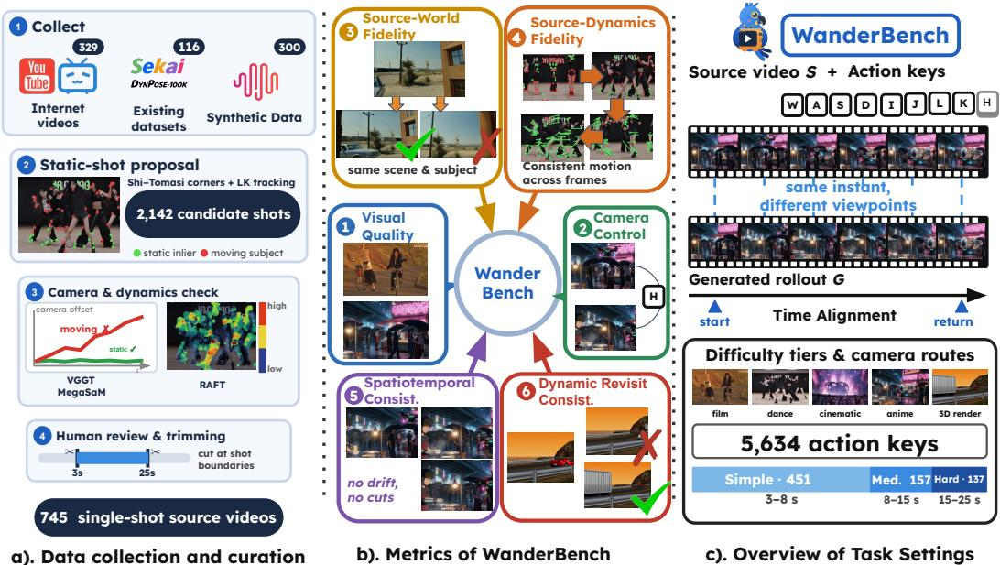
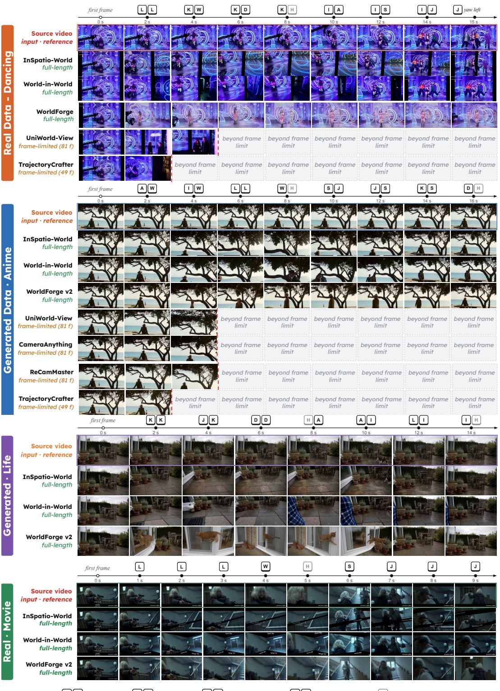
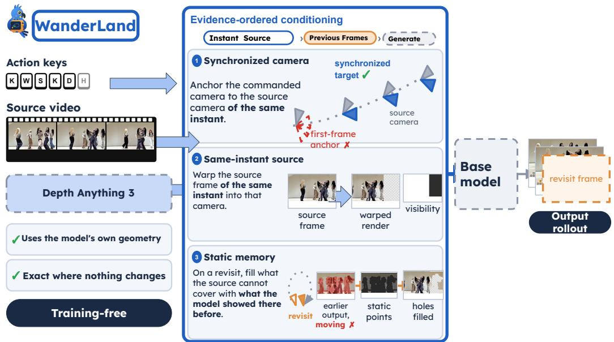
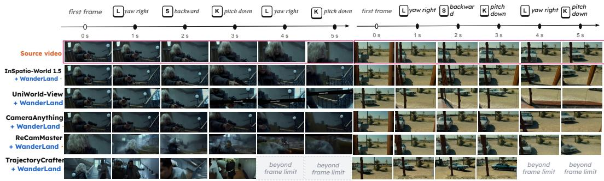

# WanderBench: Can World Models Explore Dynamic Worlds from Video?

Jiheng Li1∗ Jiale Wang1∗ Yuhang Chen1∗† Zai Wang1∗ Guangyue Liu1

1Huazhong University of Science and Technology thisiscyh@gmail.com

## Abstract

Video world models conditioned on an input video make it possible to explore real, recorded dynamic scenes, enabling re-shooting of footage, free-viewpoint replay, and real-to-sim environments for embodied agents. Such uses require the generated rollout to stay faithful to the recorded world, yet existing benchmarks start from a single image or a text prompt, and video-conditioned generation is evaluated mainly on perceptual quality and camera following. These evaluations do not directly assess whether exploration preserves subject identity, event progression, and scene consistency upon revisiting a location. We introduce WanderBench, a benchmark for exploring dynamic worlds from video. It comprises 745 single-shot source videos of real and AI-generated content in three difficulty tiers (3–25 s), paired with camera routes given as keyboard actions, and evaluates six dimensions with 24 human-validated sub-metrics. Benchmarking eight models, we find that as clips grow longer, models keep the static scene and visual quality but lose camera control and the source dynamics, and that none keeps revisited places consistent. We further propose WanderLand, a training-free framework that conditions each frame of a frozen model on the same-instant source and, on revisits, on its own earlier static content. WanderLand improves five models on every dimension, by up to 8.3 points in source-dynamics fidelity.

## 1 Introduction

Recent advances in video generation have steadily improved visual quality, motion realism, and temporal coherence, and the scope of the field has broadened beyond producing fixed-length clips to interactive world models, in which users continuously issue camera or action controls during generation to explore an unfolding visual world [8, 14, 17, 20, 39, 47, 49, 57]. Such models offer new tools for game creation [2, 5, 14, 22, 36, 48, 57, 68], virtual production [34, 35, 38, 50, 52], and robot policy learning [59, 62, 73]. However, most world models start from a single image or a text prompt, so the scene dynamics they produce are entirely imagined by the model and do not correspond to events that actually took place.

Video-conditioned world models open up a new possibility: given a real recorded video of a dynamic scene, users can re-observe the scenes and events it captures along new camera trajectories [45, 51, 60]. This capability directly supports re-framing real footage and free-viewpoint replay, and offers a way to build simulation environments for embodied agents from real videos. Unlike exploration from a single image, these applications impose stricter requirements on the generated results: the model must not only synthesize plausible novel views but also remain faithful to the world recorded in the source video [1, 65].

Table 1: Comparison with representative video-generation and world-model benchmarks. Video/Action: video / action input. Long: long-horizon evaluation. The six dimensions follow WanderBench: visual quality (Qual.), camera control (Cam.), source-world fidelity (World), source-dynamics fidelity (Dyn.), spatiotemporal consistency (Cons.), and dynamic revisit consistency (Revisit). ✓: explicit design goal; △: partial or indirect coverage; ✗: not covered. WanderBench is the only benchmark that conditions on a recorded video and scores exploration against its timesynchronized source events.
<table><tr><td>Benchmark</td><td>Video</td><td>Action</td><td>Long</td><td>Qual.</td><td>Cam.</td><td>World</td><td>Dyn.</td><td>Cons.</td><td>Revisit</td><td>#Cases</td></tr><tr><td>VBench [18, 19, 69]</td><td>X</td><td>x</td><td>X</td><td>√</td><td>X</td><td>X</td><td>X</td><td>△</td><td>X</td><td>946</td></tr><tr><td>WorldScore [7]</td><td>X</td><td>√</td><td>√</td><td>√</td><td>√</td><td>△</td><td>△</td><td>√</td><td>X</td><td>3,000</td></tr><tr><td>WorldModelBench [21]</td><td>X</td><td>√</td><td>x</td><td>X</td><td>△</td><td>△</td><td>△</td><td>X</td><td>X</td><td>350</td></tr><tr><td>MIND [63]</td><td>X</td><td>√</td><td>√</td><td>√</td><td>√</td><td>△</td><td>x</td><td>√</td><td>△</td><td>250</td></tr><tr><td>Omni-WorldBench [58]</td><td>X</td><td>√</td><td>△</td><td>√</td><td>√</td><td>X</td><td>△</td><td>√</td><td>X</td><td>1,068</td></tr><tr><td>WorldMark [61]</td><td>X</td><td>√</td><td>√</td><td>√</td><td>√</td><td>X</td><td>X</td><td>√</td><td>△</td><td>500</td></tr><tr><td>WBench [64]</td><td>X</td><td>√</td><td>√</td><td>√</td><td>√</td><td>△</td><td>△</td><td>√</td><td>△</td><td>289</td></tr><tr><td>R2M-Bench [12]</td><td>X</td><td>√</td><td>√</td><td>X</td><td>X</td><td>X</td><td>X</td><td>X</td><td>△</td><td>300</td></tr><tr><td>WorldMemBench [71]</td><td>X</td><td>√</td><td>√</td><td>√</td><td>√</td><td>X</td><td>△</td><td>X</td><td>√</td><td>260</td></tr><tr><td>WanderBench (Ours)</td><td>V</td><td>V</td><td></td><td></td><td></td><td></td><td></td><td>√</td><td></td><td>745</td></tr></table>

Despite these advances, it remains unclear whether current models can faithfully explore the dynamic world captured in a source video. Existing benchmarks evaluate visual quality [18, 69], interactive control [27, 58, 64], and world consistency [61, 63], including memory across revisits [12, 71]. However, success on these dimensions does not necessarily imply fidelity to the recorded event. A model may generate realistic views and follow the requested camera trajectory while altering the source action or its timing. It may also produce seemingly consistent revisits by retaining an outdated state of a dynamic subject. This leaves a central question: can models use the source video as evidence of an evolving world, preserving its events under viewpoint changes, integrating information across frames, and maintaining scene consistency during revisits while respecting the event’s temporal progression?

To address this gap, we introduce WanderBench, a benchmark for evaluating video-conditioned world exploration. Each test case pairs a single-shot source video of a dynamic scene with a camera route specified by discrete keyboard actions, which determines how the events in the source video should be observed from changing viewpoints. WanderBench contains 745 source videos spanning real-world footage such as dance, film, and natural scenes, together with AI-generated videos in realistic, anime, and artistic styles, organized into three difficulty tiers from 3 to 25 seconds. We provide random exploration and out-and-back camera routes to examine continuous viewpoint changes and revisits to previously observed regions, respectively. The evaluation comprises 24 sub-metrics across six complementary dimensions. By incorporating source-video references, event timing, and visibility, WanderBench assesses whether stable scene structure and subject identities are preserved and whether dynamic content evolves in accordance with the source event, providing a systematic evaluation of faithful reproduction and sustained exploration of dynamic worlds under camera control.

Benchmarking eight video-conditioned world models on WanderBench reveals two consistent failure modes. First, as clips grow longer, models keep the static scene and their visual quality but lose camera control and the source dynamics: the output drifts from the commanded view and falls out of sync with the source events. Second, no model remembers what it has generated, so a revisited place is redrawn and changes appearance. Models limited to a few seconds of generation cannot even reach the longer tiers.

Beyond evaluation, we introduce WanderLand, a training-free inference-time framework for videoconditioned world exploration. WanderLand aims to preserve source-world identity and event progression while maintaining consistency throughout camera-controlled exploration and revisits. To this end, we develop an evidence-ordered conditioning scheme that rebuilds only the camera and source render a model already reads: every frame is anchored to the source camera of the same instant and rendered from the same-instant source frame, and on revisits, the regions the source cannot cover are filled with the static content the model itself generated earlier. It operates on pretrained video world models without updating their parameters, using only each model’s own geometry. We evaluate WanderLand on WanderBench across five video world models, demonstrating consistent gains across all six dimensions, with the largest improvements in source-dynamics fidelity (up to +8.3) and dynamic revisit consistency (up to +4.8), the two dimensions targeted by the failure modes above.

Our main contributions are:

• We introduce WanderBench, a benchmark for world exploration from dynamic video inputs. It comprises 745 single-shot source videos organized into three difficulty tiers, with random camera exploration and long-horizon out-and-back revisit tasks across all tiers, providing a unified setting for evaluating exploration of source-video worlds from novel viewpoints.

• We establish an evaluation framework comprising six complementary dimensions and 24 sub-metrics. By incorporating source-video references, event timing, and visibility, it systematically assesses stable properties that should persist and dynamic content that should evolve with the source event. Benchmarking eight models with it, we identify loss of camera control and source dynamics over long horizons, and inconsistent revisits, as shared failure modes.

• We propose WanderLand, a training-free framework for enhancing existing video world models. Built upon these models, WanderLand uses evidence-ordered conditioning, which draws on the same-instant source and the model’s own earlier static content, to improve source-content preservation and dynamic-event reproduction. We evaluate it on Wander-Bench across five applicable models and observe gains on all six dimensions, most notably in source-dynamics fidelity and dynamic revisit consistency.

## 2 Related Work

## 2.1 Video World model

Early world models explored robotic manipulation and autonomous driving, including UniSim [62], IRASim [73], GAIA-1 [15], and Vista [10]. With advances in video generation, world models can continuously generate subsequent frames from visual observations and user actions, enabling interactive exploration of generated environments. YUME [34, 35] introduces natural language into world event control, while HY-World [53] and LingBot-World [40] explore world generation that combines real-time interaction with long-term consistency. Hunyuan-GameCraft [22] and Matrix-Game [14, 57, 68] support keyboard-and-mouse-driven interactive generation. AlayaWorld [49] further supports sustained world exploration through compressed temporal history and geometrically aligned spatial memory.

Further work uses source videos as references for scene appearance and dynamic content, allowing users to re-observe the events they contain along new camera trajectories. ReCamMaster [1] jointly conditions on a source video and a target camera trajectory to generate novel views while preserving the source video’s appearance consistency and dynamic synchronization. WorldForge [44, 46] improves trajectory-controlled video generation through reference-fusion correction and denoising guidance. InSpatio-World [51] supports spatiotemporal exploration through world states anchored to a reference video; Wonder [60] jointly designs visual camera control, sparse memory, and distillation strategies to support real-time world generation conditioned on images and videos; and World in World [45] converts source observations, target-view projections, and historical information into unified visual evidence, enabling training-free control through the pretrained model’s native selfattention. WanderBench addresses these requirements by systematically evaluating video world models’ ability to controllably explore dynamic worlds from source videos. Models must not only generate plausible novel views but also preserve the scene and subject identities in the source video, maintain the temporal progression of the original event, and remain consistent with the current event state when revisiting previously observed regions.

## 2.2 World Models Evaluation

Existing benchmarks broadly fall into two categories: non-interactive video evaluation and world model evaluation. VBench [18, 19, 69], EvalCrafter [29], and VideoPhy [3, 4] do not support action inputs or interaction, focusing primarily on video quality, text alignment, or physical commonsense. In contrast, WorldScore [7] evaluates camera-trajectory-conditioned generation, WorldModelBench [21] studies decision-oriented world-model quality, WorldArena [42] targets embodied agents in closed domains, MIND [63] probes closed-loop memory consistency, Omni-WorldBench [58] focuses on causal interaction, WorldLens [26] targets autonomous driving, and WorldMark [61] measures navigation consistency. WBench further introduces a multi-turn evaluation framework for opendomain interactive world models and R2M-Bench [12] evaluates consistency during long-horizon revisits in interactive video world models. Other efforts examine complementary aspects [6, 11, 13, 30, 31, 37, 48, 55, 66, 67, 72].

  
Figure 1: Overview of WanderBench. (a) Data collection and curation. (b) Six evaluation dimensions with 24 sub-metrics. (c) Task setting: given a source video and action keys, a model re-renders the scene from novel viewpoints while staying synchronized with the source.

These studies provide a foundation for evaluating generation quality, interactive control, and world consistency. However, in video-conditioned settings, evaluation must also determine whether the generated results remain faithful to the dynamic world recorded in the source video: models should preserve scene and subject identities while reproducing the actions and temporal progression of the original event. WanderBench addresses this problem by incorporating source-video references, event timing, and visibility into 24 sub-metrics across six complementary dimensions, systematically evaluating source-world fidelity, source-dynamics fidelity, and consistency during exploration and revisits under camera control.

## 3 WanderBench: Can World Models Explore Dynamic Worlds from Video?

Data Composition. WanderBench comprises 745 source videos, each a single continuous shot whose camera remains static or near-static, so that C(t) = I denotes the original view. 329 are real-world or rendered videos collected from the Internet (Bilibili and YouTube), covering dance, film, daily life, stage performances, and other scenes; 116 are drawn from existing video datasets [16, 24, 41]; and the remaining 300 are generated with MiniMax, spanning 13 realistic looks, 12 anime looks, and 48 artistic.

Clip Screening. Candidate clips are screened in two stages. (1) Shot proposal. For Internet videos, static shots are automatically proposed by following Shi–Tomasi [43] corners with a pyramidal Lucas–Kanade [32] optical flow at 10 fps and fitting a RANSAC [9] similarity transform. (2) Camera and dynamics verification. For each candidate, we reconstruct the camera trajectory with VGGT [56], cross-checked with MegaSaM [25], and discard clips with noticeable camera rotation or translation. We further check scene dynamics with RAFT [54] optical flow.

Difficulty Tiers. WanderBench is organized into three tiers of increasing difficulty: (1) Simple (451 clips) contains short clips with slow, mild subject motion; (2) Medium (157 clips) features longer clips with higher visual quality and richer lighting variation; and (3) Hard (137 clips) contains the longest clips, with the highest visual quality, large-amplitude subject motion, substantial background changes, and complex illumination. Across the benchmark, camera-compensated motion extends from a median of 0.029 to 0.12 image diagonals, and MUSIQ imaging quality spans from 22.9 to 74.8. To verify the single-shot filtering, four annotators independently labeled all 2,142 candidate clips as single-shot or not. The annotators agree with each other at Fleiss $\kappa = 0 . 9 3$ , yielding the final 745 clips.

## 3.1 Evaluation Suite

WanderBench decomposes evaluation into six complementary dimensions comprising 24 sub-metrics, detailed in the Appendix. Most of our metrics compare the output with a time-synchronized source reference: each output frame G(t) and the source frame S(τ(t)) depict the same instant from two viewpoints, so every frame has a reference without any temporal annotation. All sub-metric scores are rescaled to [0, 100].

• Visual Quality. We adopt V.1 Aesthetic Quality, V.2 Imaging Quality, V.3 Temporal Flickering, and V.4 Motion Smoothness from VBench [18], together with V.5 HPSv3 Preference [33] and V.6 Visual Plausibility scored by the PAVRM model of WBench [64]. Since the task is to re-render an input video, all scores are normalized by those of the source video.

• Camera Control. C.1 Synchronized Camera Following reconstructs the source and generated videos separately with VGGT [56] and compares the realized camera motion with the commanded one at one-second intervals.

• Source-World Fidelity. W.1 Scene Adherence and W.2 Subject Adherence use a VLM and source subject tracks, respectively, to check whether the scene facts and subjects of the source are preserved. W.3 Synchronized View Fidelity reprojects the source frame of the same instant into the realized view and compares it with the output on co-visible regions.

• Source-Dynamics Fidelity. D.1 Motion Timeline Agreement compares the camera-compensated motion curves of each subject between the source and the output. D.2 Event Adherence localizes the source events in the output. D.3 Temporal Synchronization finds the best-matching source time for each output frame and measures the proportion that falls within a tolerance of the correct time.

• Spatiotemporal Consistency. S.1 Subject Consistency and S.2 Background Consistency penalize only the drift of subjects and static regions beyond the changes in the source. S.3 Segment Continuity penalizes hard cuts absent from the source. S.4 Static Geometric Consistency measures the reprojection consistency of static regions with Depth Anything 3 [28].

• Dynamic Revisit Consistency. R.1 – R.5 are based on DreamSim similarity (R.1), its pose-gated variant (R.2), place descriptors (R.3), geometric correspondence (R.4), and object appearance (R.5), respectively. R.6 Object Semantic Persistence checks the objects that should appear in the source at the return time. R.7 Revisit Event Currency measures whether the returning view shows the current state of a dynamic subject.

## 4 Experiments

## 4.1 Evaluated Models and Protocol

We evaluate eight video-conditioned world models that take a source video and a target camera trajectory, divided into two groups by generation length: (1) full-length models, which render the whole clip in one pass, including InSpatio-World 1.5 [51], World-in-World [45], and WorldForge v2 [46]; and (2) frame-limited models, which produce at most 81 frames (49 for TrajectoryCrafter), including ReCamMaster [1], CameraAnything [23], UniWorld-View [70], WorldForge v1 [44], and TrajectoryCrafter [65]. All models receive the same source video and the same action sequence. Each action sequence is converted into per-frame camera poses relative to the source camera and passed through the model’s native conditioning interface at its native resolution and frame rate; models with a different frame rate receive the same actions resampled to their own time grid. Frame-limited models process only the opening segment of each clip up to their maximum length (81 frames, or

Table 2: Results on WanderBench by difficulty tier. Overall is the equal-weight mean of the six dimensions. Bold marks the best score within each tier. Rows of the same model share a colour; grey rows are frame-limited models, which are evaluated only on Simple and only on the frames they can generate.
<table><tr><td>Model</td><td>Visual Quality</td><td>Camera Control</td><td>Source-World Fidelity</td><td>Source-Dyn. Fidelity</td><td>Spatiotemp. Consist.</td><td>Dyn. Revisit Consist.</td><td>Overall</td></tr><tr><td colspan="8">Simple (3–8 s), 451 clips Full-length</td></tr><tr><td>InSpatio-World 1.5</td><td>74.9</td><td>75.4</td><td>87.5</td><td>65.8</td><td>83.4</td><td>54.5</td><td>73.6</td></tr><tr><td>World-in-World</td><td>84.0</td><td>44.4</td><td>90.5</td><td>65.8</td><td>83.3</td><td>53.1</td><td>70.2</td></tr><tr><td>WorldForge v2</td><td>85.8</td><td>44.8</td><td>88.1</td><td>60.9</td><td>85.9</td><td>50.0</td><td>69.3</td></tr><tr><td colspan="8">Frame-limited (scored on the first ≤81 frames; 49 for TrajectoryCrafter)</td></tr><tr><td>UniWorld-View</td><td>68.7</td><td>85.1</td><td>89.6</td><td>61.2</td><td>84.5</td><td>68.6</td><td>76.3</td></tr><tr><td>CameraAnything</td><td>74.3</td><td>66.5</td><td>85.5</td><td>65.4</td><td>82.8</td><td>46.0</td><td>70.1</td></tr><tr><td>TrajectoryCrafter</td><td>72.1</td><td>74.8</td><td>75.7</td><td>58.1</td><td>80.7</td><td>56.5</td><td>69.7</td></tr><tr><td>WorldForge v1</td><td>78.7</td><td>60.5</td><td>84.4</td><td>53.0</td><td>82.7</td><td>51.8</td><td>68.5</td></tr><tr><td>ReCamMaster</td><td>73.3</td><td>40.8</td><td>87.2</td><td>62.0</td><td>83.0</td><td>32.8</td><td>63.2</td></tr><tr><td colspan="8">Medium (8–15 s), 157 clips</td></tr><tr><td>InSpatio-World 1.5</td><td>73.2</td><td>70.6</td><td>87.3</td><td>55.2</td><td>83.2</td><td>52.7</td><td>70.4</td></tr><tr><td>World-in-World</td><td>82.9</td><td>41.2</td><td>89.9</td><td>49.9</td><td>83.0</td><td>51.4</td><td>66.4</td></tr><tr><td>WorldForge v2</td><td>79.9</td><td>43.6</td><td>86.5</td><td>41.3</td><td>84.8</td><td>40.8</td><td>62.8</td></tr><tr><td colspan="8">Frame-limited models: not applicable, clips exceed their generation length.</td></tr><tr><td colspan="8">Hard (15–25 s), 137 clips</td></tr><tr><td>InSpatio-World 1.5</td><td>71.6</td><td>49.0</td><td>81.7</td><td>40.2</td><td>80.5</td><td>50.5</td><td>62.3</td></tr><tr><td>World-in-World</td><td>78.4</td><td>34.7</td><td>86.5</td><td>44.8</td><td>78.6</td><td>50.1</td><td>62.2</td></tr><tr><td>WorldForge v2</td><td>74.0</td><td>10.4</td><td>82.0</td><td>26.6</td><td>79.3</td><td>20.5</td><td>48.8</td></tr><tr><td></td><td></td><td></td><td></td><td></td><td></td><td></td><td></td></tr></table>

Frame-limited models: not applicable, clips exceed their generation length.

49 for TrajectoryCrafter), conditioned on the corresponding prefix of the full trajectory, and are scored on that segment only. For scoring, (1) all metrics operate on a time grid in seconds; (2) scores are averaged over items, videos, and then models; and (3) a dimension score is the mean of its sub-metrics, and the overall score is the equal-weight mean of the six dimensions.

## 4.2 Findings

(1) Visual quality hides exploration failures. From Simple to Hard, the three full-length models lose little in Visual Quality and Spatiotemporal Consistency. Over the same range, they lose much more in Camera Control, Source-Dynamics Fidelity, and Dynamic Revisit Consistency. A rollout can therefore look clean and stable while following neither the command nor the source events, which per-frame quality metrics alone would not reveal.

(2) Models keep the static world but lose the dynamic one. Source-World Fidelity is the highestscoring dimension on every tier, so scenes and subjects are largely preserved. Source-Dynamics Fidelity, in contrast, falls to 37.2 on Hard, meaning the models keep what is in the scene but not when things happen in it.

(3) Visual quality and camera control trade off. Across the eight models on Simple, Visual Quality and Camera Control are negatively correlated. WorldForge has the highest Visual Quality but only 44.8 in Camera Control, while UniWorld-View has the best Camera Control and the lowest Visual Quality. Faithfully executing a camera move appears to cost image quality in current models, and ranking them by quality alone favors models that move the camera less.

(4) Short horizons hide the differences that long horizons reveal. On Simple, the frame-limited UniWorld-View obtains the highest overall score, and the overall scores of the full-length models span only 4.3 points. On Hard, this span widens to 13.5 points, and WorldForge collapses to 10.4 in Camera Control. Their strong short-horizon scores do not show whether they can explore.

Table 3: Change brought by WanderLand on each dimension (score with WanderLand minus score without). World-in-World and WorldForge are not evaluated, since both are themselves training-free frameworks built on pretrained world models.
<table><tr><td>Model</td><td>Visual Quality</td><td>Camera Control</td><td>Source-World Fidelity</td><td>Source- Dynamics Fidelity</td><td>Spatiotemporal Consistency</td><td>Dynamic Revisit Consistency</td></tr><tr><td>InSpatio-World 1.5</td><td>+4.0</td><td>+2.2</td><td>+2.4</td><td>+8.3</td><td>+1.8</td><td>+2.4</td></tr><tr><td>UniWorld-View</td><td>+1.2</td><td>+1.0</td><td>+1.3</td><td>+1.9</td><td>+1.4</td><td>+2.6</td></tr><tr><td>TrajectoryCrafter</td><td>+0.7</td><td>+0.9</td><td>+0.5</td><td>+0.7</td><td>+0.4</td><td>+3.0</td></tr><tr><td>ReCamMaster</td><td>+2.6</td><td>+2.8</td><td>+0.4</td><td>+1.4</td><td>+1.0</td><td>+3.7</td></tr><tr><td>CameraAnything</td><td>+2.4</td><td>+1.3</td><td>+0.5</td><td>0.0</td><td>+1.3</td><td>+4.8</td></tr></table>

(5) Model hardly remembers what it has generated. Dynamic Revisit Consistency is the weakest dimension overall: no model exceeds 68.6, the full-length models stay between 50.0 and 54.5 even on Simple, and WorldForge drops to 20.5 on Hard. Across models, Dynamic Revisit Consistency correlates with Camera Control, which suggests that a model must first reach the revisit pose before consistency there can be achieved.

## 5 WanderLand: A Training-Free Enhancement of Exploration in Video World Models

To explore how source-video evidence can help address the failure modes identified by WanderBench, we introduce WanderLand, a training-free enhancement for existing video world models. WanderLand constructs conditioning inputs by prioritizing time-aligned source observations and using previously generated static content to fill regions not covered by the source.

## 5.1 Methods

For each output frame, WanderLand takes evidence in a fixed order, in three steps.

(1) Synchronized camera. The model’s own geometry front-end estimates the depth and camera of every source frame, and the commanded camera is then placed relative to the source camera of the same instant rather than to that of the first frame.

(2) Same-instant source. The model’s own point-cloud renderer warps the source frame of the same instant into this camera. As a result, the render covers more of the view, and moving subjects appear at the correct time.

(3) Static memory. When the camera returns to a place shown earlier, we lift the model’s nearest earlier outputs to 3D points using Depth Anything 3 [28] depth aligned to the render depth, and use them to fill the regions the source video cannot cover. Pixels whose source content changes over time, measured by a camera-compensated color difference, are discarded. Moving subjects are therefore never frozen, and all visible motion still comes from the source video.

## 5.2 Properties

WanderLand requires no training and introduces no additional weights. It relies only on the model’s own geometry module and renderer and never uses WanderBench’s evaluation tools. Wherever the evidence does not change, it reproduces the original output exactly, and its only extra cost is one additional generation when the camera revisits a place.

## 5.3 WanderLand Results

We apply WanderLand to five video world models and report the change on each dimension in Tab. 3. World-in-World and WorldForge are not included, since both are themselves training-free frameworks built on pretrained world models and do not expose the inputs that WanderLand rebuilds.

H hold frame limit reached

  
Figure 2: Qualitative results on WanderBench. Each block shows one source clip (left tag: data category). Time runs from left to right; the keys above each column are the camera actions held since the previous column, and H denotes hold. The first row of each block is the source video at the same instant, followed by the outputs of each model. Grey cells mark frames beyond a model’s generation length, and the red dashed line marks where its frame limit is reached.

  
Figure 3: Overview of WanderLand. WanderLand wraps a frozen video world model and leaves its weights, sampler, and seed unchanged. It only rebuilds the camera and source render the model already takes as input, taking evidence for every frame in a fixed order (top): the latent source first, then previous frames, and generation only where neither exists. All geometry comes from the model’s own front-end. The frozen model then generates the output rollout.

(1) Consistent gains without trade-offs. WanderLand improves most backbone on every dimension and degrades none, so the better conditioning comes at no cost to visual quality or camera control.

(2) Revisits benefit on every model. Dynamic Revisit Consistency rises by 2.4–4.8 points across all five backbones, as the holes at a revisit are filled with content the model has already shown instead of being redrawn.

(3) Long horizons benefit the most. The largest single gain is on the full-length InSpatio-World 1.5, whose Source-Dynamics Fidelity rises by 8.3 points: over long rollouts, anchoring every frame to the source at the same instant keeps the generated events in sync with the recorded ones.

  
Figure 4: Qualitative results of WanderLand. Two clips from WanderBench (left: an indoor action scene; right: an outdoor desert scene). Each column shows one frame per second, and the key above it is the camera action held during the preceding second. The first row is the source video; the other rows are the outputs of five base models with WanderLand applied. TrajectoryCrafter is limited to 49 frames, so its output ends after 3 s. WanderLand keeps the content that is visible in the source and stays consistent under the same key sequence, without retraining any base model.

## 6 Discussion

WanderBench moves video world model evaluation from a single view to time-aligned multiple views: each explored trajectory is a new view of the same dynamic scene, synchronized with the source. We expect models that do well here to produce time-aligned multi-view videos from a single input, which could enable end-to-end generation of full-scene 4D Gaussian Splatting from one video. Current models still fall short on temporal synchronization and long-range revisits, and we hope WanderBench offers a concrete target for closing this gap.

## 7 Conclusion

We introduced WanderBench, a benchmark for exploring dynamic worlds from video, with 745 single-shot source videos in three difficulty tiers and 24 sub-metrics over six dimensions. Current world models preserve static scenes and visual quality but lose camera control, source dynamics, and revisit consistency over longer horizons. Our training-free WanderLand improves five models by conditioning each frame on the same-instant source and the model’s own earlier content, though it requires camera and source-render inputs. We hope WanderBench drives world models that stay faithful to the recorded world as they explore it.

## References

[1] Jianhong Bai, Menghan Xia, Xiao Fu, Xintao Wang, Lianrui Mu, Jinwen Cao, Zuozhu Liu, Haoji Hu, Xiang Bai, Pengfei Wan, et al. Recammaster: Camera-controlled generative rendering from a single video. In 2025 IEEE/CVF International Conference on Computer Vision (ICCV), pages 14834–14844. IEEE, 2025.

[2] Philip J. Ball, Jakob Bauer, Frank Belletti, Bethanie Brownfield, Ariel Ephrat, Shlomi Fruchter, Agrim Gupta, Kristian Holsheimer, Aleksander Holynski, Jiri Hron, Christos Kaplanis, Marjorie Limont, Matt McGill, Yanko Oliveira, Jack Parker-Holder, Frank Perbet, Guy Scully, Jeremy Shar, Stephen Spencer, Omer Tov, Ruben Villegas, Emma Wang, Jessica Yung, Cip Baetu, Jordi Berbel, David Bridson, Jake Bruce, Gavin Buttimore, Sarah Chakera, Bilva Chandra, Paul Collins, Alex Cullum, Bogdan Damoc, Vibha Dasagi, Maxime Gazeau, Charles Gbadamosi, Woohyun Han, Ed Hirst, Ashyana Kachra, Lucie Kerley, Kristian Kjems, Eva Knoepfel, Vika Koriakin, Jessica Lo, Cong Lu, Zeb Mehring, Alex Moufarek, Henna Nandwani, Valeria Oliveira, Fabio Pardo, Jane Park, Andrew Pierson, Ben Poole, Helen Ran, Tim Salimans, Manuel Sanchez, Igor Saprykin, Amy Shen, Sailesh Sidhwani, Duncan Smith, Joe Stanton, Hamish Tomlinson, Dimple Vijaykumar, Luyu Wang, Piers Wingfield, Nat Wong, Keyang Xu, Christopher Yew, Nick Young, Vadim Zubov, Douglas Eck, Dumitru Erhan, Koray Kavukcuoglu, Demis Hassabis, Zoubin Ghahramani, Raia Hadsell, Aäron van den Oord, Inbar Mosseri, Adrian Bolton, Satinder Singh, and Tim Rocktäschel. Genie 3: A new frontier for world models, 2025. URL https://deepmind.google/ discover/blog/genie-3-a-new-frontier-for-world-models/.

[3] Hritik Bansal, Zongyu Lin, Tianyi Xie, Zeshun Zong, Michal Yarom, Yonatan Bitton, Chenfanfu Jiang, Yizhou Sun, Kai-Wei Chang, and Aditya Grover. Videophy: Evaluating physical commonsense for video generation. In International Conference on Learning Representations, volume 2025, pages 102075–102121, 2025.

[4] Hritik Bansal, Clark Peng, Yonatan Bitton, Roman Goldenberg, Aditya Grover, and Kai-Wei Chang. Videophy-2: A challenging action-centric physical commonsense evaluation in video generation. In International Conference on Learning Representations, volume 2026, pages 118456–118470, 2026.

[5] Jake Bruce, Michael D Dennis, Ashley Edwards, Jack Parker-Holder, Yuge Shi, Edward Hughes, Matthew Lai, Aditi Mavalankar, Richie Steigerwald, Chris Apps, et al. Genie: Generative interactive environments. In Forty-first international conference on machine learning, 2024.

[6] Zefan Cai, Haoyi Qiu, Tianyi Ma, Haozhe Zhao, Gengze Zhou, Kung-Hsiang Huang, Parisa Kordjamshidi, Minjia Zhang, Wen Xiao, Jiuxiang Gu, et al. Mmgr: Multi-modal generative reasoning. arXiv preprint arXiv:2512.14691, 2025.

[7] Haoyi Duan, Hong-Xing Yu, Sirui Chen, Li Fei-Fei, and Jiajun Wu. Worldscore: A unified evaluation benchmark for world generation. In Proceedings of the IEEE/CVF International Conference on Computer Vision, pages 27713–27724, 2025.

[8] Ruili Feng, Han Zhang, Zhantao Yang, Jie Xiao, Zhilei Shu, Zhiheng Liu, Andy Zheng, Yukun Huang, Yu Liu, and Hongyang Zhang. The matrix: Infinite-horizon world generation with real-time moving control. arXiv preprint arXiv:2412.03568, 2024.

[9] Martin A Fischler and Robert C Bolles. Random sample consensus: a paradigm for model fitting with applications to image analysis and automated cartography. Communications ofthe ACM, 24(6):381–395, 1981.

[10] Shenyuan Gao, Jiazhi Yang, Li Chen, Kashyap Chitta, Yihang Qiu, Andreas Geiger, Jun Zhang, and Hongyang Li. Vista: A generalizable driving world model with high fidelity and versatile controllability. Advances in Neural Information Processing Systems, 37:91560–91596, 2024.

[11] Jing Gu, Xian Liu, Yu Zeng, Ashwin Nagarajan, Fangrui Zhu, Daniel Hong, Yue Fan, Qianqi Yan, Kaiwen Zhou, Ming-Yu Liu, and Xin Eric Wang. "phyworldbench": A comprehensive evaluation of physical realism in text-to-video models, 2026. URL https://arxiv.org/abs/2507.13428.

[12] Qiwen Gu, Bingjie Gao, Rui Chen, Geng Li, Jifan Li, Qishuai Wen, Li Niu, Jing Tang, Xiangxiang Chu, and Junqiao Zhao. R2m-bench: Evaluating revisit memory via relative consistency in interactive video world models. arXiv preprint arXiv:2608.27328, 2026.

[13] Hui Han, Siyuan Li, Jiaqi Chen, Yiwen Yuan, Yuling Wu, Yufan Deng, Chak Tou Leong, Hanwen Du, Junchen Fu, Youhua Li, et al. Video-bench: Human-aligned video generation benchmark. In Proceedings of the Computer Vision and Pattern Recognition Conference, pages 18858–18868, 2025.

[14] Xianglong He, Chunli Peng, Zexiang Liu, Boyang Wang, Yifan Zhang, Qi Cui, Fei Kang, Biao Jiang, Mengyin An, Yangyang Ren, et al. Matrix-game 2.0: An open-source, real-time, and streaming interactive world model. arXiv preprint arXiv:2508.13009, 2025.

[15] Anthony Hu, Lloyd Russell, Hudson Yeo, Zak Murez, George Fedoseev, Alex Kendall, Jamie Shotton, and Gianluca Corrado. Gaia-1: A generative world model for autonomous driving. arXiv preprint arXiv:2309.17080, 2023.

[16] Jiahui Huang, Qunjie Zhou, Hesam Rabeti, Aleksandr Korovko, Huan Ling, Xuanchi Ren, Tianchang Shen, Jun Gao, Dmitry Slepichev, Chen-Hsuan Lin, Jiawei Ren, Kevin Xie, Joydeep Biswas, Laura Leal-Taixe, and Sanja Fidler. ViPE: Video pose engine for 3D geometric perception. In NVIDIA Research Whitepapers, 2025.

[17] Siqiao Huang, Jialong Wu, Qixing Zhou, Shangchen Miao, and Mingsheng Long. Vid2world: Crafting video diffusion models to interactive world models. arXiv preprint arXiv:2505.14357, 2025.

[18] Ziqi Huang, Yinan He, Jiashuo Yu, Fan Zhang, Chenyang Si, Yuming Jiang, Yuanhan Zhang, Tianxing Wu, Qingyang Jin, Nattapol Chanpaisit, Yaohui Wang, Xinyuan Chen, Limin Wang, Dahua Lin, Yu Qiao, and Ziwei Liu. VBench: Comprehensive benchmark suite for video generative models. In Proceedings ofthe IEEE/CVF Conference on Computer Vision and Pattern Recognition, 2024.

[19] Ziqi Huang, Fan Zhang, Xiaojie Xu, Yinan He, Jiashuo Yu, Ziyue Dong, Qianli Ma, Nattapol Chanpaisit, Chenyang Si, Yuming Jiang, et al. Vbench++: Comprehensive and versatile benchmark suite for video generative models. IEEE Transactions on Pattern Analysis and Machine Intelligence, 2025.

[20] Lingdong Kong, Yu Yang, Jianbiao Mei, Youquan Liu, Ao Liang, Dekai Zhu, Dongyue Lu, Wei Yin, Xiaotao Hu, Mingkai Jia, et al. 3d and 4d world modeling: A survey. arXiv preprint arXiv:2509.07996, 2025.

[21] Dacheng Li, Yunhao Fang, Yukang Chen, Shuo Yang, Shiyi Cao, Justin Wong, Michael Luo, Xiaolong Wang, Hongxu Yin, Joseph E Gonzalez, et al. Worldmodelbench: Judging video generation models as world models. arXiv preprint arXiv:2502.20694, 2025.

[22] Jiaqi Li, Junshu Tang, Zhiyong Xu, Longhuang Wu, Yuan Zhou, Shuai Shao, Tianbao Yu, Zhiguo Cao, and Qinglin Lu. Hunyuan-gamecraft: High-dynamic interactive game video generation with hybrid history condition. arXiv preprint arXiv:2506.17201, 2(3):6, 2025.

[23] Yixuan Li, Yanhong Zeng, Ka Leong Cheng, Jiayi Zhu, Hanlin Wang, Wen Wang, Yihao Meng, Hao Ouyang, Qiuyu Wang, Yue Yu, ZiDong Wang, Yiyuan Zhang, Yujun Shen, and Dahua Lin. CameraAnything: Refilming videos with arbitrary camera control. arXiv preprint arXiv:2607.24591, 2026. URL https://arxiv.org/abs/2607.24591.

[24] Zhen Li, Chuanhao Li, Xiaofeng Mao, Shaoheng Lin, Ming Li, Shitian Zhao, Zhaopan Xu, Xinyue Li, Yukang Feng, Jianwen Sun, et al. Sekai: A video dataset towards world exploration. arXiv preprint arXiv:2506.15675, 2025.

[25] Zhengqi Li, Richard Tucker, Forrester Cole, Qianqian Wang, Linyi Jin, Vickie Ye, Angjoo Kanazawa, Aleksander Holynski, and Noah Snavely. Megasam: Accurate, fast and robust structure and motion from casual dynamic videos. In Proceedings of the IEEE/CVF Conference on Computer Vision and Pattern Recognition, pages 10486–10496, 2025.

[26] Ao Liang, Lingdong Kong, Tianyi Yan, Hongsi Liu, Wesley Yang, Ziqi Huang, Wei Yin, Jialong Zuo, Yixuan Hu, Dekai Zhu, et al. Worldlens: Full-spectrum evaluations of driving world models in real world. arXiv preprint arXiv:2512.10958, 2025.

[27] Ao Liang, Lingdong Kong, Tianyi Yan, Hongsi Liu, Yu Yang, Ziqi Huang, Wei Yin, Jialong Zuo, Yixuan Hu, Dekai Zhu, et al. Worldlens: Full-spectrum evaluations of driving world models in real world. In Proceedings ofthe IEEE/CVF Conference on Computer Vision and Pattern Recognition, pages 36385– 36399, 2026.

[28] Haotong Lin, Sili Chen, Junhao Liew, Donny Y Chen, Zhenyu Li, Guang Shi, Jiashi Feng, and Bingyi Kang. Depth Anything 3: Recovering the visual space from any views. arXiv preprint arXiv:2511.10647, 2025.

[29] Yaofang Liu, Xiaodong Cun, Xuebo Liu, Xintao Wang, Yong Zhang, Haoxin Chen, Yang Liu, Tieyong Zeng, Raymond Chan, and Ying Shan. Evalcrafter: Benchmarking and evaluating large video generation models. In 2024 IEEE/CVF Conference on Computer Vision and Pattern Recognition (CVPR), pages 22139–22149. IEEE, 2024.

[30] Yuanxin Liu, Lei Li, Shuhuai Ren, Rundong Gao, Shicheng Li, Sishuo Chen, Xu Sun, and Lu Hou. Fetv: A benchmark for fine-grained evaluation of open-domain text-to-video generation. Advances in Neural Information Processing Systems, 36:62352–62387, 2023.

[31] Yiting Lu, Wei Luo, Peiyan Tu, Haoran Li, Hanxin Zhu, Zihao Yu, Xingrui Wang, Xinyi Chen, Xinge Peng, Xin Li, et al. 4dworldbench: A comprehensive evaluation framework for 3d/4d world generation models. arXiv preprint arXiv:2511.19836, 2025.

[32] Bruce D Lucas and Takeo Kanade. An iterative image registration technique with an application to stereo vision. In IJCAI’81: 7th international joint conference on Artificial intelligence, volume 2, pages 674–679, 1981.

[33] Yuhang Ma, Xiaoshi Wu, Keqiang Sun, and Hongsheng Li. Hpsv3: Towards wide-spectrum human preference score, 2025. URL https://arxiv.org/abs/2508.03789.

[34] Xiaofeng Mao, Shaoheng Lin, Zhen Li, Chuanhao Li, Wenshuo Peng, Tong He, Jiangmiao Pang, Mingmin Chi, Yu Qiao, and Kaipeng Zhang. Yume: An interactive world generation model. arXiv preprint arXiv:2507.17744, 2025.

[35] Xiaofeng Mao, Zhen Li, Chuanhao Li, Xiaojie Xu, Kaining Ying, and Kaipeng Zhang. Yume1. 5: A text-controlled interactive world generation model. In Proceedings of the IEEE/CVF Conference on Computer Vision and Pattern Recognition, pages 7752–7761, 2026.

[36] Jack Parker-Holder, Philip Ball, Jake Bruce, Vibhavari Dasagi, Kristian Holsheimer, Christos Kaplanis, Alexandre Moufarek, Guy Scully, Jeremy Shar, Jimmy Shi, Stephen Spencer, Jessica Yung, Michael Dennis, Sultan Kenjeyev, Shangbang Long, Vlad Mnih, Harris Chan, Maxime Gazeau, Bonnie Li, Fabio Pardo, Luyu Wang, Lei Zhang, Frederic Besse, Tim Harley, Anna Mitenkova, Jane Wang, Jeff Clune, Demis Hassabis, Raia Hadsell, Adrian Bolton, Satinder Singh, and Tim Rocktäschel. Genie 2: A largescale foundation world model, 2024. URL https://deepmind.google/discover/blog/genie-2-alarge-scale-foundation-world-model/.

[37] Yiran Qin, Zhelun Shi, Jiwen Yu, Xijun Wang, Enshen Zhou, Lijun Li, Zhenfei Yin, Xihui Liu, Lu Sheng, Jing Shao, et al. Worldsimbench: Towards video generation models as world simulators. arXiv preprint arXiv:2410.18072, 2024.

[38] Fatema Rahimi, Abolghasem Sadeghi-Niaraki, and Soo-Mi Choi. Generative ai meets virtual reality: A comprehensive survey on applications, challenges, and future direction. IEEE Access, 13:94893–94909, 2025.

[39] Robbyant Team. Advancing open-source world models. arXiv preprint arXiv:2601.20540, 2026.

[40] Robbyant Team, Zelin Gao, Qiuyu Wang, Yanhong Zeng, Jiapeng Zhu, Ka Leong Cheng, Yixuan Li, Hanlin Wang, Yinghao Xu, Shuailei Ma, Yihang Chen, Jie Liu, Yansong Cheng, Yao Yao, Jiayi Zhu, Yihao Meng, Kecheng Zheng, Qingyan Bai, Jingye Chen, Zehong Shen, Yue Yu, Xing Zhu, Yujun Shen, and Hao Ouyang. Advancing open-source world models. arXiv preprint arXiv:2601.20540, 2026. doi: 10.48550/arXiv.2601.20540. URL https://arxiv.org/abs/2601.20540.

[41] Chris Rockwell, Joseph Tung, Tsung-Yi Lin, Ming-Yu Liu, David F Fouhey, and Chen-Hsuan Lin. Dynamic camera poses and where to find them. In 2025 IEEE/CVF Conference on Computer Vision and Pattern Recognition (CVPR), pages 12444–12455. IEEE, 2025.

[42] Yu Shang, Zhuohang Li, Yiding Ma, Weikang Su, Xin Jin, Ziyou Wang, Lei Jin, Xin Zhang, Yinzhou Tang, Haisheng Su, et al. Worldarena: A unified benchmark for evaluating perception and functional utility of embodied world models. arXiv preprint arXiv:2602.08971, 2026.

[43] Jianbo Shi et al. Good features to track. In 1994 Proceedings of IEEE conference on computer vision and pattern recognition, pages 593–600. IEEE, 1994.

[44] Chenxi Song, Yanming Yang, Tong Zhao, Ruibo Li, and Chi Zhang. Worldforge: Unlocking emergent 3d/4d generation in video diffusion model via training-free guidance. 2025.

[45] Chenxi Song, Yanming Yang, and Chi Zhang. World in world: Explore the world with world models. arXiv preprint arXiv:2609.11548, 2026.

[46] Chenxi Song, Yanming Yang, Tong Zhao, Ruibo Li, and Chi Zhang. Taming video models for 3D and 4D generation via zero-shot camera control. In Proceedings ofthe IEEE/CVF Conference on Computer Vision and Pattern Recognition (CVPR), pages 40352–40363, 2026.

[47] Wenqiang Sun, Haiyu Zhang, Haoyuan Wang, Junta Wu, Zehan Wang, Zhenwei Wang, Yunhong Wang, Jun Zhang, Tengfei Wang, and Chunchao Guo. Worldplay: Towards long-term geometric consistency for real-time interactive world modeling. arXiv preprint arXiv:2512.14614, 2025.

[48] Junshu Tang, Jiacheng Liu, Jiaqi Li, Longhuang Wu, Haoyu Yang, Penghao Zhao, Siruis Gong, Xiang Yuan, Shuai Shao, Linfeng Zhang, et al. Hunyuan-gamecraft-2: Instruction-following interactive game world model. arXiv preprint arXiv:2511.23429, 2025.

[49] AlayaWorld Team, Kaipeng Zhang, Chuanhao Li, Yifan Zhan, Yongtao Ge, Yuanyang Yin, Jiaming Tan, Kang He, Liaoyuan Fan, Mingliang Zhai, et al. Alayaworld: Interactive long-horizon world modeling–full technical report. arXiv preprint arXiv:2607.18367, 2026.

[50] HunyuanWorld Team, Zhenwei Wang, Yuhao Liu, Junta Wu, Zixiao Gu, Haoyuan Wang, Xuhui Zuo, Tianyu Huang, Wenhuan Li, Sheng Zhang, et al. HunyuanWorld 1.0: Generating immersive, explorable, and interactive 3D worlds from words or pixels. arXiv preprint arXiv:2507.21809, 2025.

[51] InSpatio Team, Donghui Shen, Guofeng Zhang, Haomin Liu, Haoyu Ji, Hujun Bao, Hongjia Zhai, Jialin Liu, Jing Guo, Nan Wang, et al. Inspatio-world: A real-time 4d world simulator via spatiotemporal autoregressive modeling. arXiv preprint arXiv:2604.07209, 2026.

[52] Robbyant Team, Zelin Gao, Qiuyu Wang, Yanhong Zeng, Jiapeng Zhu, Ka Leong Cheng, Yixuan Li, Hanlin Wang, Yinghao Xu, Shuailei Ma, et al. Advancing open-source world models. arXiv preprint arXiv:2601.20540, 2026.

[53] Team HY-World, Chenjie Cao, Xuhui Zuo, Zhenwei Wang, Yisu Zhang, Junta Wu, Zhenyang Liu, Yuning Gong, Yang Liu, Bo Yuan, Chao Zhang, Coopers Li, Dongyuan Guo, Fan Yang, Haiyu Zhang, Hang Cao, Jianchen Zhu, Jiaxin Lin, Jie Xiao, Jihong Zhang, Junlin Yu, Lei Wang, Lifu Wang, Lilin Wang, Linus, Minghui Chen, Peng He, Penghao Zhao, Qi Chen, Rui Chen, Rui Shao, Sicong Liu, Wangchen Qin, Xiaochuan Niu, Xiang Yuan, Yi Sun, Yifei Tang, Yifu Sun, Yihang Lian, Yonghao Tan, Yuhong Liu, Yuyang Yin, Zhiyuan Min, Tengfei Wang, and Chunchao Guo. HY-World 2.0: A multi-modal world model for reconstructing, generating, and simulating 3D worlds. arXiv preprint arXiv:2604.14268, 2026.

[54] Zachary Teed and Jia Deng. Raft: Recurrent all-pairs field transforms for optical flow. In European conference on computer vision, pages 402–419. Springer, 2020.

[55] Rishi Upadhyay, Howard Zhang, Jim Solomon, Ayush Agrawal, Pranay Boreddy, Shruti Satya Narayana, Yunhao Ba, Alex Wong, Celso M de Melo, and Achuta Kadambi. Worldbench: Disambiguating physics for diagnostic evaluation of world models. arXiv preprint arXiv:2601.21282, 2026.

[56] Jianyuan Wang, Minghao Chen, Nikita Karaev, Andrea Vedaldi, Christian Rupprecht, and David Novotny. Vggt: Visual geometry grounded transformer. In 2025 IEEE/CVF Conference on Computer Vision and Pattern Recognition (CVPR), pages 5294–5306. IEEE, 2025.

[57] Zile Wang, Zexiang Liu, Jiaxing Li, Kaichen Huang, Baixin Xu, Fei Kang, Mengyin An, Peiyu Wang, Biao Jiang, Yichen Wei, et al. Matrix-game 3.0: Real-time and streaming interactive world model with long-horizon memory. arXiv preprint arXiv:2604.08995, 2026.

[58] Meiqi Wu, Zhixin Cai, Fufangchen Zhao, Xiaokun Feng, Rujing Dang, Bingze Song, Ruitian Tian, Jiashu Zhu, Jiachen Lei, Hao Dou, et al. Omni-worldbench: Towards a comprehensive interaction-centric evaluation for world models. arXiv preprint arXiv:2603.22212, 2026.

[59] Junjin Xiao, Yandan Yang, Xinyuan Chang, Ronghan Chen, Feng Xiong, Mu Xu, Wei-Shi Zheng, and Qing Zhang. World-env: Leveraging world model as a virtual environment for vla post-training. arXiv preprint arXiv:2509.24948, 2025.

[60] Jiacong Xu, Hanwen Jiang, Zhixin Shu, Kalyan Sunkavalli, Vishal M Patel, and Yiqun Mei. Wonder: Video world model done better. arXiv preprint arXiv:2607.26037, 2026.

[61] Xiaojie Xu, Zhengyuan Lin, Kang He, Yukang Feng, Xiaofeng Mao, Yuanyang Yin, Yongtao Ge, and Kaipeng Zhang. Worldmark: A unified benchmark suite for interactive video world models. arXiv preprint arXiv:2604.21686, 2026.

[62] Mengjiao Yang, Yilun Du, Kamyar Ghasemipour, Jonathan Tompson, Dale Schuurmans, and Pieter Abbeel. Learning interactive real-world simulators. arXiv preprint arXiv:2310.06114, 1(2):6, 2023.

[63] Yixuan Ye, Xuanyu Lu, Yuxin Jiang, Yuchao Gu, Rui Zhao, Qiwei Liang, Jiachun Pan, Fengda Zhang, Weijia Wu, and Alex Jinpeng Wang. Mind: Benchmarking memory consistency and action control in world models. arXiv preprint arXiv:2602.08025, 2026.

[64] Kaining Ying, Hengrui Hu, Siyu Ren, Jiamu Li, Fengjiao Chen, Ziwen Wang, Xuezhi Cao, Xunliang Cai, and Henghui Ding. Wbench: A comprehensive multi-turn benchmark for interactive video world model evaluation. arXiv preprint arXiv:2605.25874, 2026.

[65] Mark Yu, Wenbo Hu, Jinbo Xing, and Ying Shan. Trajectorycrafter: Redirecting camera trajectory for monocular videos via diffusion models. In 2025 IEEE/CVF International Conference on Computer Vision (ICCV), pages 100–111. IEEE, 2025.

[66] Hu Yue, Siyuan Huang, Yue Liao, Shengcong Chen, Pengfei Zhou, Liliang Chen, Maoqing Yao, and Guanghui Ren. Ewmbench: Evaluating scene, motion, and semantic quality in embodied world models. arXiv preprint arXiv:2505.09694, 2025.

[67] Jiahan Zhang, Muqing Jiang, Nanru Dai, Taiming Lu, Arda Uzunoglu, Shunchi Zhang, Yana Wei, Jiahao Wang, Vishal M Patel, Paul Pu Liang, et al. World-in-world: World models in a closed-loop world. arXiv preprint arXiv:2510.18135, 2025.

[68] Yifan Zhang, Chunli Peng, Boyang Wang, Puyi Wang, Qingcheng Zhu, Fei Kang, Biao Jiang, Zedong Gao, Eric Li, Yang Liu, and Yahui Zhou. Matrix-Game: Interactive world foundation model. arXiv preprint arXiv:2506.18701, 2025. doi: 10.48550/arXiv.2506.18701. URL https://arxiv.org/abs/ 2506.18701.

[69] Dian Zheng, Ziqi Huang, Hongbo Liu, Kai Zou, Yinan He, Fan Zhang, Lulu Gu, Yuanhan Zhang, Jingwen He, Wei-Shi Zheng, et al. Vbench-2.0: Advancing video generation benchmark suite for intrinsic faithfulness. arXiv preprint arXiv:2503.21755, 2025.

[70] Haiyang Zhou, Wangbo Yu, Chaoran Feng, Xunyu Zhou, Yonghong Tian, and Li Yuan. Uniworld-view: Large-baseline view synthesis via video diffusion models. arXiv preprint arXiv:2608.04701, 2026.

[71] Nan Zhou, Jianxiong Gao, Qiuyu Wang, Wen Wang, Jiahao Wang, Yufeng Yuan, Shuaiting Li, Hao Ouyang, Yujun Shen, Weiming Lu, et al. Worldmembench: A comprehensive benchmark for memory of video world models. arXiv preprint arXiv:2610.19063, 2026.

[72] Yang Zhou, Hao Shao, Letian Wang, Zhuofan Zong, Hongsheng Li, and Steven L Waslander. Drivinggen: A comprehensive benchmark for generative video world models in autonomous driving. arXiv preprint arXiv:2601.01528, 2026.

[73] Fangqi Zhu, Hongtao Wu, Song Guo, Yuxiao Liu, Chilam Cheang, and Tao Kong. Irasim: A fine-grained world model for robot manipulation. In 2025 IEEE/CVF International Conference on Computer Vision (ICCV), pages 9834–9844. IEEE, 2025.