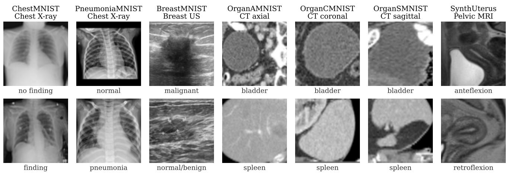
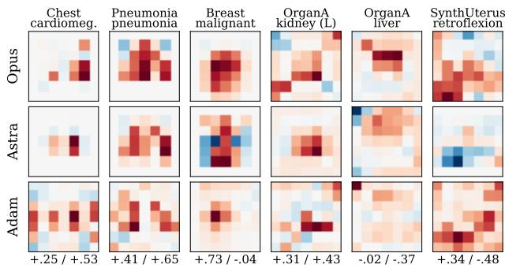
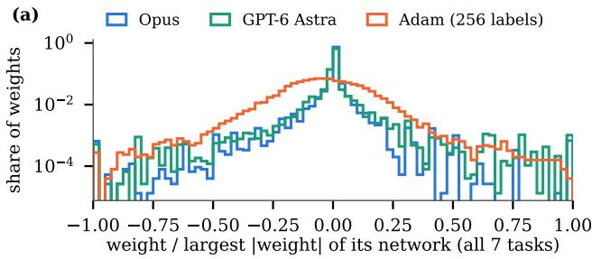
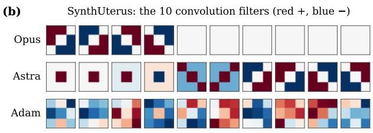
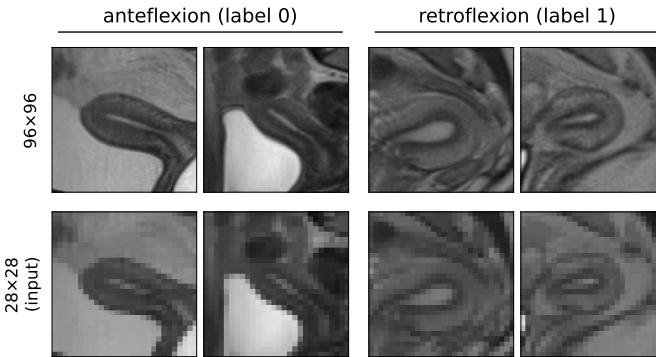

# Weight-Space Programming for Medical Imaging: Do We Still Need Training Data?

Maximilian Lindholz<sup>1,2,∗</sup> Richard Ruppel<sup>1,∗</sup> Annette Milnik<sup>3</sup> Sebastian Halskov<sup>1</sup> Semil Eminovic<sup>1</sup> Charlie A. Hamm<sup>1,2</sup> Robin Schmidt<sup>1,4</sup> Anika Knupfer<sup>5,6</sup> Jana Hutter<sup>5,6,7</sup> Johanna P. Muller¨ <sup>7</sup> Carolina Dominguez Aleixo<sup>1</sup> Jawed Nawabi<sup>1</sup> Jens Vogel-Claussen<sup>1,5,8</sup> Tobias Penzkofer<sup>1,2</sup>

<sup>1</sup>Charite – Universit´ atsmedizin Berlin, Germany¨

<sup>2</sup>Berlin Institute of Health at Charite – Universit´ atsmedizin Berlin, Germany¨

<sup>3</sup>University of Basel, Switzerland

<sup>4</sup>Experimental and Clinical Research Center (ECRC) of Charite and Max Delbr ´ uck Center, Berlin, Germany ¨

<sup>5</sup>Hannover Medical School, Germany

<sup>6</sup>Leibniz University Hannover, Germany

<sup>7</sup>King’s College London, United Kingdom

<sup>8</sup>German Center for Lung Research (DZL), Hannover, Germany

<sup>∗</sup>Equal contribution. Correspondence: maximilian.lindholz@charite.de

## Abstract

Can a large language model (LLM) write the parameters of a medical image classifier from medical knowledge alone, without any training data? Such classifiers normally require labelled images, which are costly and often unavailable. We investigate this question through weight-space programming (WSP), in which an LLM writes or adapts the weights and biases of a neural network directly, without optimisation on training data. Claude Opus 5.5 and GPT-6 Astra each generate the parameters of a small LeNet-style CNN in a single reply, without tool use and without access to any image. We compare these networks against zeroshot MedSigLIP and against the same architecture trained on labels using the Adam optimiser, across 7 classification tasks in four modalities: chest X-ray, breast ultrasound and abdominal CT (allfrom MedMNIST), and pelvic MRI (SynthUterus). The LLM-written networks perform above chance on all six MedMNIST tasks, with a mean test AUC of 0.719 for Opus and 0.711 for Astra. Both models outperform MedSigLIP on 5 of 6 tasks while using more than 10<sup>4</sup> times fewer parameters. However, the same network trained with Adam on only 256 labelled images achieves a higher AUC on every MedMNIST task (mean AUC 0.828). On SynthUterus, Opus attains an AUC of 0.764, whereas Astra falls below chance (AUC 0.136) owing to a systematic error. These results show that LLMs

can write functional medical classifiers, but that they do not yet replace training data. We release the protocol, logs and all generated weights at https: // github. com/ MaximilianLindholz/ weight-space-programmingmedical .

## 1. Introduction

Neural networks are usually programs that are not written but found by an optimiser on labelled data [21]. Takehi et al. recently introduced weight-space programming [39], which asks whether frontier LLMs can now operate in the other direction, reading a network’s weights and writing new ones directly. Setting weights without gradient descent is not new in itself: hypernetworks have generated weights since 2016 [12, 19], but they are trained predictors. In WSP, the predictor is a general-purpose LLM that writes weights from knowledge stated in natural language.

Medical imaging is a natural test for this idea. Labelling medical images is expensive and requires radiologists, yet the rules for reading them, the relevant “program”, are largely written down in textbooks and the medical literature. For example, a retroflexed uterus bends backward against the cervix [2].

If an LLM can turn such knowledge into a model, a classifier could be created before the first label is collected, and every weight could carry a stated radiological rationale. Unlike the games and other artificial environments that Takehi et al. [39] use to motivate WSP, medical imaging has no source code for its rules. The imaging process itself is reproducible, but no program specifies how anatomy and disease appear in an image, or how an image maps to a diagnosis. These rules must come from the model’s medical knowledge, and they must survive the gap between textbook descriptions and pixel data.

  
Figure 1. The 7 medical imaging tasks (Sec. 3.1), two examples each. For display only, images are shown at higher resolution (MedM NIST+ [48] at 64 or 224 pixels, SynthUterus at its released 96); the networks see the same images at 28×28.

We therefore ask three questions. First, can an LLM write a working medical imaging classifier from scratch, without any task-specific training data, and do different LLMs write similar ones? Second, do we still need data: how does a written network compare with label-free foundation models and with training on a few hundred labels? Third, which design decisions do LLMs make in the parameters, and how do they compare with what gradient descent learns in the same network?

## Contributions.

• To our knowledge, the first study of weight-space programming in medical imaging, covering 7 tasks in four modalities (X-ray, ultrasound, CT, MRI).

• Evidence that networks written by both LLMs are above chance on all six MedMNIST tasks and beat zero-shot MedSigLIP on 5 of 6 tasks, but stay below the same network trained on 256 labels.

• A weight-level comparison of LLM-written and gradienttrained networks of identical architecture, covering weight statistics, learned filters and spatial attribution. The LLM-written networks use few distinct, rounded values and textbook filters, unlike the trained networks.

## 2. Related Work

Predicting weights instead of training them. One network setting the weights of another is an established idea, dating back to Schmidhuber’s fast weights, where a slowly learning network outputs the weight changes of a second, fast network at every time step [34]. Later milestones differ mainly in what the weights are predicted from. In 2016, dynamic filter networks generated convolution filters from the input image [16], and HyperNetworks, which named the idea, generated a main network’s weights from learned layer embeddings [12]. Meta networks derived fast weights from the loss gradients of a few labelled examples for one-shot learning [26]. Graph hypernetworks predicted all weights of unseen architectures from their computational graph [50], and GHN-2 sets the 24M parameters of a ResNet-50 in a single forward pass [19]. Taskconditioned hypernetworks map a learned task embedding to weights [42], and HyperDreamBooth predicts personalisation weights of a text-to-image model from one photo, refined by brief fine-tuning [31]. A review sorts hypernetworks by whether the task, the data or noise conditions them [5]. In all of these, the mapping to weights is itself learned, from labelled data and populations of trained networks. WSP [39] is closest to a task-conditioned hypernetwork, but the task embedding is a natural-language description, and the mapping is a general-purpose LLM that was not trained for this purpose.

Learning in weight space. A growing literature treats trained networks as data. Unterthiner et al. [41] predict accuracy from weight statistics, and Schurholt¨ et al. [35] learn representations of model zoos. Equivariant architectures process weights while respecting neuron permutation symmetries [27, 52]. Weight-space editing includes task arithmetic [15], model soups [45] and locate-and-edit methods for language models [23]. Like the weight predictors above, these methods learn or compute their edits from data or from other networks; in WSP, the LLM reasons about the weights itself.

Weight-space programming. Takehi et al. [39] introduced the term and reported that a frontier LLM (GPT-6 Astra) can read, repair and write network weights, ranging from MinAtar and Go policies to edits of a 0.8B-parameter language model. Concurrently, Claude, operating as a toolusing coding agent, set the weights of small transformers by hand for ten algorithmic tasks [37]. Both reports are informal (blog posts) and have been criticised: networks written from raw weights alone are small, and most results depend on tools and forward passes [10, 14]. We adopt the most restrictive setting of [39], a single reply without tools, audit each call, and apply it to a domain whose rules are not available as code.

Hand-written and compiled networks. Tracr [22] compiles programs into transformer weights, and classic computer vision hand-designed filters. WSP differs in that the “compiler” is an LLM working from natural-language domain knowledge.

Label-free medical classification. Zero-shot vision– language models such as CLIP [29] and BiomedCLIP [51] also classify without task labels, but they rely on large-scale pretraining. WSP needs no labelled images and no image–text pretraining for the network it produces, although the LLM that writes it is itself pretrained on large text corpora, and it yields a network small enough to be fully inspected. We compare against the medical vision–language model MedSigLIP [36].

## 3. Method

## 3.1. Datasets

We study 7 imaging tasks from two sources. MedMNIST v2 [47, 48] is a collection of standardised 2D biomedical classification datasets at 28×28 pixels, with official splits, metrics and ResNet reference results [13]. We use all six of its 2D radiology tasks: ChestMNIST, which of 14 findings are present on an adult chest X-ray (multilabel: each finding is its own yes/no output [43]); PneumoniaMNIST, pneumonia vs. normal on paediatric chest Xrays [17]; BreastMNIST, malignant vs. normal or benign on breast ultrasound [1]; and OrganA/C/SMNIST, which of 11 abdominal organs a CT crop shows, in axial, coronal and sagittal slices (multi-class; LiTS volumes [3] with organ bounding boxes from [46]). These datasets have been public since 2020 and are widely used, so they may be in the LLMs’ training data (high exposure, <sup>•</sup>).

The second dataset is a predefined subset of the synthetic uterine MRI dataset SynthUterus [25] (96×96 sagittal crops generated by orientation-conditioned diffusion models [24], 200 per combination of flexion and version), used for a binary task (Fig. 4): anteverted/anteflexed vs. retroverted/retroflexed uterus, i.e. whether the corpus bends forward or backward against the cervix. We chose it a priori because the 28×28 format needs clear geometric differences, so mixed version/flexion subclasses are excluded, as are near-duplicate images that this resolution cannot tell apart. Labels are derived from the independent ratings of both radiologists (class agreement 99.1%, $\kappa = 0 . 9 4 )$ . Of the 400 images of the two unmixed classes, 305 were rated realistic, correctly classed and anomaly-free by both readers; removing near-duplicates (shift-tolerant pixel correlation $r ~ > ~ 0 . 9 5$ with another image of the same class, 12 images) leaves 293 cases (146 anteflexed, 147 retroflexed). The data have been public only since February 2026 and are rarely downloaded (low exposure, <sup>◦</sup>). The released crops follow the radiological convention for sagittal slices (anterior left, superior up), which the prompt does not state; we resize them to 28×28.

All tasks are scored with MedMNIST’s official metrics [48]: the area under the ROC curve (AUC, averaged over findings or classes) and accuracy (ACC). Below, “the six MedMNIST tasks” always means the first group; SynthUterus is reported separately.

## 3.2. A network small enough to write

Before prompting the LLMs, we fix one base architecture that is small enough to fit into their context window. We call it ProgNet (“programmable network”): a LeNet-style CNN [20] with a single convolutional stage (Tab. 1). With one stage, every weight has a direct meaning (a filter, an image region or a class), so an LLM can write it as a radiological rule. In deeper networks, layers combine features of features, which no longer map onto such rules.

The input is a greyscale image $x ~ \in ~ [ - 1 , 1 ] ^ { C \times 2 8 \times 2 8 }$ with C=1; pixel values $v \in \{ 0 , \ldots , 2 5 5 \}$ are rescaled to $v / 1 2 7 . 5 - 1$ . ProgNet processes it in four steps:

1. Convolution. K=10 filters $w _ { k } \in \mathbb { R } ^ { C \times 3 \times 3 }$ with biases $b _ { k }$ (stride 1, zero padding 1) give feature maps $z _ { k } =$ $w _ { k } * x + b _ { k } \in \mathbb { R } ^ { 2 8 \times 2 8 }$

2. ReLU. $a _ { k } = \operatorname* { m a x } ( 0 , z _ { k } )$ , so each map shows where filter k responds.

3. Pooling. Non-overlapping 4×4 average pooling gives $g _ { k } = \mathrm { P o o l } _ { 4 } ( a _ { k } ) \in \mathbb { R } ^ { 7 \times 7 }$ . Each cell is the mean response of filter k in one 4×4 block of the image.

4. Read-out. Each output o has one weight map $M _ { o , k } \in$ $\mathbb { R } ^ { 7 \times 7 }$ per filter and a bias $c _ { o } .$

Table 1. ProgNet, layer by layer. C input channels, K filters, n outputs.
<table><tr><td>Step</td><td>Operation</td><td>Output</td><td>Parameters</td></tr><tr><td>Input</td><td>image scaled to [−1, 1]</td><td> $C \times 2 8 \times 2 8$ </td><td></td></tr><tr><td>1 Convolution</td><td>K filters 3×3 (pad 1)</td><td> $K \times 2 8 \times 2 8$ </td><td> $K ( 9 C + 1 )$ </td></tr><tr><td>2 Rectification ReLU</td><td></td><td> $K \times 2 8 \times 2 8$ </td><td></td></tr><tr><td>3 Pooling</td><td>average 4×4, stride 4</td><td> $K \times 7 \times 7$ </td><td></td></tr><tr><td>4 Read-out</td><td>linear, n× K maps 7×7 n</td><td></td><td> $n ( 4 9 K + 1 )$ </td></tr><tr><td>Output</td><td>sigmoid or softmax</td><td>n</td><td></td></tr></table>

$$
f ( x ) _ { o } = \sum _ { k = 1 } ^ { K } \sum _ { i , j = 1 } ^ { 7 } M _ { o , k } [ i , j ] g _ { k } [ i , j ] + c _ { o } .\tag{1}
$$

Each entry $M _ { o , k } [ i , j ]$ states how much evidence filter k at grid position (i, j) provides for class o. This is the unit in which rules are written (Sec. 3.4).

The output layer depends on the task: one logit with a sigmoid for binary tasks, a softmax for the multi-class organ tasks, and 14 independent sigmoids for multi-label ChestM-NIST. With n outputs, ProgNet has $K ( 9 C + 1 ) + n ( 4 9 K + 1 )$ learnable parameters (weights and biases, together called weights below), i.e. 591–6,974 per task. ProgNet is a standard CNN that can be trained with the Adam optimiser [18], and it is small enough for an LLM to write or read all of its weights.

## 3.3. Protocol

LLM writers and prompt. We use two LLMs as writers. Opus 5.5 is called through Claude Code 2.1.319, Anthropic’s command-line agent, in its headless (noninteractive) mode. Astra, the model used in [39], is called through the OpenAI Responses API. Both models receive the identical prompt and the one-line system prompt “Answer the user’s request.” For both we set the reasoning effort to high. This setting controls how much internal reasoning the model may do before it answers. The only other setting is an output limit of 128,000 tokens. Each call starts with a fresh context (no tools, no MCP servers and no stored session), so no information passes between calls or tasks. Figure S1 shows the complete prompt for Syn thUterus. The prompts of the other six tasks differ only in the task-specific lines: dataset name and citation, MedM-NIST’s official dataset description quoted verbatim (source, label definition, preprocessing) instead of the flexion definition, the class names, and the output, parameter count and metric that follow from the task type (e.g. 11 softmax logits and $^ { 5 , 5 0 1 }$ parameters for OrganA, 14 independent sigmoids for Chest). Everything else, including the input encoding, the row/column convention and the edit syntax, is identical.

## 3.4. Writing weights from scratch: the LLM’s design decisions

The LLM chooses every weight and explains its choices in its reply before it writes them. The networks it writes have two parts. The K filters of step 1 are a feature bank: the image features the network can detect. The read-out maps $M _ { o , k }$ of step 4 say, for each class, which feature counts as evidence where in the image. Opus made four kinds of choices:

• Filters. It sets filter biases so that each filter reacts only to a range of grey values.

• Read-out maps. It compares a region with a reference, which cancels overall brightness.

• Read-out biases. It sets them from the metric and the class frequency (Sec. 4.2).

• Whole network. It picks a classic method and builds it from weights.

## 3.5. Compared models

We compare the LLM-written ProgNets with two kinds of models, always in this order. MedSigLIP [36] is a medical vision–language model (∼400M-parameter image encoder) pre-trained on medical images with their text. Used zero-shot, it needs no labelled image of the task: each image is assigned to the class whose short text description it matches best. Adam trains the same ProgNet via gradient descent [18] on 256 class-stratified labelled images (Adam, 256 labels) or on the full training set (Adam, full data; capped at 20k images), with early stopping on validation AUC. Adam uses learning rate $3 \times 1 0 ^ { - 3 }$ , weight decay $1 0 ^ { - 4 }$ and batch size 64. It shows what the same network reaches with labels, and its weights are the reference for the LLMs’ decisions (Sec. 4.2). Published ResNet-18 results [48] are given for orientation only.

## 3.6. Comparing written and trained weights

We compare each written network with the Adam network trained on 256 labels (SynthUterus: 117 labels, seed 0). Evidence maps use the test images (a 2,000-image subset for Chest and Organ).

Evidence maps. By Eq. (1), grid cell (i, j) adds $c _ { o } [ i , j ] =$ $\begin{array} { r } { \sum _ { k } M _ { o , k } [ i , j ] g _ { k } [ i , j ] } \end{array}$ to logit o (for softmax outputs, relative to the mean over classes). Subtracting its mean over all other test cases from its mean over test cases of class o gives a $7 \times 7$ map of where the network separates class o (Fig. 2). We compare the maps of two networks by their Pearson correlation r over the 49 cells.

The figures show the first of the three calls of each LLM.

## 4. Experiments

We use the 7 tasks of Sec. 3.1: the six MedMNIST tasks with their official splits, and SynthUterus with a fixed split

of 117/59/117 train/val/test images. Models and baselines follow Sec. 3.5; neither LLM saw an image before writing.

## 4.1. Written networks, label-free models and training

Table 2 gives the test AUC of all models. The networks written by both LLMs are above chance on all six MedM-NIST tasks (mean 0.719 for Opus, 0.711 for Astra), with a similar profile across tasks. For Opus, the three CT organ tasks reach 0.731–0.782, PneumoniaMNIST 0.822 and BreastMNIST 0.670; ChestMNIST, the mean AUC over 14 findings, stays close to chance (0.552). Results were consistent across the three independent calls, with the largest variation on BreastMNIST for Astra (0.067).

Without labels, the written networks compete with a foundation model: on the same test images, both LLMs beat MedSigLIP zero-shot on 5 of the 6 MedMNIST tasks (all except Chest), with ≤7k instead of ∼400M imageencoder parameters. On Pneumonia, MedSigLIP is even below chance (0.273), ranking the classes the wrong way round. With labels, training wins: the same ProgNet trained with Adam on 256 labels is better on every MedMNIST task (mean 0.828, 10.9 AUC points above Opus and 11.7 above Astra).

On SynthUterus (Fig. 4), the one task the LLMs are unlikely to have seen, Opus’s networks reach 0.764±0.073 AUC (ACC 0.698), below MedSigLIP zero-shot (0.818) and far below Adam with all 117 training labels (0.996). Opus encodes the flexion as the edge orientation of cavity and canal across the whole image. Astra’s three networks are far below chance (mean 0.136), i.e. they separate the classes the wrong way round. Both LLMs assume the correct orientation (anterior left), and all six networks score a $" / "$ line as retroflexion and a $\bullet \bullet \bullet \bullet$ line as anteflexion. Astra, however, takes the definition literally and models a bend, comparing the orientation in the upper part of the image with that in the lower part, where it expects the cervical canal; these crops do not show that layout, and Astra’s read-out of the lower three grid rows alone gives AUC 0.121–0.241 (Opus 0.769–0.923).

## 4.2. LLM-written vs. Adam-trained weights

Within the fixed architecture, each LLM decides every filter, read-out weight and bias. Figures 2 and 3 compare these decisions with the weights Adam learns for the same ProgNet from 256 labels (Sec. 3.6).

What the weights look like (Fig. 3). Opus’s networks are sparse and discrete: 22–94% of their weights are exactly zero, and each network uses only 8–145 distinct values (e.g. ±0.25, ±0.5), whereas Adam gives every weight its own value (554–2,865 distinct values, none zero). Astra’s networks are denser but also take few distinct values (Fig. 3a). The filters show the same contrast (Fig. 3b):

  
Figure 2. Where the LLM-written and Adam-trained networks (256 labels) look for selected classes (one map per class and network). Per 7×7 grid cell: contribution to the class logit in test cases of the class minus in the other cases (red: evidence for the class; each map scaled to its own maximum). Opus and Astra: first of their three calls each; below each column: correlation r of each LLM’s map with Adam’s (Opus / Astra).



  
Figure 3. LLM-written vs. Adam-trained weights. (a) Distribution of all weights of the LLM-written networks (Opus and Astra, three calls each) and of the 256-label Adam networks (SynthUterus: 117 labels), each scaled by its network’s largest weight, pooled over the 7 tasks (log scale). Written weights are mostly exactly zero and take few distinct values. (b) The ten SynthUterus convolution filters (first call each): Opus writes four oriented edge detectors and leaves six filters unused (all zero), Astra uses all ten, Adam learns smooth mixed patterns.

for SynthUterus, Opus writes four oriented edge detectors for the uterine axis and leaves six filters unused, Astra fills all ten with textbook kernels (identity, centre–surround, diagonal line and edge detectors), and Adam learns smooth, mixed patterns.

Where the networks look (Fig. 2). Each map shows where a network separates one class from the others. Where a finding has a typical location, the written networks often look where the trained one does: for pneumonia, both LLMs’ maps correlate with Adam’s (r =+0.41 for Opus, +0.65 for Astra), as Opus’s does for a malignant breast lesion (+0.73; Astra −0.04). On CT, the agreement is weaker (left kidney +0.31/+0.43, liver −0.02/−0.37): Opus chose coarse region features and reads laterality only from diagonal corners, whereas gradient descent uses where an organ lies. On SynthUterus, Opus’s map partly matches Adam’s (+0.34), while Astra’s is inverted (−0.48), the same sign flip as its AUC in Tab. 2. The written maps are also sparser: the LLMs state a few regions, whereas training spreads evidence over the whole image.

Table 2. Test AUC of LLM-written networks and baselines. LLM-written: weights written in a single tool-free reply, mean±sd over three calls. No labels: zero-shot MedSigLIP-448. Adam: the same ProgNet trained on 256 labels or on the full training set; the published ResNet-18 (grey) is shown for reference. Bold: best without labels per row. <sup>•</sup>High, <sup>◦</sup>low risk of LLM training-data exposure. <sup>‡</sup>117 labels (all training cases), mean of 3 seeds. ML: multi-label.
<table><tr><td></td><td></td><td></td><td colspan="2">LLM-written, 3 calls</td><td>No labels</td><td colspan="2">Adam (same network)</td><td>ResNet</td></tr><tr><td>Dataset</td><td>Modality</td><td>Cls.</td><td>Opus</td><td>Astra</td><td>MedSigLIP</td><td>256 lab.</td><td>full</td><td>-18</td></tr><tr><td>Chest•</td><td>Chest X-ray</td><td>14 (ML)</td><td>0.552±0.015</td><td>0.538±0.008</td><td>0.665</td><td>0.553</td><td>0.654</td><td>0.768</td></tr><tr><td>Pneumonia•</td><td>Chest X-ray</td><td>2</td><td>0.822±0.036</td><td>0.854±0.012</td><td>0.273</td><td>0.914</td><td>0.934</td><td>0.944</td></tr><tr><td>Breast•</td><td>Breast US</td><td>2</td><td>0.670±0.009</td><td>0.677±0.067</td><td>0.643</td><td>0.820</td><td>0.841</td><td>0.901</td></tr><tr><td>OrganA•</td><td>Abdominal CT</td><td>11</td><td>0.782±0.000</td><td>0.763±0.004</td><td>0.656</td><td>0.896</td><td>0.982</td><td>0.997</td></tr><tr><td>OrganC•</td><td>Abdominal CT</td><td>11</td><td>0.731±0.017</td><td>0.712±0.022</td><td>0.673</td><td>0.908</td><td>0.983</td><td>0.992</td></tr><tr><td>OrganS•</td><td>Abdominal CT</td><td>11</td><td>0.759±0.016</td><td>0.721±0.020</td><td>0.618</td><td>0.875</td><td>0.957</td><td>0.972</td></tr><tr><td colspan="2">Mean (6 MedMNIST tasks)</td><td></td><td>0.719</td><td>0.711</td><td>0.588</td><td>0.828</td><td>0.892</td><td>0.929</td></tr><tr><td>SynthUterus°</td><td>Pelvic MRI</td><td>2</td><td>0.764±0.073</td><td>0.136±0.053</td><td>0.818</td><td>0.996‡</td><td>=</td><td></td></tr></table>

  
Figure 4. The SynthUterus task: anteflexion (left) vs. retroflexion (right), defined by the angle between the cervical canal and the uterine cavity. Two illustrative training or validation cases per class (the data owner’s picks, or the most similar kept case where de-duplication removed a pick), at the released 96×96 resolution (top) and as the 28×28 network input (bottom). Both radiologists rated each case realistic, correct class, free of anomalies and artefacts.

What the LLMs know about the data. The LLMs also use what they know about each dataset’s label distribution, although no prompt states it. Opus opens its BreastMNIST answer (Fig. S2) with: “Prior. About 73% of BreastM-NIST images are label 1 (normal or benign). The bias therefore starts positive, and the network predicts ‘benign’ unless there is clear malignant evidence.” The true share is 73.1%. All six BreastMNIST networks start from a positive output bias (Opus +1.2–2.0, Astra +0.8–1.0), Opus quotes the share of pneumonia in the Pneumonia test set (about 62%; true 62.5%), and every ChestMNIST bias of both LLMs is negative, because each of the 14 findings is rare (0.2–17.6% of test images). On SynthUterus, such knowledge was not present: all six networks set the output bias to zero, and Astra states that a zero bias “avoids imposing an unsupported class-frequency prior”. An output bias moves the decision threshold, and thus the ACC, but leaves the AUC of a binary output unchanged.

## 5. Discussion

Without a single image, two LLMs turned radiological knowledge (organ density, opacified lungs, hypoechoic masses, the axis of a flexed uterus) [38] into networks that are above chance on every MedMNIST task and beat a 400M-parameter vision–language model zero-shot on 5 of 6, a model class that can reach expert level on chest X-rays at higher resolution [40]. They work best where the label is a matter of anatomy and density, and worst where findings are subtle and rare, as in the 14-label chest X-rays. On SynthUterus, the one task neither LLM is likely to have seen, MedSigLIP zero-shot does better than both. An LLM can therefore write a working medical imaging classifier, but only in a limited sense.

The written networks also differ from trained ones in a consistent way: textbook operators, few round values and a few stated regions. Where a finding has a typical location, the LLMs place the evidence where training does; where it does not, they follow their own design. These choices are not one model’s habit: both LLMs make the same kinds of choices and reach a similar AUC, which suggests a shared textbook prior that, more than the writer, differs from what data teach. The two LLMs differ in economy (Astra uses all filters) and in how literally they take a definition: on SynthUterus, both assume the correct orientation, but Astra expects the bend at the cervix in a place where these crops do not show it, and its networks fall below chance. What the prompt leaves unstated about the images, the LLM has to guess. What it knows about a dataset, it uses: on the MedMNIST tasks, both LLMs set the output biases from class shares that no prompt states but that they quote correctly (Sec. 4.2), whereas on SynthUterus this knowledge was not present and every bias is zero. This also strengthens our claim that SynthUterus was likely not part of the LLMs’ training data. Setting a bias from the class prior is the classic correction for known class frequencies [32]. The biases do not change the AUC [8], but they show that the LLMs bring knowledge of the specific datasets, not only of radiology. How much of the MedMNIST performance rests on such knowledge we cannot separate, a general problem when evaluating LLMs on public benchmarks [33]. This is why SynthUterus matters: it is unlikely to be in the models training data.

Training data are still needed. A few hundred labels beat the written networks on every task (mean over three calls), by 6–20 AUC points on the MedMNIST tasks except the 14-label chest findings, where both are near chance, and by far more on SynthUterus (0.996 vs. 0.764). This is far from the results for games, where the generating process is given as code [39]; trained weight predictors show a similar gap (GHN-2: 58.6% vs. 93.5% with SGD on CIFAR-10 [19]). In medical imaging, no code defines the classes, so the writer must guess how a sign looks at 28×28 pixels and where the dataset draws the line, and no labelled image tells it whether the guess is right. Labels thus remain the bottleneck, as curation and expert annotation dominate the cost of a dataset [44].

What LLM-written networks offer instead is auditability. For high-stakes decisions, models should be interpretable by construction rather than explained after the fact [6, 30], and a written network is such a model: every weight carries a stated region, feature and sign that a radiologist can review, and every prediction can be traced cell by cell from filter response over the pooled grid to the logit. Its rules can be wrong, but they cannot silently rely on hospital, scanner or text markers, shortcuts that learned chest X-ray classifiers exploit [7, 9, 49]; for hypernetworks, explaining generated weights is still open [5]. Predicted weights also help as an initialisation [19, 31]; whether written ones do, we have not tested. Written networks are thus a transparent, label-free starting point and a reference for a trained network’s decisions.

Writing weights matters most where our benchmarks cannot follow, rare diseases with too few cases to train on, which together affect 3.5–5.9% of the population [28], and new diseases with only few known cases. A case report often describes what a finding looks like and where it lies before a significant amount of data exist. A written network could turn that description into a reviewable classifier on the day it is published, and rank incoming cases for expert labelling, as active learning does with trained models [4].

Our study has limitations. The scale is small by design: 28×28 images and networks of ≤7k weights, because every weight must fit into one reply (128k output tokens including reasoning; answers take up to 79k). The models are therefore far below the state of the art, and MedSigLIP is handicapped by upsampled inputs and untuned prompts. SynthUterus is recent, so LLM exposure is unlikely but not excluded; its images are synthetic and few (293), two readers rated them without adjudication, and flexion read from a 2D slice carries some label noise. Finally, we test two LLMs with one prompt: other LLMs or prompts may write differently, our prompt did not describe the image layout, and a wrong guess about it inverted Astra’s SynthUterus networks. Both writers know the MedMNIST datasets (Sec. 4.2); such contamination can be probed [11] but not excluded.

Conclusion. LLMs can write medical imaging classifiers without data that compete with a foundation model’s zeroshot predictions on most tasks, but a few hundred labels still beat them on average on every task.

Ethics. We use only public, de-identified data under their sources’ licences: MedMNIST [47, 48] and SynthUterus (CC BY 4.0; synthetic images [24, 25]). No patient data were collected.

Use of AI. Claude Opus 5.5 and GPT-6 Astra are the objects of study; Claude also helped draft text and code; the authors take full responsibility.

Funding. M.L., C.H., J.N. and T.P. are fellows or alumni of the BIH Charite (Junior Digital/Advanced) Clinician Sci-´ entist Program funded by Charite – Universit´ atsmedizin¨ Berlin, the Berlin Institute of Health, and Stiftung Charite.´

Competing interests. T.P. reported receiving grant funding from the Berlin Institute of Health (Advanced Clinician Scientist Grant, Platform Grant), Ministry of Education and Research (01KX2021 [RACOON], 01KX2121 [NUM 2.0, RACOON], 01KX2524 [NUM 3.0], 68GX21001A, 01ZZ2315D), German Research Foundation (SFB 1240/2), and European Union (H2020, CHAIMELEON: 952172;

DIGITAL, EUCAIM: 10110063) during the conduct of the study; research agreements (no personal payments) with AGO Research GmbH, Aravive Inc, ARCAGY-GINECO, Astellas Pharma Global Development Inc, AstraZeneca AB, AstraZeneca GmbH, Clovis Oncology, EQRx International Inc, F. Hoffmann-La Roche Ltd, GlaxoSmithKline Research and Development Limited, Grupo Espanol˜ de Investigacion en C´ ancer de Ovario, ImmunoGen Inc,´ Incyte Corporation, Karyopharm Therapeutics, Mario Negri Gynecology Oncology Group, Merck KGaA, Merck Sharp & Dohme, NOGGO eV, Nordic Society of Gynaecological Oncology–Clinical Trial Unit, Novartis Pharma GmbH, NovoCure GmbH, Sutro Biopharma Inc, TESARO Inc, TORL Biotherapeutics LLC, Tubulis GmbH, Universitatspoliklinik A. Gemelli, and Verastem Inc outside the¨ submitted work; and personal fees from Elsevier and Bayer Healthcare. C.H. reported receiving personal fees from Lucida Medical, Bayer AG, Siemens Healthineers, Koelis GmbH, and Bracco Imaging Deutschland and grants from the Ministry of Education and Research (01KX2524 [NUM 3.0], 01KX2626 [NUM SVIK]) outside the submitted work. J.N. reports research collaboration agreements with Briya Labs Ltd., Cercare Medical, and mediaire, and has received grant funding from the European Union (101079894). He is participant in the Berlin Advanced Clinician Scientist Program proHealth – Forderung von Advanced Clinician Sci-¨ entists im Bereich Pravention funded by the Federal Min-¨ istry of Research, Technology and Space, project number: 01EO2508. The other authors declare no competing interests.

## References

[1] Walid Al-Dhabyani, Mohammed Gomaa, Hussien Khaled, and Aly Fahmy. Dataset of breast ultrasound images. Data in Brief, 28:104863, 2020. 3

[2] Muhammad Atif Ameer and Diana C Peterson. Anatomy, abdomen and pelvis: uterus. In StatPearls [Internet]. Stat-Pearls Publishing, 2025. 1

[3] Patrick Bilic, Patrick Christ, et al. The liver tumor segmentation benchmark (LiTS). Medical Image Analysis, 84:102680, 2023. 3

[4] Samuel Budd, Emma C. Robinson, and Bernhard Kainz. A survey on active learning and human-in-the-loop deep learning for medical image analysis. Medical Image Analysis, 71: 102062, 2021. 7

[5] Vinod Kumar Chauhan, Jiandong Zhou, Ping Lu, Soheila Molaei, and David A. Clifton. A brief review of hypernetworks in deep learning. Artificial Intelligence Review, 57(9): 250, 2024. 2, 7

[6] Chaofan Chen, Oscar Li, Chaofan Tao, Alina Jade Barnett, Jonathan Su, and Cynthia Rudin. This looks like that: Deep learning for interpretable image recognition. In Advances in Neural Information Processing Systems, pages 8928–8939, 2019. 7

[7] Alex J. DeGrave, Joseph D. Janizek, and Su-In Lee. AI for radiographic COVID-19 detection selects shortcuts over sig nal. Nature Machine Intelligence, 3(7):610–619, 2021. 7

[8] Tom Fawcett. An introduction to ROC analysis. Pattern Recognition Letters, 27(8):861–874, 2006. 7

[9] Robert Geirhos, Jorn-Henrik Jacobsen, Claudio Michaelis,¨ Richard Zemel, Wieland Brendel, Matthias Bethge, and Felix A. Wichmann. Shortcut learning in deep neural networks. Nature Machine Intelligence, 2(11):665–673, 2020. 7

[10] Sean Goedecke. LLMs are not superhuman at reading and writing neural network weights. Blog post, 3 November 2026, https://www.seangoedecke.com/llms- arenot-superhuman-at-reading-and-writing-neuralnetwork-weights/, 2026. 3

[11] Shahriar Golchin and Mihai Surdeanu. Time travel in LLMs: Tracing data contamination in large language models. In In ternational Conference on Learning Representations (ICLR), 2024. 7

[12] David Ha, Andrew M. Dai, and Quoc V. Le. HyperNetworks. In International Conference on Learning Represen tations (ICLR), 2017. 1, 2

[13] Kaiming He, Xiangyu Zhang, Shaoqing Ren, and Jian Sun. Deep residual learning for image recognition. In IEEE Conference on Computer Vision and Pattern Recognition (CVPR), 2016. 3

[14] Matthew Honnibal. The “Astra can read and write weights to improve Qwen” post is misleading. Blog post, 3 Novem ber 2026, https://honnibal.dev/blog/astra-readwrite-misleading, 2026. 3

[15] Gabriel Ilharco, Marco Tulio Ribeiro, Mitchell Wortsman, Suchin Gururangan, Ludwig Schmidt, Hannaneh Hajishirzi, and Ali Farhadi. Editing models with task arithmetic. In In ternational Conference on Learning Representations (ICLR), 2023. 3

[16] Xu Jia, Bert De Brabandere, Tinne Tuytelaars, and Luc Van Gool. Dynamic filter networks. In Advances in Neu ral Information Processing Systems (NeurIPS), 2016. 2

[17] Daniel S. Kermany, Michael Goldbaum, Wenjia Cai, et al. Identifying medical diagnoses and treatable diseases by image-based deep learning. Cell, 172(5):1122–1131, 2018. 3

[18] Diederik P. Kingma and Jimmy Ba. Adam: A method for stochastic optimization. In International Conference on Learning Representations (ICLR), 2015. 4

[19] Boris Knyazev, Michal Drozdzal, Graham W. Taylor, and Adriana Romero Soriano. Parameter prediction for unseen deep architectures. In Advances in Neural Information Pro cessing Systems (NeurIPS), 2021. 1, 2, 7

[20] Yann LeCun, Leon Bottou, Yoshua Bengio, and Patrick´ Haffner. Gradient-based learning applied to document recognition. Proceedings of the IEEE, 86(11):2278–2324, 1998. 3

[21] Yann LeCun, Yoshua Bengio, and Geoffrey Hinton. Deep learning. Nature, 521(7553):436–444, 2015. 1

[22] David Lindner, Janos Kram´ ar, Sebastian Farquhar, Matthew´ Rahtz, Thomas McGrath, and Vladimir Mikulik. Tracr:

Compiled transformers as a laboratory for interpretability. In Advances in Neural Information Processing Systems (NeurIPS), 2023. 3

[23] Kevin Meng, David Bau, Alex Andonian, and Yonatan Belinkov. Locating and editing factual associations in GPT. In Advances in Neural Information Processing Systems (NeurIPS), 2022. 3

[24] Johanna P. Muller, Anika Knupfer, Pedro Bl¨ oss, Edoardo Be-¨ rardi Vittur, Bernhard Kainz, and Jana Hutter. Diffusing the blind spot: Uterine MRI synthesis with diffusion models. In Skin Image Analysis, and Computer-Aided Pelvic Imaging for Female Health, pages 93–102. Springer Nature Switzerland, 2025. 3, 7

[25] Johanna P. Muller, Anika Knupfer, Maximilian Lindholz,¨ Robin Schmidt, Bernhard Kainz, and Jana Hutter. Synthetic uterus MRI dataset with uterine orientation labels. Zenodo, version 2, https://doi.org/10.5281/zenodo. 18587285, 2026. IEEE International Symposium on Biomedical Imaging (ISBI) 2026. CC BY 4.0. 3, 7

[26] Tsendsuren Munkhdalai and Hong Yu. Meta networks. In International Conference on Machine Learning (ICML), pages 2554–2563, 2017. 2

[27] Aviv Navon, Aviv Shamsian, Idan Achituve, Ethan Fetaya, Gal Chechik, and Haggai Maron. Equivariant architectures for learning in deep weight spaces. In International Conference on Machine Learning (ICML), 2023. 2

[28] Stephanie Nguengang Wakap, Deborah M. Lambert, Annie´ Olry, Charlotte Rodwell, Charlotte Gueydan, Valerie Lan-´ neau, Daniel Murphy, Yann Le Cam, and Ana Rath. Estimating cumulative point prevalence of rare diseases: analysis of the Orphanet database. European Journal of Human Genetics, 28(2):165–173, 2020. 7

[29] Alec Radford, Jong Wook Kim, Chris Hallacy, et al. Learning transferable visual models from natural language supervision. In International Conference on Machine Learning (ICML), 2021. 3

[30] Cynthia Rudin. Stop explaining black box machine learning models for high stakes decisions and use interpretable models instead. Nature Machine Intelligence, 1(5):206–215, 2019. 7

[31] Nataniel Ruiz, Yuanzhen Li, Varun Jampani, Wei Wei, Tingbo Hou, Yael Pritch, Neal Wadhwa, Michael Rubinstein, and Kfir Aberman. HyperDreamBooth: HyperNetworks for fast personalization of text-to-image models. In IEEE/CVF Conference on Computer Vision and Pattern Recognition (CVPR), pages 6527–6536, 2024. 2, 7

[32] Marco Saerens, Patrice Latinne, and Christine Decaestecker. Adjusting the outputs of a classifier to new a priori probabilities: A simple procedure. Neural Computation, 14(1):21–41, 2002. 7

[33] Oscar Sainz, Jon Ander Campos, Iker Garc´ıa-Ferrero, Julen Etxaniz, Oier Lopez de Lacalle, and Eneko Agirre. NLP evaluation in trouble: On the need to measure LLM data contamination for each benchmark. In Findings ofthe Association for Computational Linguistics: EMNLP 2023, pages 10776–10787, 2023. 7

[34] Jurgen Schmidhuber. Learning to control fast-weight mem-¨ ories: An alternative to dynamic recurrent networks. Neural Computation, 4(1):131–139, 1992. 2

[35] Konstantin Schurholt, Dimche Kostadinov, and Damian¨ Borth. Self-supervised representation learning on neural network weights for model characteristic prediction. In Advances in Neural Information Processing Systems (NeurIPS), 2021. 2

[36] Andrew Sellergren, Sahar Kazemzadeh, Fereshteh Mahvar, Atilla Kiraly, Madeleine Traverse, et al. An open visionlanguage model for diverse medical applications. Nature Medicine, 32(10):3695–3704, 2026. MedGemma and Med-SigLIP; preprint arXiv:2507.05201 (“MedGemma Technical Report”). 3, 4

[37] Chandan Singh. Weight-space programming from scratch on simple tasks. Report, 2 November 2026, https://csinva.io/weight- space- programmingautoresearch/analyze/toy\_examples/report.html, 2026. 3

[38] Karan Singhal, Shekoofeh Azizi, Tao Tu, S. Sara Mahdavi, Jason Wei, Hyung Won Chung, Nathan Scales, Ajay Tanwani, Heather Cole-Lewis, Stephen Pfohl, et al. Large language models encode clinical knowledge. Nature, 620 (7972):172–180, 2023. 6

[39] Rikiya Takehi, Jayden Teoh, Alex Zhang, and Omar Khattab. Sparks of weight-space programming: LLMs can na tively read & write neural network weights. MIT CSAIL blog post, 2 November 2026, https://rikiyat.github. io/blog/weight-space-programming/; logs at https: //github.com/RikiyaT/lm\_understand-logs, 2026. 1, 2, 3, 4, 7

[40] Ekin Tiu, Ellie Talius, Pujan Patel, Curtis P. Langlotz, Andrew Y. Ng, and Pranav Rajpurkar. Expert-level detection of pathologies from unannotated chest X-ray images via selfsupervised learning. Nature Biomedical Engineering, 6: 1399–1406, 2022. 6

[41] Thomas Unterthiner, Daniel Keysers, Sylvain Gelly, Olivier Bousquet, and Ilya Tolstikhin. Predicting neural network accuracy from weights. arXiv preprint arXiv:2002.11448, 2020. 2

[42] Johannes von Oswald, Christian Henning, Benjamin F. Grewe, and Joao Sacramento. Continual learning with hy-˜ pernetworks. In International Conference on Learning Rep resentations (ICLR), 2020. 2

[43] Xiaosong Wang, Yifan Peng, Le Lu, Zhiyong Lu, Mohammadhadi Bagheri, and Ronald M. Summers. ChestXray8: Hospital-scale chest x-ray database and benchmarks on weakly-supervised classification and localization of common thorax diseases. In IEEE Conference on Computer Vision and Pattern Recognition (CVPR), 2017. 3

[44] Martin J. Willemink, Wojciech A. Koszek, Cailin Hardell, Jie Wu, Dominik Fleischmann, Hugh Harvey, Les R. Folio, Ronald M. Summers, Daniel L. Rubin, and Matthew P. Lungren. Preparing medical imaging data for machine learning. Radiology, 295(1):4–15, 2020. 7

[45] Mitchell Wortsman, Gabriel Ilharco, Samir Yitzhak Gadre, et al. Model soups: Averaging weights of multiple fine-

tuned models improves accuracy without increasing inference time. In International Conference on Machine Learning (ICML), 2022. 3

[46] Xuanang Xu, Fugen Zhou, Bo Liu, Dongshan Fu, and Xiangzhi Bai. Efficient multiple organ localization in CT image using 3D region proposal network. IEEE Transactions on Medical Imaging, 38(8):1885–1898, 2019. 3

[47] Jiancheng Yang, Rui Shi, and Bingbing Ni. MedMNIST classification decathlon: A lightweight AutoML benchmark for medical image analysis. In IEEE International Symposium on Biomedical Imaging (ISBI), 2021. 3, 7

[48] Jiancheng Yang, Rui Shi, Donglai Wei, Zequan Liu, Lin Zhao, Bilian Ke, Hanspeter Pfister, and Bingbing Ni. MedM-NIST v2 – a large-scale lightweight benchmark for 2D and 3D biomedical image classification. Scientific Data, 10(1): 41, 2023. 2, 3, 4, 7

[49] John R. Zech, Marcus A. Badgeley, Manway Liu, Anthony B. Costa, Joseph J. Titano, and Eric Karl Oermann. Variable generalization performance of a deep learning model to detect pneumonia in chest radiographs: A cross-sectional study. PLOS Medicine, 15(11):e1002683, 2018. 7

[50] Chris Zhang, Mengye Ren, and Raquel Urtasun. Graph HyperNetworks for neural architecture search. In International Conference on Learning Representations (ICLR), 2019. 2

[51] Sheng Zhang, Yanbo Xu, Naoto Usuyama, et al. A multimodal biomedical foundation model trained from fifteen million image–text pairs. NEJM AI, 2(1), 2025. BiomedCLIP; preprint arXiv:2303.00915. 3

[52] Allan Zhou, Kaien Yang, Kaylee Burns, Adriano Cardace, Yiding Jiang, Samuel Sokota, J. Zico Kolter, and Chelsea Finn. Permutation equivariant neural functionals. In Advances in Neural Information Processing Systems (NeurIPS), 2023. 2

## Supplementary material

S1. The prompt. Figure S1 shows the complete prompt for SynthUterus, the only user message of each call (Sec. 3.3 describes the protocol). The prompts of the other six tasks differ only in the task-specific lines (dataset, official description, classes, output and parameter count); no prompt describes what the images look like.

S2. An example answer. Figure S2 shows a complete answer: Opus’s first call for BreastMNIST (test AUC 0.668). The answer first describes the design in prose and then writes it as an edits block; only the edits block is read. Its first line sets the output bias from the class prior, which the prompt does not state.

YOUR TASK: write, from scratch, the weights of a small convolutional network that solves this medical image classification task as well as possible. There is no training: no data, no loss, no gradients, no fine-tuning; you choose every number yourself. You have no tools: no code execution, no calculator, nothing to run, and you will not see any image from this dataset. This is a single response and you will get no feedback. First describe your design briefly (which image features each filter detects, and which evidence each output reads where), then write the edits block.

THE DATASET: SynthUterus (Mueller et al. 2026, Zenodo): synthetic, region-of-interest-cropped uterine MRI slices; only cases validated by two radiologists are used; images downsampled from 96 x 96 to 28 x 28. Task type: binary-class.

Official description: Synthetic sagittal uterine MRI slices (region-of-interest crops, greyscale): uterine flexion, defined by the angle between the cervical canal line and the uterine cavity line: anteflexion (cavity bent forward) or retroflexion (cavity bent backward)?

0: anteflexion   
1: retroflexion

THE INPUT: one image of 28 x 28 pixels with 1 channel (grey). Each pixel value p in 0..255 is given to the network as x = (p / 255 - 0.5) / 0.5, i.e. in [-1, 1] (-1 = black, +1 = white). Rows go from 0 (top) to 27 (bottom), columns from 0 (left) to 27 (right), exactly as stored in the dataset arrays.

THE OUTPUT: one logit o\_0 = log-odds that the label is 1 (’retroflexion’); the score is sigmoid(o\_0).

THE NETWORK (591 parameters; the same architecture as the gradient-trained baselines it is compared with):   
h = ReLU(conv3x3(x; CW, CB)) CW: 10 x 1 x 3 x 3, CB: 10 (stride 1, zero padding 1 -> 10 x 28 x 28)   
g = AvgPool4x4(h) -> 10 x 7 x 7 (cell (i, j) averages pixel rows 4i..4i+3, columns 4j..4j+3)   
o\_n = sum over k, i, j of M[n, k, i, j] \* g[k, i, j] + B[n] M: 1 x 10 x 7 x 7, B: 1   
CW[k, c] is the 3 x 3 kernel of filter k on input channel c, applied as cross-correlation: kernel entry [a, b] multiplies   
the pixel at offset (a - 1, b - 1) (row, column). EVERY WEIGHT STARTS AT 0; you set the weights you need.

HOW YOUR NETWORK IS SCORED: on the official test split with MedMNIST’s official metrics: AUC of sigmoid(o\_0), and ACC with threshold 0.5. It is compared with networks of the same architecture trained by gradient descent on 256 labelled images and on the full training set.

HOW TO WRITE THE WEIGHTS (numbers only; nothing is run). Write a code block whose opening line is three backticks followed by the word edits, one statement per line (’#’ starts a comment; a long list may continue over the next lines). Tensors: CW, CB, M, B.

‘‘‘edits   
CW[0, 0] = [[0, 0, 0], [0, 1, 0], [0, 0, 0]] # filter 0, channel 0: identity kernel   
CB[0] = -0.5 # one entry   
M[2, 0, 1:6, 1:3] = 0.1 # output 2 reads filter 0 in grid rows 1..5, columns 1..2   
M[2, 0, 3] = [0, 0, 0.2, 0.2, 0.2, 0, 0] # explicit values along the last axis   
B[:] = -1 # fill a range (a:b is half-open; ’:’ alone = the whole axis)   
M[:, 1] \*= 2 # scale (also += and -=)

Ranges: a:b is half-open, a:b:s takes every s-th index. Statements apply in order; a later statement overwrites an earlier one. Only the LAST edits block of your reply is read; a statement that cannot be read is skipped (the others still apply). Values: plain decimal numbers (|v| <= 1e6); a list must have exactly the shape of the indexed block.

Figure S1. The complete prompt for SynthUterus, the only user message of each of its three calls (system prompt: “Answer the user’s request.”). Long lines are wrapped for display.

```markdown
## Design
**Prior.** About 73% of BreastMNIST images are label 1 (normal or benign). The bias therefore starts positive, and the
network predicts "benign" unless there is clear malignant evidence.
**What the filters detect.** All kernels act on the 3x3 local mean or on a vertical gradient, which smooths out
speckle.
- **Filter 0, darkness:** all weights -1/9, bias -0.3. It fires where the local mean is below about -0.3, i.e. on
hypoechoic tissue such as a lesion.
- **Filter 1, strong darkness:** all weights -1/9, bias -0.7. It marks near-anechoic regions. It is computed but not
read by the output, so it is neutral.
- **Filter 2, brightness:** all weights +1/9, bias -0.1. It fires on bright, echogenic tissue.
- **Filter 3, bright-below edge:** dark above and bright below, kernel rows (-1, 0, +1)/3, bias -0.3. This is the
signature of posterior acoustic enhancement under a lesion, which is typical of benign cysts and fibroadenomas.
**How the output reads the evidence.**
- **Lesion burden (malignant evidence):** filter 0 is read with negative weight over the central grid. The weight is
-0.15 on cells 1-5 and -0.3 on the inner 3x3 (rows and columns 2-4). Malignant masses in this dataset tend to be
large, dark and central. Normal images have little darkness, and benign lesions are usually smaller.
- **Posterior shadowing (malignant evidence):** darkness directly below the centre adds -0.15 per cell on grid rows
5-6, columns 2-4.
- **Echogenic tissue (benign/normal evidence):** brightness is read with +0.15 in the centre, where it means no
lesion. It is read with +0.2 below the centre, where it means posterior enhancement rather than shadow.
- **Bright-below edges (benign evidence):** filter 3 is read with +0.2 per cell on grid rows 3-5, columns 2-4.
- **Bias:** B = 1.2. A typical benign or normal image stays above 0. A large, dark, shadowing mass pushes the logit
below 0.
‘‘‘edits
# Filter 0: darkness (local mean below ˜-0.3)
CW[0, 0] = [[-0.111, -0.111, -0.111], [-0.111, -0.111, -0.111], [-0.111, -0.111, -0.111]]
CB[0] = -0.3
# Filter 1: strong darkness / anechoic (not read by the output)
CW[1, 0] = [[-0.111, -0.111, -0.111], [-0.111, -0.111, -0.111], [-0.111, -0.111, -0.111]]
CB[1] = -0.7
# Filter 2: brightness (echogenic tissue)
CW[2, 0] = [[0.111, 0.111, 0.111], [0.111, 0.111, 0.111], [0.111, 0.111, 0.111]]
CB[2] = -0.1
# Filter 3: dark above / bright below edge (posterior enhancement)
CW[3, 0] = [[-0.333, -0.333, -0.333], [0, 0, 0], [0.333, 0.333, 0.333]]
CB[3] = -0.3
# Lesion burden: central darkness -> malignant
M[0, 0, 1:6, 1:6] = -0.15
M[0, 0, 2:5, 2:5] = -0.3
# Posterior shadowing: darkness below centre -> malignant
M[0, 0, 5:7, 2:5] -= 0.15
# Echogenic tissue centrally, and enhancement below -> benign/normal
M[0, 2, 2:5, 2:5] = 0.15
M[0, 2, 5:7, 2:5] = 0.2
# Bright-below edges in lower centre -> benign
M[0, 3, 3:6, 2:5] = 0.2
# Prior toward benign/normal
B[0] = 1.2
```

Figure S2. The complete answer of Opus’s first BreastMNIST call, verbatim (its hidden reasoning is not part of the answer). Long lines are wrapped for display, and Unicode minus signs, dashes and × are shown in ASCII.