# When Does Sliced Inference Pay Off? Resolution, Tiling and Dense Fusion for Small Object Detection

Stefan Becker

Jens Bayer

David Munch¨

Fraunhofer IOSB, Ettlingen, Germany

Fraunhofer Center for Machine Learning

{firstname.lastname}@iosb.fraunhofer.de

## Abstract

Sliced inference such as SAHI is the standard remedy for small objects in high-resolution imagery, but its gains are usually measured against low-resolution baselines. We revisit sliced inference with scale as the explicit variable and ask when tiling actually pays off. We compare seven dense detectorsfromfourfamilies on VisDrone and DOTA, under pre-specified hypotheses, calibration-only tuning and a single evaluation on held-out test data. Two findings emerge. First, much of the benefit attributed to slicing is a resolution effect: on VisDrone, a single pass trained at a higher resolution outperforms tiling with box fusion (merging decoded boxes)for every detector that could be trained at that resolution, and at equal compute a higher resolution helps more than a larger model. Second, tiles carry complementary information that box fusion wastes. We introduce SC-AHI (Slicing with Coverage-Aware Hyper Inference), which accumulates the dense outputs of all passes with weights that give every image position the same total coverage, and reads objects off a peak grid fine enough to keep crowded neighbours apart. On identical passes, SCAHI outperforms box fusion for every YOLO detector on both datasets and matches it for FCOS. On DOTA, whose images far exceed the resolution a single pass can be trained at, tiles with SC-AHI beat the best single pass for every detector, by 4.3 to 5.6 mAP50 at 2048 px, and replacing only SAHI’s merge step by SCAHI adds 2.3 to 4.0 mAP50. An ablation attributes the gain to the border weighting and the resolution ofthe peak grid. Source code is available in our code repository.

## 1. Introduction

Tiling a large image into overlapping slices and running the detector on each slice is routine for small objects in drone and satellite imagery [2]. The reported gains are large, but they are usually measured against a full-image baseline at a low input resolution. This mixes two effects. A tile shows a part of the image at a larger scale, which helps small objects, but the same effect can be obtained by feeding the whole image at a higher resolution. On VisDrone [25], a typical image has a long side of about 1360 px, and a 640 px tile at native scale shows objects at almost the same size as a full image resized to 1280 px.

We therefore treat scale as the explicit variable and compare every sliced configuration with a single pass trained and run at a matched or higher resolution. All comparisons use one evaluation code path per dataset, a calibration split for every tunable choice, hypotheses fixed before the corresponding results existed, and a single evaluation on held-out test data. We use two datasets that represent two regimes. On VisDrone, images are moderately large, and a single pass at the native resolution can be trained. On DOTA [23], images are several thousand pixels wide and densely populated, and training a single pass beyond 2048 px exceeds the memory of our GPU.

The answer to the title question depends on this regime. Our study makes two main contributions:

1. An insight: resolution beats tiling with box fusion as long as the resolution can be trained. In our experiments on VisDrone, a single pass trained at a higher resolution outperforms sliced inference with box fusion for every detector that could be trained at that resolution, and at equal compute a higher resolution helps more than a larger model.

2. A method: SCAHI. Tiles nevertheless carry complementary information, but box fusion wastes it. SCAHI, a dense fusion of detector outputs with coverage-aware weights and a peak grid that keeps crowded neighbours apart, outperforms box fusion on identical passes for every YOLO detector on both datasets and matches it for FCOS. With it, tiles beat the strongest single pass on Vis-Drone and, by a wide margin, on DOTA.

A component ablation, a decomposition of the gain and scale analyses explain where the gains come from. Code, frozen configurations and the decision log are available in our code repository; the SCAHI fusion is released under the Apache-2.0 licence.

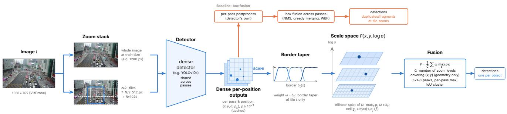  
Figure 1. Overview. One detector processes a whole-image pass at its training size and overlapping tiles. The baseline merges decoded boxes across passes (orange). SCAHI accumulates the dense outputs of all passes in a global volume over position and object size, weights them so that every position receives the same total weight, and extracts one peak per object. For YOLOv10, SCAHI uses the one-to-many head.

## 2. Related work

Sliced inference. SAHI [1, 2] popularised slicing-aided inference and fine-tuning. Follow-ups make slicing cheaper or adaptive: ASAHI [11] fixes the number of slices, DAHI [19] and GOIS [12] select dense regions, ROI-Gated SAHI [14] selectively applies sliced inference to regions identified by a lightweight object proposer, skipping background regions when foreground coverage is low, and ESOD [10] slices at feature level. Earlier, ClusDet [24] and DMNet [7] chose crops from cluster or density maps. These works compare against full-image baselines at a fixed, usually low, input size; matched-resolution baselines are rarely reported.

Scale normalisation. SNIP [16] and SNIPER [17] train only on objects within a valid size range per pyramid scale; AutoFocus [13] restricts high-resolution processing to likely regions.

Merging detections. Multi-pass inference needs a merge step: NMS, Soft-NMS [3], SAHI’s greedy nonmaximum merging [2], or Weighted Boxes Fusion [18]. All operate on decoded boxes. Voting-based detectors such as HoughNet [15] accumulate evidence for objects within a single pass; SCAHI instead merges the outputs of overlapping passes with coverage-aware weights. Weighted aggregation of overlapping windows is standard in semantic segmentation, for example Gaussian-weighted sliding windows in nnU-Net [5]. There, the aggregated map is the output. In detection, individual objects must afterwards be separated from the aggregated evidence, and, as we show, this step decides whether multi-pass inference pays off.

Detectors and data. YOLOv10 [22] trains a one-tomany and an NMS-free one-to-one head and uses only the latter at inference. YOLOv11 [6] and YOLOv12 [20]<sup>1</sup> use a single dense head with NMS. All three predict box distributions per position as in generalised focal loss [8].

DOTA [4, 23] is the standard benchmark for object detection in large aerial images.

## 3. Study design

Datasets and metrics. On VisDrone2019-DET [25] we use the standard 10 classes and the toolkit AP@[.5:.95] with ignore regions treated as in the official toolkit, whose evaluation we ported and validated against the original. On DOTA v1.5 [4] we use horizontal boxes, all 16 classes and the official mAP50 of the DOTA devkit, again through a validated port, without a cap on detections per image. The devkit ignores objects marked difficult, which include all objects below 8 px; a pre-specified secondary evaluation counts them as normal objects. To bound memory, the DOTA pipeline keeps at most 200,000 detections per image (for box fusion, per pass); on VisDrone, every method is capped at 500 detections per image, as in the toolkit. We call an object crowded if another object of the same class overlaps it with IoU > 0.3, and isolated otherwise; the recall of both groups is measured at IoU 0.5.

Splits. On VisDrone, a calibration split of 594 images from 30 whole video sequences is held out of the training set; we report on val and evaluated test-dev once. On DOTA, a calibration split of 141 training images is held out, and the official val split (458 images) serves as the held-out test set; its test labels are not public. All model selection and tuning use the calibration splits.

Hypotheses. Before the respective results existed, we fixed three questions for both datasets, the success threshold ε = 0.30 (AP or mAP50 points) and the selection rules: (Q1) does a single pass at higher resolution beat tiling with box fusion; (Q2) does SCAHI beat box fusion on identical passes; (Q3) do tiles with SCAHI beat the strongest single pass. Differences $\Delta$ are reported with paired bootstrap 95 % confidence intervals over images (1000 resamples, percentile intervals). On VisDrone, a question holds for a detector if $\Delta > \varepsilon$ (for Q3 also with a lower confidence bound above zero), and it is confirmed across detectors if it holds for at least four of the five detectors of the extension. On DOTA, a detector meets a question if $\Delta > \varepsilon$ and a onesided bootstrap test rejects $\Delta \le \varepsilon \mathrm { a t } \alpha = 0 . 0 5$ after Holm correction over YOLOv10s and YOLOv10m, which must both meet it; Q3 also requires a lower confidence bound above zero. Two further YOLO detectors and, last, FCOS were added to DOTA later under the same rules; FCOS, a single model, is judged without correction. For the added detectors we report verdicts per detector and a count over all five. On DOTA, a fourth question was also fixed before its results existed: (Q4) does SCAHI improve SAHI when it replaces only SAHI’s merge step, on exactly SAHI’s passes? Untestable cases count as not confirmed, and posthoc analyses never enter a verdict.

Detectors and training. VisDrone: YOLOv10s/m, YOLOv11s/m and YOLOv12s/m; DOTA: YOLOv10s/m, YOLOv11s, YOLOv12s and FCOS [21] (torchvision implementation, ResNet-50-FPN). All YOLO detectors start from COCO weights and follow one recipe per dataset (Ultralytics [6]; 100 epochs on VisDrone, 60 on DOTA; model selection on the calibration split). FCOS also starts from COCO weights but uses a simpler recipe (horizontal flips only), so absolute accuracies are not comparable across families; all questions compare configurations of the same detector. Deviations, such as smaller batches for two YOLOv12 runs, are listed in the supplement.

## 4. SCAHI

Passes. A configuration consists of passes and a merge rule. A pass sees the image at an absolute zoom z, the number of network-input pixels per image pixel; a tile of side $T = N / z$ image pixels is resized to the network input N. Our multi-pass configuration runs the single pass exactly as trained and adds overlapping tiles with overlap $\rho \ = \ 0 . 3 \colon$ $z = 2 , N = 1 0 2 4$ on VisDrone (512 px tiles) and $z = 1$ N = 1024 on DOTA. The baseline merge is NMS with intersection over the smaller box, the best box-level rule on calib; greedy merging and Weighted Boxes Fusion merge distinct neighbours in dense scenes.

Dense accumulation. Box fusion sees each pass only through its final boxes. SCAHI combines the passes before boxes are decided (Algorithm 1 and Fig. 2). Every position i of a pass predicts class probabilities $\mathbf { p } _ { i }$ and a box with centre $( x _ { i } , y _ { i } )$ , width $w _ { i }$ and height $h _ { i }$ in image coordinates, hence object size $\sigma _ { i } = { \sqrt { w _ { i } h _ { i } } }$ . Predictions with max<sub>c</sub> $p _ { c , i } \geq \tau _ { \mathrm { s p l a t } }$ are accumulated in a field over position and log size,

$$
F ( \mathbf { v } ) = \frac { 1 } { C ( x , y ) } \sum _ { k } \sum _ { i \in k } \omega _ { i } \operatorname* { m a x } _ { c } p _ { c , i } \kappa ( \mathbf { v } - \mathbf { v } _ { i } ) ,\tag{1}
$$

with $\begin{array} { r l r } { { \bf v } } & { { } = } & { ( x , y , u ) } \end{array}$ and $\begin{array} { r c l c r c l } { \mathbf { v } _ { i } } & { = } & { ( x _ { i } , y _ { i } , u _ { i } ) , u _ { i } } & { = } & { } \end{array}$ $\beta \log _ { 2 } ( \sigma _ { i } / \sigma _ { 0 } )$ , where k runs over the passes, κ is the trilinear interpolation kernel on a grid whose cell size at object size σ is $g ( \sigma ) = \operatorname* { m a x } ( 1 , \sigma / f ) \operatorname { p x } , \beta$ is the number of size bins per octave, $\sigma _ { 0 } = 2 \mathsf { p x } , \omega _ { i }$ is the weight of the prediction and C the coverage, both defined next. For YOLOv10 we use the one-to-many head, whose redundant per-position predictions are what the fusion aggregates.

Coverage-aware weights. A prediction close to a tile border sees a truncated object and is unreliable. A tile t therefore weights its predictions with a raised-cosine taper that rises over a width $\Delta = \rho T$ from each of its borders that lies inside the image,

$$
r _ { t } ( x , y ) = \prod _ { e \in \mathcal { E } _ { t } } s ( d _ { e } ) , \quad s ( d ) = \sin ^ { 2 } \bigl ( \frac { \pi } { 2 } \mathrm { c l i p } ( d / \Delta , 0 , 1 ) \bigr ) ,\tag{2}
$$

where $\mathcal { E } _ { t }$ are the inner borders of t and $d _ { e }$ is the distance of $( x , y )$ to border e. The tapers are normalised over the tiles of a level, $\begin{array} { r } { b _ { t } = r _ { t } / \sum _ { t ^ { \prime } } r _ { t ^ { \prime } } , } \end{array}$ so that $\begin{array} { r } { \sum _ { t } b _ { t } ( x , y ) = 1 } \end{array}$ at every position: the tiles form a partition of unity, and the weight of a tile prediction is $\omega _ { i } = b _ { t } ( x _ { i } , y _ { i } )$ . The whole-image pass has weight $\omega _ { i } = 1$ , and the coverage $C ( x , y )$ counts the levels of passes that contain $( x , y )$ . Every position thus receives the same total weight from each level, whatever the number of tiles that cover it, and fragments of cut objects receive little weight. Because both levels cover the whole image, $C = 2$ everywhere and the normalisation in Eq. (1) is a constant in our configurations; it matters only for passes that cover part of the image.

Separating neighbours. Objects are read off as local maxima of $F$ with $F \geq \tau _ { \mathrm { p e a k } }$ in their $3 \times 3 \times 3$ neighbourhood. Around a peak, the predictions within 1.5 cells and one size bin whose boxes overlap the strongest of them with IoU $\geq 0 . 5$ form a cluster $\kappa ,$ , across all passes. Its score for class c and its box are

$$
S _ { c } = \frac { 1 } { C } \sum _ { k } \operatorname* { m a x } _ { i \in \mathcal { K } \cap k } \omega _ { i } p _ { c , i } ,\tag{3}
$$

$$
\hat { \mathbf { q } } = \frac { \sum _ { i \in \mathcal { K } } a _ { i } \mathbf { q } _ { i } } { \sum _ { i \in \mathcal { K } } a _ { i } } , \qquad a _ { i } = \omega _ { i } \operatorname* { m a x } _ { c } p _ { c , i } ,\tag{4}
$$

with box parameters $\mathbf { q } _ { i } = ( x _ { i } , y _ { i } , \log w _ { i } , \log h _ { i } )$ . A pass that covers the peak but has no member contributes zero, which acts as negative evidence. Up to three classes with $S _ { c } \ > \ 0$ are kept per peak, and no NMS follows. The grid must be fine relative to object size: if one cell covers two adjacent objects, they become one detection. On VisDrone, our pre-specified setting used a cell factor of $f \ = \ 5 ;$ a post-hoc analysis (Sec. 5.2) showed that this merges crowded neighbours, and the refined grid, which selects $f ~ \in ~ \{ 7 , \dots , 1 3 \}$ , β and the thresholds on calib, was pre-specified for DOTA. SCAHI leaves the detector unchanged and replaces only the merge step. This makes two effects visible that box fusion hides: evidence from overlapping passes can be combined before objects are decided, and the resolution of the peak search relative to object size determines whether tiles improve on a strong single pass.

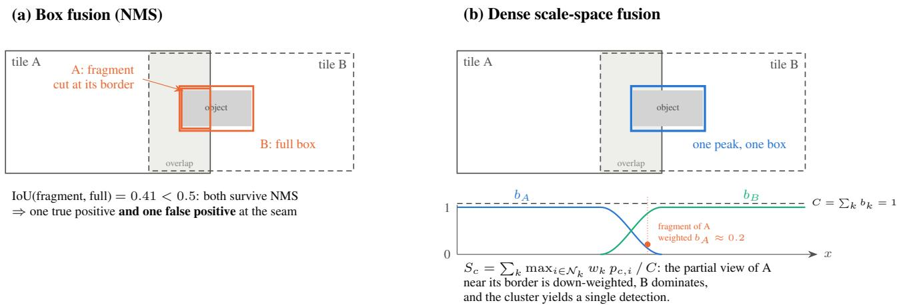  
Figure 2. Why dense fusion removes tile-border fragments. (a) Box fusion sees two decoded boxes for one object that straddles a tile seam: the fragment predicted by tile A overlaps the full box from tile B too little to be suppressed. (b) Dense fusion weights every prediction by a cosine taper $b _ { k }$ over the overlap; the tapers of overlapping tiles sum to the coverage $C = 1 ,$ so a prediction near a tile border carries little weight and the cluster around the object yields one detection. The fusion must also keep adjacent objects apart: its peak search has to be fine relative to object size (Sec. 5.2). Schematic, not to scale.

Algorithm 1 SCAHI fusion of one image   
Require: passes k = 1..K (whole image and tiles) with dense   
predictions $( x , y , w , h , \mathbf { p } )$ ; cell factor $f ;$ size bins per octave   
β; thresholds $\tau _ { \mathrm { s p l a t } } , \tau _ { \mathrm { p e a k } }$   
1: for each pass k and each prediction i with max<sub>c</sub> $p _ { c , i } \geq$ τ<sub>splat</sub>   
do   
2: map the box to image coordinates; $\sigma _ { i } \gets \sqrt { w _ { i } h _ { i } }$   
3: ω<sub>i</sub> $ b _ { k } ( x _ { i } , y _ { i } )$ ▷ Eq. (2); whole image: 1   
4: splat ω<sub>i</sub> max<sub>c</sub> $p _ { c , i }$ trilinearly at $\mathbf { v } _ { i }$ ▷ cell size   
max $( 1 , \sigma / f )$   
5: F ← accumulated field divided by the coverage C ▷ Eq. (1)   
6: for each local maximum of F in its $3 \times 3 \times 3$ neighbourhood   
with $F \geq \tau _ { \mathrm { p e a k } }$ do   
7: cluster $\kappa \colon$ nearby predictions with IoU $\ge ~ 0 . 5$ to the   
strongest, over all passes   
8: class scores $S _ { c }$ and box $\hat { \mathbf { q } }$ ▷ Eqs. (3) and (4)   
9: keep up to three classes with $S _ { c } > 0$

## 5. Results

## 5.1. VisDrone: resolution beats tiling (Q1)

For every detector that could be trained at 2048 px (all but YOLOv12m), the single pass beats the 1280 px pass with tiles and box fusion, by 2.8–3.5 AP on val and 1.8–3.1 AP on test-dev (Tab. 1); standard SAHI is the weakest configuration. Q1 is confirmed across detectors on both splits. At almost equal compute, YOLOv10s at 2048 px (128 GFLOPs) beats YOLOv10m at 1280 px (136 GFLOPs) by

Table 1. VisDrone: single pass vs. tiling (AP on val). Single passes trained and run at 1280 and 2048 px; SAHI and the 1280 px pass with tiles merged by NMS. ∆Q1 = single pass at 2048 px minus tiles with box fusion, on val and on the held-out test-dev.
<table><tr><td></td><td colspan="2">single pass</td><td colspan="2">1280 px</td><td colspan="2">∆Q1</td></tr><tr><td>Detector</td><td>1280</td><td>2048</td><td>SAHI</td><td>+ tiles</td><td>val</td><td>test</td></tr><tr><td>YOLOv10s</td><td>33.66</td><td>38.47</td><td>31.52</td><td>35.00</td><td>+3.47</td><td>+2.75</td></tr><tr><td>YOLOv10m</td><td>36.81</td><td>41.03</td><td>34.18</td><td>37.66</td><td>+3.37</td><td>+3.05</td></tr><tr><td>YOLOv11s</td><td>32.20</td><td>36.80</td><td>30.26</td><td>34.05</td><td>+2.75</td><td>+1.83</td></tr><tr><td>YOLOv11m</td><td>35.82</td><td>40.00</td><td>33.80</td><td>37.05</td><td>+2.95</td><td>+1.90</td></tr><tr><td>YOLOv12s</td><td>32.64</td><td>37.94</td><td>30.95</td><td>34.87</td><td>+3.07</td><td>+2.03</td></tr><tr><td>YOLOv12m</td><td>35.41</td><td></td><td>33.70</td><td>36.95</td><td></td><td></td></tr></table>

1.7 AP on val and 1.6 AP on test-dev (Fig. 3): raising the resolution is the more efficient lever. For YOLOv10s, accuracy still grows at 2560 px (39.51 AP); training at 3072 px exceeded memory with our fixed batch of three images, and running the 2560 px weights at 3072 px adds little (39.64 AP).

## 5.2. VisDrone: fusion and when tiles pay off (Q2, Q3)

On identical passes, SCAHI beats box fusion for every detector, by 1.4–2.0 AP on val and 1.9–2.4 AP on test-dev; Q2 is confirmed across detectors on both splits. Whether tiles with SCAHI also beat the 2048 px single pass (Q3) depended on the detector: with the pre-specified setting it held for three detectors but not for YOLOv10m (+0.26 AP on val, below ε), and YOLOv12m could not be tested, so Q3 is not confirmed on val. On test-dev, all four testable detectors exceed the threshold; as verdicts are taken on val, this counts as supporting evidence only.

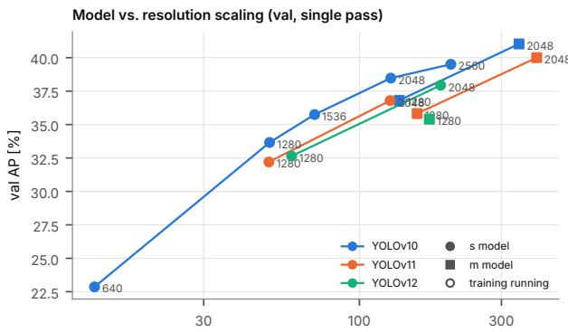  
GFLOPs per image (single pass, exact per input shape; val geometry)

Figure 3. Resolution or model size (VisDrone val). Singlepass AP against compute for each detector at 1280 and 2048 px (YOLOv10s also at 640, 1536 and 2560 px).  
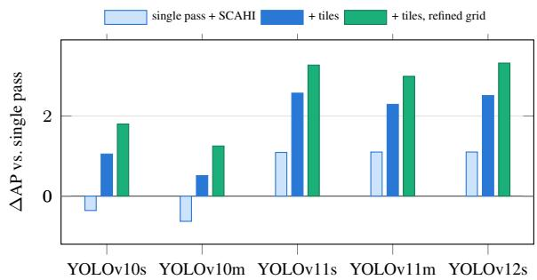  
Figure 4. Decomposition on VisDrone test-dev at 2048 px (post hoc). Gain over the single pass with standard post-processing. Tiles add a similar amount for every detector; fusing the single pass helps detectors with NMS and costs YOLOv10; the refined grid makes the overall gain consistent.

Decomposition and over-merging (post hoc). Splitting the step from the single pass to tiles with SCAHI shows that the tiles add a similar amount for every detector, 1.1–1.5 AP at 2048 px on test-dev, almost entirely on objects below 16 px (Fig. 4). The difference lies in fusing the single pass itself: it helps detectors with NMS but costs YOLOv10, whose one-to-one head already separates crowded objects. With a cell factor of 5, the fused single pass loses 22 to 24 points of recall on objects with a same-class neighbour. The refined grid recovers most of it and adds 1.2–1.4 AP on val for every detector; on test-dev the gain is about half as large (0.6–0.8 AP) but positive for every detector, the expected shrinkage after a search. With it, tiles beat the 2048 px single pass on test-dev by 1.0–3.3 AP for every detector.

Compute. For YOLOv10s, a single pass at 2560 px matches the 2048 px pass with tiles and the pre-specified SCAHI on val at 36 % of its compute. With the refined grid, tiles exceed it by 1.2 AP on val and 1.3 AP [1.05; 1.53] on test-dev, at 2.8 times the compute (Tab. 2). On the same tiles, SCAHI costs 77 ms per image against 51 ms for box fusion, mostly because it needs the dense outputs of the detector, and adds 1.9 AP on val and 2.0 AP on test-dev with the refined grid. On VisDrone, tiles therefore buy accuracy, not efficiency.

Table 2. Compute control, YOLOv10s on VisDrone. AP on val and test-dev, compute per image and latency on one RTX 5090, all rows measured in one exclusive run. Box fusion merges on the CPU, SCAHI on the GPU; SCAHI needs the detector’s dense oneto-many outputs and an unfused model, which is included in its latency; its GPU fusion matches the CPU reference up to float32 rounding. Rows marked <sup>†</sup> are post hoc; the 3072 px row is evaluated on val only.
<table><tr><td>Configuration</td><td>val</td><td>test GFLOPs</td><td>ms</td></tr><tr><td>single pass 2048</td><td>38.47</td><td>33.48</td><td>128 9.6</td></tr><tr><td>single pass 2560</td><td>39.51</td><td>33.98</td><td>203 13.6</td></tr><tr><td>run at 3072†</td><td>39.64</td><td></td><td>298 21.0</td></tr><tr><td>2048 + tiles, box fusion</td><td>38.85</td><td>33.25</td><td>562 50.8</td></tr><tr><td>2048 + tiles, SCAHI</td><td>39.34</td><td>34.53</td><td>562 77.3</td></tr><tr><td>2048 + tiles, SCAHI refined†</td><td>40.72</td><td>35.28</td><td>56277.3</td></tr></table>

## 5.3. DOTA: where tiles pay off

DOTA represents the other regime (Tab. 3). Its images are several thousand pixels wide and contain up to ten thousand objects. Because of this density, training a single pass at 3072 px exceeded the memory of our GPU even with a batch of two, and YOLOv12s could not be trained beyond 1024 px. Here tiles pay off. Because the refined grid was fixed before any DOTA result existed, DOTA tests it on independent data. Tiles at native resolution with SCAHI beat the strongest trainable single pass for all five detectors: by 4.3 to 5.6 mAP50 at 2048 px, and by 9.6 for YOLOv12s on its weaker 1024 px pass (Q3). Counting the difficult objects, the gains grow (e.g. 6.3 and 5.0 for YOLOv10s/m), and AP@[.5:.95] shows the same picture (supplement). For the YOLO detectors, SCAHI beats box fusion on identical passes at every testable resolution (Q2); for FCOS, both fusions perform on par (+0.4 and +0.1 mAP50, not confirmed). Q1 holds for YOLOv10m and YOLOv11s but narrowly misses for YOLOv10s and FCOS, whose confidence intervals include zero: on DOTA, higher resolution alone no longer beats tiling clearly. The verdicts of the original two-detector study are unchanged: Q2 and Q3 confirmed, Q1 not. Even box fusion with tiles is ahead of the single pass at 2048 px; SCAHI adds another 2.5 to 3.6 mAP50.

SAHI with SCAHI (Q4). SCAHI also works as a dropin replacement for SAHI’s merge step, given access to the detector’s dense outputs: on exactly SAHI’s passes, it adds 2.3 to 4.0 mAP50 for all four detectors (Q4, confirmed for both pairs; 3.4 to 4.3 points in AP@[.5:.95]), with large gains on objects above 128 px, which slicing cuts into fragments, and without adding substantial latency (supplement). For YOLOv10, SAHI uses the one-to-one and SCAHI the one-to-many head; YOLOv11s and YOLOv12s have a single head, so SAHI and SCAHI see the same predictions. Their gains (4.0 and 3.1) are at least as large, so they stem from the merge step.

Table 3. DOTA v1.5 (mAP50 on the held-out val split, devkit, no cap). Tiles at native resolution, merged by box fusion or by SCAHI with the refined grid (pre-specified on DOTA). YOLOv12s could not be trained at 2048 px; its Q3 is measured on its largest trainable pass (<sup>†</sup>1024 px). SAHI + SCAHI: SAHI’s own passes (1024 px weights) merged by SCAHI with the refined grid instead of SAHI’s merge; SAHI rows were not part of the pre-specified FCOS design. Bold: best configuration per detector and pass size. Bottom: pre-specified questions, difference with 95 % CI; verdicts with Holm over YOLOv10s/m and, separately, over YOLOv11s/v12s (both pairs also for Q4); FCOS, a single model, without correction. FCOS uses a simpler training recipe; compare within a column only.
<table><tr><td></td><td>Configuration</td><td>YOLOv10s</td><td>YOLOv10m</td><td>YOLOv11s</td><td>YOLOv12s</td><td>FCOS</td></tr><tr><td></td><td>1024 px single pass</td><td>55.80</td><td>58.44</td><td>56.16</td><td>56.36</td><td>42.64</td></tr><tr><td></td><td>+ tiles, box fusion</td><td>64.86</td><td>64.57</td><td>62.14</td><td>62.88</td><td>52.56</td></tr><tr><td></td><td>+ tiles, SCAHI</td><td>66.17</td><td>67.34</td><td>65.26</td><td>65.97</td><td>52.96</td></tr><tr><td></td><td>SAHI</td><td>59.20</td><td>60.96</td><td>57.90</td><td>60.21</td><td>一</td></tr><tr><td></td><td>SAHI + SCAHI</td><td>62.08</td><td>63.22</td><td>61.87</td><td>63.30</td><td></td></tr><tr><td></td><td>2048 px single pass</td><td>65.50</td><td>67.39</td><td>65.19</td><td></td><td>55.01</td></tr><tr><td></td><td>+ tiles, box fusion</td><td>68.46</td><td>68.13</td><td>66.68</td><td></td><td>60.49</td></tr><tr><td></td><td>+ tiles, SCAHI</td><td>71.00</td><td>71.73</td><td>69.81</td><td></td><td>60.59</td></tr><tr><td>Q1</td><td>2048 vs. 1024 + tiles, box</td><td>+2.31 [−0.31; 4.95] +3.42 [0.74; 5.59]+3.05 [0.55; 5.81]</td><td></td><td></td><td></td><td>untestable +2.45 [-0.49; 5.28]</td></tr><tr><td>Q2</td><td>SCAHI vs. box, 1024</td><td>+1.31 [0.36; 2.39] +2.77 [1.67; 3.83]+3.12 [2.02; 4.18]</td><td></td><td></td><td></td><td>+3.09 [2.11; 4.43] +0.40 [−0.92; 1.79]</td></tr><tr><td>Q2</td><td>SCAHI vs. box, 2048</td><td>+2.54 [1.43; 3.34]+3.60 [2.29; 4.57] +3.12 [2.00; 3.94]</td><td></td><td></td><td></td><td>untestable +0.09 [-0.91; 1.37]</td></tr><tr><td>Q3</td><td>tiles + SCAHI vs. single pass</td><td></td><td>+5.50 [3.55; 7.77] +4.34 [3.02; 6.19]+4.62 [2.76; 6.62]</td><td></td><td>+9.62† [7.10; 12.22]</td><td>+5.57 [3.77; 7.65]</td></tr><tr><td>Q4</td><td>SCAHI vs. SAHI&#x27;s merge</td><td></td><td></td><td>+2.87 [2.13; 4.33] +2.26 [1.08; 3.25] +3.97 [2.93; 5.06]</td><td>+3.10 [2.23; 4.08]</td><td></td></tr></table>

Compute on DOTA. The price of tiles is compute: for YOLOv10s about 5.5 times the GFLOPs and 4.8 times the latency of the single pass (134 vs. 28 ms with the fusion on the GPU). Of this time, 90 % are the tile passes, which every tiled method shares, including SAHI (195 ms); SCAHI itself adds about 13 ms.

FCOS. The non-YOLO detector reproduces the main pattern: tiles with SCAHI beat its single pass by 5.6 mAP50 and even its best single pass of the pre-specified inference crossing (2048 px weights run at 2560 px) by 2.5 mAP50. As for the YOLO detectors, the gain comes from the tiles, not from fusing the single pass. Where SCAHI does not exceed box fusion, the peak grid explains it (post hoc): on calib, the search retained the coarse pre-specified cell factor for FCOS, and with it SCAHI recalls about 30 points fewer crowded objects than box fusion, while isolated objects are recalled almost equally well, the over-merging analysed on VisDrone (Sec. 5.2). Neither the detection cap (capping both fusions equally leaves the result unchanged) nor a lack of redundant predictions (FCOS yields almost twice as many per object as the YOLO detectors) accounts for it. The FCOS comparison of the two fusions is also sensitive to the pipeline limit, which caps single very dense images: without it, a few such images add millions of low-scoring detections that dilute the dataset-wide ranking, SCAHI falls behind box fusion at 1024 px (−1.8 mAP50), and the gain of Q3 shrinks to 4.1 mAP50 but remains clear (supplement).

Table 4. SCAHI component ablation (post hoc; 2048 px pass with tiles). Difference to the pre-specified setting (border taper, normalisation, cell factor 5) in AP on VisDrone val (range over five detectors) and mAP50 on DOTA-val (YOLOv10s / YOLOv10m), and change in recall of objects with a same-class neighbour.
<table><tr><td>Variant</td><td>VisDrone</td><td>DOTA</td><td>crowded recall</td></tr><tr><td>without normalisation by C</td><td>±0.00</td><td>±0.00/±0.00</td><td>±0</td></tr><tr><td>without border taper</td><td>-0.74 to -1.01</td><td>-1.12/-0.99</td><td>-2 to +1</td></tr><tr><td>with validity windows</td><td>-1.61 to -1.79</td><td>*</td><td>-1 to -2</td></tr><tr><td>refined peak grid</td><td>+1.32 to +1.38</td><td>+0.36/+0.41</td><td>+18 to +24</td></tr></table>

<sup>∗</sup>Windows sized for VisDrone; on DOTA they cut off large objects (−19 / −20 mAP50).

## 5.4. What makes SCAHI work

Table 4 isolates the parts of SCAHI. Removing the explicit normalisation leaves the results unchanged, because the coverage-aware tapers already give every position the same total weight; removing the tapers themselves costs up to 1.1 points on both datasets. Validity windows that favour object sizes per pass consistently hurt and are not part of SCAHI. The resolution of the peak grid is the decisive design choice for crowded scenes: a finer grid raises the recall of crowded objects by 18 to 24 points. On VisDrone this lifts AP by 1.3 to 1.4 points; on DOTA, whose primary metric ignores the smallest, most crowded objects, the gain in mAP50 is smaller, but vehicles, the most crowded classes, gain 3.7 points. Giving box fusion the same coverage-aware border weights recovers only part of the gap for the YOLO detectors (post hoc, YOLOv10s and YOLOv11s): weighted NMS gains 0.5 to 0.75 AP over box fusion on VisDrone and 1.4 to 1.7 mAP50 on DOTA, but SCAHI remains ahead on the same passes by 1.0 to 2.3 AP on VisDrone and 1.1 to 1.4 mAP50 (2.0 to 2.3 AP@[.5:.95]) on DOTA. Most of its gain therefore comes from merging the dense outputs before boxes are decided, which mainly improves localisation. For FCOS, weighting does not help box fusion, and SC-AHI with its coarse grid stays on par with both; weighted Weighted Boxes Fusion falls below plain box fusion on both datasets (supplement).

## 5.5. Scale analyses

Two analyses on VisDrone clarify what limits small objects. Recall as a function of object size in the network input is the same whatever the inference resolution, so tiles and a higher input resolution help in the same way; below about 6 input pixels almost nothing is found. A degradation test suggests that the remaining difficulty of small objects stems more from the objects themselves, often occluded and crowded, than from missing pixels: large objects that lose half their resolution lose only 0.03 in recall, while originally small objects at the same apparent size are 0.09 below them. Training only on objects within a valid size band per zoom level, in the spirit of SNIPER, brought no gain over ignore-aware training.

## 6. Discussion and limitations

When does sliced inference pay off? We observed two regimes. Where the image could be processed at the needed resolution in a single pass, as on VisDrone, a higher input resolution was the cheaper route and outperformed standard tiling for every detector. Where the resolution a single pass could be trained at fell short of the image, as on DOTA, tiles paid off clearly. Which regime applies depends on image size, object density and the available memory, so the boundary will shift with hardware and detector. For the YOLO detectors, a dense fusion that keeps neighbours apart turned the tiles into more accuracy than box fusion in both regimes; for FCOS, both fusions were on par, and the reason, a peak grid too coarse for crowded scenes, is the same mechanism that the refined grid addresses. Per image, the gain of tiles with SCAHI increased with the share of small objects on DOTA (Spearman $\rho = 0 . 1 5 ~ \mathrm { t o } ~ 0 . 2 1 )$ ; on Vis-Drone this relation was weak $( | \rho | \le 0 . 0 9 )$ , and in neither dataset did it follow the share of crowded objects (supplement). Like any tiled inference, including SAHI, SCAHI multiplies the number of passes; most of its cost comes from these passes, and the fusion adds the remainder. It therefore targets accuracy-oriented processing of large images, such as offline analysis of aerial imagery; where latency matters more than the last points of accuracy, a single pass at the highest trainable resolution remains the better choice.

Limitations. (i) SCAHI requires dense per-position predictions, as produced by anchor-free heads (YOLO, FCOS [21], GFL [8]); query-based detectors such as RT-DETR output a fixed set of predictions per pass and would require a sparse variant of the fusion, which we leave for future work. Apart from FCOS on DOTA, our experiments use YOLO detectors. (ii) On VisDrone, the refined peak grid was found post hoc; its held-out gain is about half of its val estimate, and on DOTA it was pre-specified. Its cell factor is selected by mAP50 on a calibration split, which can miss crowded scenes when they are rare, as for FCOS; a selection criterion that accounts for crowded recall is left for future work. (iii) The DOTA devkit ignores the smallest objects, and the images we used are re-encoded JPEGs. (iv) All latencies were measured on a single RTX 5090, each table in one exclusive run. (v) Horizontal boxes only.

## 7. Conclusion

In our experiments, whether sliced inference pays off depended on whether the needed resolution could be trained. On VisDrone, where it could, a single pass at a higher resolution beat tiling with box fusion; on DOTA, where it could not, tiles added substantial accuracy for every detector. For the YOLO detectors, the merge step decided in both regimes: a dense fusion with coverage-aware weights and a peak grid that keeps neighbours apart turns the information in the tiles into accuracy that box fusion leaves on the table.

## LLM Usage Statement

The research question and core idea originated with the authors. Under their direction, a general-purpose assistant (Claude, Anthropic) helped draft experimental designs, analysis plans, manuscript text and two schematic figures and one chart, which the authors reviewed, revised and approved; Claude Opus 5.5 (Anthropic) was used as a coding agent to implement code and run experiments. All key decisions, including hypotheses and success criteria, data and models, deviations, frozen configurations and the single authorized evaluation on held-out test data, were made by the authors and are recorded in a dated decision log. Experimental results were checked using reproducible scripts and automated tests, including evaluation ports validated against the official implementations. The authors verified the manuscript and references and take full responsibility for the work.

## References

[1] Fatih Cagatay Akyon, Cemil Cengiz, Sinan Onur Altinuc, Devrim Cavusoglu, Kadir Sahin, Ogulcan Eryuksel, and O. Sezer. SAHI: A lightweight vision library for performing large scale object detection and instance segmentation. Soft ware, version 0.12.8 used in this work, Zenodo, 2021. 2

[2] Fatih Cagatay Akyon, Sinan Onur Altinuc, and Alptekin Temizel. Slicing aided hyper inference and fine-tuning for small object detection. In 2022 IEEE International Conference on Image Processing (ICIP), pages 966–970, 2022. 1, 2

[3] Navaneeth Bodla, Bharat Singh, Rama Chellappa, and Larry S. Davis. Soft-NMS – improving object detection with one line of code. In Proceedings of the IEEE International Conference on Computer Vision (ICCV), pages 5561–5569, 2017. 2

[4] Jian Ding, Nan Xue, Gui-Song Xia, Xiang Bai, Wen Yang, Michael Ying Yang, Serge Belongie, Jiebo Luo, Mihai Datcu, Marcello Pelillo, and Liangpei Zhang. Object detection in aerial images: A large-scale benchmark and challenges. IEEE Transactions on Pattern Analysis and Machine Intelligence, 44(11):7778–7796, 2022. 2

[5] Fabian Isensee, Paul F. Jaeger, Simon A. A. Kohl, Jens Petersen, and Klaus H. Maier-Hein. nnU-Net: A selfconfiguring method for deep learning-based biomedical image segmentation. Nature Methods, 18:203–211, 2021. 2

[6] Glenn Jocher, Jing Qiu, and Ayush Chaurasia. Ultralytics YOLO. Software, version 8.4.183, Zenodo, 2026. 2, 3

[7] Changlin Li, Taojiannan Yang, Sijie Zhu, Chen Chen, and Shanyue Guan. Density map guided object detection in aerial images. In Proceedings of the IEEE/CVF Conference on Computer Vision and Pattern Recognition (CVPR) Workshops, pages 190–191, 2020. 2

[8] Xiang Li, Wenhai Wang, Lijun Wu, Shuo Chen, Xiaolin Hu, Jun Li, Jinhui Tang, and Jian Yang. Generalized focal loss: Learning qualified and distributed bounding boxes for dense object detection. In Advances in Neural Information Processing Systems, 2020. 2, 7

[9] Tsung-Yi Lin, Michael Maire, Serge Belongie, James Hays, Pietro Perona, Deva Ramanan, Piotr Dollar, and C. Lawrence´ Zitnick. Microsoft COCO: Common objects in context. In Computer Vision – ECCV 2014, pages 740–755, 2014. 1

[10] Kai Liu, Zhihang Fu, Sheng Jin, Ze Chen, Fan Zhou, Rongxin Jiang, Yaowu Chen, and Jieping Ye. ESOD: Efficient small object detection on high-resolution images. IEEE Transactions on Image Processing, 34:183–195, 2025. 2

[11] Francesco Moretti, Yi Jin, and Guiqin Mario. Adaptive slicing-assisted hyper inference for enhanced small object detection in high-resolution imagery, 2026. 2

[12] Muhammad Muzammul, Xuewei Li, and Xi Li. Enhancing tiny object detection using guided object inference slicing (GOIS): An efficient dynamic adaptive framework for finetuned and non-fine-tuned deep learning models. Neurocomputing, 640:130327, 2025. 2

[13] Mahyar Najibi, Bharat Singh, and Larry S. Davis. Auto-Focus: Efficient multi-scale inference. In Proceedings of the IEEE/CVF International Conference on Computer Vision (ICCV), pages 9745–9755, 2019. 2

[14] Rashid Riyadh, Abd Ullah Khan, Imad Gohar, and Muzammil Behzad. ROI-Gated SAHI: Content-adaptive slicingbased inference for efficient object detection, 2026. 2

[15] Nermin Samet, Samet Hicsonmez, and Emre Akbas. Hough-Net: Integrating near and long-range evidence for bottom-up object detection. In Computer Vision – ECCV 2020, pages 406–423. Springer International Publishing, 2020. 2

[16] Bharat Singh and Larry S. Davis. An analysis of scale invariance in object detection – SNIP. In Proceedings of the IEEE Conference on Computer Vision and Pattern Recognition (CVPR), pages 3578–3587, 2018. 2

[17] Bharat Singh, Mahyar Najibi, and Larry S. Davis. SNIPER: Efficient multi-scale training. In Advances in Neural Information Processing Systems, 2018. 2

[18] Roman Solovyev, Weimin Wang, and Tatiana Gabruseva. Weighted boxes fusion: Ensembling boxes from different object detection models. Image and Vision Computing, 107: 104117, 2021. 2

[19] Jonay Suarez-Ram´ ´ırez, Daniel Santana-Cedres, and Nelson´ Monzon. DAHI: A fast and efficient density aided hyper´ inference technique for large scene object detection. Pattern Recognition, 171:112228, 2026. 2

[20] Yunjie Tian, Qixiang Ye, and David Doermann. YOLOv12: Attention-centric real-time object detectors. In Advances in Neural Information Processing Systems, pages 78433– 78457, 2025. 2

[21] Zhi Tian, Chunhua Shen, Hao Chen, and Tong He. FCOS: Fully convolutional one-stage object detection. In 2019 IEEE/CVF International Conference on Computer Vision (ICCV), pages 9626–9635, 2019. 3, 7

[22] Ao Wang, Hui Chen, Lihao Liu, Kai Chen, Zijia Lin, Jungong Han, and Guiguang Ding. YOLOv10: Real-time end to-end object detection. In Advances in Neural Information Processing Systems, 2024. 2

[23] Gui-Song Xia, Xiang Bai, Jian Ding, Zhen Zhu, Serge Belongie, Jiebo Luo, Mihai Datcu, Marcello Pelillo, and Liang pei Zhang. DOTA: A large-scale dataset for object detection in aerial images. In Proceedings of the IEEE Conference on Computer Vision and Pattern Recognition (CVPR), pages 3974–3983, 2018. 1, 2

[24] Fan Yang, Heng Fan, Peng Chu, Erik Blasch, and Haibin Ling. Clustered object detection in aerial images. In Proceedings of the IEEE/CVF International Conference on Computer Vision (ICCV), pages 8311–8320, 2019. 2

[25] Pengfei Zhu, Longyin Wen, Dawei Du, Xiao Bian, Heng Fan, Qinghua Hu, and Haibin Ling. Detection and tracking meet drones challenge. IEEE Transactions on Pattern Analysis and Machine Intelligence, 44(11):7380–7399, 2022. 1, 2

# When Does Sliced Inference Pay Off? Resolution, Tiling and Dense Fusion for Small Object Detection

Supplementary Material

## Overview

This supplement collects material that does not fit into the page limit of the main paper and the information needed to reproduce the study. Section 8 describes the study protocol and the computing environment. Section 9 and Sec. 10 give the detailed VisDrone results of the model extension and of the main study with YOLOv10s. Section 11 reports the DOTA study, Sec. 12 the component ablation of SC-AHI, Sec. 13 qualitative examples, Sec. 14 the code and its use, Sec. 15 the societal impact, and Sec. 16 all deviations from the original plan. Unless stated otherwise, VisDrone numbers are the toolkit AP@[.5:.95] and DOTA numbers the devkit mAP50, in percent.

## 8. Study protocol and reproducibility

Evaluation. Our Python port of the official VisDrone toolkit (evalDET.m) reproduces the original implementation to within 2 · 10<sup>−4</sup> AP on the full val split, for synthetic and for real detections. Ground truth and detections that lie mostly in ignore regions are removed as in the toolkit; every method is capped at 500 detections per image, sorted by score. Size-bin results use pycocotools [9] on the same filtered data. Boxes of the cached whole-image passes are mapped back to the image with a single scale factor, whereas the Ultralytics predictor uses one per axis and a slightly different resize rule. Recomputing affected configurations on calib with the Ultralytics conventions changes their results by at most 0.013 AP@[.5:.95] on VisDrone and 0.0015 mAP50 on DOTA; this is below the threshold of 0.05 fixed before the check, so all frozen values are kept.

Pre-specification. Both studies fixed their hypotheses, success thresholds and selection rules in writing before the corresponding results existed, and recorded every later decision with date and reason in a decision log. Additions after the start of a study were only allowed to tighten a criterion or to define untestable cases; all of them predate the results they concern. In the main study, the reference configuration, the candidate set, three hypotheses and the noise threshold were fixed before the first method training; a second, stronger reference was added before any method result on val existed. In the extension, the four questions of the main paper, the counting rule (at least four of five detectors) and the treatment of untestable cases were fixed before training.

Frozen evaluation. Before each test-dev evaluation, all configurations to be evaluated were frozen together with the checksums of their weights and the origin of every choice (fixed by design or selected on calib). A replay through the test-dev code path then had to reproduce the val result of every frozen configuration exactly before test-dev was touched. Test-dev was evaluated once per study, and every frozen configuration is reported.

Environment and compute. Python 3.11, PyTorch 2.14.1 (CUDA 13.0), Ultralytics 8.4.183, SAHI 0.12.8. All runs used one NVIDIA RTX 5090 (32 GB) at the default power limit; the study moved once between two identical machines, and the frozen weights reproduced every val result exactly on both. All latencies were measured on one machine with exclusive use of the GPU, each table in one run. Parts of the calibration tuning were parallelised; a cross-check confirmed identical selections and identical results. The main study took about 24 GPU-hours plus CPU time for the fusion.

## 9. VisDrone model extension: detailed results

Figure 5 summarises the pre-specified questions of the extension on val and test-dev.

This section complements Sec. 5.2 of the main paper. The decomposition, the over-merging analysis and the refined peak grid were defined after the val results of the extension were known; they are reported separately from the pre-specified verdicts and never enter them.

Decomposition. Figure 6 shows the full decomposition for all detectors, both pass sizes and both splits. Each panel starts from the single pass with its standard post-processing (A), adds SCAHI on the single pass, then the tiles, and finally the refined peak grid. Error bars are paired bootstrap 95 % confidence intervals of each step. The step from adding tiles is positive in every panel, which is the basis of the statement that tiles carry consistent information for small objects. The step from fusing the single pass is negative for YOLOv10, whose one-to-one head already delivers one box per object, and positive on test-dev for all detectors with NMS. On test-dev, the refined grid improves on the pre-specified setting by 0.61–0.81 AP for all eleven comparable configurations, about half of its val gain (ratio 0.49– 0.59).

Crowded and isolated objects. Figure 7 splits the recall at IoU 0.5 into objects with a same-class neighbour (crowded) and all others (isolated). With the pre-specified grid, fusion loses about 20 points of crowded recall against the single pass, while isolated objects gain. The refined grid recovers most of the crowded recall without losing the gain on isolated objects. Figure 8 shows, for each configuration searched on calib, accuracy against fusion time; the selected configurations lie on the upper edge of each cloud, and allowing more than twice the fusion time of the pre-specified setting would have added at most 0.14 AP on calib. Fusion times vary by about ±10 % between measurements, so the admissibility of variants close to the limit can change; in a repeated search, the selected configuration and all accuracies were unchanged.

Questions Q1–Q3 per detector, val and test-dev  
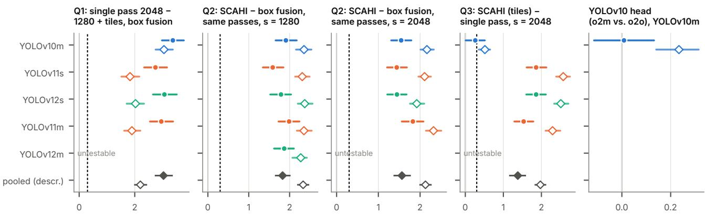  
Δ AP [%], paired-bootstrap 95 % CI (1000 resamples); dashed = ε = 0.30 (from val)  
val (verdicts as computed) test-dev (held-out confirmation, same logic)

Figure 5. Pre-specified questions across detectors (VisDrone model extension). Differences with paired bootstrap 95 % confidence intervals on val (filled) and test-dev (hollow); dashed line: threshold ε = 0.30 AP. Q2 is shown for passes at 1280 and 2048 px; the las panel compares the two YOLOv10 heads under SCAHI. YOLOv12m could only be tested at 1280 px.  
Table 5. Small objects on test-dev (AP for objects below 8 px and 8–16 px, passes at 2048 px). Single pass with standard post-processing; tiles with box fusion (NMS); tiles with SCAHI, pre-specified and with refined grid.
<table><tr><td>Detector</td><td>single pass</td><td>tiles, NMS</td><td>tiles, SCAHI</td><td>tiles, SCAHI refined</td></tr><tr><td>YOLOv10m</td><td>7.74 / 15.73</td><td>7.48 / 16.39</td><td>6.33 / 16.81</td><td>6.78 / 17.31</td></tr><tr><td>YOLOv11s</td><td>5.14 / 12.78</td><td>6.33 / 13.92</td><td>6.79 / 15.26</td><td>6.88 / 15.72</td></tr><tr><td>YOLOv11m</td><td>5.53 / 14.08</td><td>6.24 / 15.28</td><td>7.37 / 16.76</td><td>7.53 / 17.13</td></tr><tr><td>YOLOv12s</td><td>4.94 / 13.69</td><td>6.09 / 14.65</td><td>6.86 / 15.91</td><td>7.19 / 16.39</td></tr></table>

Small objects. Table 5 breaks the test-dev results at 2048 px down by object size. Tiles with SCAHI improve the bins below 16 px for the detectors with NMS. For YOLOv10m, the NMS-free single pass remains best below 8 px, and the gain of tiles appears from 8 px upwards; this is the same head effect that the decomposition isolates.

Compute control. Figure 9 plots accuracy against compute and latency for YOLOv10s on both splits. The differences to the 2560 px single pass are, on val, −1.03 [−1.36; −0.68] for the 2048 px single pass, −0.17 [−0.51; +0.16] for tiles with pre-specified SCAHI and +1.21 [+0.90; +1.53] with the refined grid; on test-dev −0.51 [−0.76; −0.27], +0.55 [+0.29; +0.79] and +1.30 [+1.05; +1.53].

Compute and latency were measured on val and apply to test-dev unchanged.

Training curves. Figure 10 shows the calibration AP over training for all runs. Every detector peaks around epoch 50–60 and then declines by 1.3–1.7 points, so the selection of the epoch on calib matters; the recipe was kept unchanged as pre-specified.

YOLOv12s s = 1280 · test-dev

YOLOv10m s = 2048 · test-dev YOLOv11s s = 2048 · test-dev YOLOv12s s = 2048 · test-dev YOLOv11m s = 2048 · test-dev  
Decomposition: single pass → + SCAHI on the single pass (no tiles) → + z = 2 tiles → SCAHI, refined grid (o2m head), val and test-dev; exploratory, post hoc  
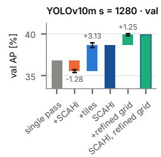

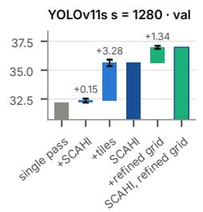  
YOLOv11s s = 1280 · test-dev

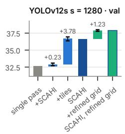

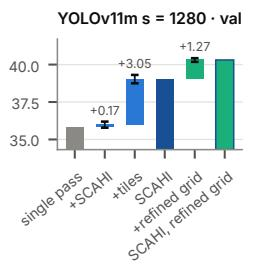  
YOLOv11m s = 1280 · test-dev

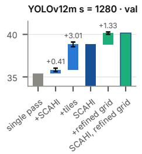  
YOLOv12m s = 1280 · test-dev

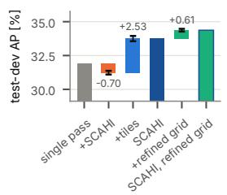

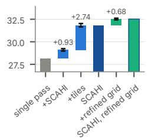

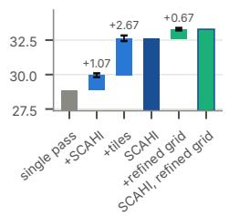

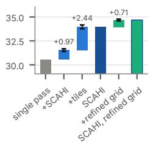

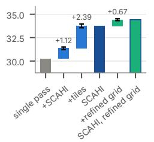

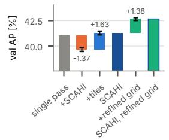

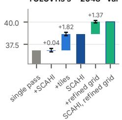

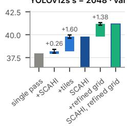

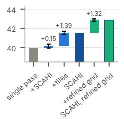

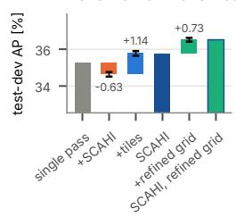

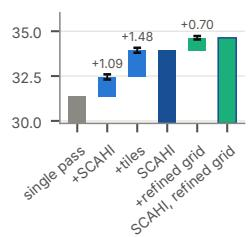  
Error bars: paired-bootstrap 95 % CI of each step. YOLOv10m: the single pass uses the o2o head. YOLOv12m: s = 1280 only

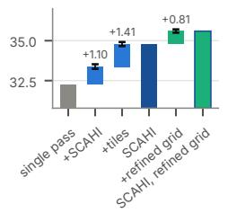

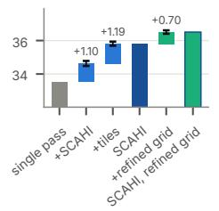

Figure 6. Decomposition of the gain of tiles with SCAHI for all detectors, on val and test-dev, at 1280 px (top) and 2048 px (bottom): single pass, then SCAHI on the single pass, then adding z=2 tiles, then the refined grid. Error bars: paired bootstrap 95 % confidence intervals of each step. For YOLOv10m, the single pass uses the one-to-one head; YOLOv12m only at 1280 px.

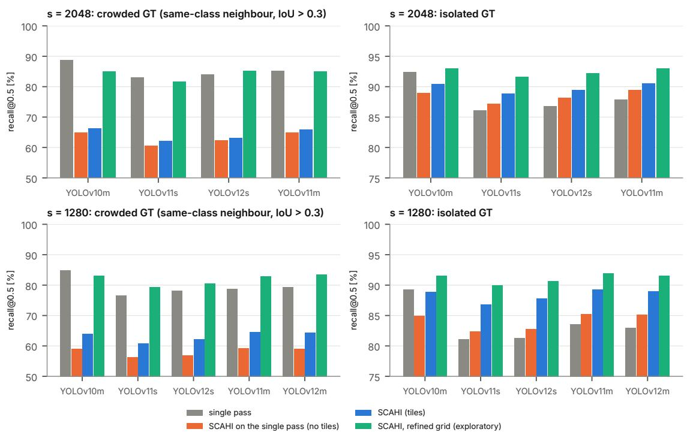  
val, all detections (≤ 500 per image, as in the evaluation); YOLOv12m only at s = 1280 (2048 dropped); exploratory, post hoc

Figure 7. Recall of crowded and isolated objects (IoU 0.5, val) for the single pass (A), SCAHI on the single pass (B), tiles with SCAH (C) and the refined grid.

SCAHI, refined grid on calib: AP vs. fusion time (exploratory, post hoc; selected on calib after val results were known)  
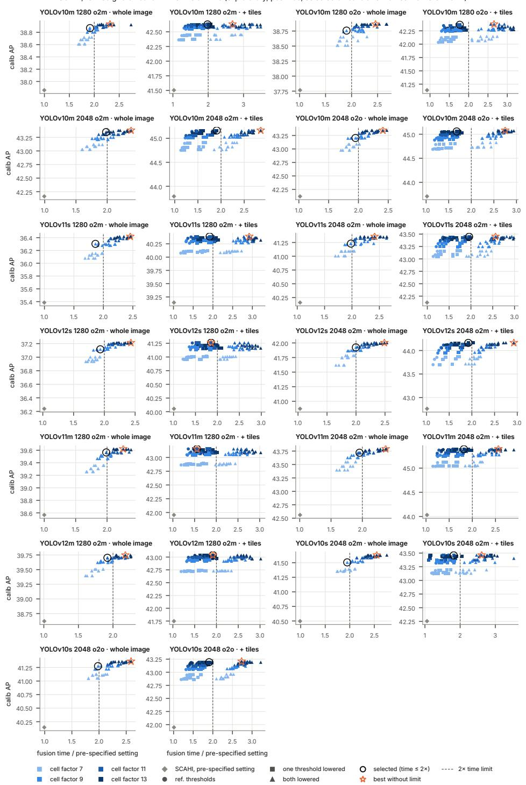  
Figure 8. Search of the refined peak grid on calib. AP against fusion time per image for every searched configuration, per detector, pass size and row (B: single pass, C: with tiles); the selected configuration is marked. The time limit was twice the fusion time of the pre-specified setting.

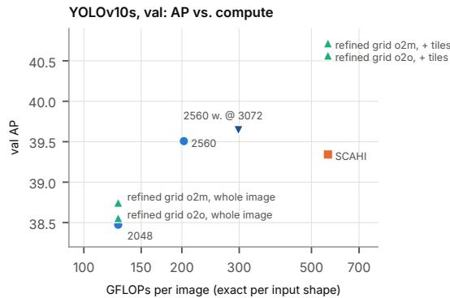  
YOLOv10s, test-dev: AP vs. compute

YOLOv10s, val: AP vs. latency (hollow = optimised path)  
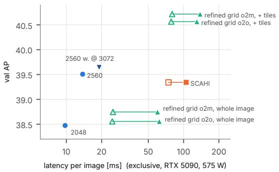  
YOLOv10s, test-dev: AP vs. latency (hollow = optimised path)

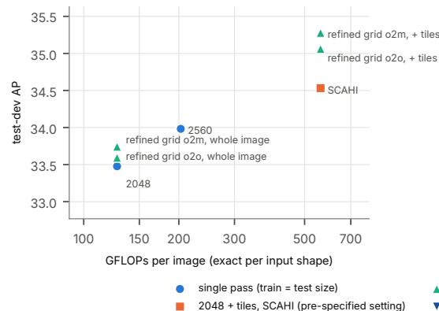

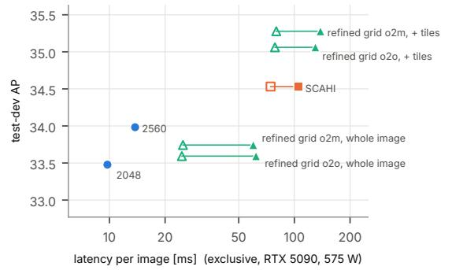  
SCAHI, refined grid, exploratory (whole image / + tiles)  
Single pass 2048, SCAHI and refined grid on the single-pass 2048 weights; single pass 2560 = own training at 2560 (same recipe); training at 3072 did not fit at the recipe batch 3. The 2560 weights at 3072 px (exploratory, post hoc) are on val only. Refined grid: exploratory, post hoc, selected on calib. GFLOPs and latency measured on val, reused for test-dev.

single pass, 2560 weights at 3072 px (exploratory)

Figure 9. Compute control for YOLOv10s: AP against GFLOPs and against latency on val (top) and test-dev (bottom), for single passes at 2048 and 2560 px and tiles with SCAHI (pre-specified and refined grid).

Calib AP during training (toolkit port at the scheduled calib evaluations) - descriptive, recipe unchanged  
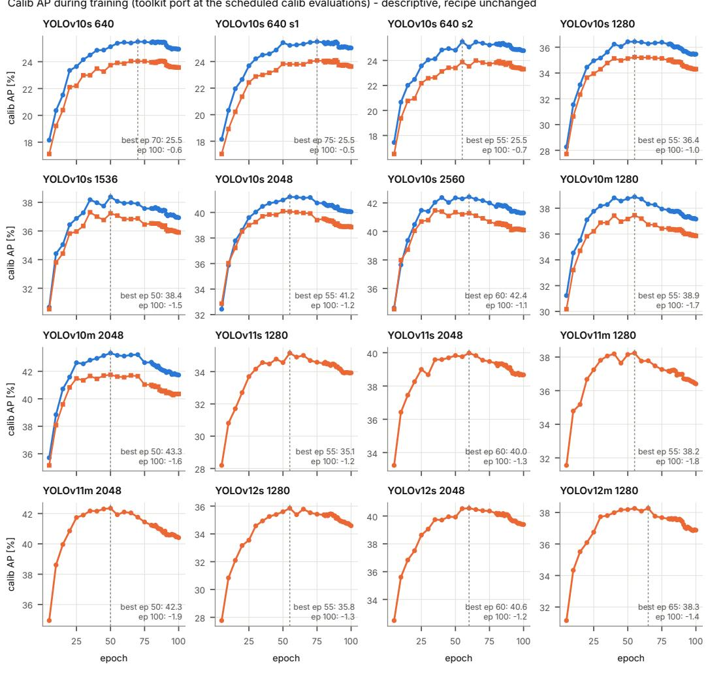  
Figure 10. Calibration AP during training for all detectors and input sizes; the selected epoch is the maximum on calib.

The main study compared single passes, SAHI and multizoom configurations for YOLOv10s, studied five training variants including scale-normalised training, and introduced the dense fusion. The configuration selected on calib in the main study (“selected configuration”) combines scale-normalised training, z0.64 + z2 tiles and SCAHI with validity windows estimated on calib. Table 6 lists all reference configurations; Fig. 11 relates the object sizes of val and test-dev to the sizes a pass can resolve.

Detection limit and degradation. Figure 12 shows recall over the apparent object size in the network input on calib; it defines the lower edge of the validity windows tested for the fusion. Table 7 and Fig. 14 report the degradation test: large objects that lose half of their resolution keep most of their recall, whereas originally small objects at the same apparent size are much harder.

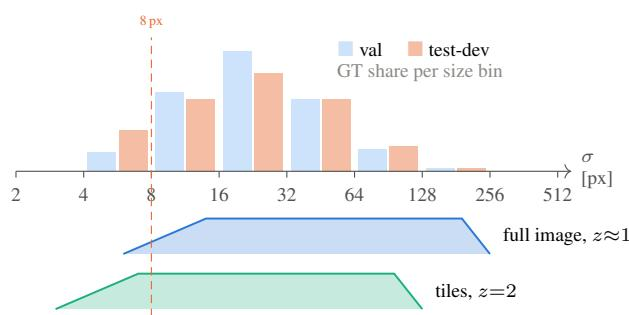  
Figure 11. Object sizes and the sizes each pass can see. Top: share of ground truth per size bin in val and test-dev. Bottom: the band of original object sizes σ whose apparent size σz lies in the valid input range of 8–192 px (soft edges 6–14 and 192–256 px), for a native full-image pass and for z=2 tiles. Objects below about 4 px are out of reach of both; test-dev has twice the share of objects below 8 px.

Training variants. Table 8 compares the five training variants under identical inference. They differ by at most 0.31 AP on val. Figure 15 explains why scale normalisation does not help: it gains on large objects and loses on small ones, and its zoom-stratified chips carry fewer positives in the size range that matters most. Table 9 shows that the choice of the fusion matters more than the choice of the training variant.

Dense fusion in the main study. Figure 16 shows that the excess of false positives near tile borders disappears with the dense fusion; Fig. 17 shows its border and validity windows, and Fig. 18 slices of the fused volume over position and object size. Table 10 and Fig. 19 report the configurations that place tiles on top of the strongest single passes, defined after the val results and confirmed on testdev.

Pre-specified criteria and test-dev. Table 11 and Fig. 20 report the pre-specified criteria of the main study on val and test-dev, and Fig. 21 compares all frozen configurations across the splits.

Table 6. Single pass vs. tiling. Toolkit AP; $\mathrm { { A P _ { < 1 6 } } \mathrm { { : } } }$ objects below 16 px (val); MP: input megapixels per image; latency on one RTX 5090 (val).
<table><tr><td>Configuration</td><td> $\mathrm { A P \ v a l }$ </td><td> $\mathrm { A P t d }$ </td><td> $\mathrm { A P _ { < 1 6 } }$ </td><td>MP</td><td>ms</td></tr><tr><td>single pass 640</td><td>22.86</td><td>21.82</td><td>6.9</td><td>0.25</td><td>4.8</td></tr><tr><td>single pass 1280</td><td>33.66</td><td>30.25</td><td>14.9</td><td>0.94</td><td>6.3</td></tr><tr><td>single pass 1536</td><td>35.75</td><td>31.60</td><td>17.0</td><td>1.33</td><td>7.0</td></tr><tr><td>single pass 2048</td><td>38.47</td><td>33.48</td><td>19.5</td><td>2.36</td><td>10.7</td></tr><tr><td>SAHI, fine-tuned</td><td>32.75</td><td>29.87</td><td>13.5</td><td>2.37</td><td>36.3</td></tr><tr><td>SAHI (1280 weights)</td><td>31.52</td><td>28.68</td><td>13.4</td><td>2.37</td><td>36.4</td></tr><tr><td>1280 + tiles, box fusion</td><td>35.00</td><td>30.73</td><td>18.5</td><td>9.12</td><td>49.9</td></tr><tr><td> $1 5 3 6 + \mathrm { t i l e s } ,$  box fusion</td><td>36.67</td><td>31.83</td><td>19.5</td><td>9.51</td><td>49.3</td></tr></table>

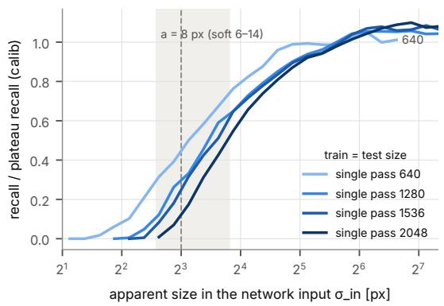  
Figure 12. Lower detection edge on calib: recall over apparent size in the network input; 25/50/75 % points at 5.6/8.7/14.3 px.

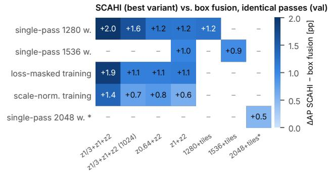  
Figure 13. Fusion gain (best dense variant minus NMS) for every weight set and stack, configurations chosen on calib.

Table 7. Degradation test (recall at score ≥ 0.25, val). All 95 % CIs between columns are disjoint.
<table><tr><td>Model</td><td>native</td><td>d=2</td><td>small ×2</td><td>d=4</td><td>small ×4</td></tr><tr><td>single pass 1280</td><td>0.825</td><td>0.800</td><td>0.710</td><td>0.670</td><td>0.419</td></tr><tr><td>single pass 2048</td><td>0.853</td><td>0.815</td><td>0.729</td><td>0.675</td><td></td></tr></table>

Same apparent size σ\_in, same information loss: originally small objects stay harder (population effect)

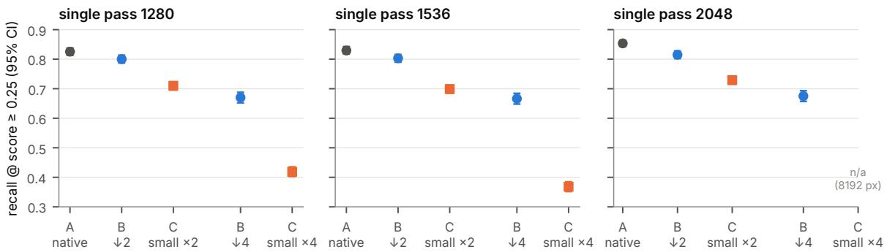  
Figure 14. Information loss vs. population. Recall of large objects natively and after degradation by d, compared with originally smal objects zoomed to the same apparent size (val, 95 % CIs).

Table 8. Training variants $( \mathbf { z } 1 + \mathbf { z } 2 { \boldsymbol { \mathbf { \mathit { \Sigma } } } }$ tiles, box fusion, one-to-one head).
<table><tr><td>Variant</td><td>AP val</td><td>AP test-dev</td></tr><tr><td>ignore regions dropped</td><td>35.76</td><td>31.24</td></tr><tr><td>ignore regions painted grey</td><td>35.76</td><td>31.44</td></tr><tr><td>loss-masked training</td><td>35.93</td><td>31.41</td></tr><tr><td>loss-masked + truncation ignore</td><td>35.62</td><td>31.48</td></tr><tr><td>scale-normalised training</td><td>35.92</td><td>31.69</td></tr></table>

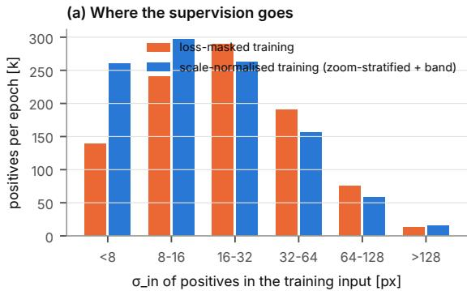

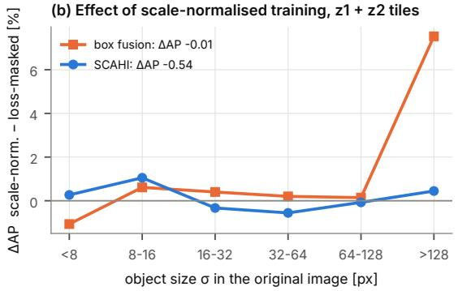  
Figure 15. H1 diagnostic: per-size AP of T4 vs. T2 and positives per training chip by zoom level.

Table 9. Training × fusion (val AP, ${ \bf z } 0 . 6 4 + { \bf z } 2$ tiles, one-to-many head).
<table><tr><td></td><td>box fusion</td><td>SCAHI + validity windows</td><td>fusion gain</td></tr><tr><td>loss-masked training</td><td>34.01</td><td>35.33</td><td>+1.32</td></tr><tr><td>scale-normalised training</td><td>34.82</td><td>35.92</td><td>+1.10</td></tr><tr><td>training gain</td><td>+0.81</td><td>+0.59</td><td></td></tr></table>

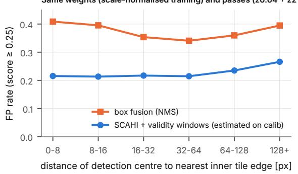  
Figure 16. False positives near tile borders for box fusion and dense fusion on identical passes (YOLOv10s, val).

Table 10. Exploratory rows: single pass $+ z { = } 2$ tiles, ∆AP vs. the single pass of the same weights.
<table><tr><td>Rows</td><td>∆ val</td><td>∆ test-dev</td><td>AP td</td></tr><tr><td>2048 + tiles, box fusion (o2o)</td><td>+0.37</td><td>-0.23</td><td>33.25</td></tr><tr><td>2048 + tiles, SCAHI (o2m)</td><td>+0.87</td><td>+1.05</td><td>34.53</td></tr><tr><td>1536 + tiles, box fusion (o2o)</td><td>+0.92</td><td>+0.31</td><td>31.92</td></tr><tr><td>1536 + tiles, SCAHI (o2m)</td><td>+1.86</td><td>+1.92</td><td>33.52</td></tr></table>

(a) Validity windows, passes z1/3 + z1 + z2 tiles $( \mathsf { a } = \mathsf { 8 } , \mathsf { b } = 1 \mathsf { 9 } 2$ px in σ\_in)(b) Border windows sum to one  
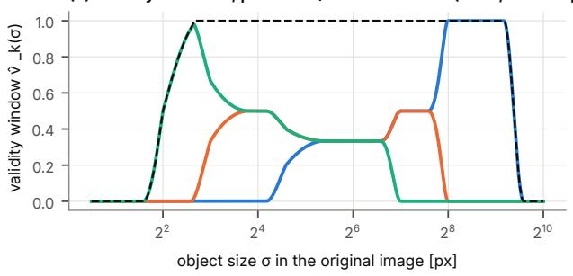

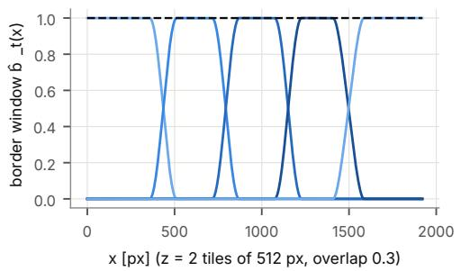  
z = 1/3 (whole image) z = 1 (tiles 640) z = 2 (tiles 320) Σ v̂ (partition of unity)  
Figure 17. Analytic windows: border tapers (sum to 1 over the overlap) and validity windows over $\log _ { 2 } ( \sigma z )$ (gate G5a: deviation from 1 at most 0.045).

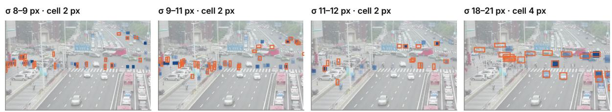  
Field S(x, y, log σ) of SCAHI per σ-slice (blue, darker = higher, scaled to the slice's 99th percentile; display max-filter ≈ σ/2); orange = ground truth of that size; same crop as the qualitative figure.  
Figure 18. Slices of the fused scale-space volume S(x, y, log σ) for four size ranges (blue, darker = higher; orange = ground truth of tha size). Small objects light up only in the small-σ slices, larger vehicles in the 18–21 px slice (val image 0000295 02000 d 0000031).

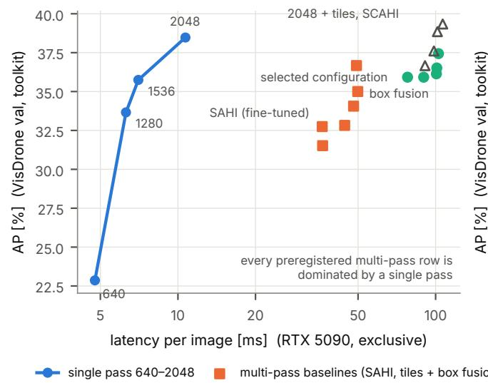

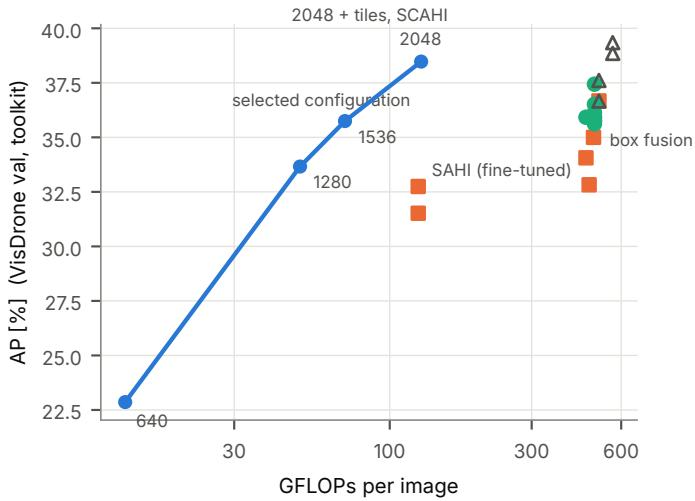  
SCAHI variants (pre-registered) exploratory, defined after val  
Figure 19. Accuracy vs. cost (val; final latencies with exclusive GPU and CPU). The single-pass front dominates all pre-specified multi pass rows; only the exploratory 2048 px pass with z=2 tiles and dense fusion lies above it.

object size σ = √(wh) [px] (top: share of test-dev GT)  
Table 11. Main study: pre-specified criteria with confidence intervals (seed 0; paired bootstrap 95 % CI over images, 1,000 resamples; $\varepsilon = 0 . 3 0 \mathrm { A P } )$
<table><tr><td>Criterion</td><td>val</td><td></td><td></td><td>test-dev</td><td></td></tr><tr><td>(a) selected config. − (1280 + tiles, box)  $\geq + 1 . 0$ </td><td></td><td> $+ 0 . 9 2 \ [ + 0 . 5 2 ; + 1 . 3 1 ]$ </td><td>not met</td><td> $+ 1 . 8 1 [ + 1 . 5 2 ; + 2 . 1 0 ]$ </td><td></td></tr><tr><td>(b)  $\sigma < 1 6 ; \ge + 2 . 0$ </td><td></td><td> $+ 0 . 4 2 \ : [ - 0 . 5 0 ; + 1 . 6 5 ] \mathrm { n o t } \mathrm { m e t }$ </td><td></td><td> $- 0 . 7 8 \left[ - 1 . 3 4 ; - 0 . 0 8 \right]$ </td><td></td></tr><tr><td> $( \mathrm { c } ) \mathrm { e q u a l \ A P \ a t } \leq 0 . 7 \times \mathrm { c o s t }$ </td><td>not testable</td><td></td><td></td><td>not testable</td><td></td></tr><tr><td>(a) vs. single pass 2048</td><td></td><td> $- 2 . 5 5 \ : [ - 2 . 9 8 ; - 2 . 1 9 ] \ : \mathrm { n o t } \ : \mathrm { m e t }$ </td><td></td><td></td><td> $- 0 . 9 4 \left[ - 1 . 2 5 ; - 0 . 6 5 \right]$ </td></tr><tr><td>scale-normalised — loss-masked  $> \varepsilon$ </td><td></td><td> $- 0 . 0 1 \left[ - 0 . 3 9 ; + 0 . 3 4 \right] \mathrm { n o t } \mathrm { m e t }$ </td><td></td><td> $+ 0 . 2 9 \left[ + 0 . 0 6 ; + 0 . 5 3 \right]$ </td><td>not met</td></tr><tr><td>SCAHI − box fusion &gt; ε</td><td></td><td> $+ 1 . 1 0 \ [ + 0 . 8 4 ; + 1 . 3 7 ] \ \mathrm { m e t }$ </td><td></td><td> $+ 1 . 6 4 \ : [ + 1 . 4 4 ; + 1 . 8 4 ] \ : \mathrm { m e t }$ </td><td></td></tr><tr><td>YOLOv10 head: o2m vs. o2o</td><td></td><td> $+ 0 . 5 9 \ [ + 0 . 4 4 ; + 0 . 7 5 ]$ </td><td></td><td> $+ 0 . 5 0 \ [ + 0 . 3 8 ; + 0 . 6 2 ]$ </td><td></td></tr></table>

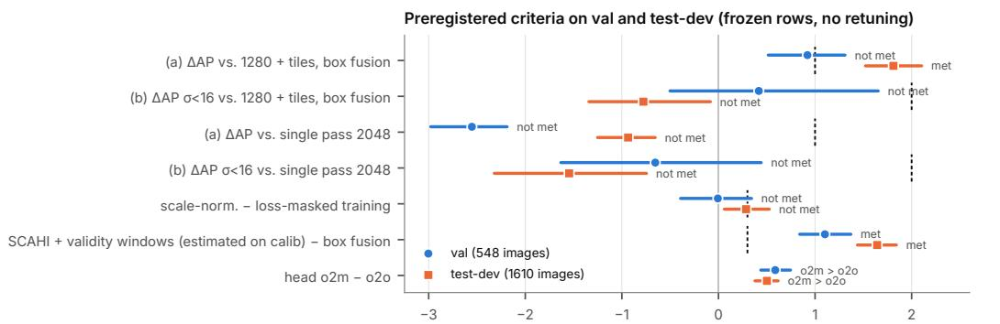  
Δ AP [%] with paired-bootstrap 95 % CI (1000 resamples over images); dashed = preregistered threshold  
Figure 20. Main study: pre-specified criteria on val and test-dev with paired-bootstrap 95 % CIs; dashed lines mark the thresholds.

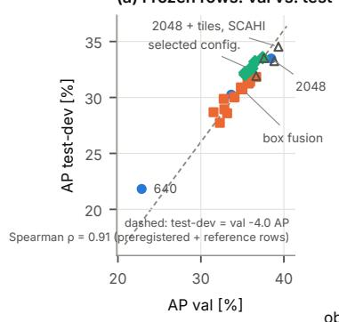

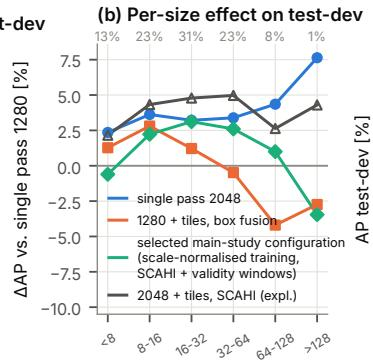

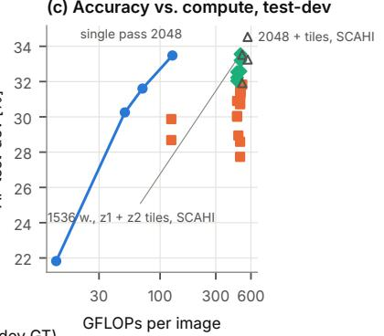  
single pass multi-pass box fusion SCAHI variants (pre-registered) exploratory, defined after va  
Figure 21. val vs. test-dev: AP per frozen row, per-size effect and test-dev Pareto view.

## 11. DOTA: protocol and detailed results

Data. We use DOTA v1.5 with the official horizontalbox annotations; the official boxes coincide with the minimum and maximum of the oriented corners for every object. Train and val contain 280,196 instances. The images used are JPEG files re-encoded at quality 70, which we report as a limitation. One training image (P1872) whose annotations lie far outside the image was excluded from training and calibration. All objects below 8 px and about three quarters of those between 8 and 16 px are marked difficult; they are used as normal positives in training, ignored by the official evaluation, and counted in the pre-specified secondary evaluation “all objects”.

Evaluation. Our port of the official DOTA devkit evaluation (horizontal boxes) reproduces the original exactly on synthetic and realistic detections. The primary metric has no cap on detections per image; the pipeline keeps at most 200,000 detections per image, which one image reached in one configuration without changing its mAP50. A prespecified secondary evaluation caps detections at 4,000 per image; it, the “all objects” evaluation and AP@[.5:.95] lead to the same conclusions as the primary metric.

Training. YOLOv10s and YOLOv10m were trained for 60 epochs at 1024 and 2048 px, with batches of eight and three images (effective batch 64 and 63). At 2048 px, the

CUDA allocator reported failed allocations in every epoch, which were absorbed by retrying or by a per-image fallback of the label assignment that computes the same assignment; batch size and results are unaffected. At 3072 px, training did not fit even with a batch of two, because of the object density. On calib, YOLOv10m at 2048 px stayed about 1.6 points below YOLOv10s over the whole late phase of training, whereas on DOTA-val it is ahead; the cause remains open; possible explanations include batch normalisation with a batch of three, overfitting and the small calibration split (141 images), which we did not test. YOLOv11s and YOLOv12s were added later under a dated addendum with unchanged hypotheses and rules; YOLOv11s was trained at 1024 and 2048 px, whereas YOLOv12s did not fit at 2048 px even with a batch of two, so its largest trainable pass is 1024 px and the questions that require 2048 px count as not confirmed for it.

FCOS. FCOS (torchvision implementation, ResNet-50- FPN, COCO weights) was added last, under a further dated addendum with unchanged hypotheses and rules, and as a single model it is judged without correction. Its recipe was fixed in advance and is simpler than the Ultralytics recipe of the YOLO detectors: horizontal flips only, whereas the YOLO runs used mosaic, random scaling by up to 50 % and translation. FCOS was trained at 1024 and 2048 px; at 2048 px with a batch of one image and gradient accumulation to the same effective batch, which the pre-specified minimum batch of two does not forbid here because FCOS uses group normalisation in its head and frozen batch normalisation in its backbone. Every FCOS configuration uses the detector’s own score p · centerness. Two observations are specific to FCOS. First, its best inference size on calib was 2560 px for the 2048 px weights (the YOLO detectors preferred their training size), plausibly because its recipe lacks scale augmentation; the pre-specified comparison against this best single pass is reported in the main text. Second, the search of the refined grid selected the prespecified cell factor for FCOS at both sizes, so its refinedgrid rows equal the pre-specified ones.

Why SCAHI does not exceed box fusion for FCOS. Table 12 collects post-hoc diagnostics. Capping both fusions at the same 200,000 detections per image leaves Q2 unchanged, so the uncapped output of box fusion is not the cause (a). FCOS yields almost twice as many candidate predictions per object as the YOLO detectors (b), so a lack of redundant evidence is not the cause either. With the coarse grid retained on calib, SCAHI recalls about 30 points fewer crowded objects than box fusion, while isolated objects are recalled almost equally well (c): the over-merging analysed on VisDrone. Crowded objects are only about 7 % of the objects on DOTA-val, which plausibly explains why selecting the cell factor by mAP50 on calib did not favour a finer grid. Finally, the comparison is sensitive to the pipeline limit (d). The limit caps single very dense images; without it, a few images contribute millions of low-scoring detections that rank above true positives of other images and lower the dataset-wide precision. SCAHI then falls behind box fusion at 1024 px, and the gain of Q3 shrinks from 5.6 to 4.1 mAP50. The verdicts stay as computed under the prespecified limit.

Table 12. FCOS diagnostics and limit check on DOTA-val (post hoc; verdicts unchanged). (a) SCAHI (refined grid) minus box fusion in mAP50 under the pre-specified evaluation (cap 4000), as evaluated, with both fusions capped at the top 200,000 detections per image, and without the pipeline limit. (b) Candidate predictions with IoU ≥ 0.5 per ground-truth object at 2048 px, summed over all passes, mean (median). (c) Recall at IoU 0.5, SCAHI (refined grid) vs. box fusion. (d) mAP50 of every affected row with and without the 200,000 limit (box fusion: limit per pass).
<table><tr><td colspan="5">(a) Equal caps</td></tr><tr><td>Contrast</td><td>cap 4000</td><td>as evaluated</td><td>both capped at 200k</td><td>without limit</td></tr><tr><td>Q2, 1024 px</td><td>+0.38 [-0.94; 1.77]</td><td> $+ 0 . 4 0 \ [ - 0 . 9 2 ; 1 . 7 9 ]$ </td><td> $+ 0 . 4 0 \left[ - 0 . 9 2 ; 1 . 7 9 \right]$ </td><td>-1.76</td></tr><tr><td>Q2, 2048 px</td><td>+0.10 [-0.96; 1.33]</td><td>+0.09 [-0.91; 1.37]</td><td> $+ 0 . 0 9 \left[ - 0 . 9 1 ; 1 . 3 6 \right]$ </td><td>+0.14</td></tr><tr><td colspan="5">(b) Redundancy: candidates per object, all / crowded / isolated</td></tr><tr><td>FCOS</td><td>62.7 (44) / 95.4 (85) / 60.1 (41)</td><td></td><td></td><td></td></tr><tr><td>YOLOv10s YOLOv11s</td><td>35.5 (33) / 47.6 (42) / 34.5 (32)</td><td></td><td></td><td></td></tr><tr><td></td><td>35.8 (33) / 48.1 (43) / 34.8 (32)</td><td></td><td></td><td></td></tr><tr><td colspan="5">(c) Recall, SCAHI vs. box fusion</td></tr><tr><td></td><td colspan="2">crowded (2515 objects)</td><td colspan="2">isolated (31 489 objects)</td></tr><tr><td>1024px</td><td colspan="2"> $6 1 . 1 \ \mathrm { v s . } \ 9 1 . 5 \mathrm { : } \ - 3 \bar { 0 } . 3 \ [ - 3 5 . 2 \mathrm { ; } \ - 2 4 . 4 ]$ </td><td colspan="2"> $9 2 . 5 \mathrm { v s . } 9 3 . 4 \colon - 0 . { \overset { \sim } { . } } 9 [ - 1 . 6 ; - 0 . 2 ]$ </td></tr><tr><td>2048 px</td><td colspan="2"> $6 2 . 6 \ \mathrm { v s . } \ 9 3 . 4 \colon - 3 0 . 9 \ [ - 3 3 . 5 ; - 2 7 . 1 ]$ </td><td colspan="2"> $9 3 . 9 \ \mathrm { v s . } \ 9 5 . 3 \colon - 1 . 4 \ [ - 2 . 2 ; - 0 . 7 ]$ </td></tr><tr><td>(d) Limit check</td><td></td><td></td><td></td><td></td></tr><tr><td colspan="5">Row</td></tr><tr><td></td><td>affected images</td><td>with limit</td><td>without limit</td><td>∆</td></tr><tr><td>single pass, 1024 px  $\mathrm { t i l e s } + \mathrm { b o x } \ \mathrm { f u s i o n } , 1 0 2 4 \mathrm { p x }$ </td><td>24 30</td><td>42.64 52.56</td><td>42.64 52.56</td><td>0.00 0.00</td></tr><tr><td> $\mathrm { t i l e s } + \mathrm { S C A H I } , 1 0 2 4 \mathrm { p x }$ </td><td>8</td><td>52.96</td><td>50.81</td><td>-2.16</td></tr><tr><td>single pass, 2048 px</td><td>76</td><td>55.01</td><td>55.01</td><td>0.00</td></tr><tr><td>single pass, 2048 px weights at 2560 px</td><td>82</td><td>58.12</td><td>58.12</td><td>0.00</td></tr><tr><td> $\mathrm { t i l e s } + \mathrm { b o x } \ \mathrm { f u s i o n } , 2 0 4 8 \mathrm { p x }$ </td><td>78</td><td>60.49</td><td>58.96</td><td>-1.53</td></tr><tr><td></td><td></td><td></td><td></td><td></td></tr><tr><td> $\mathrm { t i l e s } + \mathrm { S C A H I } , 2 0 4 8 \mathrm { p x }$ </td><td>1</td><td>60.59</td><td>59.10</td><td>-1.48</td></tr></table>

All configurations and secondary evaluations. Table 13 lists all frozen configurations of the five detectors under the primary and the three secondary evaluations, and Tab. 14 the decisive comparison of tiles with SCAHI against the single pass under all four. The gain holds under every evaluation and grows when difficult objects are counted. Table 15 breaks the result down by class.

Latency. On DOTA (Tab. 17), the tile passes account for 91–94 % of the total time when the fusion runs on the GPU; SCAHI adds about 12 ms per image, and tiles with SCAHI are faster than SAHI for both detectors where SAHI was run. The GPU fusion processes the image in spatial blocks with a margin derived from the largest cell of the peak grid; on every image of DOTA-val and VisDrone val it reproduces the CPU reference exactly (no differing detection among 42 million). Table 18 gives the corresponding breakdown for VisDrone.

SCAHI as a replacement for SAHI’s merge (Q4). For YOLOv10s/m, this comparison uses exactly the passes of the frozen SAHI configuration (1024 px weights, SAHI’s 640 px slices and its standard full-image pass at 640 px). The caches reproduce SAHI’s own inference path, including the fused model, one slice per forward pass and Ultralytics’ resize and back-mapping; recomputing SAHI from them gives its frozen calib mAP50 exactly. SCAHI was tuned on calib as for all other rows. For YOLOv11s and YOLOv12s, which were added under a later addendum, SAHI was first tuned on calib with the same procedure (both select an overlap of 0.2 and NMS), and SCAHI was then tuned on exactly these passes; the two pairs were decided separately. Table 16 reports the results; the gain holds under every evaluation and for all four detectors. Because YOLOv11s and YOLOv12s have a single dense head, SAHI and SCAHI see the same predictions there, which isolates the merge step. By object size, SCAHI improves on SAHI in all bins above 8 px, most for objects above 128 px (4.4 and 4.6 AP50), which SAHI’s slices cut into fragments. With the pre-specified setting, SCAHI lowers the recall of crowded objects for every detector (e.g. 67 vs. 91 % for YOLOv10s, and by 17 and 19 points for YOLOv11s and YOLOv12s); the refined grid restores it and lies above SAHI, as on the other configurations. With the fusion on the GPU, SAHI’s passes followed by SCAHI take 147 and 219 ms per image for YOLOv10s and YOLOv10m, and SAHI itself 195 and 268 ms in the same run. The difference in the passes (about 45 ms) is overhead of the SAHI library on the CPU, mainly image loading and per-detection Python objects; it is not a property of SCAHI. SCAHI’s merge takes about 12 ms on the GPU, SAHI’s merge 14– 16 ms on the CPU.

When do tiles pay off? Figure 22 relates the per-image gain of tiles with SCAHI (refined grid) over the single pass at 2048 px to the share of objects below 16 px and to the share of crowded objects (post hoc). On DOTA, the gain increases with the share of small objects (Spearman ρ = 0.21 and 0.15 for YOLOv10s/m, both intervals above zero);

Table 13. All frozen configurations on DOTA-val for the five detectors (devkit mAP50 without cap, with cap 4000, with difficult objects counted, and AP@[.5:.95]). YOLOv10: single pass and SAHI on the one-to-one head, box fusion and SCAHI on the one-to-many head unless marked; YOLOv11s/v12s and FCOS use their single head (FCOS score ${ \sqrt { p \cdot } }$ · centerness). For box fusion, the pipeline limit applies per pass and the merged output is not capped.
<table><tr><td>Detector</td><td>size</td><td>configuration</td><td>mAP50</td><td>cap 4000</td><td>all objects</td><td>AP@[.5:.95]</td></tr><tr><td>YOLOv10s</td><td>1024</td><td>single pass</td><td>55.80</td><td>55.76</td><td>50.59</td><td>36.14</td></tr><tr><td></td><td></td><td>tiles + box fusion (o2o head)</td><td>63.18</td><td>63.15</td><td>60.39</td><td>41.23</td></tr><tr><td></td><td></td><td>tiles + box fusion</td><td>64.86</td><td>64.63</td><td>61.53</td><td>43.50</td></tr><tr><td></td><td></td><td>tiles + SCAHI</td><td>66.17</td><td>66.02</td><td>62.65</td><td>44.75</td></tr><tr><td></td><td></td><td>tiles + SCAHI, refined grid</td><td>66.17</td><td>65.90</td><td>62.71</td><td>45.63</td></tr><tr><td></td><td></td><td>SCAHI, single pass (no tiles)</td><td>56.29</td><td>56.30</td><td>50.94</td><td>36.44</td></tr><tr><td></td><td></td><td>SCAHI, single pass (no tiles), refined grid</td><td>57.22</td><td>57.18</td><td>51.88</td><td>37.31</td></tr><tr><td></td><td>SAHI</td><td></td><td>59.20</td><td>59.11</td><td>56.31</td><td>37.46</td></tr><tr><td></td><td>2048</td><td>single pass</td><td>65.50</td><td>65.27</td><td>60.71</td><td>44.65</td></tr><tr><td></td><td></td><td>single pass, 2048 weights at 2560 px (crossing)</td><td>65.50</td><td>65.27</td><td>60.71</td><td>44.65</td></tr><tr><td></td><td></td><td>tiles + box fusion (o2o head)</td><td>68.29</td><td>68.33</td><td>64.43</td><td>46.85</td></tr><tr><td></td><td></td><td>tiles + box fusion</td><td>68.46</td><td>68.49</td><td>64.56</td><td>47.41</td></tr><tr><td></td><td></td><td>tiles + SCAHI</td><td>70.64</td><td>70.65</td><td>66.69</td><td>49.15</td></tr><tr><td></td><td></td><td>tiles + SCAHI, refined grid</td><td>71.00</td><td>71.06</td><td>67.03</td><td>50.13</td></tr><tr><td></td><td></td><td>SCAHI, single pass (no tiles)</td><td>66.58</td><td>66.13</td><td>61.18</td><td>44.87</td></tr><tr><td>YOLOv10m</td><td></td><td>SCAHI, single pass (no tiles), refined grid</td><td>67.27</td><td>66.96</td><td>62.04</td><td>45.94</td></tr><tr><td></td><td>1024</td><td>single pass</td><td>58.44</td><td>58.42</td><td>52.82</td><td>38.37</td></tr><tr><td></td><td></td><td>tiles + box fusion (o2o head)</td><td>63.97</td><td>63.82</td><td>61.17</td><td>43.09</td></tr><tr><td></td><td></td><td>tiles + box fusion</td><td>64.57</td><td>64.48</td><td>61.37</td><td></td></tr><tr><td></td><td></td><td>tiles + SCAHI</td><td></td><td>66.54</td><td>63.21</td><td>43.87</td></tr><tr><td></td><td></td><td></td><td>66.69</td><td>67.08</td><td></td><td>46.33</td></tr><tr><td></td><td></td><td>tiles + SCAHI, refined grid</td><td>67.34</td><td>58.61</td><td>63.88</td><td>47.02</td></tr><tr><td></td><td></td><td>SCAHI, single pass (no tiles) SCAHI, single pass (no tiles), refined grid</td><td>58.61 59.29</td><td>59.26</td><td>52.98 53.60</td><td>38.74</td></tr><tr><td></td><td>SAHI</td><td></td><td>60.96</td><td>60.87</td><td>58.04</td><td>39.50 39.78</td></tr><tr><td></td><td>2048 single pass</td><td></td><td>67.39</td><td>66.99</td><td>63.06</td><td>46.13</td></tr><tr><td></td><td></td><td>single pass, 2048 weights at 2560 px (crossing)</td><td>67.39</td><td>66.99</td><td>63.06</td><td>46.13</td></tr><tr><td></td><td></td><td>tiles + box fusion (o2o head)</td><td>68.71</td><td>68.54</td><td>65.63</td><td>47.74</td></tr><tr><td></td><td></td><td>tiles + box fusion</td><td>68.13</td><td>68.08</td><td>64.61</td><td>47.85</td></tr><tr><td></td><td></td><td>tiles + SCAHI</td><td>71.32</td><td>71.08</td><td>67.64</td><td>50.57</td></tr><tr><td></td><td></td><td>tiles + SCAHI, refined grid</td><td>71.73</td><td>71.44</td><td>68.10</td><td>51.30</td></tr><tr><td></td><td></td><td>SCAHI, single pass (no tiles)</td><td>67.67</td><td>67.20</td><td>62.80</td><td>46.48</td></tr><tr><td></td><td></td><td>SCAHI, single pass (no tiles), refined grid</td><td>68.42</td><td>68.02</td><td>63.52</td><td>47.30</td></tr><tr><td>YOLOv11s</td><td>1024</td><td></td><td></td><td>56.16</td><td></td><td></td></tr><tr><td></td><td></td><td>single pass</td><td>56.16</td><td>61.92</td><td>50.91 59.24</td><td>36.30</td></tr><tr><td></td><td></td><td>tiles + box fusion</td><td>62.14</td><td>65.07</td><td>61.56</td><td>41.06</td></tr><tr><td></td><td></td><td>tiles + SCAHI</td><td>65.20</td><td>65.09</td><td></td><td>43.85</td></tr><tr><td></td><td></td><td>tiles + SCAHI, refined grid</td><td>65.26</td><td>55.64</td><td>61.67</td><td>44.61</td></tr><tr><td></td><td></td><td>SCAHI, single pass (no tiles)</td><td>55.68</td><td>56.46</td><td>50.54</td><td>35.76</td></tr><tr><td></td><td>2048</td><td>SCAHI, single pass (no tiles), refined grid single pass</td><td>56.47</td><td>64.98</td><td>51.34</td><td>36.45</td></tr><tr><td></td><td></td><td>single pass, 2048 weights at 2560 px (crossing)</td><td>65.19</td><td>64.98</td><td>60.28</td><td>44.69</td></tr><tr><td></td><td></td><td>tiles + box fusion</td><td>65.19</td><td>66.49</td><td>60.28 62.91</td><td>44.69</td></tr><tr><td></td><td></td><td>tiles + SCAHI</td><td>66.68 69.14</td><td>68.97</td><td>65.38</td><td>45.93</td></tr><tr><td></td><td></td><td>tiles + SCAHI, refined grid</td><td>69.81</td><td>69.66</td><td>66.01</td><td>48.42</td></tr><tr><td></td><td></td><td>SCAHI, single pass (no tiles)</td><td>64.92</td><td>64.71</td><td>59.74</td><td>49.36</td></tr><tr><td></td><td></td><td>SCAHI, single pass (no tiles), refined grid</td><td>65.45</td><td>65.24</td><td>60.62</td><td>44.02</td></tr><tr><td>YOLOv12s</td><td></td><td></td><td></td><td></td><td></td><td>44.94</td></tr><tr><td></td><td>1024</td><td>single pass</td><td>56.36</td><td>56.36</td><td>51.27</td><td>36.62</td></tr><tr><td></td><td></td><td>tiles + box fusion</td><td>62.88</td><td>62.79</td><td>59.75</td><td>42.17</td></tr><tr><td></td><td></td><td>tiles + SCAHI</td><td>65.18</td><td>65.07 65.88</td><td>61.80</td><td>44.16</td></tr><tr><td></td><td></td><td>tiles + SCAHI, refined grid</td><td>65.97</td><td>55.69</td><td>62.65</td><td>45.31</td></tr><tr><td></td><td></td><td>SCAHI, single pass (no tiles)</td><td>55.78</td><td></td><td>50.50</td><td>35.92</td></tr><tr><td></td><td></td><td>SCAHI, single pass (no tiles), refined grid</td><td>56.74</td><td>56.69</td><td>51.70</td><td>36.95</td></tr><tr><td>FCOS</td><td>1024</td><td>single pass</td><td>42.64</td><td>42.63</td><td>38.60</td><td>23.97</td></tr><tr><td></td><td></td><td>tiles + box fusion tiles + SCAHI</td><td>52.56 52.96</td><td>52.56 52.94</td><td>48.70 48.94</td><td>31.45 31.99</td></tr><tr><td></td><td></td></table>

Table 14. Q3 on DOTA-val under four evaluations: tiles + SCAHI (refined grid) vs. the single pass, both at the largest trainable size, with paired bootstrap 95 % CI. Only the primary metric carries the pre-specified verdict. <sup>†</sup>YOLOv12s could only be trained at 1024 px, where the single pass is weaker; not comparable with the 2048 px values.
<table><tr><td>Detector</td><td>size</td><td>evaluation</td><td>single pass</td><td>tiles + SCAHI</td><td>∆ [95 % CI]</td></tr><tr><td>YOLOv10s</td><td>2048</td><td>mAP50 (primary)</td><td>65.50</td><td>71.00</td><td>+5.50 [+3.55; +7.77]</td></tr><tr><td></td><td></td><td>mAP50, all objects</td><td>60.71</td><td>67.03</td><td>+6.32 [+4.54; +8.64]</td></tr><tr><td></td><td></td><td>mAP50, cap 4000</td><td>65.27</td><td>71.06</td><td>+5.79 [+3.64; +8.18]</td></tr><tr><td></td><td></td><td>AP@[.5:.95]</td><td>44.65</td><td>50.13</td><td>+5.48 [+4.17; +7.03]</td></tr><tr><td>YOLOv10m</td><td>2048</td><td>mAP50 (primary)</td><td>67.39</td><td>71.73</td><td>+4.34 [+3.02; +6.19]</td></tr><tr><td></td><td></td><td>mAP50, all objects</td><td>63.06</td><td>68.10</td><td>+5.04 [+3.63; +6.87]</td></tr><tr><td></td><td></td><td>mAP50, cap 4000</td><td>66.99</td><td>71.44</td><td>+4.45 [+3.07; +6.24]</td></tr><tr><td></td><td></td><td>AP@[.5:.95]</td><td>46.13</td><td>51.30</td><td>+5.17 [+3.84; +6.50]</td></tr><tr><td>YOLOv11s</td><td>2048</td><td>mAP50 (primary)</td><td>65.19</td><td>69.81</td><td>+4.62 [+2.76; +6.62]</td></tr><tr><td></td><td></td><td>mAP50, all objects</td><td>60.28</td><td>66.01</td><td>+5.73 [+3.97; +7.92]</td></tr><tr><td></td><td></td><td>mAP50, cap 4000</td><td>64.98</td><td>69.66</td><td>+4.68 [+2.76; +6.66]</td></tr><tr><td></td><td></td><td>AP@[.5:.95]</td><td>44.69</td><td>49.36</td><td>+4.67 [+3.43; +6.20]</td></tr><tr><td>YOLOv12s</td><td>1024†</td><td>mAP50 (primary)</td><td>56.36</td><td>65.97</td><td>+9.62 [+7.10; +12.22]</td></tr><tr><td></td><td></td><td>mAP50, all objects</td><td>51.27</td><td>62.65</td><td>+11.39 [+9.09; +13.96]</td></tr><tr><td></td><td></td><td>mAP50, cap 4000</td><td>56.36</td><td>65.88</td><td>+9.52 [+7.03; +11.89]</td></tr><tr><td></td><td></td><td>AP@[.5:.95]</td><td>36.62</td><td>45.31</td><td>+8.69 [+6.74; +10.60]</td></tr><tr><td>FCOS</td><td>2048</td><td>mAP50 (primary)</td><td>55.01</td><td>60.59</td><td>+5.57 [+3.77; +7.65]</td></tr><tr><td></td><td></td><td>mAP50, all objects</td><td>49.58</td><td>55.79</td><td>+6.21 [+4.25; +8.03]</td></tr><tr><td></td><td></td><td>mAP50, cap 4000</td><td>54.97</td><td>60.55</td><td>+5.58 [+3.71; +7.62]</td></tr><tr><td></td><td></td><td>AP@[.5:.95]</td><td>33.91</td><td>37.55</td><td>+3.64 [+2.38; +4.94]</td></tr></table>

Table 15. Per-class AP50 on DOTA-val at the largest trainable size: single pass (s), tiles + box fusion (b), tiles + SCAHI with refined grid (r).
<table><tr><td>class</td><td colspan="3">YOLOv10s (2048 px)</td><td colspan="3">YOLOv10m (2048 px)</td><td colspan="3">YOLOv11s (2048 px)</td><td colspan="3">YOLOv12s (1024 px)</td><td colspan="3">FCOS (2048 px)</td></tr><tr><td></td><td>S</td><td>b</td><td>r</td><td>S</td><td>b</td><td>r</td><td>S</td><td>b</td><td>r</td><td>S</td><td>b</td><td>r</td><td>S</td><td>b</td><td>r</td></tr><tr><td>plane</td><td>88.6</td><td>90.2</td><td>90.3</td><td>89.9</td><td>90.3</td><td>90.4</td><td>89.3</td><td>90.0</td><td>90.1</td><td>80.6</td><td>89.7</td><td>89.9</td><td>79.7</td><td>88.9</td><td>89.0</td></tr><tr><td>baseball-diamond</td><td>70.4</td><td>64.8</td><td>71.5</td><td>72.3</td><td>70.1</td><td>75.2</td><td>71.5</td><td>70.9</td><td>72.5</td><td>66.1</td><td>60.9</td><td>66.8</td><td>60.1</td><td>60.5</td><td>64.9</td></tr><tr><td>bridge</td><td>45.5</td><td>48.0</td><td>51.1</td><td>42.7</td><td>43.9</td><td>47.2</td><td>45.2</td><td>44.7</td><td>48.6</td><td>27.7</td><td>35.6</td><td>39.6</td><td>32.6</td><td>38.2</td><td>41.4</td></tr><tr><td>ground-track-field</td><td>59.2</td><td>68.4</td><td>70.6</td><td>69.0</td><td>67.9</td><td>73.3</td><td>59.2</td><td>62.4</td><td>67.7</td><td>47.3</td><td>58.6</td><td>60.6</td><td>43.8</td><td>45.6</td><td>41.7</td></tr><tr><td>small-vehicle</td><td>70.7</td><td>77.7</td><td>81.7</td><td>75.2</td><td>80.5</td><td>82.9</td><td>72.7</td><td>79.1</td><td>82.2</td><td>58.1</td><td>75.3</td><td>78.9</td><td>57.8</td><td>67.9</td><td>68.7</td></tr><tr><td>large-vehicle</td><td>79.9</td><td>81.7</td><td>82.5</td><td>80.6</td><td>76.7</td><td>83.8</td><td>79.9</td><td>81.7</td><td>84.1</td><td>77.0</td><td>78.0</td><td>81.5</td><td>76.3</td><td>78.0</td><td>71.6</td></tr><tr><td>ship</td><td>88.5</td><td>89.7</td><td>89.9</td><td>89.4</td><td>89.4</td><td>89.8</td><td>88.9</td><td>89.2</td><td>89.7</td><td>78.6</td><td>89.2</td><td>89.2</td><td>78.3</td><td>86.0</td><td>80.7</td></tr><tr><td>tennis-court</td><td>90.7</td><td>90.7</td><td>90.9</td><td>90.7</td><td>90.8</td><td>90.9</td><td>90.8</td><td>90.8</td><td>90.9</td><td>90.6</td><td>90.7</td><td>90.8</td><td>90.0</td><td>90.5</td><td>90.7</td></tr><tr><td>basketball-court</td><td>52.3</td><td>61.7</td><td>63.2</td><td>58.3</td><td>67.7</td><td>69.8</td><td>54.2</td><td>59.5</td><td>60.8</td><td>47.2</td><td>48.5</td><td>54.9</td><td>43.1</td><td>41.6</td><td>45.6</td></tr><tr><td>storage-tank</td><td>81.4</td><td>86.1</td><td>86.6</td><td>82.0</td><td>85.9</td><td>87.1</td><td>83.5</td><td>86.8</td><td>87.4</td><td>62.7</td><td>76.8</td><td>79.6</td><td>68.9</td><td>81.4</td><td>81.0</td></tr><tr><td>soccer-ball-field</td><td>65.8</td><td>76.4</td><td>74.2</td><td>63.3</td><td>66.2</td><td>72.4</td><td>61.4</td><td>63.3</td><td>70.6</td><td>63.3</td><td>67.3</td><td>71.6</td><td>56.9</td><td>66.3</td><td>66.6</td></tr><tr><td>roundabout</td><td>54.8</td><td>66.0</td><td>67.9</td><td>58.9</td><td>67.6</td><td>69.2</td><td>58.1</td><td>65.2</td><td>68.7</td><td>33.8</td><td>56.2</td><td>59.1</td><td>49.0</td><td>61.5</td><td>61.7</td></tr><tr><td>harbor</td><td>82.4</td><td>80.8</td><td>85.7</td><td>83.7</td><td>77.6</td><td>86.2</td><td>83.9</td><td>77.7</td><td>85.9</td><td>78.3</td><td>75.2</td><td>82.8</td><td>69.7</td><td>70.7</td><td>73.6</td></tr><tr><td>swimming-pool</td><td>69.5</td><td>75.6</td><td>78.3</td><td>71.1</td><td>70.1</td><td>76.6</td><td>68.4</td><td>75.4</td><td>79.5</td><td>60.8</td><td>72.0</td><td>72.6</td><td>55.5</td><td>63.9</td><td>65.2</td></tr><tr><td>helicopter</td><td>48.1</td><td>35.3</td><td>49.5</td><td>50.8</td><td>44.8</td><td>52.4</td><td>35.5</td><td>29.7</td><td>37.7</td><td>29.3</td><td>32.0</td><td>37.6</td><td>18.4</td><td>26.9</td><td>27.0</td></tr><tr><td>container-crane</td><td>0.1</td><td>2.3</td><td>2.2</td><td>0.4</td><td>0.8</td><td>0.5</td><td>0.5</td><td>0.4</td><td>0.6</td><td>0.1</td><td>0.0</td><td>0.2</td><td>0.0</td><td>0.0</td><td>0.0</td></tr><tr><td>mAP50</td><td>65.5</td><td>68.5</td><td>71.0</td><td>67.4</td><td>68.1</td><td>71.7</td><td>65.2</td><td>66.7</td><td>69.8</td><td>56.4</td><td>62.9</td><td>66.0</td><td>55.0</td><td>60.5</td><td>60.6</td></tr></table>

on VisDrone test-dev the relation is weak and changes sign between detectors (−0.05 to +0.09). Neither dataset shows a relation with the share of crowded objects.

Configurations of YOLOv10s/m. Figure 24 shows all 32 frozen configurations. The decomposition of the gain differs from VisDrone: on DOTA, adding tiles at native resolution contributes most (3.3 to 9.9 mAP50), whereas fusing the single pass alone contributes little. Figure 25 shows the calibration curves during training. Figure 23 shows the pre-specified questions graphically.

Table 16. SCAHI on SAHI’s passes (Q4) on DOTA-val (mAP50 without cap unless stated). Differences to SAHI with paired bootstrap 95 % CI; Q4 is decided on the primary metric for the refined grid, Holm over YOLOv10s/m and, separately, over YOLOv11s/12s. Latency (ms per image, fusion on the GPU, optimised path) from one exclusive run; not measured for YOLOv11s/12s.
<table><tr><td></td><td>YOLOv10s</td><td>YOLOv10m</td><td>YOLOv11s</td><td>YOLOv12s</td></tr><tr><td>SAHI</td><td>59.20</td><td>60.96</td><td>57.90</td><td>60.21</td></tr><tr><td>SAHI passes + SCAHI</td><td>61.96</td><td>62.98</td><td>61.36</td><td>63.13</td></tr><tr><td>SAHI passes + SCAHI, refined grid</td><td>62.08</td><td>63.22</td><td>61.87</td><td>63.30</td></tr><tr><td>∆ refined grid (primary, Q4)</td><td>+2.87 [2.13; 4.33]</td><td>+2.26 [1.08; 3.25]</td><td>+3.97 [2.93; 5.06]</td><td>+3.10 [2.23; 4.08]</td></tr><tr><td>∆ refined grid, cap 4000</td><td>+2.80 [2.07; 4.27]</td><td>+2.13 [0.86; 3.16]</td><td>+4.05 [2.91; 5.06]</td><td>+3.02 [2.17; 4.03]</td></tr><tr><td>∆ refined grid, all objects</td><td>+2.67 [1.97; 3.98]</td><td>+1.99 [1.11; 2.83]</td><td>+3.92 [2.84; 4.79]</td><td>+2.99 [2.21; 3.95]</td></tr><tr><td>∆ refined grid, AP@[.5:.95]</td><td>+4.15 [3.24; 5.18]</td><td>+3.73 [2.91; 4.57]</td><td>+4.25 [3.50; 4.99]</td><td>+3.40 [2.74; 4.13]</td></tr><tr><td>∆ pre-specified setting (primary)</td><td>+2.76 [1.65; 4.12]</td><td>+2.02 [0.83; 3.06]</td><td>+3.46 [2.38; 4.56]</td><td>+2.92 [1.92; 3.90]</td></tr><tr><td>latency SAHI / SAHI passes + SCAHI</td><td>195 / 147</td><td>268 / 219</td><td></td><td></td></tr></table>

Table 17. Latency on DOTA-val (ms per image, mean over 458 images; RTX 5090 at default power, exclusive use, batch 1; all rows from one run on the same machine as Tab. 2). Totals including the tile passes. Box fusion and SCAHI on the CPU use the reference passes (tile passes 137.9, 188.7, 125.9 and 133.8 ms); SCAHI on the GPU uses the optimised path of Tab. 2 (passes 120.4, 172.2, 121.0 and 129.6 ms; fusion 13.2–13.8 ms). A one-to-one matching of its detections with the CPU reference shows no deviation beyond float32 rounding. Box fusion runs on the CPU, so the table shows how the cost splits, not which merge step is faster. Peak GPU memory of the SCAHI fusion: 1.6–1.9 GB.
<table><tr><td>Detector</td><td>single pass</td><td>tiles + box fusion</td><td>tiles + SCAHI (CPU)</td><td>tiles + SCAHI (GPU)</td><td>SAHI</td></tr><tr><td>YOLOv10s, 2048 px</td><td>28.0</td><td>175.5</td><td>300.9</td><td>133.6</td><td>194.6</td></tr><tr><td>YOLOv10m, 2048 px</td><td>34.7</td><td>225.2</td><td>398.0</td><td>186.0</td><td>268.1</td></tr><tr><td>YOLOv11s, 2048 px</td><td>28.5</td><td>165.3</td><td>286.9</td><td>134.2</td><td>一</td></tr><tr><td>YOLOv12s, 1024 px</td><td>21.7</td><td>167.1</td><td>334.0</td><td>142.9</td><td>一</td></tr></table>

Table 18. Latency breakdown on VisDrone (ms per image, YOLOv10s, exclusive GPU and CPU, RTX 5090 at default power, batch 1, one run): time of the passes and of the fusion on the CPU or the GPU.
<table><tr><td>Dataset</td><td>Detector</td><td>configuration</td><td>passes</td><td>fusion CPU</td><td>fusion GPU</td><td>total (CPU)</td><td>total (GPU)</td></tr><tr><td rowspan="4">VisDrone val</td><td>YOLOv10s</td><td>single pass 2048</td><td>10.3</td><td>1</td><td>一</td><td>10.3</td><td>10.3</td></tr><tr><td>YOLOv10s</td><td>single pass 2560</td><td>14.4</td><td></td><td></td><td>14.4</td><td>14.4</td></tr><tr><td>YOLOv10s</td><td>tiles + SCAHI (pre-specified)</td><td>75.6</td><td>30.8</td><td>9.4</td><td>106.4</td><td>85.0</td></tr><tr><td> $\Upsilon \mathrm { O L O v 1 0 s }$ </td><td> ${ \mathrm { t i l e s } } + { \mathrm { S C A H I } } ,$  refined grid</td><td>76.6</td><td>60.1</td><td>10.2</td><td>136.7</td><td>86.8</td></tr></table>

When do tiles pay off? Mean per-image difference in bins, 95 % bootstrap CI (exploratory, post hoc)

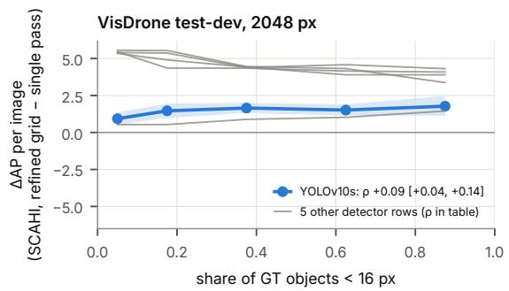

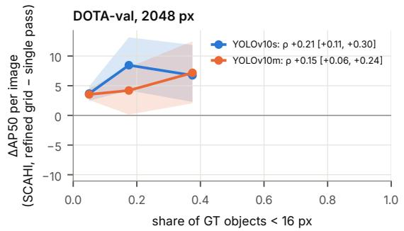

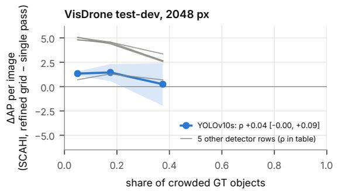

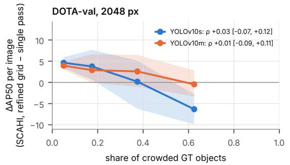  
Figure 22. When do tiles pay off? Per-image gain of tiles with SCAHI (refined grid) over the single pass at 2048 px, in bins of the share of objects below 16 px and of crowded objects, on VisDrone test-dev and DOTA-val (post hoc; mean with 95 % CI).

  
Figure 23. Pre-specified questions on DOTA-val: differences in mAP50 with 95 % confidence intervals; dashed: ε.

  
Figure 24. All frozen configurations on DOTA-val (mAP50, devkit, no cap), for YOLOv10s and YOLOv10m at 1024 and 2048 px: single pass, tiles with box fusion (both heads), SCAHI with the setting from VisDrone and with the refined grid (pre-specified on DOTA), SCAHI on the single pass, and SAHI.

  
Figure 25. Calibration mAP50 during training on DOTA; the selected epoch is the maximum on calib.

## 12. SCAHI component ablation: details

The ablation was run after the main results, from the existing detections, on VisDrone val and on DOTA-val (the latter after its single held-out evaluation); it never enters a verdict. All variants use the same passes (single pass at 2048 px plus tiles) and the same parameter selection on calib. Figures 26 and 27 show all variants per detector, including a sweep of the cell factor of the peak grid. On VisDrone, accuracy rises almost monotonically with the cell factor; on DOTA it peaks around a cell factor of 9, while the recall of crowded objects keeps rising.

Why the normalisation has no effect. We measured the coverage C at every fused position. With the coverageaware tapers and two levels of passes that each cover the whole image, $C \ = \ 2$ at every position on both datasets, so dividing by C only rescales all scores. Without the taper, C varies between 2 and 10 (mean about 3.4), and accuracy drops. That a pass which covers a position but predicts nothing counts against an object follows from the summation over passes, not from the division; the division would matter only for passes that cover part of the image, which our configurations do not contain.

Border-weighted box fusion. To separate the effect of the coverage-aware weights from that of merging dense outputs, we gave box fusion the same weights (post hoc): every per-pass detection is scored with SCAHI’s weight at its box centre and then merged by the frozen NMS (variant a) or by Weighted Boxes Fusion (variant b), with the box-fusion parameters re-selected on calib. Table 19 compares these variants with plain box fusion and with SCAHI on the same passes and head. Weighted NMS improves on plain box fusion, but SCAHI remains ahead on both datasets; weighted WBF falls below plain box fusion, because it merges crowded neighbours.

Table 20 lists the selected parameters of SCAHI for every configuration with tiles.

Table 19. Border-weighted box fusion (post hoc, same passes and head). VisDrone val: AP@[.5:.95] / AP50; DOTA-val: mAP50 / AP@[.5:.95]. Recall at IoU 0.5 of crowded / isolated objects. Differences in the first metric with paired bootstrap 95 % CI, against box fusion and against SCAHI with the refined grid; only rows on the same head are compared. Variant (b) was not run for FCOS.
<table><tr><td>VisDrone val Detector</td><td>head</td><td>configuration</td><td>AP</td><td>AP50</td><td>R50 crowded / isolated</td><td>∆ vs. box fusion</td><td>∆ vs. refined</td></tr><tr><td>YOLOv10s</td><td>o20</td><td>box fusion (frozen)</td><td>38.85</td><td>64.73</td><td>79.8 / 91.0</td><td></td><td></td></tr><tr><td></td><td></td><td>(a) weighted NMS</td><td>39.57</td><td>64.75</td><td>86.2 / 91.5</td><td>+0.72 [+0.52; +0.93]</td><td>-1.00 [-1.13; -0.84]</td></tr><tr><td></td><td></td><td>(b) weighted WBF</td><td>37.56</td><td>62.34</td><td>87.1 / 93.0</td><td>-1.29 [-1.57; -0.98]</td><td>-3.01 [-3.25; -2.74]</td></tr><tr><td></td><td></td><td>SCAHI, refined grid</td><td>40.57</td><td>66.17</td><td>85.7 / 92.5</td><td></td><td></td></tr><tr><td>YOLOv10s</td><td>o2m</td><td>box fusion (post hoc, tuned like the frozen row)</td><td>37.85</td><td>62.76</td><td>79.7 / 87.9</td><td></td><td></td></tr><tr><td></td><td></td><td>(a) weighted NMS</td><td>38.60</td><td>62.68</td><td>86.3 / 88.3</td><td>+0.75 [+0.57; +0.95]</td><td>-2.12 [-2.29; -1.93]</td></tr><tr><td></td><td></td><td>(b) weighted WBF</td><td>35.59</td><td>59.11</td><td>85.1 / 89.3</td><td>-2.25 [-2.55; -1.90]</td><td>-5.12 [-5.42; -4.79]</td></tr><tr><td></td><td></td><td>SCAHI (pre-specified)</td><td>39.34</td><td>64.19</td><td>63.4 / 89.0</td><td></td><td></td></tr><tr><td></td><td></td><td>SCAHI, refined grid</td><td>40.72</td><td>66.15</td><td>81.1 /91.9</td><td></td><td></td></tr><tr><td>YOLOv11s</td><td>02m</td><td>box fusion (frozen)</td><td>37.22</td><td>62.18</td><td>79.1 / 87.6</td><td></td><td></td></tr><tr><td></td><td></td><td>(a) weighted NMS</td><td>37.72</td><td>62.52</td><td>77.3 / 87.3</td><td>+0.50 [+0.30; +0.71]</td><td>-2.31 [-2.52; -2.14]</td></tr><tr><td></td><td></td><td>(b) weighted WBF</td><td>35.12</td><td>58.64</td><td>84.4 / 89.1</td><td>-2.10 [-2.42; -1.73]</td><td>-4.91 [-5.21; -4.57]</td></tr><tr><td></td><td></td><td>SCAHI (pre-specified)</td><td>38.66</td><td>63.58</td><td>62.1 / 88.9</td><td></td><td></td></tr><tr><td></td><td></td><td>SCAHI, refined grid</td><td>40.03</td><td>65.30</td><td>81.6 /91.6</td><td></td><td></td></tr><tr><td>DOTA-val Detector</td><td>head</td><td>configuration</td><td>mAP50</td><td></td><td>R50 crowded / isolated</td><td></td><td></td></tr><tr><td></td><td>02m</td><td>box fusion (frozen)</td><td></td><td>AP</td><td></td><td>∆ vs. box fusion</td><td>∆ vs. refined</td></tr><tr><td>YOLOv10s</td><td></td><td>(a) weighted NMS</td><td>68.46 69.87</td><td>47.41 48.15</td><td>94.6 / 95.6 94.2 / 95.5</td><td></td><td></td></tr><tr><td></td><td></td><td>(b) weighted WBF</td><td>64.30</td><td>43.39</td><td>80.6 / 95.2</td><td>+1.42 [+0.22; +1.72] -4.16 [-5.56; -2.71]</td><td>-1.12 [-2.27; -0.57] -6.70 [-8.04; -5.15]</td></tr><tr><td></td><td></td><td>SCAHI (pre-specified)</td><td>70.64</td><td>49.15</td><td>66.8 / 96.9</td><td></td><td></td></tr><tr><td></td><td></td><td>SCAHI, refined grid</td><td>71.00</td><td>50.13</td><td>91.1 / 98.1</td><td></td><td></td></tr><tr><td>YOLOv11s</td><td>02m</td><td>box fusion (frozen)</td><td></td><td>45.93</td><td>92.5 / 95.5</td><td></td><td></td></tr><tr><td></td><td></td><td>(a) weighted NMS</td><td>66.68 68.41</td><td>47.02</td><td>89.4 / 95.2</td><td></td><td></td></tr><tr><td></td><td></td><td>(b) weighted WBF</td><td>63.32</td><td>42.80</td><td>81.4 / 96.3</td><td>+1.73 [+0.55; +2.41]</td><td>-1.39 [-2.23; -0.72]</td></tr><tr><td></td><td></td><td>SCAHI (pre-specified)</td><td>69.14</td><td>48.42</td><td>66.8 / 96.8</td><td>-3.36 [-4.47; -1.98]</td><td>-6.49 [-7.46; -5.05]</td></tr><tr><td></td><td></td><td>SCAHI, refined grid</td><td>69.81</td><td>49.36</td><td>94.5 / 98.0</td><td></td><td></td></tr><tr><td>FCOS</td><td></td><td></td><td></td><td></td><td></td><td></td><td></td></tr><tr><td></td><td></td><td>box fusion (frozen)</td><td>60.49</td><td>37.50</td><td>93.4 / 95.3 91.1 / 94.5</td><td></td><td></td></tr><tr><td></td><td></td><td>(a) weighted NMS</td><td>59.74</td><td>36.86</td><td></td><td>-0.75 [-1.79; +0.14]</td><td>-0.85 [-2.24; +0.23]</td></tr><tr><td></td><td></td><td>SCAHI (pre-specified) SCAHI, refined grid</td><td>60.59 60.59</td><td>37.55 37.55</td><td>62.6 / 93.9 62.6 / 93.9</td><td></td><td></td></tr></table>

Table 20. Selected SCAHI parameters for tiles with SCAHI (one-to-many head), per dataset, detector and size of the single pass: cel factor $f ,$ bins per octave of the size axis, and the thresholds $\tau _ { \mathrm { s p l a t } }$ and $\tau _ { \mathrm { p e a k } }$ . The pre-specified setting was tuned on calib over thresholds and bins with $f = 5 ;$ the refined grid also selects f (post hoc on VisDrone, pre-specified on DOTA). Predictions are clustered at IoU 0.5 in all settings.
<table><tr><td></td><td></td><td></td><td colspan="4">pre-specified setting</td><td colspan="4">refined grid</td></tr><tr><td>Dataset</td><td>Detector</td><td>size</td><td>f</td><td>bins</td><td> $\tau _ { \mathrm { s p l a t } }$ </td><td> $\tau _ { \mathrm { p e a k } }$ </td><td>f</td><td>bins</td><td> $\tau _ { \mathrm { s p l a t } }$ </td><td>Tpeak</td></tr><tr><td>VisDrone</td><td>YOLOv10s</td><td>2048</td><td>5</td><td>5</td><td>0.005</td><td>0.001</td><td>11</td><td>7</td><td>0.00125</td><td>0.001</td></tr><tr><td>VisDrone</td><td>YOLOv10m</td><td>1280</td><td>5</td><td>5</td><td>0.005</td><td>0.001</td><td>13</td><td>7</td><td>0.00125</td><td>0.001</td></tr><tr><td>VisDrone</td><td>YOLOv10m</td><td>2048</td><td>5</td><td>5</td><td>0.005</td><td>0.001</td><td>13</td><td>8</td><td>0.00031</td><td>0.001</td></tr><tr><td>VisDrone</td><td>YOLOv11s</td><td>1280</td><td>5</td><td>5</td><td>0.005</td><td>0.001</td><td>11</td><td>7</td><td>0.00125</td><td>0.001</td></tr><tr><td>VisDrone</td><td>YOLOv11s</td><td>2048</td><td>5</td><td>5</td><td>0.005</td><td>0.001</td><td>11</td><td>8</td><td>0.00031</td><td>0.001</td></tr><tr><td>VisDrone</td><td>YOLOv11m</td><td>1280</td><td>5</td><td>5</td><td>0.005</td><td>0.001</td><td>11</td><td>6</td><td>0.005</td><td>1e-05</td></tr><tr><td>VisDrone</td><td>YOLOv11m</td><td>2048</td><td>5</td><td>5</td><td>0.005</td><td>0.001</td><td>13</td><td>7</td><td>0.00125</td><td>0.001</td></tr><tr><td>VisDrone</td><td>YOLOv12s</td><td>1280</td><td>5</td><td>5</td><td>0.005</td><td>0.001</td><td>11</td><td>6</td><td>0.00031</td><td>0.001</td></tr><tr><td>VisDrone</td><td>YOLOv12s</td><td>2048</td><td>5</td><td>5</td><td>0.005</td><td>0.001</td><td>13</td><td>8</td><td>0.00125</td><td>0.001</td></tr><tr><td>VisDrone</td><td>YOLOv12m</td><td>1280</td><td>5</td><td>5</td><td>0.005</td><td>0.001</td><td>13</td><td>6</td><td>0.00031</td><td>0.001</td></tr><tr><td>DOTA</td><td>YOLOv10s</td><td>1024</td><td>5</td><td>4</td><td>0.005</td><td>0.001</td><td>7</td><td>8</td><td>0.00031</td><td>0.001</td></tr><tr><td>DOTA</td><td>YOLOv10s</td><td>2048</td><td>5</td><td>4</td><td>0.005</td><td>0.001</td><td>7</td><td>7</td><td>0.00031</td><td>0.001</td></tr><tr><td>DOTA</td><td>YOLOv10m</td><td>1024</td><td>5</td><td>5</td><td>0.005</td><td>0.001</td><td>7</td><td>6</td><td>0.00125</td><td>1e-05</td></tr><tr><td>DOTA</td><td>YOLOv10m</td><td>2048</td><td>5</td><td>5</td><td>0.005</td><td>0.001</td><td>7</td><td>6</td><td>0.00125</td><td>0.0001</td></tr></table>

VisDrone val, 2048 px weights; refined grid post hoc (exploratory, post hoc)  


  
Figure 26. Ablation on VisDrone val: difference to the pre-specified SCAHI setting for each variant and detector, with paired bootstrap 95 % confidence intervals, and the sweep of the cell factor.

DOTA v1.5 HBB, DOTA-val, 2048 px weights; refined grid pre-specified on DOTA (exploratory, post hoc)  


  
Figure 27. Ablation on DOTA-val (post hoc, after the single held-out evaluation). The validity windows are sized for VisDrone and cu off large DOTA objects; they are shown for completeness only.

## 13. Qualitative examples

Figure 28 compares box fusion and SCAHI on the same passes. To compare equal operating points, each method uses the score threshold at which it reaches a precision of 0.80 on calib. The images were chosen by a rule fixed before rendering: one image from each quartile of the perimage difference in AP between the two methods, and the image with the most objects below 16 px. The examples show both directions: SCAHI recovers missed small objects in crowded scenes, but can also merge neighbours, which is the failure mode addressed by the refined peak grid.

Figure 29 shows the same comparison on DOTA, with operating points and image selection fixed in the same way before rendering (one image per quartile of the per-image difference in mAP50 between SCAHI with the refined grid and box fusion, YOLOv10s at 2048 px, plus the image with the most vehicles). Dense parking lots show where box fusion loses crowded vehicles.

Box fusion (NMS): TP 22, FP 5, FN 9 (image AP 48.0)  
  
Box fusion (NMS): TP 24, FP 3, FN 37 (image AP 38.9)

SCAHI: TP 23, FP 10, FN 8 (image AP 44.6)  
  
SCAHI: TP 32, FP 9, FN 29 (image AP 38.7)

  
Box fusion (NMS): TP 10, FP 0, FN 10 (image AP 50.3)

  
SCAHI: TP 11, FP 0, FN 9 (image AP 52.2)

  
Box fusion (NMS): TP 8, FP 2, FN 9 (image AP 24.8)

  
SCAHI: TP 8, FP 5, FN 9 (image AP 29.8)


Box fusion (NMS): TP 41, FP 5, FN 101 (image AP 27.0)  


SCAHI: TP 44, FP 8, FN 98 (image AP 24.3)  
  
YOLOv10s, single-pass 1280 weights, passes 1280 + z = 2 tiles. Operating point per method: calib precision 0.80 (box s ≥ 0.464, SCAHI s ≥ 0.275). Green TP, red FP, yellow dashed FN (IoU 0.5). Images selected by a rule fixed before rendering.  
Figure 28. Qualitative comparison of box fusion (NMS, left) and SCAHI (pre-specified setting, right) on the passes of the 1280 px pass with z=2 tiles (YOLOv10s, val). Green: correct detections; red: false positives; yellow dashed: missed objects (IoU 0.5). Rows: one image per quartile of the per-image AP difference, and the image with the most objects below 16 px.

  
Figure 29. Qualitative comparison on DOTA-val: box fusion (left) and SCAHI with the refined grid (right), YOLOv10s, 2048 px pass with tiles. Green: correct detections; red: false positives; yellow dashed: missed objects (IoU 0.5).

## 14. Code and reproduction

Our code repository contains the complete code under the AGPL-3.0 licence (the SCAHI fusion itself under Apache-2.0), together with the frozen configurations of every reported row. It offers four entry points; the README gives the details.

(a) Installation with the exact package versions used for the paper, from the lock file:

```batch
conda env create -f environment.yml
conda activate scahi
pip install -r requirements.lock
pip install -e .
```

(b) Regenerating the paper. Every table of the paper and the data of every figure are regenerated from the stored results, without datasets, weights or a GPU, and compared byte for byte with the expected outputs (about one minute on a CPU):

python scripts/regenerate\_paper.py

(c) SCAHI on one’s own image. The example runs the public COCO weights of YOLOv10s, which Ultralytics fetches by model name, with the passes of the paper: one whole-image pass at a long side of 2048 px and tiles at zoom z = 2 (input 1024 px, overlap 0.3). It fuses the dense one-to-many outputs with SCAHI, in the pre-specified or the refined setting, on the CPU or the GPU, and optionally merges the same passes with box fusion for comparison:

```batch
python examples/scahi_yolov10s.py img.jpg
python examples/scahi_yolov10s.py img.jpg \
--setting refined --fusion-device gpu \
--box-fusion --out dets.csv
```

(d) The full experiment pipeline (training, caching of the dense outputs, tuning on calib, freezing, the single evaluation) is documented in REPRODUCE.md, with the entry points of each study: the VisDrone main study and extension, the DOTA study with the YOLO detectors and FCOS, SCAHI on SAHI’s passes, and the exploratory analyses. Trained weights are not included because of their size.

## 15. Societal impact

Object detection in aerial and UAV imagery supports beneficial applications such as search and rescue, disaster response, traffic monitoring and infrastructure inspection. However, improving the detection and localisation of people and vehicles may also facilitate intrusive surveillance and unauthorized monitoring. Although object detection does not establish individual identities, its outputs could be combined with tracking or identification systems to infer sensitive information about individuals and their movements. Our work does not identify individuals: it predicts class labels and boxes, and we used only established public benchmarks (VisDrone, DOTA) as released by their creators, without collecting new data. Detection errors and limited generalisation across environments may introduce additional risks in real-world use, and our results on public benchmarks should not be read as evidence of suitability for high-stakes surveillance or automated decision-making. Responsible deployment therefore requires appropriate privacy safeguards, data minimization, legal authorization and human oversight. Finally, tiled inference multiplies the computation per image; where a single pass at a higher resolution suffices, as on VisDrone in our experiments, it is also the more economical choice.

## 16. Deviations and disclosures

All deviations are recorded in the decision log; none changed a pre-specified criterion after the corresponding results were known.

Dropped configurations. YOLOv12m at 2048 px did not fit into memory with a batch of at least two images, the pre-specified minimum; it was dropped, and the affected questions count as not confirmed for YOLOv12m. The single pass at 3072 px of the compute control did not fit with its standard batch and was dropped for the same reason.

Recipe deviations. YOLOv12s at 2048 px and YOLOv12m at 1280 px were trained with reduced batches (effective batch 64 via gradient accumulation), which affects the batch normalisation statistics. The YOLOv12m run was interrupted by an out-of-memory error at epoch 66 and resumed from its checkpoint; its selected checkpoint (epoch 65) predates the interruption.

Quality gates. Two automated checks were corrected during the studies. A decoding-parity tolerance of 10<sup>−4</sup> px was below float32 resolution for inputs above 1024 px and became max(10<sup>−4</sup> px, 1 ulp). A requirement of identical AP to four decimals between our decoding and the reference failed for one detector because a single match flipped at an IoU threshold; it became $| \Delta \mathrm { A P } | \le 0 . 0 1$ for all detectors. No verdict of YOLOv11m lies closer than 1.2 AP to its threshold, so the choice of decoding cannot change it.

Post-hoc analyses. In the main study, one design comparison of the fusion was run on 60 val images before the pre-specification and later repeated on calib. In the extension, the decomposition, the over-merging analysis and the refined peak grid were defined after the val results were known; the refined grid was selected on calib and frozen before test-dev. For the single-pass row of the refined grid, only the first search round was used, so its gain is likely underestimated.