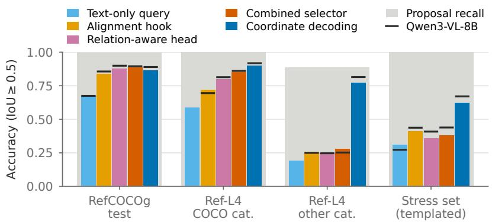
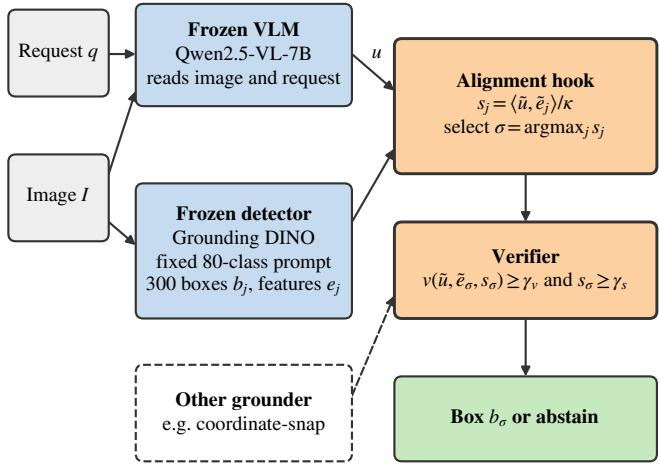
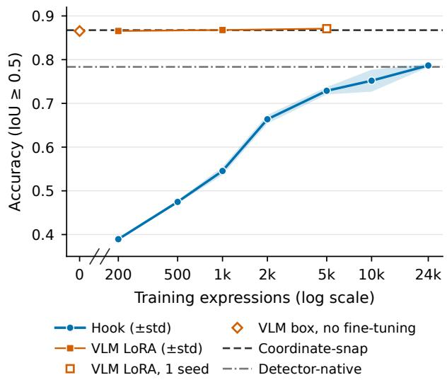
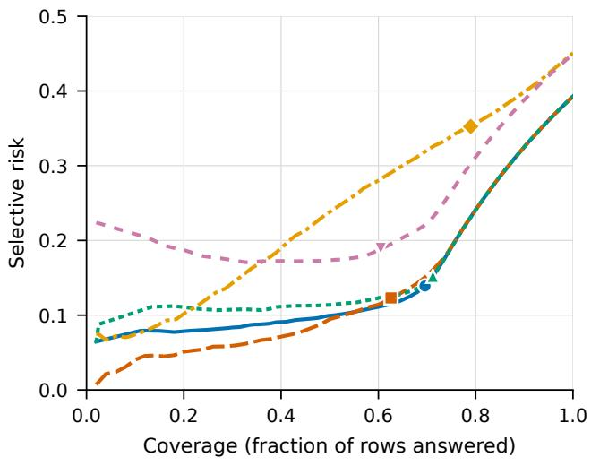
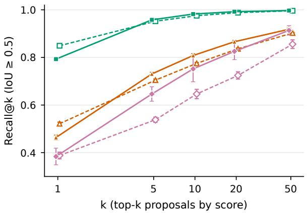

# Where Does Proposal Selection Fail? Diagnosing Frozen Vision-Language Queries over Detector Proposals

Bo Ma Auckland University of Technology

Weiqi Yan Auckland University of Technology

Jinsong Wu Guilin University of Electronic Technology

## Abstract

In modular grounding a frozen detector proposes regions and a vision-language model (VLM) selects one, at lower cost than letting the VLM decode a box, but it is unclear where such systems fail. We hold perception fixed—every trained selector chooses among the same frozen proposals, which contain the referent for at least 99.8% of Ref-COCO/+/g queries—and vary the selection interface one factor at a time for two VLMs of one family (Qwen2.5- VL-7B, Qwen3-VL-8B). On RefCOCOg, what the selector reads matters more than how it is built: the VLM’s imageconditioned query encodes the referent’s location and beats a text-only query by 0.15–0.18 with every head tested (by less for InternVL3-8B, whose vision encoder differs; one head tested). The remaining errors are rankings among a few top candidates; a cross-attention selector supervised with every valid box reaches the VLM’s coordinate decoding on RefCOCOg, and with Qwen2.5-VL on RefCOCO/+ when also trained on their data. Beyond that distribution it does not: on Ref-L4’s Objects365 images, mostly of cat egories outside training, every trained head falls to 0.19– 0.28 while Qwen decoding keeps about 0.8 (InternVL3’s drops too), neither a wider detector prompt nor a classagnostic proposer closes the gap, and on public reasoning benchmarks Ref-Adv-s and RefBench-PRO full-budget heads trail decoding by 0.19–0.37 althoughproposals cover most referents. A trained verifier reduces to an existence probe on the VLM’s query state and does not beat the VLM’s yes/no answer on public no-target benchmarks.

## 1. Introduction

Grounding a free-form request—“the person not wearing a helmet”, “something to cut paper with”—requires two competencies: localizing candidate objects and selecting the one the request refers to. Two families of vision-language models (VLMs) combine them differently. Coordinateas-text models decode the box inside the language head [3, 6, 25, 51, 85]; modular designs let a detector propose regions and let the language model select among them, by retrieval with pooled token states [88], by an index token [22, 23, 44], by attending from proposals to the language model’s hidden states [29], or by reasoning over candidates in text [24]. These systems report localization, selection and abstention as one number, so a wrong box cannot be traced to the detector, the selection step or the decision to answer.

The modular route has practical appeal. One detector pass serves every request on an image; one forward pass of the VLM replaces autoregressive decoding, so with our components a proposal pipeline costs 0.41 of the latency of coordinate decoding per request (0.23 when the detector pass is shared by the 3.8 requests per image of RefCOCOg val); boxes inherit the detector’s localization; and a selector can expose a decision to abstain. What builders of such pipelines need to know is whether selection is as accurate as the VLM’s own grounding, and if not, which part to fix.

We isolate the selection step. A frozen, language-aligned detector [41] returns M=300 proposals with region features; a frozen VLM (Qwen2.5-VL [3], replicated with Qwen3-VL [2]) reads the image and the request and emits a pooled query embedding; a small trained alignment hook (a region–query matching head) selects a proposal; a verifier decides whether to answer. Because every trained method selects from the same proposals—which contain the referent for 99.8–100% of RefCOCO/+/g queries—differences measure the selection interface, not the detector. Varying one factor at a time yields three findings (Fig. 1), whose core comparisons are repeated for both VLMs on heads trained with the full RefCOCOg training set (Tab. 1):

• The query decides, because it localizes. With any of three heads fixed, a text-only query loses 0.15–0.18 on RefCOCOg (at 24k rows the hook’s loss is 0.21 with Qwen2.5-VL and 0.13 with InternVL3 [90], whose vision encoder differs) against the query the VLM computes with the image, which linearly encodes much of the referent’s location; with that query fixed, pairwise heads of different form and capacity converge and cross-attention scoring adds a few points (Sec. 6.2).

  
(a) “man holding two plates” hook: other object, IoU 0.04 (referent ranked 2nd) coord.: IoU 0.97

  
(b) “something to eat with” hook: miss (3/3) coord.: IoU 0.96

  
Figure 1. Where selection fails. Left: the alignment hook’s choice among the frozen detector’s proposals (orange, dotted; one seed, 24k rows) against the VLM’s own coordinate decoding (blue, dashed) and the ground truth (green). (a) A ranking error: the referent is ranked second. (b) A reasoning request, missed in all three seeds. Right: accuracy of heads trained on all of RefCOCOg and of coordinate decoding (bars: Qwen2.5-VL-7B; ticks: Qwen3-VL-8B; gray: proposal recall). The selectors reach decoding on RefCOCOg but not on Ref-L4’s Objects365 images or on templated reasoning requests (values in Tab. 1; Qwen3-VL’s text-only query is not split on Ref-L4).

• On standard expressions, errors are ranking errors. The correct proposal is usually in the top five (Fig. 1a); supervision with every valid box, reading several VLM layers and cross-attention scoring bring a selector level with coordinate decoding on RefCOCOg. Prompting the VLM to pick among the top candidates does not help; finetuning it to pick, as in candidate-region selection [76], does, though on the hook’s top five it ends level with the same VLM fine-tuned to decode boxes on the same rows.

• Beyond them, a category boundary. On Ref-L4 every trained head collapses on referents outside the COCO cat egories it was trained on, while Qwen’s coordinate decoding does not (InternVL3’s falls too); a detector prompt naming every category or a class-agnostic proposer leaves it far below decoding, while training on such referents, not on their caption style, lifts it (hook: 0.24 to 0.47 on Objects365 images; Sec. 6.3). On public reasoning benchmarks (Ref-Adv-s, RefBench-PRO) every fullbudget head trails decoding by 0.19–0.37.

For abstention, a verifier on frozen features is an existence probe on the VLM’s query state; it adds referent-level abstention to coordinate-snap, but the VLM’s yes-minus-no score ranks swapped negatives better and its yes/no answer is better on every public no-target benchmark (Sec. 6.4). We contribute a matched-perception protocol for modular grounding (one metric for every method, with abstention reported as answer rate and selective accuracy and errors split into perception and selection as in [43], Sec. 3) and the controlled diagnosis above. We claim no state-of-the-art localization: the VLM’s untrained decoding is matched only on RefCOCOg, and on RefCOCO/+ with their data.

## 2. Related Work

Two-stage referring-expression comprehension. Selecting among expression-agnostic proposals is the classic two-stage design [60, 67, 82], which already compared ground-truth with detected regions; its ceiling motivated expression-aware proposals [7] and one-stage grounding fusing the request early [11, 27, 32, 78]; referring segmentation has been split into perception and cognition [9]. We revisit selection with a frozen VLM as the query source.

Coordinate-as-text grounding. Kosmos-2 [51], Shikra [6] and Florence-2 [72] emit boxes as location tokens or plain numbers, Ferret [80] mixes points with continuous region features, Griffon [84, 85] spells out dense object locations, the Qwen-VL family [1–3, 64] decodes coordinates as text (normalized, except absolute pixels in Qwen2.5-VL), and Rex-Omni [25] predicts quantized coordinate tokens. Frozen VLMs also localize without decoding, through a few attention heads [28], their attention maps [70, 87] or a learned positional prompt [14], and intermediate layers carry region information [35, 58]. Contemporaneous work regresses the box from one token state of a fine-tuned VLM [91], drafts it with such a head and verifies it with coordinate tokens [61] (both run in Tab. S11), or fuses several frozen VLMs’ boxes by agreement [57]. The frozen VLM’s own coordinate decoding is our strongest matchedperception reference.

Proposal-based grounding with multimodal LLMs. GROUNDHOG [88] retrieves masks with the averaged hidden state of an adapted LLM’s grounding tokens. ChatRex [22], RexSeek [23], Groma [44] and VLM-FO1 [40] insert proposal or region tokens into a trained LLM that answers with their indices; LLM-wrapper [4] fine-tunes an LLM to pick among candidate boxes listed as text, candidate-region selection [76] instruction-tunes an MLLM to answer one of a detector’s top candidates or “none”, and ROD-MLLM [79] also rejects absent targets. VGent [29] freezes a reinforcement-learning-tuned Qwen2.5-VL-7B and lets boxes from several proposers cross-attend to its hidden states of every layer, trained on several grounding corpora; our combined selector (Sec. 4) is a small instance of that design trained on RefCOCO-family data alone. Rex-Thinker [24] reasons in text over each candidate and may reject all of them. Training-free variants overlay numbered marks [75, 89], which can hurt open VLMs [62] unless they are trained to read them [74], ask one true/false question per proposal [38], or chain agents over candidates [42]. PropVG [10] and RefFormer [65] avoid an external detector. Published accuracies are not matched-perception results. The alignment hook, the verifier and the coverage– selection decomposition were introduced in HKVLM [43]; the matched-perception diagnosis, the category-boundary analysis, the full-budget and second-VLM replications, the probes on per-token states and in-VLM selection are new here. The hook is deliberately the simplest member of the family, so that what these systems add—token-level access, relations among proposals, selection inside the language model—can be varied singly on identical proposals.

Absent targets and abstention. gRefCOCO [12, 19, 37] adds no-target and multi-target expressions to the Ref-COCO family, and GREC methods predict the number of targets [66]; Ref-ZOM [21] does the same for referring segmentation; R-RefCOCO [69] builds negatives that include sentences of other referents, as our swaps do; $\mathrm { D ^ { 3 } }$ [73] annotates descriptions of absence and finds that REC models rarely reject negatives, and OmniLabel [59] adds negative descriptions to language-based detection; and GroundingME [33] reports that most MLLMs score zero on its rejection dimension and releases attribute-edited RefCOCOg negatives. Remedies train the grounder to refuse [77, 83], add a discrimination module [10] or verify program steps [50]; our verifier is trained on frozen features and acts as a hidden-state probe [30]. Contemporaneously, absence is scored from frozen CLIP features [48] and blackbox VLM groundings are calibrated on held-out data [86]. Recent benchmarks also probe compositional, knowledgedependent and reasoning-heavy references with rejection [13, 16, 26, 39, 71]. We report the answer rate, selective accuracy and the area under the risk–coverage curve [17, 68]; object hallucination is measured with caption metrics [56] and existence probes [34] and reduced by contrastive decoding [31], and grounding objectives alone do not remove it [18]. Ref-L4 [5] pairs long, human-reviewed expressions over 365 categories with COCO and Objects365 images and already reports lower accuracy on its Objects365 categories;

open-vocabulary detectors [8, 32, 46] and grounding heads [63] drop on categories outside their training vocabulary. We separate prompt and training vocabulary as causes.

## 3. Setting and Metrics

Given an image I and a request q, a system returns a box for the referent when one exists and abstains otherwise. A perception module supplies proposals $\mathcal { R } = \{ ( b _ { j } , e _ { j } ) \} _ { j = 1 } ^ { M }$ with boxes $b _ { j }$ and features $e _ { j } { \mathrm { ; } }$ selection maps q to one element of $\mathcal { R }$ .

One grounding metric. Grounding accuracy is the fraction of present queries whose returned box has IoU ≥ 0.5 with the ground truth, for every method. For methods that rank the proposals, the accuracy of the top-ranked proposal with abstention disabled is selection accuracy. An abstaining system additionally has an answer rate (fraction of queries answered) and a selective accuracy (accuracy among answered queries). On sets that mix present and absent referents, joint accuracy counts a present query as correct if a correct box is returned and an absent query if the system abstains; its AURC is the area under the selective risk–coverage curve. Recall@k is the share of present queries with a proposal at $\mathrm { I o U } \geq 0 . 5$ among the top k.

Perception versus selection. Let zn = $\begin{array} { l r } { { \bf 1 } [ \mathrm { m a x } _ { j } \mathrm { I o U } ( b _ { n , j } , b _ { n } ^ { \star } ) } & { \geq } & { 0 . 5 ] } \end{array}$ indicate that some proposal covers referent n. Because the returned box is a proposal, a hit implies $z _ { n } ~ = ~ 1$ , and selection accuracy factorizes into proposal recall and conditional selection,

$$
\begin{array} { r } { \mathrm { A c c } = ( 1 - \epsilon _ { \mathrm { c o v } } ) ( 1 - \epsilon _ { \mathrm { s e l } } ) , \quad \epsilon _ { \mathrm { c o v } } = 1 - \frac { 1 } { N } \sum _ { n } z _ { n } , } \end{array}\tag{1}
$$

where $N$ is the number of present queries and $\epsilon _ { \mathrm { s e l } }$ the failure rate among covered referents; the identity separates the detector’s share of the error from the selector’s.

Terms. Alignment hook: the cosine matching head of Sec. 4. Learned bridge: the hook trained without the verifier, used to vary the query source (CLIP, the detector’s text tower, the VLM with or without the image). Index scorer: a per-proposal scorer over the query and proposal features with a learned index embedding, modeled on the index outputs of [22, 44] but a small head over the pooled query rather than a trained language model; audited: its best variant (no index embedding, masked uncovered positives, normalized inputs, learning rate swept on RefCOCOg val). Relation-aware head, token-state probe and combined selector: the heads of Sec. 4. Detector-native: the detector prompted with the expression, highest-scoring box. Coordinate decoding: the frozen VLM prompted for a box in its documented format (absolute pixels for Qwen2.5-VL, a

  
Figure 2. Matched-perception selection. A frozen detector, prompted with one fixed text independent of the request, supplies proposals and region features; the frozen VLM reads image and request and returns the query u. Only the orange components are trained: the hook selects a proposal and the verifier decides whether to answer. Dashed: the verifier scores, unchanged, the proposal returned by another grounder, gating on $v \geq \gamma _ { v }$ alone (Sec. 6.4).

0–1000 grid for Qwen3-VL), used as returned; coordinatesnap: that box snapped to the proposal of maximal IoU. Swapped absent referent: an expression paired with another image. Stress set: the templated reasoning requests of Sec. 5. Late fusion: the request and the region features meet only in the selection head, through the VLM’s query. Intervals: 95% bootstrap over queries; two-level: seeds, then queries; Holm: multiplicity-adjusted p-values.

## 4. Selection Interface and Probes

Frozen components. The detector is Grounding DINO [41] (Swin-B), prompted with one fixed text listing the 80 COCO category names, independent of the request; it returns the M=300 highest-scoring proposals with 256- dimensional vision-language-fused region features. The VLM is Qwen2.5-VL-7B [3]; it receives the image and the bare request, with no instruction, and the query $\bar { u } \in \mathbb { R } ^ { 3 5 8 4 }$ is its final-layer hidden state at the position that would begin its answer (Fig. 2). We call this single vector the pooled query, unlike the per-token states of the token-state probe.

Alignment hook. Two small MLPs map regions and the query into a shared space; the affinity is a temperaturescaled cosine, $s _ { j } ~ = ~ \langle \tilde { u } , \tilde { e } _ { j } \rangle / \kappa .$ , with ℓ2-normalized projections and a learned temperature κ. The hook is trained by contrastive retrieval over the proposals of the image, $\begin{array} { r } { \mathcal { L } _ { \mathrm { r e t } } = - \mathbf { 1 } [ P \neq \infty ] \log \sum _ { j \in P } } \end{array}$ softmaxj(s), where the positive set P is the proposal of maximal IoU with the ground truth; absent queries and the few present queries that no proposal covers have $P = \varnothing$ and contribute only to the verifier loss. At inference the hook selects arg maxj $s _ { j }$ . With normalized projections any proposal can be ranked first by some query, as its feature lies outside the convex hull of the others’; the interface itself rules out no selection.

Verifier. A head $v ( \tilde { u } , \tilde { e } _ { \sigma } , s _ { \sigma } )$ reads the query, the selected region and their affinity and is trained with binary crossentropy on $y = 1$ [referent present], with swapped absent queries as negatives. The hook emits a box when $v \geq \gamma _ { v }$ and $s _ { \sigma } \geq \gamma _ { s }$ (its veto); $( \gamma _ { v } , \gamma _ { s } ) = ( 0 . 3 , 2 4 )$ is chosen once on RefCOCOg val $( \gamma _ { s } \kappa \approx 0 . 4$ in cosine units at the learned $\kappa \approx 0 . 0 1 7 )$ . Because the verifier reads only a query, a region and their affinity, it can score any grounder’s box once snapped to a proposal, gating on $v \geq \gamma _ { v }$ alone (Sec. 6.4).

Diagnostic probes. Each probe changes one factor with perception, training data (24k rows, Sec. 5) and evaluation fixed, with three seeds. Query source: the learned bridge on CLIP [53] text, the detector’s text tower (native and through a trained projection), the VLM without the image, or the image-conditioned VLM query. Head form and capacity: shared dimension 128–512, width 256–1024, depth 0–3; the index scorer with and without its index embedding, with a bilinear scorer and with a learning-rate sweep. Supervision and readout: every proposal with $\mathrm { I o U } \geq 0 . 5$ as a positive; the query read as the mean over expression tokens or from three depths of the VLM. Set-level scoring at a matched 4.3M parameters: a relation-aware head in which query-modulated proposal tokens with box geometry attend to each other under a learned pairwise geometry bias, optionally with a loss that ranks proposals by IoU; a crossattention head in which proposal tokens attend to the pooled query; and the token-state probe, in which they attend to the final-layer states of the request tokens. The combined selector joins token states, two intermediate depths, relations among proposals and the all-positive IoU-rank loss.

## 5. Experimental Protocol

Data. We evaluate on RefCOCO, RefCOCO+ [81] and RefCOCOg [45] (umd split [47]) over COCO [36]; training uses RefCOCOg only, so RefCOCO/+ are held-out expression sets, though not held-out images (see below). Probes train on the first 24,000 rows of RefCOCOg train (16,724 present expressions, 7,276 swapped absent ones); the core comparisons use the full set (80,512 and 34,505 rows on 21,899 images; Tab. 1). Ref-L4 [5] (13,420 validation queries) adds long expressions and non-COCO categories. A 231-query stress set of templated reasoning requests built from COCO val2017 annotations tests negation, affordance and world knowledge; it is small and templated (25 templates over 218 images, none in any RefCOCO-family split, reviewed by annotators blind to model outputs), so its intervals are clustered by template (Sec. S8). Two public reasoning benchmarks complement it: Ref-Adv-s, the public split of Ref-Adv [13] (1,142 queries, same-category distractors, 40% negated, no image in RefCOCO-family training data) and RefBench-PRO [16] (5,000 queries in five perception and reasoning tasks plus 1,000 without a referent). Abstention is tested on POPE [34], RefBench-PRO, gRef-COCO [37] testA and testB, GroundingME [33] and on RefCOCOg val and test and the stress set augmented with 30% swapped absent referents, re-encoded with the new image. Some supplementary analyses use an earlier feature build.

Caveats on the frozen components. The Swin-B detector was trained with RefCOCO-family data and the VLM’s grounding corpora are undisclosed, so neither built-in interface is zero-shot on these splits: low-rank fine-tuning of the VLM in its native box format on 200 to 5,000 RefCOCOg expressions moves its RefCOCOg val accuracy only from 0.865 to 0.866–0.871 (Sec. S16). With proposals from a detector trained without RefCOCO data, recall drops by at most 0.006 on every whole split but the stress set, the relation-aware head stays within 0.010 on the standard splits (the hook within 0.04), and the Ref-L4 collapse persists (Tab. S58). Every trained method shares both frozen components, so comparisons among them stay matched. RefCOCO/+ val images outside RefCOCOg train are harder for every system: on those of RefCOCO val the full-budget combined selector reaches 0.861 against 0.875 for coordinate decoding (−0.014 [−0.024, −0.004]; RefCOCO+ 0.784 against 0.824); the heads gain at most 0.013 more on newly seen training images than on others, so this reflects image selection, not memorization (Tabs. S52 and S53); trained on all three RefCOCO-family sets it reaches 0.893 and 0.820 there. Trained results: three-seed means.

## 6. Results

## 6.1. Where selection by alignment stands

Table S1 indexes the evidence (intervals, paired tests, persplit and per-bucket tables) behind each claim below.

Tab. 1 answers the first question. Proposal recall is at least 0.998 on the COCO-based splits, so Eq. (1) attributes the loss to selection: for the hook trained on 24k rows $\epsilon _ { \mathrm { s e l } }$ is 0.21 on RefCOCO and RefCOCOg, 0.29 on RefCOCO+ and 0.62 on the stress set, whereas on Ref-L4 perception accounts for 4% of queries. At that budget the hook is 0.07– 0.13 below coordinate-snap on every standard split and not distinguishable from detector-native selection on Ref-COCOg. Trained on the full set, every head gains on every split outside the stress set, where the relation-aware head, the token-state probe and the combined selector lose 0.03,

0.07 and 0.04. On RefCOCOg test the combined selector exceeds the raw box by 0.018 [0.012, 0.025] with Qwen2.5- VL and is level with it with Qwen3-VL (+0.006 [0.000, 0.011]; on val +0.011 and +0.013); the relation-aware head alone exceeds the raw box by 0.012 [0.005, 0.020] and cross-attention to the pooled query reaches 0.881, so the scoring, not the combination, carries most of it (twolevel intervals). On RefCOCO val the combined selector is level with the raw box, on RefCOCO+ val 0.014 behind (Qwen3-VL: 0.008 and 0.014 behind); trained on all three RefCOCO-family training sets it leads on RefCOCO val, RefCOCO+ val and RefCOCOg test by 0.018, 0.008 and 0.023 (intervals above zero; Tab. S55), though the added data move RefCOCOg test by only +0.005 [0.000, 0.009] and Ref-L4 not at all. VGent [29] reports 0.01–0.035 more on these splits; as neither these data nor a class-agnostic proposer (Sec. 6.3) close that gap, it may lie in what we hold fixed: its tuned encoder read at every layer, its three proposers used together and its broader corpora. On Ref-L4 and the stress set decoding stays at least 0.21 ahead of every head. The findings below hold for both VLMs where Tab. 1 has both. On RefCOCO/+ testA/testB and Ref-L4 test the hook is below the relation-aware head and both below the snapped box. Selected boxes are not loose: at IoU ≥ 0.75 the full-budget relation-aware head and combined selector exceed the snapped box on RefCOCOg test by about 0.04.

## 6.2. What limits selection

The query, and why it matters. With the head fixed (Tab. 2, left), every text-only query source stays at or below 0.61 on RefCOCOg test, against 0.79 for the imageconditioned VLM query; at the full budget the text-only query loses 0.15–0.18 on RefCOCOg with the bridge (both VLMs, Tab. 1), the relation-aware head and the token-state probe, and at 24k rows it costs the hook 0.134 [0.122, 0.146] with InternVL3-8B against 0.208 with Qwen2.5- VL on RefCOCOg val (Tabs. S50 and S57). The imageconditioned query already localizes the referent: a linear probe from it to the box explains 68% of the variance of the box center on RefCOCOg val (6% for the text-only query), and snapping the probe’s box to the nearest proposal selects the referent for 0.56 of queries. The hook reads this location out against the region features (0.79); a query computed without the image cannot carry it, so under late fusion over request-independent proposals what matters is what the VLM computed with the image. The same detector reaches 0.78 when the expression conditions its features (detector-native) but 0.61 when its text tower supplies the query. With the query fixed, pairwise per-proposal heads differ little: the index-scorer variants stay within 0.03 of the hook on RefCOCOg and seven capacity settings span at most 0.025; scoring proposals by cross-attention with every valid box as a positive adds 0.06 over the single-positive hook on RefCOCOg test, 0.02–0.04 of it at matched supervision and size, with or without relations among proposals (Tab. 2, right). On Ref-L4 the query matters less (0.06– 0.13) and the head more (with the text-only query the tokenstate probe leads the bridge by 0.105).

Table 1. Full RefCOCOg training set, two VLMs: accuracy at $\mathrm { I o U } \geq 0 . 5$ on present queries, no abstention; trained rows select one of the same 300 proposals (mean over three seeds; sample std $\leq 0 . 0 1 6 ,$ , on $\mathrm { S t r e s s } \leq 0 . 0 4 8 $ ; RefCOCOg val also served for tuning). Heads are trained on all of RefCOCOg train (115k rows) with each VLM’s own query; text-only query: the learned bridge on the request read without the image; pooled query: cross-attention of proposal tokens to the pooled query. Ref-L4 is also split by image source: COCO images, whose referents are all COCO categories (63% of queries), and Objects365 images (other; a third of their referents map to a COCO class). All three train sets: trained on RefCOCO, RefCOCO+ and RefCOCOg train, evaluation images removed. RefCOCO/+ cells of the pooled query, token-state probe and combined selector: same-seed retraining (other cells reproduced within 0.004 outside Stress). Ref-Adv-s and RB-PRO (RefBench-PRO, five grounding tasks): public reasoning benchmarks, Qwen2.5-VL heads only. –: not evaluated. Std, $\mathrm { I o U } \geq 0 . 7 5$ and recall@5 where evaluated: Tabs. S44 and S45.
<table><tr><td></td><td>RefCOCO</td><td>RefCOCO+</td><td colspan="2">RefCOCOg</td><td colspan="3">Ref-L4 val</td><td colspan="3"></td></tr><tr><td></td><td>val</td><td>val</td><td>val</td><td>test</td><td>all</td><td>COCO cat.</td><td>other</td><td>Stress</td><td>Ref-Adv-s</td><td>RB-PRO</td></tr><tr><td>Proposal recall</td><td>0.999</td><td>0.999</td><td>1.000</td><td>0.998</td><td>0.958</td><td>0.999</td><td>0.886</td><td>1.000</td><td>0.907</td><td>0.884</td></tr><tr><td>Detector-native</td><td>0.847</td><td>0.737</td><td>0.783</td><td>0.781</td><td>0.634</td><td>0.649</td><td>0.609</td><td>0.255</td><td>0.271</td><td>0.524</td></tr><tr><td>Qwen2.5-VL-7B</td><td></td><td></td><td></td><td></td><td></td><td></td><td></td><td></td><td></td><td></td></tr><tr><td>Text-only query</td><td>0.683</td><td>0.517</td><td>0.672</td><td>0.676</td><td>0.442</td><td>0.587</td><td>0.194</td><td>0.312</td><td></td><td></td></tr><tr><td>Alignment hook</td><td>0.834</td><td>0.760</td><td>0.843</td><td>0.837</td><td>0.549</td><td>0.718</td><td>0.259</td><td>0.413</td><td>0.308</td><td>0.297</td></tr><tr><td>Relation-aware head</td><td>0.872</td><td>0.802</td><td>0.877</td><td>0.878</td><td>0.595</td><td>0.798</td><td>0.247</td><td>0.358</td><td>0.317</td><td>0.290</td></tr><tr><td>Pooled query, cross-attention</td><td>0.876</td><td>0.808</td><td>0.877</td><td>0.881</td><td>0.606</td><td>0.807</td><td>0.260</td><td>0.388</td><td></td><td></td></tr><tr><td>Token-state probe</td><td>0.886</td><td>0.815</td><td>0.871</td><td>0.878</td><td>0.627</td><td>0.834</td><td>0.272</td><td>0.355</td><td>0.326</td><td>0.313</td></tr><tr><td>Combined selector</td><td>0.895</td><td>0.824</td><td>0.876</td><td>0.885</td><td>0.641</td><td>0.852</td><td>0.280</td><td>0.381</td><td>0.314</td><td>0.313</td></tr><tr><td>all three train sets</td><td>0.912</td><td>0.846</td><td>0.877</td><td>0.889</td><td>0.640</td><td>0.853</td><td>0.274</td><td>0.374</td><td></td><td></td></tr><tr><td>Coordinate decoding</td><td>0.893</td><td>0.838</td><td>0.865</td><td>0.866</td><td>0.853</td><td>0.900</td><td>0.774</td><td>0.623</td><td>0.520</td><td>0.662</td></tr><tr><td>Qwen3-VL-8B</td><td></td><td></td><td></td><td></td><td></td><td></td><td></td><td></td><td></td><td></td></tr><tr><td>Text-only query</td><td>0.669</td><td>0.508</td><td>0.671</td><td>0.674</td><td>0.469</td><td></td><td></td><td>0.273</td><td></td><td></td></tr><tr><td>Alignment hook</td><td>0.853</td><td>0.800</td><td>0.853</td><td>0.856</td><td>0.531</td><td>0.695</td><td>0.250</td><td>0.437</td><td>一</td><td></td></tr><tr><td>Relation-aware head</td><td>0.905</td><td>0.853</td><td>0.900</td><td>0.899</td><td>0.605</td><td>0.814</td><td>0.247</td><td>0.408</td><td>一</td><td></td></tr><tr><td>Token-state probe</td><td>0.909</td><td>0.858</td><td>0.897</td><td>0.894</td><td>0.579</td><td>0.782</td><td>0.230</td><td>0.434</td><td></td><td></td></tr><tr><td>Combined selector</td><td>0.910</td><td>0.855</td><td>0.898</td><td>0.895</td><td>0.637</td><td>0.861</td><td>0.252</td><td>0.439</td><td>一</td><td></td></tr><tr><td>Coordinate decoding</td><td>0.918</td><td>0.868</td><td>0.886</td><td>0.890</td><td>0.880</td><td>0.918</td><td>0.815</td><td>0.671</td><td></td><td></td></tr></table>

Table 2. Diagnostic probes (Qwen2.5-VL, 24k rows; selection accuracy at $\mathrm { I o U } \geq 0 . 5 ;$ mean±sample std over three seeds; ∗selected on RefCOCOg val; –: not evaluated). Test: RefCOCOg test. Left: the query source with the head fixed (the bridge on the image-conditioned query coincides seed by seed with the hook trained without the verifier), and the head with the image-conditioned query fixed. Right: supervision and readout of the hook, and set-level scoring at a matched 4.3M parameters (cross-attention rows trained in one run with a relation-aware head that scores 0.850 / 0.517 / 0.380).
<table><tr><td></td><td>Test</td><td>Ref-L4</td><td>Stress</td><td></td><td>Test</td><td>Ref-L4</td><td>Stress</td></tr><tr><td colspan="3">Query source (learned bridge)</td><td colspan="3">Supervision and readout (hook)</td><td></td><td></td></tr><tr><td>CLIP text</td><td> $0 . 5 5 3 { \pm } . 0 0 5$ </td><td>0.359</td><td>0.237</td><td>Single positive, final token</td><td> $0 . 7 9 3 { \scriptstyle \pm . 0 0 7 }$ </td><td>0.464</td><td>0.384</td></tr><tr><td>Detector text tower</td><td> $0 . 6 0 5 { \scriptstyle \pm . 0 0 6 }$ </td><td>0.388</td><td>0.250</td><td>Every valid box positive</td><td> $0 . 8 0 5 { \pm } . 0 1 4$ </td><td></td><td></td></tr><tr><td>projected</td><td> $0 . 6 1 1 { \pm } . 0 1 0$ </td><td>0.375</td><td>0.224</td><td>Mean over expression</td><td> $0 . 7 2 1 { \pm } . 0 0 8$ </td><td></td><td></td></tr><tr><td>VLM, text only</td><td> $0 . 5 9 3 { \scriptstyle \pm . 0 0 7 }$ </td><td>0.372</td><td>0.294</td><td>Three VLM depths</td><td> $0 . 8 1 7 { \scriptstyle \pm . 0 0 1 }$ </td><td></td><td></td></tr><tr><td>VLM, image-conditioned</td><td> $0 . 7 9 1 { \pm } . 0 1 3$ </td><td>0.465</td><td>0.423</td><td>Three depths, every valid box</td><td>0.842±.003</td><td></td><td></td></tr><tr><td colspan="3">Head (image-conditioned query)</td><td colspan="3">Set-level scoring (4.3M parameters)</td><td></td><td></td></tr><tr><td>Alignment hook (1.1M)</td><td> $0 . 7 9 3 { \scriptstyle \pm . 0 0 7 }$ </td><td>0.464</td><td>0.384</td><td>Hook, single positive</td><td>0.792±.004</td><td>0.444</td><td>0.390</td></tr><tr><td>Index scorer, as proposed</td><td> $0 . 7 7 0 { \scriptstyle \pm . 0 0 7 }$ </td><td>0.444</td><td>0.384</td><td>Hook, every valid box</td><td>0.816±.011</td><td>0.497</td><td>0.392</td></tr><tr><td>Index scorer, no index emb.</td><td> $0 . 8 0 8 { \scriptstyle \pm . 0 0 7 }$ </td><td>0.469</td><td>0.420</td><td>Relation-aware, every valid box</td><td>0.842±.003</td><td>0.518</td><td>0.362</td></tr><tr><td>Index scorer, audited*</td><td> $0 . 8 1 5 { \pm } . 0 0 2$ </td><td>0.451</td><td>0.434</td><td>+ IoU-rank loss*</td><td> $0 . 8 4 9 { \scriptstyle \pm . 0 0 1 }$ </td><td>0.522</td><td>0.388</td></tr><tr><td>Detector-native</td><td>0.781</td><td>0.634</td><td>0.255</td><td>Pooled query, cross-attention</td><td>0.854±.001</td><td>0.502</td><td>0.356</td></tr><tr><td>Coordinate-snap</td><td>0.866</td><td>0.833</td><td>0.610</td><td>Token states, cross-attention</td><td> $0 . 8 5 2 { \pm } . 0 0 2$ </td><td>0.593</td><td>0.426</td></tr><tr><td></td><td></td><td></td><td></td><td>+ image tokens</td><td> $0 . 8 5 1 { \pm } . 0 0 5$ </td><td>0.592</td><td>0.392</td></tr><tr><td></td><td></td><td></td><td></td><td>+ relations</td><td>0.854±.002</td><td>0.588</td><td>0.408</td></tr></table>

Table 3. Selecting inside the VLM (Qwen2.5-VL; accuracy at IoU ≥ 0.5; hook: seed 42). The VLM chooses among five proposals (near-duplicates suppressed) ranked by the hook or by the detector prompted with the expression, drawn as numbered marks, listed as box coordinates, or judged one at a time. Fine-tuned: one epoch of low-rank adaptation [20] on the 24k training rows, to answer the box list with a candidate’s number (or “none” on swapped rows) or to decode a box in the native format (present rows); three seeds, std ≤ 0.006 on RefCOCOg, except the detector row (one seed). Ref-L4: fixed 3,000-query subset (hook seed: 0.451; all of Ref-L4: 0.452). –: not evaluated.
<table><tr><td></td><td colspan="2">RefCOCOg</td><td></td><td></td></tr><tr><td></td><td>val</td><td>test</td><td>Ref-L4</td><td>Stress</td></tr><tr><td>Hook, top-1</td><td>0.787</td><td>0.788</td><td>0.451</td><td>0.390</td></tr><tr><td>Correct box in hook&#x27;s top 5</td><td>0.973</td><td>0.973</td><td>0.757</td><td>0.736</td></tr><tr><td>Correct box in detector&#x27;s top 5</td><td>0.980</td><td>一</td><td>0.898</td><td>一</td></tr><tr><td>VLM over hook&#x27;s top 5: marks</td><td>0.587</td><td></td><td>0.503</td><td>0.411</td></tr><tr><td>box list</td><td>0.760</td><td>0.762</td><td>0.576</td><td>0.524</td></tr><tr><td>true/false per box</td><td>0.735</td><td></td><td>0.587</td><td>0.489</td></tr><tr><td>VLM over detector&#x27;s top 5: marks</td><td>0.479</td><td>一</td><td>0.485</td><td>0.429</td></tr><tr><td>Fine-tuned, box list, hook&#x27;s top 5</td><td>0.878</td><td>0.882</td><td>0.688</td><td>0.528</td></tr><tr><td>detector&#x27;s top 5</td><td>0.892</td><td></td><td>0.763</td><td>一</td></tr><tr><td>Fine-tuned, native box</td><td>0.871</td><td>0.875</td><td>一</td><td>一</td></tr><tr><td>Coordinate decoding</td><td>0.865</td><td>0.866</td><td>0.838</td><td>0.623</td></tr></table>

Ranking, not retrieval. On RefCOCOg the correct proposal is ranked first for 0.79 of queries but is among the top five for 0.96 (0.97 after suppressing near-duplicates, Tab. 3): the scores contain the answer and misorder it among a few top candidates. Of the hook’s errors on RefCOCOg val (0.21 of queries), four fifths keep the correct proposal in the top five, split evenly between a box that overlaps the referent $( 0 . 1 ~ \leq ~ \mathrm { I o U } ~ < ~ 0 . 5 )$ and a different object; errors grow with the number of same-category distractors (0.19 with one, 0.27 with three or more). Changes aimed at that ordering pay off (Tab. 2, right): every valid box as a positive adds 0.012 and three VLM depths 0.024 (significant after correction only for the former at matched capacity), whereas averaging over expression tokens loses 0.07. Set-level scoring adds 0.02–0.04 over a hook with the same parameters and supervision on every standard split, at both budgets with Qwen2.5-VL and at the full budget with Qwen3-VL (+0.023 to +0.035), with every seed pair positive, but not on the stress set; the gain does not come from relations among proposals: removing the pairwise geometry bias changes accuracy by at most 0.004 outside the stress set, and cross-attention to the pooled query alone matches it. Trained on the full set and combined in one selector, these changes reach coordinate decoding on RefCOCOg (Tab. 1).

Selecting inside the VLM. If ordering is the bottleneck, the VLM might order the top candidates itself. Given the hook’s five highest-ranked proposals, which contain a correct box for 0.97 of RefCOCOg queries, none of three zeroshot prompts does (Tab. 3): the best, a list of box coordinates, stays below the hook (0.760 against 0.787), marks drawn on the image fare worse, as reported for open VLMs [62], and Qwen3-VL behaves alike with the box list. Finetuning, as in candidate-region selection [76], changes this: one epoch on the hook’s 24k training rows, answering with a candidate’s number, brings the same VLM to 0.882 on RefCOCOg test, above the hook and its own decoding (+0.016 [0.007, 0.024]; three seeds). The same epoch in the native box format brings decoding to 0.875, not distinguishable (+0.007 [−0.001, 0.015]; Tab. S26): training adds 0.12 to choosing from the list but under 0.01 to decoding, so it teaches ordering without making selection among the hook’s candidates beat equally trained decoding. On Ref-L4 and the stress set it gains 0.24 and 0.14 over the hook, below decoding; on the expression-prompted detector’s top five it reaches 0.892 on val, above decoding (one seed).

## 6.3. Ref-L4 and the reasoning probes

On Ref-L4 the hook’s top five contain the correct proposal for only 0.76 of queries, below decoding’s 0.84 (Tab. 3), so reordering them cannot close the gap; on the stress set (0.74 against 0.62) it could. The relation-aware head gains 0.06 on Ref-L4 over the hook (0.02 at matched parameters and supervision) but still trails coordinate-snap by 0.31; on the stress set it gains nothing over the hook (+0.004 [−0.036, +0.046] at 24k, clustered by template). Decoding leads the hook there by 0.62 to 0.38, also on each of the 14 templates with at least ten queries, and affordance requests stay below 0.40 for every trained interface.

Pooled versus token-level query. Is the pooled query the limit, as pooled states of generative VLMs are weak retrieval embeddings [15]? Proposal tokens cross-attending to the request tokens’ final-layer states, at the relation head’s parameter count, test this (Tab. 2, right). On Ref-L4 token states help at this budget: 0.593 against at most 0.522 for pooled-query heads and +0.08 over a same-run relationaware head (paired test, Holm $p ~ \leq ~ 0 . 0 0 6 )$ , while Ref-COCOg is unchanged and image tokens or relations add nothing. On the stress set they do not (0.426 against 0.423 and 0.434 for the best pooled-query heads). The advantage shrinks with data: at the full budget the pooled control reaches 0.606 and the token-state probe 0.627, it loses 0.07 on the stress set, and with Qwen3-VL it trails the relationaware head on Ref-L4 (0.579 against 0.605; Tab. 1).

On Ref-L4 trained heads meet a category boundary. On Ref-L4 detector-native selection (0.634) leads every trained head except the full-budget combined selector (0.641 and 0.637). Splitting it by image source—COCO images, whose referents all belong to the 80 COCO classes of the proposal prompt and of the training data, and Objects365 images (“other”)—locates most of the reversal (Tab. 1). On COCO images (63% of queries) the full-budget relation and cross-attention heads reach 0.78–0.86 and the combined selector comes within 0.06 of decoding; on Objects365 images every trained head stays at 0.19–0.28 while the expression-prompted detector keeps 0.61 and decoding 0.77–0.82, although proposals still cover 0.89 of these referents, whose boxes are also smaller. A third of them map to a COCO class, and these are selected about twice as often as the rest (hook at 24k: 0.38 against 0.17), a drop 0.14 larger than that of decoding. In a regression on vocabulary, image source and box size the trained heads’ category term stays at +0.84 to +0.94 log-odds under every size specification; the image-source term depends on it. Contemporaneous work attributes a similar drop of RefCOCOfine-tuned VLMs to target size [61]. On these images re leased Jag and LOCUS v1.0 reach 0.36–0.48; size is their largest term, and a smaller category term remains (+0.33 to +0.53; Tab. S12). LOCUS v1.1, also trained on small targets, reaches 0.52–0.60. Prompting the detector with every Objects365 name lifts recall on referents without a COCO counterpart to 0.95 but the hook only from 0.17 to 0.27. A class-agnostic proposer without a category prompt (UPN [22]) raises their recall from 0.89 to 0.97, yet the retrained heads stay at 0.17–0.29 there (Tab. S15). Training on half of Ref-L4’s Objects365 referents lifts the other half from 0.24 to 0.47 (hook, 24k; on referents without a COCO counterpart from 0.17 to 0.42, 0.50 with the extended prompt); as many COCO-image Ref-L4 rows, same caption style but no new categories, add nothing there (−0.008 [−0.018, 0.002], hook), and 0.05–0.09 of the gain is specific to the new categories, the rest reaching COCO-mappable referents on Objects365 images too (Tabs. S14 and S16). A RefCOCOgtrained selector thus does not transfer beyond the COCO categories although the frozen Qwen VLMs do, and 30k Flickr30k Entities phrases [52] on non-person, non-COCO objects lift Objects365 referents by only 0.06–0.08, mostly regardless of naming (Tab. S17). With InternVL3 the hook (0.58 to 0.21) and decoding (0.92 to 0.56) both drop.

Public benchmarks. On Ref-Adv-s, whose own prompt reproduces the published Qwen2.5-VL score here, and on RefBench-PRO a proposal covers 91% and 88% of referents, yet every full-budget head reaches only 0.31–0.33 and 0.29–0.31, against 0.52 and 0.66 for decoding (Tab. 1). Negation is not the obstacle (heads 0.33–0.35 with it, 0.29–0.31 without); relation and commonsense requests are (0.155–0.244 against 0.607–0.662), and on RefBench-PRO even the expression-prompted detector (0.52) beats every head (Tabs. S41 and S42). On GroundingME [33] (present referents) decoding reaches 0.24 (0.35 with Qwen3-VL) and every trained selector 0.05–0.07, although proposals cover 79% of referents (Tab. S39): not a pipeline fault—they reach 0.81–0.86 on COCO images—but a selection failure (first covering proposal at median rank 16– 31 of 300), as the query barely steers it: another request’s query costs the hooks 0.01–0.02, against 0.50–0.55 on RefCOCOg val.

## 6.4. What the verifier contributes

A swapped expression describes a specific object of another image, so the question is whether this image contains that referent, not a category. Attached unchanged to coordinate-snap, the verifier gives joint accuracy 0.888 on RefCOCOg test with 30% swapped absent referents, against 0.877 for a threshold on the VLM’s yes-probability tuned on val (+0.011 [0.009, 0.014], paired sign-flip test), 0.841 for its plain yes/no answer, 0.788 for the hook’s own veto and 0.606 for always answering (Tab. S30). It leads only at its operating point, on its own kind of negative. As a ranking signal the VLM’s yes-minus-no score is better (AURC 0.134 against 0.148 on val); its yes/no answer rejects more same-category hard negatives (0.91 against 0.87); and on every public no-target benchmark that answer wins: on POPE, gRefCOCO testA and testB (Pr@(F1=1) 0.51 and 0.52 against 0.48, also after retraining on gRefCOCO negatives), GroundingME’s attribute-edited negatives (0.87– 0.91 rejected against 0.33–0.38) and RefBench-PRO (joint accuracy 0.52 against 0.48). Its signal lies in the query: the projected query alone, or a logistic probe on the VLM’s raw state, matches it; the region alone does not. Qwen3- VL gives the same ordering. Decoding also refuses on its own: abstaining when no box parses gives joint accuracy 0.66 (Qwen2.5-VL, snapped box, 17% of swapped requests refused) and 0.82 (Qwen3-VL, raw box, 66%), below either model’s yes/no answer. On the stress set no gate is reliable; the verifier is level with the tuned yes-probability.

## 7. Limitations

All conclusions are for two detectors of one family (one without RefCOCO data), a class-agnostic proposer at the 24k budget and two VLMs of one family with undisclosed grounding corpora, plus InternVL3 (language model from Qwen2.5; hook and decoding only, 24k rows). The main heads saw only COCO-category referents. The templated reasoning probes are small, a third of their swaps satisfied by the new image; Ref-Adv-s and RefBench-PRO used Qwen2.5-VL heads only. The VLMs fine-tuned to select or decode (Tab. 3) saw one epoch of 24k rows. No VGentclass system is public; its remaining lead is inferred.

## 8. Conclusion

Proposal selection over a frozen VLM’s query fails in three places: in what the query saw, in ordering a few top candidates, and beyond the training distribution (new categories, reasoning requests). The first two are fixed on indistribution expressions by reading the query from the VLM with the image, supervising with every valid box and scoring proposals by cross-attention, at 0.41 of decoding’s latency. The third is not fixed by a better head, a wider detector prompt or a class-agnostic proposer; training on the target distribution narrows it. Beyond RefCOCO-family expressions the VLM’s own box is better when its latency is acceptable, and on public no-target benchmarks its yes/no answer abstains better than a trained verifier.

## LLM Usage Statement

LLM-based assistants (Anthropic Claude models, used through the Claude Code agent) were used extensively in this work, often carrying out multi-step tasks autonomously under the authors’ direction. Ideation and experiments: proposing and planning experiments, and acting as simulated reviewers whose critiques shaped which analyses were run; the authors decided what to pursue. Code and figures: writing and debugging the experiment, analysis and figure code, and launching and monitoring runs. Data: generating the rule-based candidate queries of the stress set and writing the data-preparation code; annotators who are not authors filtered the candidates. Related work: finding and summarizing literature. Text: drafting and revising the paper and the supplementary material, including grammar and wording. Checking: cross-checking reported numbers against the result files. No reported number was generated by an LLM, other than the outputs of the models under study. The authors reviewed all content and take full responsibility for it.

# Where Does Proposal Selection Fail? Diagnosing Frozen Vision-Language Queries over Detector Proposals

Supplementary Material

Bo Ma and Weiqi Yan

Auckland University of Technology

Jinsong Wu

Guilin University of Electronic Technology

This supplementary material accompanies the main paper. It gives the formal objectives, the accounting identities, the results that the main paper summarizes in text (reasoning-stress categories, POPE, training budget), extended results and ablations (Ref-L4 vocabulary, a classagnostic proposer, the prompt-versus-training vocabulary test and a caption-style control, margins, in-VLM selection including the fine-tuned selector and its matched control), an error taxonomy of the hook, the full evaluation of the verifier as a detachable abstention layer (including an untouched test split, hard negatives, its input ablation and the query-location probe), the construction and an audit of the reasoning-stress set, the public reasoning and rejection benchmarks, the full training set and training on all three RefCOCO-family sets, the second VLM, a third VLM and a second proposal source, an audit of image overlap between training and evaluation splits, the statistical protocol, the feature builds, and the reproducibility configuration. Notation and metrics follow the main paper: selection accuracy is the accuracy of the top-ranked proposal at IoU $\geq 0 . 5$ with abstention disabled, answer rate (the fraction of rows answered) and selective accuracy describe an abstaining system, and instance-exact selection is the fraction of present referents whose top-ranked proposal is the proposal of maximal IoU with the annotated box, provided that this IoU is at least 0.5; it is therefore never above selection accuracy, and it is the correctness criterion of the veto-threshold selection (Sec. S18). The main paper calls the frozen VLM’s box snapped to the proposals coordinate-snap and the unsnapped box coordinate decoding.

Where each claim is supported. Table S1 maps each finding of the main paper to its main-paper table and to the supplementary evidence.

## S1. Formal Selection Objective

Let $\mathcal { R } = \{ ( b _ { j } , e _ { j } ) \} _ { j = 1 } ^ { M } .$ be the frozen detector’s proposals and u the query embedding of one request (every experiment has one referent or none per request). With projections $\tilde { e } _ { j } = f _ { \theta } ( e _ { j } ) , \tilde { u } = g _ { \phi } ( u )$ and affinity $s _ { j } = \langle \tilde { u } , \tilde { e } _ { j } \rangle / \kappa .$ selection is trained as contrastive retrieval of one proposal.

Retrieval. The positive set $P$ of a present request holds the matched proposal, the proposal of maximal IoU with the ground-truth box; $P$ is empty for an absent request and for a present request that no proposal covers at $\mathrm { I o U } \geq 0 . 5$ (0.0–0.2% of requests at M=300). Over a batch,

$$
\mathcal { L } _ { \mathrm { r e t } } = - \sum _ { n : P _ { n } \neq \infty } \log \frac { \sum _ { j \in P _ { n } } \exp ( s _ { n j } ) } { \sum _ { j = 1 } ^ { M } \exp ( s _ { n j } ) } .\tag{S1}
$$

Requests with $P _ { n } = \varnothing$ enter only the verifier objective. The multi-positive variant of the supervision probes puts every proposal with IoU $\geq 0 . 5$ into $P _ { n } i$ ; the main configuration uses the single matched proposal. The hook has no boxregression output: the emitted box is always a frozen proposal.

## S2. Faithfulness Objective and Veto

The verification head reads the projected query, the projected region of maximal affinity $\sigma = \operatorname { a r g m a x } _ { j } s _ { j }$ and their affinity, $v ( \tilde { u } , \tilde { e } _ { \sigma } , s _ { \sigma } ) \in [ 0 , 1 ]$ , with the same choice of σ during training as at inference, and is trained with

$$
\begin{array} { l } { { \displaystyle { \mathcal { L } } _ { \mathrm { f a i t h } } = \sum _ { n } \mathrm { B C E } \big ( v _ { n } , y _ { n } \big ) , } \ ~ } \\ { { \displaystyle y _ { n } = \mathbf { 1 } \big [ \mathrm { r e q u e s t } n \mathrm { h a s ~ a ~ r e f e r e n t } \big ] } . } \end{array}\tag{S2}
$$

A present request receives $y _ { n } { = } 1$ whether or not its selected proposal is correct; the verifier is therefore an existence detector conditioned on the best-scoring region, not a correctness estimator for the selection. Absent training requests are constructed by pairing an expression with a different image (random swap, rate 0.3); Section S7 compares the existence label with a correctness label. At inference a request emits $b _ { \sigma } \operatorname { i f f } v \geq \gamma _ { v }$ and $s _ { \sigma } \geq \gamma _ { s } ;$ otherwise it abstains. The total loss is ${ \mathcal { L } } = { \mathcal { L } } _ { \mathrm { r e t } } + \lambda _ { \mathrm { f } } { \mathcal { L } } _ { \mathrm { f a i t h } }$ with $\lambda _ { \mathrm { f } } = 1 ;$ gradients of both terms reach the projections.

## S3. Accounting Identities

Let the detector produce proposals $\{ ( b _ { n , j } , e _ { n , j } ) \} _ { j = 1 } ^ { M }$ for input n, let $b _ { n } ^ { \star }$ be the ground-truth referent box when it exists, and let $y _ { n } ^ { \star } \in \{ 0 , 1 \}$ denote existence. Restrict to present queries $( y _ { n } ^ { \star } { = } 1 , n = 1 , \ldots , N _ { + } )$ and fix the IoU threshold $\tau .$

Definitions. The referent is covered by the proposal set when $\begin{array} { r c l c r c l } { z _ { n } } & { = } & { { \bf 1 } [ \mathrm { m a x } _ { j } \mathrm { I o U } ( b _ { n , j } , b _ { n } ^ { \star } ) } & { \geq } & { \tau ] ; } & { \epsilon _ { \mathrm { c o v } } } & { = } & { } \end{array}$ $\begin{array} { r } { \mathrm { ~ 1 ~ - ~ } \frac { 1 } { N _ { + } } \sum _ { n } z _ { n } } \end{array}$ depends only on the frozen detector and M. With $\hat { b } _ { n }$ the selected proposal and $\begin{array} { r l } { h _ { n } } & { { } = } \end{array}$ $\mathbf { 1 } [ \mathrm { I o U } ( \hat { b } _ { n } , b _ { n } ^ { \star } ) \geq \tau ]$ the hit indicator, $\begin{array} { r } { \epsilon _ { \mathrm { s e l } } = \sum _ { n } z _ { n } ( 1 - } \end{array}$ $h _ { n } ) / \sum _ { n } z _ { n }$ is the failure rate given a covering proposal. False-positive and false-negative existence rates are $\begin{array} { r } { \epsilon _ { \mathrm { h a l l } } = \sum _ { n } { \bf 1 } [ y _ { n } ^ { \star } = 0 \wedge \hat { y } _ { n } = 1 ] / \sum _ { n } { \bf 1 } [ y _ { n } ^ { \star } = 0 ] } \end{array}$ and $\epsilon _ { \mathrm { m i s s } } ~ =$ $\scriptstyle \sum _ { n } \mathbf { 1 } [ y _ { n } ^ { \star } = 1 \land \hat { y } _ { n } { = } 0 ] / \sum _ { n } \mathbf { 1 } [ y _ { n } ^ { \star } = 1 ]$

Table S1. Claim index. Main-paper tables are numbered as in the main paper.
<table><tr><td>Claim</td><td>Main paper</td><td>Supplement</td></tr><tr><td>The query source decides accuracy under late fusion, because the image-conditioned query encodes the referent&#x27;s location; head form and capacity matter less than the query on the RefCOCO family (on RefCOCOg test the image-conditioned query adds 0.15–0.17 with each of three heads, a set-level head 0.02–0.06</td><td>Tables 1, 2; Fig. 1</td><td>Tabs. S2, S20, S36, S46, S50, S51, S61 and S62</td></tr><tr><td>over the hook; on Ref-L4 the head matters as much) Remaining errors are ranking errors (correct proposal usually in the top five)</td><td></td><td>Tables 2, 3; Fig. 1 Fig. S3 and Tabs. S5 and S28</td></tr><tr><td>Cross-attention scoring, token states, multi-layer readout and multi-positive supervision reach coordinate decoding on RefCOCOg at the full budget, and on RefCOCO/+ when trained</td><td></td><td>Tables 1, 2; Fig. 1 Tabs. S2, S44, S45, S53, S55, S56 and S67 and Sec. S10</td></tr><tr><td>RefCOCOg part of that union); VGent&#x27;s remaining lead is attributed by elimination, also against its class-agnostic proposer Prompting the VLM to choose does not help on RefCOCOg; fine-tuning it to choose adds 0.12 but ends level with fine-tuning it</td><td>Table 3</td><td>Tabs. S23 to S27</td></tr><tr><td>to decode on the same rows Ref-L4: collapse outside the trained categories, not lifted by a wider detector prompt or a class-agnostic proposer; training on the</td><td>Table 1; Fig. 1</td><td>Tabs. S9, S10 and S13 to S16</td></tr><tr><td>new categories helps, not through caption style Released Jag and LOCUS weights on every column of Table 1: on Objects365 images far below decoding, with a smaller category</td><td></td><td>Tabs. S11 and S12</td></tr><tr><td>term than our heads&#x27; with size controlled Second detector without RefCOCO data leaves the findings</td><td></td><td>Tab. S58</td></tr><tr><td>unchanged A third VLM (InternVL3-8B, hook and decoding at 24k): the query finding transfers (0.134), the decoding side of the category</td><td></td><td>Tab. S57</td></tr><tr><td>contrast does not (its decoding also falls outside the COCO categories) Reasoning probes and public benchmarks (Ref-Adv-s, RefBench-PRO, GroundingME): trained selectors far below</td><td>Table 1; Fig. 1</td><td>Tabs. S3, S37 to S39, S41 and S42</td></tr><tr><td>decoding although proposals cover most referents; the GroundingME collapse is on the selection side Verifier vs. the VLM&#x27;s own signals; prior and hard negatives;</td><td></td><td>Tabs. S29, S30, S32, S43, S48 and S64</td></tr><tr><td>RefBench-PRO rejection The verifier&#x27;s signal lies in the query; the query encodes the</td><td></td><td>Tabs. S35 and S36</td></tr><tr><td>referent&#x27;s location Feature builds and provenance</td><td></td><td>Tab. S69</td></tr></table>

Proposition 1. Because $\hat { b } _ { n }$ is one of the M proposals, $\begin{array} { r } { \mathrm { I o U } ( \hat { b } _ { n } , b _ { n } ^ { \star } ) \ \leq \ \operatorname* { m a x } _ { j } \mathrm { I o U } ( b _ { n , j } , b _ { n } ^ { \star } ) } \end{array}$ , so $h _ { n } ~ = ~ 1$ implies $z _ { n } = 1$ and $h _ { n } = z _ { n } h _ { n }$ for every n. Hence

$$
\begin{array} { c } { \displaystyle \sum _ { n } h _ { n } = \sum _ { n } z _ { n } - \sum _ { n } z _ { n } \big ( 1 - h _ { n } \big ) } \\ { \displaystyle = \Big ( \sum _ { n } z _ { n } \Big ) \big ( 1 - \epsilon _ { \mathrm { s e l } } \big ) , } \end{array}
$$

and dividing by $N _ { + }$ gives $\mathrm { A c c } = ( 1 - \epsilon _ { \mathrm { c o v } } ) ( 1 - \epsilon _ { \mathrm { s e l } } )$ . The only assumption is that the emitted box is drawn from the proposal set, which is how every hook-level accuracy in this paper is measured.

Numerical check. At M=300 proposal recall is 1.000 (RefCOCOg val), 0.998 (RefCOCOg test), 0.999 (Ref-COCO val) and 0.999 (RefCOCO+ val) (Table S5). With the three-seed selection accuracies of the main paper the identity gives $\epsilon _ { \mathrm { s e l } } ( 0 . 5 ) \ : = \ : 0 . 2 1 3 \ : ( \mathrm { R e f C O C O g }$ val), 0.205 (RefCOCOg test), 0.210 (RefCOCO val) and 0.292 (Ref-COCO+ val).

Margin bound and selection ceiling. Fix a query and write $s _ { j } = \langle \tilde { u } , \tilde { e } _ { j } \rangle / \kappa$ with $\lVert \tilde { u } \rVert = \lVert \tilde { e } _ { j } \rVert = 1$ . For any two proposals,

$$
\begin{array} { r } { s _ { i } - s _ { j } = \frac { 1 } { \kappa } \langle \tilde { u } , \tilde { e } _ { i } - \tilde { e } _ { j } \rangle \leq \frac { 1 } { \kappa } \| \tilde { e } _ { i } - \tilde { e } _ { j } \| } \end{array}\tag{S3}
$$

by Cauchy–Schwarz, with equality when u˜ is parallel to $\tilde { e } _ { i } - \tilde { e } _ { j }$ . The score margin between the referent’s proposal and a distractor is therefore bounded by their distance in the projected region space, uniformly over queries. For selectability, let $P \subseteq \{ 1 , \dots , M \}$ be the correct proposals of a covered referent and D its complement. Some query ranks a member of P first iff there exist $p \in P$ and u with $\langle u , \tilde { e } _ { p } \rangle \ > \ \operatorname* { m a x } _ { j \in D } \langle u , \tilde { e } _ { j } \rangle$ , i.e. iff $\tilde { e } _ { p }$ is strictly separable from $\{ \tilde { e } _ { j } \} _ { j \in D }$ , and the largest margin it can attain,

$$
\mu _ { p } = \operatorname* { m a x } _ { \| u \| \leq 1 } \operatorname* { m i n } _ { j \in D } \big \langle u , \tilde { e } _ { p } - \tilde { e } _ { j } \big \rangle ,\tag{S4}
$$

equals the Euclidean distance from $\tilde { e } _ { p }$ to the convex hull of the distractor features (linear separation duality).

Separability itself is not informative here: the projections are ℓ -normalized, every ${ \tilde { e } } _ { j }$ lies on the unit sphere, and every point of a sphere is an extreme point of any set of points on it, so $\mu _ { p } > 0$ always and the interface can express any selection. We verify this numerically $( \mu _ { p } \ > \ 0$ for every covered referent of every split) and report it only as a check. What the geometry does constrain is the width of the cone of query directions that select correctly, measured by $\mu _ { p } ,$ and how much of it the emitted query attains: writing p for the proposal of maximal IoU with the referent, the realized margin is $\rho = s _ { p } - \operatorname* { m a x } _ { j \in D } s _ { j }$ , with $\rho > 0$ exactly when that proposal outranks every incorrect proposal, which implies a correct selection (another correct proposal may still be ranked above p), and $\rho \le \mu _ { p } / \kappa$ by Eq. (S4). The ratio $\kappa \rho / \mu _ { p } \in ( - \infty , 1 ]$ is the share of the available room the trained interface (query and projections together) uses. We compute $\mu _ { p }$ with a batched Frank–Wolfe iteration that returns both a separating direction (a certified lower bound on $\mu _ { p } )$ and the hull iterate (an upper bound).

Corollary 1. With gate $g _ { n } \in \{ 0 , 1 \}$ , the abstaining system counts a present query as correct only if it is both answered and a hit: $\begin{array} { r } { \mathrm { A c c } _ { \mathrm { v e t o } } = \frac { 1 } { N _ { + } } \sum _ { n } g _ { n } h _ { n } = \mathrm { A c c } - } \end{array}$ $\begin{array} { r } { \frac { 1 } { N _ { + } } \sum _ { n } ( 1 - g _ { n } ) h _ { n } \leq \mathrm { A c c } } \end{array}$ , with equality iff $( 1 - g _ { n } ) h _ { n } = 0$ for all $n .$ The answer rate on present queries is $\frac { 1 } { N _ { + } } \sum _ { n } g _ { n }$ and selective accuracy is $\textstyle \sum _ { n } g _ { n } h _ { n } / \sum _ { n } g _ { n }$ . On a positiveonly split abstention can therefore only lower accuracy; its benefit is measured on queries without a referent, where the same gate converts false emissions into correct abstentions.

## S4. Results Summarized in the Main Paper

Grounding at the 24k-row budget. Table S2 gives the matched-perception comparison at the probes’ training budget, with the learned bridge and the index scorer that Table 2 of the main paper varies. At this budget the hook is 0.07–0.13 below coordinate-snap on every standard split and not distinguishable from detector-native selection on RefCOCOg; the relation-aware head shown is the variant with the IoU-rank loss, selected among five on RefCOCOg val (Tab. S63).

  
Figure S1. Training budget on RefCOCOg val (accuracy at IoU ≥ 0.5). The hook (mean over three seeds) against low-rank finetuning of the VLM in its native box format (three seeds at 200 and 1,000 expressions, one seed at 5,000) and the VLM’s box without fine-tuning through the same pipeline; horizontal lines are the coordinate-snap and detector-native references, which receive no task-specific training here. Band and error bars span one sample standard deviation over seeds.

Reasoning-stress set by category. Tab. S3 breaks the 231-query stress set down by construction category. Every interface built on the image-conditioned VLM query reaches 0.57–0.62 on negation, against 0.28 for detectornative selection and the CLIP-query bridge; affordance and world-knowledge requests remain hard for every trained interface, and coordinate decoding leads every one of them by at least 0.24 on affordance. Because queries that share a template are not independent, the table also gives intervals that resample templates (Sec. S8).

POPE existence probes. Tab. S4 isolates the two gates of the default veto at the fixed thresholds and compares them with the VLM’s own answer. The area in the last column is taken under the hallucination–recall curve (recall = answer rate on present objects, risk = hallucination rate); it is not the selective AURC used elsewhere.

Training budget. Fig. S1 compares training the hook with low-rank fine-tuning of the VLM in its native box format (protocol in Sec. S16).

Table S2. Grounding under matched perception at the 24k-row budget (Qwen2.5-VL): accuracy at $\mathrm { I o U } \geq 0 . 5$ on present queries, no abstention. Trained rows select one of the same 300 proposals (mean±sample std, three seeds; ∗selected on RefCOCOg val); detector native: raw box; coordinate-snap: the VLM’s box snapped to the proposals. The learned bridge here and the CLIP row of Table 2 of the main paper are separate runs of the same recipe. Intervals: Tab. S61.
<table><tr><td>Method</td><td>RefCOCO val</td><td>RefCOCO+ val</td><td> $\operatorname { R e f C O C O g \ v a l }$ </td><td> $\operatorname { R e f C O C O g } { \mathrm { t e } }$  s</td><td>Ref-L4 val</td><td>Stress</td></tr><tr><td>Proposal recall (ceiling)</td><td>0.999</td><td>0.999</td><td>1.000</td><td>0.998</td><td>0.958</td><td>1.000</td></tr><tr><td>Learned bridge (CLIP query)</td><td> $0 . 5 1 1 { \pm } . 0 1 7$ </td><td> $0 . 4 2 9 { \scriptstyle \pm . 0 0 8 }$ </td><td> $0 . 5 4 2 { \scriptstyle \pm . 0 0 6 }$ </td><td> $0 . 5 5 2 { \scriptstyle \pm . 0 0 9 }$ </td><td> $0 . 3 5 7 { \scriptstyle \pm . 0 0 6 }$ </td><td> $0 . 2 5 4 { \pm } . 0 2 2$ </td></tr><tr><td>Index scorer</td><td> $0 . 7 5 9 { \scriptstyle \pm . 0 0 2 }$ </td><td> $0 . 6 8 3 { \scriptstyle \pm . 0 0 4 }$ </td><td> $0 . 7 7 0 { \scriptstyle \pm . 0 0 2 }$ </td><td> $0 . 7 7 0 { \scriptstyle \pm . 0 0 7 }$ </td><td> $0 . 4 4 4 { \pm } . 0 1 0$ </td><td> $0 . 3 8 4 { \pm } . 0 3 2$ </td></tr><tr><td>Index scorer, audited*</td><td> $0 . 8 0 1 { \scriptstyle \pm . 0 0 3 }$ </td><td> $0 . 7 2 2 { \scriptstyle \pm . 0 0 9 }$ </td><td> $0 . 8 1 1 { \pm } . 0 0 3$ </td><td> $0 . 8 1 5 { \scriptstyle \pm . 0 0 2 }$ </td><td> $0 . 4 5 1 { \scriptstyle \pm . 0 2 7 }$ </td><td> $0 . 4 3 4 { \pm } . 0 1 7$ </td></tr><tr><td>Alignment hook</td><td> $0 . 7 8 9 { \scriptstyle \pm . 0 0 7 }$ </td><td> $0 . 7 0 7 { \scriptstyle \pm . 0 1 0 }$ </td><td> $0 . 7 8 7 { \scriptstyle \pm . 0 0 4 }$ </td><td> $0 . 7 9 3 { \scriptstyle \pm . 0 0 7 }$ </td><td> $0 . 4 6 4 \pm . 0 1 0$ </td><td> $0 . 3 8 4 { \pm } . 0 3 5$ </td></tr><tr><td>Relation-aware head, IoU-rank loss*</td><td> $0 . 8 4 9 { \scriptstyle \pm . 0 0 3 }$ </td><td> $0 . 7 7 2 { \scriptstyle \pm . 0 0 3 }$ </td><td> $0 . 8 4 6 { \pm } . 0 0 2$ </td><td> $0 . 8 4 9 { \scriptstyle \pm . 0 0 1 }$ </td><td> $0 . 5 2 2 { \scriptstyle \pm . 0 0 7 }$ </td><td> $0 . 3 8 8 { \pm } . 0 1 4$ </td></tr><tr><td>Detector-native</td><td>0.847</td><td>0.737</td><td>0.783</td><td>0.781</td><td>0.634</td><td>0.255</td></tr><tr><td>Coordinate-snap</td><td>0.895</td><td>0.840</td><td>0.867</td><td>0.866</td><td>0.833</td><td>0.610</td></tr></table>

<table><tr><td rowspan="2">System</td><td colspan="3">Accuracy</td><td rowspan="2"></td><td colspan="2">Adversarial</td></tr><tr><td>Rand.</td><td>Pop.</td><td>Adv.</td><td>Rec. Hall.</td><td>Area</td></tr><tr><td>No verifier (affinity)</td><td>0.573</td><td>0.586</td><td>0.589</td><td>0.521</td><td>0.343</td><td>0.341</td></tr><tr><td>Default veto</td><td>0.599</td><td>0.600</td><td>0.594</td><td>0.216</td><td>0.028</td><td>0.265</td></tr><tr><td>Affinity only</td><td>0.596</td><td>0.597</td><td>0.592</td><td>0.217</td><td>0.033</td><td>0.261</td></tr><tr><td>Verifier only</td><td>0.806</td><td>0.802</td><td>0.763</td><td>0.666</td><td>0.140</td><td>0.135</td></tr><tr><td>Correctness label</td><td>0.886</td><td>0.862</td><td>0.820</td><td>一</td><td>一</td><td>1</td></tr><tr><td>VLM, direct answer</td><td>0.884</td><td>0.875</td><td>0.864</td><td>0.777</td><td>0.049</td><td>一</td></tr><tr><td>VLM + contrastive dec.</td><td>0.897</td><td>0.888</td><td>0.873</td><td>0.809</td><td>0.063</td><td>一</td></tr></table>

All numbers in this section follow the metric contract of the main paper and, for trained methods, are the mean±sample

## S5. Extended Results

Table S4. POPE at $( \gamma _ { v } , \gamma _ { s } ) = ( 0 . 3 , 2 4 )$ . Hook rows: means over three seeds; “verifier only” and “affinity only” replay the trained hook with one gate disabled; “correctness label”: verifier trained on y = 1[present ∧ selection correct]. VLM rows are single runs. Rec.: recall on present objects (identical across splits); Hall. and area: adversarial split.  
Table S3. Reasoning-stress set by category (selection accuracy at $\mathrm { I o U } \geq 0 . 5 .$ , no abstention; trained rows mean±sample std over three seeds; †single seed, rebuilt caches, Sec. S5). Coordinate decoding is scored on the raw VLM box. “Template interval”: 95% bootstrap interval over the 25 query templates (clusters; 10,000 resamples), for the hook computed on per-query correctness averaged over seeds.
<table><tr><td>Method</td><td>Afford. (n=125)</td><td>Negation  $( n { = } 7 1 )$ </td><td>World kn. (n=35)</td><td>All  $\scriptstyle ( n = 2 3 1 )$ </td></tr><tr><td>Learned bridge (CLIP) 0.251±.033 0.282±.028 0.210±.033 0.254±.022</td><td></td><td></td><td></td><td></td></tr><tr><td>Detector-native</td><td>0.256</td><td>0.282</td><td>0.200</td><td>0.255</td></tr><tr><td>template interval</td><td>[.129,.386]</td><td></td><td></td><td>[.184,.359] [.029,.481] [.172,.337]</td></tr><tr><td>Index scorer</td><td></td><td></td><td></td><td>0.296±.037 0.615±.064 0.229±.049 0.384±.032</td></tr><tr><td>Alignment hook</td><td></td><td></td><td></td><td>0.309±.038 0.568±.080 0.276±.066 0.384±.035</td></tr><tr><td>template interval</td><td></td><td></td><td></td><td>[.216, .403] [.469,.681] [.135,.588] [.297, .470]</td></tr><tr><td>Hook, no verifier loss</td><td></td><td></td><td></td><td>0.360±.050 0.592±.042 0.305±.016 0.423±.017</td></tr><tr><td>Relation-aware head</td><td></td><td></td><td></td><td>0.325±.012 0.582±.008 0.219±.044 0.388±.014</td></tr><tr><td>Discrete phrase†</td><td>0.392</td><td>0.606</td><td>0.343</td><td>0.450</td></tr><tr><td>Coordinate decoding</td><td>0.640</td><td>0.718</td><td>0.371</td><td>0.623</td></tr><tr><td>template interval</td><td>[.536,.745]</td><td>[.636,.817]</td><td>[.211,.679]</td><td>[.534,.706]</td></tr></table>

std over training seeds 42, 123 and 456 at the fixed thresholds $( \gamma _ { v } , \gamma _ { s } ) = ( 0 . 3 , 2 4 . 0 )$

Untrained hook. The hook with random projections, forced to emit its top proposal, measures the modality gap rather than a threshold. Its RefCOCOg val accuracy is 0.007, 0.122 and 0.115 for the three random initializations (0.082±0.065; intervals for every split in Tab. S61). Under the operating thresholds the untrained hook abstains on every query.

Proposal recall. Table S5 reports the proposal ceiling used by the main paper. At M=300 the pool covers 99.8– 100% of referents at IoU 0.5 on the COCO-based splits and 95.8% on Ref-L4, so the residual grounding error is selection error rather than perception error. A hit need not be the proposal of maximal IoU: on RefCOCOg val the hook picks that proposal for 0.405 of queries (three-seed mean) but hits at IoU ≥ 0.5 for 0.787, so about half of its hits are other proposals that overlap the referent (on RefCOCOg test 0.399 against 0.793).

Table S5. Proposal recall at M=300 and the implied selection error of the alignment hook. Proposal recall $\mathrm { ( I o U \ ) } \ge \ 0 . 5 )$ is the fraction of present referents covered by some proposal at IoU ≥ 0.5 (the ceiling on selection accuracy); $\epsilon _ { \mathrm { c o v } }$ is its complement; $\epsilon _ { \mathrm { s e l } } ( 0 . 5 )$ follows from Proposition 1 and the three-seed selection accuracy.
<table><tr><td>Split</td><td>Proposal recall</td><td> $\epsilon _ { \mathrm { c o v } }$ </td><td> $\epsilon _ { \mathrm { s e l } }$  (hook)</td></tr><tr><td>RefCOCO val</td><td>0.999</td><td>0.001</td><td>0.210</td></tr><tr><td>RefCOCO+ val</td><td>0.999</td><td>0.001</td><td>0.292</td></tr><tr><td>RefCOCOg val</td><td>1.000</td><td>0.000</td><td>0.213</td></tr><tr><td>RefCOCOg test</td><td>0.998</td><td>0.002</td><td>0.205</td></tr><tr><td>Ref-L4 val</td><td>0.958</td><td>0.042</td><td>0.516</td></tr><tr><td>Reasoning stress</td><td>1.000</td><td>0.000</td><td>0.616</td></tr></table>

Stricter localization. Table S6 repeats the grounding comparison at IoU ≥ 0.75. Proposal-based selectors keep 0.88–0.93 of their hits at the stricter threshold on the standard splits, the VLM’s raw box 0.87–0.89, so the gap to coordinate decoding narrows and on RefCOCOg the relationaware head and the token-state probe exceed the raw box; snapping that box to the proposals (0.764 on RefCOCOg val) recovers most of the difference.

Answer rate of the veto on positive-only splits. At the fixed thresholds the hook answers 0.818±0.054 of Ref-COCO val, 0.758±0.045 of RefCOCO+ val, 0.850±0.035 of RefCOCOg val and 0.856±0.028 of RefCOCOg test queries, with selective accuracy 0.842, 0.778, 0.824 and 0.831; the hook trained without the verifier, gated on affinity only, answers 0.946, 0.920, 0.947 and 0.951. On Ref-L4 and the stress set the answer rate falls to 0.337 and 0.320.

Coordinate-snap and detector-native on RefCOCO+ and Ref-L4. Coordinate-snap and detector-native are deterministic interfaces of the frozen models and receive no task-specific training here. On every split of Tab. S2 they are computed on the same rows and proposals as every other method; coordinate-snap is the VLM’s box snapped to the proposal of maximal IoU, detector-native the top-1 box of the detector prompted with the expression (protocol in Sec. S16). An earlier, separate evaluation run of the same models gave raw-box accuracies of 0.838 (coordinate decoding) and 0.739 (detector-native) on RefCOCO+ val and 0.662 (detector-native) on Ref-L4. The same-build values are 0.838 for the raw and 0.840 for the snapped coordinate box and 0.737 for detector-native on RefCOCO+ val, and 0.634 for detector-native on Ref-L4. On Ref-L4 the two detector runs agree on 94.8% of the queries, and almost all of the difference lies on the COCO images (0.649 against 0.691; 0.609 against 0.610 on the Objects365 images). Every Ref-L4 detector-native number in this supplement comes from the same-build run.

Standard test splits and Ref-L4 test. Table S7 completes the standard eight-split protocol with the RefCOCO and RefCOCO+ testA (people) and testB (other objects) splits; RefCOCOg uses the umd partition throughout. The test splits are built with the same detector prompt, proposal budget and query readout as the other splits; the first rows of RefCOCO val rebuilt this way match the original build exactly. The hooks are the published checkpoints (they reproduce every published per-query hit on RefCOCOg val and Ref-L4 val); the relation-aware heads were retrained with the published recipe and seeds, reaching 0.848 on RefCOCOg val against the published 0.846. The val ordering holds on all four test splits. The hook stays below detectornative (0.015–0.060), the relation-aware head is level with it on RefCOCO and above it on RefCOCO+, and coordinate decoding leads every 24k head and the full-set hook: by 0.10–0.13 for the hook, 0.05–0.06 for the relation-aware head and 0.05–0.08 for the hook trained on all of Ref-COCOg. The full-set relation-aware head trails it by 0.030 and 0.036 on testA and is level on testB, and the combined selector is level on testA and ahead on testB (+0.013 [0.002, 0.023] and +0.015 [0.003, 0.026]; Sec. S10). Every method is more accurate on people than on other objects, by 0.05–0.08 on RefCOCO and 0.11–0.18 on RefCOCO+, but the hook’s distance to coordinate decoding is the same on both (0.10 on RefCOCO, 0.12–0.13 on RefCOCO+), so the selection deficit is not specific to people. Averaged over IoU thresholds 0.50:0.05:0.95 (mAcc), the snapped coordinate box is best on all four test splits (0.815, 0.709, 0.783, 0.628), while the raw box falls below detector-native on RefCOCO testA and testB (0.778 and 0.675 against 0.795 and 0.705), as in the stricter-localization comparison above.

Table S8 reports Ref-L4 test with its standard metrics. For compute reasons it uses a fixed subset of 6,000 of the 31,921 official test queries, drawn uniformly at random with a fixed seed within the two vocabulary groups of the official annotation (COCO-80 category or other), in proportion to their shares (3,738 and 2,262 queries). The subset was fixed before any method was run on it. Every method stays within 0.011 of its Ref-L4 val accuracy, so the val findings carry over to test: coordinate-snap leads mAcc (0.706 against 0.468 for the best trained head), and outside the COCO categories every trained head stays near 0.20 mAcc while detector-native keeps 0.51.

Ref-L4 decomposition. Table S9 extends the main paper’s vocabulary split of Ref-L4 val with expression-length terciles, relative-box-area terciles and the caption-origin flag of the benchmark (raw versus rewritten). The vocabulary boundary dominates: the out-of-vocabulary bucket concentrates the collapse of every trained interface (0.24– 0.27) and also drives the apparent length and size effects, since out-of-vocabulary referents are smaller and carry shorter captions on average. Rewriting the caption changes the trained heads by at most 0.03. The expression-prompted detector also loses outside the vocabulary and on small boxes (0.649 against 0.609; 0.553 on the smallest tercile against 0.698 on the largest), but far less than any trained head. Gap shares are computed as the bucket’s contribution $w _ { b } \Delta _ { b }$ to the overall difference: the out-of-vocabulary bucket carries 79% of the detector-native−hook difference (0.170) and 50% of the coordinate decoding−hook difference (0.389), with 37% of the queries. Every referent the trained heads saw comes from RefCOCOg train and belongs to a COCO category, so the prompt’s vocabulary and the training vocabulary coincide; the next paragraph separates vocabulary from image source and box size.

Table S6. Accuracy at $\mathrm { I o U } \geq 0 . 7 5$ on present queries, no abstention (trained rows: mean±sample std over three seeds; rows without task-specific training: one run). Last column: mean IoU of the returned box on RefCOCOg test (misses included). –: boxes not stored fo that run.
<table><tr><td>Method</td><td>RefCOCO val</td><td>RefCOCO+ val</td><td>RefCOCOg val</td><td>RefCOCOg test</td><td>Ref-L4 val</td><td>Stress</td><td>mIoU test</td></tr><tr><td>Learned bridge (CLIP query)</td><td> $0 . 4 6 0 { \scriptstyle \pm 0 . 0 1 7 }$ </td><td> $0 . 3 8 6 { \pm } 0 . 0 0 9$ </td><td> $0 . 4 7 8 { \scriptstyle \pm 0 . 0 0 8 }$ </td><td> $0 . 4 9 5 { \scriptstyle \pm 0 . 0 1 1 }$ </td><td> $0 . 3 1 6 { \pm } 0 . 0 0 8$ </td><td> $0 . 2 0 8 { \pm } 0 . 0 1 3$ </td><td>0.544</td></tr><tr><td>Index scorer</td><td> $0 . 6 9 9 { \scriptstyle \pm 0 . 0 0 2 }$ </td><td> $0 . 6 2 7 { \scriptstyle \pm 0 . 0 0 7 }$ </td><td> $0 . 6 9 2 { \scriptstyle \pm 0 . 0 0 4 }$ </td><td> $0 . 6 9 6 { \scriptstyle \pm 0 . 0 0 9 }$ </td><td> $0 . 3 9 0 { \scriptstyle \pm 0 . 0 0 7 }$ </td><td> $0 . 3 2 8 { \pm } 0 . 0 2 1$ </td><td>0.735</td></tr><tr><td>Alignment hook</td><td> $0 . 7 2 8 { \pm } 0 . 0 0 9$ </td><td> $0 . 6 5 5 { \pm } 0 . 0 1 4$ </td><td> $0 . 7 0 6 { \scriptstyle \pm 0 . 0 0 6 }$ </td><td> $0 . 7 2 0 { \scriptstyle \pm 0 . 0 0 9 }$ </td><td> $0 . 4 1 0 { \scriptstyle \pm 0 . 0 1 1 }$ </td><td> $0 . 3 2 3 { \pm } 0 . 0 3 9$ </td><td>0.753</td></tr><tr><td>Relation-aware head</td><td> $0 . 7 8 1 { \scriptstyle \pm 0 . 0 0 2 }$ </td><td> $0 . 7 1 2 { \scriptstyle \pm 0 . 0 0 5 }$ </td><td> $0 . 7 6 8 { \scriptstyle \pm 0 . 0 0 3 }$ </td><td> $0 . 7 7 9 { \scriptstyle \pm 0 . 0 0 2 }$ </td><td> $0 . 4 6 2 { \scriptstyle \pm 0 . 0 0 8 }$ </td><td> $0 . 3 2 0 { \scriptstyle \pm 0 . 0 1 1 }$ </td><td>0.801</td></tr><tr><td>Pooled query, cross-attention</td><td></td><td></td><td> $0 . 7 7 7 { \scriptstyle \pm 0 . 0 0 1 }$ </td><td> $0 . 7 8 5 { \pm } 0 . 0 0 2$ </td><td> $0 . 4 4 1 { \scriptstyle \pm 0 . 0 0 7 }$ </td><td> $0 . 2 7 1 { \scriptstyle \pm 0 . 0 0 2 }$ </td><td>0.806</td></tr><tr><td>Token states, cross-attention</td><td>1</td><td></td><td> $0 . 7 6 3 { \scriptstyle \pm 0 . 0 0 6 }$ </td><td> $0 . 7 6 9 { \scriptstyle \pm 0 . 0 0 3 }$ </td><td> $0 . 5 2 6 { \scriptstyle \pm 0 . 0 0 5 }$ </td><td> $0 . 3 2 8 { \pm } 0 . 0 2 8$ </td><td>0.801</td></tr><tr><td>Detector-native</td><td>0.792</td><td>0.685</td><td>0.715</td><td>0.718</td><td>0.567</td><td>0.203</td><td>0.745</td></tr><tr><td>Coordinate-snap</td><td></td><td></td><td>0.764</td><td>0.770</td><td></td><td>0.532</td><td>0.812</td></tr><tr><td>Coordinate decoding (raw box)</td><td>0.791</td><td>0.742</td><td>0.749</td><td>0.757</td><td>0.724</td><td>0.468</td><td>0.795</td></tr></table>

Table S7. The standard eight-split protocol (Qwen2.5-VL): accuracy at $\mathrm { I o U } \ \geq \ 0 . 5$ on present queries, no abstention. Trained rows: mean±sample std over three seeds (relation-aware head on testA/testB: heads retrained with the published recipe and seeds; full-se relation-aware head on testA/testB and combined selector on RefCOCO/+: the evaluation of Sec. S10); rows without task-specific training: one run. Val and RefCOCOg columns repeat Tab. S2 (24k rows, coordinate-snap) and Table 1 of the main paper (full-set rows, detectornative, coordinate decoding); 95% query bootstrap half-widths on testA/testB are 0.007–0.013.
<table><tr><td></td><td colspan="3">RefCOCO</td><td colspan="3">RefCOCO+</td><td colspan="2">RefCOCOg (umd)</td></tr><tr><td>Method</td><td>val</td><td>testA</td><td>testB</td><td>val</td><td>testA</td><td>testB</td><td>val</td><td>test</td></tr><tr><td>Proposal recall (ceiling)</td><td>0.999</td><td>0.999</td><td>0.998</td><td>0.999</td><td>0.999</td><td>0.999</td><td>1.000</td><td>0.998</td></tr><tr><td>Alignment hook, 24k</td><td> $0 . 7 8 9 { \scriptstyle \pm . 0 0 7 }$ </td><td> $0 . 8 2 7 { \scriptstyle \pm . 0 0 6 }$ </td><td>0.755±.011</td><td> $0 . 7 0 7 { \scriptstyle \pm . 0 1 0 }$ </td><td> $0 . 7 7 0 { \scriptstyle \pm . 0 0 7 }$ </td><td>0.625±.009</td><td> $0 . 7 8 7 \pm . 0 0 4$ </td><td>0.793±.007</td></tr><tr><td>Relation-aware head, 24k</td><td> $0 . 8 4 9 \pm . 0 0 3$ </td><td> $0 . 8 8 1 \pm . 0 0 2$ </td><td>0.803±.005</td><td> $0 . 7 7 2 { \scriptstyle \pm . 0 0 3 }$ </td><td> $0 . 8 3 2 { \scriptstyle \pm . 0 0 6 }$ </td><td> $0 . 6 9 6 { \pm } . 0 0 3$ </td><td> $0 . 8 4 6 { \pm } . 0 0 2$ </td><td>0.849±.001</td></tr><tr><td>Alignment hook, full set</td><td> $0 . 8 3 4 \pm . 0 0 6$ </td><td> $0 . 8 5 7 { \scriptstyle \pm . 0 0 6 }$ </td><td>0.798±.008</td><td> $0 . 7 6 0 { \scriptstyle \pm . 0 0 8 }$ </td><td> $0 . 8 1 4 \pm . 0 0 8$ </td><td> $0 . 6 9 3 { \scriptstyle \pm . 0 0 7 }$ </td><td> $0 . 8 4 3 { \scriptstyle \pm . 0 0 4 }$ </td><td>0.837±.005</td></tr><tr><td>Relation-aware head, full set</td><td> $0 . 8 7 2 { \scriptstyle \pm . 0 0 3 }$ </td><td> $0 . 8 9 8 { \pm } . 0 0 2$ </td><td>0.846±.003</td><td> $0 . 8 0 2 { \scriptstyle \pm . 0 0 6 }$ </td><td> $0 . 8 5 5 { \pm } . 0 0 1$ </td><td> $0 . 7 4 8 { \pm } . 0 0 3$ </td><td> $0 . 8 7 7 { \scriptstyle \pm . 0 0 2 }$ </td><td>0.878±.003</td></tr><tr><td>Combined selector, full set</td><td>0.895±.003</td><td> $0 . 9 2 1 { \scriptstyle \pm . 0 0 1 }$ </td><td>0.864±.004</td><td> $0 . 8 2 4 \pm . 0 0 2$ </td><td> $0 . 8 8 4 \pm . 0 0 1$ </td><td> $0 . 7 7 2 { \scriptstyle \pm . 0 0 1 }$ </td><td> $0 . 8 7 6 { \scriptstyle \pm . 0 0 1 }$ </td><td>0.885±.000</td></tr><tr><td>Detector-native</td><td>0.847</td><td>0.887</td><td>0.806</td><td>0.737</td><td>0.822</td><td>0.640</td><td>0.783</td><td>0.781</td></tr><tr><td>Coordinate decoding (raw box</td><td>0.893</td><td>0.928</td><td>0.851</td><td>0.838</td><td>0.892</td><td>0.758</td><td>0.865</td><td>0.866</td></tr><tr><td>Coordinate-snap</td><td>0.895</td><td>0.928</td><td>0.854</td><td>0.840</td><td>0.891</td><td>0.761</td><td>0.867</td><td>0.866</td></tr></table>

Vocabulary, image source and box size on Ref-L4. In Ref-L4 val the vocabulary split coincides with the image source: all 8,483 queries with a COCO-category referent are on COCO images and all 4,937 others on Objects365 images, whose referents are also small (71–78% fall in the smallest area tercile, against 9% on COCO images). Table S10 separates the factors. Within Objects365 images, referents whose category maps to a COCO class (by a strict name mapping, 1,664 queries) are selected about twice as often by the trained heads as the remaining 3,273; the token-state probe’s drop exceeds that of coordinate decoding by 0.147 [0.110, 0.184]. In a fractional-logit regression of the seed-averaged per-query hit on vocabulary, image source and box size (covered queries, image-clustered intervals; Tab. S16, bottom), the vocabulary term stays large for the trained heads under every size specification (+0.84 to +0.94 log-odds) and small for the references without selection training (+0.24 to +0.26). The imagesource term depends on how size enters: with the standardized log relative area and its square it is near zero for the trained heads (−0.11 for the token probe and +0.01 for the hook, intervals including zero; +0.16 for the relationaware head), with the linear term alone or with size terciles it remains (−0.27 to −0.55 and −0.35 to −0.73). Objects365 referents are mostly small, so image source and box size are only weakly separable, while a category effect remains within one image source under every specification. A class-agnostic proposer (Sec. S5) and a caption-style control (Sec. S5) show that this effect is set by the selectors’ training data, not by the proposal prompt or the caption style. An image-overlap audit finds 746 Ref-L4 COCO images (1,341 queries) among the hook’s training images; the hook gains no more on them than coordinate decoding does (difference in differences +0.010, interval including zero). Objects365 images could not be audited against the detector’s training data.

Released contemporaneous models on our rows. Table S11 scores the released weights of Jag [91] and LO-CUS [61], unchanged and not retrained, on the present rows of every column of Table 1, with the same metric (a missing box counts as wrong) and image-clustered bootstrap intervals. We used the authors’ code at recorded commits (Jag 57dcfa2, weights 8db6a87, PyTorch 2.10.0, Transformers 5.9.0; LOCUS e8687aa, PyTorch 2.15.0, Transformers 5.22.1): Jag’s predictor at its defaults, and LO-

Table S8. Ref-L4 test, fixed stratified subset of 6,000 queries (Qwen2.5-VL): accuracy at IoU $\geq 0 . 5 / 0 . 7 5 / 0 . 9$ and mAcc (mean accuracy over IoU 0.50:0.05:0.95), overall and by whether the referent’s category is a COCO-80 class; last two columns: Ref-L4 val $_ { ( n = 1 3 , 4 2 0 ) }$ for comparison. Trained rows: mean over three seeds (sample std $\leq 0 . 0 1 2 )$ ; 95% query bootstrap half-width of mAcc about 0.01. –: not evaluated.
<table><tr><td></td><td colspan="6">Ref-L4 test (subset, n=6,000)</td><td colspan="2">Ref-L4 val</td></tr><tr><td>Method</td><td>Acc@0.5</td><td>Acc@0.75</td><td>Acc@0.9</td><td>mAcc</td><td> $\operatorname* { m A c c } \mathrm { C O C O } \mathrm { c a t } .$ </td><td>mAcc other</td><td>Acc@0.5</td><td>mAcc</td></tr><tr><td>Proposal recall (ceiling)</td><td>0.954</td><td>0.918</td><td>0.747</td><td>0.861</td><td>0.926</td><td>0.754</td><td>0.958</td><td>0.864</td></tr><tr><td>Alignment hook, 24k</td><td>0.455</td><td>0.402</td><td>0.330</td><td>0.389</td><td>0.505</td><td>0.198</td><td>0.464</td><td>0.396</td></tr><tr><td>Relation-aware head, 24k</td><td>0.517</td><td>0.458</td><td>0.377</td><td>0.444</td><td>0.587</td><td>0.206</td><td>0.522</td><td>0.446</td></tr><tr><td>Alignment hook, full set</td><td>0.542</td><td>0.483</td><td>0.401</td><td>0.468</td><td>0.623</td><td>0.213</td><td>0.549</td><td>0.473</td></tr><tr><td>Relation-aware head, full set</td><td></td><td></td><td>一</td><td>1</td><td>1</td><td>一</td><td>0.595</td><td>0.516</td></tr><tr><td>Detector-native</td><td>0.644</td><td>0.575</td><td>0.450</td><td>0.546</td><td>0.566</td><td>0.511</td><td>0.634</td><td>0.537</td></tr><tr><td>Coordinate decoding (raw box)</td><td>0.864</td><td>0.729</td><td>0.480</td><td>0.685</td><td>0.741</td><td>0.592</td><td>0.853</td><td>0.679</td></tr><tr><td>Coordinate-snap</td><td>0.839</td><td>0.733</td><td>0.581</td><td>0.706</td><td>0.777</td><td>0.588</td><td>0.833</td><td>0.701</td></tr></table>

Table S9. Ref-L4 val by bucket (selection accuracy at $\mathrm { I o U } \geq 0 . 5 ,$ no abstention; trained rows are three-seed means). Cov.: proposal recall. Hook / Rel. / Token: alignment hook, relation-aware head with IoU-rank loss, token-state cross-attention. Det. / Coord.: detector-native and coordinate decoding (the VLM’s raw box).
<table><tr><td>Bucket n Cov. Hook Rel.</td></tr><tr><td>Token Det. COCO-80 category 8483 0.999 0.592 0.680 0.784 0.649</td></tr><tr><td>0.900 Other category 4937 0.886 0.243 0.249 0.266 0.609 0.774</td></tr><tr><td>Caption ≤ 20 words 4726 0.918 0.367 0.404 0.439 0.678</td></tr><tr><td>0.813 Caption 21–27 words 4706 0.970 0.505 0.567 0.642 0.643 0.860</td></tr><tr><td>Caption &gt; 27 words 3988 0.991 0.530 0.607 0.718 0.572 0.892</td></tr><tr><td>Small box (lower tercile) 4474 0.900 0.237 0.220 0.236 0.553 0.754</td></tr><tr><td>Medium box 4473 0.981 0.559 0.693 0.755 0.652 0.875</td></tr><tr><td>Large box (upper tercile) 4473 0.992 0.595 0.651 0.788 0.698 0.931</td></tr><tr><td>Raw caption 6769 0.957 0.479 0.537 0.598 0.662 0.861</td></tr><tr><td>Rewritten caption 66510.9580.448 0.506 0.588 0.606 0.845</td></tr></table>

Table S10. Ref-L4 val by image source and referent vocabulary (selection accuracy at $\mathrm { I o U } \geq 0 . 5$ , no abstention; trained rows are three-seed means). COCO-mappable: an Objects365 category that maps to a COCO-80 class.
<table><tr><td>Images</td><td>Referent</td><td>n</td><td>Hook</td><td>Token</td><td>Det.</td><td>Coord.</td></tr><tr><td>COCO</td><td>COCO-80</td><td>8483</td><td>0.592</td><td>0.784</td><td>0.649</td><td>0.900</td></tr><tr><td>Objects365</td><td>COCO-mappable</td><td>1664</td><td>0.384</td><td>0.410</td><td>0.671</td><td>0.821</td></tr><tr><td>Objects365</td><td>other</td><td>3273</td><td>0.171</td><td>0.192</td><td>0.578</td><td>0.749</td></tr></table>

CUS’s grounding call with exact verification, which also records the head’s one-pass draft. We disabled LOCUS’s abstention so that every row gets a box, as in Table 1. v1.0 never answers that the target is absent; v1.1 does so on at most 5.5% of these present rows, and counting those as wrong changes any verified cell by at most 0.009. FORUM [57], which fuses several large frozen VLMs, was not run.

LOCUS has two releases. Its paper describes v1.0 (weights 22ffbb1 for 2B, 2c6e041 for 0.8B), trained on the RefCOCO family; v1.1 (f393d11, 13cd584) adds no-target, category-contrast, small-target and noun-swap rows, augmentation and 12k steps. Our first run loaded the hub’s default, v1.1, and we noticed only because LOCUS-2B fell outside the range we had predicted for it. We then ran v1.0 under the same predictions, written before its run but with the v1.1 numbers known. v1.0 decides the size statement in the main paper, which concerns VLMs fine-tuned on the RefCOCO family, and v1.1 is reported beside it. The runs match the authors’ numbers. On Ref-L4 val targets under 1% of the image we obtain 1.5, 0.5, 23.5 and 12.2 against their 1.4, 0.5, 22.8 and 12.3 (2B then 0.8B, v1.0 then v1.1). On Objects365 images LOCUS-2B v1.0 scores 0.068 and 0.848 in the smallest and largest size quarter, against their 0.062 and 0.848 on Ref-L4 test. Their figures for targets under 2% (16.7, 10.0, 40.0, 27.7) come from a random 600 of the 2,127 rows; on all of them we obtain 14.8, 8.7, 39.9 and 27.5.

On COCO images Jag and LOCUS v1.0 reach 0.897– 0.917, against 0.900 and 0.918 for decoding; 61% of these rows are on images of the train union described below, and outside it they reach 0.885–0.906. On Objects365 images they reach 0.361 [0.342, 0.380] (Jag), 0.426 [0.407, 0.445] and 0.483 [0.464, 0.502] (LOCUS-0.8B and 2B, verified): inside the ranges we predicted for Jag and LOCUS-2B, and at least 0.29 below decoding (0.774, 0.815). They are above our combined selectors on all Ref-L4 columns and on RB-PRO. On Ref-Adv-s, where we ran Qwen2.5-VL heads only, LOCUS-2B v1.0 is clearly above (0.375 against 0.314), while the gaps of Jag and LOCUS-0.8B v1.0 (0.038, 0.035) are about the half-width. The stress set does not resolve the order (half-width 0.066): Jag 0.338, LOCUS v1.0 0.385 and 0.442, our combined selectors 0.381 and 0.439.

On the RefCOCO family we had planned to rank on images outside the train union only. After the first run we found that LOCUS removes every image of these splits from training, so all its cells there are held out like our allthree-sets row (0.912, 0.846, 0.877, 0.889), and we read them on all rows. LOCUS-2B v1.0 is above that row on RefCOCO and RefCOCO+ val (0.923, 0.874), level with it on RefCOCOg (0.881, 0.893; half-widths at most 0.013), and below our Qwen3-VL-8B selector on RefCOCOg (0.898, 0.895). LOCUS-0.8B v1.0 is at or below the row. Outside the union, which is a different set of rows, LOCUS-2B v1.0 is below the row on RefCOCO val (0.906). Base models differ, so these gaps mix method and model size: Jag and LOCUS use 0.8B and 2B VLMs, our rows 7B and 8B. The LOCUS paper reports 0.745 on Objects365 images of Ref-L4 test for the untrained 2B base of LOCUS-2B, against 0.478 for LOCUS-2B and 0.358 for Jag; we did not run that base on our rows.

Table S12 refits the regression of Tab. S16 (bottom) on the same covered rows. We fixed its reading before any run: (a) vocabulary remains if the category term is at least +0.50 with an interval excluding zero under both size specifications; (b) size accounts for the drop if under both the interval includes zero or the term is at most +0.26, the top of our references without selection training; (c) mixed otherwise. We predicted (a) for Jag and the LOCUS drafts, and (a) or (c) for verified LOCUS. On v1.0 this held for verified LOCUS and the 0.8B draft and missed for Jag and the 2B draft, which read (c). No model reads (b). The large-target term (+1.79 to +2.38) exceeds the category term in every tercile fit, in line with that paper’s attribution to size. A category term remains with size controlled: +0.33 to +0.53 on the Jag and verified v1.0 outputs, +0.24 to +0.64 with the drafts, against +0.84 to +0.94 for our trained heads. The LOCUS-2B draft is near the level of our references, and under continuous size its interval barely excludes zero (lower bound +0.0003). In a paired comparison on the same rows with images as clusters, which we added after these fits and ran for the hook only, the hook’s term exceeds each of these five under both specifications; the smallest gap is +0.243 [+0.010, +0.477] (LOCUS-0.8B draft, continuous size). v1.1 raises Objects365 accuracy by 0.09 and 0.12 at a cost of at most 0.010 on the RefCOCO family. Its largetarget term falls (+1.79 to +1.43 for verified 2B), its category term is larger, +0.52 to +0.78, reading (a) throughout, and the paired gap to the hook stays above zero under terciles but includes zero under continuous size for the 0.8B output and draft and the 2B draft.

Jag was trained on the raw union of the RefCOCO, Ref-COCO+ and RefCOCOg train splits, whose images recur in 57–59% of the RefCOCO-family rows and 38% of the Ref L4 rows, so its all-row cells there are not held out. Table S11 also gives every model on images outside that union, but these cells and the all-three-sets row cover different rows. We predicted seen above unseen images. That holds on RefCOCO and RefCOCO+ val (Jag by 0.046 and 0.051), yet LOCUS v1.0 shows 0.022–0.030 there without having trained on these images, so part of the gap is row composition. The prediction fails on RefCOCOg test for every model (seen lower by 0.01 to 0.02) and on RefCOCOg val for both LOCUS-2B releases (lower by 0.014 and 0.006); we computed no intervals for these differences. We did not measure the overlap of Ref-L4’s COCO images with LO-CUS’s training images.

Extended proposal vocabulary on Ref-L4. Table S13 tests whether the out-of-vocabulary collapse is a proposal failure. Only the detector is re-run on the Ref-L4 images: the COCO-80 prompt is kept and the remaining Objects365 category names are added as further prompts of at most 80 names each; the detections of all prompts are pooled and the 300 highest-scoring boxes kept. The three hooks are those of the margin analysis below (retrained on the earlier feature build (Sec. S17)) and, like the query embeddings, are unchanged, and both proposal sets are scored on the same 9,388 present queries used in Table S18. The margin analysis below predicts the outcome, and we recorded that prediction before the run: since the referent is already as separable outside the vocabulary as inside it, proposal recall should rise but accuracy by no more than the recall gain. That is what happens. Proposal recall of the outof-vocabulary bucket rises from 0.883 to 0.957; accuracy rises by 0.040 (per seed +0.045, +0.036, +0.040), mostly because more referents are covered, and accuracy given a covering proposal moves only from 0.251 to 0.273. The bucket stays far below both the in-vocabulary bucket (0.62) and detector-native (0.609 on the full bucket). Inside the vocabulary the extra prompts change nothing. One caveat bounds this run: its hooks were trained on features fused with the COCO-80 prompt. Table S14 retrains them on the extended-prompt features of the main build, which lowers their accuracy there (0.267 to 0.241).

Prompt vocabulary versus training vocabulary. On Ref-L4 the prompt and training vocabularies coincide (both COCO-80), so the category boundary could come from either. Table S14 separates them on the main build. The extended prompts (COCO-80 plus all Objects365 names in chunks, pooled, top 300) are run over the training images, RefCOCOg val and Ref-L4 val; hooks and relation-aware heads are trained on the 24k rows with fixed or extended features (three seeds). For the training vocabulary, Ref-L4’s Objects365 images are split into two image-disjoint halves (2,492 and 2,445 queries): a hook is trained on the 24k rows plus the present rows of one half and scored on the other half, and the two fold models are averaged on the remaining rows. Extended prompts raise proposal recall on referents outside the COCO categories from 0.834 to 0.947 and the published hook’s accuracy there by 0.10, at a cost of 0.05 on COCO-mappable Objects365 referents; retraining on the extended features lowers it there (0.267 to 0.241;

Table S11. Released contemporaneous models on the present rows of Table 1 (accuracy at $\mathrm { I o U } \geq 0 . 5 ,$ no retraining). Verified: the LOCUS output; draft: its head’s one-pass box. Reference rows are repeated from Table 1. Image-clustered 95% half-widths of the all-row Jag and verified cells are at most 0.013 on the RefCOCO family, 0.011 on Ref-L4 all, 0.008 on COCO, 0.019 on other, 0.066 on Stress, 0.036 on Ref-Adv-s and 0.017 on RB-PRO; outside the train union at most 0.020 on the RefCOCO family, 0.015 on Ref-L4 all and 0.013 on COCO. Images outside the train union: rows whose image is not in the RefCOCO, RefCOCO+ and RefCOCOg train splits, the union Jag trained on. No Stress row and none of the 259 Ref-Adv-s rows with a COCO image is in that union; RB-PRO rows carry no COCO id, so its overlap is not measured.
<table><tr><td></td><td>RefCOCO</td><td>RefCOCO+</td><td colspan="2">RefCOCOg</td><td colspan="3">Ref-L4 val</td><td></td><td></td><td></td></tr><tr><td></td><td>val</td><td>val</td><td>val</td><td>test</td><td>all</td><td>COCO cat.</td><td>other</td><td>Stress</td><td>Ref-Adv-s</td><td>RB-PRO</td></tr><tr><td>References</td><td></td><td></td><td></td><td></td><td></td><td></td><td></td><td></td><td></td><td></td></tr><tr><td>Qwen2.5-VL-7B, coordinate decoding</td><td>0.893</td><td>0.838</td><td>0.865</td><td>0.866</td><td>0.853</td><td>0.900</td><td>0.774</td><td>0.623</td><td>0.520</td><td>0.662</td></tr><tr><td>Qwen3-VL-8B, coordinate decoding</td><td>0.918</td><td>0.868</td><td>0.886</td><td>0.890</td><td>0.880</td><td>0.918</td><td>0.815</td><td>0.671</td><td></td><td></td></tr><tr><td>Qwen2.5-VL-7B, combined selector</td><td>0.895</td><td>0.824</td><td>0.876</td><td>0.885</td><td>0.641</td><td>0.852</td><td>0.280</td><td>0.381</td><td>0.314</td><td>0.313</td></tr><tr><td>all three train sets</td><td>0.912</td><td>0.846</td><td>0.877</td><td>0.889</td><td>0.640</td><td>0.853</td><td>0.274</td><td>0.374</td><td></td><td></td></tr><tr><td>Qwen3-VL-8B, combined selector</td><td>0.910</td><td>0.855</td><td>0.898</td><td>0.895</td><td>0.637</td><td>0.861</td><td>0.252</td><td>0.439</td><td></td><td></td></tr><tr><td>All rows</td><td></td><td></td><td></td><td></td><td></td><td></td><td></td><td></td><td></td><td></td></tr><tr><td>Jag</td><td>0.912</td><td>0.856</td><td>0.872</td><td>0.876</td><td>0.707</td><td>0.909</td><td>0.361</td><td>0.338</td><td>0.352</td><td>0.386</td></tr><tr><td>LOCUS-0.8B v1.0, verified</td><td>0.901</td><td>0.846</td><td>0.865</td><td>0.864</td><td>0.724</td><td>0.897</td><td>0.426</td><td>0.385</td><td>0.349</td><td>0.412</td></tr><tr><td>LOCUS-0.8B v1.0, draft</td><td>0.910</td><td>0.856</td><td>0.869</td><td>0.869</td><td>0.719</td><td>0.907</td><td>0.397</td><td>0.377</td><td>0.352</td><td>0.404</td></tr><tr><td>LOCUS-2B v1.0, verified</td><td>0.923</td><td>0.874</td><td>0.881</td><td>0.893</td><td>0.758</td><td>0.917</td><td>0.483</td><td>0.442</td><td>0.375</td><td>0.428</td></tr><tr><td>LOCUS-2B v1.0, draft</td><td>0.931</td><td>0.879</td><td>0.886</td><td>0.899</td><td>0.734</td><td>0.925</td><td>0.406</td><td>0.433</td><td>0.350</td><td>0.401</td></tr><tr><td>LOCUS-0.8B v1.1, verified</td><td>0.896</td><td>0.836</td><td>0.855</td><td>0.860</td><td>0.755</td><td>0.892</td><td>0.519</td><td>0.424</td><td>0.398</td><td>0.443</td></tr><tr><td>LOCUS-0.8B v1.1, draft</td><td>0.907</td><td>0.847</td><td>0.863</td><td>0.869</td><td>0.744</td><td>0.902</td><td>0.473</td><td>0.398</td><td>0.356</td><td>0.418</td></tr><tr><td>LOCUS-2B v1.1, verified</td><td>0.918</td><td>0.869</td><td>0.875</td><td>0.886</td><td>0.797</td><td>0.913</td><td>0.599</td><td>0.519</td><td>0.438</td><td>0.492</td></tr><tr><td>LOCUS-2B v1.1, draft</td><td>0.927</td><td>0.872</td><td>0.887</td><td>0.890</td><td>0.783</td><td>0.920</td><td>0.547</td><td>0.519</td><td>0.418</td><td>0.457</td></tr><tr><td>Images outside the train union (LOCUS: verified)</td><td></td><td></td><td></td><td></td><td></td><td></td><td></td><td></td><td></td><td></td></tr><tr><td>Jag</td><td>0.886</td><td>0.826</td><td>0.854</td><td>0.882</td><td>0.574</td><td>0.891</td><td>0.361</td><td></td><td></td><td></td></tr><tr><td>LOCUS-0.8B v1.0</td><td>0.888</td><td>0.828</td><td>0.856</td><td>0.878</td><td>0.611</td><td>0.885</td><td>0.426</td><td></td><td></td><td></td></tr><tr><td> $\mathrm { L O C U S  – 2 B ~ v 1 . 0 }$ </td><td>0.906</td><td>0.857</td><td>0.889</td><td>0.899</td><td>0.653</td><td>0.906</td><td>0.483</td><td></td><td></td><td></td></tr><tr><td> $\mathrm { L O C U S  – 0 . 8 B \ v 1 . 1 }$ </td><td>0.880</td><td>0.815</td><td>0.850</td><td>0.870</td><td>0.663</td><td>0.878</td><td>0.519</td><td></td><td></td><td></td></tr><tr><td> $\mathrm { L O C U S  – 2 B \ v 1 . 1 }$ </td><td>0.898</td><td>0.853</td><td>0.878</td><td>0.896</td><td>0.720</td><td>0.901</td><td>0.599</td><td></td><td></td><td></td></tr></table>

Table S12. Category term against size on Ref-L4 val for the released models: the regression of Tab. S16 (bottom), strict name mapping, covered rows $( n = 1 2 , 8 5 4 )$ , image-clustered 95% intervals. Size: terciles, or the standardized log relative area and its square. Large target: tercile term. Reading: the rule fixed before the runs (see text). Our rows are from Tab. S16, without selection training for the last two.
<table><tr><td></td><td>Category term, size terciles</td><td>Category term, continuous size</td><td>Large target</td><td>Reading</td></tr><tr><td>Jag</td><td> $+ 0 . 4 5 0 \ [ + 0 . 2 7 6 , + 0 . 6 2 5 ]$ </td><td> $+ 0 . 5 0 1 \left[ + 0 . 2 6 3 , + 0 . 7 3 9 \right]$ </td><td>+2.38</td><td>(c)</td></tr><tr><td>LOCUS-0.8B v1.0, verified</td><td>+0.454  $\left[ + 0 . 2 9 0 , + 0 . 6 1 9 \right]$ </td><td> $+ 0 . 5 3 3 \ [ + 0 . 3 2 6 , + 0 . 7 4 0 ]$ </td><td>+1.90</td><td>(c)</td></tr><tr><td> $\mathrm { L O C U S  – 0 . 8 B \ v l . 0 , d r a f t }$ </td><td> $+ 0 . 5 1 1 \ [ + 0 . 3 4 5 , + 0 . 6 7 7 ]$ </td><td> $+ 0 . 6 4 2 \ [ + 0 . 4 2 2 , + 0 . 8 6 2 ]$ </td><td>+2.26</td><td>(a)</td></tr><tr><td>LOCUS-2B v1.0, verified</td><td> $+ 0 . 3 3 5 \left[ + 0 . 1 7 1 , + 0 . 4 9 9 \right]$ </td><td> $+ 0 . 3 7 4 \ [ + 0 . 1 6 9 , + 0 . 5 7 9 ]$ </td><td>+1.79</td><td>(c)</td></tr><tr><td>LOCUS-2B v1.0, draft</td><td>+0.294  $[ + 0 . 1 2 3 , + 0 . 4 6 4 ]$ </td><td> $+ 0 . 2 4 2 \ [ + 0 . 0 0 0 , + 0 . 4 8 3 ]$ </td><td>+2.32</td><td>(c)</td></tr><tr><td>LOCUS-0.8B v1.1, verified</td><td>+0.662  $[ + 0 . 5 0 1 , + 0 . 8 2 3 ]$ </td><td> $+ 0 . 7 7 5 \ [ + 0 . 5 9 2 , + 0 . 9 5 8 ]$ </td><td>+1.59</td><td>(a)</td></tr><tr><td>LOCUS-0.8B v1.1, draft</td><td> $+ 0 . 6 3 4 \left[ + 0 . 4 7 0 , + 0 . 7 9 7 \right]$ </td><td> $+ 0 . 7 8 1 \ [ + 0 . 5 8 5 , + 0 . 9 7 7 ]$ </td><td>+2.15</td><td>(a)</td></tr><tr><td>LOCUS-2B v1.1, verified</td><td> $+ 0 . 5 1 9 \ [ + 0 . 3 5 4 , + 0 . 6 8 4 ]$ </td><td> $+ 0 . 5 8 6 \ [ + 0 . 4 0 7 , + 0 . 7 6 4 ]$ </td><td>+1.43</td><td>(a)</td></tr><tr><td>LOCUS-2B v1.1, draft</td><td> $+ 0 . 5 8 4 \ : [ + 0 . 4 2 3 , + 0 . 7 4 6 ]$ </td><td> $+ 0 . 6 9 3 \ : [ + 0 . 5 1 1 , + 0 . 8 7 5 ]$ </td><td>+1.94</td><td>(a)</td></tr><tr><td>Ours: alignment hook</td><td>+0.864</td><td>+0.885</td><td></td><td></td></tr><tr><td>Ours: relation-aware head</td><td>+0.875</td><td>+0.941</td><td></td><td></td></tr><tr><td>Ours: token-state probe</td><td>+0.841</td><td>+0.930</td><td></td><td></td></tr><tr><td>Ours: detector-native</td><td>+0.242</td><td>+0.246</td><td></td><td></td></tr><tr><td>Ours: coordinate decoding</td><td>+0.257</td><td>+0.256</td><td></td><td></td></tr></table>

+0.001 overall). Adding non-COCO referents to the training data instead lifts the other-category bucket from 0.17 to 0.42 with the original prompt and to 0.50 with both vocabularies, while COCO-image queries gain only 0.02–0.04 and RefCOCOg val moves by less than 0.01: the boundary is set by what the head was trained on, and the prompt matters only together with it. The added rows also carry Ref-L4’s caption style, but the same number of Ref-L4 rows from COCO images moves this bucket by only −0.008 [−0.018, +0.002] (Sec. S5); the gain comes from the Objects365 rows, partly through their images (COCO-mappable referents gain +0.159) and partly through their categories: the gain on other categories exceeds that on COCO-mappable ones by 0.094 [0.065, 0.125] with the original prompt.

Table S13. Ref-L4 val with the fixed COCO-80 proposal prompt and with the extended (COCO-80 plus Objects365) prompts; 9,388 present queries, hook accuracy as mean over three seeds. Acc|cov: accuracy among queries whose referent is covered by a proposal.
<table><tr><td>Referent</td><td>Prompt</td><td>n</td><td>Coverage</td><td>Acc</td><td>Acc|cov</td></tr><tr><td>COCO-80</td><td>COCO-80</td><td>5863</td><td>0.999</td><td>0.621</td><td>0.622</td></tr><tr><td rowspan="3">Other</td><td>extended</td><td></td><td>0.998</td><td>0.616</td><td>0.617</td></tr><tr><td>COCO-80</td><td>3525</td><td>0.883</td><td>0.221</td><td>0.251</td></tr><tr><td>extended</td><td></td><td>0.957</td><td>0.261</td><td>0.273</td></tr></table>

A class-agnostic, prompt-free proposer. In every other Ref-L4 analysis the proposals and their region features come from Grounding DINO prompted with the 80 COCO names, whose decoder states are fused with that prompt: the feature of a referent outside the COCO categories is the detector’s representation of the best-matching COCO phrase. Table S15 removes the category prompt from perception. The universal proposal network (UPN) released with ChatRex [22] is a class-agnostic DETR-style proposer without text input; its queries are conditioned only on a learned instance-level prompt embedding. Its boxes (input shorter side 800 pixels) are suppressed at IoU 0.8 in score order and the 300 highest-scoring ones are kept per image, the same number as for Grounding DINO (at least 432 boxes survive suppression on every image). The region features come from one of two sources, neither of which has seen a category prompt: DINOv2-L/14 [49], a self-supervised backbone trained without text or labels, whose final-layer patch tokens (input shorter side 644 pixels) are RoIAlign-pooled over 7×7 bins in each box and averaged (1024-d), or UPN’s own last decoder-layer query states (256-d). The 24k Ref-COCOg training rows, RefCOCOg val and test, Ref-L4 val and the stress set are re-detected; rows, ground-truth boxes and the frozen Qwen2.5-VL queries and token states are unchanged, and the alignment hook, the relation-aware head with IoU-rank loss, the token-state probe and the combined selector (token states, two intermediate VLM depths, relations among proposals and all-positive supervision with the IoU-rank loss) are retrained with the recipes of Tab. S2 and Table 2 of the main paper, three seeds each. The Grounding DINO rows are the 24k runs of Tab. S2 and of Table 2 of the main paper, on the same rows; the combined selector, which the main paper trains only on the full set, is trained at 24k on all three feature sets.

The class-agnostic proposer covers more referents outside the COCO categories: proposal recall on Ref-L4 “other” rises from 0.886 to 0.966 (from 0.834 to 0.955 on referents without a COCO counterpart), while Ref-COCOg val and test, the RefCOCOg training rows (0.9953 against 0.9985) and the COCO-category referents lose at most 0.003, and the stress set loses 0.009 (0.991 against 1.000). Selection does not follow. With UPN’s query states every head is level with its Grounding DINO counterpart on “other”: 0.241 against 0.243 for the hook, 0.261 against 0.249 for the relation-aware head and 0.267 against 0.266 for the token-state probe (paired differences −0.002 [−0.013, +0.009], +0.012 [+0.002, +0.022] and +0.001 [−0.008, +0.010]). Since selection accuracy is proposal recall times accuracy given a covering proposal, the recall gain is canceled by a lower conditional accuracy (0.276 against 0.300 for the token-state probe, 0.249 against 0.274 for the hook): the referents that only UPN covers are selected less often than the others, and on the referents both proposers cover the heads are level or slightly worse (−0.022 to −0.006).

Within “other” the proposer only moves accuracy between the two Objects365 sub-buckets, +0.040 to +0.056 on referents without a COCO counterpart, where its recall gain lies, and −0.073 to −0.097 on COCO-mappable ones, whose category the COCO-80 prompt names; the gap between COCO-category and other referents narrows by 0.02–0.04 and stays at 0.31–0.50. On RefCOCOg the query states stay within 0.016 of Grounding DINO. DINOv2 features lose on every split and bucket (−0.08 to −0.15 on Ref-COCOg val, −0.04 to −0.07 on “other”), so a region feature that never saw a category label does not select better outside COCO than the prompt-fused one. A proposer without a category prompt, with region features never fused with one, thus leaves the category boundary where it was: the boundary is not caused by the COCO-80 prompt of the proposer but lies in what the selectors were trained on (Sec. S5).

The combined selector, the head that shares most with VGent’s design (token states read at several depths, scored jointly over the proposal set), follows the same pattern. Over UPN’s query states it loses 0.016 on RefCOCOg test (0.845 against 0.861) and is level on Ref-L4 val (0.599 for both; 0.000 [−0.006, +0.005]); on “other” it gains 0.013 [0.003, 0.023], again from +0.050 on referents without a COCO counterpart and −0.060 on COCO-mappable ones, and with DINOv2 features it loses everywhere (−0.081 on RefCOCOg test). Over the token-state probe it adds 0.008– 0.009 on RefCOCOg test with either proposer and 0.014 to 0.025 on “other” (two-level intervals above zero), so the combination helps on both proposal sets but leaves the category boundary where it was: 0.78 against 0.29 on UPN, 0.79 against 0.28 on Grounding DINO.

Caption style versus training data. The Ref-L4 rows added in Tab. S14 differ from RefCOCOg in three ways at once: their caption style (long expressions, about half of them rewritten), their image source (Objects365 photographs, whose referents are mostly small) and their referent categories. A style control keeps the first and removes the other two. Ref-L4’s 4,802 COCO images are split into two image-disjoint halves (2,401 images each), and the 24k RefCOCOg rows are extended by the Ref-L4 queries of one COCO half, subsampled to exactly the number of queries of the matching Objects365 half (2,492 and 2,445): these rows carry Ref-L4’s caption style but only COCO images and COCO categories. Scoring is cross-fitted as before: a query in a training half is scored by the model trained on the other half, every other query by the mean of both. The hook and the relation-aware head are trained on the COCO 80-prompt features, three seeds per arm (Tab. S16, top).

Table S14. Prompt vocabulary × training vocabulary on the main build (Qwen2.5-VL, 24k budget, three seeds; accuracy at IoU ≥ 0.5) “Ext.”: COCO-80 plus Objects365 prompts; “+ Ref-L4 half”: training rows extended by the present Ref-L4 queries on one image-disjoint half of its Objects365 images, scored on the other half. O365: Ref-L4 queries on Objects365 images, split into referents whose category maps to a COCO class and the rest. Hook rows with the COCO-80 prompt and 24k rows: the published hooks; relation-aware head with the COCO-80 prompt and 24k rows: a retraining with the published recipe and seeds (published run: 0.846 on RefCOCOg val and 0.522 on Ref-L4 val).
<table><tr><td>Head</td><td>Proposals</td><td>Training rows</td><td>RefCOCOg val</td><td>Ref-L4 val</td><td>COCO images</td><td>O365, COCO-mappable</td><td>0365, other</td></tr><tr><td colspan="3">Proposal recall, COCO-80 prompt</td><td>1.000</td><td>0.958</td><td>0.999</td><td>0.989</td><td>0.834</td></tr><tr><td>Proposal recall, extended prompts</td><td></td><td></td><td>0.998</td><td>0.984</td><td>0.998</td><td>0.984</td><td>0.947</td></tr><tr><td>Hook</td><td>COCO-80</td><td>24k</td><td>0.787</td><td>0.464</td><td>0.592</td><td>0.384</td><td>0.171</td></tr><tr><td>Hook</td><td>ext. (not retrained)</td><td>24k</td><td>0.776</td><td>0.470</td><td>0.576</td><td>0.331</td><td>0.267</td></tr><tr><td>Hook</td><td>ext.</td><td>24k, ext. features</td><td>0.775</td><td>0.472</td><td>0.582</td><td>0.364</td><td>0.241</td></tr><tr><td>Hook</td><td>COCO-80</td><td>24k + Ref-L4 half</td><td>0.794</td><td>0.561</td><td>0.617</td><td>0.543</td><td>0.425</td></tr><tr><td>Hook</td><td>ext.</td><td>24k + Ref-L4 half</td><td>0.778</td><td>0.586</td><td>0.625</td><td>0.544</td><td>0.504</td></tr><tr><td>Relation-aware head</td><td>COCO-80</td><td>24k</td><td>0.850</td><td>0.519</td><td>0.676</td><td>0.389</td><td>0.177</td></tr><tr><td>Relation-aware head</td><td>ext. (not retrained)</td><td>24k</td><td>0.838</td><td>0.528</td><td>0.672</td><td>0.351</td><td>0.242</td></tr><tr><td>Relation-aware head</td><td>ext.</td><td>24k, ext. features</td><td>0.842</td><td>0.529</td><td>0.672</td><td>0.366</td><td>0.243</td></tr></table>

Table S15. Class-agnostic, prompt-free proposals (Qwen2.5-VL, 24k training rows, three seeds; selection accuracy at IoU ≥ 0.5, no abstention, mean ± sample std). Grounding DINO: COCO-80 prompt and prompt-fused region features (the runs of Tab. S2). UPN: the proposer of ChatRex without text input, 300 boxes per image, with DINOv2-L RoI features or its own query states; both share one proposal set. Ref-L4 COCO cat. / other: referents inside / outside the 80 COCO categories (all of the former are on COCO images, all of the latter on Objects365 images); O365 map. / O365 other: other referents whose Objects365 category does / does not map to a COCO class by a strict name mapping. Combined selector: the main paper’s combined selector trained on the same 24k rows (its Grounding DINO row is a new run). ∆: paired difference, UPN minus Grounding DINO, of the seed-averaged per-query hits; †its 95% percentile-bootstrap interva over queries (10,000 resamples) excludes zero (stress set: over queries, not templates).
<table><tr><td></td><td colspan="2">RefCOCOg</td><td colspan="5">Ref-L4 val</td><td></td></tr><tr><td>Proposals, region features</td><td>val</td><td>test</td><td>all</td><td>COCO cat.</td><td>other</td><td>0365 map.</td><td>0365 other</td><td>Stress</td></tr><tr><td>Proposal recall</td><td></td><td></td><td></td><td></td><td></td><td></td><td></td><td></td></tr><tr><td>Grounding DINO, COCO-80 prompt</td><td>1.000</td><td>0.998</td><td>0.958</td><td>0.999</td><td>0.886</td><td>0.989</td><td>0.834</td><td>1.000</td></tr><tr><td>UPN, no prompt</td><td>0.997</td><td>0.996</td><td>0.986</td><td>0.998</td><td>0.966</td><td>0.986</td><td>0.955</td><td>0.991</td></tr><tr><td>Alignment hook</td><td></td><td></td><td></td><td></td><td></td><td></td><td></td><td></td></tr><tr><td>Grounding DINO, fused features</td><td>0.787±.004</td><td>0.793±.007</td><td>0.464±.010</td><td>0.592±.018</td><td>0.243±.004</td><td>0.384±.017</td><td>0.171±.008</td><td>0.384±.035</td></tr><tr><td>UPN, DINOv2-L features</td><td>0.640±.003</td><td>0.639±.003</td><td>0.393±.015</td><td>0.522±.023</td><td>0.172±.003</td><td>0.270±.006</td><td>0.121±.005</td><td>0.241±.018</td></tr><tr><td>UPN, query states</td><td>0.776±.005</td><td>0.778±.005</td><td>0.436±.040</td><td>0.549±.053</td><td>0.241±.026</td><td>0.287±.020</td><td>0.217±.029</td><td>0.394±.022</td></tr><tr><td>∆, DINOv2-L features</td><td>-0.147†</td><td>-0.154†</td><td>-0.071†</td><td>-0.070†</td><td>-0.071†</td><td>-0.113†</td><td>-0.050†</td><td>-0.143†</td></tr><tr><td>∆, query states</td><td>-0.010†</td><td>-0.015†</td><td>-0.028†</td><td>-0.044†</td><td>-0.002</td><td>-0.097†</td><td>+0.046†</td><td>+0.010</td></tr><tr><td>Relation-aware head, IoU-rank loss</td><td></td><td></td><td></td><td></td><td></td><td></td><td></td><td></td></tr><tr><td>Grounding DINO, fused features</td><td>0.846±.002</td><td>0.849±.001</td><td>0.522±.007</td><td>0.680±.010</td><td>0.249±.001</td><td>0.393±.009</td><td>0.176±.005</td><td>0.388±.014</td></tr><tr><td>UPN, DIÑOv2-L features</td><td>0.729±.003</td><td>0.735±.003</td><td>0.461±.002</td><td>0.608±.004</td><td>0.208±.001</td><td>0.315±.002</td><td>0.153±.003</td><td>0.291±.015</td></tr><tr><td>UPN, query states</td><td>0.841±.001</td><td>0.841±.001</td><td>0.524±.007</td><td>0.677±.009</td><td>0.261±.005</td><td>0.319±.006</td><td>0.231±.004</td><td>0.365±.009</td></tr><tr><td>∆, DINOv2-L features</td><td>-0.117†</td><td>-0.114†</td><td>-0.061†</td><td>-0.072†</td><td>-0.041†</td><td>-0.078†</td><td>-0.022†</td><td>-0.097†</td></tr><tr><td>∆, query states</td><td>-0.004</td><td>-0.008†</td><td>+0.003</td><td>-0.003</td><td>+0.012†</td><td>-0.073†</td><td>+0.056†</td><td>-0.023</td></tr><tr><td>Token-state probe</td><td></td><td></td><td></td><td></td><td></td><td></td><td></td><td></td></tr><tr><td>Grounding DINO, fused features</td><td>0.849±.004</td><td>0.852±.002</td><td>0.593±.004</td><td>0.784±.005</td><td>0.266±.004</td><td>0.410±.011</td><td>0.192±.002</td><td>0.426±.015</td></tr><tr><td>UPN, DIÑOv2-L features</td><td>0.765±.003</td><td>0.766±.001</td><td>0.537±.005</td><td>0.719±.005</td><td>0.223±.004</td><td>0.335±.006</td><td>0.167±.005</td><td>0.322±.009</td></tr><tr><td>UPN, query states</td><td>0.832±.003</td><td>0.837±.002</td><td>0.582±.003</td><td>0.765±.003</td><td>0.267±.003</td><td>0.335±.003</td><td>0.232±.002</td><td>0.361±.016</td></tr><tr><td>∆, DINOv2-L features</td><td>-0.084†</td><td>-0.086†</td><td>-0.056†</td><td>-0.064†</td><td>-0.042†</td><td>-0.076†</td><td>-0.025†</td><td>-0.104†</td></tr><tr><td>∆, query states</td><td>-0.016†</td><td>-0.015†</td><td>-0.011†</td><td>-0.018†</td><td>+0.001</td><td>-0.075†</td><td>+0.040†</td><td>-0.065†</td></tr><tr><td>Combined selector</td><td></td><td></td><td></td><td></td><td></td><td></td><td></td><td></td></tr><tr><td>Grounding DINO, fused features</td><td>0.857±.003</td><td>0.861±.003</td><td>0.599±.006</td><td>0.785±.007</td><td>0.279±.008</td><td>0.419±.009</td><td>0.208±.008</td><td>0.417±.020</td></tr><tr><td>UPN, DINOv2-L features</td><td>0.772±.004</td><td>0.780±.001</td><td>0.557±.005</td><td>0.735±.006</td><td>0.252±.007</td><td>0.361±.013</td><td>0.196±.004</td><td>0.317±.017</td></tr><tr><td>UPN, query states</td><td>0.840±.002</td><td>0.845±.002</td><td>0.599±.002</td><td>0.777±.002</td><td>0.292±.002</td><td>0.359±.005</td><td>0.258±.004</td><td>0.368±.007</td></tr><tr><td>∆, DINOv2-L features</td><td>-0.085†</td><td>-0.081†</td><td>-0.042†</td><td>-0.050†</td><td>-0.027†</td><td>-0.058†</td><td>-0.012†</td><td>-0.100†</td></tr><tr><td>∆, query states</td><td>-0.017†</td><td>-0.016†</td><td>-0.000</td><td>-0.008†</td><td>+0.013†</td><td>-0.060†</td><td>+0.050†</td><td>-0.049†</td></tr></table>

Caption style is a large effect where it comes with COCO images: the style arm lifts the COCO-category referents by +0.157 [+0.148, +0.165] (hook) and +0.166 [+0.157, +0.175] (relation-aware head), more than the Objects365 arm does (+0.024 and +0.070). On Objects365 referents it does almost nothing: −0.008 [−0.018, +0.002] and +0.015 [+0.007, +0.023] on referents without a COCO counterpart, −0.010 [−0.026, +0.008] and +0.009 [−0.003, +0.022] on COCO-mappable ones. The gain of the Objects365 arm on referents without a COCO counterpart (+0.253 and +0.332 over the 24k rows) therefore lies beyond style: +0.261 [+0.244, +0.279] and +0.317 [+0.297, +0.337]. Part of it is shared with the COCO-mappable referents on the same Objects365 images (+0.169 [+0.145, +0.194] and +0.265 [+0.236, +0.293]) and comes from the image source; the remainder, specific to categories outside COCO, is +0.092 [+0.063, +0.123] and +0.052 [+0.015, +0.087] (difference in differences). Ref-COCOg val changes by less than 0.01 in every arm. Caption style thus explains almost none of the transfer to Objects365 referents; what lifts them is training data from their image source and, to a smaller but non-zero extent, from their categories.

Table S16 (bottom) reports the fractional-logit regression of Sec. S5 with size entered as relative-box-area terciles, as a standardized log relative area with a quadratic term (the continuous specification), and as the linear logarea term alone. The COCO-vocabulary term is stable under all three: +0.84 to +0.94 log-odds for the trained heads, against +0.24 to +0.26 for detector-native selection and coordinate decoding. The image-source term is not. For the trained heads it is −0.35 to −0.73 with terciles, −0.11 to +0.16 with the quadratic log area (the intervals of the hook and the token-state probe include zero, the relation-aware head’s +0.164 [+0.005, +0.323] barely excludes it) and −0.27 to −0.55 with the linear term alone; detector-native selection has a positive image-source term under each of the three (+0.61 to +0.86). Objects365 referents are concentrated at the small end (71% of the COCO-mappable and 78% of the other ones fall in the lowest area tercile, against 9% on COCO images), so image source and box size are only weakly separable. Letting the terciles interact with the image source places the trained heads’ image-source deficit in the smallest tercile (−0.91 to −1.83, with positive interactions for the larger ones), and a broader category mapping gives the same pattern (COCO-vocabulary term +1.01 to +1.11 for the trained heads). The category term is robust to the size specification; the image-source term cannot be separated from box size and should not be read as absent.

Broad-vocabulary training phrases. The Objects365 arm of Tab. S14 adds referents from the target images together with their categories. A second source asks whether categories outside COCO, taken from other images and phrased differently, move the boundary as well. From the training split of Flickr30k Entities [52] we keep phrases whose entity has exactly one box, and drop scene and nonvisual phrases, phrases whose last word names no object (a color, “one”, a pronoun), person phrases (the dataset’s person type or a person noun) and phrases whose head noun is a COCO class name or a synonym of one. One phrase is kept per entity and images are visited in a seeded roundrobin order, one entity per image per round, until 30,000 phrase–box pairs are reached. They lie on 24,914 images and are short (median two words); 40% name clothing, 10% body parts, 46% other objects and 4% instruments, vehicles and animals, with 3,228 distinct head words. Their features are built exactly as those of the training rows (COCO-80 proposal prompt, top 300 proposals, same VLM query); rebuilding 256 RefCOCOg val rows in the same run reproduces the cached features exactly, and a proposal covers 79% of the phrases’ referents. The hook and the relationaware head are trained on the 24k RefCOCOg rows with and without the phrases, three seeds each, with the same number of epochs (the second arm thus passes over 2.25 times as many rows). On these caches the published hooks reproduce the main-table numbers, and the hook trained without the phrases is identical to them. The relation-aware head is retrained in the same run as its second arm and does not reproduce the earlier run of Tabs. S14 and S16 exactly although data, configuration, code and seeds are the same: on RefCOCOg val it is 0.003–0.013 lower per seed (0.842 against 0.850 for the mean), on Ref-L4 overall within 0.003 per seed. Every difference below is therefore paired within this one run. Before training, the Ref-L4 referents without a COCO counterpart were split by whether the head noun of their category name is among the phrases’ head words (2,461 queries in 195 categories, named) or not (812 queries in 91 categories).

The phrases raise accuracy on Objects365 images (Tab. S17): +0.056 [+0.046, +0.066] (hook) and +0.081 [+0.071, +0.092] (relation-aware head; per seed +0.03 to +0.08 for the hook, +0.08 for the relation-aware head, and the hook’s gain on COCO-mappable referents ranges from −0.015 to +0.084 across seeds), +0.063 and +0.085 on referents without a COCO counterpart and +0.041 and +0.074 on COCO-mappable ones, while COCO-image referents change by −0.001 and +0.017 and RefCOCOg by at most +0.012. The gain is about a quarter of what Ref-L4’s own Objects365 rows give (+0.253 and +0.332 on referents without a COCO counterpart, Tab. S16), and most of it does not depend on naming the category: under the hook named and other categories gain alike (−0.006 [−0.032, +0.019] between them); the relation-aware head gains +0.058 even on categories the phrases never name and 0.036 [0.008, 0.065] more on named ones. Referents outside COCO from another image source thus narrow the boundary by a few points, mostly not through the category names, and leave it far from closed.

Table S16. Caption style versus training data on Ref-L4 val (Qwen2.5-VL, COCO-80-prompt features, three seeds). Top: selection accuracy at $\mathrm { I o U } \geq 0 . 5 ,$ , no abstention (mean ± sample std). Training rows: the 24k RefCOCOg rows, extended by the Ref-L4 queries on one image-disjoint half of its COCO images (subsampled to the query count of the matching Objects365 half) or on one half of its Objects365 images (the arm of Tab. S14); cross-fitted scoring. Style term: COCO-image arm minus 24k rows; beyond style: Objects365 arm minus COCO-image arm; differences of the seed-averaged per-query hits, with 95% image-clustered bootstrap intervals (2,000 resamples) on the line below. COCO cat.: referents on COCO images, all of COCO categories; other: referents on Objects365 images, split into O365 map. (category maps to a COCO class by a strict name mapping) and O365 other. Relation-aware head: IoU-rank loss, trained as in Tab. S14; its 24k row is a retraining with the published recipe and seeds (published run: 0.846 and 0.522). Bottom: fractional-logit regression of the seed-averaged per-query hit on the 12,854 covered Ref-L4 val queries (7,005 images); coefficients (log-odds) of the COCO-vocabulary in dicator (COCO category or strictly mapped to one) and the Objects365-image indicator, with 95% Wald intervals from the image-clustered sandwich covariance. Size enters as relative-area terciles (two indicators), as the standardized log relative area plus its square, or as the log relative area alone.
<table><tr><td rowspan="2">Training rows</td><td rowspan="2">RefCOCOg val</td><td colspan="5">Ref-L4 val</td></tr><tr><td>all</td><td>COCO cat.</td><td>other</td><td>0365 map.</td><td>0365 other</td></tr><tr><td>Alignment hook</td><td></td><td></td><td></td><td></td><td></td><td></td></tr><tr><td>24k RefCOCOg rows</td><td>0.787±.004</td><td> $0 . 4 6 4 \pm . 0 1 0$ </td><td>0.592±.018</td><td>0.243±.004</td><td>0.384±.017</td><td> $0 . 1 7 1 { \scriptstyle \pm . 0 0 8 }$ </td></tr><tr><td>+ Ref-L4, COCO images</td><td>0.792±.008</td><td> $0 . 5 6 0 { \scriptstyle \pm . 0 0 8 }$ </td><td>0.749±.016</td><td>0.234±.006</td><td>0.374±.009</td><td> $0 . 1 6 3 { \pm } . 0 0 5$ </td></tr><tr><td>+ Ref-L4, Objects365 images</td><td>0.794±.003</td><td> $0 . 5 6 1 { \scriptstyle \pm . 0 1 6 }$ </td><td>0.617±.022</td><td>0.465±.008</td><td>0.543±.002</td><td> $0 . 4 2 5 { \pm } . 0 1 3$ </td></tr><tr><td>Style term</td><td></td><td>+0.096</td><td>+0.157</td><td>-0.008</td><td>-0.010</td><td>-0.008</td></tr><tr><td>Beyond style</td><td></td><td>[.090,.103]</td><td>[.148,.165]</td><td>[-.017,.001]</td><td>[-.026,.008]</td><td>[-.018,.002]</td></tr><tr><td></td><td></td><td>+0.001</td><td>-0.132</td><td>+0.230</td><td>+0.169</td><td>+0.261</td></tr><tr><td></td><td></td><td>[−.008, .009]</td><td>[-.140,−.125]</td><td>[.216, .246]</td><td>[.145,.194]</td><td>[.244, .279]</td></tr><tr><td>Relation-aware head</td><td></td><td></td><td></td><td></td><td></td><td></td></tr><tr><td>24k RefCOCOg rows</td><td>0.850±.002</td><td> $0 . 5 1 9 { \scriptstyle \pm . 0 0 2 }$ </td><td>0.676±.002</td><td> $0 . 2 4 9 { \scriptstyle \pm . 0 0 3 }$ </td><td>0.389±.015</td><td> $0 . 1 7 7 { \scriptstyle \pm . 0 0 4 }$ </td></tr><tr><td>+ Ref-L4, COCO images</td><td>0.857±.001</td><td> $0 . 6 2 8 { \scriptstyle \pm . 0 0 1 }$ </td><td>0.842±.002</td><td> $0 . 2 6 1 { \scriptstyle \pm . 0 0 2 }$ </td><td>0.398±.007</td><td> $0 . 1 9 2 { \scriptstyle \pm . 0 0 3 }$ </td></tr><tr><td>+ Ref-L4, Objects365 images</td><td>0.850±.003</td><td>0.678±.002</td><td>0.746±.002</td><td>0.561±.005</td><td>0.663±.008</td><td>0.509±.008</td></tr><tr><td>Style term</td><td></td><td>+0.110</td><td>+0.166</td><td>+0.013</td><td>+0.009</td><td>+0.015</td></tr><tr><td></td><td></td><td>[.103,.116]</td><td>[.157,.175]</td><td>[.006, .020]</td><td>[-.003,.022]</td><td>[.007, .023]</td></tr><tr><td>Beyond style</td><td></td><td>+0.050</td><td>-0.095</td><td>+0.300</td><td>+0.265</td><td>+0.317</td></tr><tr><td></td><td></td><td>[.041,.059]</td><td>[-.102,-.089]</td><td>[.282, .317]</td><td>[.236, .293]</td><td>[.297, .337]</td></tr><tr><td></td><td></td><td></td><td></td><td></td><td></td><td></td></tr><tr><td>Method</td><td>Term</td><td>Size terciles</td><td></td><td>Log area and its square</td><td>Log area</td><td></td></tr><tr><td>Alignment hook</td><td>COCO vocab.</td><td>+0.864[.716, 1.012]</td><td></td><td>+0.885 [.732, 1.038]</td><td>+0.879[.735,1.024]</td><td></td></tr><tr><td></td><td>O365 image</td><td>-0.346[−.479,−.212]</td><td></td><td>+0.006[-.136,.148]</td><td>-0.273[−.404,−.141]</td><td></td></tr><tr><td>Relation-aware head</td><td>COCO vocab.</td><td>+0.875[.718, 1.033]</td><td></td><td>+0.941[.769, 1.113]</td><td>+0.892[.739, 1.044]</td><td></td></tr><tr><td></td><td>0365 image</td><td>-0.435[−.579, −.292]</td><td></td><td>+0.164[.005, .323]</td><td>-0.452[−.590, −.313]</td><td></td></tr><tr><td>Token-state probe</td><td>COCO vocab.</td><td>+0.841[.686, .995]</td><td></td><td>+0.930 [.755, 1.105]</td><td>+0.883 [.730, 1.035]</td><td></td></tr><tr><td></td><td>0365 image</td><td>-0.733[−.878, −.589]</td><td></td><td>-0.107[-.276,.063]</td><td>-0.553[−.696, −.409]</td><td></td></tr><tr><td>Detector-native</td><td></td><td></td><td></td><td></td><td></td><td></td></tr><tr><td></td><td>COCO vocab. 0365 image</td><td>+0.242[.085, .399] +0.605[.445, .765]</td><td></td><td>+0.246[.084, .408] +0.859 [.691, 1.028]</td><td>+0.243[.086, .401]</td><td></td></tr><tr><td>Coordinate decoding</td><td>COCO vocab.</td><td>+0.257[.061,.453]</td><td></td><td>+0.256[.058, .454]</td><td>+0.772[.613, .932] +0.257[.059, .456]</td><td></td></tr><tr><td></td><td></td><td></td><td></td><td></td><td></td><td></td></tr><tr><td></td><td>O365 image</td><td>-0.052[-.259,.156]</td><td></td><td>+0.232[.001,.464]</td><td>+0.237[.005, .469]</td><td></td></tr></table>

Achievable versus realized selection margin. Table S18 measures, in the trained region space of each of the three seeds, the margin $\mu / \kappa$ a best-possible query could attain at the referent’s proposal and the margin ρ the emitted query does attain. The achievable margin is nearly constant across regimes (29.8–32.7), including on the reasoning-stress set and on the out-of-vocabulary bucket of Ref-L4: the frozen features and the learned region projection leave as much room for a correct selection there as on standard expressions. The realized margin is what separates the regimes, from +3.0 on RefCOCOg val $\mathrm { t o } ~ - 8 . 7$ outside the proposal prompt’s vocabulary. Since $\rho ~ > ~ 0$ exactly when the maximal-IoU proposal outranks every incorrect proposal, which implies a hit, its sign largely restates accuracy. The informative comparison is with $\mu / \kappa$ on the same rows, and its reading is limited: $\mu$ is computed from requestindependent features, so its flatness across regimes is expected, and it is set by the nearest incorrect proposal, often an overlapping box of the same object. It shows that perinstance separability does not differ between regimes, not whether the deficit lies in the query, in the trained projection or in what the region features encode. The median ratio of 0.06–0.11 on the four standard splits is likewise not evidence of waste: a softmax-trained interface stops widening its margin once the loss saturates. Two properties make the reading conservative. The achievable margin is taken at the proposal of maximal IoU, although any proposal above the threshold counts as a hit, so it understates the room a query could use. And the pattern is not an artifact of what the projection learned: in the raw detector feature space, before any training, the median achievable margin is likewise flat across regimes (0.24 on RefCOCO and RefCOCO+ val, 0.26 on RefCOCOg val, 0.29 on the stress set, 0.25 and 0.26 on the two Ref-L4 buckets, on the unit-sphere scale), with the out-of-vocabulary bucket no worse than the rest.

Table S17. Broad-vocabulary training phrases on Ref-L4 val and RefCOCOg (Qwen2.5-VL, COCO-80-prompt features, three seeds). Selection accuracy at $\mathrm { I o U } \geq 0 . 5 ,$ no abstention (mean ± sample std). Training rows: the 24k RefCOCOg rows, alone or with 30,000 Flickr30k Entities phrases whose referents are neither persons nor COCO categories (paragraph “Broad-vocabulary training phrases”). Difference: second arm minus first, from the seed-averaged per-query hits, with 95% bootstrap intervals (2,000 resamples; image-clustered on Ref-L4, over queries on RefCOCOg) on the line below. Both arms come from one training run, so each difference is paired within it; the intervals reflect query sampling only. Retraining the relation-aware head with the same data and seeds in another run moves its RefCOCOg val accuracy by up to 0.013 per seed (0.008 for the mean; its first row here: 0.842, against 0.850 in Tab. S16) and its overall Ref-L4 accuracy by at most 0.003 per seed, so its RefCOCOg differences of about 0.01 are not resolved; the hook rows reproduce exactly across runs. Columns as in Tab. S16; named / not named: the referents of the O365 other column whose category head noun is / is not among the phrases’ head words (split fixed before training); named minus not named: difference of the two differences, bootstrapped within each group.
<table><tr><td></td><td colspan="2">RefCOCOg</td><td colspan="7">Ref-L4 val</td></tr><tr><td>Training rows</td><td>val</td><td>test</td><td>all</td><td>COCO cat.</td><td>other</td><td>0365 map.</td><td>O365 other</td><td>named</td><td>not named</td></tr><tr><td>Alignment hook</td><td></td><td></td><td></td><td></td><td></td><td></td><td></td><td></td><td></td></tr><tr><td>24k RefCOCOg rows</td><td>0.787±.004</td><td>0.793±.007</td><td>0.464±.010</td><td>0.592±.018</td><td>0.243±.004</td><td>0.384±.017</td><td>0.171±.008</td><td>0.148</td><td>0.241</td></tr><tr><td>+ 30k Flickr30k Entities phrases</td><td>0.799±.001</td><td>0.805±.001</td><td>0.484±.019</td><td>0.591±.021</td><td>0.299±.024</td><td>0.425±.037</td><td>0.235±.019</td><td>0.210</td><td>0.309</td></tr><tr><td>Difference</td><td>+0.012</td><td>+0.012</td><td>+0.020</td><td>-0.001</td><td>+0.056</td><td>+0.041</td><td>+0.063</td><td>+0.062</td><td>+0.068</td></tr><tr><td>Named minus not named</td><td>[.006, .019]</td><td>[.007,.017]</td><td>[.014, .026]</td><td>[−.009, .006]</td><td>[.046, .066]</td><td>[.022, .060]</td><td>[.052, .075]</td><td>[.050,.074]</td><td>[.044, .090] -0.006[-.032, .019]</td></tr><tr><td></td><td></td><td></td><td></td><td></td><td></td><td></td><td></td><td></td><td></td></tr><tr><td>Relation-aware head 24k RefCOCOg rows</td><td></td><td></td><td></td><td></td><td></td><td></td><td></td><td></td><td></td></tr><tr><td>+ 30k Flickr30k Entities phrases</td><td>0.842±.004 0.852±.002</td><td>0.850±.002</td><td>0.520±.001</td><td>0.679±.000</td><td>0.248±.002</td><td>0.388±.010</td><td>0.176±.002</td><td>0.145</td><td>0.271</td></tr><tr><td>Difference</td><td>+0.009</td><td>0.853±.003 +0.003</td><td>0.561±.003</td><td>0.696±.004</td><td>0.329±.004 +0.081</td><td>0.462±.013 +0.074</td><td>0.261±.003</td><td>0.239 +0.093</td><td>0.329 +0.058</td></tr><tr><td></td><td>[.004, .015]</td><td>[−.001,.007]</td><td>+0.041</td><td>+0.017</td><td>[.071,.092]</td><td>[.056, .092]</td><td>+0.085 [.072, .097]</td><td>[.080,.108]</td><td>[.034,.084]</td></tr><tr><td></td><td></td><td></td><td>[.036, .047]</td><td>[.011,.024]</td><td></td><td></td><td></td><td></td><td></td></tr><tr><td>Named minus not named</td><td></td><td></td><td></td><td></td><td></td><td></td><td></td><td></td><td>+0.036 [.008, .065]</td></tr></table>

Table S18. Achievable $( \mu / \kappa )$ and realized (ρ) selection margin at the maximal-IoU proposal, medians over covered present queries, mean over three seeds. Ratio: median of $\kappa \rho / \mu ,$ the share of the available margin the trained interface attains. n: covered present queries; Acc: selection accuracy of the same runs over these queries.
<table><tr><td>Split</td><td>n</td><td>Acc  $\mu / \kappa$ </td><td>ρ</td><td>Ratio</td></tr><tr><td>RefCOCO val</td><td>10815</td><td>0.780</td><td>30.0 +3.3</td><td>0.11</td></tr><tr><td>RefCOCO+ val</td><td>10742</td><td>0.700</td><td>30.1 +1.7</td><td>0.06</td></tr><tr><td>RefCOCOg val</td><td>4896</td><td>0.779</td><td>32.6 +3.0</td><td>0.10</td></tr><tr><td>RefCOCOg test</td><td>9583</td><td>0.780</td><td>32.7 +3.1</td><td>0.10</td></tr><tr><td>Ref-L4, COCO-80 referent</td><td>5858</td><td>0.622</td><td>31.0 -0.1</td><td>-0.00</td></tr><tr><td>Reasoning stress</td><td>231</td><td>0.375</td><td>32.2 -6.5</td><td>-0.20</td></tr><tr><td>Ref-L4, other referent</td><td>3112</td><td>0.251</td><td>29.8 -8.7</td><td>-0.30</td></tr></table>

Two details make the accuracies in this table differ slightly from the main ones. The Ref-L4 rows are the 9,388 present queries of the evaluation set augmented with absent referents, a content-independent 70% sample of the split whose vocabulary mix (62.5% / 37.5%) matches the full set. And the hooks are retrained for this analysis, on the earlier feature build (Sec. S17), with the same detector, prompt and VLM, reaching $0 . 7 7 9 \pm 0 . 0 1 3$ on RefCOCOg val against $0 . 7 8 7 \pm 0 . 0 0 4$ for the published hooks (Tab. S2); the margins therefore characterize the interface rather than one particular checkpoint.

Query-source and head audit. Table S19 gives every variant of the two trained controls on every split. Bridge variants other than the one used in the main grounding table are trained with the hook’s budget (50 epochs, uncovered positives masked). Swept index-scorer variants choose their learning rate and number of epochs on RefCOCOg val, so that column is optimistic for them; the other splits are untouched by the choice. The bridge trained with the image-conditioned VLM query reproduces the hook trained without the verifier on every split and seed, to the last digit.

Hook capacity. Table S20 varies the hook’s shared dimension, width and depth with the default single-positive supervision, and the positive set. Capacity changes stay within 0.02 of the default configuration; only the positiveset definition moves accuracy beyond the seed variation.

Relation-aware head. Each of the M proposals is embedded from its region feature and its box geometry $( x _ { 1 } , y _ { 1 } , x _ { 2 } , y _ { 2 } , w , h , \mathrm { a r e a } )$ , modulated feature-wise by the projected query, and joined by one existence token. Two pre-normalized transformer layers apply self-attention over the M+1 tokens with an additive bias per head and layer computed from the relative geometry of every pair (signed log offsets, log size ratios, center offsets and IoU), crossattention to eight tokens obtained by a linear expansion of the query, and a feed-forward block. A proposal’s logit is a scaled cosine between its token and the query plus a small MLP over their concatenation and product; the existence logit is read from the existence token. The losses are retrieval cross-entropy with the single matched proposal, with every proposal at IoU ≥ 0.5 as positives, or both (hybrid), optionally an IoU-weighted listwise term that favors tighter boxes, and existence cross-entropy. The head has 4.29M parameters; the capacity-matched hook (4.29M, $d _ { s } = 2 5 6 ,$ h=881) and the default hook (1.12M) are trained in the same runs. Removing the pairwise geometry bias from the hybrid-loss head changes selection accuracy by at most 0.004 on the four standard splits (+0.002, +0.003, +0.003 and −0.001 on RefCOCO, RefCOCO+ and RefCOCOg val and RefCOCOg test), by −0.002 on Ref-L4 and by −0.019 on the stress set (paired permutation $p = 0 . 0 7 5 )$ . On the stress set by category, the head reaches 0.325±0.012 (affordance), 0.582±0.008 (negation) and $0 . 2 1 9 { \pm } 0 . 0 4 4$ (world knowledge), against 0.309, 0.568 and 0.276 for the default hook.

Interface ablation: protocol, buckets and phrase examples. Both interface variants reuse the identical frozen detector (M=300), the identical RefCOCOg training pool (24k rows, negative rate 0.3), the identical fixed thresholds and seed; only the query-embedding source differs. The discrete variant’s caches were rebuilt with the detector rerun on other hardware; its covered-proposal flags agree with the main build on every RefCOCOg val and stress query (Sec. S17). For the discrete variant the frozen VLM is prompted with the image and the instruction “In at most 6 words, name the object referred to by: ‘{expression}’. Respond with only the short phrase,” and the phrase (truncated to six words) is re-embedded through the same readout used for the continuous query. Table S21 breaks $\operatorname { R e f C O C O g }$ val down by expression length and by the presence of relational and negation words. The continuous query is ahead in every bucket; the gap is largest for relational expressions and not significant for the 122 expressions with a negation word. The verbalization step also makes existence judgments of its own: for present referents it sometimes answers “Not possible.” or “not visible”, and for absent training referents “no zebra present” or “no such object”. This is one reason why the discrete variant answers fewer present queries at the fixed thresholds (answer rate 0.539 against 0.828 for the continuous query, seed 42) and why it is not simply a weaker version of the continuous one. On the stress set it compresses affordance requests to object names (“something to ride” → “scooter”; “something to eat $w i t h \textsuperscript { 7 } \to$ “wooden spoon”), which is where it gains: 0.450 against 0.390 for the continuous query on the stress set (seed 42, $p = 0 . 1 0 )$ , against 0.681 and 0.787 on RefCOCOg val. The continuous channel is thus worth about 0.1 on standard expressions but is not what limits the reasoning probes.

Agreement between the hook and coordinate decoding. Table S22 gives the agreement signal on every split with coordinate-decoding boxes. Agreement means that the hook’s selected proposal and the coordinate-decoding box overlap at $\mathrm { I o U } \geq 0 . 5 .$ . The emitted box is chosen on Ref-COCOg val per seed among coordinate decoding, the hook and a re-ranking of the proposals that overlap the coordinate box by hook affinity (two seeds choose coordinate decoding, one the re-ranking), so the selective accuracies average over these choices. On RefCOCOg val at least one of the two is right on 0.92 of queries, and answering only on agreement covers 0.79 at 0.94 selective accuracy; reranking by hook affinity does not beat coordinate decoding, and the two agree on under half of the Ref-L4 and stress queries.

Selecting inside the VLM: all variants and the prompts. Table S23 extends Table 3 of the main paper. The frozen VLM sees the top-K proposals of a ranker (the hook, seed 42, or the detector prompted with the expression), with near-duplicates (IoU>0.7 to a higher-ranked box) removed, and may answer “none”. Box-list coordinates are given in pixels of the smart-resized input frame in which the VLM grounds. Its answer is taken greedily; for

Table S19. Audit of the trained matched-perception controls: selection accuracy at IoU $\geq 0 . 5$ (mean±sample std over three seeds).
<table><tr><td>Variant</td><td>RefCOCO val</td><td>RefCOCO+ val</td><td>RefCOCOg val</td><td>RefCOCOg test</td><td>Ref-L4 val</td><td>Stress</td></tr><tr><td>Alignment hook (reference)</td><td> $0 . 7 8 9 { \scriptstyle \pm 0 . 0 0 7 }$ </td><td> $0 . 7 0 7 { \scriptstyle \pm 0 . 0 1 0 }$ </td><td> $0 . 7 8 7 { \scriptstyle \pm 0 . 0 0 4 }$ </td><td> $0 . 7 9 3 { \scriptstyle \pm 0 . 0 0 7 }$ </td><td> $0 . 4 6 4 { \pm } 0 . 0 1 0$ </td><td> $0 . 3 8 4 { \pm } 0 . 0 3 5$ </td></tr><tr><td>Index scorer (image-conditioned VLM query)</td><td></td><td></td><td></td><td></td><td></td><td></td></tr><tr><td>As proposed (index embedding, 30 epochs)</td><td> $0 . 7 5 9 { \pm } 0 . 0 0 2$ </td><td> $0 . 6 8 3 { \pm } 0 . 0 0 4$ </td><td> $0 . 7 7 0 { \scriptstyle \pm 0 . 0 0 2 }$ </td><td> $0 . 7 7 0 { \scriptstyle \pm 0 . 0 0 7 }$ </td><td> $0 . 4 4 4 { \pm } 0 . 0 1 0$ </td><td> $0 . 3 8 4 { \pm } 0 . 0 3 2$ </td></tr><tr><td>No index embedding</td><td> $0 . 7 9 3 { \scriptstyle \pm 0 . 0 0 6 }$ </td><td> $0 . 7 1 4 { \pm } 0 . 0 0 5$ </td><td>0.805±0.012</td><td> $0 . 8 0 8 { \scriptstyle \pm 0 . 0 0 7 }$ </td><td> $0 . 4 6 9 { \pm } 0 . 0 3 7$ </td><td>0.420±0.004</td></tr><tr><td>Bilinear scorer</td><td> $0 . 7 8 5 { \pm } 0 . 0 1 3$ </td><td> $0 . 7 1 1 { \pm } 0 . 0 1 2$ </td><td>0.797±0.009</td><td> $0 . 7 9 5 { \pm } 0 . 0 0 8$ </td><td> $0 . 4 7 1 { \scriptstyle \pm 0 . 0 0 4 }$ </td><td>0.404±0.011</td></tr><tr><td>Uncovered positives masked</td><td> $0 . 7 5 4 { \pm } 0 . 0 0 3$ </td><td> $0 . 6 7 5 { \scriptstyle \pm 0 . 0 0 6 }$ </td><td>0.763±0.005</td><td> $0 . 7 6 3 { \scriptstyle \pm 0 . 0 0 5 }$ </td><td> $0 . 4 2 8 { \pm } 0 . 0 0 8$ </td><td> $0 . 3 8 1 { \pm } 0 . 0 0 9$ </td></tr><tr><td>Learning-rate and epoch sweep</td><td> $0 . 7 7 0 { \scriptstyle \pm 0 . 0 0 3 }$ </td><td>0.692±0.004</td><td>0.783±0.008</td><td> $0 . 7 8 6 { \pm } 0 . 0 0 3$ </td><td> $0 . 4 5 5 { \pm } 0 . 0 1 1$ </td><td>0.397±0.026</td></tr><tr><td>Audited (no index, masked, normalized, sweep)</td><td> $0 . 8 0 1 { \scriptstyle \pm 0 . 0 0 3 }$ </td><td> $0 . 7 2 2 { \scriptstyle \pm 0 . 0 0 9 }$ </td><td> $0 . 8 1 1 { \scriptstyle \pm 0 . 0 0 3 }$ </td><td> $0 . 8 1 5 { \scriptstyle \pm 0 . 0 0 2 }$ </td><td> $0 . 4 5 1 { \pm } 0 . 0 2 7$ </td><td> $0 . 4 3 4 { \pm } 0 . 0 1 7$ </td></tr><tr><td>Audited, bilinear scorer</td><td> $0 . 7 9 6 { \pm } 0 . 0 0 2$ </td><td> $0 . 7 2 1 { \scriptstyle \pm 0 . 0 0 5 }$ </td><td> $0 . 8 0 7 { \scriptstyle \pm 0 . 0 0 2 }$ </td><td> $0 . 8 0 9 { \scriptstyle \pm 0 . 0 0 4 }$ </td><td> $0 . 4 6 8 { \pm } 0 . 0 1 5$ </td><td> $0 . 4 3 0 { \pm } 0 . 0 1 6$ </td></tr><tr><td>Learned bridge (query source varies)</td><td></td><td></td><td></td><td></td><td></td><td></td></tr><tr><td>CLIP text, 30 epochs (Tab. S2)</td><td> $0 . 5 1 1 { \scriptstyle \pm 0 . 0 1 7 }$ </td><td> $0 . 4 2 9 { \pm } 0 . 0 0 8$ </td><td> $0 . 5 4 2 { \scriptstyle \pm 0 . 0 0 6 }$ </td><td> $0 . 5 5 2 { \scriptstyle \pm 0 . 0 0 9 }$ </td><td> $0 . 3 5 7 { \scriptstyle \pm 0 . 0 0 6 }$ </td><td>0.254±0.022</td></tr><tr><td>CLIP text</td><td> $0 . 5 0 4 { \scriptstyle \pm 0 . 0 1 2 }$ </td><td> $0 . 4 2 1 { \scriptstyle \pm 0 . 0 0 7 }$ </td><td> $0 . 5 4 1 { \pm } 0 . 0 0 5$ </td><td> $0 . 5 5 3 { \scriptstyle \pm 0 . 0 0 5 }$ </td><td> $0 . 3 5 9 { \pm } 0 . 0 0 5$ </td><td>0.237±0.029</td></tr><tr><td>Detector text tower</td><td> $0 . 5 9 3 { \scriptstyle \pm 0 . 0 0 6 }$ </td><td> $0 . 4 4 3 { \pm } 0 . 0 0 4$ </td><td> $0 . 5 9 6 { \scriptstyle \pm 0 . 0 0 5 }$ </td><td> $0 . 6 0 5 { \scriptstyle \pm 0 . 0 0 6 }$ </td><td> $0 . 3 8 8 { \pm } 0 . 0 0 4$ </td><td> $0 . 2 5 0 { \scriptstyle \pm 0 . 0 5 1 }$ </td></tr><tr><td>Detector text tower, projected</td><td> $0 . 6 0 1 { \scriptstyle \pm 0 . 0 1 4 }$ </td><td> $0 . 4 5 4 { \pm } 0 . 0 1 1$ </td><td> $0 . 5 9 6 { \scriptstyle \pm 0 . 0 0 6 }$ </td><td> $0 . 6 1 1 { \pm } 0 . 0 1 0$ </td><td> $0 . 3 7 5 { \scriptstyle \pm 0 . 0 0 2 }$ </td><td>0.224±0.027</td></tr><tr><td>VLM, text only (no image)</td><td> $0 . 5 5 7 { \scriptstyle \pm 0 . 0 0 5 }$ </td><td> $0 . 4 4 4 { \pm } 0 . 0 1 2$ </td><td> $0 . 5 7 9 { \scriptstyle \pm 0 . 0 0 7 }$ </td><td> $0 . 5 9 3 { \scriptstyle \pm 0 . 0 0 7 }$ </td><td> $0 . 3 7 2 { \scriptstyle \pm 0 . 0 1 8 }$ </td><td> $0 . 2 9 4 { \pm } 0 . 0 3 3$ </td></tr><tr><td>VLM, image-conditioned</td><td> $0 . 7 8 4 { \pm } 0 . 0 1 3$ </td><td> $0 . 7 0 5 { \scriptstyle \pm 0 . 0 1 2 }$ </td><td> $0 . 7 8 5 { \pm } 0 . 0 0 9$ </td><td> $0 . 7 9 1 { \scriptstyle \pm 0 . 0 1 3 }$ </td><td> $0 . 4 6 5 { \pm } 0 . 0 1 1$ </td><td> $0 . 4 2 3 { \pm } 0 . 0 1 7$ </td></tr></table>

Table S20. Hook capacity and positives on RefCOCOg (selection accuracy at $\mathrm { I o U } \geq 0 . 5 ,$ , instance-exact selection and recall@5 on test; three seeds). ds: shared dimension; h: hidden width; depth: hidden layers.
<table><tr><td>Configuration</td><td>Val</td><td>Test</td><td>Inst.-exact</td><td>R@5</td></tr><tr><td>Default  $( d _ { s } = 1 2 8 , h = 2 5 6 , \mathrm { d e p t h } 1 )$ </td><td> $0 . 7 8 7 { \scriptstyle \pm 0 . 0 0 4 }$ </td><td> $0 . 7 9 3 { \scriptstyle \pm 0 . 0 0 7 }$ </td><td> $0 . 3 9 9 { \scriptstyle \pm 0 . 0 0 5 }$ </td><td>0.958</td></tr><tr><td> $d _ { s } = 2 5 6$ </td><td> $0 . 7 9 2 { \scriptstyle \pm 0 . 0 0 2 }$ </td><td> $0 . 7 9 2 { \scriptstyle \pm 0 . 0 0 4 }$ </td><td> $0 . 3 9 4 { \scriptstyle \pm 0 . 0 0 7 }$ </td><td>0.953</td></tr><tr><td> $d _ { s } = 5 1 2$ </td><td> $0 . 7 8 9 { \pm } 0 . 0 1 3$ </td><td> $0 . 7 9 4 { \scriptstyle \pm 0 . 0 0 6 }$ </td><td> $0 . 3 9 7 { \scriptstyle \pm 0 . 0 0 3 }$ </td><td>0.957</td></tr><tr><td> $h { = } 1 0 2 4$ </td><td> $0 . 7 8 4 { \pm } 0 . 0 1 3$ </td><td> $0 . 7 9 0 { \scriptstyle \pm 0 . 0 0 4 }$ </td><td> $0 . 3 9 4 { \pm } 0 . 0 0 5$ </td><td>0.957</td></tr><tr><td>Depth 2</td><td> $0 . 7 8 9 { \pm } 0 . 0 0 4$ </td><td> $0 . 7 8 7 { \scriptstyle \pm 0 . 0 0 4 }$ </td><td> $0 . 3 9 1 { \pm } 0 . 0 1 3$ </td><td>0.952</td></tr><tr><td>Depth 3</td><td> $0 . 7 8 6 { \pm } 0 . 0 0 3$ </td><td> $0 . 7 8 7 { \scriptstyle \pm 0 . 0 0 4 }$ </td><td> $0 . 3 9 9 { \scriptstyle \pm 0 . 0 0 2 }$ </td><td>0.951</td></tr><tr><td>Linear (depth 0)</td><td> $0 . 7 6 7 { \scriptstyle \pm 0 . 0 0 8 }$ </td><td> $0 . 7 7 5 { \scriptstyle \pm 0 . 0 0 6 }$ </td><td> $0 . 3 8 8 { \pm } 0 . 0 1 4$ </td><td>0.953</td></tr><tr><td>Multi-positive  $\mathrm { ( I o U \ge 0 . 5 ) }$ </td><td> $0 . 8 0 8 { \scriptstyle \pm 0 . 0 1 0 }$ </td><td> $0 . 8 0 5 { \pm } 0 . 0 1 4$ </td><td> $0 . 4 2 6 { \pm } 0 . 0 1 3$ </td><td>0.965</td></tr><tr><td>Multi-positive,  $d _ { s } = 2 5 6 , \deg \mathrm { t h } 2$ </td><td> $0 . 8 2 1 { \scriptstyle \pm 0 . 0 0 6 }$ </td><td> $0 . 8 2 1 { \pm } 0 . 0 0 3$ </td><td> $0 . 4 3 3 { \pm } 0 . 0 0 5$ </td><td>0.966</td></tr></table>

Table S21. Continuous versus discrete interface on RefCOCOg val by expression bucket (selection accuracy at $\mathrm { I o U } \geq 0 . 5 ,$ seed 42, same rows; discrete column on rebuilt caches, Sec. S5; mid-p of the exact McNemar test, whose exact p is in Tab. S62). Relational words: above, behind, below, beside, between, bottom, closest, farthest, front, left, middle, near, next, on, right, top, under. Negation words: empty, no, nobody, not, nothing, unoccupied, without, and contractions ending in n’t.

<table><tr><td>Bucket</td><td>n</td><td>Continuous</td><td>Discrete</td><td>mid-p</td></tr><tr><td>All</td><td>4896</td><td>0.787</td><td>0.681</td><td> $1 \times 1 0 ^ { - 4 7 }$ </td></tr><tr><td>Length  $\leq 4$  words</td><td>693</td><td>0.797</td><td>0.729</td><td> $2 \times 1 0 ^ { - 4 }$ </td></tr><tr><td>Length 5–8 words</td><td>2079</td><td>0.783</td><td>0.667</td><td> $1 \times 1 0 ^ { - 2 3 }$ </td></tr><tr><td>Length ≥ 9 words</td><td>2124</td><td>0.789</td><td>0.678</td><td> $3 \times 1 0 ^ { - 2 3 }$ </td></tr><tr><td>Relational word</td><td>2161</td><td>0.768</td><td>0.634</td><td> $9 \times 1 0 ^ { - 3 0 }$ </td></tr><tr><td>No relational word</td><td>2735</td><td>0.803</td><td>0.717</td><td> $4 \times 1 0 ^ { - 2 0 }$ </td></tr><tr><td>Negation word</td><td>122</td><td>0.615</td><td>0.574</td><td>0.42</td></tr><tr><td>No negation word</td><td>4774</td><td>0.792</td><td>0.683</td><td> $4 \times 1 0 ^ { - 4 8 }$ </td></tr></table>

the true/false variant each candidate is judged separately, the candidate with the largest true-minus-false score is returned, and “none” means no candidate was judged true. The prompts are: marks, {k} numbered boxes are drawn on the image. Which box marks $" \{ \mathrm { e x p r e s s i o n } \} " ?$ Answer with the number of the box only, or "none" if no box marks it.; box list, Candidate boxes in this image, as [x1, y1, x2, y2] pixel coordinates: {one box per line} Which box marks "{expression}"? Answer with the number of the box only, or "none" if no box marks it.; true/false, A red box is drawn on the image. Does the box match the description "{expression}"? Answer true or false. (prompts in typewriter type are verbatim, including their straight quotes). Ten candidates raise the ceiling but lower accuracy for every interface, and the VLM rarely says “none” when the referent is present $( \leq 1 . 4 \%$ of present queries except true/false, 9.3%). On the absent rows “none” is most reliable for the true/false variant (0.953), whose joint accuracy (0.770) stays below the verifier attached to coordinate-snap (0.888, Tab. S30). Its Acc column is a forced choice: when no candidate is judged true it still returns the highest-scoring box, which is correct for 210 of the 454 such present queries on

Table S22. Hook–coordinate-decoding complementarity (present queries; mean over three hook seeds). Oracle: at least one of the two is correct. Emit iff agree: answer rate (Ans., over all present queries) and selective accuracy of the operating point that answers only when the two agree. AURC of three confidence signals for the emitted box (lower is better).
<table><tr><td></td><td></td><td></td><td></td><td colspan="2">Emit iff agree</td><td colspan="3">AURC</td></tr><tr><td>Split</td><td>Hook</td><td>Coord.-snap</td><td>Oracle</td><td>Ans.</td><td>Sel. acc.</td><td>Agree, then affinity</td><td>Detector score</td><td>Verifier</td></tr><tr><td>RefCOCOg val</td><td>0.787</td><td>0.867</td><td>0.922</td><td>0.785</td><td>0.936</td><td>0.051</td><td>0.060</td><td>0.091</td></tr><tr><td>RefCOCOg test</td><td>0.793</td><td>0.866</td><td>0.922</td><td>0.791</td><td>0.934</td><td>0.048</td><td>0.057</td><td>0.097</td></tr><tr><td>RefCOCO val</td><td>0.789</td><td>0.895</td><td>0.935</td><td>0.785</td><td>0.958</td><td>0.032</td><td>0.035</td><td>0.085</td></tr><tr><td>Ref-L4 val</td><td>0.464</td><td>0.833</td><td>0.859</td><td>0.474</td><td>0.925</td><td>0.082</td><td></td><td>0.101</td></tr><tr><td>Stress</td><td>0.384</td><td>0.610</td><td>0.668</td><td>0.440</td><td>0.748</td><td>0.263</td><td>0.387</td><td>0.288</td></tr></table>

Table S23. In-VLM selection over the same proposals, no finetuning. Acc: accuracy at IoU ≥ 0.5 on present queries (for true/false a forced choice, see text); Ceil.: a correct box among the K candidates; No-tgt. / Joint: “none” on the 30% swapped absent rows and joint accuracy over present and absent rows.
<table><tr><td colspan="4">RefCOCOg val</td><td colspan="3">Stress</td></tr><tr><td>Variant</td><td>Acc</td><td>Ceil.</td><td>No-tgt.</td><td>Joint</td><td>Acc</td><td>Ceil. Joint</td></tr><tr><td>Marks, hook, K=5</td><td>0.587</td><td>0.973</td><td>0.743</td><td>0.632</td><td>0.411</td><td>0.736 0.376</td></tr><tr><td>Marks, hook, K=10</td><td>0.413</td><td>0.988</td><td>0.719</td><td></td><td>0.504 0.329 0.835 0.339</td><td></td></tr><tr><td>Marks, detector, K=5</td><td>0.479 0.980</td><td></td><td>0.740</td><td></td><td>0.555 0.429 0.719 0.415</td><td></td></tr><tr><td>Marks, detector, K=10 0.338 0.991</td><td></td><td></td><td>0.713</td><td></td><td>0.4490.3330.8350.348</td><td></td></tr><tr><td>Box list, hook, K=5</td><td>0.760 0.973</td><td></td><td>0.791</td><td></td><td>0.7670.524 0.7360.500</td><td></td></tr><tr><td>Box list, hook, K=10</td><td>0.695 0.988</td><td></td><td>0.819</td><td></td><td>0.729 0.489 0.835 0.503</td><td></td></tr><tr><td>True/false, hook, K=5 0.735 0.973</td><td></td><td></td><td>0.953</td><td></td><td>0.770 0.489 0.736 0.467</td><td></td></tr></table>

RefCOCOg val; with abstention in those cases, as in the Joint column, its present-query accuracy is 0.692 (0.672 on the RefCOCOg test subset). The result also depends on how per-box judgments are combined. Returning instead the first candidate judged true in the hook’s ranking (with the same fallback) reaches 0.800–0.802 on RefCOCOg val, slightly above the hook (0.787); we found this rule after seeing these results and have not evaluated it on held-out data, so we report it as an observation, not as a result.

Other splits. Table S24 repeats the protocol on fixed 3,000-query subsets of RefCOCOg test, RefCOCO val and RefCOCO+ val, with 1,286 swapped absent rows added to RefCOCOg test by the generator used throughout (Sec. S18), and on the 2,121 of the 3,000 Ref-L4 queries of Table 3 of the main paper that are present queries in that build, with five and ten candidates. These runs use the earlier feature build (Sec. S17) and a hook of the same recipe (seed 42) retrained on it; the hook and detector rows are therefore recomputed on the same subsets and proposals. The pattern of Table 3 of the main paper holds on every split. The box list stays within 0.04 of the hook’s first choice (0.750, 0.773 and 0.719 against 0.790, 0.779 and 0.706), although a correct box is among its candidates for 0.94–0.97 of the queries; true/false per box is close behind, numbered marks lose 0.13–0.21 to the hook, and marks over the detector’s ranking are lower still. Answering true/false first and falling back to the marks is below true/false alone. On Ref-L4 the box list gains 0.12 over the hook, and ten candidates are again worse than five for both interfaces. On RefCOCOg test with swapped absent rows the best joint accuracy is 0.763 with the VLM’s own “none” and 0.784 with the thresholds chosen on RefCOCOg val, against 0.888 for the verifier attached to coordinate-snap on the full split (Tab. S30).

A VLM fine-tuned to select. The fine-tuned selector of Table 3 of the main paper answers exactly the zero-shot box-list prompt, over the same candidates (the published seed-42 hook’s top 20, non-maximum suppression at IoU 0.7, the five highest kept and numbered left to right by box center), and is scored the same way. Its training rows are the hook’s 24,000 training rows ranked by that hook: present rows are labeled with the number of the highest-IoU correct candidate, swapped rows with “none”, and the 27 present rows without a correct candidate are dropped (23,973 rows; targets 1–5: 3,121, 3,884, 3,763, 3,487, 2,442; “none”: 7,276). Low-rank adapters (rank 16, α = 32, dropout 0.05) on the query, key, value and output projections of Qwen2.5- VL-7B are trained for one epoch with the loss on the answer tokens only: AdamW, learning rate $2 \times 1 0 ^ { - 4 }$ (constant), weight decay 0.01, gradient clipping 1.0, micro-batch 8 with 8 accumulation steps, bfloat16, at most 1,003,520 pixels, seed 42. Rerunning the zero-shot box list in the same runtime gives 0.759 against 0.760, so the gain is not an artifact of the inference setup. Table S25 gives the details; on RefCOCOg val the trained selector is ahead of coordinate decoding on 279 present requests and behind on 215 (exact McNemar $p = 0 . 0 0 5 )$ . The training candidates are easier than at evaluation, since the hook ranks rows it was trained on (top-1 accuracy 0.967 and top-five ceiling 0.998 there, against 0.787 and 0.973 on RefCOCOg val), yet given a correct candidate the selector picks it for 0.90 of RefCOCOg val and 0.92 of Ref-L4 queries; on Ref-L4 its accuracy is bounded by the hook’s top-five ceiling (0.757), and on the stress set it often answers “none” to present requests. Section S5 repeats this run with three seeds and on RefCOCOg test, RefCOCO/+ val and gRefCOCO, against fine-tuning of the VLM’s own box format on the same rows and over the detector’s own top five.

Table S24. In-VLM selection on the remaining splits (3,000-query subsets; Ref-L4: the 2,121 of the 3,000 queries of Table 3 of the main paper that are present queries in the earlier build), no fine-tuning. Acc: accuracy at $\mathrm { I o U } \geq 0 . 5$ on present queries. RefCOCOg test also has 1,286 swapped absent rows: No-tgt. is the share answered “none” (or no box judged true), Joint the accuracy over present and absent rows. Hook and detector rows: their own first choice on the same subset and proposals. ∗True/false first, then the marks answer when several or no boxes are judged true.
<table><tr><td></td><td colspan="3">RefCOCOg test</td><td>RefCOCO</td><td>RefCOCO+</td><td> $_ { \mathrm { R e f - L } 4 }$ </td></tr><tr><td>Variant</td><td>Acc</td><td>No-tgt.</td><td>Joint</td><td>val</td><td>val</td><td>val</td></tr><tr><td>Hook, top-1</td><td>0.790</td><td>一</td><td>一</td><td>0.779</td><td>0.706</td><td>0.481</td></tr><tr><td>Detector, top-1</td><td>0.774</td><td>一</td><td>一</td><td>0.843</td><td>0.736</td><td></td></tr><tr><td>Correct box in hook&#x27;s top 5</td><td>0.970</td><td>一</td><td>一</td><td>0.960</td><td>0.943</td><td>0.767</td></tr><tr><td>Marks, hook,  $K { = } 5$ </td><td>0.578</td><td>0.767</td><td>0.632</td><td>0.614</td><td>0.578</td><td>0.518</td></tr><tr><td>Marks, hook,  $K { = } 1 0$ </td><td></td><td></td><td></td><td></td><td></td><td>0.398</td></tr><tr><td>Marks, detector,  $K { = } 5$ </td><td>0.467</td><td>0.761</td><td>0.552</td><td>0.572</td><td>0.504</td><td></td></tr><tr><td>Box list, hook,  $K { = } 5$ </td><td>0.750</td><td>0.807</td><td>0.763</td><td>0.773</td><td>0.719</td><td>0.603</td></tr><tr><td>Box list, hook,  $K { = } 1 0$ </td><td></td><td></td><td></td><td></td><td></td><td>0.589</td></tr><tr><td>True/false, hook,  $K { = } 5$ </td><td>0.721</td><td>0.967</td><td>0.761</td><td>0.763</td><td>0.714</td><td>一</td></tr><tr><td>True/false, then marks*</td><td>0.611</td><td>0.767</td><td>0.656</td><td>0.651</td><td>0.623</td><td>一</td></tr></table>

A matched low-rank control for the fine-tuned selector. Section S5 compares the fine-tuned selector with coordinate decoding that received no task-specific training. To separate the answer interface from the fine-tuning, we train three low-rank adaptations of Qwen2.5-VL-7B with exactly that recipe (rank 16 on the query, key, value and output projections, one epoch, learning rate $2 \times 1 0 ^ { - 4 }$ , effective batch 64, at most 1,003,520 pixels, loss on the answer tokens only) on the same 24k RefCOCOg training rows, and change only what the VLM is trained to answer. (a) Native box: the coordinate-decoding prompt (Sec. S10) answered with the annotated box in the VLM’s own format (absolute pixels of its resized input frame). It uses the 16,697 present rows of (b): the 7,276 swapped absent rows, which (b) answers with “none”, have no answer in this format, and the 27 present rows that (b) drops for want of a correct candidate are dropped here too. (a) and (b) thus see the same expressions and images, and (a) takes 261 optimizer steps against 374 for (b). Its boxes are decoded greedily with the parse rule of Sec. S10 and scored raw and snapped to the proposal of maximal IoU. (b) Index over the hook’s top five: the selector of Sec. S5, unchanged (23,973 rows: 16,697 present rows answered with a candidate’s number, 7,276 swapped rows answered “none”), now trained with seeds 42, 123 and 456 (seed 42 is the run of Tab. S25). (c) Index over the detector’s top five, the candidate-region selection setting [76] under matched perception. The detector is prompted with the expression itself, as for detector-native selection, not with the fixed category prompt that produces the proposals. Each of its 20 highest-scoring boxes (largest text logit)

is replaced by the proposal of maximal IoU among the same 300 proposals and repeats are removed; suppression at IoU 0.7, the cut to five and the left-to-right numbering are those of (b). The training rows are the same 24k rows ranked in this way, without the 302 present rows that have no correct candidate (23,698 rows: 16,422 present, $7 { , } 2 7 6 \ { } ^ { \cdots } \mathrm { n o n e ^ { 3 9 } } ;$ one seed. We evaluate (b) on every split of Tab. S26, with 30% swapped absent rows on RefCOCOg val and test and on the stress set, and with the threshold on $1 - P ( \mathrm { n o n e } )$ chosen per seed on RefCOCOg val and then frozen; (a) on RefCOCOg val and test; (c) on RefCOCOg val and the Ref-L4 subset. On one RTX PRO 6000 shared with other jobs, so that wallclock time varies across seeds, a training run took 1.1–3.6 h for (a), 2.2–3.2 h for (b) and 1.6 h for (c), with peak allocated memory of 28.3, 30.2–30.3 and 30.2 GB.

Fine-tuned on the same expressions, the native box and the index answer are not distinguishable on RefCOCOg (Tab. S27): (b)−(a) is +0.008 [−0.002, +0.017] on val and +0.007 [−0.001, +0.015] on test, and matched seed pairs differ by 0.000 to 0.013 in favor of (b) (exact McNemar $p \leq 0 . 0 3$ for two of the three pairs on each split). Finetuning adds 0.119 and 0.120 to the box list but only 0.005 and 0.006 to decoding run through the same pipeline; the gains differ by 0.114 on both splits. Most of the gain from fine-tuning thus lies in learning to read a candidate list, on which the VLM without fine-tuning falls 0.21 short of its top-five ceiling, whereas its own box format moves little. Over three seeds variant (b) stays above coordinate decoding on RefCOCOg (+0.013 on val, +0.016 on test) and is level with it on RefCOCO val (+0.001 [−0.006, +0.008]) and, in the mean, on RefCOCO+ val (0.839 against 0.838); native-box fine-tuning on the same rows reaches 0.871 and 0.875, and the selector’s lead over it is not significant. On Ref-L4 and the stress set the selector stays below decoding (−0.150 and −0.095), bounded by the hook’s top five (0.757 and 0.736): given a correct candidate it picks it for 0.908 of Ref-L4 and 0.718 of stress queries, and it answers “none” to 0.19 of present stress queries. Its seeds disagree most on these two sets (0.670–0.699 and 0.494–0.554).

Table S25. VLM fine-tuned to select among the hook’s top five (seed 42; all three seeds and the matched controls in Tabs. S26 and S27). Accuracy at $\mathrm { I o U } \geq 0 . 5$ on present requests; joint accuracy with the swapped absent rows (“native”: abstain when “none” is the most likely answer; “tuned”: threshold on $1 - P ( { \mathrm { n o n e } } )$ chosen on RefCOCOg val). ∆: paired difference on present requests with 95% bootstrap interval. Ref-L4: the fixed 3,000-query subset of Table 3 of the main paper (coordinate decoding 0.838 there).
<table><tr><td></td><td> $\operatorname { R e f C O C O g v a l }$ </td><td>Ref-L4</td><td>Stress</td></tr><tr><td>Accuracy</td><td>0.878</td><td>0.694</td><td>0.554</td></tr><tr><td>Top-five ceiling</td><td>0.973</td><td>0.757</td><td>0.736</td></tr><tr><td>Accuracy given ceiling</td><td>0.903</td><td>0.917</td><td>0.753</td></tr><tr><td>“None” on present requests</td><td>0.021</td><td>0.061</td><td>0.260</td></tr><tr><td>Joint accuracy, native / tuned</td><td>0.899 / 0.901</td><td></td><td>0.621 / 0.624</td></tr><tr><td>∆ vs. zero-shot box list</td><td>+0.118[.107,.130]</td><td> $+ 0 . 1 1 8 [ . 1 0 4 , . 1 3 2 ]$ </td><td> $+ 0 . 0 3 0 [ - . 0 2 6 , . 0 9 1 ]$ </td></tr><tr><td> $\Delta$  vs. hook top-1</td><td>+0.091[.080,.102]</td><td> $+ 0 . 2 4 3 \left[ . 2 2 6 , . 2 6 1 \right]$ </td><td> $+ 0 . 1 6 5 \left[ . 1 0 0 , . 2 2 9 \right]$ </td></tr><tr><td>∆ vs. coordinate decoding</td><td>+0.013 [.004, .022]</td><td> $- 0 . 1 4 4 \left[ - . 1 6 1 , - . 1 2 7 \right]$ </td><td> $- 0 . 0 6 9 [ - . 1 2 6 , - . 0 1 3 ]$ </td></tr></table>

Table S26. Matched low-rank control for the fine-tuned selector (Qwen2.5-VL-7B; accuracy at IoU $\geq 0 . 5$ on present requests, a forced choice for the selectors; mean±sample std over the number of seeds in column S). All three fine-tuned variants train for one epoch on the same RefCOCOg rows with the same recipe (Sec. S5): (a) the coordinate-decoding prompt answered with the annotated box, decoded raw or snapped to the proposal of maximal IoU; (b) a candidate’s number over the hook’s top five; (c) the same over the top five of the detector prompted with the expression. RefCOCO and RefCOCO+ val and RefCOCOg test: all queries; Ref-L4: the fixed 3,000-query subset of Table 3 of the main paper. Hook, top-1: the ranking hook’s own choice. Ceiling rows: a correct box among the five candidates. Coordinate decoding: the raw boxes of Table 1 of the main paper; same pipeline: the decoding run of (a) without adapter. Zero-shot box lists are rerun in the runtime of (b) and (c) (Table 3 of the main paper: 0.760, 0.576, 0.524). –: not evaluated.
<table><tr><td></td><td></td><td colspan="2">RefCOCOg</td><td>RefCOCO</td><td>RefCOCO+</td><td>Ref-L4</td><td></td></tr><tr><td>System</td><td>S</td><td>val</td><td>test</td><td>val</td><td>val</td><td>subset</td><td>Stress</td></tr><tr><td>Hook, top-1</td><td>一</td><td>0.787</td><td>0.788</td><td>0.787</td><td>0.699</td><td>0.451</td><td>0.390</td></tr><tr><td>Correct box in hook&#x27;s top 5</td><td>1</td><td>0.973</td><td>0.973</td><td>0.961</td><td>0.943</td><td>0.757</td><td>0.736</td></tr><tr><td>Correct box in detector&#x27;s top 5</td><td></td><td>0.980</td><td></td><td></td><td></td><td>0.898</td><td></td></tr><tr><td>Coordinate decoding, no fine-tuning</td><td></td><td>0.865</td><td>0.866</td><td>0.893</td><td>0.838</td><td>0.838</td><td>0.623</td></tr><tr><td>same pipeline as (a)</td><td></td><td>0.865</td><td>0.868</td><td></td><td></td><td></td><td></td></tr><tr><td>Zero-shot box list, hook&#x27;s top 5</td><td></td><td>0.759</td><td>0.762</td><td></td><td></td><td>0.577</td><td>0.506</td></tr><tr><td>Zero-shot box list, detector&#x27;s top 5</td><td>一</td><td>0.730</td><td></td><td></td><td></td><td>0.622</td><td></td></tr><tr><td>(a) Native box, fine-tuned, raw</td><td>3</td><td> $0 . 8 7 1 { \scriptstyle \pm . 0 0 4 }$ </td><td> $0 . 8 7 5 { \scriptstyle \pm . 0 0 1 }$ </td><td></td><td></td><td></td><td></td></tr><tr><td>snapped to a proposal</td><td>3</td><td> $0 . 8 7 1 { \scriptstyle \pm . 0 0 5 }$ </td><td> $0 . 8 7 5 { \scriptstyle \pm . 0 0 1 }$ </td><td></td><td></td><td></td><td></td></tr><tr><td>(b) Index, hook&#x27;s top 5, fine-tuned</td><td>3</td><td> $0 . 8 7 8 { \scriptstyle \pm . 0 0 4 }$ </td><td> $0 . 8 8 2 { \scriptstyle \pm . 0 0 6 }$ </td><td> $0 . 8 9 4 { \scriptstyle \pm . 0 0 5 }$ </td><td> $0 . 8 3 9 { \scriptstyle \pm . 0 0 5 }$ </td><td>0.688±.015</td><td>0.528±.031</td></tr><tr><td>(c) Index, detector&#x27;s top 5, fine-tuned</td><td>1</td><td>0.892</td><td></td><td></td><td></td><td>0.763</td><td></td></tr></table>

Over the detector’s own top five the same recipe reaches 0.892 on RefCOCOg val (one seed), +0.014 [0.006, 0.022] over (b) and +0.027 [0.018, 0.035] over coordinate decod ing, and 0.763 on Ref-L4, 0.076 above (b) but 0.075 below decoding. On Ref-L4 the lead over (b) comes from the candidates: the expression-prompted detector has a correct box among its five for 0.898 of the queries against 0.757 for the hook, while (c) picks a correct candidate less often when one is present (0.850 against 0.908). The fine-tuned selector therefore does not need the hook’s ranking; an expression-prompted ranking serves at least as well. Without fine-tuning, the two candidate sets order the other way on RefCOCOg (0.730 against 0.759), and fine-tuning adds

0.162 over the detector’s five against 0.119 over the hook’s. A possible reason is that the hook ranks its own training rows almost perfectly (top-1 0.967, top-five ceiling 0.998; Sec. S5), whereas the detector’s ranking of the same rows (top-1 0.807, ceiling 0.982) is about as hard as at evaluation; we did not test this.

With its own “none” as the abstention, (b) reaches joint accuracy 0.899±.003 on RefCOCOg val and 0.902±.004 on test with 30% swapped absent rows (0.900 and 0.903 with the tuned threshold), above the 0.888 of the verifier attached to coordinate-snap on the same rows (Tab. S30), and 0.614±.015 on the stress set. The selector was trained on swapped rows, as the verifier was. Of the swapped rows whose donor image contains the referent’s category (524 on val, 1,105 on test) it rejects 0.875 and 0.892 (0.891 and 0.903 tuned), against 0.994 and 0.991 of the other swaps; joint accuracy over the present rows and this hard subset is

Table S27. Paired differences for Tab. S26 (accuracy at $\mathrm { I o U } \geq 0 . 5$ on present requests) with 95% two-level (seed × query) bootstrap intervals (10,000 resamples; queries drawn once and shared, the seeds of each system drawn independently; a system with one run contributes only its queries). Decoding: the raw boxes of Table 1 of the main paper. ∗(a) minus decoding in the same pipeline withou adapter. The fine-tuned variant, (b) or (c), minus the zero-shot box list over the same five candidates. Against the boxes of Table 1 instead, (a) gains +0.005 and +0.009 and the difference of gains is +0.114 and +0.112. On the stress set queries, not templates, are resampled –: not evaluated.
<table><tr><td>Difference</td><td> $_ \mathrm { R e f C O C O g \ v a l }$ </td><td> $\operatorname { R e f C O C O g } \operatorname { t e s t }$ </td><td>Ref-L4 subset</td><td>Stress</td></tr><tr><td> $( \mathbf { b } ) - ( \mathbf { a } ) , \mathrm { r a w }$ </td><td> $+ 0 . 0 0 8 [ - . 0 0 2 , . 0 1 7 ]$ </td><td> $+ 0 . 0 0 7 [ - . 0 0 1 , . 0 1 5 ]$ </td><td></td><td>一</td></tr><tr><td> $( \mathbf { b } ) - ( \mathbf { a } ) , { \mathrm { s n a p p e d } }$ </td><td> $+ 0 . 0 0 7 [ - . 0 0 2 , . 0 1 7 ]$ </td><td> $+ 0 . 0 0 7 [ - . 0 0 1 , . 0 1 5 ]$ </td><td></td><td></td></tr><tr><td> $( \mathbf { b } ) - \mathsf { d e c o d i n g }$ </td><td> $+ 0 . 0 1 3 [ . 0 0 4 , . 0 2 2 ]$ </td><td> $+ 0 . 0 1 6 [ . 0 0 7 , . 0 2 4 ]$ </td><td> $- 0 . 1 5 0 [ - . 1 7 2 , - . 1 3 0 ]$ </td><td> $- 0 . 0 9 5 \left[ - . 1 5 7 , - . 0 3 3 \right]$ </td></tr><tr><td>Gain of  $\mathbf { \rho } ( \mathbf { a } ) ^ { * }$ </td><td> $+ 0 . 0 0 5 \left[ - . 0 0 2 , . 0 1 2 \right]$ </td><td>+0.006 [.002, .011]</td><td></td><td></td></tr><tr><td>Gain of (b)†</td><td> $+ 0 . 1 1 9 [ . 1 0 7 , . 1 3 1 ]$ </td><td> $+ 0 . 1 2 0 [ . 1 1 1 , . 1 3 0 ]$ </td><td> $+ 0 . 1 1 0 \left[ . 0 9 0 , . 1 2 9 \right]$ </td><td> $+ 0 . 0 2 2 \left[ - . 0 3 9 , . 0 8 4 \right]$ </td></tr><tr><td>Gain of (b) − gain of (a)</td><td> $+ 0 . 1 1 4 [ . 1 0 0 , . 1 2 8 ]$ </td><td>+0.114[.103,.124]</td><td></td><td>一</td></tr><tr><td> $( \mathbf { c } ) - ( \mathbf { b } )$ </td><td> $+ 0 . 0 1 4 \left[ . 0 0 6 , . 0 2 2 \right]$ </td><td>一</td><td> $+ 0 . 0 7 6 [ . 0 5 5 , . 0 9 7 ]$ </td><td></td></tr><tr><td> $\mathrm { ( c ) - d e c o d i n g }$ </td><td>+0.027[.018, .035]</td><td>一</td><td> $- 0 . 0 7 5 \left[ - . 0 8 9 , - . 0 6 0 \right]$ </td><td>一</td></tr><tr><td> ${ \mathrm { G a i n ~ o f ~ ( c ) ^ { \dag } } }$ </td><td> $+ 0 . 1 6 2 [ . 1 5 0 , . 1 7 4 ]$ </td><td>一</td><td> $+ 0 . 1 4 1 [ . 1 2 4 , . 1 5 8 ]$ </td><td>一</td></tr></table>

0.871 on val, against 0.857 for the verifier and 0.796 for the VLM’s yes/no answer on coordinate-snap (Tab. S32). On $\mathrm { g R e f C O C O }$ testB, with the threshold kept from $\operatorname { R e f C O C O g }$ val, Pr@(F1=1) is $0 . 4 4 7 { \scriptstyle \pm . 0 1 6 }$ (0.449 tuned; N-acc 0.618, T-acc 0.921): above the hook’s veto (0.412) but below the verifier (0.478) and the VLM’s yes/no answer (0.519) on coordinate decoding (Tab. S66). As for the verifier, the advantage holds on the kind of negative it was trained on.

## S6. Where the Hook’s Selections Fail

Tab. S28 classifies the hook’s wrong selections on Ref-COCOg val and test (three seeds pooled) by the overlap of the chosen proposal with the referent and by the rank, under the hook’s scores, of the first proposal that covers the referent at $\mathrm { I o U } \geq 0 . 5$ . Near misses and selections of a different object are about equally frequent; four in five errors keep a covering proposal in the top five, and in 0.41 (0.42 on test) of the errors it is ranked second (median rank 3). A covering proposal is missing for at most 0.002 of the queries, so retrieval is not what fails. Among the errors that keep the referent in the top five, coordinate decoding is correct on 0.67–0.68 of the near misses and on 0.69–0.72 of the other-object selections. The hook’s error rate rises with the number of same-category distractors and for small referents, but its accuracy gap to coordinate decoding stays within 0.059–0.097 across these buckets on RefCOCOg val (0.079 overall). Persons, chairs and dining tables account for the most errors on both splits; among categories with at least 50 queries, dining tables have the highest error rate on val (0.435) and the second highest on test.

## S7. The Verifier as a Detachable Abstention Layer

Protocol. Absent referents are created by pairing 30% of the expressions of a split with the image of another

Table S28. Error taxonomy of the hook on RefCOCOg (present queries; shares of all query–seed pairs over three seeds). Near miss: chosen proposal with $0 . 1 \leq \mathrm { I o U } < 0 . 5$ to the referent; other object: $\mathrm { I o U < 0 . 1 }$ . In top-5 / beyond top-5: rank, under the hook’s scores, of the first proposal covering the referent at $\mathrm { I o U } \geq 0 . 5$ Coord.: coordinate decoding (raw box). Distractors: other COCO instances of the referent’s category in the image; area: referent box relative to the image.

<table><tr><td rowspan="2"></td><td colspan="2">RefCOCOg val</td><td colspan="2">RefCOCOg test</td></tr><tr><td>Hook</td><td>Coord.</td><td>Hook</td><td>Coord.</td></tr><tr><td>Error rate</td><td>0.213</td><td>0.135</td><td>0.207</td><td>0.134</td></tr><tr><td>near miss, in top-5</td><td>0.084</td><td></td><td>0.082</td><td></td></tr><tr><td>other object, in top-5</td><td>0.087</td><td></td><td>0.083</td><td>1</td></tr><tr><td>beyond top-5</td><td>0.042</td><td></td><td>0.040</td><td></td></tr><tr><td>no covering proposal</td><td>0.000</td><td></td><td>0.002</td><td></td></tr><tr><td>Ranked 2nd (share of errors)</td><td>0.41</td><td></td><td>0.42</td><td>1</td></tr><tr><td>Ranked 2nd–5th (share)</td><td>0.80</td><td></td><td>0.80</td><td></td></tr><tr><td colspan="3">Error rate by bucket</td><td></td><td></td></tr><tr><td>1 distractor</td><td>0.193</td><td>0.124</td><td>0.187</td><td>0.122</td></tr><tr><td>2 distractors</td><td>0.215</td><td>0.124</td><td>0.223</td><td>0.146</td></tr><tr><td>≥ 3 distractors</td><td>0.270</td><td>0.182</td><td>0.245</td><td>0.152</td></tr><tr><td>Area 2-10%</td><td>0.282</td><td>0.185</td><td>0.265</td><td>0.179</td></tr><tr><td>Area 10–30%</td><td>0.189</td><td>0.130</td><td>0.186</td><td>0.123</td></tr><tr><td> $\mathrm { A r e a } \geq 3 0 \%$ </td><td>0.159</td><td>0.067</td><td>0.166</td><td>0.090</td></tr></table>

row (a fixed random draw) and re-encoding the query with the VLM on that image; POPE carries its own absent objects. Target accuracy is the fraction of present rows answered with a box at $\mathrm { I o U } \geq 0 . 5 .$ , no-target accuracy the fraction of absent rows abstained on, joint accuracy the accuracy over all rows and answer rate the fraction of all rows (present and absent) answered. AURC is the area under the selective risk–coverage curve over all rows, in which answering an absent row is an error; it is not comparable with the hallucination–recall area of Tab. S4. $^ { 6 6 } +$ verifier” scores the hook’s verifier at the proposal returned by the named grounder, at the fixed $\gamma _ { v }$ . “VLM

Coord.-snap + verifier (AURC 0.148) Coord.-snap, VLM yes/no (AURC 0.134) Coord.-snap, verifier at hook's proposal (AURC 0.161) Detector-native, score threshold (AURC 0.236) Hook, default veto (AURC 0.234)

yes/no” answers only if the VLM says that the referent is in the image, asked Is there "{expression}" in the image? Answer yes or no. (POPE: its own question followed by Answer yes or no.); “VLM yes-probability, tuned” answers if the yes-minus-no score, the log-probability of the yes tokens minus that of the no tokens at the first answer position, is at least −3.58, and the detector score threshold is 0.405. These two thresholds maximize joint accuracy on RefCOCOg val with absent referents and are frozen for every other split, so RefCOCOg test is untouched by any choice (Tab. S63).

Dependence on the absent rate. Joint accuracy weights target and no-target accuracy by the share of absent referents. Table S29 reweights the RefCOCOg rows to other absent rates (balanced accuracy equals the 50% column) and gives target accuracy at a fixed false-accept rate, with the threshold chosen on the absent rows of the same split (an oracle operating point). When absences are rare the binary yes/no gate costs more present referents than it saves: at 5% it falls below answering always. The verifier and the tuned yes-probability stay above it at every rate, and at a 5% falseaccept rate the verifier keeps more present referents than the VLM’s yes-minus-no score (0.860 against 0.834).

Transfer to an untouched split. Tab. S30 gives both RefCOCOg splits. The thresholds chosen on val transfer without loss: no system loses more than 0.004 joint accuracy from val to test (the detector threshold, 0.651 → 0.648), and on test the two tuned thresholds are within 0.004 of the best threshold chosen on test itself (Tab. S63).

The verifier against the VLM’s own answer. Scoring the verifier at the coordinate-snap proposal gives the highest joint accuracy on both RefCOCOg splits (0.888), but the VLM’s own yes-probability, thresholded once on val, trails it by only 0.015 on val and 0.011 on test (0.873 and 0.877) and is far better on POPE (0.932, 0.897 and 0.859 against 0.697, 0.695 and 0.686; Tab. S31). Without a threshold, the VLM’s yes-minus-no score ranks rows better than the verifier probability: AURC 0.134 against 0.148 on val and 0.135 against 0.152 on test, with a lower risk at every coverage below about 0.55 (Fig. S2). The verifier’s lead at the fixed operating points therefore comes from where it operates: it keeps more present referents (target accuracy 0.856 against 0.784 for the yes/no answer) at a slightly lower notarget accuracy (0.962 against 0.970). Requiring both the yes/no answer and the verifier gives the highest no-target accuracy of the coordinate-snap gates (0.979 on val, 0.987 on test) but also their lowest target accuracy, so its joint accuracy stays at the level of the yes/no answer alone. On the stress set, gating on the verifier at the hook’s proposal gives the highest joint accuracy (0.580), ahead of the tuned yesprobability (0.564) and the yes/no answer (0.545). These stress-set differences are not established: paired tests do not separate them (Tab. S62); moreover, a third of the stress set’s absent labels are questionable (see below).

  
Figure S2. Selective risk against coverage (the answer rate over all rows) on RefCOCOg val with 30% swapped absent referents (risk over answered rows; answering an absent row is an error). Each curve orders the rows by the system’s own confidence (verifier probability, the VLM’s yes-minus-no score, detector score); markers are the operating points at the fixed or tuned thresholds. Curves involving the verifier or the hook are averaged over three seeds; the legend gives the AURC.

Hard negatives. A swapped expression can name an object whose category also occurs in the donor image: 524 of the 2,098 swapped rows of RefCOCOg val (0.250) are such category-present hard negatives. The VLM’s yes/no answer accepts 0.092 of them against 0.009 of the categoryabsent swaps (Fisher exact $p = 1 . 7 \times 1 0 ^ { - 1 8 } ) ;$ the detector score threshold accepts 0.807 against 0.442. The VLM still rejects hard negatives more often than the verifier (0.908 against 0.869 no-target accuracy; Tab. S32), while the verifier keeps more present referents, so its joint accuracy remains higher on the hard subset (0.857 against 0.796). The highest-margin hard negatives accepted by the VLM include several donor images that do contain an object matching the expression, so part of this subset is label noise. On the stress set the problem is larger: 35 of its 99 swapped rows (25 of the 33 negation swaps) have a donor image that satisfies the query template under the set’s own construction rules, so their absent label is questionable; the VLM’s yes/no answer accepts 0.886 of these rows and 0.125 of the others.

Table S29. Joint accuracy of coordinate-snap gates and the hook on RefCOCOg val (val) and test (test) when the absent rows are reweighted to an absent rate of 5–50%; the actual rate is 30%. Last column: target accuracy at a false-accept rate of at most 5% on val (threshold chosen on the val absent rows; the binary yes/no gate has a single point, false-accept rate 0.03). Hook rows: mean over three seeds.
<table><tr><td>Absent rate</td><td>5%</td><td>10%</td><td>30%</td><td>50%</td><td>FAR≤5%</td></tr><tr><td>Coordinate-snap, always answer (val / test)</td><td>0.824 / 0.823</td><td>0.781 / 0.779</td><td>0.607 / 0.606</td><td>0.434 / 0.433</td><td></td></tr><tr><td>+ VLM yes/no</td><td>0.793 / 0.792</td><td>0.803 / 0.802</td><td>0.840 / 0.841</td><td>0.877 / 0.880</td><td>0.784</td></tr><tr><td>+ VLM yes-prob., tuned</td><td>0.856 / 0.858 0.860 / 0.862</td><td></td><td></td><td>0.873 / 0.877 0.887 / 0.892</td><td>0.834</td></tr><tr><td>+ verifier</td><td>0.861 / 0.861 0.866 / 0.866</td><td></td><td></td><td>50.888 / 0.888 0.909 / 0.910</td><td>0.860</td></tr><tr><td>+ verifier, hook&#x27;s pick</td><td></td><td></td><td></td><td>0.866 / 0.866 0.870 / 0.870 0.886 / 0.887 0.902 / 0.904</td><td>0.861</td></tr><tr><td>Hook, default veto</td><td>0.714 / 0.7240.727 / 0.7370.780 / 0.7880.833 / 0.840</td><td></td><td></td><td></td><td></td></tr></table>

Table S30. The verifier as a detachable abstention layer on RefCOCOg with 30% swapped absent referents: the validation split, on which the two tuned thresholds were chosen (6,994 rows), and the test split, untouched by any choice (13,717 rows). Target: present rows answered with a box at IoU ≥ 0.5; No-tgt.: absent rows abstained on; Ans.: answer rate, the fraction of all rows (present and absent) answered; AURC over all rows (lower is better). Rows with the verifier or the hook: mean over three seeds with the sample std of join accuracy; the sample std of the other columns is below 0.03. Refusal gate: a fixed rule, so no AURC (–); all other rows use Qwen2.5-VL.
<table><tr><td></td><td colspan="5">RefCOCOg val + absent (tuning split)</td><td colspan="5">RefCOCOg test + absent (untouched)</td></tr><tr><td>System</td><td>Joint</td><td>Target</td><td>No-tgt.</td><td>Ans.</td><td>AURC</td><td>Joint</td><td>Target</td><td>No-tgt.</td><td>Ans.</td><td>AURC</td></tr><tr><td>Coordinate-snap, always answer</td><td>0.607</td><td>0.867</td><td>0.000</td><td>1.000</td><td>0.393</td><td>0.606</td><td>0.866</td><td>0.000</td><td>1.000</td><td>0.394</td></tr><tr><td>+ VLM yes/no</td><td>0.840</td><td>0.784</td><td>0.970</td><td>0.626</td><td>0.134</td><td>0.841</td><td>0.782</td><td>0.978</td><td>0.624</td><td>0.135</td></tr><tr><td>+ VLM yes-probability, tuned</td><td>0.873</td><td>0.853</td><td>0.921</td><td>0.708</td><td>0.134</td><td>0.877</td><td>0.854</td><td>0.929</td><td>0.708</td><td>0.135</td></tr><tr><td>+ verifier</td><td>0.888±.002</td><td>0.856</td><td>0.962</td><td>0.696</td><td>0.148</td><td>0.888±.002</td><td>0.856</td><td>0.963</td><td>0.695</td><td>0.152</td></tr><tr><td>+ verifier at the hook&#x27;s proposal</td><td>0.886±.001</td><td>0.862</td><td>0.942</td><td>0.712</td><td>0.161</td><td>0.887±.001</td><td>0.861</td><td>0.947</td><td>0.711</td><td>0.168</td></tr><tr><td>+ VLM yes/no and verifier</td><td>0.839±.001</td><td>0.779</td><td>0.979</td><td>0.618</td><td>0.146</td><td>0.841±.001</td><td>0.779</td><td>0.987</td><td>0.615</td><td>0.149</td></tr><tr><td>Detector-native, score threshold, tuned</td><td>0.651</td><td>0.731</td><td>0.467</td><td>0.790</td><td>0.236</td><td>0.648</td><td>0.734</td><td>0.446</td><td>0.798</td><td>0.239</td></tr><tr><td>Detector-native + verifier</td><td>0.832±.002</td><td>0.776</td><td>0.960</td><td>0.692</td><td>0.210</td><td>0.831±.002</td><td>0.775</td><td>0.962</td><td>0.693</td><td>0.211</td></tr><tr><td>Hook, default veto</td><td>0.780±.014</td><td>0.700</td><td>0.967</td><td>0.605</td><td>0.234</td><td>0.788±.012</td><td>0.711</td><td>0.968</td><td>0.609</td><td>0.224</td></tr><tr><td>Hook, verifier only</td><td>0.830±.004</td><td>0.783</td><td>0.942</td><td>0.712</td><td>0.246</td><td>0.837±.006</td><td>0.790</td><td>0.947</td><td>0.711</td><td>0.239</td></tr><tr><td colspan="9">Refusal gate: abstain when the answer has no parsable box</td><td></td></tr><tr><td>Qwen2.5-VL, coordinate-snap</td><td>0.659</td><td>0.867</td><td>0.172</td><td>0.948</td><td></td><td>0.658</td><td>0.866</td><td>0.174</td><td>0.948</td><td></td></tr><tr><td>Qwen3-VL, raw box</td><td>0.815</td><td>0.886</td><td>0.649</td><td>0.804</td><td></td><td>0.819</td><td>0.890</td><td>0.655</td><td>0.802</td><td></td></tr></table>

Verifier trained on harder negatives. Would harder neg atives in training close the verifier’s gap to the VLM? We retrain the hook and its verifier with the recipe of the main paper (24,000 RefCOCOg training rows, 7,276 of them swapped absent rows) and change only the negatives, adding 7,276 rows of one of two kinds to the swaps (“+”) or using them instead of the swaps (“only”). A same-image negative scores a present expression at the gold proposal of another expression of the same image whose referent it does not describe (that gold box and the proposal each overlap the expression’s own gold box with IoU < 0.5; 9,535 such pairs over 1,311 images); it supervises only the verifier. A gRefCOCO negative is a no-target expression of gRefCOCO’s training split with its own detector and VLM features, used as an absent row; none of these images is a RefCOCOg val or test image. All variants, including a baseline with the standard swaps, are trained with three seeds in one run; their thresholds are chosen on RefCOCOg val with swaps and frozen for RefCOCOg test and gRefCOCO testB (Tab. S33).

gRefCOCO negatives added to the swaps raise the verifier’s no-target accuracy on testB from 0.646 to 0.821, close to the VLM’s yes/no answer (0.840), and leave RefCOCOg joint accuracy unchanged (0.887 against 0.888). They do not raise the official score: the retrained verifier also rejects more expressions that do have a target (target accuracy 0.728 against 0.893), so Pr@(F1=1) stays at 0.475, level with the tuned yes-probability and below the yes/no answer (0.519). Using only gRefCOCO negatives moves further along the same trade-off (0.931 no-target and 0.354 target accuracy on testB) and loses RefCOCOg’s category-present swaps (0.601 rejected against 0.895). Same-image negatives help on neither RefCOCOg nor gRefCOCO; added to the swaps they lower the rejection of category-present swaps from 0.895 to 0.754. On these hard negatives the standard verifier already rejects more than the tuned yesprobability (0.822), and neither kind of harder negative raises that rate. Matching the training negatives to gRef-COCO thus shifts the verifier’s operating point toward rejection rather than improving its ranking of present and absent referents. The stress set (231 present queries, 99 swapped absent rows, a third of them questionable) orders the variants differently: adding either kind of harder negative to the swaps raises its joint accuracy (0.559 and 0.544 against 0.512), and gRefCOCO negatives alone reach 0.582, level with the tuned yes-probability (0.567), whereas same-image negatives alone do not help (0.496); on a set this small we do not read more into the difference.

Table S31. The systems of Tab. S30 with the same frozen thresholds on the reasoning-stress set with 30% swapped absent referents (330 rows) and on POPE, where joint accuracy is existence accuracy (a present object counts as correct when the system answers). Rows with the verifier or the hook: mean over three seeds with the sample std of joint accuracy; the sample std of the other columns is below 0.05. The POPE accuracy of the VLM yes/no gate differs from the direct-answer run of Tab. S4 by at most 0.001.
<table><tr><td rowspan="2">System</td><td colspan="3">Stress + absent</td><td colspan="3">POPE</td></tr><tr><td>Joint</td><td>No-tgt.</td><td>AURC</td><td>Random</td><td>Popular</td><td>Adversarial</td></tr><tr><td>Coordinate-snap, always answer</td><td>0.427</td><td>0.000</td><td>0.573</td><td>0.500</td><td>0.500</td><td>0.500</td></tr><tr><td>+ VLM yes/no</td><td>0.545</td><td>0.606</td><td>0.412</td><td>0.883</td><td>0.874</td><td>0.864</td></tr><tr><td>+ VLM yes-prob., tuned</td><td>0.564</td><td>0.475</td><td>0.412</td><td>0.932</td><td>0.897</td><td>0.859</td></tr><tr><td>+ verifier</td><td>0.528±.042</td><td>0.923</td><td>0.377</td><td>0.697±.033</td><td>0.695±.034</td><td>0.686±.030</td></tr><tr><td>+ verifier at hook&#x27;s proposal</td><td>0.580±.031</td><td>0.859</td><td>0.394</td><td>0.806±.026</td><td>0.802±.024</td><td>0.763±.015</td></tr><tr><td>+ VLM yes/no and verifier</td><td>0.482±.035</td><td>0.923</td><td>0.397</td><td>0.693±.034</td><td>0.692±.034</td><td>0.692±.033</td></tr><tr><td>Det.-native, score threshold, tuned</td><td>0.276</td><td>0.495</td><td>0.794</td><td>0.795</td><td>0.786</td><td>0.752</td></tr><tr><td>Det.-native + verifier</td><td>0.390±.014</td><td>0.916</td><td>0.699</td><td>0.715±.035</td><td>0.711±.036</td><td>0.696±.027</td></tr><tr><td>Hook, default veto</td><td>0.413±.014</td><td>0.902</td><td>0.560</td><td>0.599±.031</td><td>0.600±.034</td><td>0.594±.028</td></tr><tr><td>Hook, verifier only</td><td>0.478±.031</td><td>0.859</td><td>0.586</td><td>0.806±.026</td><td>0.802±.024</td><td>0.763±.015</td></tr></table>

Table S32. Hard negatives among the 2,098 swapped absent rows of RefCOCOg val. Present: the donor image contains an object of the referent’s COCO category (n=524); absent: it does not (n=1,574). No-target: absent rows abstained on. Joint: accuracy over the 4,896 present rows and the absent rows of the subset. Rows with the verifier or the hook: mean over three seeds (sample std ≤ 0.019).
<table><tr><td></td><td colspan="3">No-target</td><td colspan="2">Joint</td></tr><tr><td>System</td><td>All</td><td>Present</td><td>Absent</td><td>Present</td><td>Absent</td></tr><tr><td>Coord.-snap + VLM yes/no</td><td>0.970</td><td>0.908</td><td>0.991</td><td>0.796</td><td>0.834</td></tr><tr><td>Coord.-snap + yes-prob., tuned</td><td>0.921</td><td>0.807</td><td>0.959</td><td>0.848</td><td>0.879</td></tr><tr><td>Coord.-snap + verifier</td><td>0.962</td><td>0.869</td><td>0.993</td><td>0.857</td><td>0.889</td></tr><tr><td>Coord.-snap + yes/no + verifier</td><td>0.979</td><td>0.929</td><td>0.996</td><td>0.794</td><td>0.832</td></tr><tr><td>Det.-native, score threshold</td><td>0.467</td><td>0.193</td><td>0.558</td><td>0.679</td><td>0.689</td></tr><tr><td>Det.-native + verifier</td><td>0.960</td><td>0.869</td><td>0.991</td><td>0.785</td><td>0.829</td></tr><tr><td>Hook, default veto</td><td>0.967</td><td>0.889</td><td>0.993</td><td>0.718</td><td>0.771</td></tr></table>

Verifier supervision. Table S34 compares the existence label of the main paper with the correctness label, each trained jointly with the hook or after the fact on a frozen hook trained without the verifier, under both gates. The existence label was fixed before this comparison; with the verifier gate the correctness label is level on joint accuracy and better on AURC and POPE, so the existence-label results of the main paper are a conservative estimate for a verifier of this form. Attaching the verifier to another grounder requires that grounder’s box to be snapped to one of the detector’s proposals, i.e. one pass of the frozen detector per image in addition to the grounder.

Table S33. Verifier retrained with harder negatives (coordinatesnap + verifier; mean over three seeds, sample std ≤ 0.056). RefCOCOg test with 30% swapped absent rows: joint accuracy, and no-target accuracy on the 1,105 swaps whose image contains an object of the referent’s category (“Hard”). Stress: joint accuracy with its swapped absent rows. gRefCOCO testB: Pr@(F1=1) (“Pr@1”), N-acc and T-acc. Thresholds chosen on RefCOCOg val per variant. All rows use the earlier feature build (Sec. S17), so the first row differs from them by up to 0.02. From Tab. S66; its RefCOCOg values are in Tab. S30.
<table><tr><td></td><td colspan="2">RefCOCOg test</td><td></td><td colspan="2">gRefCOCO testB</td></tr><tr><td>Training negatives</td><td>Joint</td><td>Hard</td><td>Stress</td><td>Pr@1</td><td>N-acc T-acc</td></tr><tr><td>Swaps (main recipe)</td><td>0.888</td><td>0.895</td><td>0.512</td><td>0.479</td><td>0.646 0.893</td></tr><tr><td>Swaps + same-image</td><td>0.853</td><td>0.754</td><td>0.559</td><td>0.434</td><td>0.571 0.810</td></tr><tr><td>Same-image only</td><td>0.759</td><td>0.580</td><td>0.496</td><td>0.390</td><td>0.542 0.657</td></tr><tr><td>Swaps + gRefCOCO</td><td>0.887</td><td>0.870</td><td>0.544</td><td>0.475</td><td>0.821 0.728</td></tr><tr><td>gRefCOCO only</td><td>0.853</td><td>0.601</td><td>0.582</td><td>0.375</td><td>0.931 0.354</td></tr><tr><td>VLM yes-prob., tuned VLM yes/no*</td><td>0.876</td><td>0.822</td><td>0.567</td><td>0.477 0.622 0.519 0.840</td><td>0.929</td></tr></table>

What the verifier reads. The verifier sees the projected query, the projected selected region and their affinity, and a swapped absent request’s query is re-encoded with the image it is asked about. Table S35 retrains the verifier head after the fact on each published hook (frozen, three seeds) with one input at a time, on the same training rows and swaps, and adds a logistic probe on the VLM’s raw query state u that never sees the hook. The query alone carries the signal: with u˜ only, or with the raw hidden state, the separation of present from absent requests equals that of the full verifier on RefCOCOg val, on the untouched test split and on its same-category hard negatives, and exceeds it on the stress set, whereas the region alone loses 0.06 AUROC on RefCOCOg and 0.12 on the hard negatives, and the affinity alone is in between. The verifier is therefore, in effect, an existence probe on the VLM’s image-conditioned hidden state, as in hidden-state hallucination detection [30]; the region it is attached to matters little, which is also why it transfers to proposals chosen by another grounder. Probes on the final position after $3 / 4$ and $1 / 2$ of the layers, trained and scored on image- and text-disjoint halves of the full training split, reach held-out AUROC 0.996 and 0.993 against 0.995 for the final layer.

Table S34. Verifier supervision (three seeds). Joint accuracy on RefCOCOg val with 30% swapped absent referents and its AURC (al rows), and POPE accuracy. “Post hoc”: verifier head trained on a frozen hook without faithfulness training.
<table><tr><td>Label</td><td>Gate</td><td>Val joint</td><td>Val AURC</td><td>Random</td><td>Popular</td><td>Advers.</td></tr><tr><td>Existence</td><td>veto</td><td>0.780</td><td>0.234</td><td>0.599</td><td>0.600</td><td>0.594</td></tr><tr><td>Existence</td><td>verifier</td><td>0.830</td><td>0.246</td><td>0.806</td><td>0.802</td><td>0.763</td></tr><tr><td>Correctness</td><td>veto</td><td>0.678</td><td>0.173</td><td>0.582</td><td>0.581</td><td>0.580</td></tr><tr><td>Correctness</td><td>verifier</td><td>0.832</td><td>0.169</td><td>0.886</td><td>0.862</td><td>0.820</td></tr><tr><td>Existence, post hoc</td><td>veto</td><td>0.807</td><td>0.234</td><td>0.700</td><td>0.687</td><td>0.676</td></tr><tr><td>Existence, post hoc</td><td>verifier</td><td>0.822</td><td>0.233</td><td>0.793</td><td>0.766</td><td>0.749</td></tr><tr><td>Correctness, post hoc</td><td>veto</td><td>0.808</td><td>0.186</td><td>0.686</td><td>0.675</td><td>0.667</td></tr><tr><td>Correctness, post hoc</td><td>verifier</td><td>0.824</td><td>0.184</td><td>0.756</td><td>0.734</td><td>0.723</td></tr></table>

Table S35. Verifier inputs (Qwen2.5-VL, 24k hooks, three seeds). AUROC of present against swapped absent requests (30%) and joint accuracy at the threshold tuned on RefCOCOg val (verifier only). Hard: same-category swaps. “Probe on $u ^ { \ast } \colon$ logistic regression on the raw query state, no hook.
<table><tr><td rowspan="2">Input</td><td colspan="2">RefCOCOg val</td><td colspan="2">RefCOCOg test</td><td rowspan="2">Stress AUROC</td></tr><tr><td>AUROC</td><td>Joint</td><td>AUROC</td><td>Hard AUROC</td></tr><tr><td>Full  $( \tilde { u } , \tilde { e } _ { \sigma } , s _ { \sigma } )$ </td><td>0.993</td><td>0.833</td><td>0.994</td><td>0.982</td><td>0.860</td></tr><tr><td>Query ũ only</td><td>0.993</td><td>0.831</td><td>0.995</td><td>0.983</td><td>0.894</td></tr><tr><td>Region  $\tilde { e } _ { \sigma }$  only</td><td>0.935</td><td>0.757</td><td>0.931</td><td>0.863</td><td>0.692</td></tr><tr><td>Affinity  $s _ { \sigma }$  only</td><td>0.978</td><td>0.812</td><td>0.978</td><td>0.935</td><td>0.715</td></tr><tr><td>Probe on u (no hook)</td><td>0.993</td><td>0.833</td><td>0.994</td><td>0.982</td><td>0.916</td></tr></table>

The query carries the referent’s location. The query is read at the position that would begin the VLM’s answer to the bare request, without a grounding instruction (Tab. S70). A ridge regression from u to the referent’s box (center, log width and log height), fitted on the present training rows and scored on held-out splits, shows that this state nonetheless encodes where the referent is (Tab. S36): it explains about two thirds of the variance of the box center on RefCOCOg, against about 0.06 for the text-only query of the same VLM, and snapping its box to the nearest proposal already selects the referent for 0.56 of the requests, against 0.79 for the hook. Part of what the image-conditioned query contributes to selection is thus the VLM’s own localization; the hook reads it out against the region features more accurately than a linear map, and on Ref-L4 and the stress set both the encoding and the hook are weaker.

Table S36. Linear probe from the query to the referent’s box (ridge, fitted on the 24k training rows). $\dot { R } ^ { 2 }$ of the box center (mean over x and $y )$ and of the log size (mean over width and height); “Snap”: accuracy at IoU $\geq 0 . 5$ of the proposal of maximal IoU with the probe’s box; hook: three-seed accuracy.
<table><tr><td>Split</td><td>Query</td><td> $R ^ { 2 }$  center</td><td> $R ^ { 2 }$  size</td><td>Snap</td><td>Hook</td></tr><tr><td rowspan="2">RefCOCOg val</td><td>image-cond.</td><td>0.685</td><td>0.577</td><td>0.564</td><td>0.787</td></tr><tr><td>text-only</td><td>0.056</td><td>0.211</td><td>0.188</td><td></td></tr><tr><td rowspan="2">RefCOCOg test image-cond.</td><td></td><td>0.672</td><td>0.570</td><td>0.563</td><td>0.793</td></tr><tr><td>text-only</td><td>0.055</td><td>0.211</td><td>0.189</td><td></td></tr><tr><td>Ref-L4 val</td><td>image-cond.</td><td>0.413</td><td>0.268</td><td>0.247</td><td>0.464</td></tr><tr><td>Stress</td><td>image-cond.</td><td>0.434</td><td>-0.072</td><td>0.147</td><td>0.384</td></tr></table>

Trained controls on existence probes. The learned bridge and the index scorer have no verifier and are gated at their own confidence thresholds. On POPE the bridge reaches 0.560–0.582 existence accuracy with hallucination 0.36–0.40, and the index scorer 0.490–0.494 with hallucination 0.91–0.92 (three seeds): their retrieval or selection confidence carries little existence signal.

## S8. Reasoning-Stress Set: Construction and Audit

Construction and rejection protocol. From COCO val2017 instance annotations we semi-automatically generated 1,323 candidate queries across three categories: negation (an image with $\geq 2$ people where exactly one has no spatial overlap with any instance of a named accessory category), affordance (an image containing exactly one instance of an affordance-mapped category and no sibling category in the same affordance group), and world-knowledge state (a state-dependent selection derivable from annotation geometry, e.g. an unoccupied chair among images that also contain an occupied one). Each candidate records the image, query, category, construction rule, ground-truth box and distractor count. Rule-based filtering reduced this to 323 candidates, which were manually reviewed by annotators who are not authors of this paper and saw no model’s predictions, against three criteria—the ground-truth box matches the query, the query has a unique correct referent, and the query reads as natural, unambiguous language— rejecting 92 and keeping 231 approved queries (affordance 125, negation 71, world-knowledge state 35). All 231 are evaluated under the same thresholds and M=300 budget as every other split; the query list and rejection log are in the accompanying code archive.

The query templates are fixed by the generation rules rather than chosen per image: one negation template for each COCO accessory category whose wearing, carrying or holding can be decided from box containment (tie, backpack, handbag, umbrella, cell phone, skis, surfboard, tennis racket), one affordance template for each of ten groups of COCO categories that share a function (Tab. S37), and one state template for each seat category (chair, bench, couch) and each rideable category (horse, elephant, bicycle, motorcycle). These are all 25 templates the generator defines. Each occurs among the 323 candidates and keeps at least one approved query, so no template was removed, by the manual review or at any later stage. The template list was last changed (four accessory and two rideable categories added to cover more categories) before the candidates were generated and reviewed, and before any model was evaluated on the set.

Image overlap with training data. All 218 stress images are COCO val2014 images (the val2017 images whose annotations built the set are a subset of val2014); RefCOCO, RefCOCO+ and RefCOCOg draw their images from COCO train2014. None of the stress images is among the 9,948 images of the 24k training rows, the 21,899 images of the full training set, or any image of any RefCOCO-family split (30,956 images), so neither the trained heads nor the detector’s RefCOCO-family training data have seen them. The pre-training data of the VLM and the detector beyond Ref-COCO are not documented and could not be audited.

Audit. The 231 approved queries use 25 distinct query strings, one per construction template (10 affordance, 8 negation and 7 world-knowledge templates), over 218 images; 12 images carry more than one query (at most three). Manual verification rejected 15 of 140 affordance, 48 of 119 negation and 29 of 64 world-knowledge candidates. One negation template contains a grammatical slip (“the person not wearing a skis”, three queries). Because queries that share a template are not independent, Tab. S3 adds intervals that resample templates. They are wider than query-level intervals (for the hook on all queries [0.297, 0.470] against [0.330, 0.439]). On all queries and on affordance the template intervals of the hook and coordinate decoding do not overlap; on negation they overlap, and on world knowledge (seven templates, 35 queries) every interval is wide. Coordinate decoding is above the hook (three-seed mean) on 22 of the 25 templates, level on one and below on two. Restricted to the 14 templates with at least ten approved queries (eight affordance, five negation and one world-knowledge template; 189 queries), coordinate decoding is above the hook on all 14; the template where the two are level and the two where the hook is ahead have at most five queries each. Table S37 gives every template. Affordance templates whose object is small or held (“something to eat with”, “something to brush teeth with”) are the hardest for every system, and the detector’s own interface fails outright on several of them.

  
RefCOCOg test Reasoning stress Relation head Ref-L4 val Hook  
Figure S3. Recall@k of a correct proposal under the hook (solid) and the relation-aware head (dashed), mean over three seeds with sample-std bars (24k budget, Qwen2.5-VL). On RefCOCOg test the correct proposal is almost always in the top five; on Ref-L4 and the stress set it often is not. RefCOCOg val is not drawn: it differs from test by at most 0.006 at every k for both heads. Fullbudget recall@5 for both VLMs is in Tab. S45.

## S9. Public Reasoning and Rejection Benchmarks

The frozen pipeline, with every threshold kept as chosen on RefCOCOg val, is evaluated on two public sets (Tab. S38); nothing is tuned on them. GroundingME [33] (1,005 requests on high-resolution images: 204 discriminative, 300 spatial, 300 limited-view, 201 rejection requests with no referent, correct only if the system abstains; research-use license) is scored with its official Accuracy@0.5, which equals our joint accuracy. Its gold boxes are partly seeded by Grounding DINO (654 of the 804 present referents, corrected by annotators; the other 150 are manual), which favors proposal-based systems: proposal recall at IoU 0.5 is 0.85 on the seeded and 0.56 on the manual boxes. Ref-COCOg rej (released with GroundingME) edits an attribute of a RefCOCOg expression so that it no longer describes any object; we use its 729 negatives on RefCOCOg test images together with their 729 original expressions on the same images, so that pair accuracy counts a pair as correct when the original is grounded and the edit rejected. The detector, prompt and query extraction are those of every other cache; the relation-aware head, token probe and combined selector, which save no checkpoints, are retrained with the published recipe and reproduce the published RefCOCOg val accuracies within 0.003 per seed. GroundingME’s own prompt, which allows a null answer, reproduces the published Qwen2.5-VL-7B score (0.156 at our input resolution, 0.178 at the checkpoint default, against 15.1%) and Qwen3- VL-8B (0.290 against 31.0%).

Table S37. Reasoning-stress set by query template: accuracy at $\mathrm { I o U } \geq 0 . 5 ,$ no abstention, with 95% percentile-bootstrap intervals over queries (10,000 resamples). Hook: three-seed mean; Coord.: coordinate decoding (raw box); Det.: detector-native. Templates with fewer than five queries are listed for completeness; their intervals are uninformative.
<table><tr><td>Template</td><td>n</td><td>Hook</td><td>Coord.</td><td>Det.</td></tr><tr><td colspan="5">Affordance</td></tr><tr><td>something that tells the time</td><td>16</td><td>0.31 [.12, .52]</td><td>0.69 [.44, .88]</td><td>0.44[.19, .69]</td></tr><tr><td>something to cut with</td><td>15</td><td>0.24[.07, .44]</td><td>0.53 [.27, .80]</td><td>0.00[.00, .00]</td></tr><tr><td>something to eat with</td><td>15</td><td>0.13[.02, .27]</td><td>0.33 [.13, .60]</td><td>0.00[.00, .00]</td></tr><tr><td>something to ride</td><td>15</td><td>0.42[.24, .62]</td><td>0.60[.33, .87]</td><td>0.40[.13, .67]</td></tr><tr><td>something to sit on</td><td>15</td><td>0.47[.24, .69]</td><td>0.60[.33, .87]</td><td>0.27[.07, .47]</td></tr><tr><td>something to heat food with</td><td>14</td><td>0.36[.19, .52]</td><td>0.86[.64, 1.00]</td><td>0.21 [.00, .43]</td></tr><tr><td>something to read</td><td>13</td><td>0.18 [.00, .38]</td><td>0.77 [.54, 1.00]</td><td>0.31 [.08, .54]</td></tr><tr><td>something to drink from</td><td>10</td><td>0.60[.33, .83]</td><td>0.90[.70, 1.00]</td><td>0.70 [.40, 1.00]</td></tr><tr><td>something to brush teeth with</td><td>8</td><td>0.00 [.00, .00]</td><td>0.50[.12, .88]</td><td>0.00[.00, .00]</td></tr><tr><td>something to dry hair with</td><td>4</td><td>0.33 [.00, .75]</td><td>0.75 [.25, 1.00]</td><td>0.25 [.00, .75]</td></tr><tr><td>Negation</td><td></td><td></td><td></td><td></td></tr><tr><td>the person not wearing a backpack</td><td>15</td><td>0.49[.29, .69]</td><td>0.60[.33, .87]</td><td>0.40[.13,.67]</td></tr><tr><td>the person not carrying a handbag</td><td>13</td><td>0.38[.21, .59]</td><td>0.85 [.62, 1.00]</td><td>0.31 [.08, .54]</td></tr><tr><td>the person not holding a cell phone</td><td>12</td><td>0.69[.44, .92]</td><td>0.75 [.50, 1.00]</td><td>0.25 [.00, .50]</td></tr><tr><td>the person not holding a tennis racket</td><td>12</td><td>0.53 [.28, .75]</td><td>0.58 [.33, .83]</td><td>0.08 [.00, .25]</td></tr><tr><td>the person not wearing a tie</td><td>12</td><td>0.72[.50, .89]</td><td>0.75 [.50, 1.00]</td><td>0.33 [.08, .58]</td></tr><tr><td>the person not wearing a skis</td><td>3</td><td>0.67 [.00, 1.00]</td><td>1.00 [1.00, 1.00]</td><td>0.33 [.00, 1.00]</td></tr><tr><td>the person not holding a surfboard</td><td>2</td><td>0.33 [.00, .67]</td><td>0.50 [.00, 1.00]</td><td>0.50 [.00, 1.00]</td></tr><tr><td>the person not holding an umbrella</td><td>2</td><td>1.00 [1.00, 1.00]</td><td>1.00 [1.00, 1.00]</td><td>0.00 [.00, .00]</td></tr><tr><td>World knowledge</td><td></td><td></td><td></td><td></td></tr><tr><td>the unoccupied chair</td><td>12</td><td>0.14[.00, .33]</td><td>0.25 [.00, .50]</td><td>0.17[.00, .42]</td></tr><tr><td>the motorcycle without a rider</td><td>8</td><td>0.12[.00, .38]</td><td>0.25 [.00, .62]</td><td>0.00[.00, .00]</td></tr><tr><td>the unoccupied bench</td><td>5</td><td>0.13 [.00, .40]</td><td>0.00 [.00, .00]</td><td>0.00[.00, .00]</td></tr><tr><td>the unoccupied couch</td><td>5</td><td>0.87[.60, 1.00]</td><td>0.80 [.40, 1.00]</td><td>0.80 [.40, 1.00]</td></tr><tr><td>the elephant without a rider</td><td>2</td><td>0.33 [.00, .67]</td><td>0.50 [.00, 1.00]</td><td>0.00 [.00, .00]</td></tr><tr><td>the horse without a rider</td><td>2</td><td>0.67[.33, 1.00]</td><td>1.00 [1.00, 1.00]</td><td>0.50 [.00, 1.00]</td></tr><tr><td>the bicycle without a rider</td><td>1</td><td>0.00 [.00, .00]</td><td>1.00 [1.00, 1.00]</td><td>0.00[.00, .00]</td></tr></table>

Two results carry over from the main paper. First, on GroundingME every proposal-based selector fails although a proposal covers 79% of present referents: the trained heads reach target accuracy 0.05–0.07 against 0.24 (Qwen2.5-VL) and 0.35 (Qwen3-VL) for coordinate decoding, and 0.002 on the manually boxed subset; the default veto reaches its joint accuracy almost only by abstaining. Second, on referent-level negatives the VLM’s own yes/no answer is the abstention that works: it rejects 0.87– 0.91 of the edited expressions, the verifier scored at the decoded box 0.33–0.38, and the hook’s veto 0.32–0.60, consistent with the verifier being an existence probe on the query (Sec. S7): an attribute edit leaves the object category present.

Where the GroundingME collapse comes from. The collapse is not a fault of the pipeline. All 879 images match their recorded sizes, every gold box lies inside its image, coordinate decoding in the same frame reaches 0.243 with a median center offset of zero, and the proposals cover 0.792 of present referents, as reported. The same retrained heads, run through the same pipeline on COCO images (the RefCOCOg-based negatives’ present rows), reach 0.848– 0.862. On the 637 covered GroundingME referents, however, the selection error is 0.93–0.94: the first covering proposal has median rank 26–31 of 300 (rank 1 on RefCOCOg val), and it is among the top five for only 0.19–0.20 of them. The failure is worst on referents smaller than 1% of the image (at most 0.006, against 0.16–0.23 for coordinate decoding) and on the manually boxed high-resolution subset (0.002), but it persists on boxes covering at least 10% of the image (0.29 against 0.43) and on COCO-category referents (0.07), so the category boundary does not explain it. Every GroundingME image exceeds the VLM’s pixel budget (median downscale 1.87 per side), whereas RefCOCOg images are read at their native size; reading them at native resolution lifts no selector (Sec. S9).

Table S38. Public benchmarks with frozen thresholds (accuracy at IoU $\geq 0 . 5 ;$ hook-based rows: full-budget hooks and heads, mean over three seeds, sample std ≤ 0.017). Target: present requests; No-tgt.: correct abstention on requests without a referent; Joint: all requests (GroundingME’s official score); Pair: original grounded and edit rejected. “+ verifier”: the hook’s verifier scored at the decoded box’s proposal.
<table><tr><td></td><td colspan="6">GroundingME</td><td colspan="4">RefCOCOg-rej (test images)</td></tr><tr><td>System</td><td>Target</td><td>No-tgt.</td><td>Joint</td><td>Discr.</td><td>Spatial</td><td>Limited</td><td>Target</td><td>No-tgt.</td><td>Joint</td><td>Pair</td></tr><tr><td>Qwen2.5-VL-7B</td><td></td><td></td><td></td><td></td><td></td><td></td><td></td><td></td><td></td><td></td></tr><tr><td>Coordinate decoding</td><td>0.243</td><td>0.000</td><td>0.194</td><td>0.338</td><td>0.153</td><td>0.267</td><td>0.853</td><td>0.000</td><td>0.427</td><td>0.000</td></tr><tr><td>GroundingME prompt (null allowed)</td><td>0.193</td><td>0.010</td><td>0.156</td><td>0.275</td><td>0.140</td><td>0.190</td><td>0.844</td><td>0.086</td><td>0.465</td><td>0.064</td></tr><tr><td>at the checkpoint&#x27;s default resolution</td><td>0.223</td><td>0.000</td><td>0.178</td><td>0.358</td><td>0.160</td><td>0.193</td><td></td><td></td><td></td><td></td></tr><tr><td>Coordinate decoding + VLM yes/no</td><td>0.111</td><td>0.224</td><td>0.133</td><td>0.206</td><td>0.090</td><td>0.067</td><td>0.771</td><td>0.870</td><td>0.820</td><td>0.657</td></tr><tr><td>Coordinate decoding + tuned yes-prob.</td><td>0.221</td><td>0.035</td><td>0.184</td><td>0.309</td><td>0.153</td><td>0.230</td><td>0.846</td><td>0.565</td><td>0.706</td><td>0.473</td></tr><tr><td>Coordinate decoding + verifier</td><td>0.083</td><td>0.265</td><td>0.119</td><td>0.175</td><td>0.077</td><td>0.026</td><td>0.840</td><td>0.380</td><td>0.610</td><td>0.298</td></tr><tr><td>Detector-native</td><td>0.056</td><td>0.000</td><td>0.045</td><td>0.127</td><td>0.033</td><td>0.030</td><td>0.783</td><td>0.000</td><td>0.392</td><td>0.000</td></tr><tr><td>Hook, forced</td><td>0.051</td><td>0.000</td><td>0.041</td><td>0.088</td><td>0.049</td><td>0.028</td><td>0.815</td><td>0.000</td><td>0.408</td><td>0.000</td></tr><tr><td>Hook, default veto</td><td>0.012</td><td>0.725</td><td>0.155</td><td>0.025</td><td>0.012</td><td>0.004</td><td>0.679</td><td>0.596</td><td>0.638</td><td>0.358</td></tr><tr><td>Relation-aware head</td><td>0.055</td><td>0.000</td><td>0.044</td><td>0.096</td><td>0.057</td><td>0.024</td><td>0.848</td><td>0.000</td><td>0.424</td><td>0.000</td></tr><tr><td>Token-state probe</td><td>0.046</td><td>0.000</td><td>0.036</td><td>0.077</td><td>0.053</td><td>0.017</td><td>0.850</td><td>0.000</td><td>0.425</td><td>0.000</td></tr><tr><td>Combined selector</td><td>0.052</td><td>0.000</td><td>0.041</td><td>0.093</td><td>0.039</td><td>0.037</td><td>0.862</td><td>0.000</td><td>0.431</td><td>0.000</td></tr><tr><td>Qwen3-VL-8B</td><td></td><td></td><td></td><td></td><td></td><td></td><td></td><td></td><td></td><td></td></tr><tr><td>Coordinate decoding</td><td>0.351</td><td>0.000</td><td>0.281</td><td>0.515</td><td>0.223</td><td>0.367</td><td>0.881</td><td>0.000</td><td>0.440</td><td>0.000</td></tr><tr><td>GroundingME prompt (null allowed)</td><td>0.362</td><td>0.000</td><td>0.290</td><td>0.500</td><td>0.280</td><td>0.350</td><td>0.881</td><td>0.141</td><td>0.511</td><td>0.118</td></tr><tr><td>Coordinate decoding + VLM yes/no</td><td>0.269</td><td>0.169</td><td>0.249</td><td>0.392</td><td>0.203</td><td>0.250</td><td>0.805</td><td>0.912</td><td>0.859</td><td>0.727</td></tr><tr><td>Coordinate decoding + verifier</td><td>0.105</td><td>0.245</td><td>0.133</td><td>0.245</td><td>0.056</td><td>0.060</td><td>0.872</td><td>0.327</td><td>0.599</td><td>0.264</td></tr><tr><td>Hook, forced</td><td>0.066</td><td>0.000</td><td>0.053</td><td>0.124</td><td>0.051</td><td>0.041</td><td>0.841</td><td>0.000</td><td>0.420</td><td>0.000</td></tr><tr><td>Hook, default veto</td><td>0.034</td><td>0.405</td><td>0.108</td><td>0.077</td><td>0.019</td><td>0.021</td><td>0.818</td><td>0.321</td><td>0.570</td><td>0.244</td></tr></table>

Diagnosing the GroundingME collapse. We traced the trained selectors’ failure on GroundingME through the pipeline (Qwen2.5-VL, 804 present referents; Tab. S39), and twelve consistency checks pass. All 879 images have their recorded size in the detector pass. Proposals and gold boxes share one normalized frame: every proposal lies in [0, 1], the 300 proposals of an image reach its right and bottom edges for landscape and portrait images alike (median largest right and bottom coordinates 1.000 and 0.998, as on RefCOCOg val), the mean proposal center (0.496, 0.573) lies next to the mean gold-box center (0.511, 0.586), and recomputing IoU recovers the stored covering proposal of every referent. The queries and token states belong to their requests and images, and re-scoring the hooks’ stored selections reproduces the reported accuracies exactly. The detector and the VLM see each image at the same scale (median downscale per side 1.88 and 1.87; every image exceeds the VLM’s 1,280-token budget), at which the square root of a referent’s box area has a median of 98 pixels (187 in the original image), and coordinate decoding from the same VLM input reaches 0.243.

The failure sits in selection. Proposals cover 0.792 of the present referents, but on the 637 covered ones the conditional selection error $\epsilon _ { \mathrm { s e l } }$ of the two hooks and the three set-level heads is 0.930–0.942, against 0.160–0.212 for the hooks on 2,000 RefCOCOg val requests; the first covering proposal has median rank 16 and 19 of 300 for the two hooks and 26–31 for the three heads, deeper than in the detector’s own score order (rank 11). The hooks’ selections hardly depend on the request: giving each request the query of another request lowers their accuracy only from 0.055 to 0.038 (24k hook) and from 0.051 to 0.037 (fullbudget hook), and the mean query of the split reaches 0.043 and 0.036, whereas on RefCOCOg val the same replacement costs 0.50 and 0.55 (0.788 to 0.284 and 0.840 to 0.294). Selection thus falls back on a prior over regions that suits COCO but not GroundingME, where the detector’s top proposal is the referent for 0.040 of the referents against 0.300 on RefCOCOg val. The GroundingME queries also lie farther from the training distribution (median cosine to the RefCOCOg val query centroid 0.913 against 0.973), whereas description length is not the mechanism: every selector scores at least as well beyond 40 words as at 11– 20 words, and the 66 descriptions truncated at 96 tokens are not systematically worse (0.040–0.091 against 0.046– 0.052). Small and manually boxed referents make the failure total but do not create it. Below 32 pixels at the detector input (21% of present referents) no selector exceeds 0.003 while decoding reaches 0.14–0.19; on the 150 manually boxed referents, all on images of at least 16 megapixels, proposal recall falls to 0.560 and every selector to at most 0.002, below the detector’s top proposal (0.053). Yet on the largest referents (at least 128 pixels, recall 0.866) the selectors reach only 0.108–0.137 against 0.294 for decoding, with $\epsilon _ { \mathrm { s e l } }$ of 0.842–0.875, and on the discriminative subset only 0.077–0.098 against 0.338, while the same heads reach

0.848–0.862 on the present referents of RefCOCOg test images (Tab. S38).

The VLM reads GroundingME images downscaled about twofold, unlike RefCOCOg images, so we re-ran the frozen pipeline on 300 present referents (274 images, drawn with a fixed seed and stratified by subset and box source) in three arms that differ only in input resolution (Tab. S40): the evaluation budget of 1,280 visual tokens (re-extracted queries match the original ones with cosine at least 0.9997, and the hooks reproduce their original accuracy within 0.001); native resolution, the checkpoint’s default cap of 12.8 megapixels, under which only the manu ally boxed images of at least 16 megapixels remain down scaled, with the proposals unchanged; and images reduced to a longer side of 640 pixels, the size of the COCO images every head was trained on, with detector and VLM rerun. The set-level heads are the saved full-budget heads of Sec. S10. At native resolution the query changes little (median cosine 0.990 to the budget query, minimum 0.929) and no selector improves significantly: all five stay at 0.049–0.062 (paired differences from −0.014 to +0.009, image-clustered intervals within [−0.027, +0.022]) with proposal recall at 0.803, while coordinate decoding moves from 0.273 to 0.237 (−0.037 [−0.088, +0.010]); the first covering proposal stays deep, at median rank 18 for both hooks and 23–26 for the heads (15–18 and 24–26 at the budget on the same referents). At 640 pixels decoding loses 0.103 ([−0.157, −0.053]) but the selectors stay at 0.040–0.064, and their $\epsilon _ { \mathrm { s e l } }$ lies between 0.92 and 0.95 in every arm. The numbers place the collapse on the selec tion side: the pipeline is consistent, proposals cover four in five referents, and neither the query’s resolution nor the referent’s size explains why the selectors miss more than nine in ten covered referents. What fails is the mapping from a GroundingME request to one of the covered proposals, which selectors trained on RefCOCOg expressions over COCO-category referents do not learn.

Public reasoning benchmarks: Ref-Adv-s and RefBench-PRO. The stress set of the main paper is templated and small, so we also run the frozen pipeline on two public referring benchmarks built around reasoning, negation and rejection. Ref-Adv-s [13] has 1,142 expressions on 614 images, each with a referent among same-category distractors, which the authors bin by number (2–3, 4–6 and at least 7); 457 expressions contain a negation and 421 are marked as human-authored. Of its rows, 883 are on OpenImages images and 259 on COCO val2017 images; none of its images is in a RefCOCO-family training split. RefBench-PRO [16], whose data are released under the name PR-Bench (CC BY-NC 4.0), has 6,000 rows on 3,102 images: 1,000 in each of five grounding tasks that test attributes, positions, interactions, relations between objects and commonsense knowledge, and 1,000 in a reject task whose expression has no referent in the image, where only an abstention is correct. Nothing is retrained or re-tuned. The proposals come from the same detector pass with the 80-category prompt, the Qwen2.5-VL-7B query and token states are extracted exactly as on every other split, the selectors are the alignment hook trained on the 24k rows of the probes and the full-budget heads of Table 1 of the main paper (the alignment hook and the saved relation-aware head, token-state probe and combined selector of Sec. S10), and every threshold is the one chosen on RefCOCOg val (Sec. S7). We report accuracy at $\mathrm { I o U } \geq 0 . 5 ;$ on RefBench-PRO also the benchmark’s mAcc, the accuracy averaged over the IoU thresholds 0.50:0.05:0.90, and the authors $\operatorname { A c c } _ { p } ,$ , the mean mAcc of the five grounding tasks (the leaderboard score). Seeded systems are averaged over three seeds, and intervals are image-clustered bootstrap 95% intervals of the seed-averaged correctness.

With each benchmark’s own prompt the frozen VLM reproduces the published numbers, which checks the data handling and scoring. On Ref-Adv-s the Ref-Adv prompt at the checkpoint’s default resolution, scored with the authors’ rule, reaches 0.395 (0.392 at the pipeline’s budget of 1,280 visual tokens), against 0.393 for the Qwen2.5-VL-7B predictions released by the authors (39.3 in their paper, direct prompting); the two agree on 0.942 of the rows (34 and 32 discordant rows, exact McNemar $p = 0 . 9 0 )$ . The pipeline’s own coordinate-decoding prompt reaches 0.520 on the same rows (226 rows correct only for it, 81 only for the released predictions, $p < 1 0 ^ { - 1 6 } )$ , so the decoding rows below are not weakened by our prompt. On RefBench-PRO the benchmark’s prompt, read as the authors read it, gives Qwen2.5-VL-7B an $\operatorname { A c c } _ { p }$ of 0.526 (rejection accuracy 0.038), against 57.58 (3.1) in the first version of the RefBench-PRO paper, which was measured on an earlier version of the data, so this comparison is approximate. Qwen3-VL-8B, which the release leaderboard lists, reaches 0.605 against 59.4, with rejection accuracy 0.175 against 16.2.

Proposals are not the bottleneck on either benchmark (Tabs. S41 and S42): they cover 0.907 of the Ref-Advs referents and 0.794–0.927 of the RefBench-PRO referents per task. Selection is. On Ref-Adv-s the full-budget selectors reach 0.308–0.326, slightly above detector-native (0.271) but below the benchmark’s own prompt (0.395) and far below coordinate decoding (0.520 [0.485, 0.555], an interval that lies above every selector’s). On RefBench-PRO they reach 0.290–0.313 over the five grounding tasks $( \operatorname { A c c } _ { p }$ 0.252–0.267), against 0.662 for decoding and 0.524 for detector-native, and they are weakest on relation (0.235– 0.244) and commonsense (0.155–0.176), where decoding keeps 0.607 and 0.662 and proposals still cover 0.902 and 0.794 of the referents. Negation does not hurt the trained selectors: on negated Ref-Adv-s expressions they reach 0.333–0.346 against 0.291–0.313 on the others, as decoding does (0.554 against 0.498) and with higher proposal recall (0.932 against 0.891); detector-native loses clearly (0.212 against 0.309) and the benchmark prompt slightly (0.387 against 0.400). Human-authored expressions are harder for every system although their referents are covered more often (0.976 against 0.867): the selectors fall to 0.248–0.272 against 0.337–0.358 and decoding to 0.475 against 0.546. So are the rows on COCO val2017 images, the image domain the heads were trained on: there the selectors reach only 0.156–0.194 against 0.342–0.365 on OpenImages images, with 0.981 of the referents covered, while decoding drops from 0.553 to 0.409 and the benchmark prompt from 0.453 to 0.197. Every system is also less accurate with at least seven distractors than with two or three (decoding 0.419 against 0.557, token-state probe 0.235 against 0.358), although proposals cover more of those referents (0.977 against 0.895).

Table S39. Where the GroundingME collapse sits (Qwen2.5-VL; present referents; accuracy at Io $J \geq 0 . 5 ,$ , frozen pipeline, no abstention; trained rows: mean over three seeds). Recall: proposal recall at $\mathrm { I o U } \geq 0 . 5$ . Decoding: the VLM’s raw coordinate box. Hooks: the alignment hooks trained on 24k rows and on the full set; set-level heads: the full-budget relation-aware head, token-state probe and combined selector of Tab. S38. $\epsilon _ { \mathrm { s e l } } \dot { \cdot }$ conditional selection error of the combined selector on covered referents. Det. top: the detector’s highest-scoring proposal. Size: square root of the gold box’s area in pixels at the detector input. Seeded: gold box seeded by Grounding DINO and corrected by annotators; manual: drawn by annotators, all on images of at least 16 megapixels.
<table><tr><td></td><td></td><td></td><td></td><td colspan="2">Hook</td><td colspan="3">Set-level heads</td><td></td><td></td></tr><tr><td>Referents</td><td>n</td><td>Recall</td><td>Decoding</td><td>24k</td><td>full</td><td>Relation</td><td>Token</td><td>Comb.</td><td> $\epsilon _ { \mathrm { s e l } }$ </td><td>Det. top</td></tr><tr><td>All present</td><td>804</td><td>0.792</td><td>0.243</td><td>0.055</td><td>0.051</td><td>0.055</td><td>0.046</td><td>0.052</td><td>0.935</td><td>0.040</td></tr><tr><td colspan="9">Size at the detector input</td><td></td></tr><tr><td>&lt; 16 px</td><td>108</td><td>0.519</td><td>0.139</td><td>0.000</td><td>0.000</td><td>0.003</td><td>0.000</td><td>0.003</td><td>0.994</td><td>0.056</td></tr><tr><td>16–32 px</td><td>64</td><td>0.672</td><td>0.188</td><td>0.000</td><td>0.000</td><td>0.000</td><td>0.000</td><td>0.000</td><td>1.000</td><td>0.031</td></tr><tr><td>32–64 px</td><td>112</td><td>0.875</td><td>0.179</td><td>0.003</td><td>0.003</td><td>0.012</td><td>0.012</td><td>0.024</td><td>0.973</td><td>0.036</td></tr><tr><td>64–128 px</td><td>221</td><td>0.819</td><td>0.271</td><td>0.033</td><td>0.023</td><td>0.006</td><td>0.014</td><td>0.014</td><td>0.983</td><td>0.009</td></tr><tr><td>≥ 128 px</td><td>299</td><td>0.866</td><td>0.294</td><td>0.123</td><td>0.119</td><td>0.137</td><td>0.108</td><td>0.119</td><td>0.862</td><td>0.060</td></tr><tr><td colspan="9">Gold-box source</td><td></td><td></td></tr><tr><td>Seeded, corrected</td><td>654</td><td>0.846</td><td>0.258</td><td>0.068</td><td>0.063</td><td>0.067</td><td>0.056</td><td>0.063</td><td>0.925</td><td>0.037</td></tr><tr><td>Manual</td><td>150</td><td>0.560</td><td>0.173</td><td>0.000</td><td>0.000</td><td>0.002</td><td>0.000</td><td>0.002</td><td>0.996</td><td>0.053</td></tr><tr><td colspan="9">GroundingME subset</td><td></td><td></td></tr><tr><td>Discriminative</td><td>204</td><td>0.858</td><td>0.338</td><td>0.098</td><td>0.088</td><td>0.096</td><td>0.077</td><td>0.093</td><td>0.891</td><td>0.054</td></tr><tr><td>Spatial</td><td>300</td><td>0.803</td><td>0.153</td><td>0.054</td><td>0.049</td><td>0.057</td><td>0.053</td><td>0.039</td><td>0.952</td><td>0.033</td></tr><tr><td>Limited view</td><td>300</td><td>0.737</td><td>0.267</td><td>0.027</td><td>0.028</td><td>0.024</td><td>0.017</td><td>0.037</td><td>0.950</td><td>0.037</td></tr></table>

Table S40. GroundingME at three input resolutions (300 present referents; accuracy at $\mathrm { I o U } \ \geq \ 0 . 5 ,$ , no abstention; trained rows: mean over three seeds). Budget: 1,280 visual tokens, as evaluated (coordinate decoding: the original answers); native: the checkpoint’s default cap of 12.8 megapixels, same proposals; 640 px: image reduced to a longer side of 640 pixels, detector and VLM rerun. $\Delta \colon$ native minus budget; †its image-clustered bootstrap 95% interval excludes zero. Set-level heads: the saved full-budget heads of Tab. S53.
<table><tr><td></td><td>Budget</td><td>t Native</td><td> $6 4 0 \ \mathrm { p x }$ </td><td> $\Delta$ </td></tr><tr><td>Proposal recall Coordinate decoding Detector&#x27;s top proposal</td><td>0.803 0.273</td><td>0.803 0.237</td><td>0.813 0.170</td><td>+0.000 -0.037</td></tr><tr><td>Hook, 24k</td><td>0.040 0.064</td><td>0.040 0.050</td><td>0.037 0.044</td><td>+0.000 -0.014†</td></tr><tr><td>Hook, full</td><td>0.061</td><td>0.058</td><td>0.064</td><td>-0.003</td></tr><tr><td>Relation-aware head</td><td>0.051</td><td>0.060</td><td>0.053</td><td>+0.009</td></tr><tr><td>Token-state probe</td><td>0.058</td><td>0.062</td><td>0.040</td><td></td></tr><tr><td>Combined selector</td><td>0.061</td><td>0.049</td><td>0.052</td><td>+0.004 -0.012</td></tr></table>

Abstention repeats the pattern found on GroundingME’s attribute-edited negatives (Tabs. S38 and S43). On Ref-Adv-s the VLM’s yes/no answer keeps only 0.616 of the referents, and 0.503 of the negated ones against 0.691 of the others; the tuned yes-probability keeps 0.957 (0.932 of the negated ones), the verifier at the decoded box 0.815 with no difference by negation (0.810 against 0.818), the heads’ own gates 0.859–0.919 and the hooks’ default vetoes only 0.418–0.424. On RefBench-PRO’s 1,000 reject rows the VLM’s yes/no answer rejects 0.565, with joint accuracy 0.524 [0.507, 0.540] over all 6,000 rows, whereas the verifier at the decoded box rejects 0.271 and reaches 0.476 [0.461, 0.492]. The tuned yes-probability rejects only 0.209 but keeps 0.976 of the present queries and gives the highest joint accuracy among the gates added to the decoded box (0.545). With five present queries per reject row, joint accuracy here rewards answering: decoding’s own refusal rejects only 0.052 yet reaches the highest joint accuracy of all gates (0.560 [0.545, 0.575]) because it keeps the raw box and its target accuracy of 0.662, and the benchmark prompt’s refusal behaves alike (0.038 rejected, joint 0.555). The trained heads’ own gates reject 0.084–0.164 at joint accuracy 0.266–0.283, and the hooks’ default vetoes reject 0.778–0.794 only by answering on about a third of the present queries (answer rate 0.310–0.338, joint 0.258– 0.292). On public reasoning data, too, proposals cover most referents, but selectors trained on RefCOCOg expressions return a correct one for less than a third of the queries, and the VLM’s yes/no answer rejects more absent referents than the verifier, at the price of half of Ref-Adv-s’s negated expressions.

Table S41. Ref-Adv-s through the frozen pipeline (Qwen2.5-VL-7B; every row has a referent; accuracy at $\mathrm { I o U } \geq 0 . 5 ,$ no abstention; trained rows: mean over three seeds; brackets: image-clustered bootstrap 95% interval). Columns split the rows by negation, by whether the expression is marked as human-authored, by image source (COCO val2017 or OpenImages) and by the authors’ bins of the numbe of same-category distractors; the second header row gives the rows per column. Coordinate decoding: the VLM’s raw box under the pipeline’s prompt; coordinate-snap: that box snapped to the proposal of maximal IoU; benchmark prompt: the Ref-Adv prompt at the checkpoint’s default resolution, scored with the authors’ rule; detector-native: the detector prompted with the expression, highest-scoring box. Alignment hooks: trained on the 24k rows of the probes and on the full set; the three set-level heads are the saved full-budget heads of Sec. S10.
<table><tr><td></td><td></td><td colspan="2">Negation</td><td colspan="2">Human-authored</td><td colspan="2">Image source</td><td colspan="3">Distractors</td></tr><tr><td>System</td><td>All</td><td>yes</td><td>no</td><td>yes</td><td>no</td><td>COCO</td><td>OpenImages</td><td>2-3</td><td>4-6</td><td>≥7</td></tr><tr><td>Rows</td><td>1,142</td><td>457</td><td>685</td><td>421</td><td>721</td><td>259</td><td>883</td><td>698</td><td>315</td><td>129</td></tr><tr><td>Proposal recall</td><td>0.907</td><td>0.932</td><td>0.891</td><td>0.976</td><td>0.867</td><td>0.981</td><td>0.886</td><td>0.895</td><td>0.905</td><td>0.977</td></tr><tr><td>No task training</td><td></td><td></td><td></td><td></td><td></td><td></td><td></td><td></td><td></td><td></td></tr><tr><td>Coordinate decoding</td><td>0.520 [.485, .555]</td><td>0.554</td><td>0.498</td><td>0.475</td><td>0.546</td><td>0.409</td><td>0.553</td><td>0.557</td><td>0.479</td><td>0.419</td></tr><tr><td>Coordinate-snap</td><td>0.499 [.461, .536]</td><td>0.532</td><td>0.477</td><td>0.466</td><td>0.519</td><td>0.402</td><td>0.528</td><td>0.539</td><td>0.444</td><td>0.419</td></tr><tr><td>Benchmark prompt</td><td>0.395 [.360, .429]</td><td>0.387</td><td>0.400</td><td>0.297</td><td>0.452</td><td>0.197</td><td>0.453</td><td>0.441</td><td>0.346</td><td>0.264</td></tr><tr><td>Detector-native</td><td>0.271 [.240, .300]</td><td>0.212</td><td>0.309</td><td>0.209</td><td>0.307</td><td>0.181</td><td>0.297</td><td>0.297</td><td>0.235</td><td>0.217</td></tr><tr><td>Trained on RefCOCOg</td><td></td><td></td><td></td><td></td><td></td><td></td><td></td><td></td><td></td><td></td></tr><tr><td>Alignment hook, 24k</td><td>0.280 [.250, .310]</td><td>0.280</td><td>0.280</td><td>0.226</td><td>0.312</td><td>0.188</td><td>0.307</td><td>0.319</td><td>0.216</td><td>0.227</td></tr><tr><td>Alignment hook, full</td><td>0.308 [.276, .341]</td><td>0.333</td><td>0.291</td><td>0.258</td><td>0.337</td><td>0.194</td><td>0.342</td><td>0.335</td><td>0.278</td><td>0.235</td></tr><tr><td>Relation-aware head</td><td>0.317 [.282, .353]</td><td>0.333</td><td>0.307</td><td>0.249</td><td>0.357</td><td>0.156</td><td>0.364</td><td>0.349</td><td>0.293</td><td>0.202</td></tr><tr><td>Token-state probe</td><td>0.326[.291, .362]</td><td>0.346</td><td>0.313</td><td>0.272</td><td>0.358</td><td>0.192</td><td>0.365</td><td>0.358</td><td>0.292</td><td>0.235</td></tr><tr><td>Combined selector</td><td>0.314 [.282, 350]</td><td>0.334</td><td>0.301</td><td>0.248</td><td>0.353</td><td>0.171</td><td>0.356</td><td>0.351</td><td>0.276</td><td>0.207</td></tr></table>

Table S42. RefBench-PRO grounding tasks through the frozen pipeline (Qwen2.5-VL-7B; 1,000 rows per task, every row with a referent; no abstention; trained rows: mean over three seeds). @0.5: accuracy at $\mathrm { I o U } \geq 0 . 5$ (proposal recall in the first row); mAcc: the benchmark’s accuracy averaged over the IoU thresholds 0.50:0.05:0.90. Five tasks: mean accuracy at $\mathrm { I o U } \geq 0 . 5$ over the 5,000 rows with its imageclustered bootstrap 95% interval, and $\operatorname { A c c } _ { p } ,$ , the mean mAcc of the five tasks (the leaderboard score). Benchmark prompt: the RefBench PRO prompt at the checkpoint’s default resolution, read as by the authors. Other rows as in Tab. S41.
<table><tr><td></td><td colspan="2">Attribute</td><td colspan="2">Position</td><td colspan="2">Interaction</td><td colspan="2">Relation</td><td colspan="2">Commonsense</td><td colspan="2">Five tasks</td></tr><tr><td>System</td><td>@0.5</td><td>mAcc</td><td>@0.5</td><td>mAcc</td><td>@0.5</td><td>mAcc</td><td>@0.5</td><td>mAcc</td><td>@0.5</td><td>mAcc</td><td>@0.5</td><td>Accp</td></tr><tr><td>Proposal recall</td><td>0.927</td><td></td><td>0.887</td><td>一</td><td>0.908</td><td></td><td>0.902</td><td></td><td>0.794</td><td></td><td></td><td></td></tr><tr><td>No task training</td><td></td><td></td><td></td><td></td><td></td><td></td><td></td><td></td><td></td><td></td><td></td><td></td></tr><tr><td>Coordinate decoding</td><td>0.725</td><td>0.595</td><td>0.693</td><td>0.566</td><td>0.622</td><td>0.524</td><td>0.607</td><td>0.510</td><td>0.662</td><td>0.494</td><td>0.662 [.645, .679]</td><td>0.538</td></tr><tr><td>Coordinate-snap</td><td>0.702</td><td>0.589</td><td>0.658</td><td>0.546</td><td>0.597</td><td>0.513</td><td>0.577</td><td>0.499</td><td>0.562</td><td>0.444</td><td>0.619 [.601, .636]</td><td>0.518</td></tr><tr><td>Benchmark prompt</td><td>0.724</td><td>0.591</td><td>0.676</td><td>0.547</td><td>0.628</td><td>0.524</td><td>0.574</td><td>0.482</td><td>0.647</td><td>0.486</td><td>0.650 [.633, .668]</td><td>0.526</td></tr><tr><td>Detector-native</td><td>0.680</td><td>0.598</td><td>0.584</td><td>0.503</td><td>0.487</td><td>0.444</td><td>0.457</td><td>0.415</td><td>0.410</td><td>0.355</td><td>0.524 [.507, .540]</td><td>0.463</td></tr><tr><td>Trained on RefCOCOg</td><td></td><td></td><td></td><td></td><td></td><td></td><td></td><td></td><td></td><td></td><td></td><td></td></tr><tr><td>Alignment hook, 24k</td><td>0.354</td><td>0.300</td><td>0.267</td><td>0.226</td><td>0.333</td><td>0.288</td><td>0.198</td><td>0.174</td><td>0.155</td><td>0.132</td><td>0.261 [.247, .276]</td><td>0.224</td></tr><tr><td>Alignment hook, full</td><td>0.393</td><td>0.336</td><td>0.309</td><td>0.269</td><td>0.376</td><td>0.326</td><td>0.236</td><td>0.210</td><td>0.170</td><td>0.140</td><td>0.297 [.282, .312]</td><td>0.256</td></tr><tr><td>Relation-aware head</td><td>0.401</td><td>0.339</td><td>0.288</td><td>0.250</td><td>0.372</td><td>0.327</td><td>0.235</td><td>0.211</td><td>0.155</td><td>0.131</td><td>0.290 [.274, .306]</td><td>0.252</td></tr><tr><td>Token-state probe</td><td>0.427</td><td>0.362</td><td>0.329</td><td>0.277</td><td>0.390</td><td>0.329</td><td>0.244</td><td>0.209</td><td>0.176</td><td>0.146</td><td>0.313 [.297, .329]</td><td>0.265</td></tr><tr><td>Combined selector</td><td>0.429</td><td>0.367</td><td>0.323</td><td>0.272</td><td>0.396</td><td>0.338</td><td>0.241</td><td>0.216</td><td>0.175</td><td>0.144</td><td>0.313 [.296, .329]</td><td>0.267</td></tr></table>

## S10. Full Training Set and a Second VLM

Setup. The heads of Table 1 of the main paper are retrained on all of RefCOCOg (umd) train: 80,512 present expressions on 21,899 images and 34,505 additional swapped absent rows (30% of all rows; Sec. S18), 115,017 rows in total. The diagnostic probes keep the 24k budget, at which every variant, the per-query statistics and the multiple-comparison tests were run; the full budget repeats each comparison the main conclusions rest on. Proposals, recipes, thresholds and seeds are those of the 24k runs; the detector pass is independent of the VLM, and its expression-prompted boxes coincide row by row across the two VLM runs. The second VLM is Qwen3-VL-8B [2]. Its query is read as for Qwen2.5-VL, as the final-layer state (after the final normalization) at the position that would begin the answer, and both VLMs see at most 1,280 visual tokens per image. Qwen3-VL returns boxes in relative 0– 1000 coordinates, which we rescale; decoding is greedy. Unparsable answers, including refusals, fall back to a fixed box as for Qwen2.5-VL (prompt and parse rule below); they occur on at most 0.22% of present queries, but Qwen3-VL gives no parsable box for 66% of the swapped absent requests on RefCOCOg test (65% on val), against 17% for Qwen2.5-VL. The bridge trained on the image-conditioned query is the hook trained without the verifier; their perquery outcomes coincide in every seed and split for both VLMs, as at 24k.

Table S43. Abstention on the public reasoning benchmarks with the thresholds frozen on RefCOCOg val (Qwen2.5-VL-7B; accuracy at $\mathrm { I o U } \geq 0 . 5 ;$ ; trained rows: mean over three seeds). Ref-Adv-s has a referent in every row, so a gate can only lose referents. Answer rate (Ans.): fraction of present rows answered (all rows, negated and other expressions on Ref-Adv-s); Target: accuracy on present rows, an abstention counting as a miss; Reject: fraction of RefBench-PRO’s reject rows abstained on; Joint: accuracy over all 6,000 RefBench-PRO rows, with its image-clustered bootstrap 95% interval. Own refusal: abstain when the answer contains no box. VLM yes/no: answer only if the VLM says the referent is in the image; yes-probability, tuned: answer if its yes-minus-no score reaches the threshold tuned on RefCOCOg val; verifier: the 24k hook’s verifier scored at the snapped box’s proposal; default veto: verifier and affinity thresholds $( \gamma _ { v } , \gamma _ { s } ) = ( 0 . 3 , 2 4 )$ ; verifier only: the verifier threshold alone; own gate: the head’s existence probability at $\gamma _ { v } ;$ detector score threshold: the detector’s snapped box if its score reaches the threshold tuned on RefCOCOg val. Benchmark prompt: its first box read in the model’s own frame; read as by the authors: RefBench-PRO’s reading, under which an answer without a box is a rejection. –: not applicable.
<table><tr><td rowspan="3"></td><td colspan="4">Ref-Adv-s (1,142 present)</td><td colspan="4">RefBench-PRO (5,000 present, 1,000 reject)</td></tr><tr><td colspan="3">Answer rate</td><td rowspan="2">Target</td><td rowspan="2">Reject</td><td rowspan="2">Target</td><td rowspan="2">Joint</td><td rowspan="2">Ans.</td></tr><tr><td>all</td><td>negated</td><td>other</td></tr><tr><td>Gates on the VLM&#x27;s box</td><td></td><td></td><td></td><td></td><td></td><td></td><td></td><td></td></tr><tr><td>Coordinate decoding, own refusal</td><td>0.999</td><td>1.000</td><td>0.999</td><td>0.520</td><td>0.052</td><td>0.662</td><td>0.560 [.545, .575]</td><td>0.996</td></tr><tr><td>Coordinate-snap + VLM yes/no</td><td>0.616</td><td>0.503</td><td>0.691</td><td>0.346</td><td>0.565</td><td>0.516</td><td>0.524 [.507, .540]</td><td>0.755</td></tr><tr><td>Coordinate-snap + yes-probability, tuned</td><td>0.957</td><td>0.932</td><td>0.974</td><td>0.482</td><td>0.209</td><td>0.613</td><td>0.545 [.529, .561]</td><td>0.976</td></tr><tr><td>Coordinate-snap + verifier</td><td>0.815</td><td>0.810</td><td>0.818</td><td>0.450</td><td>0.271</td><td>0.517</td><td>0.476[.461, .492]</td><td>0.776</td></tr><tr><td>Coordinate-snap + VLM yes/no + verifier</td><td>0.534</td><td>0.430</td><td>0.604</td><td>0.318</td><td>0.635</td><td>0.450</td><td>0.481 [.465, .497]</td><td>0.636</td></tr><tr><td>Benchmark prompt, own refusal</td><td>1.000</td><td>1.000</td><td>1.000</td><td>0.402</td><td>0.038</td><td>0.659</td><td>0.555 [.541, .571]</td><td>0.995</td></tr><tr><td>read as by the authors</td><td></td><td></td><td></td><td></td><td>0.038</td><td>0.650</td><td>0.548[.532, .563]</td><td>0.995</td></tr><tr><td>Gates on proposal-based selectors</td><td></td><td></td><td></td><td></td><td></td><td></td><td></td><td></td></tr><tr><td>Detector-native, score threshold</td><td>0.765</td><td>0.799</td><td>0.743</td><td>0.223</td><td>0.128</td><td>0.437</td><td>0.385 [.371, .401]</td><td>0.770</td></tr><tr><td>Alignment hook 24k, default veto</td><td>0.424</td><td>0.410</td><td>0.433</td><td>0.180</td><td>0.794</td><td>0.150</td><td>0.258 [.245, .270]</td><td>0.310</td></tr><tr><td>Alignment hook 24k, verifier only</td><td>0.938</td><td>0.931</td><td>0.943</td><td>0.276</td><td>0.052</td><td>0.259</td><td>0.225 [.213, .236]</td><td>0.957</td></tr><tr><td>Alignment hook full, default veto</td><td>0.418</td><td>0.413</td><td>0.421</td><td>0.200</td><td>0.778</td><td>0.194</td><td>0.292[.278, .305]</td><td>0.338</td></tr><tr><td>Alignment hook full, verifier only</td><td>0.893</td><td>0.902</td><td>0.887</td><td>0.299</td><td>0.158</td><td>0.292</td><td>0.270[.257, .283]</td><td>0.903</td></tr><tr><td>Relation-aware head, own gate</td><td>0.889</td><td>0.891</td><td>0.889</td><td>0.312</td><td>0.164</td><td>0.286</td><td>0.266[.252, .279]</td><td>0.900</td></tr><tr><td>Token-state probe, own gate</td><td>0.919</td><td>0.911</td><td>0.925</td><td>0.318</td><td>0.084</td><td>0.312</td><td>0.274[.261, .287]</td><td>0.954</td></tr><tr><td>Combined selector, own gate</td><td>0.859</td><td>0.880</td><td>0.845</td><td>0.304</td><td>0.153</td><td>0.309</td><td>0.283 [.270, .296]</td><td>0.886</td></tr></table>

Coordinate answers: prompt and parse rule. Both VLMs receive the image and the prompt Locate “⟨expression⟩” in this image and output its bounding box coordinates in JSON format with the key “bbox 2d”. They decode greedily (Qwen2.5-VL with its checkpoint’s sampling at temperature $1 0 ^ { - 6 }$ , which is effectively greedy; Sec. S18) for at most 64 new tokens and stop once the first complete box entry has been generated. The box is read from the first entry under that key, $[ x _ { 1 } , y _ { 1 } , x _ { 2 } , y _ { 2 } ]$ , or, if there is none, from the first group of four comma-separated numbers (in square brackets for Qwen3-VL). Qwen2.5-VL values are absolute pixels of its resized input frame and are divided by that frame’s width and height (four values that are all at most 1.5 are taken as already normalized); Qwen3-VL values are divided by 1000. Coordinates are clipped to the image, and for Qwen3-VL reversed corners are swapped. An answer without such a group of four numbers is unparsable; refusals and statements that the object is not in the image fall in this class. Rows that always answer (coordinate decoding and coordinate-snap) replace an unparsable answer by the fixed box covering the top-left quarter of the image, which almost always counts as a miss, and record the row as unparsable.

Refusal as an abstention gate. Unparsable answers are rare on present referents (0.03% of RefCOCOg test rows for Qwen2.5-VL, 0.22% for Qwen3-VL) but not on swapped absent ones (17.4% and 65.5%). Abstaining exactly on them gives coordinate decoding a native gate. On RefCOCOg test with 30% swapped absent referents it reaches joint accuracy 0.658 [0.650, 0.666] for Qwen2.5- VL (snapped box; answer rate 0.948, no-target accuracy 0.174, 0.087 on same-category hard negatives) and 0.819 for Qwen3-VL (raw box; answer rate 0.802, no-target accuracy 0.655, 0.506 on hard negatives), against 0.606 and 0.623 for always answering, 0.841 and 0.860 for the yes/no answer, 0.877 and 0.891 for the tuned yes-probability and 0.888 and 0.907 for the verifier. On the stress set Qwen2.5- VL never refuses; Qwen3-VL’s gate reaches 0.561. On gRefCOCO the Qwen2.5-VL coordinate-decoding row already abstains exactly on answers without a box (no-target accuracy 0.030 on testA, 0.071 on testB). Refusal is thus a real but weak gate, strongest for Qwen3-VL and below the VLM’s own yes/no answer for both models.

Accuracy. Table S44 lists every head with its sample std, Tab. S45 accuracy at IoU $\geq 0 . 7 5$ and recall@5. Full data raise every head on every split except the stress set, by 0.02–0.13 (paired query-level intervals exclude zero); on the stress set the changes lie between −0.07 and +0.03, and the token-state probe loses 0.071 [−0.107, −0.035]. At IoU $\ge ~ 0 . 7 5$ the relation-aware head, the token-state probe and the combined selector are above the VLM’s raw box on RefCOCOg for both VLMs (the hook only with Qwen2.5-VL), and far below it on Ref-L4 and the stress set (Tab. S45). Qwen3-VL’s raw box is more accurate than Qwen2.5-VL’s by 0.020–0.030 on the standard splits and on Ref-L4 and by 0.041–0.052 at IoU ≥ 0.75 (Tab. S47), yet on Ref-L4 its heads are not better than Qwen2.5-VL’s (hook −0.018, token states −0.049, combined −0.005), except the relation-aware head (0.605 against 0.595). Trained on subsets of the full split, the hook reaches 0.734 (5k rows), 0.772 (10k) and 0.843 (all) on RefCOCOg val with Qwen2.5-VL and 0.788, 0.797 and 0.853 with Qwen3-VL (random subsets of the 115k rows, so the 5k and 10k points differ by up to 0.02 from the curve over subsets of the 24k rows in Sec. S14).

Capacity, pooling and query source at the full budget. Table S46 reruns four capacity and supervision variants and the pooling block with Qwen2.5-VL. Capacity settings again stay close: linear projections and a width of 1,024 are within 0.008 of the hook on RefCOCOg test, while three hidden layers lose 0.024 and, at the fixed thresholds, answer only about half of the queries. All-positive supervision and the three-depth readout each add about 0.01, and together 0.03; averaging over expression tokens still loses 0.05 on RefCOCOg, gains on Ref-L4 (0.582 against 0.549) and collapses on the stress set (0.232). The query-source gap of the bridge, image-conditioned against text-only query, is

0.155–0.243 on the RefCOCO family with Qwen2.5-VL and 0.184–0.302 with Qwen3-VL, and 0.08–0.18 on Ref-L4 and the stress set (all paired intervals above zero).

Coordinate decoding, abstention and in-VLM selection with Qwen3-VL. Table S47 compares the raw boxes of the two VLMs. Table S48 repeats the abstention comparison of Tabs. S30 and S31 with Qwen3-VL and its fullbudget hook and verifier: the ordering is unchanged, with the verifier at the decoded proposal ahead of the tuned yes-probability (0.907 against 0.891 joint accuracy on Ref-COCOg test) and of the plain yes/no answer (0.860); as an existence classifier the VLM’s yes-minus-no score has the same AUROC with both VLMs (0.989 on RefCOCOg test). The hard-negative subset was not scored for Qwen3-VL. Table S49 repeats the box-list prompt over the Qwen3-VL hook’s five highest-ranked proposals: below the hook on RefCOCOg val, above it on Ref-L4 and the stress set, and below the VLM’s own coordinate decoding everywhere, as with Qwen2.5-VL in the main paper.

Text-only queries with the strongest heads. The querysource comparison of the main paper holds the head fixed at the learned bridge, the weakest full-budget head. Table S50 repeats it with the two strongest set-level heads, trained on the full RefCOCOg training set with the proposals, recipes and three seeds of the image-conditioned heads: the relation-aware head on the text-only query (the same final-layer readout from a pass over the request without the image), and the token-state probe on the final-layer states of the request tokens of that image-free pass. Differences are paired over queries with two-level (seed × query) intervals, clustered by template on the stress set. On Ref-COCOg the effect of the query does not depend on the head: on RefCOCOg test the image-conditioned query leads the text-only one by 0.162 [0.151, 0.172] for the bridge, 0.154 [0.143, 0.164] for the relation-aware head and 0.167 [0.158, 0.176] for the token-state probe (0.162, 0.156 and 0.173 on val), and on RefCOCO and RefCOCO+ val by 0.155–0.272 for the bridge and the relation-aware head (every interval above 0.14; 0.179 and 0.282 for the token-state probe, without interval). The two factors are close to additive: on RefCOCOg test a set-level head adds 0.036–0.049 over the bridge with either query, a quarter to a third of the query effect, and with the text-only query the three heads differ by at most 0.049 on every RefCOCO-family split. Ref-L4 behaves differently. The query effect shrinks to 0.103 [0.088, 0.119], 0.130 [0.121, 0.138] and 0.080 [0.068, 0.092] for the three heads, and with the text-only query the token-state probe exceeds the bridge by 0.105 [0.092, 0.118], more than its own query effect; the gain comes from COCOcategory referents (+0.155 [0.135, 0.177], against +0.018 [0.006, 0.030] on the rest). Outside the COCO categories every combination of head and query stays at 0.19–0.27, and the image adds about 0.06 to each head. On the stress set the image adds 0.105 (template interval [0.018, 0.200]) to the bridge and 0.095 [0.005, 0.203] to the token-state probe, but only 0.048 [−0.024, 0.125] to the relation-aware head. On the RefCOCO family, therefore, the query the VLM computes with the image decides accuracy whatever the head; on the long expressions of Ref-L4 the form of the head matters as much, and cross-attention to the request tokens recovers part of the image-conditioned query’s advantage on COCO-category referents.

Table S44. Selection accuracy at IoU $\geq 0 . 5$ (present queries, no abstention), mean±sample std over three seeds, at the 24k budget $( \mathrm { Q w e n } 2 . 5 – \mathrm { V L } ,$ as in the main paper) and with the full RefCOCOg training set (115k rows) for both VLMs. Text-only query: the learned bridge on the request read without the image. Matched hook: the hook at the relation-aware head’s parameter count with the same all positive supervision. Pooled query and token states: cross-attention probes of Table 2 of the main paper. Combined: token states, two intermediate-depth states, relations among proposals and all-positive supervision with the IoU-rank loss. Qwen2.5-VL cross-attention heads and combined selector on RefCOCO and RefCOCO+ val: the evaluation of Sec. S10. Qwen3-VL token states and combined selecto on RefCOCO and RefCOCO+ val: the two heads retrained with the same recipe and seeds, which reproduce the other published cells within 0.002 outside the stress set. –: not evaluated.
<table><tr><td>VLM, budget</td><td>Head</td><td></td><td></td><td></td><td>RefCOCO val RefCOCO+ val RefCOCOg val RefCOCOg test Ref-L4 val</td><td></td><td>Stress</td></tr><tr><td rowspan="6">Qwen2.5-VL, 24k</td><td>Text-only query</td><td> $0 . 5 5 7 { \scriptstyle \pm . 0 0 5 }$ </td><td> $0 . 4 4 4 { \pm } . 0 1 2$ </td><td> $0 . 5 7 9 { \scriptstyle \pm . 0 0 7 }$ </td><td> $0 . 5 9 3 { \scriptstyle \pm . 0 0 7 }$ </td><td> $0 . 3 7 2 { \scriptstyle \pm . 0 1 8 }$ </td><td> $0 . 2 9 4 { \pm } . 0 3 3$ </td></tr><tr><td>Alignment hook</td><td> $0 . 7 8 9 { \scriptstyle \pm . 0 0 7 }$ </td><td> $0 . 7 0 7 { \scriptstyle \pm . 0 1 0 }$ </td><td> $0 . 7 8 7 { \scriptstyle \pm . 0 0 4 }$ </td><td> $0 . 7 9 3 { \scriptstyle \pm . 0 0 7 }$ </td><td> $0 . 4 6 4 \pm . 0 1 0$ </td><td> $0 . 3 8 4 { \pm } . 0 3 5$ </td></tr><tr><td>Matched hook</td><td> $0 . 8 1 1 { \pm } . 0 1 2$ </td><td> $0 . 7 3 4 { \pm } . 0 1 4$ </td><td> $0 . 8 2 0 { \scriptstyle \pm . 0 1 1 }$ </td><td> $0 . 8 1 6 { \pm } . 0 1 1$ </td><td> $0 . 4 9 7 { \scriptstyle \pm . 0 1 0 }$ </td><td> $0 . 3 9 2 { \scriptstyle \pm . 0 0 7 }$ </td></tr><tr><td>Relation-aware head</td><td> $0 . 8 4 9 { \scriptstyle \pm . 0 0 3 }$ </td><td> $0 . 7 7 2 { \scriptstyle \pm . 0 0 3 }$ </td><td> $0 . 8 4 6 { \pm } . 0 0 2$ </td><td> $0 . 8 4 9 { \scriptstyle \pm . 0 0 1 }$ </td><td> $0 . 5 2 2 { \scriptstyle \pm . 0 0 7 }$ </td><td> $0 . 3 8 8 { \pm } . 0 1 4$ </td></tr><tr><td>Pooled query</td><td></td><td></td><td> $0 . 8 5 0 { \scriptstyle \pm . 0 0 1 }$ </td><td> $0 . 8 5 4 { \scriptstyle \pm . 0 0 1 }$ </td><td> $0 . 5 0 2 { \scriptstyle \pm . 0 0 6 }$ </td><td> $0 . 3 5 6 { \scriptstyle \pm . 0 0 7 }$ </td></tr><tr><td>Token states</td><td></td><td></td><td> $0 . 8 4 9 { \scriptstyle \pm . 0 0 4 }$ </td><td> $0 . 8 5 2 { \scriptstyle \pm . 0 0 2 }$ </td><td> $0 . 5 9 3 { \scriptstyle \pm . 0 0 4 }$ </td><td> $0 . 4 2 6 { \pm } . 0 1 5$ </td></tr><tr><td rowspan="7">Qwen2.5-VL, full</td><td>Text-only query</td><td> $0 . 6 8 3 { \scriptstyle \pm . 0 0 1 }$ </td><td> $0 . 5 1 7 { \scriptstyle \pm . 0 0 6 }$ </td><td> $0 . 6 7 2 { \scriptstyle \pm . 0 0 5 }$ </td><td> $0 . 6 7 6 { \scriptstyle \pm . 0 0 2 }$ </td><td> $0 . 4 4 2 { \scriptstyle \pm . 0 0 8 }$ </td><td> $0 . 3 1 2 { \scriptstyle \pm . 0 2 0 }$ </td></tr><tr><td>Alignment hook</td><td> $0 . 8 3 4 { \scriptstyle \pm . 0 0 6 }$ </td><td> $0 . 7 6 0 { \scriptstyle \pm . 0 0 8 }$ </td><td> $0 . 8 4 3 { \scriptstyle \pm . 0 0 4 }$ </td><td> $0 . 8 3 7 { \scriptstyle \pm . 0 0 5 }$ </td><td> $0 . 5 4 9 { \scriptstyle \pm . 0 0 7 }$ </td><td> $0 . 4 1 3 { \pm } . 0 0 5$ </td></tr><tr><td>Matched hook</td><td> $0 . 8 5 0 { \scriptstyle \pm . 0 0 6 }$ </td><td> $0 . 7 7 4 { \scriptstyle \pm . 0 0 8 }$ </td><td> $0 . 8 5 1 { \scriptstyle \pm . 0 0 2 }$ </td><td> $0 . 8 4 8 { \pm } . 0 0 2$ </td><td> $0 . 5 7 7 { \scriptstyle \pm . 0 0 8 }$ </td><td> $0 . 4 0 8 { \pm } . 0 2 2$ </td></tr><tr><td>Relation-aware head</td><td> $0 . 8 7 2 { \scriptstyle \pm . 0 0 3 }$ </td><td> $0 . 8 0 2 { \scriptstyle \pm . 0 0 6 }$ </td><td> $0 . 8 7 7 { \scriptstyle \pm . 0 0 2 }$ </td><td> $0 . 8 7 8 { \scriptstyle \pm . 0 0 3 }$ </td><td> $0 . 5 9 5 { \scriptstyle \pm . 0 0 4 }$ </td><td> $0 . 3 5 8 { \pm } . 0 0 9$ </td></tr><tr><td>Pooled query</td><td> $0 . 8 7 6 { \scriptstyle \pm . 0 0 1 }$ </td><td> $0 . 8 0 8 { \scriptstyle \pm . 0 0 1 }$ </td><td> $0 . 8 7 7 { \scriptstyle \pm . 0 0 1 }$ </td><td> $0 . 8 8 1 { \scriptstyle \pm . 0 0 1 }$ </td><td> $0 . 6 0 6 { \scriptstyle \pm . 0 0 1 }$ </td><td> $0 . 3 8 8 { \pm } . 0 0 5$ </td></tr><tr><td>Token states</td><td> $0 . 8 8 6 { \scriptstyle \pm . 0 0 2 }$ </td><td> $0 . 8 1 5 { \pm } . 0 0 3$ </td><td> $0 . 8 7 1 { \scriptstyle \pm . 0 0 3 }$ </td><td> $0 . 8 7 8 { \scriptstyle \pm . 0 0 2 }$ </td><td> $0 . 6 2 7 { \scriptstyle \pm . 0 0 5 }$ </td><td> $0 . 3 5 5 { \pm } . 0 1 6$ </td></tr><tr><td>Combined</td><td> $0 . 8 9 5 { \scriptstyle \pm . 0 0 3 }$ </td><td> $0 . 8 2 4 { \scriptstyle \pm . 0 0 2 }$ </td><td> $0 . 8 7 6 { \scriptstyle \pm . 0 0 1 }$ </td><td> $0 . 8 8 5 { \scriptstyle \pm . 0 0 0 }$ </td><td> $0 . 6 4 1 { \pm } . 0 0 3$ </td><td> $0 . 3 8 1 { \scriptstyle \pm . 0 0 9 }$ </td></tr><tr><td rowspan="6"> ${ \mathrm { Q w e n } } 3 { \mathrm { - V L } } , { \mathrm { f u l l } }$ </td><td>Text-only query</td><td> $0 . 6 6 9 { \scriptstyle \pm . 0 1 4 }$ </td><td> $0 . 5 0 8 { \pm } . 0 0 5$ </td><td> $0 . 6 7 1 { \scriptstyle \pm . 0 0 5 }$ </td><td> $0 . 6 7 4 { \scriptstyle \pm . 0 0 6 }$ </td><td> $0 . 4 6 9 { \scriptstyle \pm . 0 0 7 }$ </td><td> $0 . 2 7 3 { \scriptstyle \pm . 0 1 1 }$ </td></tr><tr><td>Alignment hook</td><td> $0 . 8 5 3 { \scriptstyle \pm . 0 0 4 }$ </td><td> $0 . 8 0 0 { \scriptstyle \pm . 0 0 3 }$ </td><td> $0 . 8 5 3 { \scriptstyle \pm . 0 0 3 }$ </td><td> $0 . 8 5 6 { \pm } . 0 0 3$ </td><td> $0 . 5 3 1 { \pm } . 0 1 6$ </td><td> $0 . 4 3 7 { \scriptstyle \pm . 0 4 8 }$ </td></tr><tr><td>Matched hook</td><td> $0 . 8 7 2 { \scriptstyle \pm . 0 0 4 }$ </td><td> $0 . 8 1 8 { \pm } . 0 0 3$ </td><td> $0 . 8 7 3 { \scriptstyle \pm . 0 0 5 }$ </td><td> $0 . 8 7 7 { \scriptstyle \pm . 0 0 2 }$ </td><td> $0 . 5 7 2 { \scriptstyle \pm . 0 3 4 }$ </td><td> $0 . 4 4 4 { \pm } . 0 1 0$ </td></tr><tr><td>Relation-aware head</td><td> $0 . 9 0 5 { \scriptstyle \pm . 0 0 1 }$ </td><td> $0 . 8 5 3 { \scriptstyle \pm . 0 0 1 }$ </td><td> $0 . 9 0 0 { \scriptstyle \pm . 0 0 0 }$ </td><td> $0 . 8 9 9 { \scriptstyle \pm . 0 0 2 }$ </td><td> $0 . 6 0 5 { \scriptstyle \pm . 0 0 2 }$ </td><td> $0 . 4 0 8 { \pm } . 0 0 9$ </td></tr><tr><td>Token states</td><td> $0 . 9 0 9 { \scriptstyle \pm . 0 0 1 }$ </td><td> $0 . 8 5 8 { \pm } . 0 0 3$ </td><td> $0 . 8 9 7 { \scriptstyle \pm . 0 0 2 }$ </td><td> $0 . 8 9 4 { \scriptstyle \pm . 0 0 1 }$ </td><td> $0 . 5 7 9 { \scriptstyle \pm . 0 0 6 }$ </td><td> $0 . 4 3 4 { \pm } . 0 1 0$ </td></tr><tr><td>Combined</td><td> $0 . 9 1 0 { \scriptstyle \pm . 0 0 1 }$ </td><td> $0 . 8 5 5 { \scriptstyle \pm . 0 0 2 }$ </td><td> $0 . 8 9 8 { \scriptstyle \pm . 0 0 1 }$ </td><td> $0 . 8 9 5 { \scriptstyle \pm . 0 0 0 }$ </td><td> $0 . 6 3 7 { \scriptstyle \pm . 0 0 6 }$ </td><td> $0 . 4 3 9 { \scriptstyle \pm . 0 0 7 }$ </td></tr></table>

Table S45. Full training set: accuracy at $\mathrm { I o U } \geq 0 . 7 5$ (present queries, mean over three seeds) and recall@5 at $\mathrm { I o U } \ge 0 . 5 .$ Coordinate decoding: the VLM’s raw box; it ranks no proposals, hence no recall@5. Hook values at IoU $\geq 0 . 7 5$ are computed from the stored per-query IoU of the selected proposal (rounding bound 0.0003). Token states and combined selector on RefCOCO and RefCOCO+: the retrained heads of Tab. S44.
<table><tr><td></td><td></td><td colspan="6">Accuracy at  $\mathrm { I o U } \geq 0 . 7 5$ </td><td colspan="2">Recall@5</td></tr><tr><td>VLM</td><td>Head</td><td>RefCOCO</td><td></td><td>RefCOCO+ RefCOCOg val</td><td>RefCOCOg test</td><td>Ref-L4</td><td>Stress</td><td>RefCOCOg test</td><td>Ref-L4</td></tr><tr><td rowspan="5"></td><td>Alignment hook</td><td>0.770</td><td>0.702</td><td>0.760</td><td>0.761</td><td>0.490</td><td>0.355</td><td>0.971</td><td>0.761</td></tr><tr><td>Relation-aware head</td><td>0.810</td><td>0.745</td><td>0.802</td><td>0.808</td><td>0.536</td><td>0.278</td><td>0.960</td><td>0.725</td></tr><tr><td>Qwen2.5-VL Token states</td><td>0.819</td><td>0.757</td><td>0.791</td><td>0.806</td><td>0.560</td><td>0.281</td><td>0.955</td><td>0.762</td></tr><tr><td>Combined</td><td>0.829</td><td>0.765</td><td>0.797</td><td>0.814</td><td>0.573</td><td>0.300</td><td>0.953</td><td>0.752</td></tr><tr><td>Coordinate decoding</td><td>0.791</td><td>0.742</td><td>0.749</td><td>0.757</td><td>0.724</td><td>0.468</td><td>1</td><td>一</td></tr><tr><td rowspan="5"> $\mathrm { Q w e n } 3 \mathrm { - } \mathrm { V L }$ </td><td>Alignment hook</td><td>0.790</td><td>0.745</td><td>0.768</td><td>0.777</td><td>0.470</td><td>0.368</td><td>0.971</td><td>0.758</td></tr><tr><td>Relation-aware head</td><td>0.839</td><td>0.794</td><td>0.820</td><td>0.826</td><td>0.545</td><td>0.325</td><td>0.965</td><td>0.724</td></tr><tr><td>Token states</td><td>0.842</td><td>0.795</td><td>0.820</td><td>0.824</td><td>0.515</td><td>0.345</td><td>0.965</td><td>0.718</td></tr><tr><td>Combined</td><td>0.845</td><td>0.792</td><td>0.819</td><td>0.823</td><td>0.573</td><td>0.352</td><td>0.960</td><td>0.746</td></tr><tr><td>Coordinate decoding</td><td>0.832</td><td>0.789</td><td>0.801</td><td>0.807</td><td>0.774</td><td>0.554</td><td>一</td><td></td></tr></table>

Set-level scoring at matched capacity, both VLMs. The main paper compares the relation-aware head with a hook of its parameter count (4.29M) and all-positive supervision; with Qwen3-VL that hook is now trained on the full set with the same three seeds (Tab. S51). It is itself 0.018– 0.021 above the default hook on the standard splits, and the relation-aware head leads it by 0.033 [0.027, 0.039] on RefCOCO val, 0.035 [0.030, 0.041] on RefCOCO+ val, 0.027 [0.019, 0.035] on RefCOCOg val and 0.023 [0.017, 0.028] on RefCOCOg test, with every seed pair at least +0.019; with Qwen2.5-VL the lead is 0.022–0.031. On Ref-L4 the lead is 0.033 [0.008, 0.070] with Qwen3-VL (worst seed pair +0.006 [−0.000, +0.013]) and 0.018 [0.008, 0.028] with Qwen2.5-VL, and it comes from COCO-category referents (+0.065 and +0.051); outside the COCO categories it reverses (−0.022 [−0.034, −0.010] and −0.038 [−0.050, −0.026]). On the stress set the relation-aware head is behind the matched hook with both VLMs: −0.036 with Qwen3-VL, not significant when clustered by template ([−0.093, +0.021]), and −0.051 [−0.098, −0.007] with Qwen2.5-VL. Set-level scoring thus adds 0.02–0.04 over a hook of the same size on every standard split for both VLMs, but not beyond the COCO categories or on the stress set.

Table S46. Capacity, supervision and readout of the hook at the 24k budget and on the full training set (Qwen2.5-VL; mean over three seeds; Ans.: answer rate, the fraction of present RefCOCOg test queries answered at the fixed thresholds). Ref-L4 and stress were not evaluated for these variants at 24k (–).
<table><tr><td rowspan="2">Variant</td><td colspan="2">24k</td><td colspan="4">Full training set</td></tr><tr><td>Test</td><td>Ans.</td><td>Test</td><td>Ans.</td><td>Ref-L4</td><td>Stress</td></tr><tr><td>Hook (final-token query)</td><td>0.793</td><td>0.856</td><td>0.837</td><td>0.821</td><td>0.549</td><td>0.413</td></tr><tr><td>Linear projections</td><td>0.775</td><td>0.970</td><td>0.844</td><td>0.957</td><td></td><td></td></tr><tr><td>Width 1,024</td><td>0.790</td><td>0.749</td><td>0.836</td><td>0.952</td><td></td><td></td></tr><tr><td>Three hidden layers</td><td>0.787</td><td>0.000</td><td>0.813</td><td>0.553</td><td></td><td>1</td></tr><tr><td>All-positive supervision</td><td>0.805</td><td>0.636</td><td>0.849</td><td>0.767</td><td></td><td></td></tr><tr><td>Mean over expression</td><td>0.721</td><td>0.746</td><td>0.790</td><td>0.737</td><td>0.582</td><td>0.232</td></tr><tr><td>Three VLM depths</td><td>0.817</td><td>0.937</td><td>0.849</td><td>0.937</td><td>0.542</td><td>0.431</td></tr><tr><td>+ all positives</td><td>0.842</td><td>0.757</td><td>0.866</td><td>0.896</td><td>0.595</td><td>0.403</td></tr></table>

Table S47. Raw coordinate decoding of the two VLMs (present queries; 95% query-level intervals in parentheses for the Qwen3- VL minus Qwen2.5-VL difference at IoU ≥ 0.5). Snapped to the proposals, Qwen3-VL scores 0.890, 0.889 and 0.684 on Ref-COCOg val, test and stress.
<table><tr><td></td><td colspan="2">IoU ≥ 0.5</td><td colspan="2"> $\mathrm { I o U } \geq 0 . 7 5$ </td><td></td></tr><tr><td>Split</td><td>Qwen2.5</td><td>Qwen3</td><td>Qwen2.5</td><td>Qwen3</td><td>Difference</td></tr><tr><td>RefCOCO val</td><td>0.893</td><td>0.918</td><td>0.791</td><td>0.832</td><td>+0.025[.020, .030]</td></tr><tr><td>RefCOCO+ val</td><td>0.838</td><td>0.868</td><td>0.742</td><td>0.789</td><td>+0.030[.023, .037]</td></tr><tr><td>RefCOCOg val</td><td>0.865</td><td>0.886</td><td>0.749</td><td>0.801</td><td>+0.020 [.012, .029]</td></tr><tr><td>RefCOCOg test</td><td>0.866</td><td>0.890</td><td>0.757</td><td>0.807</td><td>+0.023[.017, .030]</td></tr><tr><td>Ref-L4 val</td><td>0.853</td><td>0.880</td><td>0.724</td><td>0.774</td><td>+0.027[.021, .032]</td></tr><tr><td>Stress</td><td>0.623</td><td>0.671</td><td>0.468</td><td>0.554</td><td>+0.048[-.013,.104]</td></tr></table>

Image overlap at the full budget. The full training set contains 918 of the 1,500 RefCOCO and RefCOCO+ val images: subset A of Tab. S59 (images of the 24k training rows) and subset B (images first seen at the full budget). Table S52 repeats the split. If the heads memorized images, their gain from full data would be larger on B than on C (images outside RefCOCOg). For the Qwen2.5- VL hook it is not: +0.042 on B against +0.053 on C on RefCOCO val (difference −0.011 [−0.024, +0.001]) and +0.003 [−0.010, +0.017] on RefCOCO+ val. The relationaware head gains 0.013 [0.002, 0.025] more on B than on C, but equally more on images it had already seen at 24k (+0.018 [0.007, 0.029] for A against C), so the excess follows RefCOCOg’s image selection rather than newly seen images. As at 24k, every trained head is 0.03–0.07 lower on C than on all rows and coordinate decoding 0.01–0.02 lower; restricted to C, the full-budget relation-aware head scores 0.822 (Qwen2.5-VL) and 0.872 (Qwen3-VL) on RefCOCO val against 0.875 and 0.905 for coordinate decoding.

RefCOCO+ and the test splits. The same split holds on RefCOCO+ val: on images outside RefCOCOg the hook (24k) falls from 0.707 to 0.645, the full-budget relationaware head from 0.802 to 0.746 and coordinate decoding from 0.838 to 0.824. On these images the published fullbudget relation-aware head trails decoding by 0.053 [0.040, 0.065] on RefCOCO val and 0.078 [0.063, 0.093] on Ref-COCO+ val (two-level intervals; its retraining in Sec. S10: 0.048 and 0.077); with Qwen3-VL by 0.034 and 0.036, and the Qwen3-VL combined selector by 0.024 [0.016, 0.032] and 0.027 [0.018, 0.036]. RefCOCO/+ testA and testB share the pattern: 60.5–65.1% of their images are Ref-COCOg training images, and on the rest the 24k relationaware head trails decoding by 0.06–0.08, the retrained fullbudget relation-aware head by 0.049 and 0.056 on testA and by 0.014 and 0.018 (intervals including zero) on testB, and the full-budget combined selector by at most 0.016 (Sec. S10). The pooled RefCOCO/+ columns of the main paper therefore favor the trained heads; they measure heldout expressions, not held-out images.

The full-budget heads on every RefCOCO and Ref-COCO+ split. The published runs of cross-attention to the pooled query, the token-state probe and the combined selector were evaluated on RefCOCOg, Ref-L4 and the stress set only; their RefCOCO and RefCOCO+ val cells in the main paper’s two-VLM table come from the Qwen2.5- VL retraining described here and from a same-seed retraining of the Qwen3-VL token-state probe and combined selector (Tab. S44). Table S53 evaluates the full-budget Qwen2.5-VL heads on the six RefCOCO and RefCOCO+ splits, overall and by image subset, and Tab. S54 gives the paired comparisons. The heads were retrained with the published recipe and seeds and their weights kept: crossattention to the pooled query and the token-state probe reproduce every per-query outcome of the published heads on RefCOCOg, Ref-L4 and the stress set, and the combined selector and the relation-aware head agree with them on 0.935–0.965 of per-query outcomes and within 0.002 in mean accuracy outside the stress set (combined selector −0.010 on it). On all rows the combined selector is the most accurate head on every split, ahead of the relationaware head by 0.018–0.028, of cross-attention to the pooled query by 0.016–0.028 and of the token-state probe by 0.006–0.012 (every two-level interval above zero except the last on RefCOCO+ testB). Unlike on RefCOCOg, token states help on these splits: the token-state probe leads the relation-aware head by 0.012–0.020 on the val and testA splits. Against coordinate decoding the combined selector is level on RefCOCO val (+0.001 [−0.005, +0.007]) and on both testA splits (−0.006 and −0.008, intervals reaching zero), ahead on both testB splits (+0.013 [0.002, 0.023] and +0.015 [0.003, 0.026]) and behind on RefCOCO+ val (−0.014 [−0.021, −0.007]), whereas the relation-aware head trails decoding by 0.020–0.036 on the val and testA splits and is level with it on testB.

Table S48. Abstention with 30% swapped absent referents (joint accuracy) for Qwen3-VL with its full-budget hook and verifier, next to the Qwen2.5-VL rows of Tabs. S30 and S31 (24k hook). Thresholds are tuned on RefCOCOg val where a row tunes one; hook-based rows are means over three seeds.
<table><tr><td rowspan="2">System</td><td colspan="3">Qwen3-VL, full training set</td><td colspan="3">Qwen2.5-VL, 24k</td></tr><tr><td>RefCOCOg val</td><td>RefCOCOg test</td><td>Stress</td><td>RefCOCOg val</td><td>RefCOCOg test</td><td>Stress</td></tr><tr><td>Coord.-snap, always</td><td>0.623</td><td>0.623</td><td>0.479</td><td>0.607</td><td>0.606</td><td>0.427</td></tr><tr><td>+ VLM yes/no</td><td>0.862</td><td>0.860</td><td>0.612</td><td>0.840</td><td>0.841</td><td>0.545</td></tr><tr><td>+ VLM yes-prob.</td><td>0.890</td><td>0.891</td><td>0.615</td><td>0.873</td><td>0.877</td><td>0.564</td></tr><tr><td>+ verifier</td><td>0.906</td><td>0.907</td><td>0.558</td><td>0.888</td><td>0.888</td><td>0.528</td></tr><tr><td>+ verifier, hook&#x27;s pick</td><td>0.906</td><td>0.906</td><td>0.638</td><td>0.886</td><td>0.887</td><td>0.580</td></tr><tr><td>Det.-native, own score</td><td>0.651</td><td>0.648</td><td>0.276</td><td>0.651</td><td>0.648</td><td>0.276</td></tr><tr><td>Det.-native + verifier</td><td>0.834</td><td>0.832</td><td>0.409</td><td>0.832</td><td>0.831</td><td>0.390</td></tr><tr><td>Hook, default veto</td><td>0.863</td><td>0.867</td><td>0.495</td><td>0.780</td><td>0.788</td><td>0.413</td></tr><tr><td>Hook, verifier only</td><td>0.880</td><td>0.884</td><td>0.513</td><td>0.830</td><td>0.837</td><td>0.478</td></tr></table>

Table S49. Box-list selection by Qwen3-VL over its full-budget hook’s five highest-ranked proposals (the seed-42 hook ranks), on the same queries as the hook’s top-1 and the VLM’s raw coordinate decoding (Ref-L4: the fixed 3,000-query subset of Table 3 of the main paper).
<table><tr><td></td><td>RefCOCOg val Ref-L4</td><td></td><td>Stress</td></tr><tr><td>Hook, top-1</td><td>0.856</td><td>0.530</td><td>0.446</td></tr><tr><td>Correct box in hook&#x27;s top 5</td><td>0.982</td><td>0.775</td><td>0.714</td></tr><tr><td>VLM over hook&#x27;s top 5: box list</td><td>0.848</td><td>0.690</td><td>0.550</td></tr><tr><td>Coordinate decoding</td><td>0.886</td><td>0.873</td><td>0.671</td></tr></table>

Subset C, the images outside RefCOCOg train, holds 39–43% of the rows of each split and was seen by no head. Every system is less accurate there and the trained heads lose more than decoding, as in Sec. S11, but the combined selector’s lead over the relation-aware head grows to 0.022– 0.041, and its deficit to decoding on the val and testA splits (0.014–0.041) is a quarter to a half of the relation-aware head’s (0.048–0.077); on both testB splits it is level with decoding (+0.008 [−0.011, +0.027] and +0.005 [−0.016, +0.026]). On the training images (subsets A and B, both seen at this budget) the combined selector is never more than 0.005 below decoding. Its remaining deficit on Ref-COCO and RefCOCO+ is therefore confined to images outside RefCOCOg’s image selection and is largest on Ref-COCO+ val (−0.041 [−0.052, −0.029]); the pooled RefCOCO/+ columns of the main paper overstate held-outimage accuracy for every trained head.

Training on RefCOCO, RefCOCO+ and RefCOCOg together. Every trained head of the main paper sees Ref-COCOg train only. To measure what more referring data of the same family buys, we retrain the token-state probe and the combined selector (only these two; neither the hook nor the relation-aware head was retrained) with the full-budget recipe and seeds on the union of the RefCOCO and Ref-COCO+ (UNC splits) and RefCOCOg (umd split) training sets, with the same frozen proposals (80-category prompt, M=300) and the same frozen Qwen2.5-VL-7B states. Every image of an evaluation split (RefCOCOg val and test, RefCOCO and RefCOCO+ val, testA and testB) is removed from all three sources: 1,860 RefCOCOg training images, which carry 8,143 of its 80,512 present expressions, and the 1,891 RefCOCOg val and test images that RefCOCO and RefCOCO+ train each contain. RefCOCO and RefCOCO+ contribute at most one expression per object and dataset, drawn at random after dropping texts already taken for the same object by an earlier source (order RefCOCOg, Ref-COCO, RefCOCO+; 6,696 and 10,245 duplicates); without this cap the union would hold 287,604 present expressions. Each source receives 30% swapped absent rows, an expression paired with another training image of the same source; the RefCOCOg part keeps the full-budget swaps on its remaining images and is topped up to 30%. The union has 210,836 rows (147,585 present) on 24,407 images: RefCOCOg 103,384 rows (72,369 present) on 20,039 images, RefCOCO 54,166 (37,916) on 15,101 and Ref-COCO+ 53,286 (37,300) on 15,067. As a control for the smaller RefCOCOg part, both heads are also trained with the same recipe and seeds on that part alone (103,384 rows). Of its images, 4,368 were new to the feature cache; redetecting 16 cached images reproduced their boxes exactly (feature cosine ≥ 0.99999). Proposal recall on the union’s present rows is 0.999 for every source. No union training image is in an evaluation split or among the 4,802 COCO images of Ref-L4 val, whereas RefCOCOg train contains 918 of the 1,500 RefCOCO/+ val images and 1,452 of those Ref-L4 images. Training took 40–66 min per seed for the token-state probe and 62–67 min for the combined selector on one RTX PRO 6000 shared with other jobs (peak 26.0 GB).

Table S50. Query source crossed with head form (Qwen2.5-VL, full RefCOCOg training set): accuracy at IoU ≥ 0.5 on present queries, no abstention, mean over three seeds (sample std ≤ 0.021; two-level 95% half-widths 0.006–0.021, on Stress 0.054–0.061). Image: the image-conditioned query (bridge, relation-aware head) or the request-token states read with the image (token-state probe); text: the same readouts from a pass over the request without the image. The bridge on the image-conditioned query is the hook trained without the verifier. Differences are paired over queries; †their two-level (seed × query) 95% interval excludes zero (Stress: clustered by template). ∗From the evaluation of Tab. S53, whose token-state probe reproduces this probe’s per-query outcomes on every other split; the difference has no interval. Ref-L4 COCO cat. / other: referents inside / outside the 80 COCO categories.
<table><tr><td></td><td></td><td>RefCOCO</td><td>RefCOCO+</td><td colspan="2">RefCOCOg</td><td colspan="3">Ref-L4 val</td><td></td></tr><tr><td>Head</td><td>Query</td><td>val</td><td>val</td><td>val</td><td>test</td><td>all</td><td>COCO cat.</td><td>other</td><td>Stress</td></tr><tr><td rowspan="3">Learned bridge</td><td>image</td><td>0.839</td><td>0.760</td><td>0.834</td><td>0.838</td><td>0.546</td><td>0.714</td><td>0.256</td><td>0.417</td></tr><tr><td>text</td><td>0.683</td><td>0.517</td><td>0.672</td><td>0.676</td><td>0.442</td><td>0.587</td><td>0.194</td><td>0.312</td></tr><tr><td>difference</td><td>+0.155†</td><td>+0.243†</td><td>+0.162†</td><td>+0.162†</td><td>+0.103†</td><td>+0.127†</td><td>+0.062†</td><td>+0.105†</td></tr><tr><td rowspan="3">Relation-aware head</td><td>image</td><td>0.872</td><td>0.802</td><td>0.877</td><td>0.878</td><td>0.595</td><td>0.798</td><td>0.247</td><td>0.358</td></tr><tr><td>text</td><td>0.687</td><td>0.530</td><td>0.721</td><td>0.725</td><td>0.466</td><td>0.629</td><td>0.186</td><td>0.310</td></tr><tr><td>difference</td><td>+0.185†</td><td>+0.272†</td><td>+0.156†</td><td>+0.154†</td><td>+0.130†</td><td>+0.169†</td><td>+0.061†</td><td>+0.048</td></tr><tr><td rowspan="3">Token-state probe</td><td>image</td><td>0.886*</td><td>0.815*</td><td>0.871</td><td>0.878</td><td>0.627</td><td>0.834</td><td>0.272</td><td>0.355</td></tr><tr><td>text</td><td>0.707</td><td>0.533</td><td>0.698</td><td>0.711</td><td>0.547</td><td>0.742</td><td>0.212</td><td>0.260</td></tr><tr><td>difference</td><td>+0.179*</td><td>+0.282*</td><td>+0.173†</td><td>+0.167†</td><td>+0.080†</td><td>+0.092†</td><td>+0.060†</td><td>+0.095†</td></tr><tr><td colspan="2">Head contrasts at a fixed query</td><td></td><td></td><td></td><td></td><td></td><td></td><td></td><td></td></tr><tr><td colspan="2">Relation — bridge, image</td><td>+0.033†</td><td>+0.042†</td><td>+0.043†</td><td>+0.041†</td><td>+0.050†</td><td>+0.084†</td><td>-0.009</td><td>-0.059†</td></tr><tr><td colspan="2">Relation — bridge, text</td><td>+0.004</td><td>+0.014†</td><td>+0.049†</td><td>+0.049†</td><td>+0.023†</td><td>+0.042†</td><td>-0.008</td><td>-0.001</td></tr><tr><td colspan="2">Token – bridge, image</td><td></td><td></td><td>+0.037†</td><td>+0.040†</td><td>+0.082†</td><td>+0.120†</td><td>+0.016†</td><td>-0.062†</td></tr><tr><td colspan="2">Token — bridge, text</td><td>+0.023†</td><td>+0.016†</td><td>+0.026†</td><td>+0.036†</td><td>+0.105†</td><td>+0.155†</td><td>+0.018†</td><td>-0.052†</td></tr></table>

Table S51. Set-level scoring against a hook of the same size, both VLMs (full RefCOCOg training set): accuracy at IoU ≥ 0.5 on present queries, no abstention, mean over three seeds. Hook: the default alignment hook (1.12M parameters); matched: the capacity-matched hook (4.29M parameters, the relation-aware head’s count, with the same all-positive supervision); relation: the relation-aware head. ∆: relation minus matched with its two-level (seed × query) 95% interval, clustered by template on the stress set. One seed of the Qwen3-VL matched hook is 0.05–0.06 below the other two on Ref-L4 (sample std 0.034), which widens that interval.
<table><tr><td></td><td colspan="4">Qwen2.5-VL-7B</td><td colspan="4">Qwen3-VL-8B</td></tr><tr><td>Split</td><td>Hook</td><td>Matched</td><td>Relation</td><td>∆</td><td>Hook</td><td>Matched</td><td>Relation</td><td>∆</td></tr><tr><td>RefCOCO val</td><td>0.834</td><td>0.850</td><td>0.872</td><td>+0.022[.014, .030]</td><td>0.853</td><td>0.872</td><td>0.905</td><td>+0.033[.027, .039]</td></tr><tr><td>RefCOCO+ val</td><td>0.760</td><td>0.774</td><td>0.802</td><td>+0.028[.018, .039]</td><td>0.800</td><td>0.818</td><td>0.853</td><td>+0.035 [.030, .041]</td></tr><tr><td>RefCOCOg val</td><td>0.843</td><td>0.851</td><td>0.877</td><td>+0.026[.018, .034]</td><td>0.853</td><td>0.873</td><td>0.900</td><td>+0.027[.019, .035]</td></tr><tr><td>RefCOCOg test</td><td>0.837</td><td>0.848</td><td>0.878</td><td>+0.031 [.025, .036]</td><td>0.856</td><td>0.877</td><td>0.899</td><td>+0.023[.017, .028]</td></tr><tr><td>Ref-L4 val</td><td>0.549</td><td>0.577</td><td>0.595</td><td>+0.018[.008, .028]</td><td>0.531</td><td>0.572</td><td>0.605</td><td>+0.033[.008, .070]</td></tr><tr><td>COCO cat.</td><td>0.718</td><td>0.747</td><td>0.798</td><td>+0.051[.034, .067]</td><td>0.695</td><td>0.749</td><td>0.814</td><td>+0.065[.030, .118]</td></tr><tr><td>other</td><td>0.259</td><td>0.285</td><td>0.247</td><td>-0.038 [−.050, −.026]</td><td>0.250</td><td>0.269</td><td>0.247</td><td>-0.022[−.034,−.010]</td></tr><tr><td>Stress</td><td>0.413</td><td>0.408</td><td>0.358</td><td>-0.051[−.098, −.007]</td><td>0.437</td><td>0.444</td><td>0.408</td><td>-0.036[-.093,.021]</td></tr></table>

On RefCOCOg the added data change little (Tabs. S55 and S56): the combined selector moves by +0.001 [−0.005, +0.007] on val and +0.005 [0.000, 0.009] on test and the token-state probe by +0.004 and +0.002, although the union holds 10% fewer RefCOCOg expressions. The control separates the two changes: on that reduced RefCOCOg part alone both heads are level with full RefCOCOg training on RefCOCOg (combined selector −0.001 [−0.006, +0.004] on val and −0.003 [−0.008, +0.002] on test), so the smaller RefCOCOg part costs nothing measurable there, and against the control the added RefCOCO/+ expressions are worth +0.008 [0.003, 0.013] on RefCOCOg test for the combined selector and +0.005 [0.000, 0.009] for the token-state probe. On RefCOCO and RefCOCO+ val both heads gain 0.017–0.028, and 0.032– 0.039 on the 582 images outside RefCOCOg train. The union heads saw none of these images, yet they also lead on the val images that the RefCOCOg-only heads saw in training with other expressions (combined selector 0.925 against 0.919 on RefCOCO val, 0.866 against 0.854 on RefCOCO+ val), so the gain comes from the added expressions, not from image exposure. With them the combined selector exceeds coordinate decoding on RefCOCOg val and test and on RefCOCO and RefCOCO+ val; among the RefCOCO-family columns it is level with decoding only on the RefCOCO+ images outside RefCOCOg train (−0.004 [−0.016, +0.007], against −0.041 when trained on Ref-COCOg only). On Ref-L4 the combined selector does not change (−0.001 [−0.007, +0.005]); the token-state probe gains 0.015, almost all of it on COCO-category referents (+0.023). On Objects365 images both heads stay at 0.27 (0.40–0.41 for referents of a COCO-mappable category,

Table S52. RefCOCO val accuracy by image subset (A: image of the 24k training rows; B: RefCOCOg train image first seen at the full budget; C: image not in RefCOCOg), with 95% query-level intervals. Trained heads: per-query correctness averaged over three seeds; coordinate decoding: raw box.
<table><tr><td></td><td></td><td colspan="3">Qwen2.5-VL</td><td colspan="2">Qwen3-VL</td><td colspan="2">Coordinate decoding</td></tr><tr><td>Subset</td><td>Rows (images)</td><td>Hook, 24k</td><td>Hook, full</td><td>Relation, full</td><td>Hook, full</td><td>Relation, full</td><td>Qwen2.5</td><td>Qwen3</td></tr><tr><td>A</td><td>3,373 (481)</td><td>0.839 [.829, .850]</td><td>0.877 [.867, .886]</td><td>0.913 [.905, .922]</td><td>0.900 [.892, .908]</td><td>0.935 [.927, .942]</td><td>0.908 [.898, .918]</td><td>0.930[.921, .938]</td></tr><tr><td>B</td><td>2,846 (437)</td><td>0.834[.822, .845]</td><td>0.875 [.865, .885]</td><td>0.903 [.894, .913]</td><td>0.891 [.882, .901]</td><td>0.925 [.916, .934]</td><td>0.905 [.895, .916]</td><td>0.926[.917, .936]</td></tr><tr><td>C</td><td>4,615 (582)</td><td>0.726[.714,.736]</td><td>0.778 [.768, .788]</td><td>0.822[.812, .832]</td><td>0.796[.786, .805]</td><td>0.872[.863, .881]</td><td>0.875 [.866, .885]</td><td>0.905 [.897, .914]</td></tr><tr><td>All</td><td>10,834 (1,500)</td><td>0.789 [.783, .796]</td><td>0.834 [.828, .840]</td><td>0.872[.866, .878]</td><td>0.853 [.848, .859]</td><td>0.905 [.900, .911]</td><td>0.893 [.888, .899]</td><td>0.918[.913, .924]</td></tr></table>

Table S53. Full-budget heads (Qwen2.5-VL) on the RefCOCO and RefCOCO+ splits by image subset: accuracy at IoU ≥ 0.5 on present queries, no abstention. Trained rows: mean over three seeds (all rows: ±sample std); two-level (seed × query) 95% half-widths 0.006– 0.013 on all rows and 0.009–0.021 on the subsets. Coordinate decoding: the VLM’s raw box, one run (query-bootstrap half-widths 0.006–0.012 and 0.010–0.021). Block headers give rows (images). A: image of the 24k training rows; B: other RefCOCOg train image; C: image outside RefCOCOg train, seen by no head. The relation-aware head is the retraining paired with the other heads (published run: 0.872 and 0.802 on RefCOCO and RefCOCO+ val).
<table><tr><td></td><td colspan="3">RefCOCO</td><td colspan="3">RefCOCO+</td></tr><tr><td></td><td>val</td><td>testA</td><td>testB</td><td>val</td><td>testA</td><td>testB</td></tr><tr><td>All rows</td><td>10,834 (1,500)</td><td>5,657 (750)</td><td>5,095 (750)</td><td>10,758 (1,500)</td><td>5,726 (750)</td><td>4,889 (750)</td></tr><tr><td>Pooled query, cross-attention</td><td>0.876±.001</td><td>0.902±.001</td><td>0.845±.002</td><td>0.808±.001</td><td>0.867±.001</td><td>0.744±.004</td></tr><tr><td>Token-state probe</td><td>0.886±.002</td><td>0.915±.001</td><td>0.852±.005</td><td>0.815±.003</td><td>0.875±.003</td><td>0.764±.004</td></tr><tr><td>Combined selector</td><td>0.895±.003</td><td>0.921±.001</td><td>0.864±.004</td><td>0.824±.002</td><td>0.884±.001</td><td>0.772±.001</td></tr><tr><td>Relation-aware head</td><td>0.874±.001</td><td>0.898±.002</td><td>0.846±.003</td><td>0.802±.002</td><td>0.855±.001</td><td>0.748±.003</td></tr><tr><td>Coordinate decoding</td><td>0.893</td><td>0.928</td><td>0.851</td><td>0.838</td><td>0.892</td><td>0.758</td></tr><tr><td>A: 24k training images</td><td>3,373 (481)</td><td>1,864 (249)</td><td>1,438 (228)</td><td>3,344 (481)</td><td>1,888 (249)</td><td>1,428 (228)</td></tr><tr><td>Pooled query, cross-attention</td><td>0.903</td><td>0.900</td><td>0.886</td><td>0.830</td><td>0.872</td><td>0.782</td></tr><tr><td>Token-state probe</td><td>0.915</td><td>0.921</td><td>0.898</td><td>0.843</td><td>0.883</td><td>0.812</td></tr><tr><td>Combined selector</td><td>0.924</td><td>0.922</td><td>0.908</td><td>0.857</td><td>0.887</td><td>0.817</td></tr><tr><td>Relation-aware head</td><td>0.913</td><td>0.904</td><td>0.891</td><td>0.841</td><td>0.874</td><td>0.787</td></tr><tr><td>Coordinate decoding</td><td>0.908</td><td>0.918</td><td>0.902</td><td>0.848</td><td>0.887</td><td>0.796</td></tr><tr><td>B: other RefCOCOg train</td><td>2,846 (437)</td><td>1,404 (205)</td><td>1,597 (260)</td><td>2,871 (437)</td><td>1,417 (205)</td><td>1,562 (260)</td></tr><tr><td>Pooled query, cross-attention</td><td>0.901</td><td>0.922</td><td>0.883</td><td>0.842</td><td>0.892</td><td>0.802</td></tr><tr><td>Token-state probe</td><td>0.905</td><td>0.933</td><td>0.889</td><td>0.839</td><td>0.899</td><td>0.816</td></tr><tr><td>Combined selector</td><td>0.914</td><td>0.938</td><td>0.904</td><td>0.850</td><td>0.912</td><td>0.833</td></tr><tr><td>Relation-aware head</td><td>0.903</td><td>0.924</td><td>0.891</td><td>0.843</td><td>0.884</td><td>0.813</td></tr><tr><td>Coordinate decoding</td><td>0.905</td><td>0.942</td><td>0.879</td><td>0.849</td><td>0.917</td><td>0.813</td></tr><tr><td>C: outside RefCOCOg train</td><td>4,615 (582)</td><td>2,389 (296)</td><td>2,060 (262)</td><td>4,543 (582)</td><td>2,421 (296)</td><td>1,899 (262)</td></tr><tr><td>Pooled query, cross-attention</td><td>0.842</td><td>0.893</td><td>0.786</td><td>0.769</td><td>0.849</td><td>0.668</td></tr><tr><td>Token-state probe</td><td>0.852</td><td>0.899</td><td>0.791</td><td>0.779</td><td>0.856</td><td>0.685</td></tr><tr><td>Combined selector</td><td>0.861</td><td>0.910</td><td>0.802</td><td>0.784</td><td>0.865</td><td>0.688</td></tr><tr><td>Relation-aware head</td><td>0.827</td><td>0.878</td><td>0.779</td><td>0.748</td><td>0.824</td><td>0.665</td></tr><tr><td>Coordinate decoding</td><td>0.875</td><td>0.926</td><td>0.794</td><td>0.824</td><td>0.880</td><td>0.683</td></tr></table>

Table S54. Paired differences on the RefCOCO and RefCOCO+ splits for the full-budget Qwen2.5-VL heads of Tab. S53, on all rows and on subset C (images outside RefCOCOg train), with two-level (seed × query) 95% bootstrap intervals (10,000 resamples; rows drawn once and shared by both systems). Coordinate decoding: the VLM’s raw box, one run.
<table><tr><td></td><td></td><td colspan="3">Combined selector minus</td><td>Relation-aware head</td></tr><tr><td>Split</td><td>Rows</td><td>relation-aware head</td><td>token-state probe</td><td>decoding</td><td>minus decoding</td></tr><tr><td>RefCOCO val</td><td>all</td><td>+0.021 [.015, .026]</td><td>+0.009[.004, .014]</td><td>+0.001[-.005,.007]</td><td>-0.020[−.026,−.014]</td></tr><tr><td></td><td>C</td><td>+0.034[.025, .044]</td><td>+0.009[.001, .016]</td><td>-0.014[−.024, −.004]</td><td>-0.048[-.060, -.038]</td></tr><tr><td>RefCOCO testA</td><td>all</td><td>+0.023[.017, .030]</td><td>+0.006 [.001, .012]</td><td>-0.006[−.013, .000]</td><td>-0.030[−.037, −.022]</td></tr><tr><td></td><td>C</td><td>+0.033[.022, .044]</td><td>+0.011[.002,.020]</td><td>-0.016[−.027, −.005]</td><td>-0.049[-.062, −.036]</td></tr><tr><td>RefCOCO testB</td><td>all</td><td>+0.018[.009, .026]</td><td>+0.012[.004, .020]</td><td>+0.013[.002, .023]</td><td>-0.005[−.016, .006]</td></tr><tr><td></td><td>C</td><td>+0.022[.007,.038]</td><td>+0.011[-.003,.025]</td><td>+0.008[-.011,.027]</td><td>-0.014[-.033,.005]</td></tr><tr><td>RefCOCO+ val</td><td>all</td><td>+0.022[.016, .029]</td><td>+0.009 [.003, .015]</td><td>-0.014[-.021,-.007]</td><td>-0.036[−.043, −.029]</td></tr><tr><td></td><td>C</td><td>+0.036 [.025, .048]</td><td>+0.005[-.004,.014]</td><td>-0.041[-.052,-.029]</td><td>-0.077[-.089,-.064]</td></tr><tr><td>RefCOCO+ testA</td><td>all</td><td>+0.028[.021, .036]</td><td>+0.009 [.002, .015]</td><td>-0.008[-.016,.000]</td><td>-0.036[-.045, -.028]</td></tr><tr><td></td><td>C</td><td>+0.041 [.029, .054]</td><td>+0.009[-.001,.018]</td><td>-0.015[−.029, −.002]</td><td>-0.056[−.072, -.042]</td></tr><tr><td>RefCOCO+ testB</td><td>all</td><td>+0.024[.014, .035]</td><td>+0.008[−.000,.017]</td><td>+0.015[.003, .026]</td><td>-0.010[−.022, .003]</td></tr><tr><td></td><td>C</td><td>+0.023[.006, .041]</td><td>+0.003[-.012,.017]</td><td>+0.005[−.016,.026]</td><td>-0.018[−.040, .004]</td></tr></table>

Table S55. Training on the union of RefCOCO, RefCOCO+ and RefCOCOg train (Qwen2.5-VL-7B; accuracy at IoU ≥ 0.5 on presen queries, no abstention; trained rows: mean over three seeds, sample std ≤ 0.009 outside the stress set and ≤ 0.016 on it). Union: 210,836 rows with every evaluation image removed (Sec. S10); RefCOCOg only: the full-budget heads of Table 1 of the main paper; RefCOCOg part: the control trained on the union’s 103,384 RefCOCOg rows alone. All: every query of the split; C: the 582 images outside RefCOCOg train (4,615 RefCOCO and 4,543 RefCOCO+ queries; Tab. S52). Ref-L4 val: all 13,420 queries, split as in Table 1 of the main paper into COCO-category referents (COCO images) and the rest (Objects365 images). Coordinate decoding: the VLM’s raw box, no task training. †The retraining of Sec. S10, since the published runs were not evaluated on RefCOCO/+; it reproduces the published token-state probe query for query and the published combined selector within 0.002 on RefCOCOg and Ref-L4.
<table><tr><td rowspan="2">System</td><td colspan="2">RefCOCOg</td><td colspan="2">RefCOCO val</td><td colspan="2">RefCOCO+ val</td><td colspan="3">Ref-L4 val</td><td rowspan="2">Stress</td></tr><tr><td>val</td><td>test</td><td>All</td><td>C</td><td>All</td><td>C</td><td>All</td><td>COCO cat.</td><td>other</td></tr><tr><td>Token-state probe, union</td><td>0.875</td><td>0.880</td><td>0.909</td><td>0.891</td><td>0.842</td><td>0.817</td><td>0.643</td><td>0.858</td><td>0.274</td><td>0.364</td></tr><tr><td>RefCOCOg only</td><td>0.871</td><td>0.878</td><td>0.886†</td><td>0.852†</td><td>0.815†</td><td>0.779†</td><td>0.627</td><td>0.834</td><td>0.272</td><td>0.355</td></tr><tr><td>RefCOCOg part</td><td>0.870</td><td>0.876</td><td>0.884</td><td>0.856</td><td>0.810</td><td>0.777</td><td>0.620</td><td>0.825</td><td>0.269</td><td>0.372</td></tr><tr><td>Combined selector, union</td><td>0.877</td><td>0.889</td><td>0.912</td><td>0.893</td><td>0.846</td><td>0.820</td><td>0.640</td><td>0.853</td><td>0.274</td><td>0.374</td></tr><tr><td>RefCOCOg only</td><td>0.876</td><td>0.885</td><td>0.895†</td><td>0.861†</td><td>0.824†</td><td>0.784†</td><td>0.641</td><td>0.852</td><td>0.280</td><td>0.381</td></tr><tr><td>RefCOCOg part</td><td>0.875</td><td>0.882</td><td>0.887</td><td>0.858</td><td>0.816</td><td>0.782</td><td>0.643</td><td>0.851</td><td>0.285</td><td>0.382</td></tr><tr><td>Coordinate decoding</td><td>0.865</td><td>0.866</td><td>0.893</td><td>0.875</td><td>0.838</td><td>0.824</td><td>0.853</td><td>0.900</td><td>0.774</td><td>0.623</td></tr></table>

0.21 for the rest, bucketed as in Tab. S10) against 0.774 for decoding, and the stress set does not move (+0.009 and −0.007). More RefCOCO-family expressions thus lift the RefCOCO-family splits whose expression style they add, but neither RefCOCOg nor the category boundary of the main paper.

Position relative to VGent. VGent [29] is the published design closest to the combined selector: boxes from three proposers (UPN, SAM and GLEE) cross-attend to the hidden states of every layer of a frozen, reinforcementlearning-tuned Qwen2.5-VL-7B, and the head is trained on RefCOCO, RefCOCO+ and RefCOCOg together with Objects365 and MaskGroups-2M. It reports 90.4 and 90.1 on RefCOCOg val and test (Tab. S67; not a matchedperception result). Our combined selector is 2.8 and 1.6 points below when trained on RefCOCOg alone and 2.7 and

1.2 points below when trained on the union; on RefCOCO and RefCOCO+ val the union narrows the gap from 2.9 to 1.2 and from 5.7 to 3.5 points. The RefCOCO-family part of VGent’s training data thus closes 1.7 of 2.9 and 2.2 of 5.7 points on RefCOCO and RefCOCO+, but moves RefCOCOg little (+0.005 on test, +0.008 against the Ref-COCOg part alone) and Ref-L4 not at all (−0.001), and at the 24k budget replacing the category-prompted detector by a class-agnostic proposer (UPN [22]; Sec. S5) does not lift selection either, also not for the combined selector (−0.016 on RefCOCOg test, level on Ref-L4). What remains on RefCOCOg therefore lies in the components we held fixed: VGent’s tuned encoder, its readout of every layer rather than three depths, its three proposers used together (we tested one class-agnostic proposer alone) and its corpora beyond the RefCOCO family. Our experiments do not apportion the remaining 1.2–2.7 points among these factors. The indexselecting VLM over the expression-prompted detector’s top five comes within 1.2 points on RefCOCOg val (0.892, one seed; Sec. S5), but it adapts the VLM itself.

Table S56. Paired differences for Tab. S55 with 95% two-level (seed × query) bootstrap intervals (10,000 resamples; coordinate decoding has one run and contributes only its queries; on the stress set queries, not templates, are resampled). C: images outside RefCOCOg train. †The RefCOCOg-only rows on RefCOCO/+ are the retraining of Sec. S10. –: not computed.
<table><tr><td rowspan="2">Split</td><td colspan="2">Union – RefCOCOg only</td><td colspan="2">Combined selector — decoding</td></tr><tr><td>Token-state probe</td><td>Combined selector</td><td>Union</td><td>RefCOCOg only</td></tr><tr><td>RefCOCOg val</td><td>+0.004[-.003,.012]</td><td>+0.001[-.005, .007]</td><td>+0.012[.003, .021]</td><td>+0.011 [.001, .020]</td></tr><tr><td>RefCOCOg test</td><td>+0.002[-.003,.007]</td><td>+0.005 [.000, .009]</td><td>+0.023 [.017, .030]</td><td>+0.018[.012, .025]</td></tr><tr><td>RefCOCO val†</td><td>+0.024[.019, .028]</td><td>+0.017[.012, .022]</td><td>+0.018[.013, .024]</td><td>+0.001[-.005,.007]</td></tr><tr><td>c†</td><td>+0.039 [.031, .046]</td><td>+0.032[.025, .040]</td><td>+0.018 [.009, .027]</td><td>-0.014[-.024, -.004]</td></tr><tr><td>RefCOCO+ val†</td><td>+0.028 [.022, .034]</td><td>+0.022[.017, .028]</td><td>+0.008 [.001, .015]</td><td>-0.014[-.021,-.007]</td></tr><tr><td>C†</td><td>+0.038 [.029, .047]</td><td>+0.036[.026, .046]</td><td>-0.004[-.016,.007]</td><td>-0.041[-.052, -.029]</td></tr><tr><td>Ref-L4 val</td><td>+0.015 [.009, .023]</td><td>-0.001[-.007, .005]</td><td>-0.213[-.222, -.205]</td><td>-0.212[-.220,−.204]</td></tr><tr><td>COCO cat.</td><td>+0.023 [.016, .032]</td><td>+0.001[-.005, .008]</td><td>-0.046[-.054, -.039]</td><td></td></tr><tr><td>other</td><td>+0.002[−.009, .013]</td><td>-0.006[-.017,.005]</td><td>-0.500[-.517,-.483]</td><td></td></tr><tr><td>Stress</td><td>+0.009[-.027,.043]</td><td>-0.007[-.042, .026]</td><td> $- 0 . 2 5 0 [ - . 3 1 3 , - . 1 8 6 ]$ </td><td> $- 0 . 2 4 2 \left[ - . 3 0 3 , - . 1 8 2 \right]$ </td></tr></table>

A third VLM. Both VLMs above are Qwen models. To test whether two findings depend on the Qwen models, we repeat the hook and coordinate decoding with InternVL3- 8B [90], whose vision encoder (InternViT) and native multimodal pre-training differ from Qwen’s; its language model is initialized from Qwen2.5 and shares its tokenizer, so the two are not fully independent. Proposals, region features, the 24k training rows, the recipe and the three seeds are those of the main build’s hook; only the query changes. It is read as for the Qwen VLMs (the final-layer state, after the final normalization, at the position that would begin the answer), once with the image and once from a pass over the request without it. Images are tiled as in the model’s own inference, with at most four 448-pixel tiles and a thumbnail (≤ 1,280 visual tokens, the cap of the Qwen runs). Decoding uses the model’s documented grounding prompt (“Please provide the bounding box coordinates of the region this sentence describes”, with the expression between reference tags), greedy, and rescales its relative 0–1000 coordinates; an unparsable answer counts as wrong (0.0% of RefCOCOg val and 0.2% of Ref-L4 val queries). The reading was fixed before the runs: the query finding transfers if the image-conditioned query leads the text-only one by at least 0.10 on RefCOCOg val with a paired interval excluding zero, and the category finding transfers if decoding’s lead over the hook is at least 0.10 larger on referents outside the COCO categories than inside them.

Table S57 gives the results. With InternVL3 the imageconditioned query leads by 0.134 [0.122, 0.146] on Ref-COCOg val (paired over queries, on the three-seed mean) and by 0.042 [0.035, 0.049] on Ref-L4 val, against 0.208 and 0.092 for Qwen2.5-VL at the same budget: the query finding transfers, with a smaller effect. The hook again collapses outside the COCO categories (0.581 inside against 0.213 outside; 0.525 against 0.196 with the textonly query), but so does InternVL3’s own decoding (0.917 against 0.561, where Qwen2.5-VL keeps 0.900 and 0.774). Decoding’s lead over the hook is therefore 0.348 outside and 0.336 inside the COCO categories, a difference of 0.012 against 0.223 for Qwen2.5-VL, and the category finding does not transfer as registered: the trained head’s boundary appears with InternVL3 as with Qwen2.5-VL, but whether the VLM’s own decoding crosses it depends on the VLM. InternVL3’s decoding still leads its hook on every column (0.894 against 0.735 on RefCOCOg val).

Table S57. A third VLM, InternVL3-8B (main build, 24k training rows): accuracy at $\mathrm { I o U } \ge 0 . 5$ on present queries, no abstention; trained rows are means±sample std over three seeds. Ref-L4 val: all queries and referents inside / outside the 80 COCO categories (8,483 / 4,937 queries, proposal recall 0.999 / 0.886). Qwen2.5- VL rows from Tabs. S9 and S19 and Table 1 of the main paper; image / text-only: the query read with / without the image; Qwen2.5- VL’s text-only row is the learned bridge, the hook trained without the verifier; decoding: the VLM’s own box. –: not evaluated.
<table><tr><td rowspan="2">Selector</td><td rowspan="2">RefCOCOg val</td><td colspan="3">Ref-L4 val</td></tr><tr><td>all</td><td>COCO cat.</td><td>other</td></tr><tr><td>InternVL3-8B</td><td></td><td></td><td></td><td></td></tr><tr><td>Hook, image</td><td>0.735±.005</td><td></td><td>0.446±.007 0.581±.007 0.213±.007</td><td></td></tr><tr><td>Hook, text-only</td><td>0.601±.007</td><td></td><td>0.404±.008 0.525±.011 0.196±.008</td><td></td></tr><tr><td>Decoding</td><td>0.894</td><td>0.786</td><td>0.917</td><td>0.561</td></tr><tr><td>Qwen2.5-VL-7B</td><td></td><td></td><td></td><td></td></tr><tr><td>Hook, image</td><td>0.787±.004</td><td> $0 . 4 6 4 { \pm } . 0 1 0$ </td><td>0.592</td><td>0.243</td></tr><tr><td>Bridge, text-only</td><td>0.579±.007</td><td> $0 . 3 7 2 { \scriptstyle \pm . 0 1 8 }$ </td><td></td><td></td></tr><tr><td>Decoding</td><td>0.865</td><td>0.853</td><td>0.900</td><td>0.774</td></tr></table>

A proposal source without RefCOCO data. The detector of every other table, Grounding DINO Swin-B, was trained with RefCOCO-family data, so its region features may already encode referent salience. Table S58 replaces it with MM-Grounding-DINO Swin-B trained on Objects365 v1, GoldG and V3Det, whose documented training data contain no RefCOCO/+/g annotations (its images are not documented as disjoint from COCO). Everything else is held fixed: the COCO-80 prompt, the 300 highest-scoring proposals with 256-dimensional fused features, the full RefCOCOg training rows and the Qwen2.5-VL queries, the hook (gates not re-tuned) and the relation-aware head, three seeds; rows are paired with the full-budget run on the original detector. Proposal recall is unchanged on RefCOCO and RefCOCO+ val, within 0.004 on RefCOCOg and 0.006 on Ref-L4, and falls from 1.000 to 0.983 on the stress set. The relation-aware head loses at most 0.010 on any standard split, the hook 0.026–0.034 (and 0.037 on Ref-L4), and the Ref-L4 collapse outside the COCO categories is the same with either detector (0.25–0.26), so neither the ranking finding nor the vocabulary boundary depends on Ref-COCO data in the detector. The detector itself, prompted with the expression, does depend on it: without RefCOCO data its detector-native accuracy falls by 0.15–0.32 on the standard splits (0.632 against 0.783 on RefCOCOg val), 0.24 below the relation-aware head over the same detector’s proposals.

## S11. Image Overlap between Training and Evaluation Splits

The hook is trained on the first 24k expressions of Ref-COCOg train (9,948 images). RefCOCOg val and test share no image with RefCOCOg train, but RefCOCO and Ref-COCO+ val do: 481 of their 1,500 images are among the hook’s training images and 918 are in RefCOCOg train. In turn, 0.488 of the RefCOCOg val images and 0.483 of the test images appear in $\mathrm { R e f C O C O / R e f C O C O + }$ train, the data family the detector checkpoint was trained with.

Tab. S59 splits RefCOCO val into images the hook was trained on (A), RefCOCOg-train images it never saw (B) and images outside RefCOCOg (C). The hook scores the same on A and B (0.839 against 0.834; difference in differences against coordinate decoding +0.003, 95% interval $[ - 0 . 0 1 3 , + 0 . 0 2 0 ] )$ , so there is no memorization effect. It scores 0.108 lower on C than on B, whereas coordinate decoding loses 0.030 (difference in differences +0.078, $[ + 0 . 0 6 2 , + 0 . 0 9 5 ] )$ : the hook’s transfer accuracy depends on how the images were selected, a domain effect of training on RefCOCOg’s image selection rather than memorization of seen images. The hook shows the same pattern on RefCOCO+ val. On RefCOCOg val and test, rows whose images appear in RefCOCO/RefCOCO+ train are not easier for the hook (0.785 against 0.788 on val, 0.780 against 0.811 on test) or for the detector’s text interface (0.772 against 0.800, 0.759 against 0.811); no unexposed detector or VLM is available, so these frozen-component compar-

isons are descriptive.

## S12. Statistical Protocol

Seed variation. Every trained result is the mean over three training seeds (42, 123, 456) with the sample standard deviation (n−1 in the denominator), which for three seeds is $\sqrt { 3 / 2 } \approx 1$ .22 times the population value. A 95% t-interval over three seeds has a half-width of 2.48 sample standard deviations (Tab. S61, upper block).

Query sampling. Detector-native selection, coordinate decoding and coordinate-snap receive no task-specific training and are deterministic, so their uncertainty is query sampling; Tab. S61 (middle block) gives percentile bootstrap intervals over queries (10,000 resamples) for proposal recall, for every cell of these three interfaces on the splits of Tab. S2 and for the hook’s three-seed mean. Half-widths are 0.006–0.012 on the RefCOCO-family splits and Ref-L4, and about 0.06 on the 231-query stress set, where templatelevel intervals are wider still (Tab. S3).

Seeds and queries together. Neither interval above carries both sources of variation. The two-level bootstrap draws the three seeds with replacement and the queries with replacement (one query draw shared by the drawn seeds, since the seeds share the rows), 10,000 times, and takes the mean accuracy over the drawn seeds on the drawn queries (Tab. S61, bottom block). We computed it for 118 cells: the hook and the hook without verifier at both budgets (full budget with both VLMs), the relation-aware head with IoU-rank loss at both budgets (full budget with both VLMs), the Qwen2.5-VL capacity-matched hook at both budgets, pooled and token cross-attention at both budgets (token cross-attention also with Qwen3-VL at the full budget), the combined selector with both VLMs, and the imageconditioned and text-only learned bridges with both VLMs at the full budget. In these cells, on the RefCOCO-family splits and Ref-L4, its half-width is 0.005–0.016, a median 1.2 times the query-only half-width (at most 2.2 times, for the hooks and bridges whose seeds disagree most); on the stress set it is 0.053–0.074. The Qwen3-VL capacitymatched hook, whose Ref-L4 seeds disagree more (sample std 0.034, Tab. S44), is not among them.

Paired differences with seeds and queries. Table S60 gives two-level intervals for the paired differences the main paper’s claims rest on: rows are drawn once per resample and shared by both systems, the seeds of each system are drawn independently; “worst pair” is the seed pair closest to zero in the direction of the gap. Set-level scoring (the relation-aware head with the IoU-rank loss) stays ahead of a hook of the same size on every standard split at both budgets and for both VLMs, and at the full budget falls behind it on the stress set (significantly only with Qwen2.5-VL) and outside the COCO categories of Ref-L4 (Tab. S51). The combined selector is not distinguishable from the relationaware head on RefCOCOg val and leads it by 0.006 on test with Qwen2.5-VL (not with Qwen3-VL); both exceed the raw box on RefCOCOg test.

Table S58. Second proposal source (Qwen2.5-VL, full training budget, three seeds; accuracy at $\mathrm { I o U } \geq 0 . 5 ;$ detector-native rows are deterministic, one run). “No RefC”: MM-Grounding-DINO Swin-B without RefCOCO data; “orig.”: Grounding DINO Swin-B. ∆: paired difference (no RefC minus orig.); †its 95% bootstrap interval excludes zero. Ref-L4 COCO cat. / other: referents inside / outside the 80 COCO categories.
<table><tr><td></td><td>RefCOCO val</td><td>RefCOCO+ val</td><td> $\operatorname { R e f C O C O g v a l }$ </td><td> $\operatorname { R e f C O C O g } \operatorname { t e s t }$ </td><td>Ref-L4 val</td><td>COCO cat.</td><td>other</td><td>Stress</td></tr><tr><td>Proposal recall, no RefC</td><td>0.999</td><td>0.999</td><td>0.996</td><td>0.997</td><td>0.952</td><td>0.998</td><td>0.873</td><td>0.983</td></tr><tr><td>Proposal recall, orig.</td><td>0.999</td><td>0.999</td><td>1.000</td><td>0.998</td><td>0.958</td><td>0.999</td><td>0.886</td><td>1.000</td></tr><tr><td>Hook, no RefC</td><td>0.806</td><td>0.733</td><td>0.809</td><td>0.811</td><td>0.512</td><td>0.657</td><td>0.264</td><td>0.398</td></tr><tr><td>Hook, orig.</td><td>0.834</td><td>0.760</td><td>0.843</td><td>0.837</td><td>0.549</td><td>0.718</td><td>0.259</td><td>0.413</td></tr><tr><td> $\Delta$ </td><td>-0.028†</td><td>-0.027†</td><td>-0.034†</td><td>-0.026†</td><td>-0.037†</td><td></td><td></td><td>-0.014</td></tr><tr><td>Relation-aware head, no RefC</td><td>0.870</td><td>0.792</td><td>0.870</td><td>0.873</td><td>0.590</td><td>0.790</td><td>0.247</td><td>0.397</td></tr><tr><td>Relation-aware head, orig.</td><td>0.872</td><td>0.802</td><td>0.877</td><td>0.878</td><td>0.595</td><td>0.798</td><td>0.247</td><td>0.358</td></tr><tr><td> $\Delta$ </td><td>-0.002</td><td>-0.010†</td><td>-0.007†</td><td>-0.006†</td><td>-0.005†</td><td></td><td></td><td>+0.039†</td></tr><tr><td>Detector-native, no RefC</td><td>0.529</td><td>0.535</td><td>0.632</td><td>0.629</td><td>0.438</td><td></td><td></td><td>0.320</td></tr><tr><td>Detector-native, orig.</td><td>0.847</td><td>0.737</td><td>0.783</td><td>0.781</td><td>0.634</td><td></td><td></td><td>0.255</td></tr><tr><td>∆</td><td>-0.318†</td><td>-0.202†</td><td>-0.151†</td><td>-0.151†</td><td>-0.196†</td><td></td><td></td><td>+0.065†</td></tr></table>

Table S59. Accuracy by image subset on RefCOCO val (last column: the hook on RefCOCO+ val, same images) with 95% query-leve bootstrap intervals. A: image among the hook’s training images; B: image in RefCOCOg train but never seen by the hook; C: image not in RefCOCOg. The RefCOCO+ subsets hold 3,344, 2,871 and 4,543 rows. Hook: per-query correctness averaged over three seeds; coordinate decoding and detector-native: raw boxes. Differences are computed before rounding.
<table><tr><td></td><td></td><td colspan="3">RefCOCO val</td><td>RefCOCO+ val</td></tr><tr><td>Image subset</td><td>Rows (images)</td><td>Hook</td><td>Coord. decoding</td><td>Detector-native</td><td>Hook</td></tr><tr><td>A: among the hook&#x27;s training images</td><td>3,373 (481)</td><td>0.839 [.829, .850]</td><td>0.908 [.898, .918]</td><td>0.869 [.858, .881]</td><td>0.750 [.738, .762]</td></tr><tr><td>B: in RefCOCOg train, never seen</td><td>2,846 (437)</td><td>0.834[.822, .845]</td><td>0.905 [.895, .916]</td><td>0.872[.860, .884]</td><td>0.757 [.744, .770]</td></tr><tr><td>C: not in RefCOCOg</td><td>4,615 (582)</td><td>0.726[.714,.736]</td><td>0.875 [.866, .885]</td><td>0.814[.803, .825]</td><td>0.645 [.633, .656]</td></tr><tr><td>A — B (memorization)</td><td></td><td>+0.006</td><td>+0.003</td><td>-0.003</td><td>-0.006</td></tr><tr><td>B — C (image selection)</td><td></td><td>+0.108</td><td>+0.030</td><td>+0.058</td><td>+0.112</td></tr></table>

Token states versus the pooled query. Fourteen further paired tests compare the token-state probe with pooledquery interfaces (sign-flip permutation on seed-averaged per-query correctness, 10,000 permutations; on the stress set the resampling unit is the query template). They are Holm-corrected jointly with the 44 tests of Tab. S62, a family of 58; adding them changes the significance of none of the 44. On Ref-L4 the token probe exceeds the relationaware head trained in the same run (0.517) by 0.076 (0.108 on COCO-category referents, 0.021 on the rest; 0.071 over the variant with the IoU-rank loss, 0.522, in Tab. S60) and the hook by 0.129, all with Holm-adjusted $p ~ \leq ~ 0 . 0 0 6$ On the stress set it is level with the bridge on the imageconditioned query $( + 0 . 0 0 3 \ [ - 0 . 0 4 4 , + 0 . 0 4 3 ] , p = 0 . 9 5 )$

ahead of the hook by 0.042 $( p \ = \ 0 . 1 3 )$ , and ahead of the pooled cross-attention control by 0.069 [0.025, 0.109] $( p = 0 . 0 1 0$ , Holm-adjusted 0.24); the audited index scorer (0.434) stored aggregates only and admits no paired test. With templates as the resampling unit, the verifier’s cost to the hook on the stress set $( - 0 . 0 3 9 , p = 0 . 0 3 9 )$ is not significant after correction (Holm 0.95 in the family below).

Remaining comparisons. Ten further tests complete the family, now 68 tests; adding them changes the significance of none of the 58. Where one side stored only perseed aggregates, the test is the worst-case exact McNemar bound described below. Multi-layer readout of the hook adds +0.023 on RefCOCOg val and +0.024 on test (bound p = 0.047 and 0.009, Holm 1.0 and 0.26; seed t-intervals [0.011, 0.035] and [0.008, 0.041]); multi-positive supervision of the hook adds +0.022 and +0.012 (bound $p = 0 . 4 9$ and 0.06, Holm 1.0), and at matched capacity, where both sides have per-query records, +0.035 and +0.025 (Holm 0.006); averaging over expression tokens loses 0.077 and $0 . 0 7 2 \ ( \mathrm { H o l m } \leq 5 { \times } 1 0 ^ { - 1 0 } )$ . On the untouched RefCOCOg test with swapped absent rows the verifier at the coordinatesnap proposal leads the tuned yes-probability by 0.011 in joint accuracy (0.888 against 0.877; paired query-bootstrap interval [0.009, 0.014] on the seed-averaged verifier, twolevel interval [0.008, 0.014] in Tab. S60); with per-row verifier scores of all three seeds the paired sign-flip test gives $p \ = \ 1 0 ^ { - 4 }$ , the smallest attainable, and a Holm-adjusted $p \leq 0 . 0 0 7$ . On the stress set, with templates as the resampling unit, the relation-aware head is level with the hook (+0.004 [−0.036, +0.046], p = 0.90), the continuous query is 0.061 behind the discrete phrase (p = 0.13), and the verifier at the hook’s proposal is level with the tuned yesprobability (+0.016 [−0.031, +0.061], p = 0.56); none is significant after correction.

Table S60. Paired differences with 95% two-level (seed × query) bootstrap intervals (10,000 resamples; stress set additionally with templates as the unit). Matched hook: the hook at the relation-aware head’s parameter count with the same all-positive supervision Relation-aware head: the variant with the IoU-rank loss, as in Tabs. S2 and S44 (the variant without it is compared in Tab. S62). Wors pair: the per-seed pair closest to zero, with its query-level interval. Combined-selector rows on RefCOCO and RefCOCO+ val use the retraining of Sec. S10.
<table><tr><td>Comparison</td><td>Split</td><td>Difference</td><td>Two-level 95% interval</td><td>Worst seed pair</td></tr><tr><td rowspan="5">Relation-aware head (IoU-rank loss) — matched hook, 24k</td><td>RefCOCO val</td><td>+0.038</td><td>[+0.025, +0.049]</td><td>+0.021 [+0.015, +0.028]</td></tr><tr><td>RefCOCO+ val</td><td>+0.038</td><td>[+0.023, +0.051]</td><td>+0.019 [+0.012, +0.027]</td></tr><tr><td>RefCOCOg test</td><td>+0.033</td><td>[+0.021, +0.045]</td><td>+0.020 [+0.013, +0.027]</td></tr><tr><td>Ref-L4 val</td><td>+0.025</td><td>[+0.012, +0.037]</td><td>+0.006 [−0.002, +0.014]</td></tr><tr><td>Stress (templates)</td><td>-0.004</td><td>[-0.051, +0.038]</td><td></td></tr><tr><td rowspan="6">Relation-aware head (IoU-rank loss) — matched hook, full</td><td>RefCOCO val</td><td>+0.022</td><td>[+0.014, +0.030]</td><td>+0.014 [+0.008, +0.020]</td></tr><tr><td>RefCOCO+ val</td><td>+0.028</td><td>[+0.018, +0.039]</td><td>+0.018 [+0.011, +0.026]</td></tr><tr><td>RefCOCOg val</td><td>+0.026</td><td>[+0.018, +0.034]</td><td>+0.022 [+0.013, +0.031]</td></tr><tr><td>RefCOCOg test</td><td>+0.031</td><td>[+0.025, +0.037]</td><td>+0.026 [+0.020, +0.033]</td></tr><tr><td>Ref-L4 val</td><td>+0.018</td><td>[+0.008, +0.028]</td><td>+0.006 [-0.001, +0.013]</td></tr><tr><td>Stress (templates)</td><td>-0.051</td><td>[-0.098, -0.007]</td><td></td></tr><tr><td rowspan="6">with Qwen3-VL</td><td>RefCOCO val</td><td>+0.033</td><td>[+0.027, +0.039]</td><td>+0.029 [+0.023, +0.034]</td></tr><tr><td>RefCOCO+ val</td><td>+0.035</td><td>[+0.030, +0.041]</td><td>+0.032 [+0.026, +0.038]</td></tr><tr><td>RefCOCOg val</td><td>+0.027</td><td>[+0.019, +0.035]</td><td>+0.021 [+0.013, +0.029]</td></tr><tr><td>RefCOCOg test</td><td>+0.023</td><td>[+0.017, +0.028]</td><td>+0.019 [+0.013, +0.025]</td></tr><tr><td>Ref-L4 val</td><td>+0.033</td><td>[+0.008, +0.070]</td><td>+0.006 [−0.000, +0.013]</td></tr><tr><td>Stress (templates)</td><td>-0.036</td><td>[-0.093, +0.021]</td><td></td></tr><tr><td rowspan="4">Combined — relation-aware head, full</td><td>RefCOCOg val</td><td>-0.001</td><td>[-0.009, +0.007]</td><td>+0.002 [-0.007, +0.010]</td></tr><tr><td>RefCOCOg test</td><td>+0.006</td><td>[+0.001, +0.012]</td><td>+0.004[-0.001, +0.010]</td></tr><tr><td>RefCOCO val</td><td>+0.021</td><td>[+0.015, +0.026]</td><td>+0.017[+0.011, +0.023]</td></tr><tr><td>RefCOCO+ val</td><td>+0.022</td><td>[+0.016, +0.029]</td><td>+0.019[+0.012, +0.026]</td></tr><tr><td>with Qwen3-VL</td><td>RefCOCOg test</td><td>-0.004</td><td>[-0.008, +0.000]</td><td>-0.002 [-0.007, +0.003]</td></tr><tr><td>Combined — token-state probe, full</td><td>RefCOCOg test</td><td>+0.007</td><td>[+0.002, +0.012]</td><td></td></tr><tr><td rowspan="4">Combined — coordinate decoding (raw)</td><td>RefCOCOg test</td><td>+0.018</td><td>[+0.012, +0.025]</td><td>+0.018 [+0.011, +0.025]</td></tr><tr><td>RefCOCO val</td><td>+0.001</td><td>[-0.005, +0.007]</td><td>-0.002 [−0.008, +0.004]</td></tr><tr><td>RefCOCO+ val</td><td>-0.014</td><td>[-0.021, -0.007]</td><td>-0.012 [-0.019, -0.005]</td></tr><tr><td>RefCOCOg test</td><td>+0.006</td><td>[+0.000, +0.011]</td><td>+0.005 [-0.000, +0.011]</td></tr><tr><td rowspan="4">with Qwen3-VL Relation-aware head (full) — coordinate decoding</td><td>RefCOCOg test</td><td>+0.012</td><td>[+0.005, +0.020]</td><td>+0.009 [+0.002, +0.016]</td></tr><tr><td>RefCOCO val</td><td>-0.021</td><td>[-0.028, -0.015]</td><td>-0.019[-0.025, -0.012]</td></tr><tr><td>RefCOCO+ val</td><td>-0.036</td><td>[-0.045, -0.027]</td><td>-0.029 [-0.036, -0.021]</td></tr><tr><td>Ref-L4 val</td><td>-0.258</td><td>[-0.267, -0.249]</td><td></td></tr><tr><td rowspan="3">Token-state probe — relation-aware head (IoU-rank loss)</td><td>Ref-L4 val (24k)</td><td>+0.071</td><td>[+0.062, +0.082]</td><td>+0.062 [+0.053, +0.070]</td></tr><tr><td>Ref-L4 val (full)</td><td>+0.032</td><td>[+0.024, +0.041]</td><td>+0.024 [+0.017, +0.031]</td></tr><tr><td>RefCOCOg test</td><td>+0.011</td><td>[+0.008, +0.014]</td><td>+0.009 [+0.006, +0.012]</td></tr></table>

Paired tests. Tab. S62 lists the paired comparisons behind the main paper’s claims, with Holm correction over all 44 tests. Whenever per-query outputs of both systems exist, the test is a paired sign-flip permutation test on per-query correctness averaged over seeds, whose statistic is the difference of the reported three-seed means (10,000 permutations, so the smallest attainable p is $1 0 ^ { - 4 }$ and the smallest Holm p is 0.004), or an exact McNemar test when both sides are single runs. Only two comparisons lack per-query outputs on one side and are reported as worst-case bounds, the largest exact McNemar p-value compatible with the two systems’ per-seed accuracies: the audited index scorer, and the verifier at the coordinate-snap proposal on POPE. For the audited index scorer the per-seed bounds are 0.023, 0.022 and 0.0005 on RefCOCOg val and 0.0001, 0.019 and 0.00002 on test; the table reports the largest. With Holm correction over all 128 per-seed values, the audited index scorer is ahead in two of three seeds on RefCOCOg test and in one on RefCOCOg val, and in no seed on the other splits, where the hook is ahead in one seed on Ref-L4. A bound is conservative, so a non-significant bound does not show that

Table S61. 95% intervals for Tab. S2, coordinate decoding and the untrained hook (accuracy at IoU ≥ 0.5, no abstention). Upper block: three-seed mean with a t-interval over seeds (sample std in Tab. S2). Middle block: percentile bootstrap over queries (10,000 resamples); for the hook it resamples queries with per-query correctness averaged over seeds. Bottom block: two-level bootstrap over seeds and queries. Rows without task-specific training are computed on the same rows and proposals as the trained rows; raw and snapped boxes differ in accuracy by at most 0.02. Proposal recall, the first row of Tab. S2, is the ceiling for every snapped method.
<table><tr><td>Method</td><td>RefCOCO val</td><td>RefCOCO+ val</td><td>RefCOCOg val</td><td>RefCOCOg test</td><td>Ref-L4 val</td><td>Stress</td></tr><tr><td colspan="7">Seed variation: 95% t-interval over three training seeds</td></tr><tr><td>Naive cosine (untrained hook)</td><td>0.078 [-.074, .229]</td><td>0.076[—.074, .227]</td><td>0.082[−.079, .242]</td><td>0.083 [-.081, .248]</td><td>0.065[-.072, .201]</td><td>0.048[-.072,.167]</td></tr><tr><td>Learned bridge (CLIP query)</td><td>0.511 [.468, .553]</td><td>0.429 [.409, .449]</td><td>0.542 [.527, .558]</td><td>0.552[.531,.574]</td><td>0.357[.341, .373]</td><td>0.254[.200, .308]</td></tr><tr><td>Index scorer</td><td>0.759 [.754, .765]</td><td>0.683 [.672, .694]</td><td>0.770 [.766, .775]</td><td>0.770 [.753, .787]</td><td>0.444[.420, .468]</td><td>0.384[.303, .465]</td></tr><tr><td>Index scorer, audited</td><td>0.801 [.792, .810]</td><td>0.722 [.701, .744]</td><td>0.811 [.804, .818]</td><td>0.815[.809, .821]</td><td>0.451 [.384, .518]</td><td>0.434[.391,.478]</td></tr><tr><td>Alignment hook</td><td>0.789 [.772, .807]</td><td>0.707 [.682, .733]</td><td>0.787 [.777, .797]</td><td>0.793 [.776, .810]</td><td>0.464[.439, .489]</td><td>0.384[.297, .471]</td></tr><tr><td>Relation-aware head (probe)</td><td>0.849 [.842, .856]</td><td>0.772 [.763, .780]</td><td>0.846 [.841, .850]</td><td>0.849 [.846, .852]</td><td>0.522 [.505, .538]</td><td>0.388 [.354, .423]</td></tr><tr><td colspan="7">Query sampling: 95% bootstrap over queries</td></tr><tr><td>Proposal recall (ceiling)</td><td>0.999 [.998, .999]</td><td>0.999 [.998, 1.000]</td><td>1.000 [1.000, 1.000]</td><td>0.998 [.997, .999]</td><td>0.958 [.954, .961]</td><td>1.000 [1.000, 1.000]</td></tr><tr><td>Alignment hook, three-seed mean</td><td>0.789 [.783, .796]</td><td>0.707 [.700, .715]</td><td>0.787 [.777, .796]</td><td>0.793 [.786, .800]</td><td>0.464[.457, .471]</td><td>0.384 [.330, .439]</td></tr><tr><td>Detector-native</td><td>0.847 [.840, .853]</td><td>0.737 [.729, .745]</td><td>0.783 [.772, .795]</td><td>0.781 [.772, .789]</td><td>0.634[.626, .642]</td><td>0.255 [.199, .312]</td></tr><tr><td>Coordinate-snap Coordinate decoding</td><td>0.895 [.889, .901] 0.893 [.888, .899]</td><td>0.840 [.833, .846]</td><td>0.867 [.858, .877]</td><td>0.866 [.859, .873]</td><td>0.833 [.827, .840]</td><td>0.610[.545, .671]</td></tr><tr><td></td><td></td><td>0.838 [.831, .845]</td><td>0.865 [.856, .875]</td><td>0.866 [.860, .873]</td><td>0.853 [.847, .859]</td><td>0.623 [.563, .684]</td></tr><tr><td colspan="7">Seeds and queries: 95% two-level bootstrap (seeds and queries resampled together)</td></tr><tr><td>Alignment hook</td><td>0.789 [.780, .799]</td><td>0.707 [.696, .720]</td><td>0.787 [.776, .798]</td><td>0.793 [.784, .803]</td><td>0.464[.451, .475]</td><td>0.384[.318, .450]</td></tr><tr><td>Relation-aware head (probe)</td><td>0.849 [.842, .856]</td><td>0.772 [.764, .780]</td><td>0.846[.836, .855]</td><td>0.849[.842, .856]</td><td>0.522 [.512, .532]</td><td>0.388 [.328, .450]</td></tr></table>

a difference is absent.

After correction the hook is below coordinate decoding on every split tested, below detector-native on RefCOCO val and above it on the stress set, and not distinguishable from it on RefCOCOg val or test (Holm p = 1.000 and 0.115). Set-level scoring (the relation-aware head with multi-positive supervision and without the IoU-rank loss, against a hook with the same parameters and supervision) is ahead on all four standard splits and on Ref-L4 (Holm p = 0.004 each) but not on the stress set. The verifier’s joint-accuracy lead over the VLM’s yes/no answer on RefCOCOg val holds (Holm $p = 0 . 0 0 4 )$ , as does the yes/no answer’s lead on POPE adversarial. Its lead over the tuned yes-probability on RefCOCOg val (0.888 against 0.873) is also significant, but that threshold was chosen on the same split; on the stress set the tuned yes-probability is ahead (0.564 against 0.528) without significance. The stress-set cost of verifier training (0.384 against 0.423) does not survive correction (Holm p = 0.366).

Choices made on RefCOCOg val. Tab. S63 lists every choice made on RefCOCOg val and its measured optimism on data untouched by the choice.

Intervals for the abstention systems. Table S64 gives query-level intervals for the abstention table. On Ref-COCOg val the joint-accuracy intervals of the verifier attached to coordinate-snap ([0.880, 0.895]) and of the tuned VLM yes-probability ([0.865, 0.881]) barely overlap, and the VLM’s yes-minus-no score has the lower AURC with overlapping intervals; paired tests for these comparisons are in Tab. S62. On the stress set every interval is wide and no two abstention systems are separated.

Standard no-target evaluation (gRefCOCO). Table S65 evaluates the abstention layers on gRefCOCO testA, whose no-target expressions were written to resemble the image content, with every threshold kept as chosen on RefCOCOg val. Coordinate decoding almost never abstains. Its own yes/no answer gives the best score and rejects 0.88 of the no-target expressions; the verifier and the tuned yes-probability keep more single-target referents but reject fewer no-target ones.

gRefCOCO testB and val. Table S66 repeats the notarget evaluation on gRefCOCO testB. The ranking of the abstention layers is the same as on testA: the VLM’s own yes/no answer is best overall, and the verifier and the tuned yes-probability are level, with the verifier rejecting more no-target expressions. We do not report val: in the released annotation file (258,836 expressions over all splits) the val split holds 14,229 expressions, 5,324 multi-target and 8,905 no-target, and no single-target one, whereas testA and testB hold 5,917 and 5,646 single-target expressions. The benchmark’s single-target expressions are inherited from Ref-COCO, and val’s are absent from this release, so a val score here would not follow the published protocol.

## S13. Published Results for Context

Tab. S67 lists referring-expression accuracies as reported by the original papers of the systems discussed in the related

Table S62. Paired tests with Holm correction over all 44 tests (selection accuracy on present queries; “Joint”: joint accuracy with absen referents, existence accuracy on POPE, for the coordinate-snap box gated by the verifier at its own or at the hook’s proposal, against the same box gated by the VLM’s yes/no answer or its tuned yes-probability). $^ { a , }$ b: accuracies of the first and second system, three-seed means where trained. perm.: paired sign-flip permutation test on per-query correctness averaged over seeds (10,000 permutations; smallest attainable $p = 1 0 ^ { - 4 } )$ ; McNemar: exact test between single runs; bound: largest exact McNemar p-value compatible with the per-seed accuracies (per-seed values in the text). Relation head, no IoU-rank loss: the relation-aware head with multi-positive supervision bu without the IoU-rank loss, against the capacity-matched hook with the same supervision (the variant with the IoU-rank loss: Tab. S60). †Yes-probability threshold chosen on this split.
<table><tr><td>Split</td><td>a</td><td>b</td><td>a−b</td><td>p</td><td>Holm p</td></tr><tr><td colspan="6">Hook vs index scorer (perm.)</td></tr><tr><td>RefCOCO val</td><td>0.789</td><td>0.759</td><td>+0.030</td><td> $1 . 0 \times 1 0 ^ { - 4 }$ </td><td>0.004</td></tr><tr><td>RefCOCO+ val</td><td>0.707</td><td>0.683</td><td>+0.025</td><td> $1 . 0 \times 1 0 ^ { - 4 }$ </td><td>0.004</td></tr><tr><td>RefCOCOg val</td><td>0.787</td><td>0.770</td><td>+0.016</td><td> $2 . 0 { \times } 1 0 ^ { - 4 }$ </td><td>0.005</td></tr><tr><td>RefCOCOg test</td><td>0.793</td><td>0.770</td><td>+0.023</td><td> $1 . 0 \times 1 0 ^ { - 4 }$ </td><td>0.004</td></tr><tr><td>Ref-L4 val</td><td>0.464</td><td>0.444</td><td>+0.020</td><td> $1 . 0 \times 1 0 ^ { - 4 }$ </td><td>0.004</td></tr><tr><td>Stress</td><td>0.384</td><td>0.384</td><td>0.000</td><td>1.000</td><td>1.000</td></tr><tr><td colspan="6">Hook vs index scorer, audited (bound)</td></tr><tr><td>RefCOCO val</td><td>0.789</td><td>0.801</td><td>-0.012</td><td>0.395</td><td>1.000</td></tr><tr><td>RefCOCO+ val</td><td>0.707</td><td>0.722</td><td>-0.015</td><td>0.161</td><td>1.000</td></tr><tr><td>RefCOCOg val</td><td>0.787</td><td>0.811</td><td>-0.024</td><td>0.023</td><td>0.394</td></tr><tr><td>RefCOCOg test</td><td>0.793</td><td>0.815</td><td>-0.022</td><td>0.019</td><td>0.366</td></tr><tr><td>Ref-L4 val</td><td>0.464</td><td>0.451</td><td>+0.013</td><td>0.168</td><td>1.000</td></tr><tr><td>Stress</td><td>0.384</td><td>0.434</td><td>-0.051</td><td>0.714</td><td>1.000</td></tr><tr><td colspan="6">Relation head, no IoU-rank loss, vs matched hook (perm.)</td></tr><tr><td>RefCOCO val</td><td>0.837</td><td>0.811</td><td>+0.025</td><td> $1 . 0 \times 1 0 ^ { - 4 }$ </td><td>0.004</td></tr><tr><td>RefCOCO+ val</td><td>0.759</td><td>0.734</td><td>+0.025</td><td> $1 . 0 \times 1 0 ^ { - 4 }$ </td><td>0.004</td></tr><tr><td>RefCOCOg val</td><td>0.843</td><td>0.820</td><td>+0.023</td><td> $1 . 0 \times 1 0 ^ { - 4 }$ </td><td>0.004</td></tr><tr><td>RefCOCOg test</td><td>0.842</td><td>0.816</td><td>+0.026</td><td> $1 . 0 \times 1 0 ^ { - 4 }$ </td><td>0.004</td></tr><tr><td>Ref-L4 val</td><td>0.518</td><td>0.497</td><td>+0.021</td><td> $1 . 0 \times 1 0 ^ { - 4 }$ </td><td>0.004</td></tr><tr><td>Stress</td><td>0.362</td><td>0.392</td><td>-0.030</td><td>0.076</td><td>1.000</td></tr><tr><td colspan="6">Relation-aware head (probe) vs hook (perm.)</td></tr><tr><td>Ref-L4 val</td><td>0.522</td><td>0.464</td><td>+0.058</td><td> $1 . 0 \times 1 0 ^ { - 4 }$ </td><td>0.004</td></tr><tr><td>Stress</td><td>0.388</td><td>0.384</td><td>+0.004</td><td>0.894</td><td>1.000</td></tr><tr><td colspan="6">Hook vs detector-native (perm.)</td></tr><tr><td>RefCOCOg val</td><td>0.787</td><td>0.783</td><td>+0.003</td><td>0.617</td><td>1.000</td></tr><tr><td>RefCOCOg test</td><td>0.793</td><td>0.781</td><td>+0.012</td><td>0.005</td><td>0.115</td></tr><tr><td>RefCOCO val</td><td>0.789</td><td>0.847</td><td>-0.057</td><td> $1 . 0 \times 1 0 ^ { - 4 }$ </td><td>0.004</td></tr><tr><td>Stress</td><td>0.384</td><td>0.255</td><td>+0.128</td><td> $2 . 0 { \times } 1 0 ^ { - 4 }$ </td><td>0.005</td></tr></table>

<table><tr><td>Split</td><td>a</td><td>b</td><td>a−b</td><td>p</td><td>Holm p</td></tr><tr><td colspan="6">Hook vs coordinate decoding (perm.)</td></tr><tr><td>RefCOCOg val</td><td>0.787</td><td>0.865</td><td>-0.079</td><td> $1 . 0 \times 1 0 ^ { - 4 }$ </td><td>0.004</td></tr><tr><td>RefCOCOg test</td><td>0.793</td><td>0.866</td><td>-0.073</td><td> $1 . 0 \times 1 0 ^ { - 4 }$ </td><td>0.004</td></tr><tr><td>RefCOCO val</td><td>0.789</td><td>0.893</td><td>-0.104</td><td> $1 . 0 \times 1 0 ^ { - 4 }$ </td><td>0.004</td></tr><tr><td>Stress</td><td>0.384</td><td>0.623</td><td>-0.240</td><td> $1 . 0 \times 1 0 ^ { - 4 }$ </td><td>0.004</td></tr><tr><td colspan="6">Joint: coord.-snap + verifier vs + yes/no</td></tr><tr><td>RefCOCOg val (perm.) 0.888 0.840</td><td></td><td></td><td>+0.048</td><td> $1 . 0 \times 1 0 ^ { - 4 }$ </td><td>0.004</td></tr><tr><td>Stress (perm.)</td><td>0.528</td><td>0.545</td><td>-0.017</td><td>0.572</td><td>1.000</td></tr><tr><td>POPE adv. (bound)</td><td>0.686 0.864</td><td></td><td>-0.178</td><td> $9 . 0 \times 1 0 ^ { - 4 1 }$ </td><td> $3 . 9 \times 1 0 ^ { - 3 9 }$ </td></tr><tr><td colspan="6">Joint: + verifier at hook&#x27;s proposal vs + yes/no (perm.)</td></tr><tr><td>RefCOCOg val</td><td>0.886 0.840</td><td></td><td>+0.046</td><td> $1 . 0 \times 1 0 ^ { - 4 }$ </td><td>0.004</td></tr><tr><td>Stress</td><td>0.580 0.545</td><td></td><td>+0.034</td><td>0.165</td><td>1.000</td></tr><tr><td>POPE adv.</td><td>0.763 0.864</td><td></td><td>-0.101</td><td> $1 . 0 \times 1 0 ^ { - 4 }$ </td><td>0.004</td></tr><tr><td colspan="6">Joint: + verifier vs + yes-probability, tuned (perm.)</td></tr><tr><td>RefCOCOg val†</td><td>0.888 0.873 +0.014</td><td></td><td></td><td> $1 . 0 \times 1 0 ^ { - 4 }$ </td><td>0.004</td></tr><tr><td>Stress</td><td></td><td></td><td>0.528 0.564 -0.035</td><td>0.230</td><td>1.000</td></tr><tr><td colspan="6">Continuous vs discrete query, seed 42 (McNemar)</td></tr><tr><td>RefCOCOg val</td><td></td><td></td><td>0.787 0.681 +0.107</td><td> $1 . 4 \times 1 0 ^ { - 4 7 }$ </td><td> $6 . 2 \times 1 0 ^ { - 4 6 }$ </td></tr><tr><td>Stress</td><td>0.390 0.450 -0.061</td><td></td><td></td><td>0.103</td><td>1.000</td></tr><tr><td colspan="6">Hook vs hook trained without verifier (perm.)</td></tr><tr><td>RefCOCO val</td><td>0.789 0.784</td><td></td><td>+0.005</td><td>0.013</td><td>0.256</td></tr><tr><td>RefCOCO+ val</td><td>0.707</td><td>0.705</td><td>+0.003</td><td>0.203</td><td>1.000</td></tr><tr><td>RefCOCOg val</td><td>0.787</td><td>0.785</td><td>+0.001</td><td>0.717</td><td>1.000</td></tr><tr><td>RefCOCOg test</td><td>0.793</td><td>0.791</td><td>+0.002</td><td>0.294</td><td>1.000</td></tr><tr><td>Ref-L4 val</td><td>0.464</td><td>0.465</td><td>-0.001</td><td>0.637</td><td>1.000</td></tr><tr><td>Stress</td><td>0.384</td><td>0.423</td><td>-0.039</td><td>0.020</td><td>0.366</td></tr></table>

Table S63. Every choice made on RefCOCOg val and its measured optimism. “Oracle”: joint accuracy at the best threshold chosen on the evaluated split itself, an upper bound rather than a system.
<table><tr><td>Choice</td><td>Selected by</td><td>Untouched counterparts and measured optimism</td></tr><tr><td>Veto thresholds</td><td>Faithfulness F1 over a grid on</td><td>Not re-tuned on the features reported here: with absent referents the default</td></tr><tr><td> $( \gamma _ { v } , \gamma _ { s } ) = ( 0 . 3 , 2 4 . 0 )$ </td><td>RefCOCOg val (present referents) with an earlier hook of the same</td><td>veto reaches 0.780 joint accuracy on RefCOCOg val against a val oracle of 0.832, and 0.788 against 0.836 on test. Selection accuracy without</td></tr><tr><td>Detector score threshold 0.405</td><td>recipe (Sec. S18); frozen since Joint accuracy on RefCOCOg val</td><td>abstention does not depend on the thresholds. Equal to the val oracle (0.651); on test 0.648 against an oracle of 0.651; on</td></tr><tr><td>VLM yes-probability threshold</td><td>with absent referents Joint accuracy on RefCOCOg val</td><td>the stress set and POPE 0.011-0.032 below the oracle. On test 0.877 against an oracle of 0.877; on POPE 0.006–0.021 and on the</td></tr><tr><td>(yes-minus-no score —3.58) Agreement signal: re-ranking</td><td>with absent referents RefCOCOg val, per seed</td><td>stress set 0.012 below the oracle. Tuned minus default choice: —0.001 on RefCOCOg test and RefCOCO</td></tr><tr><td>threshold and emitted box Index-scorer learning rate and epochs (three swept variants, six</td><td>Selection accuracy on</td><td>val, +0.001 on Ref-L4 val, —0.006 on the stress set. Val-minus-test gap of the swept variants minus that of the four unswept</td></tr><tr><td>configurations each) Reported relation-aware head (best</td><td>RefCOCOg val, per seed Selection accuracy on</td><td>variants: —0.003, i.e. no measurable selection optimism. The same variant is best on five of the six splits and second on the stress set.</td></tr><tr><td>of five variants)</td><td>RefCOCOg val</td><td></td></tr><tr><td>Oracle thresholds; union of hook and coordinate decoding</td><td></td><td>Upper bounds by construction; labeled as oracles wherever they appear.</td></tr></table>

Table S64. Query-level 95% intervals for the abstention systems: joint accuracy and AURC with 30% swapped absent referents, percentile bootstrap over rows (10,000 resamples, present and absent rows together, the same resample for the three seeds, so the interval covers the three-seed mean). Recomputed from per-row records that reproduce the joint accuracies of Tab. S30 exactly and its AURCs within 0.005 (the records store verifier probabilities at reduced precision, which changes ties).
<table><tr><td rowspan="2">System</td><td colspan="2">RefCOCOg val + absent (6,994 rows)</td><td colspan="2">Stress + absent (330 rows)</td></tr><tr><td>Joint</td><td>AURC</td><td>Joint</td><td>AURC</td></tr><tr><td>Coordinate-snap, always answer</td><td>0.607 [.596, .618]</td><td>0.393 [.382, .404]</td><td>0.427 [.376, .482]</td><td>0.573 [.518, .624]</td></tr><tr><td>Coordinate-snap + VLM yes/no</td><td>0.840[.831, .848]</td><td>0.134[.126, .143]</td><td>0.545 [.491, .597]</td><td>0.412 [.342, .486]</td></tr><tr><td>Coordinate-snap + VLM yes-probability, tuned</td><td>0.873 [.865, .881]</td><td>0.134[.126, .143]</td><td>0.564 [.512, .618]</td><td>0.412 [.342, .486]</td></tr><tr><td>Coordinate-snap + verifier</td><td>0.888 [.880, .895]</td><td>0.146[.137,.156]</td><td>0.528 [.479, .578]</td><td>0.377 [.309, .447]</td></tr><tr><td>Coordinate-snap + verifier at the hook&#x27;s proposal</td><td>0.886 [.879, .893]</td><td>0.161 [.151,.172]</td><td>0.580 [.531, .629]</td><td>0.394 [.327, .463]</td></tr><tr><td>Detector-native, score threshold</td><td>0.651 [.640, .663]</td><td>0.236[.225, .249]</td><td>0.276[.227, .324]</td><td>0.794 [.732, .850]</td></tr><tr><td>Detector-native + verifier</td><td>0.832[.823, .840]</td><td>0.209 [.198, .221]</td><td>0.390 [.340, .441]</td><td>0.699 [.627, .769]</td></tr><tr><td>Hook, default veto</td><td>0.780 [.772, .788]</td><td>0.233 [.223, .244]</td><td>0.413 [.365, .463]</td><td>0.560[.494, .626]</td></tr><tr><td>Hook, verifier only</td><td>0.830 [.823, .838]</td><td>0.245 [.234, .256]</td><td>0.478 [.430, .526]</td><td>0.586[.521, .651]</td></tr></table>

Table S65. Standard no-target evaluation on gRefCOCO testA (19,200 expressions: 4,448 no-target, 5,917 single-, 8,835 multitarget) and testB (all expressions; breakdown in Tab. S66), with every threshold kept as chosen on RefCOCOg val. Pr@(F1=1) is the official GREC score; on no-target expressions it equals notarget accuracy. Hook-based rows (+ verifier, the hook, and marks over its top five): mean over three seeds (sample std ≤ 0.034), except the marks row, which uses the seed-42 hook’s ranking; on testB with hooks of the same recipe retrained on the earlier feature build (Sec. S17).

<table><tr><td></td><td colspan="4">testA, Pr@(F1=1)</td><td>testB</td></tr><tr><td>System</td><td>All</td><td>No-tgt.</td><td>Single</td><td>Multi</td><td>All</td></tr><tr><td>Coordinate decoding</td><td>0.336</td><td>0.030</td><td>0.907</td><td>0.107</td><td>0.326</td></tr><tr><td>+ VLM yes/no</td><td>0.509</td><td>0.875</td><td>0.849</td><td>0.097</td><td>0.519</td></tr><tr><td>+ VLM yes-prob.</td><td>0.478</td><td>0.665</td><td>0.893</td><td>0.106</td><td>0.477</td></tr><tr><td>+ verifier</td><td>0.484</td><td>0.744</td><td>0.860</td><td>0.102</td><td>0.478</td></tr><tr><td>Hook, default veto</td><td>0.400</td><td>0.788</td><td>0.704</td><td>0.000</td><td>0.412</td></tr><tr><td>VLM over hook&#x27;s top 5, marks</td><td>0.334</td><td>0.649</td><td>0.595</td><td>0.000</td><td>0.362</td></tr></table>

Table S66. gRefCOCO testB (16,063 expressions: 4,673 notarget, 5,646 single-, 5,744 multi-target), same systems and thresholds as Tab. S65 (every threshold chosen on RefCOCOg val). Pr@(F1=1) overall and by number of targets; N-acc / Tacc: no-target / target accuracy. †Hook-based rows use hooks of the same recipe retrained on the earlier feature build (Sec. S17) (mean over three seeds; sample std $\leq 0 . 0 6 3 ;$ the marks row uses the seed-42 hook’s ranking).
<table><tr><td></td><td colspan="4">Pr@(F1=1)</td></tr><tr><td>System</td><td>All</td><td></td><td></td><td>No-tgt. Single Multi N-acc T-acc</td></tr><tr><td>Coordinate decoding</td><td>0.326</td><td>0.071</td><td></td><td>0.773 0.095 0.071 0.988</td></tr><tr><td>+ VLM yes/no</td><td>0.519</td><td>0.840</td><td></td><td>0.6920.0890.840 0.790</td></tr><tr><td>+ VLM yes-prob.</td><td>0.477</td><td>0.622</td><td></td><td>0.7460.095 0.622 0.929</td></tr><tr><td>+ verifier†</td><td>0.478</td><td>0.641</td><td></td><td>0.737 0.090 0.641 0.894</td></tr><tr><td>Hook, default veto†</td><td>0.412 0.681</td><td></td><td></td><td>0.608 0.000 0.681 0.739</td></tr><tr><td>Marks over hook&#x27;s top 5† 0.362 0.584</td><td></td><td></td><td></td><td>0.5470.000 0.584 0.877</td></tr></table>

work. They are given for orientation only: each system uses its own perception and training data, most of which include the RefCOCO/+/g training splits, so they are not matched-perception results and cannot be compared cell by cell with our tables. The published values for the frozen VLM we use agree with our own measurement of its coordinate decoding on the shared splits (0.893 on RefCOCO val and 0.865 on RefCOCOg val, against 90.0 and 87.2 reported). GROUNDHOG and F-LMM report mask metrics only, the Grounding DINO paper reports no Swin-B referring result, and DINO-X [54] and Grounding DINO 1.5 [55] report none, so they are not listed. Third-party evaluations give Qwen3-VL-8B 88.2 on RefCOCOg val [33], close to our 0.886.

## S14. Real-Image Setup

Configuration. Perception is a frozen Grounding DINO (Swin-B checkpoint) producing request-independent top-M proposals with 256-dimensional region features from a fixed prompt listing the COCO categories; queries are read from a frozen Qwen2.5-VL-7B as one 3584-dimensional embedding per request. The hook (two projections and the verifier) and the other heads are trained on 24k RefCOCOg training rows (16,724 present expressions, 7,276 swapped absent rows), and on the full training split in Sec. S10; the thresholds $( \gamma _ { v } , \gamma _ { s } ) = ( 0 . 3 , 2 4 . 0 )$ are selected once on Ref-COCOg val (Sec. S18) and held fixed across every reported split. Evaluation covers RefCOCO val (10,834 expressions), RefCOCO+ val (10,758), RefCOCOg val (4,896) and test (9,602), POPE random/popular/adversarial (3,000 each), Ref-L4 val (13,420) and the reasoning-stress set (231); for abstention, RefCOCOg val, RefCOCOg test and the stress set are augmented with 30% swapped absent referents (6,994, 13,717 and 330 rows).

Table S67. Published referring-expression results (accuracy at $\mathrm { I o U } \geq 0 . 5 ,$ %, as reported in the original papers), for context only; these are not matched-perception results. RefC. data: whether RefCOCO-family training data were used (undiscl.: not disclosed); proposals: the source of the candidate boxes, if any. †Evaluated without RefCOCOg training, with detections of the ground-truth category as box hints. ‡The technical report gives only the average over the RefCOCO splits. §F1 at IoU 0.5 under a multi-target protocol, not accuracy.
<table><tr><td></td><td colspan="3">RefCOCO</td><td colspan="3">RefCOCO+</td><td colspan="2">RefCOCOg</td><td></td><td></td></tr><tr><td>Model</td><td>val</td><td>testA</td><td>testB</td><td>val</td><td>testA</td><td>testB</td><td>val</td><td>test</td><td>RefC. data</td><td>Proposals</td></tr><tr><td>Qwen2.5-VL-7B [3]</td><td>90.0</td><td>92.5</td><td>85.4</td><td>84.2</td><td>89.1</td><td>76.9</td><td>87.2</td><td>87.2</td><td>undiscl.</td><td>none</td></tr><tr><td>Qwen3-VL-8B‡ [2]</td><td></td><td>average 89.1; per split not published</td><td></td><td></td><td></td><td></td><td></td><td></td><td>yes</td><td>none</td></tr><tr><td>Shikra-7B [6]</td><td>87.0</td><td>90.6</td><td>80.2</td><td>81.6</td><td>87.4</td><td>72.1</td><td>82.3</td><td>82.2</td><td>yes</td><td>none</td></tr><tr><td>Ferret-7B [80]</td><td>87.5</td><td>91.4</td><td>82.5</td><td>80.8</td><td>87.4</td><td>73.1</td><td>83.9</td><td>84.8</td><td>yes</td><td>none</td></tr><tr><td>Griffon-13B [85]</td><td>89.4</td><td>92.5</td><td>84.6</td><td>83.3</td><td>88.4</td><td>76.0</td><td>85.1</td><td>86.1</td><td>yes</td><td>none</td></tr><tr><td>Florence-2-L, fine-tuned [72]</td><td>93.4</td><td>95.3</td><td>92.0</td><td>88.3</td><td>92.9</td><td>83.6</td><td>91.2</td><td>91.7</td><td>yes</td><td>none</td></tr><tr><td>Rex-Omni§ [25]</td><td></td><td></td><td></td><td></td><td></td><td></td><td>86.6</td><td>86.8</td><td>yes</td><td>none</td></tr><tr><td>Groma-7B [44]</td><td>89.5</td><td>92.1</td><td>86.3</td><td>83.9</td><td>88.9</td><td>78.1</td><td>86.4</td><td>87.0</td><td>yes</td><td>own proposer</td></tr><tr><td>ChatRex-7B [22]</td><td>91.0</td><td>94.1</td><td>87.0</td><td>89.8</td><td>91.9</td><td>79.3</td><td>89.8</td><td>90.0</td><td>yes</td><td>UPN</td></tr><tr><td>VGent [29]</td><td>92.4</td><td>94.7</td><td>89.8</td><td>88.1</td><td>92.2</td><td>83.3</td><td>90.4</td><td>90.1</td><td>yes</td><td>UPN, SAM, GLEE</td></tr><tr><td>Rex-Thinker-GRPO† [24]</td><td></td><td></td><td></td><td></td><td></td><td></td><td>83.2</td><td>83.3</td><td>no</td><td>detector hints</td></tr><tr><td>PropVG [10]</td><td>92.7</td><td>95.1</td><td>89.6</td><td>87.3</td><td>90.9</td><td>81.3</td><td>88.2</td><td>88.3</td><td>yes</td><td>own proposer</td></tr><tr><td>RefFormer ViT-L [65]</td><td>90.9 89.2</td><td>93.7</td><td>86.6</td><td>83.3</td><td>89.0 87.4</td><td>75.8 74.7</td><td>85.0 84.2</td><td>84.9 84.9</td><td>yes</td><td>none</td></tr><tr><td>Grounding DINO-T, fine-tuned [41]</td><td></td><td>91.9</td><td>86.0</td><td>81.1</td><td></td><td></td><td></td><td></td><td>yes</td><td>none</td></tr></table>

Data efficiency. Selection accuracy of the hook on RefCOCOg val rises from 0.389±0.002 at 200 training expressions to 0.475±0.003 (500), 0.545±0.009 (1k), 0.664±0.010 (2k), 0.729±0.008 (5k), 0.752±0.025 (10k) and 0.787±0.004 at 24k (three seeds); recall@5 rises from 0.821 to 0.958 and instance-exact selection from 0.197 to 0.405 over the same range.

## S15. Training and Inference Algorithm

Algorithm 1 gives the full training and inference procedure. For clarity, vψ denotes the verifier head parameterized by ψ.

Complexity and latency. Let $d _ { r }$ and $d _ { q }$ denote the detector-region and language-query dimensions, h the hidden width of the hook’s projections and $d _ { s } \ \leq \ h$ the dimension of its shared space. Projecting M regions and K queries costs $\mathcal { O } ( M d _ { r } h + K d _ { q } h )$ ; the affinity matrix costs $\mathcal { O } ( M K d _ { s } )$ With one query per request $( K { = } 1 )$ selection is a top-1 search and the dominant cost is the affinity computation over M proposals, linear in M. Wall-clock hook latency measured on an NVIDIA H800 (200 timed calls after 50 warm-up calls, cache preloaded, $d _ { r } = 2 5 6 , d _ { q } = 3 5 8 4 .$ $h { = } 2 5 6 , \ d _ { s } { = } 1 2 8 ) ; \ p _ { 5 0 } \ \ = \ 0 . 6 1 9 \mathrm { m s } \ ( M { = } 5 0 )$ , 0.614 ms (M=100), 0.501 ms (M=200), 0.495 ms (M=300). At these scales the measurement is dominated by a kernellaunch and timing floor rather than by the O(M) arithmetic; the practical conclusion is that hook latency is negligible at every tested budget.

End-to-end cost. Table S68 times every component of the compared pipelines on one NVIDIA RTX PRO 6000 (Blackwell, 96 GB) with nothing else running on the card. The workload is 200 timed requests (after 20 untimed ones) drawn at random from RefCOCOg val; the 220 requests cover 201 images of mean size 584×476. Inputs are the published ones: the detector at M=300, the VLM in bfloat16 at the cache’s input resolution, coordinate decoding in float16 with the effectively greedy decoding of Sec. S18 stopped at the first complete box, and the heads on the cached features. The timed prefill reproduces the cached queries (cosine 1.000). A pipeline’s latency is the sum of its components’ batch-1 means. Proposal-based routes need the detector pass and one prefill but no autoregressive decoding. The verifier needs the detector pass and a second prefill of the bare request, while the yes/no gate needs only a second prefill. The detector pass depends on the image alone, so it can be shared by all requests on an image: 3.8 per image on RefCOCOg val. The relation-aware head and the token-state probe are timed with random weights of the published size.

Algorithm 1 Alignment hook: training and inference   
Require: image I, request $q ,$ frozen detector D, frozen LM F,   
hook parameters $\theta , \phi ,$ ψ, proposal budget M   
$1 \colon \{ ( b _ { j } , e _ { j } ) \} _ { j = 1 } ^ { M }  D ( I )$ ▷ proposals from the fixed prompt,   
request-independent   
2: $u  F ( I , q )$ ▷ query embedding of the request   
3: $\tilde { e } _ { j }  f _ { \theta } ( e _ { j } ) , \tilde { u }  g _ { \phi } ( u )$ ▷ shared-space projections   
4: $s _ { j } \gets \langle \tilde { u } , \tilde { e } _ { j } \rangle / \kappa$ ▷ affinities   
5: $j ^ { \star } \gets \arg \operatorname* { m a x } _ { j } ~ s _ { j } , ~ p \gets v _ { \psi } ( \tilde { u } , \tilde { e } _ { j ^ { \star } } , s _ { j ^ { \star } } )$   
6: if training then   
7: P ← matched proposal (maximal IoU, $\mathrm { i f } \geq 0 . 5 ;$ ∅ for   
absent requests)   
Compute $\mathcal { L } _ { \mathrm { r e t } }$ if $P \neq$ ∅ and ${ \mathcal { L } } _ { \mathrm { f a i t h } }$ from p and the exis  
tence label   
9: Update $\theta , \phi ,$ ψ only (perception and LM frozen)   
10: else   
11: $\mathbf { i f } p \ge \gamma _ { v } \ \land \ s _ { j ^ { \star } } \ge \gamma _ { s }$ then   
12: emit box $b \gets b _ { j } ,$   
13: else abstain   
14: end if   
15: end if

A proposal-based pipeline thus costs 0.41 of coordinate decoding per request (0.23 with the detector pass shared), because one prefill replaces autoregressive decoding; the trained head itself adds under 3 ms. Abstention costs more with the verifier than with the yes/no gate (827 against 687 ms per request) because the verifier needs the detector pass; with the pass shared the difference falls to 36 ms. The two frozen models together hold about 18 GB at batch 1. Batching helps the prefill only with FlashAttention-2 (18.8 requests/s at batch 16), and the batched detector is slower than batch 1 at batch 8 because of padding.

## S16. Additional Discussion Details

Low-rank fine-tuning protocol. Low-rank adaptation uses rank 16 on the query, key, value and output projections of Qwen2.5-VL-7B, learning rate $2 \times 1 0 ^ { - 4 }$ , three epochs, micro-batch 8 with 8 accumulation steps (effective batch 64) and a maximum input of 401,408 pixels. Each training example is the documented grounding prompt with the expression, answered in the model’s structured box format with the box in absolute pixels of the resized input frame, followed by the end-of-turn token; the loss is applied to the answer tokens only, so the image and prompt tokens do not dilute it. Evaluation parses the answer on the full RefCOCOg val split (n=4,896; a parse failure counts as a miss) and scores the unsnapped box. The point without fine-tuning runs through the same pipeline: 0.865 at $\mathrm { I o U } ~ \geq ~ 0 . 5$ and 0.749 at IoU ≥ 0.75. After finetuning, accuracy is 0.866±0.003 / 0.751±0.003 (200 expressions), 0.868±0.002 / 0.754±0.002 (1,000) and 0.871 / 0.754 (5,000, one seed), with no parse failures. The pipeline runs at a lower input resolution than coordinatesnap, so the two numbers without fine-tuning are different operating points of the same model (0.865 unsnapped here, 0.867 snapped for coordinate-snap). With the recipe of the fine-tuned selector instead (one epoch, 1,003,520 pixels, its 16,697 present expressions, three seeds), native-box finetuning reaches 0.871 on RefCOCOg val and 0.875 on test (Sec. S5).

Seed protocol. Every hook-level result is the mean over three training seeds (42, 123, 456) with the sample standard deviation, at one fixed threshold pair (Sec. S12).

Broader impact and ethics. No system we evaluate both grounds and rejects reliably on GroundingME (Tab. S38), so none should drive compliance or enforcement decisions. Faithful open-vocabulary grounding can be misused for surveillance, covert person tracking and population monitoring. Abstention reduces false detections but does not remove them: every gate studied here still answers on a share of absent referents, and requests about people that cannot be verified visually (sensitive attributes, social roles, ambiguous states) lie outside what the verifier was trained to judge. We therefore recommend restricting downstream deployment through access controls, usage auditing and explicit prohibition of high-risk uses. The system inherits biases from both the frozen detector and the language model: world-knowledge queries involving social roles, safetyrelated attributes or cultural context may amplify stereotypical correlations already present in COCO/RefCOCO-style training data. These datasets do not uniformly represent all environments, occupations, body types or cultural backgrounds, so benchmark accuracy should not be interpreted as evidence of universal reliability or fairness. For production use, we recommend a model card documenting training dependencies, known failure modes, benchmark limitations and prohibited applications.

Ref-L4. Ref-L4 [5] is a benchmark of long, GPT-4V-generated and human-reviewed expressions (about 24 words on average) over 365 categories, on images of the RefCOCO-family evaluation splits and of Objects365. We evaluate the RefCOCOg-trained hook zero-shot on Ref-L4 val (13,420 queries): selection accuracy is 0.464±0.010 (three seeds; 0.465 without verifier training), instance-exact selection 0.245 and recall@5 0.731; the trained controls reach 0.444 (index selector) and 0.357 (CLIP-query bridge) and the relation-aware head 0.522. Proposal recall is 0.958, so 4% of queries are lost to perception before selection. Detector-native selection reaches 0.634 and coordinatesnap 0.833 (raw coordinate decoding 0.853, with images larger than 1,003,520 pixels downscaled to that size). The drop from RefCOCOg (0.787) is much larger for the hook than for coordinate-snap (0.867 → 0.833); the vocabulary decomposition (Tabs. S9, S10, S13, S15 and S16) locates most of it in referents outside the COCO categories of the training data, a category effect that persists within one image source, under every box-size specification and with a class-agnostic proposer.

Coordinate-snap protocol. Coordinate-snap prompts the frozen Qwen2.5-VL-7B for a box in its documented absolute-pixel JSON format in the smart-resized input frame (prompt and parse rule in Sec. S10), converts the box to image coordinates, and snaps it to the proposal of maximal IoU. A normalized-coordinate prompting convention does not match the model’s documented format, so the documented format is used. It gives 0.895 (RefCOCO val), 0.840 (RefCOCO+ val), 0.867 (RefCOCOg val), 0.866 (RefCOCOg test), 0.833 (Ref-L4 val) and 0.610 (stress set) after snapping; unsnapped accuracies are within 0.02 of the snapped ones, and 12 of 49,741 present queries fail to parse; an unparsable answer is replaced by the fixed box covering the top-left quarter of the image, which almost always counts as a miss. These values are consistent with the model’s reported referring-expression accuracy and, together with the detector-native interface, are the references of the main paper that receive no task-specific training here; neither is zero-shot on these splits, since the detector was trained with RefCOCO-family data and the VLM’s ground ing corpora are undisclosed.

Table S68. End-to-end cost on one RTX PRO 6000. Top: components, batch-1 latency percentiles over 200 requests, throughput at batch 1 and at the largest tested batch, and peak allocated GPU memory at batch 1. Bottom: per-request pipeline latency (sum of batch-1 means), with the detector pass paid by every request or shared by the 3.8 requests per image of RefCOCOg val. †Left-padded batched greedy decoding, not the published per-request protocol.
<table><tr><td>Component</td><td>Needs detector</td><td>p50 (ms)</td><td>p90 (ms)</td><td>Req/s, batch 1</td><td>Req/s, batched (size)</td><td>Peak memory (GB)</td></tr><tr><td>Detector pass (Swin-B, M=300)</td><td>yes</td><td>143.1</td><td>156.3</td><td>7.1</td><td>5.4 (8)</td><td>2.46</td></tr><tr><td>VLM prefill, query readout</td><td>1</td><td>92.4</td><td>112.0</td><td>10.3</td><td>6.1 (16)</td><td>15.77</td></tr><tr><td>with FlashAttention-2</td><td>1</td><td>74.9</td><td>81.9</td><td>13.2</td><td>18.8 (16)</td><td>15.77</td></tr><tr><td>Coordinate decoding</td><td>no</td><td>585.9</td><td>617.0</td><td>1.7</td><td>4.9 (16)†</td><td>15.68</td></tr><tr><td>Yes/no answer</td><td>no</td><td>96.6</td><td>111.8</td><td>10.1</td><td>6.1 (16)</td><td>15.67</td></tr><tr><td>Alignment hook (selection and verifier)</td><td>yes</td><td>0.37</td><td>0.38</td><td>2,688</td><td>355,919 (256)</td><td>0.08</td></tr><tr><td>Relation-aware head</td><td>yes</td><td>2.75</td><td>2.78</td><td>360</td><td>9,254 (256)</td><td>0.11</td></tr><tr><td>Token-state probe</td><td>yes</td><td>2.18</td><td>2.21</td><td>457</td><td>37,175 (256)</td><td>0.21</td></tr><tr><td>Pipeline</td><td>Needs detector</td><td>Per request (ms)</td><td></td><td>Detector shared (ms)</td><td></td><td>Frozen models</td></tr><tr><td>Detector + prefill + hook</td><td>yes</td><td colspan="2">239.1</td><td colspan="2">135.1</td><td>both</td></tr><tr><td>Detector + prefill + relation-aware head</td><td>yes</td><td colspan="2">241.5</td><td colspan="2">137.5</td><td>both</td></tr><tr><td>Detector + prefill + token-state probe</td><td>yes</td><td colspan="2">240.9</td><td colspan="2">136.9</td><td>both</td></tr><tr><td>Coordinate decoding (raw box)</td><td>no</td><td colspan="2">587.8</td><td colspan="2">587.8</td><td>VLM</td></tr><tr><td>Coordinate decoding + yes/no gate</td><td>no</td><td colspan="2">686.7</td><td colspan="2">686.7</td><td>VLM</td></tr><tr><td>Coordinate-snap</td><td>yes</td><td colspan="2">729.5</td><td colspan="2">625.4</td><td>both</td></tr><tr><td>Coordinate-snap + verifier</td><td>yes</td><td colspan="2">827.0</td><td colspan="2">722.9</td><td>both</td></tr></table>

Detector-native protocol. Detector-native selection runs the frozen detector of Tab. S70 once per request with the request itself as the text prompt: the full referring expression, with surrounding white space removed and a period appended when it does not end with one (on POPE, the object phrase of the question). No phrase is extracted from the expression. The detector’s processor resizes the image exactly as in the proposal pass (shorter side 800, longer side at most 1,333 pixels). Each of the 900 decoder queries is scored by the sigmoid of its largest logit over the token positions of the prompt, and the box of the highest-scoring query is the answer. No box or text score threshold, no non-maximum suppression and no phrase-level aggregation of token scores (for example over the tokens of a parsed noun phrase) is applied, so the interface always returns exactly one box; its score is the abstention signal of the score-threshold rows.

The pass does not involve the VLM, so one set of boxes serves both VLM runs, and the rule is the same on every split. It is the rule of the detector’s official referringexpression evaluation, which also scores each query by its largest probability over all prompt tokens, with the same resizing and without threshold or suppression; a re-run reproduces every stored box. Re-scoring each query by the mean probability over the expression’s own tokens (phrase-level scoring, as in the detector’s given-phrase mode) changes accuracy by −0.007 to +0.002 on RefCOCO/+ val and Ref-COCOg val/test (0.777 on RefCOCOg val) and lowers Ref-L4 val by 0.034, so the selection rule does not explain the distance to the 84.2 of the smaller Swin-T model (Tab. S67), which is a fine-tuned accuracy.

## S17. Feature Builds

Every result uses the same frozen detector checkpoint, prompt, proposal budget and VLM, except the second proposal source (Sec. S10) and the class-agnostic proposer (Sec. S5), which replace the detector, and the second and third VLMs (Sec. S10), which replace the query. Unless listed in Tab. S69, a result comes from the main build, the feature caches behind the main paper’s tables, with the published hooks. The earlier build was extracted with the same models on different hardware and software before the main build. Its proposals cover the same referents (recall at IoU ≥ 0.5: 1.000 against 1.000 on RefCOCOg val, 0.998 against 0.998 on test, 0.956 against 0.958 on the Ref-L4 queries both builds share, with per-query agreement 100%, 99.96% and 99.2%), but their scores and therefore their order differ: the main hook’s top-ranked proposal index points to a box of the same IoU in the earlier build for only 9– 28% of queries, so hooks are retrained per build. Retrained on the earlier build, the hook reaches $0 . 7 7 9 \pm 0 . 0 1 3$ on RefCOCOg val against $0 . 7 8 7 \pm 0 . 0 0 4 ;$ the VLM’s boxes snapped to either build agree within 0.004 on RefCOCOg; detector-native selection on Ref-L4 reaches 0.662 against 0.634, the difference lying on COCO images (0.691 against 0.649; 0.610 against 0.609 elsewhere). We did not isolate the cause of the score differences beyond the change of hardware and library versions.

Table S69. Results not computed entirely on the main build.
<table><tr><td>Result</td><td>Build</td></tr><tr><td>Margin and separability analysis (Tab. S18)</td><td>Earlier build, hooks retrained on it</td></tr><tr><td>Extended-vocabulary proposals (Tab. S13)</td><td>Earlier build; Ref-L4 re-detected with the extended prompts; hooks of the</td></tr><tr><td>In-VLM selection on the remaining splits (Tab. S24)</td><td>margin analysis Earlier build, seed-42 hook retrained on it</td></tr><tr><td>Verifier with harder negatives (Tab. S33)</td><td>Earlier build, hooks retrained on it; gRefCOCO features extracted for this run</td></tr><tr><td>gRefCOCO testB (Tabs. S65 and S66)</td><td>testB features extracted with the earlier build; hooks retrained on it (testA: main</td></tr><tr><td>Discrete phrase interface (Tabs. S3 and S21)</td><td>build) Its caches rebuilt with the detector re-run; covered-proposal flags identical</td></tr><tr><td>Full-budget heads (Table 1 of the main paper, Sec. S10)</td><td>to the main build Evaluation on the main build; the 21,899 training images re-detected</td></tr><tr><td>Veto thresholds (Sec. S18)</td><td>with the same models Selected with a hook trained on the earlier build; re-selection on the main</td></tr><tr><td>Test splits and Ref-L4 test (Tabs. S7 and S8)</td><td>build in Sec. S18 Extracted later with the main build&#x27;s settings on its hardware (rebuilt RefCOCO val rows identical);</td></tr><tr><td>Training on all three RefCOCO-family sets (Tab. S55)</td><td>published recipe Main build; the 4,368 union training images new to the feature cache extracted later with the same models (re-detected cached images reproduce</td></tr><tr><td>Class-agnostic proposals (Tab. S15)</td><td>their boxes) Proposals and region features from UPN instead of the detector; the 24k training rows, RefCOCOg val/test, Ref-L4 val and the stress set re-detected; queries and token states of the main build; heads retrained</td></tr></table>

## S18. Reproducibility Configuration

Tab. S70 lists the configuration of the real-image experiments; the paragraph after it gives the details that do not fit the table (proposal formation, the multi-layer readout, the control query encoders, the sampling of absent rows and subsets, the VLM yes/no score and training time).

Configuration details. Proposals. The detector processes each image once with the category prompt. Each of its 900 decoder queries is scored by the sigmoid of its largest logit over the prompt tokens, and the M=300 highest-scoring queries are kept with their boxes and their 256-dimensional last-layer decoder states. No nonmaximum suppression or score threshold is applied, so near-duplicate boxes can remain among the proposals; proposal recall is measured on this set. Multi-layer readout. For Qwen2.5-VL the readout concatenates the query state after layer 28 (after the final normalization, i.e. the query u itself) with the outputs of layers 21 and 14 at the same position, which are taken without the final normalization; these are the last layer and three-quarter and half depth (the same relative depths for Qwen3-VL). For the multi-layer hook rows the resulting 10,752-dimensional vector takes the place of u, and the hook’s query projection (10,752→256→128) is the only fusion; there are no learned layer weights. The verifier reads the projected query and therefore sees the three depths only through that projection. All other hook rows and every verifier result use the last-layer query alone. The combined selector instead receives the states after layers 21 and 14 as two separate context tokens. Control query encoders. The CLIP query is the 512-dimensional pooled output of the CLIP ViT-B/32 text encoder at the end-of-text token, before CLIP’s text projection, with expressions truncated to 77 tokens. The detector text tower is the detector’s own BERT-base text encoder, applied to the lower-cased expression ending with a period and mean-pooled over its non-padding tokens (768 dimensions). Its projected variant passes that mean through the detector’s frozen linear text projection (768→256), which maps text features into the detector’s 256-dimensional model space before its cross-modal fusion layers. All encoders are frozen; only the bridge is trained. Absent rows. In the 24k training split each row is made absent independently with probability 0.3 (generator seed 0): its expression is paired with the image of a uniformly drawn row of the same split, the VLM query is computed on that image, and the row keeps that image’s proposals. At the full budget, 34,505 expressions are drawn uniformly without replacement and each is paired with a uniformly drawn different image (seed 0). For evaluation, present rows are drawn without replacement so that absent rows make up 30% of the augmented split, each paired with a uniformly drawn row that shows a different image (seed 0); every method sees the same absent rows. Subsets. The 3,000-request subsets of the in-VLM selection tables (Ref-L4 val, RefCOCO val, RefCOCO+ va and RefCOCOg test) are drawn uniformly without replacement from the split’s requests with generator seed 0; where a split has swapped absent rows, the same generator then draws the absent rows in proportion (1,286 for RefCOCOg test). VLM yes/no. Both VLMs receive the image and the prompt Is there “⟨expression⟩” in the image? Answer yes or no. (on POPE the benchmark question followed by Answer yes or no.) at the budget of 1,280 visual tokens. One forward pass gives the score: the log of the total next-token probability of the first tokens of Yes and yes, with and without a leading space, minus the same quantity for No and no, at the first answer position. The binary gate answers when the score is positive; the tuned gate answers when it is at least −3.58. Training time. Wall-clock per seed as logged by the training runs on one RTX PRO 6000, excluding feature extraction (Tab. S68): at 24k rows, 55–61 s for the hook, 6.1–6.4 min for the relation-aware head and 4.9 min for the token-state probe; at the full budget (115k rows), 28– 29 min (Qwen2.5-VL) and 27–39 min (Qwen3-VL) for the relation-aware head, 20–28 and 20–27 min for the tokenstate probe, and 30–32 and 28–35 min for the combined selector. The training run of the low-rank fine-tuned selector (one epoch) took 2.2–3.2 h per seed (Sec. S5). Peak GPU memory was 10–14 GB at 24k rows and 22–26 GB at the full budget.

Table S70. Reproducibility configuration sheet for the real-image experiments.
<table><tr><td>Item</td><td>Value / notes</td></tr><tr><td>Frozen detector</td><td>Grounding DINO, Swin-B backbone, the authors&#x27; public base checkpoint; fixed request-independent prompt of the 80 COCO category names; shorter image side 800, longer side at most 1,333 pixels; the top M of its 900 decoder queries by score, without non-maximum suppression or a score threshold (Sec. S18).</td></tr><tr><td>Region feature dimension Language model</td><td>256: the last decoder layer&#x27;s state of each selected query, before the hook&#x27;s projection. Qwen2.5-VL-7B, frozen. Query: final-layer hidden state at the last position of the chat template whose user turn is the image followed by the bare request (no instruction), with the assistant prefix appended, i.e. the position that would begin the answer; no grounding prompt precedes the readout. Multi-layer readout: the same position after layers 28, 21</td></tr><tr><td></td><td>and 14 (of 28), concatenated and passed through the head&#x27;s query projection (Sec. S18). Images resized by the model&#x27;s processor to at most 1,003,520 pixels.</td></tr><tr><td>Query feature dimension Proposal budget M</td><td>3584. 300.</td></tr><tr><td>Veto thresholds</td><td> $\gamma _ { v } = 0 . 3 , \gamma _ { s } = 2 4$  O; selected once by faithfulness F1 on RefCOCOg val and fixed for every reported split (definition and provenance in Sec. S18).</td></tr><tr><td>Abstention baselines</td><td>Detector score threshold 0.405 and VLM yes-minus-no score threshold —3.58, both maximizing joint accuracy on</td></tr><tr><td>Training split</td><td>RefCOCOg val with 30% swapped absent referents, frozen elsewhere. RefCOCOg train, 24,000 rows: 16,724 present expressions and 7,276 swapped absent rows (negative rate 0.3).</td></tr><tr><td>Absent rows and subsets</td><td>Swapped absent rows in training and evaluation and the fixed 3,000-request subsets are drawn with generator seed 0</td></tr><tr><td>IoU threshold τ</td><td>(rules in Sec. S18); Ref-L4 test uses a stratified 6,000-request subset (Sec. S5). 0.5 for selection accuracy and the positive-set definition.</td></tr><tr><td>Hook architecture</td><td>Query and region projections: MLPs d→256→128 (one GELU hidden layer), l2-normalized outputs. Verifier: MLP 257→256→1 (one GELU hidden layer, sigmoid output) on  $[ \tilde { u } ; \tilde { e } _ { \sigma } ; s _ { \sigma } ] ,$  the projected query, the projected top-ranked</td></tr><tr><td>Control query encoders</td><td>proposal and its affinity. No dropout; 1,115,650 trainable parameters with Qwen2.5-VL queries. CLIP ViT-B/32 text encoder, 512-dimensional pooled output; the detector&#x27;s BERT-base text tower, mean-pooled (768-</td></tr><tr><td>VLM answers</td><td>d), and the same after the detector&#x27;s linear text projection (256-d, “projected&quot;); all frozen (Sec. S18). Coordinates: greedy (Qwen2.5-VL: temperature 10−6, effectively greedy; Sec. S18), at most 64 new tokens; prompt,</td></tr><tr><td>Training time</td><td>parse rule and fallback box in Sec. S10. Yes/no: prompt and score in Sec. S18. Per seed on one RTX PRO 6000: hook about 1 min and the other heads 5–6.5 min at 24k rows; heads 20–39 min at the</td></tr><tr><td>Temperature κ</td><td>full budget (Sec. S18). Learned; initialized at 0.07, it converges to 0.017 (0.0166–0.0174 over three seeds of the same recipe), so  $\gamma _ { s } = 2 4$ </td></tr><tr><td>Loss weight</td><td>cosine threshold of about 0.41.  $\lambda _ { f } { = } 1 . 0 \ \mathrm { ( r e t r i e v a l }$  and verifier terms; no box regression).</td></tr><tr><td>Optimizer</td><td> $\mathrm { A \dot { d a } m W , I r 1 \times 1 0 ^ { - 3 } }$  , weight decay  $1 0 ^ { - 4 }$  , batch 256, 50 epochs</td></tr><tr><td>Seeds</td><td>42, 123, 456 for every hook-level table (mean±sample std).</td></tr><tr><td>Hardware / software</td><td>NVIDIA H800 (80 GB), RTX PRO 6000 (96 GB) and an RTX 3090-class virtual GPU (48 GB); main build: PyTorch</td></tr><tr><td></td><td>2.8, Transformers 4.51.3 (4.57.6 for Qwen3-VL and InternVL3).</td></tr></table>

Provenance of the veto thresholds. $( \gamma _ { v } , \gamma _ { s } )$ were selected once, before the evaluation build used in this paper, by maximizing faithfulness F1 over the grid $\gamma _ { v } \in$ $\{ 0 . 3 , 0 . 4 , 0 . 5 , 0 . 6 , 0 . 7 \} \times \gamma _ { s }$ at the $0 . 1 , 0 . 2 , \ldots , 0 . 5$ quantiles of the per-query maximal affinity, on all 4,896 Ref-COCOg val expressions (present referents only). Faithfulness F1 takes as its positive class an answered, instanceexact selection of a present referent. A request is a true positive if the system answers, the referent is present and the top-ranked proposal is the proposal matched to the annotated box (the proposal of maximal IoU, provided that this IoU is at least 0.5); a false positive if the system answers and the request is not a true positive (an answer to an absent referent, or an answered selection that is not instance-exact); and a false negative if the system abstains on a present referent, whether or not its selection would have been correct. Precision $\mathrm { T P / ( T P + F P ) }$ , recall TP/(TP+FN) and their harmonic mean are computed over all rows of the selection split. Because that split has no absent referents, the criterion trades answering wrong selections against abstaining on present referents and is not informed by absent referents. The hook used for this selection had the recipe of Tab. S70 but was trained on the earlier feature build of Sec. S17 with the configuration’s default seed. The selected values were (0.3, 24.01), rounded to (0.3, 24.0). $\gamma _ { v } = 0 . 3$ is the lowest value of the grid. Re-running the selection with hooks of seeds 42, 123 and 456 of that earlier build gave $\gamma _ { v } = 0 . 3$ and $\gamma _ { s } ~ = ~ 2 2 . 9 5$ , 23.62 and 23.36; with the hooks of the main build it gives $\gamma _ { v } ~ = ~ 0 . 3$ and $\gamma _ { s } = 2 1 . 9 4$ , 22.00 and 23.60, the lowest quantile of its grid. Extending the $\gamma _ { v }$ grid down to 0.01 on the main build selects $\gamma _ { v } = 0 . 0 1 , 0 . 0 1$ and 0.1 but changes the criterion by at most 0.0009, and extending the $\gamma _ { s }$ grid as well runs to the corner without an affinity gate: on rows without absent referents the criterion rewards answering. On RefCOCOg test with swapped absent referents the hook’s joint accuracy is 0.788 at the frozen pair, 0.786 with the re-selected $\gamma _ { v } , 0 . 8 0 8$ with the original grid re-selected on the main build and 0.821 with both grids extended; the coordinate-snap gate drops from 0.888 to 0.884 at the re-selected $\gamma _ { v } .$ . The veto rows are therefore reported at a fixed operating point that is not optimal for joint accuracy (with absent referents the default veto is 0.05 below the RefCOCOg val oracle, Tab. S63); lowering $\gamma _ { v }$ alone does not improve it. RefCOCOg val is also an evaluation split, so the abstaining rows on it are tuned-split results (Tab. S63).

Relation-aware head. The query embedding passes through LayerNorm and an MLP (3584→256→256) and is expanded into eight slot tokens; a FiLM layer (zeroinitialized) modulates the proposal tokens with the pooled query. Each proposal token is an MLP of its LayerNormed region feature plus an MLP of its seven-dimensional geometry $( x _ { 1 } , y _ { 1 } , x _ { 2 } , y _ { 2 } , w , h , \mathrm { a r e a } ) ;$ one existence token is appended. Two pre-LayerNorm layers each apply selfattention over the M+1 tokens with a pairwise bias, crossattention to the slot tokens and a GELU feed-forward block of width 1024 $( d = 2 5 6$ , 8 heads, dropout 0.1). The pairwise bias is an MLP (7→16→ one scalar per head and layer) of signed-log center offsets normalized by the first box’s width and height, log width and height ratios, raw center offsets and IoU. A proposal’s logit is the cosine of projected token and query divided by a learned temperature (initialized at 0.07) plus an MLP of [t; u; t⊙u]; the existence logit is linear in the existence token and the query, and the head answers when its sigmoid is at least 0.3. Loss: multipositive InfoNCE (positives: proposals with IoU $\geq ~ 0 . 5$ and the matched proposal) + 1.0× cross-entropy on the matched proposal $+ 0 . 5 \times$ listwise cross-entropy with targets proportional to $\mathrm { I o U ^ { 4 } + 1 . 0 \times }$ binary cross-entropy on existence. AdamW, learning rate $2 \times 1 0 ^ { - 4 }$ , weight decay 0.05, batch 64, 20 epochs with 5% linear warm-up and cosine decay, gradient clipping at 1.0, bfloat16 autocast (7,500 steps on the 24k rows, 35,960 on the 115,017 full-budget rows); 4.29M parameters with Qwen2.5-VL queries, 4.42M with Qwen3-VL. This configuration was the best of five relation-head variants on RefCOCOg val.

Token-state probe and combined selector. The context is the final-layer, final-norm states of the request tokens and of the five chat-template tokens that close the user turn and open the answer (no image positions); each state is LayerNorm-ed, projected 3584→256 and given a type embedding and a position-from-end embedding. Proposal and existence tokens are built as in the relation-aware head and pass through two layers of cross-attention to the context (padding masked) and a feed-forward block; a request summary for the logit head is pooled by attention with a learned query. The combined selector adds proposal selfattention with the pairwise geometry bias and two context tokens holding the final position after $3 / 4$ and $1 / 2$ of the layers. Feed-forward widths (1956 for the probe, 1425– 1427 for the combined selector) are set so that both match the relation-aware head’s parameter count (4.29M / 4.42M); loss and optimization are those of the relation-aware head. The combined selector is trained only at the full budget, except in the proposal-source comparison of Sec. S5, which retrains it at 24k.

Index scorer. The query (3584-d) and each proposal’s region feature with its box (256 + 4) are projected by twolayer GELU MLPs to 256 dimensions, and a learned embedding of the proposal’s index is added on the region side; an MLP over $\left[ q ; r ; q \odot r ; | q - r | \right]$ (1024→256→1) gives one logit per proposal, trained with cross-entropy on the matched proposal’s index (present rows without a covering proposal are trained toward index 0 in the variant as proposed). AdamW, learning rate $1 0 ^ { - 3 }$ , weight decay $1 0 ^ { - 4 }$ batch 256, 30 epochs, seeds 42, 123, 456; no verifier, emission by a maximum-softmax threshold tuned on RefCOCOg val. The audited variant masks uncovered rows from the loss, applies a parameter-free LayerNorm to both inputs and selects the learning rate and number of epochs on RefCOCOg val from $\{ 1 0 ^ { - 4 } , 3 { \times } 1 0 ^ { - 4 } , 1 0 ^ { - 3 } \} \times \{ \bar { 5 } 0 , 1 0 0 \}$ $( 1 0 ^ { - 4 }$ and 50 selected); the other audit variants (no index embedding, bilinear scorer, masking or the sweep alone) are in Tab. S19.

Ref-L4 vocabulary buckets. Each Ref-L4 referent carries the benchmark’s source-category identifier, which names either a COCO category or an Objects365 category. A query is in vocabulary if that identifier is a COCO category (8,483 val queries) and out of vocabulary otherwise (4,937). The COCO-mappable subset of Tab. S10 uses a strict manual name mapping of 79 Objects365 categories, each to a distinct COCO-80 class (“sports ball” has no strict counterpart), which covers 1,664 of the 4,937 queries.

Achievable-margin computation. $\mu _ { p }$ is computed per query by Frank–Wolfe over the convex hull of the incorrect proposals’ projected embeddings, started at the nearest incorrect proposal, with exact line search and a fixed 300 iterations (no early stop), in batches of 512 queries in single precision. The hull iterate gives an upper bound and the best separating direction a certified lower bound on $\mu _ { p } ;$ the ratio $\kappa \rho / \mu _ { p }$ uses the lower bound. The medians of the two bounds differ by at most 0.002 on every split, and no query is left undecided at tolerance $1 0 ^ { - 3 }$

Seeds and decoding. Hook-level and trained-head rows are means over seeds 42, 123 and 456 unless stated otherwise. Single-seed (seed 42) results: the hook boxes drawn in the main paper’s teaser; the hook rankings that define the candidates of every in-VLM selection run (Qwen2.5- VL and Qwen3-VL), and the hook retrained on the earlier feature build (Tab. S24); the discrete-phrase interface (Sec. S5); the fine-tuned selector over the detector’s top five, variant (c) of Sec. S5; and the 5,000-expression point of the native-box fine-tuning curve in Fig. S1 (the smaller points use three seeds). POPE rows of the VLM (Tab. S4) are single deterministic runs. Rows without task-specific training need no seed: the detector is deterministic, Qwen3-VL is decoded greedily, and Qwen2.5-VL keeps the checkpoint’s generation settings (sampling at temperature $1 0 ^ { - 6 }$ with repetition penalty 1.05, i.e. effectively greedy).

## S19. Availability and Reproducibility Notes

All perception and language components are publicly available [3, 41]. The trainable parts (the hook’s projections and verifier, the other heads, and the adapters of the fine-tuned selector) are fully specified above. No human-subjects data is used. The detector checkpoint was trained with RefCOCO-family data and the VLM’s grounding training corpora are undisclosed, as stated in the main paper.

An anonymized code archive accompanies this supplement. It holds the training, evaluation, threshold-selection, statistical-test and figure scripts, the reasoning-stress query list and rejection log, an environment lock for the main build, and the stored per-sample prediction records and summary results. Datasets, images, model weights, feature caches and trained checkpoints are not in the archive, so several analyses cannot be re-run from it alone. Code and checkpoints will be released publicly with the paper.

## References

[1] Jinze Bai, Shuai Bai, Shusheng Yang, Shijie Wang, Sinan Tan, Peng Wang, Junyang Lin, Chang Zhou, and Jingren Zhou. Qwen-VL: A versatile vision-language model for understanding, localization, text reading, and beyond. arXiv preprint arXiv:2308.12966, 2023. 2

[2] Shuai Bai, Yuxuan Cai, Ruizhe Chen, Keqin Chen, Xionghui Chen, Zesen Cheng, Lianghao Deng, Wei Ding, Chang Gao, Chunjiang Ge, et al. Qwen3-VL technical report. arXiv preprint arXiv:2511.21631, 2025. 1, 40, 55

[3] Shuai Bai, Keqin Chen, Xuejing Liu, Jialin Wang, Wenbin Ge, Sibo Song, Kai Dang, Peng Wang, Shijie Wang, Jun Tang, et al. Qwen2.5-VL technical report. arXiv preprint arXiv:2502.13923, 2025. 1, 2, 4, 55, 61

[4] Amaia Cardiel, Eloi Zablocki, Elias Ramzi, Oriane Simeoni,´ and Matthieu Cord. LLM-wrapper: Black-box semantic aware adaptation of vision-language models for referring expression comprehension. In International Conference on Learning Representations (ICLR), 2025. 2

[5] Jierun Chen, Fangyun Wei, Jinjing Zhao, Sizhe Song, Bohuai Wu, Zhuoxuan Peng, S.-H. Gary Chan, and Hongyang Zhang. Revisiting referring expression comprehension evaluation in the era of large multimodal models. In Proceedings of the IEEE/CVF Conference on Computer Vision and Pattern Recognition (CVPR) Workshops, pages 513–524, 2025. 3, 4, 56

[6] Keqin Chen, Zhao Zhang, Weili Zeng, Richong Zhang, Feng Zhu, and Rui Zhao. Shikra: Unleashing multimodal LLM’s referential dialogue magic. arXiv preprint arXiv:2306.15195, 2023. 1, 2, 55

[7] Long Chen, Wenbo Ma, Jun Xiao, Hanwang Zhang, and Shih-Fu Chang. Ref-NMS: Breaking proposal bottlenecks in two-stage referring expression grounding. In Proceedings of the AAAI Conference on Artificial Intelligence, pages 1036– 1044, 2021. 2

[8] Tianheng Cheng, Lin Song, Yixiao Ge, Wenyu Liu, Xinggang Wang, and Ying Shan. YOLO-World: Real-time open-vocabulary object detection. In Proceedings of the IEEE/CVF Conference on Computer Vision and Pattern Recognition (CVPR), pages 16901–16911, 2024. 3

[9] Ming Dai, Wenxuan Cheng, Jiang-jiang Liu, Sen Yang, Wenxiao Cai, Yanpeng Sun, and Wankou Yang. DeRIS: Decoupling perception and cognition for enhanced referring im age segmentation through loopback synergy. In Proceedings of the IEEE/CVF International Conference on Computer Vision (ICCV), pages 19936–19946, 2025. 2

[10] Ming Dai, Wenxuan Cheng, Jiedong Zhuang, Jiang-jiang Liu, Hongshen Zhao, Zhenhua Feng, and Wankou Yang. PropVG: End-to-end proposal-driven visual grounding with multi-granularity discrimination. In Proceedings of the IEEE/CVF International Conference on Computer Vision (ICCV), pages 7058–7068, 2025. 3, 55

[11] Jiajun Deng, Zhengyuan Yang, Tianlang Chen, Wen gang Zhou, and Houqiang Li. TransVG: End-to-end visual grounding with transformers. In Proceedings of the IEEE/CVF International Conference on Computer Vision (ICCV), pages 1769–1779, 2021. 2

[12] Henghui Ding, Chang Liu, Shuting He, Xudong Jiang, and Yu-Gang Jiang. GREx: Generalized referring expression segmentation, comprehension, and generation. International Journal ofComputer Vision, 134(2):79, 2026. 3

[13] Qihua Dong, Kuo Yang, Lin Ju, Handong Zhao, Yitian Zhang, Yizhou Wang, Huimin Zeng, Jianglin Lu, and Yun

Fu. Ref-Adv: Exploring MLLM visual reasoning in referring expression tasks. In International Conference on Learning Representations (ICLR), 2026. 3, 5, 37

[14] Michael Dorkenwald, Nimrod Barazani, Cees G. M. Snoek, and Yuki M. Asano. PIN: Positional insert unlocks object localisation abilities in VLMs. In Proceedings of the IEEE/CVF Conference on Computer Vision and Pattern Recognition (CVPR), pages 13548–13558, 2024. 2

[15] Hengyi Feng, Zeang Sheng, Meiyi Qiang, Yang Li, and Wentao Zhang. Generative giants, retrieval weaklings: Why do multimodal large language models fail at multimodal retrieval? In Findings of the Association for Computational Linguistics: ACL 2026, pages 15917–15933, 2026. 7

[16] Tianyi Gao, Hao Li, Han Fang, Xin Wei, Xiaodong Dong, Hongbo Sun, Ye Yuan, Zhongjiang He, Jinglin Xu, Jingmin Xin, and Hao Sun. RefBench-PRO: Perceptual and reasoning oriented benchmark for referring expression comprehension. arXiv preprint arXiv:2512.06276, 2025. 3, 5, 37

[17] Yonatan Geifman and Ran El-Yaniv. Selective classification for deep neural networks. In Advances in Neural Information Processing Systems (NeurIPS), 2017. 3

[18] Gregor Geigle, Radu Timofte, and Goran Glavas. Does ob-ˇ ject grounding really reduce hallucination of large visionlanguage models? In Proceedings of the Conference on Empirical Methods in Natural Language Processing (EMNLP), pages 2728–2742, 2024. 3

[19] Shuting He, Henghui Ding, Chang Liu, and Xudong Jiang. GREC: Generalized referring expression comprehension. arXiv preprint arXiv:2308.16182, 2023. 3

[20] Edward J. Hu, Yelong Shen, Phillip Wallis, Zeyuan Allen-Zhu, Yuanzhi Li, Shean Wang, Lu Wang, and Weizhu Chen. LoRA: Low-rank adaptation of large language models. In International Conference on Learning Representations (ICLR), 2022. 7

[21] Yutao Hu, Qixiong Wang, Wenqi Shao, Enze Xie, Zhenguo Li, Jungong Han, and Ping Luo. Beyond one-to-one: Rethinking the referring image segmentation. In Proceedings of the IEEE/CVF International Conference on Computer Vision (ICCV), pages 4067–4077, 2023. 3

[22] Qing Jiang, Gen Luo, Yuqin Yang, Yuda Xiong, Yihao Chen, Zhaoyang Zeng, Tianhe Ren, and Lei Zhang. ChatRex: Taming multimodal LLM for joint perception and understanding. arXiv preprint arXiv:2411.18363, 2024. 1, 2, 3, 8, 19, 47, 55

[23] Qing Jiang, Lin Wu, Zhaoyang Zeng, Tianhe Ren, Yuda Xiong, Yihao Chen, Liu Qin, and Lei Zhang. Referring to any person. In Proceedings of the IEEE/CVF International Conference on Computer Vision (ICCV), pages 21667–21678, 2025. 1, 2

[24] Qing Jiang, Xingyu Chen, Zhaoyang Zeng, Junzhi Yu, and Lei Zhang. Rex-Thinker: Grounded object referring via chain-of-thought reasoning. In International Conference on Learning Representations (ICLR), 2026. 1, 3, 55

[25] Qing Jiang, Junan Huo, Xingyu Chen, Yuda Xiong, Zhaoyang Zeng, Yihao Chen, Tianhe Ren, Junzhi Yu, and Lei Zhang. Detect anything via next point prediction. In Proceedings of the IEEE/CVF Conference on Computer Vision and Pattern Recognition (CVPR), pages 25472–25483, 2026. 1, 2, 55

[26] Guanghao Jin, Jingpei Wu, Tianpei Guo, Yiyi Niu, Weidong Zhou, Linyi Yang, and Guoyang Liu. KnowDR-REC: Audit ing knowledge-conditioned visual grounding in referring expression comprehension. In Findings of the Association for Computational Linguistics: ACL 2026, pages 38607–38629, 2026. 3

[27] Aishwarya Kamath, Mannat Singh, Yann LeCun, Gabriel Synnaeve, Ishan Misra, and Nicolas Carion. MDETR – modulated detection for end-to-end multi-modal understanding. In Proceedings of the IEEE/CVF International Conference on Computer Vision (ICCV), pages 1780–1790, 2021. 2

[28] Seil Kang, Jinyeong Kim, Junhyeok Kim, and Seong Jae Hwang. Your large vision-language model only needs a few attention heads for visual grounding. In Proceedings of the IEEE/CVF Conference on Computer Vision and Pattern Recognition (CVPR), pages 9339–9350, 2025. 2

[29] Weitai Kang, Jason Kuen, Mengwei Ren, Zijun Wei, Yan Yan, and Kangning Liu. VGent: Visual grounding via modular design for disentangling reasoning and prediction. In Proceedings of the IEEE/CVF Conference on Computer Vi sion and Pattern Recognition (CVPR), pages 41160–41170, 2026. 1, 3, 5, 47, 55

[30] Sai Akhil Kogilathota, Sripadha Vallabha E. G, Luzhe Sun, and Jiawei Zhou. HALP: Detecting hallucinations in visionlanguage models without generating a single token. In Pro ceedings of the Conference of the European Chapter of the Association for Computational Linguistics (EACL), pages 6067–6085, 2026. 3, 33

[31] Sicong Leng, Hang Zhang, Guanzheng Chen, Xin Li, Shi jian Lu, Chunyan Miao, and Lidong Bing. Mitigating object hallucinations in large vision-language models through visual contrastive decoding. In Proceedings of the IEEE/CVF Conference on Computer Vision and Pattern Recognition (CVPR), pages 13872–13882, 2024. 3

[32] Liunian Harold Li, Pengchuan Zhang, Haotian Zhang, Jianwei Yang, Chunyuan Li, Yiwu Zhong, Lijuan Wang, Lu Yuan, Lei Zhang, Jenq-Neng Hwang, Kai-Wei Chang, and Jianfeng Gao. Grounded language-image pre-training. In Proceedings of the IEEE/CVF Conference on Computer Vi sion and Pattern Recognition (CVPR), pages 10965–10975, 2022. 2, 3

[33] Rang Li, Lei Li, Shuhuai Ren, Hao Tian, Shuhao Gu, Shicheng Li, Zihao Yue, Yudong Wang, Wenhan Ma, Zhe Yang, Jingyuan Ma, Zhifang Sui, and Fuli Luo. Ground ingME: Exposing the visual grounding gap in MLLMs through multi-dimensional evaluation. In Proceedings of the IEEE/CVF Conference on Computer Vision and Pattern Recognition (CVPR), pages 2412–2422, 2026. 3, 5, 8, 34, 54

[34] Yifan Li, Yifan Du, Kun Zhou, Jinpeng Wang, Wayne Xin Zhao, and Ji-Rong Wen. Evaluating object hallucination in large vision-language models. In Proceedings of the Confer ence on Empirical Methods in Natural Language Processing (EMNLP), pages 292–305, 2023. 3, 5

[35] Yaoyuan Liang, Zhuojun Cai, Jian Xu, Guanbo Huang, Yiran Wang, Xiao Liang, Jiahao Liu, Ziran Li, Jingang Wang, and Shao-Lun Huang. Unleashing region understanding in intermediate layers for MLLM-based referring expression gener-

ation. In Advances in Neural Information Processing Systems (NeurIPS), pages 120578–120601, 2024. 2

[36] Tsung-Yi Lin, Michael Maire, Serge Belongie, James Hays, Pietro Perona, Deva Ramanan, Piotr Dollar, and C. Lawrence´ Zitnick. Microsoft COCO: Common objects in context. In European Conference on Computer Vision (ECCV), pages 740–755, 2014. 4

[37] Chang Liu, Henghui Ding, and Xudong Jiang. GRES: Generalized referring expression segmentation. In Proceedings of the IEEE/CVF Conference on Computer Vision and Pattern Recognition (CVPR), pages 23592–23601, 2023. 3, 5

[38] Jeffrey Liu and Rongbin Hu. Zero-shot referring expression comprehension via vision-language true/false verification. arXiv preprint arXiv:2509.09958, 2025. 3

[39] Junzhuo Liu, Xuzheng Yang, Weiwei Li, and Peng Wang. FineCops-Ref: A new dataset and task for fine-grained compositional referring expression comprehension. In Proceedings of the Conference on Empirical Methods in Natural Language Processing (EMNLP), pages 15440–15457, 2024. 3

[40] Peng Liu, Haozhan Shen, Chunxin Fang, Zhicheng Sun, Jiajia Liao, and Tiancheng Zhao. VLM-FO1: Bridging the gap between high-level reasoning and fine-grained perception in VLMs. arXiv preprint arXiv:2509.25916, 2025. 2

[41] Shilong Liu, Zhaoyang Zeng, Tianhe Ren, Feng Li, Hao Zhang, Jie Yang, Qing Jiang, Chunyuan Li, Jianwei Yang, Hang Su, Jun Zhu, and Lei Zhang. Grounding DINO: Marrying DINO with grounded pre-training for open-set object detection. In European Conference on Computer Vision (ECCV), 2024. 1, 4, 55, 61

[42] Liqin Luo, Guangyao Chen, Xiawu Zheng, Yongxing Dai, Yixiong Zou, and Yonghong Tian. Connecting the dots: Training-free visual grounding via agentic reasoning. In Proceedings of the AAAI Conference on Artificial Intelligence, pages 7671–7679, 2026. 3

[43] Bo Ma. HKVLM: Faithful query–region binding for frozendetector visual grounding. arXiv preprint arXiv:2606.28862, 2026. 2, 3

[44] Chuofan Ma, Yi Jiang, Jiannan Wu, Zehuan Yuan, and Xiaojuan Qi. Groma: Localized visual tokenization for grounding multimodal large language models. In European Conference on Computer Vision (ECCV), 2024. 1, 2, 3, 55

[45] Junhua Mao, Jonathan Huang, Alexander Toshev, Oana Camburu, Alan L. Yuille, and Kevin Murphy. Generation and comprehension of unambiguous object descriptions. In Proceedings of the IEEE Conference on Computer Vision and Pattern Recognition (CVPR), pages 11–20, 2016. 4

[46] Matthias Minderer, Alexey Gritsenko, Austin Stone, Maxim Neumann, Dirk Weissenborn, Alexey Dosovitskiy, Aravindh Mahendran, Anurag Arnab, Mostafa Dehghani, Zhuoran Shen, Xiao Wang, Xiaohua Zhai, Thomas Kipf, and Neil Houlsby. Simple open-vocabulary object detection with vision transformers. In European Conference on Computer Vision (ECCV), 2022. 3

[47] Varun K. Nagaraja, Vlad I. Morariu, and Larry S. Davis. Modeling context between objects for referring expression understanding. In European Conference on Computer Vision (ECCV), pages 792–807, 2016. 4

[48] Mayank Nautiyal, Tianru Zhang, Li Ju, Ekta Vats, and Prashant Singh. PROVE: Probabilistic visual grounding via patch-level evidence for vision-language models. arXiv preprint arXiv:2610.32440, 2026. 3

[49] Maxime Oquab, Timothee Darcet, Th ´ eo Moutakanni, Huy´ Vo, Marc Szafraniec, Vasil Khalidov, Pierre Fernandez, Daniel Haziza, Francisco Massa, Alaaeldin El-Nouby, et al. DINOv2: Learning robust visual features without supervision. Transactions on Machine Learning Research, 2024. 19

[50] Hyejin Park, Junhyuk Kwon, Suha Kwak, and Jungseul Ok. VIRO: Robust and efficient neuro-symbolic reasoning with verification for referring expression comprehension. In Proceedings of the IEEE/CVF Conference on Computer Vision and Pattern Recognition (CVPR), pages 33426–33435, 2026. 3

[51] Zhiliang Peng, Wenhui Wang, Li Dong, Yaru Hao, Shaohan Huang, Shuming Ma, Qixiang Ye, and Furu Wei. Grounding multimodal large language models to the world. In In ternational Conference on Learning Representations (ICLR), 2024. 1, 2

[52] Bryan A. Plummer, Liwei Wang, Chris M. Cervantes, Juan C. Caicedo, Julia Hockenmaier, and Svetlana Lazebnik. Flickr30k Entities: Collecting region-to-phrase correspondences for richer image-to-sentence models. In Proceedings of the IEEE International Conference on Computer Vision (ICCV), pages 2641–2649, 2015. 8, 21

[53] Alec Radford, Jong Wook Kim, Chris Hallacy, Aditya Ramesh, Gabriel Goh, Sandhini Agarwal, Girish Sastry, Amanda Askell, Pamela Mishkin, Jack Clark, Gretchen Krueger, and Ilya Sutskever. Learning transferable visual models from natural language supervision. In International Conference on Machine Learning (ICML), pages 8748–8763, 2021. 4

[54] Tianhe Ren, Yihao Chen, Qing Jiang, Zhaoyang Zeng, Yuda Xiong, Wenlong Liu, Zhengyu Ma, Junyi Shen, Yuan Gao, Xiaoke Jiang, Xingyu Chen, Zhuheng Song, Yuhong Zhang, Hongjie Huang, Han Gao, Shilong Liu, Hao Zhang, Feng Li, Kent Yu, and Lei Zhang. DINO-X: A unified vision model for open-world object detection and understanding. arXiv preprint arXiv:2411.14347, 2024. 54

[55] Tianhe Ren, Qing Jiang, Shilong Liu, Zhaoyang Zeng, Wenlong Liu, Han Gao, Hongjie Huang, Zhengyu Ma, Xiaoke Jiang, Yihao Chen, Yuda Xiong, Hao Zhang, Feng Li, Peijun Tang, Kent Yu, and Lei Zhang. Grounding DINO 1.5: Advance the “Edge” of open-set object detection. arXiv preprint arXiv:2405.10300, 2024. 54

[56] Anna Rohrbach, Lisa Anne Hendricks, Kaylee Burns, Trevor Darrell, and Kate Saenko. Object hallucination in image captioning. In Proceedings of the Conference on Empirical Methods in Natural Language Processing (EMNLP), pages 4035–4045, 2018. 3

[57] Taiyo Sato, Takamasa Sanda, Keisuke Maeda, Takahiro Ogawa, Miki Haseyama, and Shunya Nagashima. FORUM: Frozen outputs reconciled using model agreement for visual grounding. arXiv preprint arXiv:2609.37488, 2026. 2, 16

[58] Timothy Schaumloffel, Martina G. Vilas, and Gemma Roig.¨ Mechanisms of object localization in vision-language mod-

els. In Proceedings of the IEEE/CVF Conference on Computer Vision and Pattern Recognition (CVPR), pages 31356– 31365, 2026. 2

[59] Samuel Schulter, Vijay Kumar B. G, Yumin Suh, Konstantinos M. Dafnis, Zhixing Zhang, Shiyu Zhao, and Dimitris Metaxas. OmniLabel: A challenging benchmark for language-based object detection. In Proceedings of the IEEE/CVF International Conference on Computer Vision (ICCV), pages 11953–11962, 2023. 3

[60] Sanjay Subramanian, William Merrill, Trevor Darrell, Matt Gardner, Sameer Singh, and Anna Rohrbach. ReCLIP: A strong zero-shot baseline for referring expression comprehension. In Proceedings of the Annual Meeting of the Association for Computational Linguistics (ACL), pages 5198– 5215, 2022. 2

[61] Muhammad Talha. LOCUS: Locate once, check until settled. draft-and-verify visual grounding with a box head and coordinate-token verification. arXiv preprint arXiv:2610.35053, 2026. 2, 8, 15

[62] David Wan, Jaemin Cho, Elias Stengel-Eskin, and Mohit Bansal. Contrastive region guidance: Improving grounding in vision-language models without training. In European Conference on Computer Vision (ECCV), pages 198– 215, 2024. 3, 7

[63] Chunlei Wang, Wenquan Feng, Xiangtai Li, Guangliang Cheng, Shuchang Lyu, Binghao Liu, Lijiang Chen, and Qi Zhao. OV-VG: A benchmark for open-vocabulary visual grounding. Neurocomputing, 591:127738, 2024. 3

[64] Peng Wang, Shuai Bai, Sinan Tan, Shijie Wang, Zhihao Fan, Jinze Bai, Keqin Chen, Xuejing Liu, Jialin Wang, Wenbin Ge, Yang Fan, Kai Dang, Mengfei Du, Xuancheng Ren, Rui Men, Dayiheng Liu, Chang Zhou, Jingren Zhou, and Junyang Lin. Qwen2-VL: Enhancing vision-language model’s perception of the world at any resolution. arXiv preprint arXiv:2409.12191, 2024. 2

[65] Yabing Wang, Zhuotao Tian, Qingpei Guo, Zheng Qin, Sanping Zhou, Ming Yang, and Le Wang. Referencing where to focus: Improving visual grounding with referential query. In Advances in Neural Information Processing Systems (NeurIPS), pages 47378–47399, 2024. 3, 55

[66] Yaxian Wang, Henghui Ding, Shuting He, Xudong Jiang, Bifan Wei, and Jun Liu. Hierarchical alignment-enhanced adaptive grounding network for generalized referring expression comprehension. In Proceedings of the AAAI Conference on Artificial Intelligence, pages 8042–8050, 2025. 3

[67] Yabing Wang, Zhuotao Tian, Zheng Qin, Sanping Zhou, and Le Wang. RefDetector: A simple yet effective matchingbased method for referring expression comprehension. In Proceedings of the AAAI Conference on Artificial Intelligence, pages 8033–8041, 2025. 2

[68] Spencer Whitehead, Suzanne Petryk, Vedaad Shakib, Joseph Gonzalez, Trevor Darrell, Anna Rohrbach, and Marcus Rohrbach. Reliable visual question answering: Abstain rather than answer incorrectly. In European Conference on Computer Vision (ECCV), pages 148–166, 2022. 3

[69] Jianzong Wu, Xiangtai Li, Xia Li, Henghui Ding, Yunhai Tong, and Dacheng Tao. Toward robust referring image seg-

mentation. IEEE Transactions on Image Processing, 33: 1782–1794, 2024. 3

[70] Size Wu, Sheng Jin, Wenwei Zhang, Lumin Xu, Wentao Liu, Wei Li, and Chen Change Loy. F-LMM: Grounding frozen large multimodal models. In Proceedings of the IEEE/CVF Conference on Computer Vision and Pattern Recognition (CVPR), pages 24710–24721, 2025. 2

[71] Zongjian Wu and Lei Zhang. Towards open-world referring expression comprehension: A benchmark with training-free multi-task consistency checker. arXiv preprint arXiv:2605.25706, 2026. 3

[72] Bin Xiao, Haiping Wu, Weijian Xu, Xiyang Dai, Houdong Hu, Yumao Lu, Michael Zeng, Ce Liu, and Lu Yuan. Florence-2: Advancing a unified representation for a variety of vision tasks. In Proceedings ofthe IEEE/CVF Conference on Computer Vision and Pattern Recognition (CVPR), pages 4818–4829, 2024. 2, 55

[73] Chi Xie, Zhao Zhang, Yixuan Wu, Feng Zhu, Rui Zhao, and Shuang Liang. Described object detection: Liberating object detection with flexible expressions. In Advances in Neural Information Processing Systems (NeurIPS), pages 79095– 79107, 2023. 3

[74] An Yan, Zhengyuan Yang, Junda Wu, Wanrong Zhu, Jianwe Yang, Linjie Li, Kevin Lin, Jianfeng Wang, Julian McAuley, Jianfeng Gao, and Lijuan Wang. List items one by one: A new data source and learning paradigm for multimodal LLMs. In Conference on Language Modeling (COLM), 2024. 3

[75] Jianwei Yang, Hao Zhang, Feng Li, Xueyan Zou, Chunyuan Li, and Jianfeng Gao. Set-of-Mark prompting unleashes extraordinary visual grounding in GPT-4V. arXiv preprint arXiv:2310.11441, 2023. 3

[76] Xuzheng Yang, Junzhuo Liu, Peng Wang, Guoqing Wang, Yang Yang, and Heng Tao Shen. New dataset and methods for fine-grained compositional referring expression comprehension via specialist-MLLM collaboration. IEEE Transactions on Pattern Analysis and Machine Intelligence, 47(10): 8598–8612, 2025. 2, 3, 7, 27

[77] Xuzheng Yang, Jun Ling, Tao Huang, Caiyan Qin, and Peng Wang. Teaching MLLMs to say no: Generalized referring expression comprehension via refusal calibrated GRPO. arXiv preprint arXiv:2608.04698, 2026. 3

[78] Zhengyuan Yang, Boqing Gong, Liwei Wang, Wenbing Huang, Dong Yu, and Jiebo Luo. A fast and accurate onestage approach to visual grounding. In Proceedings of the IEEE/CVF International Conference on Computer Vision (ICCV), pages 4683–4693, 2019. 2

[79] Heng Yin, Yuqiang Ren, Ke Yan, Shouhong Ding, and Yongtao Hao. ROD-MLLM: Towards more reliable object detection in multimodal large language models. In Proceedings of the IEEE/CVF Conference on Computer Vision and Pattern Recognition (CVPR), pages 14358–14368, 2025. 3

[80] Haoxuan You, Haotian Zhang, Zhe Gan, Xianzhi Du, Bowen Zhang, Zirui Wang, Liangliang Cao, Shih-Fu Chang, and Yinfei Yang. Ferret: Refer and ground anything anywhere at any granularity. In International Conference on Learning Representations (ICLR), 2024. 2, 55

[81] Licheng Yu, Patrick Poirson, Shan Yang, Alexander C. Berg, and Tamara L. Berg. Modeling context in referring expressions. In European Conference on Computer Vision (ECCV), pages 69–85, 2016. 4

[82] Licheng Yu, Zhe Lin, Xiaohui Shen, Jimei Yang, Xin Lu, Mohit Bansal, and Tamara L. Berg. MAttNet: Modular attention network for referring expression comprehension. In Proceedings of the IEEE Conference on Computer Vision and Pattern Recognition (CVPR), pages 1307–1315, 2018. 2

[83] Zhihan Yu and Ruifan Li. Revisiting counterfactual problems in referring expression comprehension. In Proceedings of the IEEE/CVF Conference on Computer Vision and Pattern Recognition (CVPR), pages 13438–13448, 2024. 3

[84] Yufei Zhan, Hongyin Zhao, Yousong Zhu, Fan Yang, Ming Tang, and Jinqiao Wang. Griffon-G: Bridging visionlanguage and vision-centric tasks via large multimodal models. arXiv preprint arXiv:2410.16163, 2024. 2

[85] Yufei Zhan, Yousong Zhu, Zhiyang Chen, Fan Yang, Ming Tang, and Jinqiao Wang. Griffon: Spelling out all object locations at any granularity with large language models. In European Conference on Computer Vision (ECCV), 2024. 1, 2, 55

[86] Hanbo Zhang, Tianrun Hu, Cedar Site Bai, Anxing Xiao, and David Hsu. Surrogate uncertainty for black-box visual grounding. arXiv preprint arXiv:2610.39798, 2026. 3

[87] Jiarui Zhang, Mahyar Khayatkhoei, Prateek Chhikara, and Filip Ilievski. MLLMs know where to look: Training-free perception of small visual details with multimodal LLMs. In International Conference on Learning Representations (ICLR), 2025. 2

[88] Yichi Zhang, Ziqiao Ma, Xiaofeng Gao, Suhaila Shakiah, Qiaozi Gao, and Joyce Chai. GROUNDHOG: Grounding large language models to holistic segmentation. In Proceedings of the IEEE/CVF Conference on Computer Vision and Pattern Recognition (CVPR), pages 14227–14238, 2024. 1, 2

[89] Haoyu Zhao, Wenhang Ge, and Ying-cong Chen. LLM-Optic: Unveiling the capabilities of large language models for universal visual grounding. arXiv preprint arXiv:2405.17104, 2024. 3

[90] Jinguo Zhu, Weiyun Wang, Zhe Chen, Zhaoyang Liu, Shenglong Ye, Lixin Gu, Yuchen Duan, Hao Tian, Weijie Su, Jie Shao, et al. InternVL3: Exploring advanced training and test-time recipes for open-source multimodal models. arXiv preprint arXiv:2504.10479, 2025. 1, 48

[91] Xiuyuan Zhu, Ke Lu, Hao Wu, Zijin Du, Dongming Zhang, and Jian Xue. Jag: Direct box prediction for efficient visual grounding. arXiv preprint arXiv:2610.13239, 2026. 2, 15