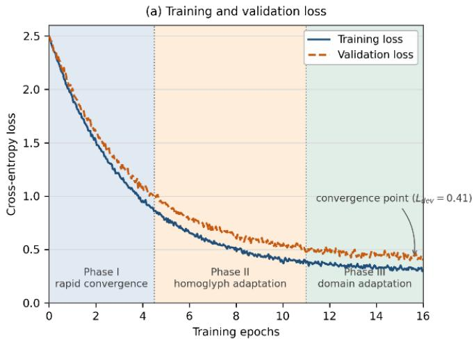
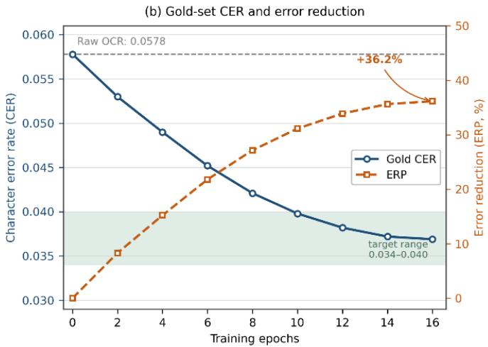
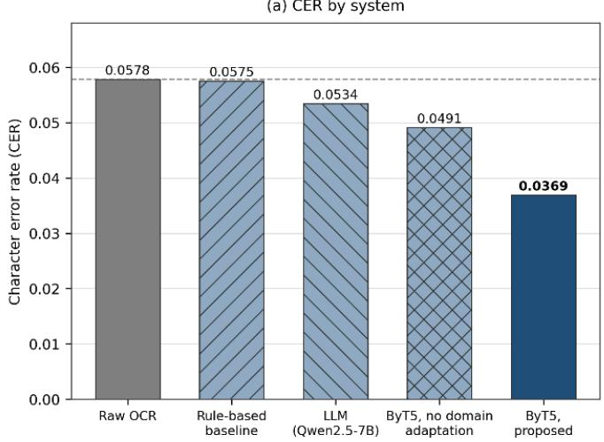
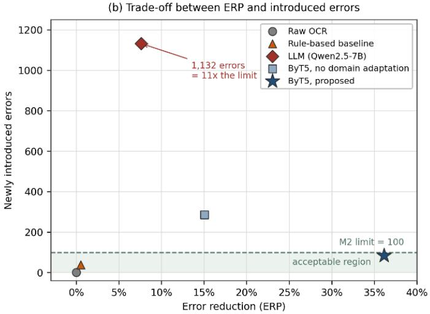

# Post-OCR Correction of Mixed-Script Uzbek Text: Byte-Level ByT5 with an Empirical Homoglyph Noise Matrix

Mannon Ochilov   
ochilov.mannon@mail.ru   
Department of Robotics and   
Intelligent Systems   
Tashkent University of Information   
Technologies named after   
Muhammad al-Khwarizmi   
Tashkent, Uzbekistan   
Oybek Narzullayev   
o.o.narzullaev@gmail.com   
Department of Robotics and   
Intelligent Systems   
Tashkent University of Information   
Technologies named after   
Muhammad al-Khwarizmi   
Tashkent, Uzbekistan   
Bahodir Zaripov   
amirbahodir@gmail.com   
Department of Artificial Intelligence   
Tashkent State University of   
Economics   
Tashkent, Uzbekistan

## Abstract

In Uzbek oficial and technical documents, a large share of OCR errors is caused not by poor image quality but by characters that are visually identical across the two alphabets in use. Because the script transition is still under way, Cyrillic and Latin appear on the same page and often within a single sentence, and in our measurements the density of homoglyph errors on such pages is close to five times higher than in single-script text. We study this problem in a setting where the corpus of engineering-geological and ICT infrastructure reports may not leave the organisation, so every stage was executed on local hardware. The proposed system combines a byte-level ByT5 model with a noise generator whose sampling weights are estimated from 359 manually classified error events, together with a Levenshtein-bounded conservative decoding rule. On a Gold set of 5,204 line pairs it lowers the character error rate from 0.0578 to 0.0369, restores 91.3% of the homoglyphs and introduces only 84 new errors.

## CCS Concepts

• Computing methodologies → Natural language processing; Neural networks; • Applied computing → Document management and text processing; Optical character recognition.

## Keywords

post-OCR correction, homoglyph errors, mixed-script text, ByT5, byte-level models, low-resource languages, Uzbek language, domain adaptation, on-premises processing

## 1 Introduction

Optical character recognition has made it possible to search across large scanned collections [19, 28]. Accuracy drops sharply, however, in low-resource and especially in multi-script settings, so whether a digital archive becomes usable at all is in many cases decided after recognition rather than during it [4, 19, 24]. Two alphabets, Cyrillic and Latin, are in parallel use, and in oficial and technical documents they mix on the same page and sometimes inside a single sentence. For an engine such as Tesseract 5.3 [28] this material is ambiguous on two levels at once: the glyphs are the same while the code points are not.

The course ofthe study was determined above all by the confidentiality of the documents. They are restricted engineering-geological reports and ICT records containing site coordinates, contract numbers and personal data. Three practical constraints follow. First, passing text fragments to commercial cloud APIs was not permitted, which excluded the baseline family most frequently cited in recent work [2]; the usual reasons are recovery of memorised training data and the attack surface of hosted model services [3, 38]. Second, the Gold test set cannot be published, so reproducibility rests on aggregate statistics and an open noise generator [17]. Third, the entire pipeline had to run on a single machine.

Confidentiality also changed the weight attached to diferent kinds of error. Since no external auditor re-checks the output, the safety of the correction step matters more than its coverage. For this reason we treat the number of newly introduced errors, and not only the share of old errors removed, as the primary metric.

The characteristic defect of mixed-script text is the homoglyph error. Homoglyphs are characters that cannot be distinguished visually but carry diferent Unicode code points [7, 33, 34]. Cyrillic «а, е, о, р, с, х» and Latin «a, e, o, p, c, x» are indistinguishable on the page, so the choice an operator makes between them is in practice arbitrary. A substitution such as «ер» → «ep» or «ВА» → «BA» breaks every downstream step that relies on string comparison, while the document still looks correct to a human reader.

The Gold set, never used for training or hyper-parameter selection and reserved for the final measurement alone, is the second element that shaped the work. To characterise the distribution empirically, its 359 homoglyph events were classified by hand (Table 1). On mixed-script pages the error density turned out to be almost five times that of single-script text. Most of the events occur at character level: 184 (51.3%) single substitutions, 66 (18.4%) clusters of adjacent characters and 77 (21.4%) multi-position errors inside one token. In a further 32 cases (8.9%) an entire word had migrated to the other alphabet, a pattern we refer to as polarisation.

An initial model trained on a general news corpus did not recognise the formatting conventions ofspecialised reports and corrupted words that were already correct (ERP −111%). The paper therefore proposes a correction model built on the byte-level ByT5 architecture and an empirical homoglyph noise matrix, operating entirely inside the security perimeter.

## 2 Related Work

Dictionary- and statistics-based correction. The most common line of work treats the task as dictionary-based spell checking: candidates are collected by edit distance [11] and then re-ranked with a lexicon, a confusion matrix and an �-gram model. Nguyen et al. [19] survey this direction, and their study of error statistics [18] shows that errors depend heavily on the collection, so a confusion matrix estimated on one corpus transfers poorly to another. The ICDAR competitions [4, 24] gave the field a common evaluation protocol, and Amrhein and Clematide [1] demonstrated that character-level statistical machine translation is still a strong baseline. A lexicon-driven system assumes that a corrupted word is a word missing from the dictionary, and homoglyph errors break exactly that assumption.

Table 1: Classification of the 359 homoglyph events in the Gold test set
<table><tr><td>Type of homoglyph event</td><td>Count</td><td>Share</td></tr><tr><td>Single substitution</td><td>184</td><td>51.3%</td></tr><tr><td>Cluster substitution</td><td>66</td><td>18.4%</td></tr><tr><td>Whole-word polarisation</td><td>32</td><td>8.9%</td></tr><tr><td>Multi-position substitution</td><td>77</td><td>21.4%</td></tr><tr><td>Total</td><td>359</td><td>100%</td></tr></table>

Shares are rounded, so the column may not sum to exactly 100%.

Neural post-correction and byte-level representation. Neural postcorrection commonly relies on byte- or character-level representations and treats OCR errors as monolingual translation from noisy into clean text. Earlier studies established the efectiveness of character-level NMT [8], showed that separating detection from correction reduces over-correction [27], and reported that BERTbased models outperform statistical pipelines [12, 29]. Others noted the drop in performance when the domain changes [32], the advan tage of lexically aware methods under low-resource conditions [25], and cases in which an ensemble of small models beats a single large one [23]. Two conclusions carry over to our setting: when the domain shifts, the dominant failure mode is over-correction [27, 32], and for orthographic noise a character-level input is the most efective choice [8, 23].

The dificulty begins at representation. Most transformer models [35] use sub-word tokenisation, which is fragile under characterlevel errors: one changed character can make the tokeniser split a word into a completely diferent sequence. CANINE [5] works directly on Unicode code points and Charformer [31] learns its own segmentation, while ByT5 [37] adapts T5 [22] to operate on raw UTF-8 bytes and is therefore markedly more robust to noise.

Homoglyphs, Unicode security and Uzbek resources. Homograph attacks were described early on [7], and the Unicode Consortium later standardised the detection of confusable characters in UTS #39 and UTR #36 [33, 34]. UTS #39 treats a mixed-script string as a risk signal, whereas in bi-alphabetic Uzbek text such strings are perfectly ordinary, so conventional rules do not discriminate well enough in practice.

A number of resources have been created for Uzbek, yet most of them are designed for a single alphabet. UzBERT [13] was among the first monolingual models; cross-lingual embeddings for Turkic languages [10] and a semantic similarity benchmark [26] have also been produced. Multilingual models such as XLM-R [6] and mT5 [36] cover Uzbek but allocate it limited resources, particularly for Cyrillic. Work on Uzbek speech recognition [14] and on punctuation restoration [16] points to the same need for in-domain adaptation.

The closest study to ours corrects Uzbek spelling errors with machine learning [20], but its hybrid algorithm relies on lexical errors, and homoglyph substitutions pass a dictionary check unnoticed. Uzbek question-answering [9] and sign-language translation [15] likewise operate on tokenised text and cannot detect an alphabet switch inside a token. Existing Uzbek corpora are almost always Latin-only or Cyrillic-only; mixed-script corpora are practically absent.

Large language models and the confidentiality barrier. Boros et al. [2] tested LLMs on historical transcripts and observed improved fluency alongside a loss of fidelity to the source, with paraphrase and hallucination. Our own experiments with Qwen2.5-7B [21] gave an even weaker result on technical strings such as «КМК 2.01.03-19» or «LMS.TUIT.UZ», because units of this kind carry no linguistic redundancy and the model is strongly inclined to “correct” them incorrectly.

## 3 Methodology

## 3.1 Corpus, confidentiality and ethics

The raw corpus consists of 487,205 lines. After cleaning by length and by corrupted characters, the operational corpus came to 422,815 lines. On this basis 2,283,198 synthetic training pairs, 63,420 validation pairs and 63,426 test pairs were derived, which corresponds to about five noisy variants per source line. Since synthetic data reflect only the noise model that produced them, a separate Gold set was collected from genuine scanned documents. A line-by-line review discarded 849 of the initial 6,053 pairs, leaving a final Gold set of 5,204 pairs. Its distribution over alphabets can be written as follows:

$$
D _ { \mathrm { g o l d } } = D _ { \mathrm { c y r } } \cup D _ { \mathrm { l a t } } \cup D _ { \mathrm { m i x } }\tag{1}
$$

## 3.2 Empirical noise generation

The proposed generator does not assume a noise distribution; it estimates one directly and empirically from the scanned documents, which is what distinguishes it from the usual practice of injecting uniform noise at character level. The proportions given in Table 1 (51.3%, 18.4%, 8.9% and 21.4%) are used as the sampling probabilities of the generator. Homoglyph candidates are taken from the Unicode confusables tables [34] and then re-weighted according to the frequencies actually observed, and each clean character is mapped onto its corresponding set ofhomoglyphs. The substitution is applied in line with these probabilities:

$$
\tilde { c } _ { i } = \left\{ \begin{array} { l l } { h _ { j } \in H ( c _ { i } ) , } & { \mathrm { w i t h ~ p r o b a b i l i t y ~ } p , } \\ { c _ { i } , } & { \mathrm { w i t h ~ p r o b a b i l i t y ~ } 1 - p , } \end{array} \right.\tag{2}
$$

where $H ( c _ { i } )$ is the confusable set of the character $c _ { i }$ and $\boldsymbol { p }$ is the substitution rate. The value of $\boldsymbol { p }$ is not fixed beforehand but calibrated so that the generated error density matches the density measured on the scans.

Whole-word polarisation, observed 32 times in the Gold set, was unexpected but important. A character-level model cannot reproduce it, because choosing each character independently yields mixed-script tokens, whereas in practice the tokens are entirely Latin or entirely Cyrillic. A token-level parameter was therefore added: it selects an alphabet for the whole token and applies that choice to all of its characters:

$$
\tilde { t } = \left\{ \begin{array} { l l } { { \pi ( t ) , } } & { { \mathrm { w i t h ~ p r o b a b i l i t y ~ } q , } } \\ { { ( \tilde { c } _ { 1 } \ldots \tilde { c } _ { n } ) , } } & { { \mathrm { w i t h ~ p r o b a b i l i t y ~ } 1 - q . } } \end{array} \right.\tag{3}
$$

Here � (·) maps every character of the token to the opposite alphabet and � denotes the probability of whole-word polarisation. The clearest example in the data is the token «PoE», which occurs in the scans in fully Latin, fully Cyrillic («РоЕ») and mixed form.

## 3.3 Architecture, conservative decoding and comparison systems

The task was formulated as a byte-level sequence-to-sequence mapping and optimised on top of ByT5 [37]. Because the model works directly with UTF-8, it represents homoglyph substitutions as what they actually are, namely edits at the byte level.

Since domain mismatch makes a model prone to over-correction, a conservative mechanism was introduced at the decoding stage. If the Levenshtein distance [11] between the prediction and the input exceeds a fixed threshold, the system rejects the model output and keeps the original line:

$$
\begin{array} { r } { y _ { \mathrm { f i n a l } } = \displaystyle \left\{ \begin{array} { l l } { \hat { y } , } & { \mathrm { i f } \ d ( \tilde { x } , \hat { y } ) \leq \tau , } \\ { \tilde { x } , } & { \mathrm { o t h e r w i s e } . } \end{array} \right. } \end{array}\tag{4}
$$

The threshold was selected on the validation set as � = 3 characters, which permits one or two homoglyphs to be repaired but prevents large-scale rewriting.

mT5 [36], mBART-50 [30] and CANINE [5] were also examined but not included in the comparison experiments. This is not a judgement about their accuracy; the research question was how much a byte-level representation gains from an empirical noise distribution, which needs no broad comparison of multilingual architectures, and byte-level models are already known to be more stable under character-level corruption [5, 31, 37].

Two practical constraints also applied: a candidate model had to run on local resources, and the whole pipeline had to fit within a single GPU. ByT5 was therefore chosen as the neural component, with a rule-based corrector and a local LLM as the deployable alternatives.

## 3.4 Metrics and success criteria

The first metric is the character error rate, where �, � and � are the numbers of substituted, deleted and inserted characters and � is the number of characters in the reference text:

$$
\mathrm { C E R } = { \frac { S + D + I } { N } }\tag{5}
$$

The second is the error reduction percentage, which we report as the main result because it shows how much of the existing error the system actually removes:

$$
{ \mathrm { E R P } } = { \frac { { \mathrm { C E R } } _ { \mathrm { r a w } } - { \mathrm { C E R } } _ { \mathrm { m o d e l } } } { { \mathrm { C E R } } _ { \mathrm { r a w } } } } \times 1 0 0 \%\tag{6}
$$

Table 2: Comparison of the systems on the Gold test set (5,204 pairs)
<table><tr><td>System</td><td>CER↓</td><td>ERP↑</td><td>Homogl.↑</td><td>New err.↓</td></tr><tr><td>Raw OCR</td><td>0.0578</td><td></td><td>0</td><td>0</td></tr><tr><td>Rule-based baseline</td><td>0.0575</td><td>+0.5%</td><td>7.2%</td><td>38</td></tr><tr><td>LLM (Qwen2.5-7B)</td><td>0.0534</td><td>+7.6%</td><td>52.4%</td><td>1,132</td></tr><tr><td>ByT5, no domain adapt.</td><td>0.0491</td><td>+15.1%</td><td>69.8%</td><td>286</td></tr><tr><td>ByT5, proposed</td><td>0.0369</td><td>+36.2%</td><td>91.3%</td><td>84</td></tr></table>

Raw OCR is Tesseract 5.3 [28]. The LLM was run from a local checkpoint. The proposed system satisfies both criteria: ERP +36.2% (M1 threshold +15%) and 84 new errors (M2 threshold 100).

Table 2 additionally reports two further indicators. The homoglyph restoration rate is the share of the 359 annotated events for which the correct code point was recovered. Newly introduced errors are counted at character level: a character that matched the reference in the input but was changed in the model output counts as a new error.

The acceptance criteria were agreed with the document owner at the beginning of the study and were not revised afterwards. Criterion M1 requires the number of errors on the Gold set to be reduced by at least 15%. Criterion M2 requires that no more than 100 new errors be introduced across the whole set.

## 4 Results

## 4.1 Training dynamics

Training proceeded in three phases, with the composition of the data changed at epochs 4, 5 and 11. The shaded regions in Figure 1(a) mark these boundaries. Validation loss stayed slightly above training loss but showed no upward trend, indicating no overfitting. Figure 1(b) shows the Gold set: CER starts from the raw OCR value of 0.0578, falls steeply over the first six epochs, then stabilises at 0.0369, while ERP rose to +36.2%.

## 4.2 System comparison

All systems were evaluated on the same Gold set of 5,204 lines (Table 2).

Only the last row of Table 2, the proposed ByT5-based system, improves on both criteria at the same time. Compared with Qwen2.5- 7B [21], the proposed system removed 4.8 times more errors and introduced 13.5 times fewer new ones.

The rule-based corrector shows how much the noise model matters: the same algorithm restored 99.3% of the homoglyphs on the synthetic test but only 7.2% on the Gold set, ERP falling from +20.1% to +0.5%, with the corrector unchanged and only the noise distribution difering. The ByT5 variant without domain adaptation almost satisfies M1 on its own yet fails M2 with 286 new errors; both criteria were met together only after domain adaptation and conservative decoding were added.

Figure 2(b) makes this balance visible: the rule-based and the proposed systems lie inside the acceptable region, the variant without domain adaptation sits slightly above it, and the LLM falls far outside on the introduced-error axis for very little additional ERP.

  
Figure 1: Training dynamics over 16 epochs: (a) training and validation cross-entropy loss; (b) CER and error reduction on the Gold set, evaluated every second epoch.

  
Figure 2: System comparison: (a) CER across systems; (b) the trade-of between error reduction and newly introduced errors, with the M2 threshold set at 100.

## 4.3 Qualitative analysis of corrections

The aggregate metrics state how much error the system removes but not how it behaves. Table 3 places the two characteristic cases side by side: homoglyph substitutions that are repaired, and technical strings that are deliberately left alone. The examples are drawn from strings already cited in this paper, so no new material from the Gold set is disclosed.

The last two rows carry as much weight as the first three. Both comparison systems fail on exactly such strings: the rule-based corrector does not treat a substituted token as out-of-vocabulary and leaves it untouched, while the LLM reads codes such as КМК 2.01.03-19 or LMS.TUIT.UZ as unknown words and rewrites them, which accounts for a substantial share of its 1,132 new errors.

## 4.4 Breakdown by script type and scan quality

The working assumption was that the advantage of the model would appear mainly where homoglyph confusion is dense. To test it, Table 4 divides the Gold set into groups by script type and scan quality.

On single-script pages the gain ranges from +28.2% to +35.9%, stable across alphabet and scan quality. On mixed pages ERP reaches +45.6% for clean scans and +40.8% for noisy ones. The “mixed, noisy” group produced an unexpected result at first sight: its raw CER is the lowest at 0.0348, although its homoglyph density is almost five times higher than in the other groups. The two figures, however, measure diferent things. CER covers all types of error, including segmentation errors, lost diacritics and image noise, whereas homoglyph density counts only the errors that arise from alphabet mixing.

Table 3: Representative examples of model behaviour
<table><tr><td>Raw OCR</td><td>Model output</td><td>Reference</td><td>Code points (raw → model)</td><td>Model behaviour</td></tr><tr><td>ep (Lat.)</td><td>ep (Cyr.)</td><td>ep (Cyr.)</td><td> $\cup + 0 . 0 6 5 \cup + 0 . 0 7 0  \cup + 0 . 4 3 5 \cup + 0 . 4 4 0$ </td><td>Homoglyph restored</td></tr><tr><td>BA (Lat.)</td><td>BA (Cyr.)</td><td>BA (Cyr.)</td><td> $\downarrow + 0 . 0 4 2 \downarrow + 0 . 0 4 1  \downarrow + 0 . 4 1 2 \downarrow + 0 . 4 1 0$ </td><td>Polarised word restored</td></tr><tr><td>PoE (Cyr.)</td><td>PoE (Lat.)</td><td>PoE (Lat.)</td><td> $\cup + 0 4 2 0 \cup + 0 4 3 5 \cup + 0 4 1 5  \cup + 0 0 5 0 \cup + 0 0 6 5 \cup + 0 0 4 5$ </td><td>Mixed token normalised</td></tr><tr><td>KMK 2.01.03-19</td><td>unchanged</td><td>KMK 2.01.03-19</td><td></td><td>Domain code preserved</td></tr><tr><td>LMS.TUIT.UZ</td><td>unchanged</td><td>LMS.TUIT.UZ</td><td></td><td>Abbreviation preserved</td></tr></table>

The first three columns are visually almost identical, which is the nature of the homoglyph problem; the diference appears only at the level of code points. In rows 1–3 the model output matches the reference. In rows 4–5 the raw input is already correct and the Levenshtein bound � of Equation (4) blocks the rewrite, which is the mechanism that holds newly introduced errors at 84.

Table 4: Model performance by text type and scan quality
<table><tr><td>Condition</td><td>N</td><td>Raw CER</td><td>Model CER</td><td>ERP</td></tr><tr><td>Cyrillic, clean</td><td>1,008</td><td>0.0608</td><td>0.0403</td><td>+33.7%</td></tr><tr><td>Cyrillic, noisy</td><td>1,000</td><td>0.0569</td><td>0.0365</td><td>+35.9%</td></tr><tr><td>Latin, clean</td><td>1,216</td><td>0.0610</td><td>0.0438</td><td> $+ 2 8 . 2 \%$ </td></tr><tr><td>Latin, noisy</td><td>1,199</td><td>0.0550</td><td>0.0374</td><td> $+ 3 2 . 0 \%$ </td></tr><tr><td>Mixed, clean</td><td>394</td><td>0.0572</td><td>0.0311</td><td> $+ 4 5 . 6 \%$ </td></tr><tr><td>Mixed, noisy</td><td>387</td><td>0.0348</td><td>0.0206</td><td>+40.8%</td></tr></table>

Table 5: Efect of the training noise distribution on CER and ERP
<table><tr><td>Training noise</td><td colspan="2">Synthetic test</td><td colspan="2">Gold set</td></tr><tr><td></td><td>CER</td><td>ERP</td><td>CER</td><td>ERP</td></tr><tr><td>Random visual noise</td><td>0.1667</td><td>-75.1%</td><td>0.0619</td><td>-7.1%</td></tr><tr><td>Homoglyph-oriented</td><td>0.0724</td><td>+24.0%</td><td>0.0491</td><td>+15.1%</td></tr><tr><td>Emp. matrix + domain</td><td>n/a</td><td>n/a</td><td>0.0369</td><td>+36.2%</td></tr></table>

The third configuration reports no synthetic metrics. Its training data were reformatted to follow the report style and rebuilt with a 60% report / 40% news ratio so the original synthetic test is not a comparable benchmark for it.

Mixed pages come mostly from modern reports prepared digitally and scanned at high quality, so image-related errors are rare while alphabet substitution is frequent.

## 4.5 Ablation: the efect of the noise distribution

To verify that the result depends on the noise matrix rather than on model size, the architecture, the corpus and all hyper-parameters were kept unchanged, and only the noise distribution used in training was replaced (Table 5).

Random noise that does not match the characteristics of the actual equipment proved not merely useless but harmful: −75.1% on the synthetic test and −7.1% on the Gold set. Homoglyph-oriented noise, with the same architecture, gave +24.0% and +15.1% respectively. Since only the noise distribution difers between the two runs, it is the principal source of the gap.

The third configuration is not a pure ablation: alongside the empirical noise matrix it also uses domain adaptation and conservative decoding, so the increase from +15.1% to +36.2% cannot be attributed to the noise distribution alone. Separating the factors would require a full 2 × 2 ablation over noise type and domain adaptation, left for future work.

Table 6: Bootstrap 95% confidence intervals (5,204 pairs, 1,000 paired resamples)
<table><tr><td>Metric</td><td>Estimate</td><td>95% CI</td></tr><tr><td>Raw OCR CER</td><td>0.0578</td><td>0.0565 – 0.0592</td></tr><tr><td>Model CER</td><td>0.0369</td><td>0.0358 - 0.0381</td></tr><tr><td>CER difference (paired)</td><td>0.0209</td><td>0.0190 - 0.0218</td></tr><tr><td>ERP</td><td>+36.2%</td><td>34.8% - 37.6%</td></tr></table>

## 4.6 Statistical reliability

Because the Gold set is a single fixed sample, the point estimates carry sampling uncertainty. Confidence intervals were estimated with a non-parametric bootstrap: the line pairs were resampled 1,000 times and the 2.5th and 97.5th percentiles taken as the interval (Table 6). Because the raw and the corrected results are measured on the same lines, the resampling was performed in paired form.

The interval for the paired diference does not include zero, so the improvement is not an efect of random sampling, and the ERP interval lies above the M1 threshold of +15%. The bootstrap estimates variability only within the existing set and does not guarantee generalisation to other collections [18]. In addition, some groups in Table 4, in particular the “mixed, noisy” condition, rest on a small sample of 387 pairs, so the exact ordering has to be interpreted carefully.

## 4.7 Computational resources

Training was carried out on a single workstation inside the perimeter, using an NVIDIA RTX 5090 GPU (32 GB GDDR7, Blackwell), BF16 mixed precision and the Hugging Face Transformers implementation, for 16 epochs with early stopping; the full configuration is summarised in Table 7.

## 5 Discussion

The advantage of the model comes not from general capability but from modelling the region where the errors actually sit. The gap between synthetic and real evaluation in rule-based systems has the same origin: synthetic noise is spread uniformly over characters, whereas real OCR errors concentrate in short tokens with weak context. LLMs capture context well, but sub-word tokenisation prevents them from resolving byte-level corruption, so they rewrite corrupted tokens from general linguistic knowledge. In our first experiments this led to heavy over-correction (CER 0.1219, ERP −111%). The principal limitations of the study follow from the confidentiality requirements: several large baseline models and wider computational resources were not available, which in turn ties the noise matrix to a single document stream and leaves some subsets small. Evaluation is therefore confined to engineering-geological and ICT reports from a single organisation; transfer to legal, literary and administrative texts, whose error profiles are expected to difer, requires separate validation.

Table 7: Training configuration, resource usage and deployment
<table><tr><td>Parameter</td><td>Value</td><td>Parameter</td><td>Value</td></tr><tr><td>Accelerator</td><td>NVIDIA RTX 5090, 32 GB GDDR7 (Blackwell)</td><td>Learning rate</td><td> $3 \times 1 0 ^ { - 4 } ,$  linear, 5% warm-up</td></tr><tr><td>Deployment</td><td>Single workstation inside the perimeter</td><td>Batch / sequence length</td><td>64 × 256 bytes</td></tr><tr><td>Precision</td><td>BF16 mixed precision</td><td>Epochs</td><td>16, early stop after 3</td></tr><tr><td>Peak memory</td><td>≈26.4 GB / 32 GB</td><td>Decoding</td><td>Beam search, width 4</td></tr><tr><td>Gradient accumulation</td><td>Not required</td><td>Conservatism threshold</td><td>τ = 3 characters</td></tr><tr><td>Training time</td><td>12 hours (wall-clock)</td><td>Training pairs</td><td>2,283,198</td></tr><tr><td>Data egress</td><td>None</td><td>Validation / test pairs</td><td>63,420 / 63,426</td></tr><tr><td>Checkpoint</td><td>google/byt5-small</td><td>Gold evaluation pairs</td><td>5,204</td></tr><tr><td>Optimiser</td><td>AdamW, weight decay 0.01</td><td></td><td></td></tr></table>

## 6 Conclusion

This work addressed post-OCR correction of mixed-script Uzbek text under confidentiality constraints, using a byte-level ByT5 architecture together with an empirical noise generator derived from real errors. With the architecture and the training regime unchanged replacing the noise distribution alone improved the result sharply, from −75.1% to +24.0% on the synthetic test and from −7.1% to +15.1% on the Gold set. In the final system the noise distribution, domain adaptation and conservative decoding were applied together; they reduced errors by +36.2% (95% CI: 34.8–37.6%) and met the requirements of the protected environment with 84 new errors. Future work will cover a full ablation separating the noise and domain factors, a comparison of other byte- and character-based architectures under identical noise, and the transfer of the noise matrix to other document streams and Turkic languages.

## References

[1] Chantal Amrhein and Simon Clematide. 2018. Supervised OCR Error Detection and Correction Using Statistical and Neural Machine Translation Methods. Journal for Language Technology and Computational Linguistics (JLCL) 33, 1 (2018), 49–76.

[2] Emanuela Boros, Maud Ehrmann, Matteo Romanello, Sven Najem-Meyer, and Frédéric Kaplan. 2024. Post-Correction of Historical Text Transcripts with Large Language Models: An Exploratory Study. In Proceedings of the 8th Joint SIGHUM Workshop on Computational Linguistics for Cultural Heritage, Social Sciences, Humanities and Literature (LaTeCH-CLfL). 133–159.

[3] Nicholas Carlini et al. 2021. Extracting Training Data from Large Language Models. In 30th USENIX Security Symposium. 2633–2650.

[4] Guillaume Chiron, Antoine Doucet, Mickael Coustaty, and Jean-Philippe Moreux. 2017. ICDAR2017 Competition on Post-OCR Text Correction. In 14th IAPR International Conference on Document Analysis and Recognition (ICDAR). 1423– 1428.

[5] Jonathan H. Clark, Dan Garrette, Iulia Turc, and John Wieting. 2022. CANINE: Pre-training an Eficient Tokenization-Free Encoder for Language Representation. Transactions ofthe Association for Computational Linguistics 10 (2022), 73–91.

[6] Alexis Conneau et al. 2020. Unsupervised Cross-lingual Representation Learning at Scale. In Proceedings of the 58th Annual Meeting of the Association for Computational Linguistics (ACL). 8440–8451.

[7] Evgeniy Gabrilovich and Alex Gontmakher. 2002. The Homograph Attack. Commun. ACM 45, 2 (2002), 128.

[8] Mika Hämäläinen and Simon Hengchen. 2019. From the Paft to the Fiiture: A Fully Automatic NMT and Word Embeddings Method for OCR Post-Correction. In Proceedings of the International Conference on Recent Advances in Natural Language Processing (RANLP). 431–436.

[9] Ilyos Khujayarov, Mannon Ochilov, Malika Abdullayeva, Orzimurod Kholmatov, and Rashid Nasimov. 2025. Development of Uzbek Question-Answering Models through Fine-Tuning Approaches. In Proceedings of the 9th International Conference on Future Networks and Distributed Systems (ICFNDS ’25). ACM, Dubai, United Arab Emirates, 694–700. doi:10.1145/3789692.3789784

[10] Elmurod Kuriyozov, Yerai Doval, and Carlos Gómez-Rodríguez. 2020. Cross-Lingual Word Embeddings for Turkic Languages. In Proceedings of the 12th Language Resources and Evaluation Conference (LREC). 4054–4062.

[11] Vladimir I. Levenshtein. 1966. Binary Codes Capable of Correcting Deletions, Insertions and Reversals. Soviet Physics Doklady 10, 8 (1966), 707–710.

[12] Mike Lewis et al. 2020. BART: Denoising Sequence-to-Sequence Pre-training for Natural Language Generation, Translation, and Comprehension. In Proceedings ofthe 58th Annual Meeting ofthe Association for Computational Linguistics (ACL). 7871–7880.

[13] B. Mansurov and A. Mansurov. 2021. UzBERT: Pretraining a BERT Model for Uzbek. arXiv:2105.09814

[14] Abdinabi Mukhamadiyev et al. 2023. Development of Language Models for Continuous Uzbek Speech Recognition System. Sensors 23, 3 (2023), 1145.

[15] Mukhammadjon Musaev, Dilshod Juraev, Mannon Ochilov, and Malika Abdullaeva. 2024. Text Processing Technology in Uzbek Speech to Sign Language Translation Systems. AIP Conference Proceedings 3244, 1 (2024), 030062. doi:10.1063/5.0241738

[16] Mukhammadjon Musaev, Mannon Ochilov, Malika Abdullaeva, and Rashid Nasimov. 2025. Restoring Punctuation in Uzbek Texts Using LLM’s Fine Tuning Approaches. In Proceedings of the 8th International Conference on Future Networks and Distributed Systems (ICFNDS ’24). ACM, 97–102.

[17] Oybek Narzullaev. 2025. byt5-uzbek-postocr: Noise Generator, Empirical Homoglyph Confusion Matrix and Evaluation Scripts. GitHub repository. https: //github.com/OybekNarzullaev/byt5-uzbek-postocr

[18] Thi Tuyet Hai Nguyen et al. 2019. Deep Statistical Analysis of OCR Errors for Efective Post-OCR Processing. In ACM/IEEE Joint Conference on Digital Libraries (JCDL). 29–38.

[19] Thi Tuyet Hai Nguyen, Adam Jatowt, Mickael Coustaty, and Antoine Doucet. 2021. Survey of Post-OCR Processing Approaches. Comput. Surveys 54, 6, Article 124 (2021), 37 pages.

[20] M. M. Ochilov, Oybek Narzullayev, and O. A. Xolmatov. 2025. Detection and Correction of Spelling Errors in Uzbek Texts Based on Machine Learning Algorithms. International Journal of Theoretical and Applied Issues of Digital Technologies 8, 1 (2025), 85–94. doi:10.62132/ijdt.v8i1.235

[21] Qwen Team. 2024. Qwen2.5 Technical Report. arXiv:2412.15115.

[22] Colin Rafel et al. 2020. Exploring the Limits of Transfer Learning with a Unified Text-to-Text Transformer. Journal of Machine Learning Research 21, 140 (2020), 1–67.

[23] Juan Ramirez-Orta et al. 2022. Post-OCR Document Correction with Large Ensembles of Character Sequence-to-Sequence Models. In Proceedings of the AAAI Conference on Artificial Intelligence, Vol. 36. 11192–11199

[24] Christophe Rigaud, Antoine Doucet, Mickael Coustaty, and Jean-Philippe Moreux. 2019. ICDAR 2019 Competition on Post-OCR Text Correction. In International Conference on Document Analysis and Recognition (ICDAR). 1588–1593.

[25] Shruti Rijhwani, Daisy Rosenblum, Antonios Anastasopoulos, and Graham Neu big. 2021. Lexically Aware Semi-Supervised Learning for OCR Post-Correction. Transactions ofthe Association for Computational Linguistics 9 (2021), 1285–1302.

[26] Ulugbek Salaev, Elmurod Kuriyozov, and Carlos Gómez-Rodríguez. 2022. SimRelUz: Similarity and Relatedness Scores as a Semantic Evaluation Dataset for the Uzbek Language. In Proceedings ofthe 1st Annual Meeting ofthe ELRA/ISCA SIG on Under-resourced Languages (SIGUL) at LREC.

[27] Robin Schaefer and Clemens Neudecker. 2020. A Two-Step Approach for Automatic OCR Post-Correction. In Proceedings ofthe Joint SIGHUM Workshop on Computational Linguistics for Cultural Heritage, Social Sciences, Humanities and Literature (LaTeCH-CLfL). 52–57.

[28] Ray Smith. 2007. An Overview of the Tesseract OCR Engine. In Ninth International Conference on Document Analysis and Recognition (ICDAR). 629–633.

[29] Elizabeth Soper, Stanley Fujimoto, and Yen-Yun Yu. 2021. BART for Post-Correction of OCR Newspaper Text. In Proceedings of the Seventh Workshop on Noisy User-generated Text (W-NUT). 284–290.

[30] Yuqing Tang et al. 2020. Multilingual Translation with Extensible Multilingual Pretraining and Finetuning. arXiv:2008.00401.

[31] Yi Tay et al. 2022. Charformer: Fast Character Transformers via Gradient-Based Subword Tokenization. In International Conference on Learning Representations (ICLR).

[32] Konstantin Todorov and Giovanni Colavizza. 2020. Transfer Learning for Historical Corpora: An Assessment on Post-OCR Correction and Named Entity Recognition. In Proceedings ofthe Workshop on Computational Humanities Research (CHR).

[33] Unicode Consortium. 2014. UTR #36: Unicode Security Considerations. Retrieved November 2026 from https://www.unicode.org/reports/tr36/

[34] Unicode Consortium. 2026. UTS #39: Unicode Security Mechanisms. Retrieved November 2026 from https://www.unicode.org/reports/tr39/

[35] Ashish Vaswani et al. 2017. Attention is All You Need. In Advances in Neural Information Processing Systems (NeurIPS), Vol. 30. 5998–6008.

[36] Linting Xue et al. 2021. mT5: A Massively Multilingual Pre-trained Text-to-Text Transformer. In Proceedings ofNAACL-HLT. 483–498.

[37] Linting Xue et al. 2022. ByT5: Towards a Token-Free Future with Pre-trained Byte-to-Byte Models. Transactions ofthe Association for Computational Linguistics 10 (2022), 291–306.

[38] Yifan Yao et al. 2024. A Survey on Large Language Model (LLM) Security and Privacy: The Good, the Bad, and the Ugly. High-Confidence Computing 4, 2 (2024), 100211.