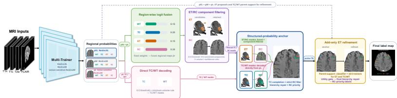
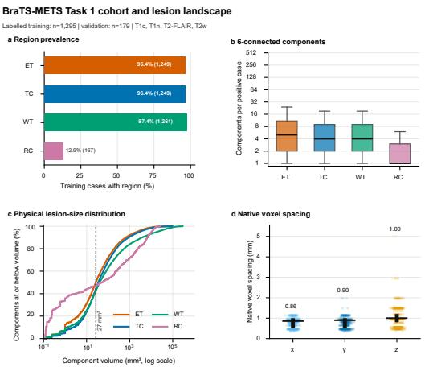
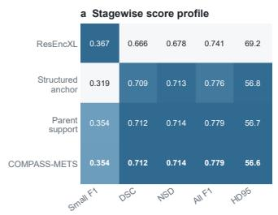
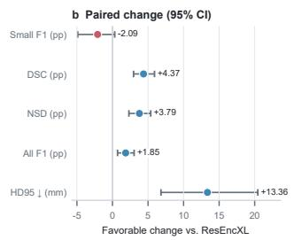
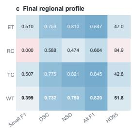
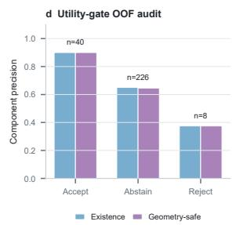
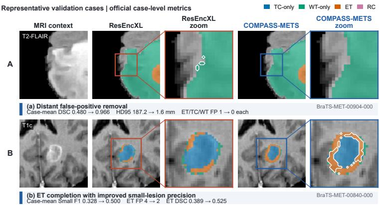

# Region-Wise Logit Fusion and Utility-Gated Refinement for Brain Metastasis Segmentation

Zhenye Lou1, Qing Xu2†, Wenting Duan3, and Zhen Chen1(B)

1 Department of Data Science and Artificial Intelligence, The Hong Kong Polytechnic University, Hong Kong SAR 2 School of Computer Science, University of Nottingham, UK School of Engineering and Physical Science, University of Lincoln, UK scxqx1@nottingham.ac.uk, z.chen@polyu.edu.hk

Abstract. BraTS-METS 2026 Task 1 evaluates segmentation of brain metastases and postoperative resection cavities on heterogeneous multiparametric MRI, requiring detection of small enhancing foci while preserving the geometry and hierarchy of enhancing tumor (ET), tumor core (TC), whole tumor (WT), and resection cavity (RC). We present COMPASS-METS (Component-Aware Multi-Trainer Probability Assembly with Structured Segmentation), which combines three five-fold nnU-Net configurations into aligned regional probability ensembles. A structured-probability anchor applies region-specific component decisions, TC boundary completion, RC filtering, and hierarchy-preserving conversion. Omitted ET candidates are recovered additively using learned component confidence and deterministic multi-trainer support for ET and its TC/WT parents; a final utility gate admits only disconnected candidates with suficient lesion-existence and geometry-safety probabilities. On the reused 179-case challenge development cohort, COMPASS-METS (Team: MicroBT) achieved Small F1 0.354, lesion-wise DSC 0.712, NSD 0.714, All F1 0.779, and HD95 56.6 mm. Relative to ResEncXL, it improved DSC, NSD, and All F1 and reduced HD95, while Small F1 changed from 0.367 to 0.354. Stagewise analysis attributes the principal geometric gains to structured probability construction and shows that guarded ET refinement recovers most of the associated small-lesion detection loss. These 179-case results remain selection-aware development estimates.

The source code is publicly available at https://github.com/leonlou921/ COMPASS-METS

Keywords: MRI · Brain metastases segmentation · BraTS-METS · nnU-Net · Multi-trainer ensemble · Component refinement

## 1 Introduction

Automatic delineation of brain metastases can support volumetric assessment, treatment planning, and longitudinal monitoring [6, 9]. The task is dificult because a single examination may contain many spatially separated lesions, including very small enhancing foci, and post-treatment scans may additionally contain resection cavities (RC). Previous BraTS-METS analyses found lower detection and segmentation performance for decreasing lesion volume, particularly below $1 0 0 \mathrm { { m m ^ { 3 } } \left[ 1 1 , 1 2 , 8 \right] }$ . BraTS-METS 2026 Task 1 directly evaluates this failure mode through lesion-level metrics and defines targets below $2 7 \mathrm { m m ^ { 3 } }$ as small lesions [2].

  
Fig. 1. Overview of COMPASS-METS. Mirrored inference and five-fold averaging yield aligned regional probability sources $p ^ { \mathrm { X L } } , p ^ { \mathrm { M } }$ , and $p ^ { \mathrm { L } }$ . Region-wise logit fusion of $p ^ { { \breve { \mathrm { X L } } } }$ and $p ^ { \mathrm { L } }$ provides ET/RC maps for component filtering, whereas $p ^ { \mathrm { L } }$ provides TC/WT masks directly; the two routes form the structured-probability anchor. All three probability sources then support add-only ET refinement, followed by utility gating, hierarchy repair, and RC-priority label conversion.

Methods for this problem have progressed from template-based detection to deep three-dimensional segmentation [1, 3]. Modern self-configuring systems adapt well to heterogeneous cohorts, but their voxel-wise probabilities expose a detection–geometry trade-of at inference. Conservative component decisions suppress distant false positives and boundary outliers, yet they can also remove small, weakly supported true lesions. Relaxing a global threshold reverses that trade-of but may introduce geometrically costly false positives. The output semantics add another constraint: ET is contained in TC, TC in WT, and RC remains independent of the nested tumor regions.

We address this trade-of through multi-trainer probability construction and guarded component refinement (Fig. 1). ResEncXL and ResEncM are optimized in five folds, and the lesion-sensitive ResEncM configuration is initialized from the fold-matched ResEncM checkpoint. Their aligned regional probabilities form a structured anchor and provide disagreement evidence for component-level decisions.

Our contributions are: (i) a multi-trainer route that preserves aligned soft probabilities until region-specific decisions; (ii) parent-supported ET refinement requiring agreement between a learned component model and $\mathrm { E T / T C / W T }$ probabilities; and (iii) a utility gate that models lesion existence and geometric safety separately. On the 179-case challenge development cohort, stagewise comparisons showed that structured probability construction produced the main geometric improvements, while parent-supported refinement recovered most of the associated loss in small-lesion detection.

## 2 Data and Evaluation

The BraTS-METS release contains retrospective pre- and post-treatment multiparametric MRI acquired across institutions, scanners, and imaging protocols [10]. Each examination provides four co-registered channels: native T1-weighted (T1n), contrast-enhanced T1-weighted (T1c), T2-weighted FLAIR (T2-FLAIR), and T2-weighted (T2w) MRI; under the challenge protocol, the T2w channel may be native or synthetic [2]. Figure 2 summarizes the resulting variation in regional prevalence, component volume, and native voxel spacing.

The analyzed release contains 1,295 annotated training examinations, each covered once across five held-out folds. The 179 hidden-label validation cases were scored through the challenge interface. Because this feedback informed trainer and inference selection, these results are selection-aware development estimates rather than an independent generalization test. Data were accessed through Synapse project syn74274097 under the challenge data-use terms [2]; no identifiable clinical information was exported by our pipeline.

The mutually exclusive labels are non-enhancing tumor core (NETC), surrounding non-enhancing FLAIR hyperintensity (SNFH), ET, and RC. Whole tumor (WT) is the union of NETC, SNFH, and ET; TC is the union of NETC and ET; ET and RC are evaluated separately. Tumor outputs are constrained by ET ⊆ TC ⊆ WT, while RC remains outside this nesting.

Task 1 defines components below 27 mm3 as small targets and evaluates detection with lesion geometry [2]. Final estimates use the returned challenge score files. Candidate screening additionally decomposes each region into 6- connected components and greedily pairs overlapping components by descending DSC without an IoU threshold. Unmatched ground truth receives zero DSC/NSD and image-diagonal HD95; NSD tolerance is 1.0 mm. Empty references receive perfect geometry only for empty predictions.

Aggregate scores macro-average finite ET, RC, TC, and WT mean records. For the 179-case challenge analysis, paired intervals align subjects, macro-average finite regional case entries, and use 10,000 paired case-level bootstrap resamples with percentile 95% intervals. Positive changes are favorable; HD95 is sign-inverted to express a reduction. Screening precision, recall, and F1 are micro-averaged from TP/FP/FN counts and use 275 mm3, whereas final analysis uses the oficial 27 mm3 threshold.

We additionally evaluate the complete pipeline and three pure ensembles on all 1,295 training cases using XL, M, and lesion-sensitive predictions from each assigned held-out fold. Equal-probability, equal-logit, and hard-majority controls use threshold 0.5 and only the common hierarchy decoder. Paired OOF intervals use 5,000 case-level bootstrap resamples. Learned models exclude the evaluated fold, but operating points remain global rather than inner-fold selected; this is a post-selection held-out-fold evaluation, not a fully nested estimate.

  
Fig. 2. Analyzed training-cohort statistics: regional prevalence, 6-connected components per positive examination, physical component volumes, and native voxel spacing. The dashed guide marks 27 mm3.

## 3 Methods

## 3.1 Overview of the Proposed Method

COMPASS-METS has four inference stages (Fig. 1). First, the ResEncXL, Res-EncM, and lesion-sensitive ResEncM trainers produce aligned five-fold probabilities for WT, TC, ET, and RC; the lesion-sensitive trainer is initialized from its fold-matched ResEncM checkpoint. Second, ResEncXL and lesion-sensitive probabilities form a structured-probability anchor. Third, a learned component model and two-of-three parent support recover ET proposals missed by the anchor. Finally, separate lesion-existence and geometry-safety models screen additional disconnected ET candidates. Every refinement is add-only, after which explicit set operations preserve ET $\subseteq \mathrm { T C } \subseteq \mathrm { W T }$ and convert the regions to mutually exclusive labels.

## 3.2 Multi-Trainer Training and Probability Construction

The primary trainer uses the nnU-Net v2 residual-encoder XL full-resolution plan [4, 5]. Automatically configured preprocessing determines spacing, resampling, cropping, and channel-wise normalization. Five folds were trained for 1000 epochs with $1 6 0 \times 2 2 4 \times 1 9 2$ patches, batch size 3, regional sigmoid outputs, and Dice– binary-cross-entropy loss. Stochastic-gradient descent used learning rate $1 0 ^ { - 2 }$ momentum 0.99, Nesterov acceleration, weight decay $3 \times 1 0 ^ { - 5 }$ , and a polynomial schedule. Deep supervision and configured augmentations were retained; the checkpoint with the highest smoothed foreground pseudo-Dice was selected per fold. Two residual-encoder M trainers provide additional sources. The standard configuration uses the same regional objective. The lesion-sensitive configuration starts from the corresponding standard fold and adds focal and asymmetric

Tversky terms, each weighted 0.5, with $( \alpha _ { F } , \gamma ) = ( 0 . 2 5 , 2 )$ and $( \alpha _ { T } , \beta _ { T } ) =$ (0.3, 0.7). All five lesion-sensitive folds are fine-tuned at $1 0 ^ { - 3 }$ with checkpointbest selection. Mirrored inference averages five outputs per trainer after alignment to the ResEncXL grid, producing $p ^ { \mathrm { X L } } , p ^ { \mathrm { M } }$ , and $p ^ { \mathrm { L } }$ . Small-lesion oversampling and synthetic-lesion augmentation were screened but not retained.

## 3.3 Structured-Probability Anchor

The structured anchor provides conservative geometry before any lesion recovery. To avoid infinite logits, define $p ^ { \epsilon } = \operatorname* { m i n } ( \operatorname* { m a x } ( p , \epsilon ) , 1 - \epsilon )$ with $\epsilon = 1 0 ^ { - 5 }$ . ResEncXL and lesion-sensitive probabilities are fused by region:

$$
\widetilde { p } _ { r } ( x ) = \sigma \big [ ( 1 - w _ { r } ) \log \mathrm { i t } p _ { \mathrm { P } , r } ^ { \epsilon } ( x ) + w _ { r } \log \mathrm { i t } p _ { \mathrm { A } , r } ^ { \epsilon } ( x ) \big ] .\tag{1}
$$

Here $p _ { \mathrm { { P } } } = p ^ { \mathrm { { X L } } } , p _ { \mathrm { { A } } } = p ^ { \mathrm { { L } } }$ , and $( w _ { \mathrm { W T } } , w _ { \mathrm { T C } } , w _ { \mathrm { E T } } , w _ { \mathrm { R C } } ) = ( 0 . 1 5 , 0 . 2 0 , 0 . 1 5 , 0 . 3 0 )$ This is logit fusion rather than calibration because no reliability objective is fitted. These weights and component operating points were inherited from ResEncM/lesion-sensitive development and transferred without a dense XL sweep; the final pipeline was nevertheless retained using 179-case feedback.

The anchor takes TC/WT from $p ^ { \mathrm { L } }$ and ET/RC from ${ \widetilde { p } } .$ Maps are thresholded at 0.5 and decomposed into 6-connected components. Given voxel volume $\nu ,$ minimum volume $v _ { r } .$ , and mean/peak thresholds $( \mu _ { r } , \pi _ { r } )$ , ET or RC component C is retained when

$$
G _ { r } ( C ) = \mathbf { 1 } \left[ | C | \nu \geq v _ { r } , \quad | C | ^ { - 1 } \sum _ { x \in C } \widetilde { p } _ { r } ( x ) \geq \mu _ { r } , \quad \operatorname* { m a x } _ { x \in C } \widetilde { p } _ { r } ( x ) \geq \pi _ { r } \right] .\tag{2}
$$

ET uses $( v _ { r } , \mu _ { r } , \pi _ { r } ) = ( 5 ~ \mathrm { m m ^ { 3 } } , 0 . 5 5 , 0 . 7 0 )$ and RC uses $( 2 0 \ \mathrm { m m ^ { 3 } } , 0 . 6 5 , 0 . 8 0 )$ . TC and WT use only a 10 mm3 minimum volume. Physical units make the rule spacing-independent.

The anchor adds at most 20 TC boundary voxels above 0.40 and applies a stricter RC rule of 20 mm $^ 3 / 0 . 7 0 / 0 . 8 5$ . Nested regions are repaired by

$$
\widehat { Y } _ { \mathrm { T C } }  \widehat { Y } _ { \mathrm { T C } } \cup \widehat { Y } _ { \mathrm { E T } } , \qquad \widehat { Y } _ { \mathrm { W T } }  \widehat { Y } _ { \mathrm { W T } } \cup \widehat { Y } _ { \mathrm { T C } } .
$$

RC receives priority through $\widehat { Y } _ { r } \gets \widehat { Y } _ { r } \setminus \widehat { Y } _ { \mathrm { R C } }$ for $r \in \{ \mathrm { E T } , \mathrm { T C } , \mathrm { W T } \}$ . Labels are assigned as RC, ET, residual $\mathrm { T C } ,$ , and residual $\mathrm { W T } \left( 4 , 3 , 1 , 2 \right)$ ; this prediction anchors both refinements.

## 3.4 Parent-Supported ET Refinement

Because the anchor can omit weak ET components, the first refinement searches for supported additions. It forms 26-connected proposals from the union of $p _ { \mathrm { E T } } ^ { \mathrm { X L } }$ $p _ { \mathrm { E T } } ^ { \mathrm { M } } .$ and $p _ { \mathrm { E T } } ^ { \mathrm { L } }$ at 0.25. The learned operation is an LCv2 LightGBM component classifier trained by five-fold case-disjoint cross-fitting; parent support is deterministic, not a second classifier. LCv2 includes a soft LCv1 case probability and fixes 250 trees, learning rate 0.04, 15 leaves, minimum child size 20, row/feature subsampling 0.85, and L2 regularization 1.0. Its global cutof 0.5497123599 maximizes recall over the full training-OOF score set under the anchor false-positive budget; it is not inner-fold nested. A two-of-three rule then requires trainer support at 0.25 for ET and its bounding-box TC/WT parents. Eligible proposals are added only to ET, and TC/WT expand to contain them. Existing anchor voxels are never removed, and global filters are not rerun.

## 3.5 Utility-Gated ET Refinement

The final refinement screens components of the three-trainer ET union that were omitted by, and remain disconnected from, the frozen parent-supported ET mask and align with the N01/RGv3 pool. Two LightGBM classifiers [7] estimate lesion existence (any reference ET overlap) and geometry safety (overlap with component precision $\geq 0 . 5 0 )$ . Five-fold case-disjoint training uses 3,265 components/825 cases: existence has 1,072/2,193 positive/negative targets and geometry safety 1,032/2,233. The 274 components/103 cases in the final gate audit are a nested application-aligned subset (existence 186/88; geometry 185/89), not a separate training set. All 70 fixed inputs comprise morphology/location (19), trainer and fused probabilities (32), support (6), uncertainty (3), containment (4), rank/distance (4), and upstream scores (2). No automated feature selection or nested tuning was used. Both models fix 160 trees, learning rate 0.03, 15 leaves, depth 4, minimum child size 20, row/feature subsampling 0.85, L2 regularization 2.0, and seed 20260728. For candidate $C , q _ { C }$ is exactly its upstream LCv2 probability (the stored v2\_component\_probability), and $( e _ { C } , g _ { C } )$ are its existence and geometry-safety probabilities. The gate decision is

$$
\mathrm { g a t e } ( C ) = \left\{ \begin{array} { l l } { \mathrm { a c c e p t , ~ } } & { \mathrm { m i n } ( q _ { C } , e _ { C } , g _ { C } ) \geq 0 . 7 5 , } \\ { \mathrm { r e j e c t , ~ } } & { \mathrm { m i n } ( e _ { C } , g _ { C } ) < 0 . 5 0 , } \\ { \mathrm { a b s t a i n , } } & { \mathrm { o t h e r w i s e . } } \end{array} \right.\tag{3}
$$

Only accepted components are added; final set operations enforce $\mathrm { E T } \subseteq \mathrm { T C } \subseteq$ WT and leave RC unchanged. The 0.50 reject and 0.75 unanimous-accept thresholds are global conservative decision states over training-OOF probabilities, not fold-wise optimized cutofs. Utility V4 is retained to reproduce the frozen challenge submission, but its practical role is optional because its aggregate incremental efect is small. Supplementary Tables S3–S5 give parameter provenance, the complete 70-input definitions, and the component-level gate audit.

## 3.6 Development Selection and Ablation Protocol

Screening varied schedules, architectures, initialization, lesion-aware objectives, and sampling, so it supports configuration selection rather than single-factor attribution. The final configuration followed comparison of 101 outputs on the same 179 cases without a preregistered scalar objective; Small F1, All F1, DSC,

NSD, and HD95 were considered jointly. Main ablations hold cases and probabilities fixed and follow execution order. Component-model OOF analyses remain component-level evidence, not full-mask OOF validation.

## 4 Results

## 4.1 Development Evidence for Trainer Selection

Each of the 1,295 training cases is predicted only by its assigned held-out fold. ResEncM uses the ResEnc-M plan, Dice–BCE, the configured nnU-Net schedule, and checkpoint-best selection, yielding WT/TC/ET/RC voxel Dice of 0.7558/0.7427/0.7208/0.1427. Lesion-sensitive ResEncM uses the ResEnc-M plan, Dice–BCE with focal and asymmetric Tversky terms, configured 300 epochs, and checkpoint-best selection, yielding 0.7721/0.7564/0.7337/0.1728. ResEncXL uses the ResEnc-XL30GB plan, Dice–BCE, configured 1000 epochs, and checkpoint-best selection, yielding 0.7735/0.7639/0.7391/0.2583. These are full-volume nnU-Net voxel metrics rather than oficial lesion-wise scores, and the configurations are non-factorial comparisons. Supplementary Tables S1–S2 report the candidate inventory and complete trainer configuration in greater detail.

Under the screening definition, focal–Tversky fine-tuning increased microaveraged component recall from 0.302 (442 TP, 1,022 FN) to 0.367 (538 TP, 926 FN), while precision changed from 0.585 to 0.584 as FP increased from 313 to 384. Micro-F1 consequently increased from 0.398 to 0.451. This sensitivity– precision trade-of motivates retaining the lesion-sensitive trainer as a probability source rather than using it as a standalone replacement. In the ResEncM-scale analysis, component filtering subsequently increased DSC/NSD from 0.665/0.672 to 0.700/0.706 and reduced HD95 from 72.3 to 58.5 mm, showing that lesionsensitive probabilities and conservative component decisions address diferent errors.

## 4.2 Overall System Comparison and Stagewise Ablation

Table 1 connects the retained ResEncM trainer endpoints with ResEncXL and the deployed inference sequence on the same 179 cases. DSC, NSD, All F1, and HD95 are directly comparable across all rows. Small F1 is not cross-compared for the two ResEncM endpoints because their historical score files use the screening definition reported above; the ResEncXL and final-sequence rows use the oficial Task 1 definition.

The lesion-sensitive ResEncM endpoint slightly increased NSD relative to the standard ResEncM ensemble (0.6747 versus 0.6719), but reduced All F1 (0.6603 versus 0.6712) and increased HD95 (74.86 versus 72.35 mm). This error-profile shift supports its use as an auxiliary probability source rather than as a standalone replacement. ResEncXL increased All F1 to 0.741 and reduced HD95 to 69.2 mm. Within the final inference sequence, the structured anchor produced most of the geometric gain but reduced Small F1 to 0.3193. Parent-supported refinement restored Small F1 to 0.3536 while retaining the anchor’s DSC, NSD, All F1, and HD95 gains. COMPASS-METS finally obtained 0.354, 0.712, 0.714, 0.779, and 56.6 mm, respectively. An existing equal-logit XL/M/lesion-sensitive control followed by the common component gate obtained Small F1/DSC/NSD/All F1/HD95 of 0.312359/0.705126/0.708612/0.768333/57.844 mm. COMPASS-METS changed these $\mathrm { b y + 0 . 0 4 1 4 3 5 / + 0 . 0 0 6 9 2 9 / + 0 . 0 0 5 0 7 0 / + 0 . 0 1 0 6 4 1 / - 1 . 2 0 2 \mathrm { m m } }$ . Because this control includes component gating, it does not replace pure averaging and majority-vote controls under a case-disjoint protocol.

Table 1. Overall evidence ladder on 179 cases. DSC, NSD, All F1, and HD95 are directly comparable. Small F1 is omitted for the historical ResEncM endpoints because they use the screening definition reported above. Best values are bold.
<table><tr><td>Configuration</td><td>Small F1↑</td><td>DSC↑</td><td>NSD↑</td><td>All F1↑</td><td>HD95↓</td></tr><tr><td>Trainer endpoints</td><td></td><td></td><td></td><td></td><td></td></tr><tr><td>ResEncM 5-fold</td><td></td><td>0.6645</td><td>0.6719</td><td>0.6712</td><td>72.35</td></tr><tr><td>Lesion-sensitive ResEncM 5-fold</td><td></td><td>0.6643</td><td>0.6747</td><td>0.6603</td><td>74.86</td></tr><tr><td>ResEncXL 5-fold</td><td>0.3666</td><td>0.6657</td><td>0.6780</td><td>0.7408</td><td>69.23</td></tr><tr><td>Final inference sequence</td><td></td><td></td><td></td><td></td><td></td></tr><tr><td>Structured-probability anchor</td><td>0.3193</td><td>0.7088</td><td>0.7130</td><td>0.7760</td><td>56.82</td></tr><tr><td>+ Parent-supported ÉT</td><td>0.3536</td><td>0.7120</td><td>0.7136</td><td>0.7789</td><td>56.66</td></tr><tr><td>+ Utility gate (COMPASS-METS)</td><td>0.3538</td><td>0.7121</td><td>0.7137</td><td>0.7790</td><td>56.64</td></tr></table>

Table 2. Oficial 27 mm3 lesion-wise post-selection held-out-fold comparison on 1,295 cases. Values are paired case-level macro averages across ET, RC, TC, and $\mathrm { W T } ;$ best values are bold.
<table><tr><td>Candidate</td><td>Small F1↑</td><td>DSC↑</td><td>NSD↑</td><td>All F1↑</td><td>HD95↓</td></tr><tr><td>ResEncXL</td><td>0.5948</td><td>0.6238</td><td>0.6641</td><td>0.7462</td><td>105.68</td></tr><tr><td>Equal-probability average</td><td>0.5631</td><td>0.6157</td><td>0.6567</td><td>0.7253</td><td>108.29</td></tr><tr><td>Equal-logit average</td><td>0.5719</td><td>0.6210</td><td>0.6620</td><td>0.7358</td><td>106.50</td></tr><tr><td>Hard majority vote</td><td>0.5531</td><td>0.6119</td><td>0.6528</td><td>0.7183</td><td>109.80</td></tr><tr><td>Parent-supported COMPASS-METS</td><td>0.6275</td><td>0.6546</td><td>0.6877</td><td>0.7691</td><td>99.86</td></tr><tr><td>Utility-V4 COMPASS-METS</td><td>0.6275</td><td>0.6546</td><td>0.6877</td><td>0.7691</td><td>99.85</td></tr></table>

Across the 1,295 held-out-fold cases, Utility-V4 COMPASS-METS achieved Small F1/DSC/NSD/All F1 of 0.6275/0.6546/0.6877/0.7691 and HD95 of 99.85 mm (Table 2). Relative to ResEncXL, the paired changes were +0.0328 Small F1 (95% CI 0.0227 to 0.0434), +0.0308 DSC (0.0256 to 0.0362), +0.0236 NSD (0.0181 to 0.0293), +0.0229 All F1 (0.0168 to 0.0292), and a 5.82 mm HD95 reduction (3.56 to 8.21 mm). The favorable direction held in every fold for all five metrics (Supplementary Table S8). None of the three pure ensemble controls exceeded ResEncXL on these case-macro metrics. Utility V4 and parent support were identical at four-decimal precision for the four unitless metrics, with a 0.004 mm HD95 diference, confirming that parent support accounts for essentially all of the OOF improvement. The paired COMPASS-METS-versus-ResEncXL analysis yielded a Small F1 change of -0.021 (95% CI -0.049 to 0.003), DSC change of +0.044 (0.030 to 0.059), NSD change of +0.038 (0.023 to 0.054), and All F1 change of +0.019 (0.007 to 0.030). HD95 was reduced by 13.36 mm (6.82 to 20.43 mm). Figure 3 summarizes the stagewise, paired, regional, and component-gate evidence.

  
Fig. 3. Quantitative analysis of COMPASS-METS: (a) stagewise scores, (b) paired COMPASS-METS-versus-ResEncXL changes with 95% bootstrap intervals, (c) regional performance of the final system, and (d) component-level OOF precision of the threestate utility gate. Positive paired changes are favorable; HD95 is therefore shown as a reduction.

## 4.3 Regional and Component-Gate Analysis

ET achieved All F1/DSC/NSD of 0.847/0.753/0.810, while TC and WT achieved 0.845/0.775/0.821and 0.820/0.732/0.750, respectively. RC remained the least certain region: All F1 was 0.604 over 27 scorable cases; DSC, NSD, and HD95 were 0.588, 0.474, and 84.92 mm over 22 cases; and Small F1 was 0.000 over only six cases. These RC values therefore have high sampling uncertainty and are not interpreted as stable region-level estimates. Supplementary Tables S6– S7 give all regional denominators and evaluator-backed failure cases; Fig. 4 provides the qualitative comparison. Across 274 cross-fit candidates from 103 cases, accept (n = 40), abstain (n = 226), and reject (n = 8) had existence precisions 0.900, 0.650, and 0.375 and geometry-safe precisions 0.900, 0.646, and 0.375. The accepted set included 36 candidates meeting both targets. On the challenge cohort, the gate changed one case by six ET voxels, adding two matched ET components and no false-positive component.

Computational requirements. A frozen Docker run processed 179 cases in 5 h 32 min 02 s on one RTX 3070 (8 GB) and eight CPU threads (111.3 s/case); the archive was 9.18 GB. One-GPU-per-fold logs sum to 1,091.220 epoch-duration GPU-hours, not calendar or billing time. Source/trimmed checkpoints occupy 11.418/5.708 GiB. The per-trainer hardware, batch-size, and logged-duration breakdown is given in the supplementary recorded-computation section.

  
Fig. 4. Evaluator-backed ResEncXL–COMPASS-METS development examples: (a) false-positive removal and (b) ET completion. Lines connect ROIs to enlargements; hidden reference masks are not displayed.

## 5 Discussion

ResEncXL supplies primary predictions and lesion-sensitive ResEncM contributes alternative probabilities. The structured anchor delivers most geometric gains, parent support recovers most lost Small F1, and the 0.900-precision utility gate makes a narrow final adjustment (Fig. 4). Limitations are development-cohort reuse, component-table OOF utility evidence, fixed proposals, non-factorial screening, unequal fine-tuning, low RC prevalence, and 15-model inference; results are therefore selection-aware estimates. This 15-model research prototype uses retrospective de-identified challenge data, lacks prospective/external/clinical validation, and should not guide care without governance and clinician oversight. The 1,295-case evaluation uses case-disjoint learned predictions but remains post-selection because operating points are global; priorities remain inner-fold operating-point selection, external/prospective validation, calibrated RC evaluation, and lower-cost deployment.

## 6 Conclusion

We introduced COMPASS-METS, which constructs aligned regional probabilities from three five-fold nnU-Net trainers and combines structured probability construction with parent-supported and utility-gated ET refinement. Across 179 challenge-development cases, it achieved Small F1/DSC/NSD/All F1 of 0.354/0.712/0.714/0.779 and HD95 of 56.6 mm. The 1,295-case post-selection held-out-fold evaluation showed the same favorable direction versus ResEncXL across all five metrics, whereas the three pure ensemble controls did not outperform it. Stagewise analysis linked geometric gains to structured construction and most small-lesion recovery to parent support.

Acknowledgments. This work was supported by PolyU Start-up Fund P0060371.

Disclosure of Interests. The authors have no competing interests to declare that are relevant to the content of this article.

## References

1. Ambrosini, R.D., Wang, P., O’Dell, W.G.: Computer-aided detection of metastatic brain tumors using automated three-dimensional template matching. Journal of Magnetic Resonance Imaging 31(1), 85–93 (2010)

2. Bakas, S., Linguraru, M., Kazerooni, A.F., Farahani, K., Astaraki, M., Maleki, N., Menze, B., Baid, U., Yordanov, N., Kofler, F., You, S., Chung, V., Mangul, S., Velichko, Y., Gandhi, D., Jiang, Z., Conte, G.M., Moawad, A., LaBella, D., De Verdier, M.C., Aboian, M., Wiestler, B., Huse, J., Huang, R.: BraTS 2026 cluster of challenges (2026). https://doi.org/10.5281/ZENODO.19714728, https: //zenodo.org/doi/10.5281/zenodo.19714728

3. Cho, S.J., Sunwoo, L., Baik, S.H., Bae, Y.J., Choi, B.S., Kim, J.H.: Brain metastasis detection using machine learning: a systematic review and meta-analysis. Neurooncology 23(2), 214–225 (2021)

4. Isensee, F., Jaeger, P.F., Kohl, S.A., Petersen, J., Maier-Hein, K.H.: nnU-Net: A self-configuring method for deep learning-based biomedical image segmentation. Nature methods 18(2), 203–211 (2021)

5. Isensee, F., Ulrich, C., Wald, T., Maier-Hein, K.H.: Extending nnU-Net is all you need. In: BVM workshop. pp. 12–17. Springer (2023)

6. Karargyris, A., Umeton, R., Sheller, M.J., Aristizabal, A., George, J., Wuest, A., Pati, S., Kassem, H., Zenk, M., Baid, U., et al.: Federated benchmarking of medical artificial intelligence with medperf. Nature machine intelligence 5(7), 799–810 (2023)

7. Ke, G., Meng, Q., Finley, T., Wang, T., Chen, W., Ma, W., Ye, Q., Liu, T.Y.: LightGBM: A highly eficient gradient boosting decision tree. In: Advances in Neural Information Processing Systems. vol. 30 (2017)

8. Liu, X., Chen, Z., Li, W., Li, C., Yuan, Y.: Harnessing lightweight transformer with contextual synergic enhancement for eficient 3d medical image segmentation. IEEE Transactions on Pattern Analysis and Machine Intelligence (2025)

9. Luo, Y., Xu, Q., Huang, H., Ouyang, Y., Chen, Z., Duan, W.: Msm-seg: A modalityand-slice memory framework with category-agnostic prompting for multi-modal brain tumor segmentation. arXiv preprint arXiv:2510.10679 (2025)

10. Maleki, N., Amiruddin, R., Moawad, A.W., Yordanov, N., Gkampenis, A., Fehringer, P., Umeh, F., Chukwurah, C., Memon, F., Petrovic, B., et al.: Analysis of the MICCAI brain tumor segmentation–metastases (BraTS-METS) 2025 lighthouse challenge: Brain metastasis segmentation on pre- and post-treatment MRI. arXiv preprint arXiv:2504.12527v3 (2025)

11. Moawad, A.W., Janas, A., Baid, U., Ramakrishnan, D., Saluja, R., Ashraf, N., Maleki, N., Jekel, L., Yordanov, N., Fehringer, P., et al.: The brain tumor segmentation–metastases (BraTS-METS) challenge 2023: Brain metastasis segmentation on pre-treatment MRI. arXiv preprint arXiv:2306.00838 (2024)

12. Xu, Q., Ma, Z., Duan, W., et al.: Dcsau-net: A deeper and more compact splitattention u-net for medical image segmentation. Computers in biology and medicine 154, 106626 (2023)