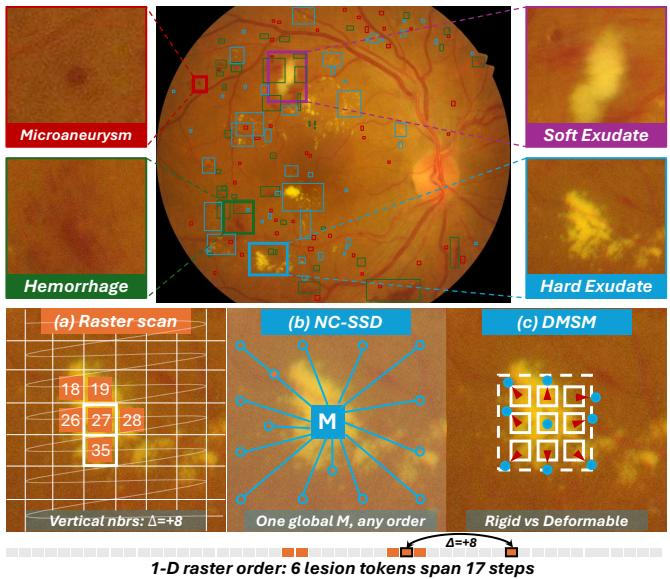
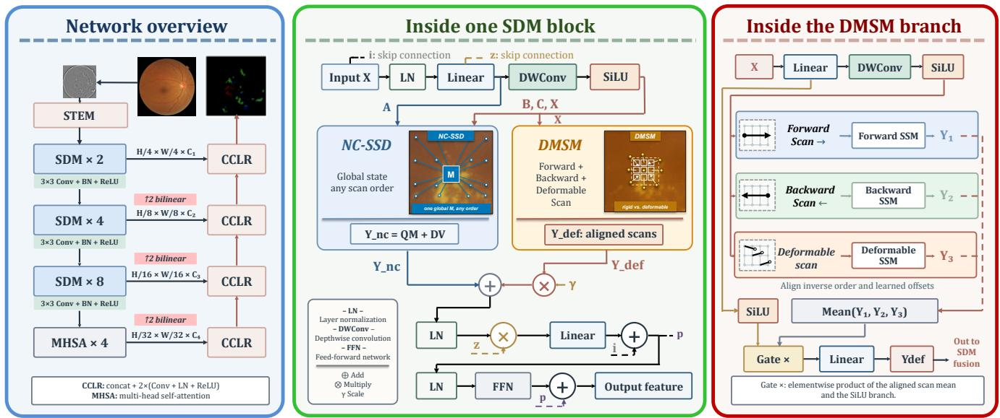
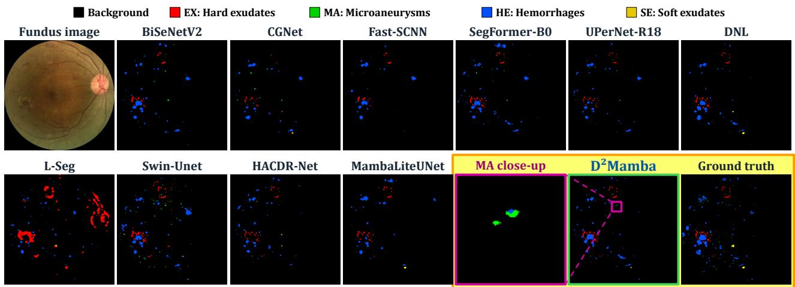
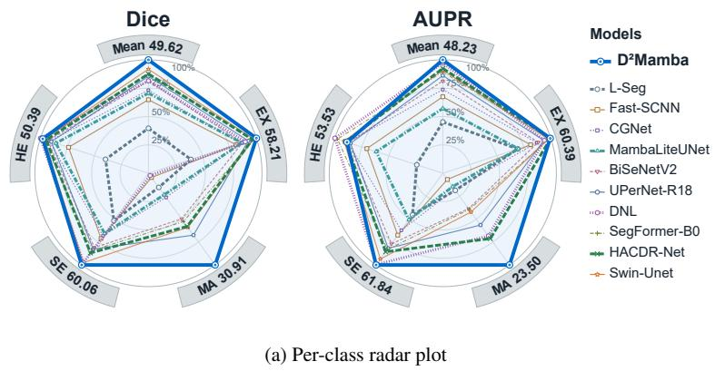

# SEEING THE SMALL: DEFORMABLE DUALITY MAMBA FOR RETINAL LESION SEGMENTATION

Chang Yu, Siqing Li, Yuanchen Liu, Zhenyu Bu, Luming Yang∗, Alper Yilmaz

The Ohio State University, Columbus, OH, USA ∗Correspondence: yang.7670@osu.edu

## ABSTRACT

Diabetic retinopathy (DR) lesions vary widely in shape, and microaneurysms (MAs) span only a few pixels. We hypothesize that modeling the spatial organization of lesion regions, with global context and shape-adaptive scanning, improves the segmentation of such small and irregular lesions. To test this, we propose D2Mamba, which couples non-causal state space duality with deformable Mamba scanning. We evaluate it with five-fold crossvalidation on the DDR dataset, comparing against representative segmentation baselines under an identical training protocol, and conduct ablations on each component. D2Mamba achieved the best overall performance, with 33.87% mIoU, 2.99 percentage points above the strongest baseline. The largest gain appeared on MAs, the smallest and most easily missed lesions, where Dice improved by 10.06 percentage points. These results confirm our hypothesis that spatially adaptive state space modeling benefits tiny-lesion segmentation. Code and pretrained weights are available at http://github.com/PUREPANEL1/D2Mamba.

Index Terms— Diabetic retinopathy, lesion segmentation, state-space model, deformable scanning

## 1. INTRODUCTION

Diabetic retinopathy (DR) is a leading cause of preventable vision loss, affecting roughly one in five people with diabetes worldwide [1, 2]. Deep learning now supports referable-DR screening, including autonomous systems deployed in primary care [3, 4, 5], and retinal foundation models [6]; however, these systems output image-level grades rather than lesion maps. Lesion-level evidence consists of hard exudates (EX), microaneurysms (MA), soft exudates (SE), and hemorrhages (HE), annotated pixel-wise in public benchmarks [7, 8, 9]. Segmenting these lesions in fundus images is difficult: they differ in morphology, small lesions occupy a tiny fraction of an image, downsampling can discard their signal, and background pixels can dominate training (Fig. 1).

Networks with an encoder and decoder, such as U-Net and nnU-Net, are standard for biomedical segmentation [10, 11, 12]. General-purpose convolutional models trade detail against context in different ways: Fast-SCNN shares early downsampling [13], CGNet combines local and surrounding features [14], BiSeNetV2 separates detail from semantics [15], and UPerNet fuses multi-level features [16]. For fundus lesions, L-Seg unifies multi-lesion segmentation [17] and HACDR-Net uses heterogeneous receptive fields for varied lesion geometry [18]. Repeated downsampling can nevertheless weaken evidence from small lesions.

  
Fig. 1. Lesion appearances and spatial modeling in case 49 of IDRiD dataset. Colored boxes mark native-resolution crops of microaneurysms (MA), hemorrhages (HE), hard exudates (EX), and soft exudates (SE). (a) Raster scanning separates nearby lesion features in the sequence. (b) NC-SSD gathers global context without directional scanning. (c) DMSM adapts sampling to irregular lesion shapes.

Non-local operations [19] and Transformers such as Swin-Unet and SegFormer [20, 21] enlarge the interaction range, but the additional context can include irrelevant retinal structure. Mamba [22] was designed for sequential data that evolve over time; visual variants such as VMamba [23], U-Mamba [24], and MambaLiteUNet [25] instead apply its state transitions over spatial positions. However, they often depend on a fixed scanning order [23, 26], and rigid paths struggle to align with the complex spatial structures of irregularly shaped lesions. We therefore use state transitions to model the spatial organization of lesion regions without a fixed scan order.

To address this, in this paper we propose a non-causal, deformation-aware network designed for multi-lesion segmentation in diabetic retinopathy (D2Mamba). Unlike existing DR multi-lesion segmentation methods, our approach employs a non-causal dual state-space mechanism (NC-SSD) [27, 28]. This allows each position to leverage global context, enabling the model to efficiently capture spatial relationships among lesion regions while overcoming the unidirectional causal constraints imposed by fixed scanning sequences. Content-dependent state modulation enables the model to distinguish lesion-related cues from irrelevant background, thereby facilitating a diverse global receptive field. In addition, our deformation-aware multi-scan mechanism (DMSM) [29] offers spatial adaptability, which helps mitigate interference from large, irrelevant regions while better conforming to the distinct shapes of individual lesions.

## 2. METHOD

## 2.1. Network and SDM Block

Figure 2 shows a four-stage encoder and progressive CCLR decoder. After a convolutional stem, three SDM stages contain 2, 4, and 8 blocks at widths 64, 128, and 256; the fourth stage contains four multi-head self-attention blocks at width 512. The stages operate at approximately $1 / 4 , 1 / 8 , 1 / 1 6 .$ and $1 / 3 2$ input resolution. CCLR fuses upsampled decoder and encoder features. A third-stage auxiliary head supervises training; the five-class head produces the inference output.

Within each SDM Block (Fig. 2), normalized features of shape $N \times H _ { s } \times W _ { s } \times C _ { s }$ are projected into content and state representations. Flattening the spatial grid gives $L = H _ { s } W _ { s }$ positions. The content projection has width $2 C _ { s } .$ , partitioned into heads of width $d \ : = \ : 6 4 $ ; the state features have width $r = 6 4$ . For one sample and head, let $V \in \mathbb { R } ^ { L \times d }$ be content and $K , Q \ \in \ \mathbb { R } ^ { L \times r }$ be state features shared across the value heads. $\mathrm { N C - S S D }$ computes a global state summary and projects it back to every position:

$$
M = K ^ { \top } \mathrm { d i a g } ( \rho ) V , \quad Y _ { \mathrm { n c } } = Q M + D V , \quad \rho = - A \Delta ,\tag{1}
$$

Here $\Delta$ is an input-dependent positive step, and A and D are learned head parameters. The $r \times d$ summary M aggregates all L positions without a causal mask or dense $L \times L$ attention matrix. Q maps M to $L \times d ;$ concatenating heads gives $Y _ { \mathrm { n c } } \in$ $\mathbb { R } ^ { N \times L \times \dot { 2 C } _ { s } }$

DMSM predicts offsets on the two-dimensional grid and bilinearly samples features. It scans them forward, backward, and in a deformable order set by learned scores. The backward output is reversed, and the deformable output is restored by the inverse learned permutation before the three aligned streams are averaged, gated, and projected. With state width 16, DMSM produces $\bar { Y } _ { \mathrm { d e f } } \in \mathbb { R } ^ { \bar { N } \times \bar { L ^ { \times } } 2 C _ { s } }$ , matching $Y _ { \mathrm { n c } }$ for per-channel fusion:

$$
Y = Y _ { \mathrm { n c } } + \gamma \odot Y _ { \mathrm { d e f } } , \qquad \gamma _ { c } ^ { ( 0 ) } = 1 0 ^ { - 3 } .\tag{2}
$$

The learned channel scale $\gamma$ controls the deformable contribution; both branches are trained end to end.

## 2.2. Multi-scale Decoding

Starting from the deepest feature, CCLR aligns the current decoder map with the next encoder skip and concatenates them:

$$
D _ { s } = \phi _ { s } ( [ { \mathcal { U } } _ { s } ( D _ { s + 1 } ) , P _ { s } ( F _ { s } ) ] ) .\tag{3}
$$

Here $F _ { s }$ is the encoder feature at stage $s , P _ { s }$ adjusts its channels, and $\mathcal { U } _ { s }$ bilinearly resizes the decoder feature to the size of $F _ { s } .$ . The operator $\phi _ { s }$ applies two successive groups, each with a $3 \times 3$ convolution, LayerNorm2d, and ReLU, to the concatenated features.

## 3. EXPERIMENTS AND RESULTS

## 3.1. Protocol

We use 757 lesion-annotated DDR images [9] in reconstructed image-level five-fold splits. Each fold contains 453 to 455 training images, 151 to 152 validation images, and 151 to 152 test images. Validation mDice selects the checkpoint; test scores are then averaged equally across folds. We report population standard deviations and exclude background from four-lesion macro scores. IoU and Dice are computed from class-wise confusion counts pooled within each test fold, while AUPR is computed from continuous softmax scores using 1000 histogram bins. We observed that the official split may allow existing models to rely on shortcut learning, so we employed a five-fold cross-validation. Our results cannot be directly compared with those reported in other studies.

We train with PyTorch and MMSegmentation on one NVIDIA RTX 4090D without pretrained initialization. Preprocessing removes black borders and combines each image with a Gaussian-blurred copy for fundus background correction, followed by RGB conversion and ImageNet normalization. Images and labels are resized to $1 0 2 8 \times 1 0 2 8$ using bilinear and nearest-neighbor interpolation, respectively. During training, images and labels share random scaling by factors from 0.5 to 2.0, cropping, and flipping; photometric distortion is applied only to images. Validation and testing use deterministic preprocessing. AdamW uses batch size 4, an initial learning rate of $6 \times 1 0 ^ { - 5 }$ , and weight decay of 0.01. Each fold is trained for 100000 optimizer updates, with 1500 warm-up updates followed by polynomial learning-rate decay. Validation and checkpointing occur every 2000 updates. The training budget is measured in optimizer updates rather than epochs. All baselines use the same folds.

Fig. 2. D2Mamba architecture and SDM Block. The encoder uses SDM Blocks at three scales; CCLR fuses decoder and skip features. NC-SSD aggregates global context, while DMSM combines forward, backward, and deformable scans.  
  
Fig. 3. Qualitative comparison on DDR image 007-6148-300. The panels show the fundus image, baseline predictions, D2Mamba, and ground truth. The magenta box marks the region enlarged in the adjacent MA close-up.

## 3.2. Quantitative Comparison

Table 1 compares D2Mamba with ten re-implemented baselines on the same DDR folds. Its mIoU of 33.87% exceeds Swin-Unet by 2.99 points and MambaLiteUNet by 10.93 points, indicating that modeling the spatial organization of lesions matters more than adopting Mamba alone. Fig. 4(a) shows class-wise Dice and AUPR; D2Mamba also has the highest macro means.

D2Mamba reaches 49.62% mDice versus 45.57% for Swin-Unet, and 48.23% mAUPR versus 46.98% for DNL, gains of 4.05 and 1.25 points.

## 3.3. Class-wise Behavior

The largest gain is for MA: D2Mamba reaches 18.29% IoU and 30.91% Dice, against UPerNet-R18’s 11.70% and 20.85%, and 23.50% AUPR against HACDR-Net’s 16.74%. MAs span only a few pixels and are the class most easily suppressed by downsampling and large-scale aggregation, so this gain is the most direct evidence for the intended behavior of the SDM block. D2Mamba also has the highest IoU and Dice for EX and SE, whereas DNL leads on HE in IoU (34.23% vs. 32.98%) and Dice (50.39% vs. 49.30%). Figure 3 shows one test case, including the MA close-up.

Table 1. DDR five-fold IoU results: mean ± population standard deviation (%). EX, MA, SE, and HE denote hard exudates, microaneurysms, soft exudates, and hemorrhages. The macro mean excludes background. Bold marks the best mean; underlining marks the second best. Rows are grouped by backbone architecture; the Purpose icon gives the target stated in each cited paper: RT general-purpose real-time/efficient, Gen general-purpose scene parsing, Med medical image segmentation.
<table><tr><td rowspan="2">Model</td><td rowspan="2">Key design</td><td rowspan="2">Purpose</td><td colspan="5">IoU (%)</td></tr><tr><td>Mean</td><td>EX</td><td>MA</td><td>SE</td><td>HE</td></tr><tr><td colspan="2">CNN</td><td></td><td></td><td></td><td></td><td></td><td></td></tr><tr><td>L-Seg [17]</td><td>multi-scale fusion + bin loss</td><td>Med</td><td> $1 1 . 3 0 \pm 1 . 6 0$ </td><td> $1 3 . 0 1 \pm 2 . 7 1$ </td><td> $2 . 5 7 \pm 3 . 6 3$ </td><td> $1 8 . 5 0 \pm 3 . 6 9$ </td><td> $1 1 . 1 4 \pm 1 . 5 5$ </td></tr><tr><td>Fast-SCNN [13]</td><td>learning-to-downsample, two-branch</td><td>0RT</td><td> $2 0 . 5 2 \pm 1 . 4 0$ </td><td> $3 1 . 0 3 \pm 1 . 4 3$ </td><td> $0 . 7 3 \pm 0 . 5 0$ </td><td> $2 7 . 1 5 \pm 1 . 5 2$ </td><td> $2 3 . 1 8 \pm 5 . 7 4$ </td></tr><tr><td>CGNet [14]</td><td>context-guided block</td><td>0 RT</td><td> $2 3 . 4 8 \pm 1 . 9 8$ </td><td> $3 3 . 4 7 \pm 2 . 6 8$ </td><td> $4 . 2 8 \pm 1 . 5 4$ </td><td> $2 5 . 7 8 \pm 3 . 4 6$ </td><td> $3 0 . 3 9 \pm 6 . 4 1$ </td></tr><tr><td>BiSeNetV2 [15]</td><td>detail + semantic branches</td><td>0 RT</td><td> $2 6 . 3 5 \pm 1 . 4 9$ </td><td> $3 4 . 0 2 \pm 2 . 7 3$ </td><td> $8 . 3 5 \pm 1 . 3 2$ </td><td> $3 2 . 2 3 \pm 3 . 2 4$ </td><td> $3 0 . 8 1 \pm 5 . 0 2$ </td></tr><tr><td></td><td>UPerNet-R18 [16, 30] unified perceptual parsing</td><td>Gen</td><td> $2 7 . 8 5 \pm 1 . 9 3$ </td><td> $3 6 . 9 0 \pm 3 . 2 5$ </td><td> $\underline { { 1 1 . 7 0 } } \pm 2 . 6 2$ </td><td> $3 3 . 1 3 \pm 2 . 1 8$ </td><td> $2 9 . 6 8 \pm 6 . 9 1$ </td></tr><tr><td>DNL [19]</td><td>disentangled non-local</td><td>Gen</td><td> $2 7 . 8 8 \pm 2 . 7 4$ </td><td> $3 5 . 4 9 \pm 4 . 7 8$ </td><td> $0 . 3 9 \pm 0 . 4 6$ </td><td> $4 1 . 3 9 \pm 3 . 4 1$ </td><td> $3 4 . 2 3 \pm 8 . 3 0$ </td></tr><tr><td>HACDR-Net [18]</td><td>heterogeneous-aware convolution</td><td>Med</td><td> $2 8 . 9 7 \pm 1 . 3 3$ </td><td> $3 9 . 0 1 \pm 1 . 8 7$ </td><td> $9 . 8 6 \pm 1 . 3 4$ </td><td> $3 5 . 4 4 \pm 3 . 8 0$ </td><td> $3 1 . 5 6 \pm 5 . 4 7$ </td></tr><tr><td colspan="2">Transformer</td><td></td><td></td><td></td><td></td><td></td><td></td></tr><tr><td>SegFormer-B0 [21]</td><td>hierarchical Transformer + MLP decoder</td><td>0 RT</td><td> $2 8 . 8 4 \pm 1 . 1 8$ </td><td> ${ 3 9 . 8 2 \pm 2 . 4 7 }$ </td><td> $8 . 8 8 \pm 1 . 8 2$ </td><td> $3 3 . 9 8 \pm 3 . 5 0$ </td><td> $3 2 . 6 8 \pm 5 . 3 7$ </td></tr><tr><td>Swin-Unet [20]</td><td>Swin U-shaped encoder and decoder</td><td> Med</td><td> $\underline { { 3 0 . 8 8 } } \pm 1 . 7 7$ </td><td> $3 9 . 6 1 \pm 2 . 0 3$ </td><td> $1 0 . 0 4 \pm 0 . 6 6$ </td><td> $\underline { { 4 1 . 5 3 } } \pm 3 . 7 7$ </td><td> $3 2 . 3 6 \pm 4 . 1 4$ </td></tr><tr><td colspan="2">Mamba / SSM</td><td></td><td></td><td></td><td></td><td></td><td></td></tr><tr><td></td><td>MambaLiteUNet [25] Mamba U-Net + cross-gated attention</td><td> Med</td><td> $2 2 . 9 4 \pm 2 . 2 3$ </td><td> $3 3 . 8 6 \pm 5 . 1 7$ </td><td> $3 . 8 2 \pm 2 . 4 5$ </td><td> $2 6 . 3 1 \pm 1 3 . 8 3$ </td><td> $2 7 . 7 6 \pm 4 . 9 5$ </td></tr><tr><td>D²Mamba</td><td>NC-SSD + deformable DMSM</td><td>+ Med</td><td> ${ \bf 3 3 . 8 7 \pm 2 . 7 8 }$ </td><td> ${ \bf 4 1 . 1 4 } \pm 3 . 4 7$ </td><td> ${ \bf 1 8 . 2 9 \pm 0 . 7 5 }$ </td><td> ${ \bf 4 3 . 0 9 \pm 4 . 9 6 }$ </td><td> $\underline { { 3 2 . 9 8 } } \pm 5 . 7 6$ </td></tr></table>

<table><tr><td>Metric (%) VSSD</td><td> $\mathrm { D ^ { 2 } M a m b a }$ </td><td>∆</td></tr><tr><td>Macro</td><td></td><td></td></tr><tr><td>mIoU 36.09</td><td>37.36</td><td>+1.27</td></tr><tr><td>mDice 51.95</td><td>53.37</td><td>+1.43</td></tr><tr><td>mAUPR 51.74</td><td>52.07</td><td>+0.33</td></tr><tr><td>Class-wise IoU</td><td></td><td></td></tr><tr><td>EX 44.61</td><td>46.78</td><td>+2.16</td></tr><tr><td>MA 16.99</td><td>19.60</td><td>+2.60</td></tr><tr><td>SE 42.76</td><td>46.88</td><td>+4.12</td></tr><tr><td>HE 39.99</td><td>36.20</td><td>-3.79</td></tr><tr><td>(b) Ablation study</td><td></td><td></td></tr></table>

Fig. 4. (a) DDR five-fold mean Dice and AUPR for the four lesion classes and their macro mean. Each grey outer band gives the highest score (%) on that axis; the concentric rings show 25% to 100% of that score. Lines show fold means without error bars; macro means exclude background. (b) DDR test-set ablation of D2Mamba against the NC-SSD-only VSSD variant; ∆ is D2Mamba minus VSSD before rounding, and bold marks the better value. Table 1 reports five-fold means.

## 3.4. Ablation

Ablations are conducted on DDR test set under the same training protocol (Fig. 4(b)). Adding DMSM to the NC-SSD-only variant raises mIoU from 36.09% to 37.36%, mDice from 51.95% to 53.37%, and mAUPR from 51.74% to 52.07%. The consistent gains on EX, MA, and SE indicate that deformable scanning complements the global NC-SSD state with spatially adaptive sampling of small and irregular lesions. HE IoU, however, drops by 3.79 points, consistent with HE being the only class where D2Mamba trails a baseline in Table 1. A fixed fusion scale appears less suited to large diffuse hemorrhages, and adapting the deformable contribution to lesion scale is left for future work.

## 4. CONCLUSION

This paper presented D2Mamba for multi-lesion segmentation in diabetic retinopathy. Its SDM block models the spatial organization of lesion regions by coupling non-causal state space duality, which aggregates global context without a fixed scan order, with deformable Mamba scanning, which adapts sampling to lesion shape. In five-fold evaluation on DDR under an identical training protocol, $\mathrm { D ^ { 2 } M }$ amba achieved the highest macro IoU, Dice, and AUPR among the compared methods, with the largest gain on microaneurysms, the smallest and most easily missed lesion class. Future work will adapt the deformable contribution to lesion scale and validate the method on additional fundus datasets.

## 5. COMPLIANCE WITH ETHICAL STANDARDS

This research study was conducted retrospectively using human subject data made available in open access by DDR fundus images and annotations dataset [9]. Ethical approval was not required as confirmed by the license attached with the open access data.

## 6. ACKNOWLEDGMENTS

No funding was received for this work. The authors declare no relevant financial or non-financial conflicts of interest.

## 7. REFERENCES

[1] Ning Cheung, Paul Mitchell, and Tien Yin Wong, “Diabetic retinopathy,” The Lancet, vol. 376, no. 9735, pp. 124–136, 2010.

[2] Zhen Ling Teo, Yih-Chung Tham, Marco Yu, Miao Li Chee, Tyler Hyungtaek Rim, Ning Cheung, et al., “Global prevalence of diabetic retinopathy and projection of burden through 2045,” Ophthalmology, vol. 128, no. 11, pp. 1580–1591, 2021.

[3] Varun Gulshan, Lily Peng, Marc Coram, Martin C. Stumpe, Derek Wu, Arunachalam Narayanaswamy, et al., “Development and validation of a deep learning algorithm for detection of diabetic retinopathy in retinal fundus photographs,” JAMA, vol. 316, no. 22, pp. 2402, 2016.

[4] Daniel Shu Wei Ting, Carol Yim-Lui Cheung, Gilbert Lim, Gavin Siew Wei Tan, Nguyen D. Quang, Alfred Gan, et al., “Development and validation of a deep learning system for diabetic retinopathy and related eye diseases using retinal images from multiethnic populations with diabetes,” JAMA, vol. 318, no. 22, pp. 2211, 2017.

[5] Michael D. Abràmoff, Philip T. Lavin, Michele Birch, Nilay Shah, and James C. Folk, “Pivotal trial of an autonomous AI-based diagnostic system for detection of diabetic retinopathy in primary care offices,” npj Digital Medicine, vol. 1, no. 1, 2018.

[6] Yukun Zhou, Mark A. Chia, Siegfried K. Wagner, Murat S. Ayhan, Dominic J. Williamson, Robbert R. Struyven, et al., “A foundation model for generalizable disease detection from retinal images,” Nature, vol. 622, no. 7981, pp. 156–163, 2023.

[7] Prasanna Porwal, Samiksha Pachade, Ravi Kamble, Manesh Kokare, Girish Deshmukh, Vivek Sahasrabuddhe, et al., “Indian Diabetic retinopathy image dataset (IDRiD): A database for diabetic retinopathy screening research,” Data, vol. 3, no. 3, pp. 25, 2018.

[8] Prasanna Porwal, Samiksha Pachade, Manesh Kokare, Girish Deshmukh, Jaemin Son, Woong Bae, et al., “IDRiD: Diabetic retinopathy – segmentation and grading challenge,” Medical Image Analysis, vol. 59, pp. 101561, 2020.

[9] Tao Li, Yingqi Gao, Kai Wang, Song Guo, Hanruo Liu, and Hong Kang, “Diagnostic assessment of deep learning algorithms for diabetic retinopathy screening,” Information Sciences, vol. 501, pp. 511–522, 2019.

[10] Geert Litjens, Thijs Kooi, Babak Ehteshami Bejnordi, Arnaud Arindra Adiyoso Setio, Francesco Ciompi, Mohsen Ghafoorian, et al., “A survey on deep learning in medical image analysis,” Medical Image Analysis, vol. 42, pp. 60–88, 2017.

[11] Olaf Ronneberger, Philipp Fischer, and Thomas Brox, “U-Net: Convolutional networks for biomedical image segmentation,” in Medical Image Computing and Computer-Assisted Intervention (MICCAI), 2015, pp. 234–241.

[12] Fabian Isensee, Paul F. Jaeger, Simon A. A. Kohl, Jens Petersen, and Klaus H. Maier-Hein, “nnU-Net: A self-configuring method for deep learning-based biomedical image segmentation,” Nature Methods, vol. 18, pp. 203–211, 2021.

[13] Rudra P. K. Poudel, Stephan Liwicki, and Roberto Cipolla, “Fast-SCNN: Fast semantic segmentation network,” arXiv preprint arXiv:1902.04502, 2019.

[14] Tianyi Wu, Sheng Tang, Rui Zhang, Juan Cao, and Yongdong Zhang, “CGNet: A light-weight context guided network for semantic segmentation,” IEEE Transactions on Image Processing, vol. 30, pp. 1169– 1179, 2021.

[15] Changqian Yu, Changxin Gao, Jingbo Wang, Gang Yu, Chunhua Shen, and Nong Sang, “BiSeNet V2: Bilateral network with guided aggregation for real-time semantic segmentation,” International Journal of Computer Vision, vol. 129, pp. 3051–3068, 2021.

[16] Tete Xiao, Yingcheng Liu, Bolei Zhou, Yuning Jiang, and Jian Sun, “Unified perceptual parsing for scene understanding,” in European Conference on Computer Vision (ECCV), 2018, pp. 432–448.

[17] Song Guo, Tao Li, Hong Kang, Ning Li, Yujun Zhang, and Kai Wang, “L-Seg: An end-to-end unified framework for multi-lesion segmentation of fundus images,” Neurocomputing, vol. 349, pp. 52–63, 2019.

[18] QiHao Xu, Xiaoling Luo, Chao Huang, Chengliang Liu, Jie Wen, Jialei Wang, and Yong Xu, “HACDR-Net: Heterogeneous-aware convolutional network for diabetic retinopathy multi-lesion segmentation,” in Proceedings of the AAAI Conference on Artificial Intelligence, 2024, vol. 38, pp. 6342–6350.

[19] Minghao Yin, Zhuliang Yao, Yue Cao, Xiu Li, Zheng Zhang, Stephen Lin, and Han Hu, “Disentangled non-local neural networks,” in European Conference on Computer Vision (ECCV), 2020, pp. 191–207.

[20] Hu Cao, Yueyue Wang, Joy Chen, Dongsheng Jiang, Xiaopeng Zhang, Qi Tian, and Manning Wang, “Swin-Unet: Unet-like pure transformer for medical image segmentation,” in Computer Vision – ECCV 2022 Workshops, 2023, pp. 205–218.

[21] Enze Xie, Wenhai Wang, Zhiding Yu, Anima Anandkumar, Jose M. Alvarez, and Ping Luo, “SegFormer: Simple and efficient design for semantic segmentation with transformers,” in Advances in Neural Information Processing Systems, 2021, vol. 34, pp. 12077–12090.

[22] Albert Gu and Tri Dao, “Mamba: Linear-time sequence modeling with selective state spaces,” arXiv preprint arXiv:2312.00752, 2023.

[23] Yue Liu, Yunjie Tian, Yuzhong Zhao, Hongtian Yu, Lingxi Xie, Yaowei Wang, Qixiang Ye, Jianbin Jiao, and Yunfan Liu, “VMamba: Visual state space model,” arXiv preprint arXiv:2401.10166, 2024.

[24] Jun Ma, Feifei Li, and Bo Wang, “U-mamba: Enhancing longrange dependency for biomedical image segmentation,” arXiv preprint arXiv:2401.04722, 2024.

[25] Md Maklachur Rahman, Soon Ki Jung, and Tracy Hammond, “MambaLiteUNet: Cross-gated adaptive feature fusion for robust skin lesion segmentation,” arXiv preprint arXiv:2604.20286, 2026.

[26] Rui Xu, Shu Yang, Yihui Wang, Yu Cai, Bo Du, and Hao Chen, “Visual Mamba: A survey and new outlooks,” arXiv preprint arXiv:2404.18861, 2024.

[27] Yuheng Shi, Minjing Dong, Mingjia Li, and Chang Xu, “VSSD: Vision mamba with non-causal state space duality,” arXiv preprint arXiv:2407.18559, 2024.

[28] Tri Dao and Albert Gu, “Transformers are SSMs: Generalized models and efficient algorithms through structured state space duality,” arXiv preprint arXiv:2405.21060, 2024.

[29] Leiye Liu, Miao Zhang, Jihao Yin, Tingwei Liu, Wei Ji, Yongri Piao, and Huchuan Lu, “DefMamba: Deformable visual state space model,” arXiv preprint arXiv:2504.05794, 2025.

[30] Kaiming He, Xiangyu Zhang, Shaoqing Ren, and Jian Sun, “Deep residual learning for image recognition,” in IEEE Conference on Computer Vision and Pattern Recognition (CVPR), 2016, pp. 770–778.