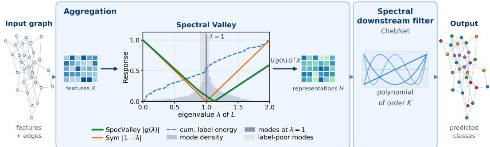
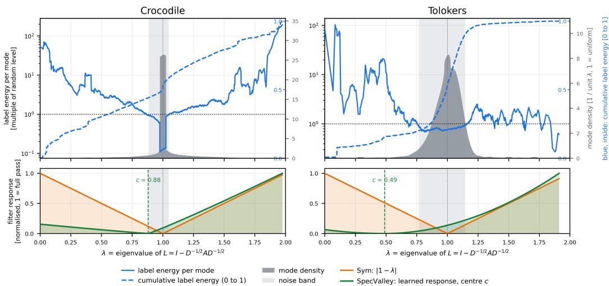
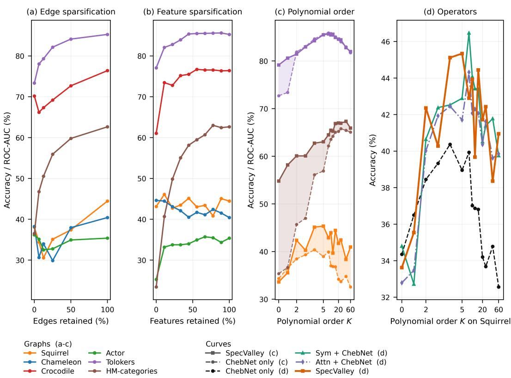
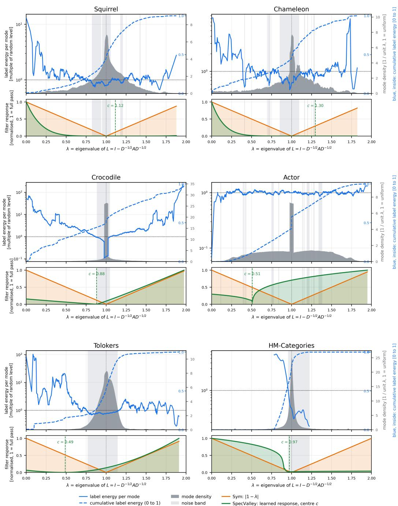
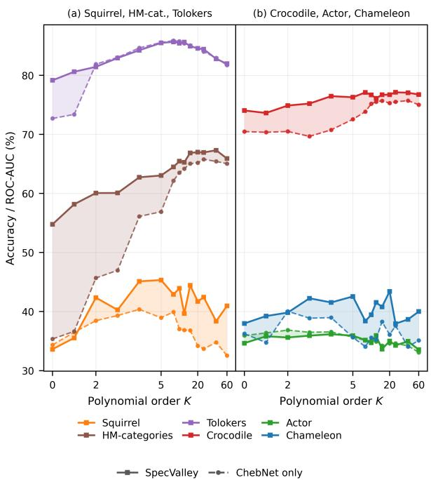

# SPECVALLEY: AGGREGATION AS SPECTRAL VALLEY IN DENSE HETEROPHILIC GRAPHS

Christoph Jahn   
Mercedes-Benz AG, Sindelfingen   
Department of Computer Science   
University of Konstanz   
christoph.jahn@mercedes-benz.com

Urs Waldmann Department of Computer Science University of Konstanz urs.wladmann@uni-konstanz.de

Delvin Bacho Mercedes-Benz AG, Sindelfingen

Bastian Goldlücke   
Department of Computer Science   
University of Konstanz   
bastian.goldluecke@uni-konstanz.de

## ABSTRACT

Node classification in heterophilic graphs remains an open problem: aggregating over neighbourhoods can damp precisely the part of the signal that carries the labels. The field has answered with ever more expressive propagation operators, leaving the aggregation step that precedes them fixed by degree normalisation. However, degree normalisation acts as a spectral valley in its own right, attenuating a fixed middle band whose position at λ = 1 is set by the normalisation rather than by the data, exactly where the eigenvalues of dense graphs accumulate. We therefore begin with the representations rather than the propagation, in two stages: a learnable aggregation followed by an ordinary spectral filter. The first, SpecValley learns the position, sharpness and flank gains of the valley for every graph. We show formally how the aggregation operator and downstream filter interact. We establish that the response 1 − λ of degree normalisation vanishes exactly at that accumulation point. A spectral energy budget shows that what aggregation removes from a band, no linear spectral filter can recover. Crowding alone says nothing about the benefit. That is decided by how much label energy the valley removes, which we measure for every graph. SpecValley achieves strong results across heterophilic benchmarks, and a controlled ablation over aggregation operators and downstream filters attributes the gain to aggregation rather than the filter.

## 1 INTRODUCTION

Graphs are a fundamental data structure for relational information: nodes stand for entities, edges for the relations between them. Node classification is a central task, with applications in social networks, biological systems and recommendation settings (Kipf and Welling, 2017; Velickoviˇ c et al., 2018).´ Graph neural networks (GNNs) shape this field by propagating and aggregating information across local neighbourhoods.

Most GNNs assume homophily, that is, that neighbouring nodes share similar features or classes (Zhu et al., 2020; Pei et al., 2020). In heterophilic graphs this does not hold (Yan et al., 2022): repeated aggregation amplifies mismatched signals and reduces class separability, particularly in dense graphs (Oono and Suzuki, 2020). The field has answered with feature-driven models (Abu-El-Haija et al., 2019; Lim et al., 2021), contrastive learning (Velickovi ˇ c et al., 2019; Hassani and Khasahmadi,´ 2020; Qiu et al., 2020), structure learning (Franceschi et al., 2019; Wu et al., 2022) and increasingly elaborate spectral and transformer architectures (Chien et al., 2021; Lin et al., 2024; Koke and Cremers, 2024; Deng et al., 2024), each tied to a regime: transformers require large datasets, spectral models excel on small or dense heterophilic graphs. All of them design the convolution operator or the structure of the graph and leave the step before it untouched: the filter is learned, the material it operates on is not.

  
Figure 1: Overview of SpecValley. Top: node features first pass an aggregation stage and then an ordinary spectralfilter (ChebNet, Eq. (5)), which predicts the node labels. Bottom: A more detailed visualization ofthe aggregation stage. On dense graphs the eigenvalues ofthe normalised Laplacian accumulate at λ = 1 (grey histogram) and degree normalisation acts there as thefixed response 1 − λ, a valley whose zero is pinned by the normalisation rather than by the data (Proposition 4.1). SpecValley replaces it by a response whose centre, sharpness andflank gains are learned per graph (Eq. (3)), so that the attenuated band can be placed awayfrom the modes that carry the label energy.

That step is not neutral. Degree normalisation acts spectrally as a fixed valley with its zero at $\lambda = 1$ , a position set by the normalisation rather than by the data, and it is exactly there that the eigenvalues of dense graphs accumulate. Whether this helps depends not on the crowding itself, which every dense graph shows, but on how much label energy lies in the attenuated band. We therefore treat aggregation as a stage of its own, upstream of an ordinary spectral filter and make it learnable: SpecValley learns the position, sharpness and flank gains of the valley per graph, staying close to degree normalisation where the band carries little label energy and moving its centre away from λ = 1 where it carries much.

Contributions. We contribute a learnable aggregation stage that generalises degree normalisation and fixes the spectral energy budget available to every downstream filter. A formal account of the interaction shows that the response 1 − λ vanishes at the accumulation point of dense spectra, and no linear spectral filter can recover what aggregation has removed from a band. We perform a controlled study on stored splits, crossing five aggregators with four filters on six graphs, together with the label-energy spectrum of each graph and the response SpecValley learns on it. SpecValley achieves strong results throughout. The ablation attributes the gain to the aggregation stage rather than to the filter and learned attention adds little beyond a fixed aggregation structure once a spectral filter follows it (Section 5.2).

## 2 RELATED WORK

Standard neighbourhood aggregation amplifies mismatched signals in heterophilic graphs, causing oversmoothing and reduced class separability (Li et al., 2018; Yan et al., 2022; Oono and Suzuki, 2020). Feature-driven methods emphasise multi-hop interactions or decouple features from topology (Abu-El-Haija et al., 2019; Lim et al., 2021), structure-oriented methods reweight or denoise edges (Franceschi et al., 2019; Wu et al., 2022). Both operate on fixed representations. Spectral methods such as GPR-GNN (Chien et al., 2021) and FAGCN (Bo et al., 2021) learn adaptive frequency weights, BernNet (He et al., 2021) approximates arbitrary filters, Specformer (Bo et al., 2023) learns the filter with a transformer over the eigenvalues, JacobiConv (Wang and Zhang, 2022) uses Jacobi polynomial bases, NLSF (Lin et al., 2024) introduces equivariant nonlinear filtering. These design expressive operators but apply them to a frequency profile that the preceding aggregation has already fixed. Few works address that step itself, and they do so spatially: separating ego from neighbourhood information (Zhu et al., 2020; Platonov et al., 2023), projecting along and against the edge direction (Rossi et al., 2023) or learning edge weights by attention (Velickoviˇ c et al., 2018).´ Read spectrally, ego-neighbour separation yields the affine family $a + b ( 1 - \lambda )$ , so the position of the response is learnable but its shape is not: sharpness and asymmetry remain those of degree normalisation. Attention weights are not a function of L, and our ablation measures how they compare with degree normalisation (Section 5.2). Graph transformers inject global structure at the feature level via Laplacian or random-walk encodings (Dwivedi et al., 2022; Rampášek et al., 2022; Kreuzer et al., 2021) and Polynormer (Deng et al., 2024) combines polynomial expressivity with local and global attention.

Our Positioning. We treat the aggregation stage itself as a spectral operator and make it learnable, with degree normalisation as the special case of a fixed valley whose position, sharpness and flanks we instead learn. Since aggregation fixes how much spectral energy reaches the downstream filters at all, our approach does not replace filter design but precedes it.

## 3 SPECTRAL REPRESENTATIONS

## 3.1 PROBLEM FORMULATION

Let $G = ( V , E )$ be a graph on n nodes with features $x _ { i } \in \mathbb { R } ^ { d }$ , collected in $\ b { X } \in \mathbb { R } ^ { n \times d }$ , and adjacency $A \in \mathbb { R } ^ { n \times n }$ We work in the transductive setting, where A is fixed and the task is to learn node representations $Z \in \mathbb { R } ^ { n \times d ^ { \prime } }$ for (semi-)supervised node classification. Message-passing GNNs obtain them by repeatedly aggregating each node’s neighbourhood and combining the result with the node’s own state (Gilmer et al., 2017). This paper concerns the aggregation operator, not the propagation that follows.

## 3.2 LINEAR AGGREGATORS WITH AND WITHOUT PARAMETERS

In heterophilic graphs adjacent nodes are often only weakly aligned semantically, which makes uniform aggregation ineffective (Dai et al., 2021). We therefore view the encoder as an aggregation operator $\bar { P } \in \mathbf { \mathbb { R } } ^ { n \times n }$ supported on E that refines node representations before graph convolution, ${ \dot { H } } ^ { \prime } = P V$ , with learnable value projection $V = X W _ { V }$

Parameter-free aggregators. As references we use two degree-based operators, the symmetric normalisation of GCN (Kipf and Welling, 2017; Wu et al., 2019) and mean aggregation as in GraphSAGE (Hamilton et al., 2017),

$$
\begin{array} { r } { P _ { \mathrm { s y m } } = D ^ { - \frac { 1 } { 2 } } A D ^ { - \frac { 1 } { 2 } } \colon h _ { i } ^ { \prime } = \sum _ { j \in \mathcal { N } ( i ) } \frac { V _ { j } } { \sqrt { d _ { i } d _ { j } } } , P _ { \mathrm { m e a n } } = D ^ { - 1 } A \colon h _ { i } ^ { \prime } = \frac { 1 } { d _ { i } } \sum _ { j \in \mathcal { N } ( i ) } V _ { j } . } \end{array}\tag{1}
$$

Both are linear and fixed by the graph; only $W _ { V }$ is learned. For undirected $A , P _ { \mathrm { s y m } } = I - L$ shares the eigenbasis of the normalised Laplacian, whereas the row-stochastic $P _ { \mathrm { { m e a n } } } = \bar { D } ^ { - 1 / 2 } P _ { \mathrm { { s y m } } } D ^ { 1 / 2 }$ is similar to it but not symmetric (Chung, 1997).

Learned aggregation via self-attention. Instead of fixing edge weights by degree, we learn them from the features via scaled dot-product self-attention, which has shown advantages over uniform aggregation (Velickoviˇ c et al., 2018; Zhao et al., 2021). With query (´ Q), key (K), and value (V) projections of the node features and hidden dimensionality Fhidden,

$$
e _ { i j } = { \frac { Q _ { i } ^ { \top } K _ { j } } { \sqrt { F _ { \mathrm { h i d d e n } } } } } \quad \alpha _ { i j } = { \frac { \exp ( e _ { i j } ) } { \sum _ { k \in { \mathcal { N } } ( i ) } \exp ( e _ { i k } ) } } \quad h _ { i } ^ { \prime } = \sum _ { j \in { \mathcal { N } } ( i ) } \alpha _ { i j } V _ { j }\tag{2}
$$

Here, $e _ { i j }$ measures feature compatibility and $\alpha _ { i j }$ reweights the neighbours in $\mathcal { N } ( i )$ , so that $h _ { i } ^ { \prime }$ is the input to the subsequent spectral layer. In matrix form, $\Breve { H } ^ { \prime } = A ( X ) \Breve { V }$ with $A ( X ) _ { i j } = \alpha _ { i j } \colon$ attention keeps the support and, like $P _ { \mathrm { m e a n } }$ , the row-stochasticity of Eq. (1), but its weights depend on the features, so ${ \bar { A ( X ) } }$ is not linear in X. With frozen query and key projections $( a t t n _ { \mathrm { i n i t } }$ , Section 5.2), $A ( X )$ is a fixed matrix on the transductive graph and acts linearly on V. Although Eq. (2) is a local 1-hop message-passing step, it differs from Graph Attention Networks (GATs) (Velickoviˇ c et al.,´ 2018) in being applied once as an input encoder rather than interleaved with multi-hop propagation.

## 3.3 ADAPTIVE SPECTRAL AGGREGATION

The fixed aggregators of $\operatorname { E q } .$ (1) act spectrally through the response $1 - \lambda ,$ a valley at $\lambda = 1$ whose position and shape follow from the normalisation rather than from the data (Section 4). In combination with ChebNet, learned attention behaves similarly on several graphs (Section 5.2). We therefore propose an aggregator that learns the valley per graph:

$$
H ^ { \prime } = \underbrace { X W _ { I } } _ { \mathrm { e g o } } + \underbrace { S X W _ { S } + S ^ { \top } X W _ { T } } _ { \mathrm { n e i g h b o u r s } } + \underbrace { R ( L ) X W _ { R } } _ { \mathrm { s p e c t r a l v a l e y } } , \qquad R ( L ) = U r ( \Lambda ) U ^ { \top } .\tag{3}
$$

Aggregation does not only apply the response $1 - \lambda ,$ , it also dilutes each node’s own features. The ego term preserves them, which matters where labels are node-level, and the neighbour terms aggregate with $\bar { S } = D ^ { - 1 / 2 } A D ^ { - 1 / 2 }$ along and $S ^ { \top }$ against the edge direction (Rossi et al., 2023); on undirected graphs both reduce to $P _ { \mathrm { s y m } }$ . Separate projections $\breve { W } _ { \bullet } \in \mathbb { R } ^ { d \times F _ { \mathrm { h i d d e n } } }$ let the model read ego and neighbour information differently, as recommended for heterophilic graphs (Zhu et al., 2020; Lim et al., 2021; Platonov et al., 2023). The spectral term rescales each Laplacian eigenmode λ by

$$
r ( \lambda ) = a ( \lambda ) | \lambda - c | ^ { p } , \qquad a ( \lambda ) = a _ { L } \mathrm { f o r } \lambda < c , \quad a ( \lambda ) = a _ { R } \mathrm { f o r } \lambda \geq c .\tag{4}
$$

The response vanishes at the valley centre $c \in ( 0 , \lambda _ { \operatorname* { m a x } } )$ , the exponent $p > 0$ sets its sharpness, narrow for $p < 1$ and broad for $p > 1$ , and the side gains $a _ { L } , a _ { R } \in$ R set slope and sign of either flank. With $c = p = 1 , a _ { L } = a _ { R } = 1$ gives |1 − λ| and $a _ { L } = - a _ { R } = 1$ the signed response $1 - \lambda$ of $P _ { \mathrm { s y m } } .$ so the fixed aggregators are special cases; we initialise at $| 1 - \lambda |$ so that training learns departures from them. Each term is scaled by a scalar gate $\tau _ { \bullet }$ (initialised to 1), which adds no expressivity but is fitted separately: all projections $\dot { W } _ { \bullet }$ and the operator parameters $\theta = ( c , p , a _ { L } , a _ { R } , \tau )$ are learned on the training loss, the latter by a separate optimiser without weight decay, and the epoch is selected on the validation set. Test labels are never used.

## 3.4 SPECTRAL PROPAGATION

Building on Sections 3.1 to 3.3, we employ a spectral graph convolution to propagate information via the graph Laplacian, whose eigenbasis captures global frequency structure beyond local neighborhoods (Bruna et al., 2014; Defferrard et al., 2016). Let $\ b { L } \in \overline { { \mathbb { R } } } ^ { n \times n }$ denote the normalized Laplacian and $\tilde { L } : = 2 L / \lambda _ { \mathrm { m a x } } - I = L - I$ its version shifted to $[ - 1 , 1 ]$ , using the bound $\lambda _ { \operatorname* { m a x } } = 2$ . For node features $H ^ { ( l ) } \in \mathbb { R } ^ { n \times d ^ { \prime } }$ , spectral propagation is defined as

$$
H ^ { ( l + 1 ) } = \mathrm { L N } \left( H ^ { ( l ) } + \mathrm { R e L U } \left( \sum _ { k = 0 } ^ { K - 1 } T _ { k } ( \tilde { L } ) H ^ { ( l ) } W _ { k } \right) \right) ,\tag{5}
$$

with learnable parameters $W _ { k }$ , layer normalization LN, and Chebyshev polynomials $T _ { k } ( \tilde { L } )$ , which follow the recursion

$$
T _ { 0 } ( \tilde { L } ) = I , \qquad T _ { 1 } ( \tilde { L } ) = \tilde { L } , \qquad T _ { k } ( \tilde { L } ) = 2 \tilde { L } T _ { k - 1 } ( \tilde { L } ) - T _ { k - 2 } ( \tilde { L } ) , \quad k \geq 2 .\tag{6}
$$

This Chebyshev convolution, in the style of ChebNet (Defferrard et al., 2016), approximates spectral filters without eigendecomposition. Since $| T _ { k } | \leq 1 \mathrm { o n } [ - 1 , 1 ]$ , the recursion is numerically stable. We use a standard Chebyshev filter rather than adaptive spectral operators such as NLSF or HeroFilter (Lin et al., 2024; Zhang et al., 2025), since spectral filters are effective under heterophily, where discriminative signal often sits at high frequencies (Chien et al., 2021; Bo et al., 2021), and a fixed downstream filter isolates the effect of the aggregation stage.

SpecValley combines $\ell = 3$ such layers of order $K = 5$ with the adaptive valley aggregator of Eq. (3), which supplies $H ^ { ( 0 ) }$ ; the ablation in Section 5.2 substitutes the other aggregators of Section 3.2 in the same position. Propagation thus operates on aggregated rather than raw inputs.

## 4 THEORETICAL PROPERTIES OF AGGREGATION REPRESENTATIONS

## 4.1 COMPUTATIONAL COMPLEXITY

Let n be the number of nodes, $s = | E |$ the number of edges, and d and $d ^ { \prime }$ the input and hidden dimension. Every model projects the features to $d ^ { \prime }$ and applies ℓ polynomial filter layers of order K (ChebNet in SpecValley), at a common cost $C _ { 0 } : =$ $O ( n d d ^ { \prime } ) + \ell \bar { C } _ { K }$ with $\dot { C } _ { K } = O \big ( K ( n d ^ { \prime 2 } + \dot { s d ^ { \prime } } ) \big )$ per layer (Table 1). $P _ { \mathrm { s y m } }$ adds one sparse product. The ego and neighbour terms of SpecValley add

<table><tr><td>Model</td><td>Cost per forward pass</td></tr><tr><td>ChebNet</td><td> $C _ { 0 }$ </td></tr><tr><td> $P _ { \mathrm { s y m } } + \mathrm { C h e b N e t }$ </td><td> $C _ { 0 } + O ( s d ^ { \prime } )$ </td></tr><tr><td>SpecValley</td><td> $C _ { 0 } + O ( n ^ { 2 } d ^ { \prime } ) + O ( \stackrel { . } { n } ^ { 3 } ) ^ { * }$ </td></tr></table>

Table 1: Complexity; $C _ { 0 }$ covers the input projection and the ChebNet layers. ∗Once per graph.

$O ( n d \Breve { d ^ { \prime } } + s d ^ { \prime } ) ;$ ; its remaining cost lies in the spectral term $U r ( \Lambda ) U ^ { \top } X W _ { R } .$ . The eigendecomposition of $\dot { L }$ takes $O ( n ^ { 3 } )$ time once per graph, $U$ occupies $O ( n ^ { 2 } )$ memory during training, and each pass multiplies by $\dot { U } ^ { \top }$ and $U$ at $\overset { \bullet } { \boldsymbol { O } ( } n ^ { 2 } \overline { { d } } ^ { \prime } )$ . Learning the valley only re-evaluates r at the n eigenvalues, at

$O ( n )$ per step. For $n > 1 4 , 0 0 0 .$ , a degree-M Chebyshev expansion of r in $L - I \left( M = 4 0 \right)$ replaces this path at $O ( M s d ^ { \prime } )$ time and $O ( M n d ^ { \prime } )$ memory. Bilevel training adds one forward and backward pass per epoch, less than doubling the training cost.

## 4.2 UNIFORM AGGREGATION AS A SPECTRAL VALLEY

Analyses of the contextual stochastic block model (CSBM) delimit when aggregation helps: one graph convolution widens linear separability by a factor of order $1 / \sqrt { \bar { d } }$ in the expected degree ¯d (Baranwal et al., 2021) and attention helps only when class means are well separated or structural noise dominates, collapsing onto uniform convolution otherwise (Fountoulakis et al., 2023; Javaloy et al., 2023; Ma et al., 2025). Our datasets are not CSBM graphs, so these results frame rather than predict our observations; on dense graphs with weak features, they point to uniform aggregation.

For this, let A be symmetric and nonnegative, without self-loops and isolated nodes, with degree matrix D, and let $L \ = \ I - P _ { \mathrm { s y m } } = U \Lambda U ^ { \top }$ with $P _ { \mathrm { s y m } } = D ^ { - 1 / 2 } A D ^ { - 1 / 2 }$ . We call $d _ { \mathrm { e f f } } : =$ $n / \| P _ { \mathrm { s y m } } \| _ { F } ^ { 2 }$ the effective degree; for unweighted A it lies between the minimum and maximum degree and equals r on r-regular graphs (Appendix A.1).

Proposition 4.1. In the setting above, $\begin{array} { r } { \frac { 1 } { n } \sum _ { k } \lambda _ { k } = 1 } \end{array}$ and $\begin{array} { r } { \frac { 1 } { n } \sum _ { k } ( \lambda _ { k } - 1 ) ^ { 2 } = 1 / d _ { \mathrm { e f f } } } \end{array}$ , and $P _ { \mathrm { s y m } } =$ $U ( I { - } \Lambda ) U ^ { \top }$ has the spectral response $1 - \lambda ,$ , which vanishes at this mean. Ifmoreover $d _ { \mathrm { e f f } } \ge 1 / ( \beta ^ { 2 } \eta )$ for some $\beta > 0$ and $\eta ~ \in ~ ( 0 , 1 )$ , then at least $( 1 - \eta ) n$ of the eigenvalues $\lambda _ { 1 } , \ldots , \lambda _ { n }$ satisfy $| \lambda _ { k } - 1 | < \beta$ , and $P _ { \mathrm { s y m } }$ scales each of the corresponding modes by a factor of absolute value less than $\beta .$

The second statement is Chebyshev’s inequality applied to the spectrum and holds for every graph; for random graphs with minimum expected degree well above $\log ^ { 2 } n$ , all non-trivial eigenvalues concentrate at 1 (Chung et al., 2003). Uniform aggregation thus places its zero where dense spectra accumulate: it is a fixed spectral valley rather than a low-pass filter, attenuating the bulk and keeping both ends of the spectrum, where community $( \lambda \approx 0 )$ and alternating $( \lambda \approx 2 )$ structure reside.

Interpretation. Proposition 4.1 explains why aggregation helps on dense graphs and where it acts. Isotropic noise spreads evenly over the modes, so on dense graphs most of it lies in the band that $P _ { \mathrm { s y m } }$ attenuates, which retains exactly a fraction $1 / d _ { \mathrm { e f f } }$ of the expected noise energy. Whether the labels survive is a separate question: label energy in the same band is attenuated along with the noise. Since no fixed response suits every graph, this motivates learning the valley (Section 3.3).

## 4.3 THE SPECTRAL ENERGY BUDGET OF AGGREGATION

The downstream filter works with what aggregation leaves. For this, fix a priori a partition $\{ \mathcal { T } _ { b } \} _ { b = \cdot } ^ { m }$ of the frequency indices into bands with projections $\begin{array} { r } { P _ { b } : = \sum _ { k \in \mathcal { T } _ { b } } u _ { k } u _ { k } ^ { \top } } \end{array}$ and band energies $E _ { b } ( Y ) : =$ $\| \ b { P } _ { b } \ b { Y } \| _ { F } ^ { 2 }$ . Let $\mathcal G _ { \Gamma } : = \{ g : \sigma ( L ) \to \mathbb R : \operatorname* { m a x } _ { k } | g ( \lambda _ { k } ) | \leq \Gamma \}$ be the admissible filters, $g ( L ) =$ $U g ( \Lambda ) U ^ { \top }$ , with extremal gains $\mu _ { b } ^ { - } ( g ) : = \mathrm { m i n } _ { k \in \mathcal { T } _ { b } } \left| g ( \lambda _ { k } ) \right.$ | and $\mu _ { b } ^ { + } ( g ) : = \operatorname* { m a x } _ { k \in \mathbb { Z } _ { b } } | g ( \lambda _ { k } ) | ; g$ is band-constant if $\mu _ { b } ^ { - } ( g ) = \mu _ { b } ^ { + } ( g )$ for all b.

Corollary 4.2. In the setting above, let Y be a graph signal, such as the aggregated features $Y = A ( x ) X$ , and $Z : = g ( L ) { \bar { Y } }$ with $g \in { \mathcal { G } } _ { \Gamma }$ . Then:

(i) Band-wise budget. $\begin{array} { r } { \| P _ { b } Z \| _ { F } ^ { 2 } = \sum _ { k \in \mathbb { Z } _ { h } } g ( \lambda _ { k } ) ^ { 2 } \| u _ { k } ^ { \top } Y \| _ { 2 } ^ { 2 } } \end{array}$ , hence $\left( \mu _ { b } ^ { - } ( g ) \right) ^ { 2 } E _ { b } ( Y ) \leq \| P _ { b } Z \| _ { F } ^ { 2 } \leq$ $\left( \mu _ { b } ^ { + } ( g ) \right) ^ { 2 } E _ { b } ( Y )$ , with equalityfor band-constant $g .$

(ii) Non-creation. $I f E _ { b } ( Y ) = 0$ , then PbZ = 0 for every $g \in { \mathcal { G } } _ { \Gamma }$

With Proposition 4.1, (i) quantifies the valley: for $Y = P _ { \mathrm { s y m } } X$ and the central band $\mathcal { T } _ { \beta } : = \{ k$ $| \lambda _ { k } - 1 | < \beta \}$ with projection $P _ { \beta }$ and band energy $E _ { \beta } , u _ { k } ^ { \top } Y = \left( 1 - \lambda _ { k } \right) u _ { k } ^ { \top } X$ gives $\| P _ { \beta } Z \| _ { F } ^ { 2 } \leq$ $\dot { \Gamma } ^ { 2 } \beta ^ { 2 } E _ { \beta } ( X )$ for every admissible g. Spectral aggregators move no energy between bands; nonspectral ones can.

Interpretation. The corollary makes the band-energy profile the interface between aggregation and filter: a linear spectral filter can only reweight what aggregation supplies (i) and cannot restore what it removed (ii), and on dense graphs this concerns the band that holds almost all modes. The ego term of Eq. (3) keeps every band of X available to the filter, consistent with the adaptive valley avoiding the collapse of the other aggregators on Actor and Tolokers. And where the label energy is spread over the modes like noise, as on Actor, no spectral aggregator can improve the ratio of label energy to noise. Proofs are given in Appendices A.1 and A.2.

## 4.4 COMPATIBILITY OF AGGREGATION AND FILTER

In the model, aggregation and filter act in sequence. For spectral functions $\begin{array} { r } { q ( L ) = U q ( \Lambda ) U ^ { \top } } \end{array}$ and $h ( L ) = U h ( \Lambda ) { \bar { U } } ^ { \top }$ , diagonal matrices commute, so $\bar { h ( L ) ^ { q } } ( L ) = U h ( \Lambda ) \bar { q ( \Lambda ) } U ^ { \top } = \dot { ( h q ) } ( L ) =$ $q ( L ) h ( L )$ , and weight matrices, acting from the right, do not interfere. Each Chebyshev term of the first ChebNet layer (Eq. (5)) applied to $q ( L ) \bar { X } W$ is thus one spectral filter with response $T _ { k } ( \lambda - 1 ) q ( \lambda )$ (Shuman et al., 2013). For degree normalisation, all these responses vanish at $\lambda = 1 \colon$ the pair is a ChebNet of one order higher with a fixed root (Wu et al., 2019). On undirected graphs all branches of SpecValley are spectral as well, with responses 1, 1 − λ and r(λ); the ego branch carries no root, and since r is in general not a polynomial, neither are the products. Attention and $P _ { \mathrm { m e a n } }$ on non-regular graphs are not spectral functions of L and do not commute with $h ( L )$ in general, since a matrix commutes with $h ( L )$ only if it maps each of its eigenspaces into itself (Horn and Johnson, 2012); their output enters the filter as an input signal, to which Corollary 4.2 applies. All statements concern the linear step: ReLU and layer normalisation can move energy between modes.

## 5 EXPERIMENTAL EVALUATION

## 5.1 EXPERIMENTAL SETTINGS

We evaluate our method on node classification in dense relational graphs, using six heterophilic benchmarks: Squirrel-f, Chameleon-f, Actor, Crocodile (Rozemberczki et al., 2021), Tolokers (Platonov et al., 2023) and HM-categories (Bazhenov et al., 2025) (Table 2). Squirrel-f and Chameleon-f are the node-deduplicated variants of Platonov et al. (2023), which remove the train–test leakage caused by duplicated pages, and are used in place of

<table><tr><td>Dataset</td><td>Nodes</td><td>Edges</td><td>Features</td><td>Classes</td><td>Degree</td></tr><tr><td>Squirrel-f*</td><td>2.2K</td><td>94K</td><td>2.1K</td><td>5</td><td>42</td></tr><tr><td>Chameleon-f*</td><td>0.9K</td><td>14K</td><td>2.3K</td><td>5</td><td>31</td></tr><tr><td>Actor*</td><td>7.6K</td><td>30K</td><td>932</td><td>5</td><td>8</td></tr><tr><td>Crocodile 4</td><td>11.6K</td><td>360K</td><td>13.2K</td><td>5</td><td>62</td></tr><tr><td>Tolokers</td><td>11.8K</td><td>519K</td><td>10</td><td>2</td><td>88</td></tr><tr><td>HM-categories</td><td>46.6K</td><td>21.5M</td><td>120</td><td>21</td><td>923</td></tr></table>

Table 2: Dataset statistics. ∗: 48/32/20 train/val/test split; Tolokers: 50/25/25; HM-categories: 10/10/80 (GraphLand RL split). Squirrel-fand Chameleon-fdenote the node-deduplicated filtered variantsfrom (Platonov et al., 2023).

the originals for comparison with prior work (Lin et al., 2024). Crocodile is a denser Wikipedia network from the same source, whose published target is continuous and which we discretise into five equally sized classes, as done for Chameleon and Squirrel by Pei et al. (2020) and on this graph by Xiao et al. (2023). The selection spans more than an order of magnitude in size and degree and deliberately covers two spectral regimes. On Squirrel-f, Chameleon-f, Crocodile and HM-categories, neighbourhood aggregation clearly improves over the feature-only baseline (Table 3), so label information is recoverable by spectral denoising. On Actor and Tolokers it is not: Actor is sparse with a label spectrum close to that of noise (Section 4.3), while Tolokers, and in part HM-categories, carry label information at the level of individual nodes, where models that separate ego from neighbour information and attention-based architectures perform best (Platonov et al., 2023; Bazhenov et al., 2025). Covering both regimes lets us attribute gains and failures to the spectral structure of a graph rather than to the choice of benchmarks.

For Squirrel-f, Chameleon-f, Actor and Crocodile we use 10 random 48%/32%/20% train/validation/test splits (Liu et al., 2023; Yuan et al., 2023); for Tolokers the 10 official 50%/25%/25% splits (Platonov et al., 2023); and for HM-categories the official GraphLand RL split (10%/10%/80%) with three seeds (Bazhenov et al., 2025). We report 95% confidence intervals (Lin et al., 2024). All splits are stored and reused across models. Detailed configurations are provided in Appendix C.1.

## 5.2 INTERPLAY OF AGGREGATION OPERATOR AND DOWNSTREAM FILTER

To isolate the contribution of the aggregation operator, we cross five aggregators with four downstream filters (Table 3). As parameter-free references we use symmetric normalisation (sym) and mean aggregation (mean); as parameterised operators, learned attention (attn), initialised attention $( a t t n _ { \mathrm { i n i t } } )$ whose query and key projections stay fixed after initialisation so that only the value projection is learned, and the adaptive valley (valley, Section 3.3). The filters cover the rational (APPNP (Gasteiger et al., 2019), ARMA (Bianchi et al., 2022)) and polynomial (Gegenbauer (Castro-Correa et al., 2024; Göksu, 2025), ChebNet (Defferrard et al., 2016)) families. A row without aggregation (none) and a block without a filter serve as references. All runs follow Section 5.1, train for 150 epochs, and report 95% confidence intervals.

<table><tr><td>Filt.</td><td>Aggr.</td><td>Squirrel*</td><td>Chameleon*</td><td>Actor</td><td>Crocodile</td><td> $\mathrm { T o l o k e r s } ^ { * * }$ </td><td>HM-cat.</td></tr><tr><td>APPNP</td><td>none sym</td><td>36.2±1.4 33.4±1.1</td><td>37.6±2.2  $4 2 . 5 { \pm } 2 . 5 $ </td><td>36.0±0.6 24.9±1.0</td><td>69.7±0.7 75.7±0.4</td><td> $7 6 . 9 { \pm } 1 . 1 $   $7 5 . 4 \pm 0 . 7$ </td><td> $3 7 . 7 { \pm } 0 . 7 $   $5 3 . 1 \pm 0 . 4$ </td></tr><tr><td></td><td>mean</td><td>33.5±0.8</td><td> $4 2 . 4 \pm 3 . 3$ </td><td>25.1±0.7</td><td>76.5±0.5</td><td> $7 3 . 4 \pm 0 . 7$ </td><td> $5 1 . 4 \pm 1 . 4$ </td></tr><tr><td></td><td>attninit</td><td>33.9±1.7</td><td> $4 3 . 8 { \pm } 2 . 8 $ </td><td>24.9±0.6</td><td>76.0±0.6</td><td> $7 3 . 2 { \pm } 0 . 8 $ </td><td> $5 3 . 5 { \pm } 0 . 7 $ </td></tr><tr><td></td><td>attn</td><td>34.3±0.8</td><td> $4 2 . 3 \pm 2 . 2$ </td><td>24.9±0.6</td><td>75.8±0.6</td><td> $7 5 . 4 \pm 0 . 8$ </td><td> $5 4 . 4 \pm 0 . 1$ </td></tr><tr><td></td><td>valley</td><td>39.9±2.0</td><td> $4 0 . 4 \pm 3 . 0$ </td><td>34.8±0.8</td><td>74.0±0.8</td><td> $8 0 . 6 { \pm } 0 . 8 $ </td><td> $5 9 . 3 { \pm } 0 . 9 $ </td></tr><tr><td>ARMA</td><td></td><td></td><td></td><td></td><td></td><td></td><td></td></tr><tr><td></td><td>none</td><td>36.4±1.3</td><td> $3 7 . 2 \pm 3 . 5$ </td><td>36.4±0.7</td><td>69.8±0.5</td><td>74.8±0.9</td><td>36.5±0.3</td></tr><tr><td></td><td>sym</td><td>33.2±1.3</td><td>42.6±2.8</td><td>25.2±0.9</td><td>75.8±0.5</td><td> $7 5 . 8 \pm 0 . 7$ </td><td> $5 2 . 2 { \pm } 0 . 5 $ </td></tr><tr><td></td><td>mean</td><td>32.9±1.6</td><td>42.3±2.1</td><td>25.2±0.7</td><td>76.3±0.6</td><td> $7 3 . 2 { \pm } 0 . 6 $ </td><td> $5 1 . 0 { \pm } 0 . 5 $ </td></tr><tr><td></td><td>attninit</td><td>34.2±1.4</td><td> $4 3 . 0 { \pm } 2 . 7 $ </td><td>25.6±0.9</td><td>76.2±0.8</td><td> $7 3 . 1 { \pm } 0 . 8 $ </td><td> $5 2 . 6 { \pm } 0 . 7 $ </td></tr><tr><td></td><td>attn</td><td>33.6±1.4</td><td>41.5±2.0</td><td>25.3±0.7</td><td>76.3±0.7</td><td> $7 5 . 9 \pm 0 . 7$ </td><td> $5 3 . 6 { \pm } 0 . 1$ </td></tr><tr><td></td><td>valley</td><td>35.8±1.2</td><td>39.7±2.3</td><td>35.0±1.2</td><td>73.7±1.0</td><td> $8 0 . 3 { \pm } 0 . 9 $ </td><td> $5 7 . 4 \pm 3 . 0 $ </td></tr><tr><td>Gegen.</td><td>none</td><td>37.8±1.2</td><td>34.2±2.3</td><td>33.6±1.1</td><td>68.1±0.6</td><td>81.9±0.7</td><td>47.2±1.4</td></tr><tr><td></td><td>sym</td><td>40.5±1.8</td><td>41.6±2.8</td><td>26.7±1.1</td><td>76.1±0.6</td><td>80.8±0.8</td><td>55.3±0.3</td></tr><tr><td></td><td>mean</td><td>40.7±1.2</td><td>42.6±2.2</td><td>26.4±1.2</td><td>76.3±0.7</td><td> $7 9 . 1 \pm 0 . 6$ </td><td> $5 2 . 2 { \pm } 0 . 8 $ </td></tr><tr><td></td><td>attninit</td><td>39.5±1.8</td><td>42.9±2.7</td><td>27.2±0.7</td><td>76.4±0.8</td><td> $7 9 . 1 \pm 0 . 6$ </td><td> $5 4 . 3 { \pm } 1 . 4 $ </td></tr><tr><td></td><td>attn</td><td>39.6±2.0</td><td>41.4±1.5</td><td>26.8±1.0</td><td>76.4±0.6</td><td> $7 9 . 1 \pm 0 . 8$ </td><td> $5 5 . 6 \pm 0 . 4$ </td></tr><tr><td></td><td>valley</td><td>42.5±1.4</td><td>44.0±3.9</td><td>33.3±0.9</td><td>75.0±1.0</td><td> $8 1 . 9 { \pm } 0 . 6 \ $ </td><td>59.4±1.1</td></tr><tr><td>ChebNet</td><td>none</td><td>37.5±1.6</td><td>37.8±2.5</td><td></td><td>72.4±0.6</td><td></td><td></td></tr><tr><td></td><td>sym</td><td>42.3±1.8</td><td>43.1±1.8</td><td>35.4±0.6 29.4±0.8</td><td>76.7±0.6</td><td>85.2±0.5  $\overline { { 8 2 . 6 { \pm } 0 . 8 } }$ </td><td>57.1±0.6 60.3±1.2</td></tr><tr><td></td><td>mean</td><td>41.7±1.4</td><td>43.0±2.5</td><td>27.7±0.9</td><td>77.1±0.6</td><td> $8 1 . 7 { \pm } 0 . 8 $ </td><td> $5 7 . 7 { \pm } 0 . 3 $ </td></tr><tr><td></td><td>attninit</td><td>41.5±1.9</td><td> $4 4 . 3 { \pm } 2 . 2 $ </td><td>27.0±0.8</td><td>77.3±0.6</td><td> $8 1 . 5 { \pm } 0 . 7 $ </td><td>60.0±0.3</td></tr><tr><td></td><td>attn</td><td>41.7±2.1</td><td> $4 2 . 4 \pm 3 . 4$ </td><td>27.4±1.0</td><td>77.3±0.5</td><td> $8 1 . 7 { \pm } 0 . 7 $ </td><td></td></tr><tr><td></td><td>valley</td><td>42.7±2.6</td><td>44.5±1.5</td><td>35.6±0.8</td><td>76.5±0.8</td><td> $\mathbf { 8 5 . 2 \pm 0 . 5 }$ </td><td> $6 1 . 0 { \pm } 0 . 3 $  63.2±0.9</td></tr><tr><td>No filter</td><td></td><td></td><td></td><td></td><td></td><td></td><td></td></tr><tr><td></td><td>none</td><td>33.5±1.9</td><td> $3 5 . 5 { \pm 2 . 0 }$ </td><td>36.2±0.8</td><td>68.4±0.7</td><td> $7 1 . 5 { \pm } 0 . 5 $ </td><td> $3 5 . 8 { \pm } 0 . 4 $ </td></tr><tr><td></td><td>sym</td><td>33.2±1.1</td><td> $4 2 . 4 \pm 2 . 7$ </td><td>25.3±0.8</td><td>58.0±0.8</td><td> $7 2 . 3 { \pm } 0 . 9 $ </td><td> $4 2 . 4 \pm 1 . 6$ </td></tr><tr><td></td><td>mean</td><td>33.0±1.8</td><td> $4 2 . 3 \pm 3 . 2$ </td><td>25.1±0.8</td><td>66.3±0.7</td><td> $6 7 . 2 { \pm } 1 . 1 $ </td><td> $3 8 . 4 \pm 0 . 2 $ </td></tr><tr><td></td><td>attninit</td><td>33.4±1.3</td><td> $4 3 . 8 { \pm } 2 . 5 $ </td><td>25.3±0.8</td><td>66.8±0.7</td><td> $6 7 . 3 { \pm } 1 . 1 $ </td><td> $3 7 . 0 { \pm } 0 . 7 $ </td></tr><tr><td></td><td>attn</td><td>32.9±1.2</td><td> $4 0 . 5 \pm 2 . 7$ </td><td>25.3±0.8</td><td>66.8±0.7</td><td> $7 3 . 0 { \pm } 0 . 8 $ </td><td> $4 4 . 6 { \pm } 0 . 3 $ </td></tr><tr><td></td><td>valley</td><td>37.3±1.4</td><td> $4 0 . 6 { \pm } 2 . 0 $ </td><td>36.1±0.6</td><td>76.2±0.7</td><td> $7 7 . 3 { \pm } 0 . 7 $ </td><td> $4 8 . 1 \pm 0 . 2 $ </td></tr></table>

The benefit depends on the spectral regime of the graph. On Chameleonf, Crocodile and HM-categories every aggregator improves over none under each of the four filters (without a filter, only the valley does so on Crocodile). On Squirrel-f the picture is split: with the polynomial filters all of them improve, with APPNP and without a filter only the valley does, and with ARMA none does. On Actor, and for 16 of 20 combinations on Tolokers, the parameterfree and attention-based aggregators instead fall below none, consistent with label energy that is spread like noise or carried by individual nodes (Sections 4.2 and 4.3). The adaptive valley avoids this collapse: on Actor it stays within 1.5 points of none, where the others lose up to 11, and on Tolokers it matches none under the polynomial filters and exceeds it by 3.7 to 5.8 points otherwise. Comparing attn with $a t t n _ { \mathrm { i n i t } }$ without a downstream filter tests whether the learned weights add a dataset-specific alignment be-

Table 3: All combinations of aggregation operator and downstream filter. Accuracy (%), mean ± 95% CI over 10 splits, HM-categories over 3 seeds. ∗node-deduplicated variant ofPlatonov et al. (2023); ∗∗ROC-AUC. All runs 150 epochs. Bold marks the best value per dataset, underline the best perfilter; colour compares each operator with none under the same filter (better, worse).

yond the fixed aggregation structure. On Tolokers they gain 5.7 points there, but at most 2.8 once a filter is applied and essentially nothing for the polynomial filters, so the learned reweighting is not aligned with what the filter does downstream. HM-categories is the complementary case: attention helps with and without a filter, consistent with it exploiting node-specific as well as spectral information.

## 5.3 BENCHMARK RESULTS

SpecValley (valley aggregator + ChebNet, Section 3.3) is level with or above the best published result on four of six benchmarks, within the confidence interval of the best on Tolokers and behind on Actor (Table 4). The benchmark runs use the protocol of Section 5.1 with 1000 epochs and a polynomial order K chosen per dataset on the validation score (Appendix C.1); Table 3 uses 150 epochs and $K = 5$ throughout, which explains the differences between the two tables.

On Squirrel-filtered and Chameleon-filtered, spectral and frequency-aware methods constitute the strongest prior work. SpecValley improves over the next best (NLSFs (Lin et al., 2024)) by 2.4 and 1.3 points, with FAGCN (Bo et al., 2021) further below. Both margins lie within the confidence intervals. On Crocodile the listed prior work is self-supervised (GraphACL (Xiao et al., 2023), DSSL (Xiao et al., 2022), HGRL (Chen et al., 2022)),

  
Figure 2: Label energy across the Laplacian spectrum (top) and the filter magnitude |g(λ)| ofdegree normalisation and ofSpecValley (bottom),for two dense graphs. Quantities are defined in the text; the remainingfour graphs are in Appendix C.2.

so we do not read the difference as a margin. On Tolokers and HM-categories, attentionbased transformers (Polynormer (Deng et al., 2024), GAT-sep (Platonov et al., 2023), Exphormer (Shirzad et al., 2023), GT and GAT (Bazhenov et al., 2025)) are the strongest baselines. SpecValley leads on HM-categories by 0.5 points and trails Polynormer-r on Tolokers by 0.7 points, in both cases within the confidence intervals. Actor is the dataset where SpecValley is clearly behind: contrastive and graphstructure-aware methods (MUSE (Yuan et al., 2023), GloGNN (Li et al., 2022), GGCN (Yan et al., 2022)) dominate, con-

<table><tr><td>Rank|</td><td colspan="2">Squirrel*</td><td colspan="2">Chameleon*</td><td colspan="2">Actor</td></tr><tr><td>1</td><td>SpecValley</td><td> $4 5 . 1 \pm 2 . 1$ </td><td>SpecValley</td><td> ${ \bf 4 3 . 8 \pm } 3 . 1$ </td><td>|MUSE</td><td> $3 8 . 6 \pm 1 . 3$ </td></tr><tr><td>2</td><td>NLSFs</td><td> $4 2 . 7 \pm 1 . 7$ </td><td>NLSFs</td><td> $4 2 . 5 \pm 1 . 5$ </td><td>GloGNN</td><td> $3 7 . 7 \pm 1 . 4$ </td></tr><tr><td>3</td><td>FAGCN</td><td> $4 1 . 1 \pm 2 . 3$ </td><td>FAGCN</td><td> $4 1 . 9 \pm 2 . 7$ </td><td>GGCN</td><td> $3 7 . 5 \pm 1 . 6$ </td></tr><tr><td>4</td><td>GCN</td><td> $3 9 . 5 \pm 1 . 5$ </td><td>ResNet+SGC</td><td> $4 1 . 0 \pm 4 . 5$ </td><td>SpecValley</td><td> $3 5 . 7 \pm 0 . 9$ </td></tr><tr><td>Rank |</td><td colspan="2">Crocodile</td><td colspan="2"> $\mathrm { T o l o k e r s } ^ { * * }$ </td><td colspan="2">HM-cat.</td></tr><tr><td>1</td><td>SpecValley</td><td> $7 7 . 2 \pm 0 . 5$ </td><td>|Polynorm.-r</td><td>85.9±0.7</td><td>|SpecValley</td><td> ${ \bf 6 9 . 7 \pm 1 . 2 }$ </td></tr><tr><td>2</td><td>GraphACL</td><td> $6 6 . 2 \pm 0 . 2$ </td><td>SpecValley</td><td>85.2 ±0.6</td><td>GT</td><td> $6 9 . 2 \pm 0 . 5$ </td></tr><tr><td>3</td><td>DSSL</td><td> $6 3 . 0 \pm 0 . 5$ </td><td>GAT-sep</td><td>83.8 ±0.4</td><td>GAT</td><td> $6 8 . 0 \pm 0 . 3$ </td></tr><tr><td>4</td><td>HGRL</td><td> $6 1 . 9 \pm 0 . 5$ </td><td>Exphormer</td><td>83.8 ±0.8</td><td>GCN</td><td> $6 1 . 7 \pm 0 . 4$ </td></tr></table>

Table 4: SpecValley vs. the three strongest reported baselines per dataset as published. Accuracy (%), mean ± 95% CI over 10 splits, HM-categories over 3 seeds. ${ } ^ { * * } R O C { - } A U C ,$ ∗node-deduplicated (Platonov et al., 2023), over 1k epochs. On Crocodile the baselines are self-supervised, so the results are indicative rather than strictly comparable.

sistent with the analysis showing that no spectral aggregator can separate signal from noise when the label energy is spread uniformly across the spectrum (Section 4.2).

## 6 UNDERSTANDING SPECTRAL REPRESENTATIONS

## 6.1 SPECTRAL VALLEY AGGREGATION

To see where aggregation acts, we diagonalise $L = I - D ^ { - 1 / 2 } A D ^ { - 1 / 2 } = U \Lambda U ^ { \top }$ and measure the share of label energy each mode carries, $\hat { e } _ { k } = \| u _ { k } ^ { \top } Y \| _ { 2 } ^ { 2 } / \| Y \| _ { F } ^ { 2 }$ with $\textstyle \sum _ { k } \hat { e } _ { k } = 1$ (Appendix C.2). Figure 2 plots $n \hat { e } _ { k }$ , the multiple of the level a random labelling would produce, together with the cumulative share, the eigenvalue density and a band marking modes significantly below the random level. The lower panel contrasts the fixed response 1 − λ of degree normalisation (Proposition 4.1) with the learned response r(λ) of Eq. (4), which recovers it for $c = p = 1$ and $a _ { L } = - a _ { R } = 1$

The two graphs have nearly the same spectrum: as Proposition 4.1 predicts for dense graphs, the eigenvalues pile up at $\lambda = 1$ , with 76% and 66% of the modes in $| \lambda - \bar { 1 | } < 0 . 1$ . The label energy tells them apart. On Crocodile this core carries only 17% of the label energy, so attenuating it removes mostly noise, and degree normalisation helps under the polynomial filters (Table 3). On Tolokers it carries 52%, so attenuation removes signal as well; there degree normalisation hurts under the same filters, and the learned valley moves its centre away from $\bar { \lambda } = 1$ . Mode crowding alone therefore does not decide whether aggregation helps; the label energy in the attenuated band matters. It is not a complete predictor, however: on HM-categories, whose core also carries most of the label energy, degree normalisation helps under every filter.

  
Figure 3: Robustness andfilter order. (a,b) Edges andfeatures removed progressively, SpecValley with ChebNet. (c) Polynomial order K of the ChebNet layer with and without the valley aggregator, all six graphs. (d) The same sweep on Squirrel-fforfour aggregation operators. Three splits (one on HM-categories), 150 epochs.

## 6.2 GENERALISATION, ROBUSTNESS AND FILTER ORDER

We probe SpecValley along three axes that leave the protocol of Section 5.1 otherwise unchanged (Figure 3): the graph is thinned by halving the edges in six steps from 100% to 0%; the features are reduced in ten equal steps over the same range; and the order K of the downstream ChebNet layer (Eq. (5)) is swept over K ∈ {0, 1, 2, 3, 4, 5, 8, 10, 12, 15, 20, 25, 40, 60}.

Sparsification. Panel (a) shows that the effectiveness of SpecValley rests on the density of the edges: every halving costs performance, but the loss stays small down to about half the edges and grows only below that, so the scores remain relatively stable over a wide range. Panel (b) shows the converse: apart from HM-categories and from very strong reductions, the scores stay almost constant across the whole range, so the label information resides in the structure rather than in the feature dimension.

Filter order. Panel (c) shows that the filter does not absorb the aggregation step. On the graphs where the valley is effective (Squirrel-f, Chameleon-f, Crocodile and HM-categories) the gap to ChebNet alone does not close with K, even at orders far beyond those used in the benchmark. The composition of aggregator and filter is a polynomial of only one order higher (Section 4.4), so this is not a question of expressive capacity but of what the two parameterisations reach in training. On Tolokers and Actor the two curves coincide from moderate orders onward, consistent with spectra in which no aggregator finds a band to attenuate (Section 6.1). Panel (d) repeats the sweep on Squirrel-f with four operators. All three aggregators stay above ChebNet alone across the whole range, and the spread between them is small next to that gap, so at fixed K it is the presence of an aggregation step, more than its particular form, that accounts for the difference. Beyond K ≈ 20 every curve declines, including ChebNet alone. Further results are reported in Appendix C.3.

## 7 CONCLUSION

The aggregation step that precedes every graph filter is a spectral operator in its own right, and on dense graphs its fixed zero falls exactly where the eigenvalues accumulate. Making this step learnable is enough to change the outcome: SpecValley, a learned valley in front of an unchanged ChebNet, is the best on four of six heterophilic benchmarks and within the confidence interval of the best on a fifth, and the ablation over aggregators and filters shows that no downstream filter closes the gap on its own. The label-energy spectrum explains where the valley helps and where, as on Actor, no spectral aggregator can.

Limitations and Future Work. Our analysis is confined to dense heterophilic graphs with informative spectral structure and to the linear part of the pipeline; ReLU and layer normalisation can move energy between modes, and the operator parameters are fitted on half of the validation set. Two questions remain open: when attention before propagation aligns with the spectrum and when it learns node-specific weights, and why a Chebyshev filter does not reproduce the gain of the valley by itself, although the composition of valley and filter is a polynomial of only one order higher.

## AI USE STATEMENT

We used generative AI tools for research ideation, method development, for writing experimental code, for writing and editing the text and for generating the figures. We have reviewed the AI-assisted work and the final content of this work.

## REPRODUCIBILITY STATEMENT

All datasets are public (Section 5.1). The stored splits, the training protocol and all hyperparameters are given in Appendix C.1 and complete proofs in Appendix A. Code and splits are included with the submission.

## REFERENCES

Thomas N. Kipf and Max Welling. Semi-supervised classification with graph convolutional networks. In International Conference on Learning Representations (ICLR), 2017. URL https://arxiv. org/abs/1609.02907.

Petar Velickoviˇ c, Guillem Cucurull, Arantxa Casanova, Adriana Romero, Pietro Liò, and Yoshua´ Bengio. Graph attention networks. In International Conference on Learning Representations (ICLR), 2018. URL https://arxiv.org/abs/1710.10903.

Jiong Zhu, Yujun Yan, Lingxiao Zhao, Mark Heimann, Leman Akoglu, and Danai Koutra. Beyond homophily in graph neural networks: Current limitations and effective designs. In Advances in Neural Information Processing Systems (NeurIPS), 2020. URL https://arxiv.org/abs/2006. 11468.

Hongbin Pei, Bingzhe Wei, Kevin Chen-Chuan Chang, Yu Lei, and Bo Yang. Geom-gcn: Geometric graph convolutional networks. In International Conference on Learning Representations (ICLR), 2020. URL https://openreview.net/forum?id=S1e2agRcFS.

Yujun Yan, Milad Hashemi, Kevin Swersky, Yaoqing Yang, and Danai Koutra. Two sides of the same coin: Heterophily and oversmoothing in graph convolutional neural networks. In IEEE International Conference on Data Mining (ICDM), 2022. URL https://arxiv.org/abs/2102. 06462.

Kenta Oono and Taiji Suzuki. Graph neural networks exponentially lose expressive power for node classification. In International Conference on Learning Representations (ICLR), 2020. URL https://openreview.net/forum?id=S1ldO2EFPr.

Sami Abu-El-Haija, Bryan Perozzi, Amol Kapoor, Nazanin Alipourfard, Kristina Lerman, Hrayr Harutyunyan, Greg Ver Steeg, and Aram Galstyan. Mixhop: Higher-order graph convolutional architectures via sparsified neighborhood mixing. In International Conference on Machine Learning (ICML), 2019. URL https://arxiv.org/abs/1905.00067.

Derek Lim, Felix Hohne, Xiuyu Li, Sijia Linda Huang, Vaishnavi Gupta, Omkar Bhalerao, and Ser-Nam Lim. Large scale learning on non-homophilous graphs: New benchmarks and strong simple methods. In Advances in Neural Information Processing Systems (NeurIPS), 2021. URL https://arxiv.org/abs/2110.14446.

Petar Velickoviˇ c, William Fedus, William L. Hamilton, Pietro Liò, Yoshua Bengio, and R. Devon´ Hjelm. Deep graph infomax. In International Conference on Learning Representations (ICLR), 2019. URL https://arxiv.org/abs/1809.10341.

Kaveh Hassani and Amir Hosein Khasahmadi. Contrastive multi-view representation learning on graphs. In International Conference on Machine Learning (ICML), 2020. URL https: //arxiv.org/abs/2006.05582.

Jiezhong Qiu, Qibin Chen, Yuxiao Dong, Jing Zhang, Hongxia Yang, Ming Ding, Kuansan Wang, and Jie Tang. Gcc: Graph contrastive coding for graph neural network pre-training. In Proceedings of the 26th ACM SIGKDD International Conference on Knowledge Discovery & Data Mining (KDD), 2020. URL https://arxiv.org/abs/2006.09963.

Luca Franceschi, Mathias Niepert, Massimiliano Pontil, and Xiao He. Learning discrete structures for graph neural networks. In International Conference on Machine Learning (ICML), 2019. URL https://arxiv.org/abs/1903.11960.

Lirong Wu, Haitao Lin, Yufei Huang, and Stan Z. Li. Knowledge distillation improves graph structure augmentation for graph neural networks. In Advances in Neural Information Processing Systems (NeurIPS), 2022. URL https://openreview.net/forum?id=7yHte3tH8Xh.

Eli Chien, Jianhao Peng, Pan Li, and Olgica Milenkovic. Adaptive universal generalized pagerank graph neural network. In International Conference on Learning Representations (ICLR), 2021. URL https://openreview.net/forum?id=n6jl7fLxrP.

Ya-Wei Eileen Lin, Ronen Talmon, and Ron Levie. Equivariant machine learning on graphs with nonlinear spectral filters. In Advances in Neural Information Processing Systems (NeurIPS), 2024. URL https://arxiv.org/abs/2406.01249.

Christian Koke and Daniel Cremers. Holonets: Spectral convolutions do extend to directed graphs. In International Conference on Learning Representations (ICLR), 2024. URL https://openreview. net/forum?id=EhmEwfavOW.

Chenhui Deng, Zichao Yue, and Zhiru Zhang. Polynormer: Polynomial-expressive graph transformer in linear time. In International Conference on Learning Representations (ICLR), 2024. URL https://openreview.net/forum?id=hmv1LpNfXa.

Qimai Li, Zhichao Han, and Xiao-Ming Wu. Deeper insights into graph convolutional networks for semi-supervised learning. In AAAI Conference on Artificial Intelligence (AAAI), 2018. URL https://arxiv.org/abs/1801.07606.

Deyu Bo, Xiao Wang, Chuan Shi, and Huawei Shen. Beyond low-frequency information in graph convolutional networks. In Proceedings ofthe AAAI Conference on Artificial Intelligence (AAAI), 2021. URL https://arxiv.org/abs/2101.00797.

Mingguo He, Zhewei Wei, Zengfeng Huang, and Hongteng Xu. Bernnet: Learning arbitrary graph spectral filters via bernstein approximation. In Advances in Neural Information Processing Systems (NeurIPS), 2021. URL https://arxiv.org/abs/2106.10994.

Deyu Bo, Chuan Shi, Lele Wang, and Renjie Liao. Specformer: Spectral graph neural networks meet transformers. In International Conference on Learning Representations (ICLR), 2023. URL https://openreview.net/forum?id=0pdSt3oyJa1.

Xiyuan Wang and Muhan Zhang. How powerful are spectral graph neural networks. In International Conference on Machine Learning (ICML), 2022. URL https://arxiv.org/abs/2205.11172.

Oleg Platonov, Denis Kuznedelev, Michael Diskin, Artem Babenko, and Liudmila Prokhorenkova. A critical look at the evaluation of GNNs under heterophily: Are we really making progress? In The Eleventh International Conference on Learning Representations (ICLR), 2023. URL https://openreview.net/forum?id=tJbbQfw-5wv.

Emanuele Rossi, Bertrand Charpentier, Francesco Di Giovanni, Fabrizio Frasca, Stephan Günnemann, and Michael M. Bronstein. Edge directionality improves learning on heterophilic graphs. In Proceedings ofthe Second Learning on Graphs Conference (LoG), volume 231 of Proceedings of Machine Learning Research, pages 25:1–25:27. PMLR, 2023. URL https://proceedings.mlr. press/v231/rossi24a.html.

Vijay Prakash Dwivedi, Anh Tuan Luu, Thomas Laurent, Yoshua Bengio, and Xavier Bresson. Graph neural networks with learnable structural and positional representations. In International Conference on Learning Representations (ICLR), 2022. URL https://openreview.net/forum? id=wTTjnvGphYj.

Ladislav Rampášek, Mikhail Galkin, Vijay Prakash Dwivedi, Anh Tuan Luu, Guy Wolf, and Dominique Beaini. Recipe for a general, powerful, scalable graph transformer. In Advances in Neural Information Processing Systems (NeurIPS), 2022. URL https://arxiv.org/abs/2205.12454.

Devin Kreuzer, Dominique Beaini, William L. Hamilton, Vincent Létourneau, and Prudencio Tossou. Rethinking graph transformers with spectral attention. In Advances in Neural Information Processing Systems (NeurIPS), 2021. URL https://arxiv.org/abs/2106.03893.

Enyan Dai, Shijie Zhou, Zhimeng Guo, and Suhang Wang. Label-wise graph convolutional network for heterophilic graphs, 2021. URL https://arxiv.org/abs/2110.08128.

Felix Wu, Amauri Souza, Tianyi Zhang, Christopher Fifty, Tao Yu, and Kilian Weinberger. Simplifying graph convolutional networks. In Proceedings ofthe 36th International Conference on Machine Learning (ICML), volume 97 of Proceedings ofMachine Learning Research, pages 6861–6871, 2019.

William L. Hamilton, Rex Ying, and Jure Leskovec. Inductive representation learning on large graphs. In Advances in Neural Information Processing Systems (NeurIPS), 2017. URL https: //arxiv.org/abs/1706.02216.

Fan R. K. Chung. Spectral Graph Theory. Number 92 in CBMS Regional Conference Series in Mathematics. American Mathematical Society, 1997.

Jianan Zhao, Chaozhuo Li, Qianlong Wen, Yiqi Wang, Yuming Liu, Hao Sun, Xing Xie, and Yanfang Ye. Gophormer: Ego-graph transformer for node classification. CoRR, abs/2110.13094, 2021. URL https://arxiv.org/abs/2110.13094.

Joan Bruna, Wojciech Zaremba, Arthur Szlam, and Yann LeCun. Spectral networks and locally connected networks on graphs. In International Conference on Learning Representations (ICLR), 2014. URL https://arxiv.org/abs/1312.6203.

Michaël Defferrard, Xavier Bresson, and Pierre Vandergheynst. Convolutional neural networks on graphs with fast localized spectral filtering. In Advances in Neural Information Processing Systems (NeurIPS), 2016. URL https://arxiv.org/abs/1606.09375.

Shuaicheng Zhang, Haohui Wang, Junhong Lin, Xiaojie Guo, Yada Zhu, Si Zhang, Dongqi Fu, and Dawei Zhou. Herofilter: Adaptive spectral graph filter for varying heterophilic relations. In Advances in Neural Information Processing Systems (NeurIPS), 2025. URL https://arxiv.org/ abs/2510.10864.

Aseem Baranwal, Kimon Fountoulakis, and Aukosh Jagannath. Graph convolution for semisupervised classification: Improved linear separability and out-of-distribution generalization. In Marina Meila and Tong Zhang, editors, Proceedings ofthe 38th International Conference on Machine Learning, volume 139 of Proceedings of Machine Learning Research, pages 684–693. PMLR, 2021. URL https://proceedings.mlr.press/v139/baranwal21a.html.

Kimon Fountoulakis, Amit Levi, Shenghao Yang, Aseem Baranwal, and Aukosh Jagannath. Graph attention retrospective. Journal of Machine Learning Research, 24(246):1–52, 2023. URL http://jmlr.org/papers/v24/22-125.html.

Adrián Javaloy, Pablo Sanchez-Martin, Amit Levi, and Isabel Valera. Learnable graph convolutional attention networks. In International Conference on Learning Representations (ICLR), 2023. URL https://openreview.net/forum?id=WsUMeHPo-2.

Zhongtian Ma, Qiaosheng Zhang, Bocheng Zhou, Yexin Zhang, Shuyue Hu, and Zhen Wang. Graph attention is not always beneficial: A theoretical analysis of graph attention mechanisms via contextual stochastic block models. In Proceedings of the 42nd International Conference on Machine Learning, volume 267 of Proceedings of Machine Learning Research, pages 42252– 42292. PMLR, 2025. URL https://proceedings.mlr.press/v267/ma25w.html.

Fan Chung, Linyuan Lu, and Van Vu. Spectra of random graphs with given expected degrees. Proceedings ofthe National Academy ofSciences, 100(11):6313–6318, 2003.

David I. Shuman, Sunil K. Narang, Pascal Frossard, Antonio Ortega, and Pierre Vandergheynst. The emerging field of signal processing on graphs: Extending high-dimensional data analysis to networks and other irregular domains. IEEE Signal Processing Magazine, 30(3):83–98, 2013.

Roger A. Horn and Charles R. Johnson. Matrix Analysis. Cambridge University Press, 2 edition, 2012.

Benedek Rozemberczki, Carl Allen, and Rik Sarkar. Multi-scale attributed node embedding. Journal ofComplex Networks, 9(2):cnab014, 2021. doi: 10.1093/comnet/cnab014.

Gleb Bazhenov, Oleg Platonov, and Liudmila Prokhorenkova. GraphLand: Evaluating graph machine learning models on diverse industrial data. In Advances in Neural Information Processing Systems (NeurIPS), 2025. URL https://arxiv.org/abs/2409.14500.

Teng Xiao, Huaisheng Zhu, Zhengyu Chen, and Suhang Wang. Simple and asymmetric graph contrastive learning without augmentations. In Advances in Neural Information Processing Systems (NeurIPS), 2023.

Yixin Liu, Yizhen Zheng, Daokun Zhang, Vincent C. S. Lee, and Shirui Pan. Beyond smoothing: Unsupervised graph representation learning with edge heterophily discriminating. In Proceedings of the AAAI Conference on Artificial Intelligence, 2023. doi: 10.1609/aaai.v37i4.25573. URL https://ojs.aaai.org/index.php/AAAI/article/view/25573.

Mengyi Yuan, Minjie Chen, and Xiang Li. MUSE: Multi-view contrastive learning for heterophilic graphs. arXiv preprint arXiv:2307.16026, 2023. URL https://arxiv.org/abs/2307.16026.

Johannes Gasteiger, Aleksandar Bojchevski, and Stephan Günnemann. Predict then propagate: Graph neural networks meet personalized pagerank. In International Conference on Learning Representations (ICLR), 2019. URL https://arxiv.org/abs/1810.05997.

Filippo Maria Bianchi, Daniele Grattarola, Lorenzo Livi, and Cesare Alippi. Graph neural networks with convolutional ARMA filters. IEEE Transactions on Pattern Analysis and Machine Intelligence, 44(7):3496–3507, 2022. doi: 10.1109/TPAMI.2021.3054830. URL https://arxiv.org/abs/ 1901.01343.

Jhon A. Castro-Correa, Jhony H. Giraldo, Mohsen Badiey, and Fragkiskos D. Malliaros. Gegenbauer graph neural networks for time-varying signal reconstruction. IEEE Transactions on Neural Networks and Learning Systems, 35(9):11734–11745, 2024. doi: 10.1109/TNNLS.2024.3381069. URL https://arxiv.org/abs/2403.19800.

Hüseyin Göksu. Gegenbauernet: Finding the optimal compromise in the gnn flexibility-stability trade-off, 2025. URL https://arxiv.org/abs/2511.13730. arXiv preprint.

Teng Xiao, Zhengyu Chen, Zhimeng Guo, Zeyang Zhuang, and Suhang Wang. Decoupled selfsupervised learning for non-homophilous graphs. In Advances in Neural Information Processing Systems (NeurIPS), 2022.

Jingfan Chen, Guanghui Zhu, Yifan Qi, Chunfeng Yuan, and Yihua Huang. Towards self-supervised learning on graphs with heterophily. In Proceedings of the 31st ACM International Conference on Information and Knowledge Management (CIKM), pages 201–211, 2022. doi: 10.1145/3511808. 3557478.

Hamed Shirzad, Ameya Velingker, Balaji Venkatachalam, Danica J. Sutherland, and Ali Kemal Sinop. Exphormer: Sparse transformers for graphs. In Proceedings ofthe 40th International Conference on Machine Learning (ICML), volume 202 of PMLR, 2023.

Xiang Li, Renyu Zhu, Yao Cheng, Caihua Shan, Siqiang Luo, Dongsheng Li, and Weining Qian. Finding global homophily in graph neural networks when meeting heterophily. In Proceedings of the 39th International Conference on Machine Learning (ICML), volume 162 of Proceedings of Machine Learning Research, pages 13242–13256. PMLR, 2022. URL https://proceedings. mlr.press/v162/li22ad.html.

## A THEORETICAL ANALYSIS

## A.1 PROOF OF PROPOSITION 4.1 (UNIFORM AGGREGATION AS A SPECTRAL VALLEY)

Let $A \in \mathbb { R } ^ { n \times n }$ be symmetric with nonnegative entries, without self-loops $( A _ { i i } = 0 )$ and without isolated nodes, i.e. with degrees $\begin{array} { r } { d _ { i } : = \sum _ { i } A _ { i j } > 0 } \end{array}$ for all $i ;$ let $D : = \mathrm { d i a g } ( d _ { 1 } , \ldots , d _ { n } ) , d _ { \mathrm { m i n } } : =$ mini $d _ { i }$ and $d _ { \operatorname* { m a x } } : = \operatorname* { m a x } _ { i } d _ { i }$ . We call the graph r-regular if $d _ { i } = r$ for all i, writing r for the common degree since D denotes the degree matrix. Let

$$
P _ { \mathrm { s y m } } : = D ^ { - 1 / 2 } A D ^ { - 1 / 2 } , \qquad L : = I - P _ { \mathrm { s y m } } = U \Lambda U ^ { \top } , \qquad d _ { \mathrm { e f f } } : = \frac { n } { \| P _ { \mathrm { s y m } } \| _ { F } ^ { 2 } } ,
$$

where $U = [ u _ { 1 } , \ldots , u _ { n } ]$ is orthogonal and $\boldsymbol { \Lambda } = \operatorname { d i a g } ( \lambda _ { 1 } , \ldots , \lambda _ { n } )$ lists the eigenvalues of L with multiplicity (this decomposition exists by Step 0 below). We call $u _ { k }$ the k-th mode, write $e _ { k }$ for the k-th standard basis vector, and for $q : \sigma ( L ) \to$ R define the spectral function $q ( L ) : =$ $U \mathrm { d i a g } \big ( q ( \lambda _ { 1 } ) , \ldots , q ( \lambda _ { n } ) \big ) U ^ { \top }$

Proposition 4.1. In the setting above, $\begin{array} { r } { \frac { 1 } { n } \sum _ { k } \lambda _ { k } = 1 } \end{array}$ and $\begin{array} { r } { \frac { 1 } { n } \sum _ { k } ( \lambda _ { k } - 1 ) ^ { 2 } = 1 / d _ { \mathrm { e f f } } } \end{array}$ , and $P _ { \mathrm { s y m } } =$ $U ( I { - } \Lambda ) U ^ { \top }$ has the spectral response $1 - \lambda$ , which vanishes at this mean. If moreover $d _ { \mathrm { e f f } } \ge 1 / ( \beta ^ { 2 } \eta )$ for some $\beta > 0$ and $\eta ~ \in ~ ( 0 , 1 )$ , then at least $( 1 - \eta )$ n of the eigenvalues $\lambda _ { 1 } , \ldots , \lambda _ { n }$ satisfy $| \lambda _ { k } - 1 | < \beta _ { \mathrm { t } }$ , and $P _ { \mathrm { s y m } }$ scales each of the corresponding modes by a factor of absolute value less than $\beta .$ . For unweighted $A , d _ { \operatorname* { m i n } } \leq d _ { \operatorname { e f f } } \leq d _ { \operatorname* { m a x } }$ , with $d _ { \mathrm { e f f } } = r$ on r-regular graphs.

Proof. Step 0 checks that all objects are well defined, Steps 1–3 establish the first two moments of the spectrum and the response of $P _ { \mathrm { s y m } } .$ , Steps 4–5 the concentration and the attenuation, and Step 6 the degree bounds.

Step 0 (well-posedness). Since every $d _ { i } > 0 , D ^ { - 1 / 2 }$ exists. As A is symmetric and D diagonal, $P _ { \mathrm { s y m } } ^ { \uparrow } = D ^ { - { \hat { 1 } } / 2 } A ^ { \top } D ^ { - 1 / 2 } = P _ { \mathrm { s y m } } , { \mathrm { s \bar { o } } } \ P _ { \mathrm { s y m } }$ and L are real symmetric, and by the spectral theorem ${ \cal { L } } = U \Lambda U ^ { \top }$ with orthogonal U and real $\lambda _ { k }$ . Since $\begin{array} { r } { d _ { 1 } = \sum _ { i } A _ { 1 j } > 0 } \end{array}$ and $A _ { 1 j } \geq 0$ , some entry of A is positive, so $\begin{array} { r } { \| P _ { \mathrm { s y m } } \| _ { F } ^ { 2 } = \sum _ { i , j } A _ { i j } ^ { 2 } / ( d _ { i } d _ { j } ) > 0 } \end{array}$ and $d _ { \mathrm { e f f } } \in ( 0 , \infty )$

Step 1 (mean). Since $A _ { i i } = 0$ , the diagonal of L is $L _ { i i } = 1 - ( P _ { \mathrm { s y m } } ) _ { i i } = 1 - A _ { i i } / d _ { i } = 1$ , so $\operatorname { t r } ( L ) = n . \ \mathbf { B } \mathbf { y }$ cyclicity of the trace and $\begin{array} { r } { U ^ { \top } U = I , \operatorname { t r } ( L ) = \operatorname { t r } ( U \Lambda U ^ { \top } ) = \operatorname { t r } ( \Lambda U ^ { \top } U ) = \sum _ { k } \lambda _ { k } } \end{array}$ Hence $\begin{array} { r } { \frac { 1 } { n } \sum _ { k } \lambda _ { k } = 1 } \end{array}$

Step 2 (spectral form and mode-wise action). Since U is square and orthogonal, $I = U U ^ { \top }$ , and

$$
P _ { \mathrm { s y m } } = I - L = U U ^ { \top } - U \Lambda U ^ { \top } = U ( I - \Lambda ) U ^ { \top } ,\tag{7}
$$

so $P _ { \mathrm { s y m } } = q ( L )$ with $q ( \lambda ) = 1 - \lambda$ . With $U ^ { \top } u _ { k } = e _ { k }$ , this gives $P _ { \mathrm { s y m } } u _ { k } = U ( I - \Lambda ) e _ { k } =$ $\left( 1 - \lambda _ { k } \right) u _ { k }$ . By symmetry of $P _ { \mathrm { s y m } } \left( \mathrm { S t e p } \left( \right) \right)$ , for every $Y \in \mathbb { R } ^ { n \times F }$

$$
\begin{array} { r } { \boldsymbol { u } _ { k } ^ { \top } P _ { \mathrm { s y m } } \boldsymbol { Y } \ : = \ : ( P _ { \mathrm { s y m } } \boldsymbol { u } _ { k } ) ^ { \top } \boldsymbol { Y } \ : = \ : ( 1 - \lambda _ { k } ) \ : \boldsymbol { u } _ { k } ^ { \top } \boldsymbol { Y } , } \end{array}\tag{8}
$$

i.e. $P _ { \mathrm { s y m } }$ multiplies the component of every signal along $u _ { k }$ by $1 - \lambda _ { k }$ . The response $1 - \lambda$ vanishes if and only if $\bar { \lambda = 1 }$ , the mean of Step 1.

Step 3 (mean-square deviation). For every $M \in \mathbb { R } ^ { n \times F }$ , orthogonality of U gives

$$
\| M \| _ { F } ^ { 2 } = \mathrm { t r } ( M ^ { \top } M ) = \mathrm { t r } ( M ^ { \top } U U ^ { \top } M ) = \| U ^ { \top } M \| _ { F } ^ { 2 } = \sum _ { k = 1 } ^ { n } \| u _ { k } ^ { \top } M \| _ { 2 } ^ { 2 } ,\tag{9}
$$

since the k-th row of $U ^ { \top } M$ is $u _ { k } ^ { \top } M$ ; this is Parseval’s identity in the graph Fourier basis. For $M = P _ { \mathrm { s y m } } , ( 8 )$ with $Y = I$ gives $\ddot { u } _ { k } ^ { \top } P _ { \mathrm { s y m } } = \left( 1 - \lambda _ { k } \right) u _ { k } ^ { \top }$ , hence $\| u _ { k } ^ { \top } P _ { \mathrm { s y m } } \| _ { 2 } ^ { 2 } = ( 1 - \lambda _ { k } ) ^ { 2 } \| u _ { k } \| _ { 2 } ^ { 2 } =$ $( \lambda _ { k } - 1 ) ^ { \bar { 2 } }$ , and (9) yields

$$
\| P _ { \mathrm { s y m } } \| _ { F } ^ { 2 } ~ = ~ \sum _ { k = 1 } ^ { n } ( \lambda _ { k } - 1 ) ^ { 2 } , \qquad \mathrm { i . e . } \qquad { \frac { 1 } { n } } \sum _ { k } ( \lambda _ { k } - 1 ) ^ { 2 } ~ = ~ { \frac { \| P _ { \mathrm { s y m } } \| _ { F } ^ { 2 } } { n } } ~ = ~ { \frac { 1 } { d _ { \mathrm { e f f } } } } .
$$

Step 4 (concentration). Let $K _ { \beta } : = \{ k : | \lambda _ { k } - 1 | \geq \beta \}$ . Every $k \in K _ { \beta }$ contributes at least $\beta ^ { 2 }$ to the sum of Step 3, and all other terms are nonnegative, so

$$
\beta ^ { 2 } | K _ { \beta } | \leq \sum _ { k \in K _ { \beta } } ( \lambda _ { k } - 1 ) ^ { 2 } \leq \sum _ { k = 1 } ^ { n } ( \lambda _ { k } - 1 ) ^ { 2 } = \frac { n } { d _ { \mathrm { e f f } } } .
$$

This is Chebyshev’s inequality for the uniform distribution over $\lambda _ { 1 } , \ldots , \lambda _ { n } ,$ , whose mean is 1 and whose variance is $1 / d _ { \mathrm { e f f } }$ by Steps 1 and 3. Since $\beta > 0 , d _ { \mathrm { e f f } } > 0$ and $d _ { \mathrm { e f f } } \geq 1 / ( \beta ^ { 2 } \eta )$ , it follows that $| K _ { \beta } | \le n / ( \beta ^ { 2 } d _ { \mathrm { e f f } } ) ^ { \cdot } \le \eta n$ , so at least $n - | K _ { \beta } | \geq ( 1 - \eta )$ n indices satisfy $| \lambda _ { k } - 1 | < \beta$

Step 5 (attenuation). For every $k \notin K _ { \beta } , | 1 - \lambda _ { k } | = | \lambda _ { k } - 1 | < \beta ,$ , so by (8) $P _ { \mathrm { s y m } }$ scales the corresponding mode by a factor of absolute value less than $\beta .$

Step 6 (degree bounds). For unweighted A, $A _ { i j } \in \{ 0 , 1 \}$ gives $A _ { i j } ^ { 2 } = A _ { i j }$ , and with $\mathcal { N } ( i ) : = \{ j$ $A _ { i j } = 1 \}$ , so that $| \mathcal { N } ( i ) | = d _ { i }$

$$
\| P _ { \mathrm { s y m } } \| _ { F } ^ { 2 } = \sum _ { i , j } { \frac { A _ { i j } } { d _ { i } d _ { j } } } = \sum _ { i = 1 } ^ { n } { \frac { 1 } { d _ { i } } } \sum _ { j \in { \cal N } ( i ) } { \frac { 1 } { d _ { j } } } .
$$

The inner sum has $d _ { i }$ terms, each in $[ 1 / d _ { \operatorname* { m a x } } , 1 / d _ { \operatorname* { m i n } } ]$ , so it lies in $[ d _ { i } / d _ { \operatorname* { m a x } } , d _ { i } / d _ { \operatorname* { m i n } } ]$ , and each outer summand lies in $[ 1 / d _ { \operatorname* { m a x } } , 1 / d _ { \operatorname* { m i n } } ]$ ]. Summing over the n nodes, $\dot { n } / d _ { \mathrm { m a x } } \leq \| P _ { \mathrm { s y m } } \| _ { F } ^ { 2 } \leq n / d _ { \mathrm { m i n } } .$ i.e. $d _ { \operatorname* { m i n } } \leq d _ { \mathrm { e f f } } \leq d _ { \operatorname* { m a x } }$ . On an r-regular graph every outer summand equals $\begin{array} { r } { { \frac { 1 } { r } } \cdot { \dot { r } } \cdot { \frac { 1 } { r } } = { \frac { 1 } { r } } } \end{array}$ , hence $\| P _ { \mathrm { s y m } } \| _ { F } ^ { 2 } = n / r$ and $d _ { \mathrm { e f f } } = r$ □

Remark (noise). As in Step 2, every spectral function satisfies $\begin{array} { r } { u _ { k } ^ { \top } q ( L ) Y = q ( \lambda _ { k } ) u _ { k } ^ { \top } Y } \end{array}$ , so $q ( L )$ scales the energy of mode k by $q ( \lambda _ { k } ) ^ { 2 }$ , for signal and noise alike. Let $N \in \mathbb { R } ^ { n \times \tilde { F } }$ have i.i.d. zero-mean entries of variance $\sigma ^ { 2 } > 0$ . Since $\mathbb { E } [ \breve { N } _ { : j } N _ { : j } ^ { \top } ] = \sigma ^ { 2 } I$ for every column,

$$
\mathbb { E } \| P N \| _ { F } ^ { 2 } = F \sigma ^ { 2 } \| P \| _ { F } ^ { 2 } \qquad \mathrm { f o r } \mathrm { e v e r y } P \in \mathbb { R } ^ { n \times n } .\tag{10}
$$

With $P = P _ { \mathrm { s y m } }$ and Step $3 , \mathbb { E } \| P _ { \mathrm { s y m } } N \| _ { F } ^ { 2 } = \mathbb { E } \| N \| _ { F } ^ { 2 } / d _ { \mathrm { e f f } } \colon$ uniform aggregation retains exactly a fraction $1 / d _ { \mathrm { e f f } }$ of the expected noise energy. With $P \stackrel { \cdot } { = } u _ { k } ^ { \top } , \mathbb { E } \| u _ { k } ^ { \top } N \| _ { 2 } ^ { 2 } = F \sigma ^ { 2 }$ for every k: isotropic noise spreads evenly over the modes. If a signal S spreads evenly as well, $\| u _ { k } ^ { \top } S \| _ { 2 } ^ { 2 } = \| S \| _ { F } ^ { 2 } / n$ for all k, then by (9) every $q ( L )$ with $\begin{array} { r } { \sum _ { k } q ( \lambda _ { k } ) ^ { 2 } > 0 } \end{array}$ scales the signal energy and the expected noise energy by the same factor $\begin{array} { r } { \frac { 1 } { n } \sum _ { k } q ( \lambda _ { k } ) ^ { 2 } } \end{array}$ , so no spectral aggregator changes their ratio.

Remark (mean aggregation). $P _ { \mathrm { m e a n } } : = D ^ { - 1 } A = D ^ { - 1 / 2 } P _ { \mathrm { s y m } } D ^ { 1 / 2 }$ is similar to $P _ { \mathrm { s y m } }$ and has the same eigenvalues $1 - \lambda _ { k }$ , but it is symmetric, and then equal to $P _ { \mathrm { s y m } } .$ , only if the degree is constant on every connected component. Otherwise it is not a spectral function of $L$ , and the proposition applies to it only through its eigenvalues.

Remark (provenance). Steps 1–3 are standard facts about the normalised Laplacian (Chung, 1997), and Step 4 is Chebyshev’s inequality. What the proposition adds is the reading of uniform aggregation as a fixed spectral valley whose zero coincides with the mean of the spectrum, together with the effective degree $d _ { \mathrm { e f f } }$ as the quantity that controls how many modes lie in that valley. For random graphs with minimum expected degree well above $\log ^ { 2 }$ n, all non-trivial eigenvalues concentrate at 1 (Chung et al., 2003); the proposition gives a weaker but deterministic statement for every graph. The $1 / d _ { \mathrm { e f f } }$ noise reduction is the energy counterpart of the $1 / \sqrt { \bar { d } }$ gain in separability in the expected degree ¯d of Baranwal et al. (2021).

Remark (what the proposition does not claim). The bound in Step 4 uses only the second moment of the spectrum and is therefore conservative; it is informative only for $d _ { \mathrm { e f f } } > 1 \dot { / } \beta ^ { 2 }$ , since otherwise $n / ( \beta ^ { 2 } \dot { d } _ { \mathrm { e f f } } ) \geq n$ . The effective degree is not the mean degree: on a star with $n \geq 3$ nodes the mean degree is $2 ( n - 1 ) / n < 2$ , but $\| \breve { P } _ { \mathrm { s y m } } \| _ { F } ^ { 2 } = 2$ and hence $d _ { \mathrm { e f f } } = n / 2$ , and indeed $n - 2$ eigenvalues equal 1 exactly. The proposition locates the modes, not the labels: whether attenuating the core removes more noise than label information depends on the task, and no statement about accuracy follows. The noise remark assumes isotropic noise; noise correlated with the graph does not spread evenly over the modes.

## A.2 PROOF OF COROLLARY 4.2 (THE SPECTRAL ENERGY BUDGET OF AGGREGATION)

Let $\begin{array} { r c l } { L } & { = } & { U \Lambda U ^ { \top } } \end{array}$ be as in Appendix A.1, with orthogonal $\begin{array} { r c l } { U } & { = } & { \left[ u _ { 1 } , \ldots , u _ { n } \right] } \end{array}$ and $\Lambda \ =$ di $\arg ( \lambda _ { 1 } , \ldots , \lambda _ { n } )$ . Fix a priori a partition $\{ \mathcal { T } _ { b } \} _ { b = 1 } ^ { m }$ of $\{ 1 , \ldots , n \}$ into nonempty bands, and set

$$
P _ { b } : = \sum _ { k \in \mathcal { I } _ { b } } u _ { k } \boldsymbol { u } _ { k } ^ { \top } , \qquad E _ { b } ( Y ) : = \| P _ { b } Y \| _ { F } ^ { 2 } \quad \mathrm { f o r } Y \in \mathbb { R } ^ { n \times F } .
$$

Let $\mathcal G _ { \Gamma } : = \{ g : \sigma ( L ) \to \mathbb R : \operatorname* { m a x } _ { k } | g ( \lambda _ { k } ) | \leq \Gamma \}$ , and for $g \in { \mathcal { G } } _ { \Gamma }$ put $g ( L ) : = U g ( \Lambda ) U ^ { \top }$ with $g ( \Lambda ) : = \mathrm { d i a g } \bigl ( g ( \lambda _ { 1 } ) , \ldots , g ( \lambda _ { n } ) \bigr )$

$$
\mu _ { b } ^ { - } ( g ) : = \operatorname* { m i n } _ { k \in \mathcal { T } _ { b } } | g ( \lambda _ { k } ) | , \qquad \mu _ { b } ^ { + } ( g ) : = \operatorname* { m a x } _ { k \in \mathcal { T } _ { b } } | g ( \lambda _ { k } ) | ;
$$

g is band-constant if $\mu _ { b } ^ { - } ( g ) = \mu _ { b } ^ { + } ( g ) = : \mu _ { b } ( g )$ for every b.

Corollary 4.2. In the setting above, let $Y \in \mathbb { R } ^ { n \times F }$ be a graph signal, such as the aggregated features $Y = A ( x ) X$ , and $Z : \dot { = } g ( L ) Y$ with $g \in { \mathcal { G } } _ { \Gamma }$ . Then:

(i) Band-wise budget. $\begin{array} { r } { \| P _ { b } Z \| _ { F } ^ { 2 } = \sum _ { k \in \mathbb { Z } _ { b } } g ( \lambda _ { k } ) ^ { 2 } \| u _ { k } ^ { \top } Y \| _ { 2 } ^ { 2 } } \end{array}$ , hence $\bigl ( \mu _ { b } ^ { - } ( g ) \bigr ) ^ { 2 } E _ { b } ( Y ) \leq \| P _ { b } Z \| _ { F } ^ { 2 } \leq$ $\left( \mu _ { b } ^ { + } ( g ) \right) ^ { 2 } E _ { b } ( Y )$ , with equality for band-constant $g .$

(ii) Non-creation. If $E _ { b } ( Y ) = 0$ , then $P _ { b } Z = 0$ for every $g \in { \mathcal { G } } _ { \Gamma }$

Proof. For an index set ${ \mathcal { T } } \subseteq \{ 1 , \ldots , n \}$ write $\begin{array} { r } { \Pi _ { \mathcal { T } } : = \sum _ { k \in \mathcal { T } } e _ { k } e _ { k } ^ { \top } } \end{array}$ for its coordinate selector, and $\Pi _ { b } : = \Pi _ { \mathcal { I } _ { b } }$ . Steps 0–3 collect the properties of the projections, Steps $_ { 4 - 6 }$ prove (i) and (ii), and Steps $_ { 7 - 8 }$ prove the two statements of the main text that follow the corollary: the central-band bound and the absence of cross-band transfer for spectral aggregators.

Step 0 (well-posedness). U is orthogonal by Step 0 of Appendix A.1. Every $g \in { \mathcal { G } } _ { \Gamma }$ is defined on $\sigma ( \bar { L } ) , \mathrm { s o } g ( \bar { \Lambda } )$ and $g ( L )$ are well defined, and since every band is nonempty, $\mu _ { b } ^ { \pm } ( g )$ are minima and maxima over nonempty finite sets.

Step 1 (projections in the eigenbasis). Since $u _ { k } = U e _ { k }$

$$
P _ { b } = \sum _ { k \in \mathcal { T } _ { b } } U e _ { k } e _ { k } ^ { \top } U ^ { \top } = U \Pi _ { b } U ^ { \top } .\tag{11}
$$

$\mathrm { A s } \left\{ \mathbb T _ { b } \right\}$ partitions $\begin{array} { r } { \{ 1 , \dots , n \} , \sum _ { b } \Pi _ { b } = I } \end{array}$ and $\Pi _ { b } \Pi _ { b ^ { \prime } } = \delta _ { b b ^ { \prime } } \Pi _ { b }$ . With $U ^ { \top } U = U U ^ { \top } = I$ this gives $\begin{array} { r } { \sum _ { b } P _ { b } = I , P _ { b } P _ { b ^ { \prime } } = \delta _ { b b ^ { \prime } } P _ { b } } \end{array}$ , and $P _ { b } ^ { \top } = P _ { b }$

Step 2 (commutation with spectral functions). Let $h : \sigma ( L ) \to \mathbb { R }$ and $\begin{array} { r } { h ( L ) : = U h ( \Lambda ) U ^ { \top } } \end{array}$ . By (11) and $U ^ { \top } U = I , P _ { b } h ( \hat { L ) } = U \tilde { \Pi _ { b } } h ( \Lambda ) U ^ { \top }$ and $h ( L ) \dot { P _ { b } } = U h ( \Lambda ) \Pi _ { b } U ^ { \dagger }$ . As $\Pi _ { b }$ and $h ( \Lambda )$ are diagonal, they commute, hence

$$
P _ { b } h ( L ) = h ( L ) P _ { b } \qquad { \mathrm { f o r e v e r y ~ } } b { \mathrm { ~ a n d ~ e v e r y ~ } } h .\tag{12}
$$

Step 3 (band energy in the modes). For every $M \in \mathbb { R } ^ { n \times F }$ , (11) gives $U ^ { \top } P _ { b } M = \Pi _ { b } U ^ { \top } M$ , whose kth row is $u _ { k } ^ { \top } M$ for $k \in \mathcal { T } _ { b }$ and zero otherwise. With the Frobenius isometry $\| P _ { b } M \| _ { F } = \| U ^ { \top } P _ { b } M \| _ { F }$ of (9),

$$
E _ { b } ( \boldsymbol { M } ) \ = \ \| P _ { b } \boldsymbol { M } \| _ { F } ^ { 2 } \ = \ \sum _ { k \in \mathcal { T } _ { b } } \| \boldsymbol { u } _ { k } ^ { \top } \boldsymbol { M } \| _ { 2 } ^ { 2 } .\tag{13}
$$

Step 4 (identity of part (i)). By (11), $U ^ { \top } U = I$ and $g ( L ) = U g ( \Lambda ) U ^ { \top }$

$$
U ^ { \top } P _ { b } Z \ = \ U ^ { \top } U \Pi _ { b } U ^ { \top } U g ( \Lambda ) U ^ { \top } Y \ = \ \Pi _ { b } g ( \Lambda ) U ^ { \top } Y ,
$$

whose k-th row is $g ( \lambda _ { k } ) u _ { k } ^ { \top } Y$ for $k \in \mathcal { T } _ { b }$ and zero otherwise. Since $\| P _ { b } Z \| _ { F } = \| U ^ { \top } P _ { b } Z \| _ { F }$ and each $g ( \lambda _ { k } )$ is a scalar,

$$
\| P _ { b } Z \| _ { F } ^ { 2 } = \sum _ { k \in \mathcal { T } _ { b } } \left\| g ( \lambda _ { k } ) u _ { k } ^ { \top } Y \right\| _ { 2 } ^ { 2 } = \sum _ { k \in \mathcal { T } _ { b } } g ( \lambda _ { k } ) ^ { 2 } \| u _ { k } ^ { \top } Y \| _ { 2 } ^ { 2 } .\tag{14}
$$

Steps 3 and 4 use neither the bound Γ nor the partition property: they hold verbatim for every function g on $\sigma ( L )$ and for every index set I in place of $\mathcal { T } _ { b }$ , with $\dot { P } _ { \mathcal { T } } \dot { : = } \dot { U } \dot { \Pi } _ { \mathcal { T } } U ^ { \top }$ and $E _ { \mathcal { T } } ( M ) : = \Vert \mathbf { P } _ { \mathcal { T } } M \Vert _ { F } ^ { 2 }$

Step 5 (two-sided bound and equality case). For $k \in \mathcal { T } _ { b } .$ , the definition of $\mu _ { b } ^ { \pm } ( g )$ gives $\mu _ { b } ^ { - } ( g ) \leq$ $| g ( \lambda _ { k } ) | \le \mu _ { b } ^ { + } ( g )$ , and squaring preserves these inequalities between nonnegative numbers. Bounding every summand of (14) on both sides and using $\begin{array} { r } { \sum _ { k \in \mathcal { T } _ { b } } \| u _ { k } ^ { \top } Y \| _ { 2 } ^ { 2 } = E _ { b } ( Y ) } \end{array}$ from (13),

$$
\begin{array} { r } { \left( \mu _ { b } ^ { - } ( g ) \right) ^ { 2 } E _ { b } ( Y ) \ \leq \ \| P _ { b } Z \| _ { F } ^ { 2 } \ \leq \ \left( \mu _ { b } ^ { + } ( g ) \right) ^ { 2 } E _ { b } ( Y ) . } \end{array}
$$

$\operatorname { I f } g$ is band-constant, both bounds equal $\mu _ { b } ( g ) ^ { 2 } E _ { b } ( Y ) , \mathrm { s o } \ \| P _ { b } Z \| _ { F } ^ { 2 } = \mu _ { b } ( g ) ^ { 2 } E _ { b } ( Y )$ . This proves (i).

Step 6 (part (ii)). If $E _ { b } ( Y ) = 0$ , the upper bound of Step 5 gives $\| P _ { b } Z \| _ { F } ^ { 2 } \leq 0$ , hence $P _ { b } Z = 0$ . Only the finiteness of $\mu _ { b } ^ { + } ( g )$ was used, so the conclusion holds for every $g \in { \mathcal { G } } _ { \Gamma }$ simultaneously. This proves (ii).

Step 7 (central band). Let $\beta > 0 , \mathbb { Z } _ { \beta } : = \{ k : | \lambda _ { k } - 1 | < \beta \} , P _ { \beta } : = P _ { \mathbb { Z } _ { \beta } }$ Iβ and $E _ { \beta } : = E _ { \mathcal { T } _ { \beta } }$ . For $Y = P _ { \mathrm { s y m } } X , ( 8 )$ gives $\boldsymbol { u } _ { k } ^ { \top } \boldsymbol { Y } = \left( 1 - \lambda _ { k } \right) \boldsymbol { u } _ { k } ^ { \top } \boldsymbol { X }$ . By (14) for the index set $\mathcal { T } _ { \beta }$ (Step 4), $g ( \lambda _ { k } ) ^ { 2 } \leq \Gamma ^ { 2 }$ and $( 1 - \lambda _ { k } ) ^ { 2 } < \beta ^ { 2 }$ for $k \in \mathcal { T } _ { \beta }$

$$
\| P _ { \beta } Z \| _ { F } ^ { 2 } \ = \ \sum _ { k \in \mathcal { T } _ { \beta } } g ( \lambda _ { k } ) ^ { 2 } ( 1 - \lambda _ { k } ) ^ { 2 } \| u _ { k } ^ { \top } X \| _ { 2 } ^ { 2 } \ \leq \ \Gamma ^ { 2 } \beta ^ { 2 } \sum _ { k \in \mathcal { T } _ { \beta } } \| u _ { k } ^ { \top } X \| _ { 2 } ^ { 2 } \ = \ \Gamma ^ { 2 } \beta ^ { 2 } E _ { \beta } ( X )
$$

for every $g \in { \mathcal { G } } _ { \Gamma }$ , using (13) for $\mathcal { T } _ { \beta }$ in the last step. If $\mathcal { T } _ { \beta } = \emptyset$ , both sides are zero.

Step 8 (cross-band transfer). Let $q : \sigma ( L ) \to \mathbb { R }$ . For $b \neq b ^ { \prime } , ( 1 2 )$ with $h = q$ and Step 1 give ${ \bar { P _ { b } q } } ( L ) P _ { b ^ { \prime } } = q ( L ) P _ { b } { \bar { P _ { b ^ { \prime } } } } = 0 :$ a spectral aggregator maps no energy from band b′ into band $b ,$ and $P _ { b } q ( L ) X = q ( L ) P _ { b } X$ depends on X only through $P _ { b } \bar { X }$ . Since Step 4 does not use Γ, it applies with g replaced by q and $Y = X$ , giving $\begin{array} { r } { \mathsf { \bar { E } } _ { b } \big ( q ( \bar { L } ) X \big ) = \sum _ { k \in \mathbb { Z } _ { b } } q ( \bar { \lambda } _ { k } ) ^ { 2 } \| u _ { k } ^ { \top } X \| _ { 2 } ^ { 2 } } \end{array}$ . For a general $A ( x ) \in \mathbb { R } ^ { n \times n }$ , the cross-band blocks $P _ { b } A ( x ) P _ { b ^ { \prime } } , b \neq b ^ { \prime }$ , need not vanish, and energy can move between bands. □

Remark (provenance). Parts (i) and (ii) are elementary consequences of Parseval’s identity and of (12); we state them as a corollary because Step 7 combines them with Proposition 4.1. Their use lies in the quantifier: (ii) holds for every admissible filter, which makes it an impossibility statement about the composition of aggregation and filter.

Remark (multi-branch aggregators). Since (i) and (ii) hold for every signal Y , they apply to the output $H ^ { \prime } = X W _ { I } + S X \widetilde { W } _ { S } \overset { \smile } { + } S ^ { \top } \dot { X } W _ { T } + R ( \dot { L } ) X W _ { R }$ of $\operatorname { E q . } ( 3 ) ,$ with the scalar gates absorbed into the projections. On undirected graphs $S = \dot { S } ^ { \top } = P _ { \mathrm { s y m } } ,$ , and $\begin{array} { r } { \dot { R } ( L ) = U r ( \Lambda ) U ^ { \top } } \end{array}$ is a spectral function of $L ,$ as is its Chebyshev approximation, which is a polynomial in $L .$ . Every branch operator is therefore spectral, and Step 8 gives $\begin{array} { r } { \hat { P } _ { b } H ^ { \prime } = ( P _ { b } X ) W _ { I } + \hat { P } _ { \mathrm { s y m } } \mathbf { \bar { ( } } P _ { b } X ) ( W _ { S } + W _ { T } ) \mathbf { \bar { + } } R ( L ) ( \hat { P } _ { b } X ) W _ { R } . } \end{array}$ the band-b component of $H ^ { \breve { \prime } }$ depends on X only through $P _ { b } X$ , so the adaptive valley moves no energy between bands. Its ego branch keeps every band of X available to the filter: if $E _ { b } ( X ) > 0$ then $\bar { P } _ { b } X \ne 0 .$ , so $P _ { b } X v \neq \bar { 0 }$ for some $v \in \mathbb R ^ { d }$ , and with $W _ { I } : = v e _ { 1 } ^ { \top }$ and $W _ { S } = W _ { T } = \dot { W _ { R } } = 0$ one obtains $E _ { b } ( H ^ { \prime } ) = \| P _ { b } X v \| _ { 2 } ^ { 2 } > 0$ . Hence the architecture never forces $E _ { b } ( H ^ { \prime } ) = 0$ on a band where $E _ { b } ( X ) > 0$ , whereas $P _ { \mathrm { s y m } }$ alone does so on every band consisting only of eigenvalues equal to 1.

Remark (scope). The corollary bounds the energy that reaches each band, not accuracy: energy in a band may be present without being linearly decodable. The partition $\{ \mathcal { T } _ { b } \}$ must be fixed before the band energies are inspected; chosen post hoc, the statement is void. The equality case of (i) is an idealisation: a ChebNet response of degree at most $K - 1$ has constant magnitude on a band with more than $2 ( K - 1 )$ distinct eigenvalues only if it is constant, since $p ^ { 2 } - \mu ^ { 2 }$ would have more roots than its degree; Step 5 bounds the deviation.

## B GCN LAYER DESCRIPTIONS

In this part of the Appendix, we present the linear spectral downstream GCN layers that follow the aggregation stage introduced in Section 3 and are evaluated in Section 5.2. We adopt simplified implementations of the layers rather than detailed one-to-one full reproductions. This choice is made to avoid unnecessary architectural complexity and to emphasize the essential structural principles of the respective models. Consequently, not all implementations correspond exactly to their origina paper versions in every technical detail.

## B.1 APPNP (GASTEIGER, BOJCHEVSKI & GÜNNEMANN, 2019)

## Mathematical Description:

APPNP combines a learnable feature transformation with a personalized PageRank-type diffusion process. First, an initial representation is computed as

$$
\mathbf { H } ^ { ( 0 ) } = \mathbf { X } \mathbf { W } ,\tag{15}
$$

where W is a learnable weight matrix. Propagation is then performed iteratively as

$$
\mathbf { H } ^ { ( k + 1 ) } = ( 1 - \alpha ) \mathbf { H } ^ { ( 0 ) } + \alpha \tilde { \mathbf { A } } \mathbf { H } ^ { ( k ) } , \qquad k = 0 , \ldots , K - 1 ,\tag{16}
$$

with final output

$$
{ \bf H } ^ { ( o u t ) } = \mathrm { R e L U } ( { \bf H } ^ { ( K ) } ) .\tag{17}
$$

Here, $\tilde { \mathbf { A } }$ denotes the symmetrically normalized adjacency matrix

$$
\tilde { \mathbf { A } } = \mathbf { D } ^ { - 1 / 2 } \mathbf { A } \mathbf { D } ^ { - 1 / 2 } .\tag{18}
$$

This corresponds to a truncated personalized PageRank (PPR) diffusion. In a PageRank-style process, each node’s representation is updated as a weighted combination of its own features and the features of its neighbors. The parameter α controls the relative weight of the propagated neighbor information versus the node’s original features, analogous to the teleport probability in classical PageRank. Gasteiger et al. (2019)

Legend:

$\mathbf { X } \in \mathbb { R } ^ { N \times d } ;$ : Input node feature matrix

$\mathbf { W } \in \mathbb { R } ^ { d \times d ^ { \prime } }$ : Learnable linear transformation

$\mathbf { H } ^ { ( k ) } \in \mathbb { R } ^ { N \times d ^ { \prime } }$ : Representation after k propagation steps

$\mathbf { A } \in \mathbb { R } ^ { N \times N }$ : Adjacency matrix

• D: Diagonal degree matrix

• $\tilde { \mathbf { A } } \mathrm { : }$ Symmetrically normalized adjacency matrix

$\alpha \in ( 0 , 1 )$ : Teleport (diffusion) parameter, controlling the weight of the initial node features

• K: Number of propagation steps

## B.2 ARMA (BIANCHI, GRATTAROLA, LIVI & ALIPPI, 2022)

Mathematical Description:

The ARMA spectral layer performs a frequency-selective, edge-aware graph convolution by iteratively combining Laplacian-propagated features with transformed input features. First, a linear feature transformation is applied Bianchi et al. (2022):

$$
\mathbf { H } ^ { ( 0 ) } = \mathbf { X } \mathbf { W } ,\tag{19}
$$

where W is a learnable weight matrix. Propagation is then performed iteratively over K steps:

$$
\mathbf { H } ^ { ( k + 1 ) } = \alpha \mathbf { L } \mathbf { H } ^ { ( k ) } + ( 1 - \alpha ) \mathbf { H } ^ { ( 0 ) } , \qquad k = 0 , \ldots , K - 1 ,\tag{20}
$$

with final output

$$
{ \bf H } ^ { ( o u t ) } = \mathrm { R e L U } ( { \bf H } ^ { ( K ) } ) .\tag{21}
$$

Here, L denotes the normalized Laplacian matrix of the graph.

Legend:

$\mathbf { X } \in \mathbb { R } ^ { N \times d } ;$ : Input node feature matrix

$\mathbf { W } \in \mathbb { R } ^ { d \times d ^ { \prime } }$ : Learnable linear transformation

$\mathbf { H } ^ { ( k ) } \in \mathbb { R } ^ { N \times d ^ { \prime } }$ : Representation after k propagation steps

$\mathbf { L } \in \mathbb { R } ^ { N \times N }$ : Normalized Laplacian matrix

$\alpha \in ( 0 , 1 )$ : Weighting between Laplacian propagation and original features

• $K \colon$ Number of propagation iterations

$\mathrm { R e L U } ( \cdot )$ : Rectified Linear Unit activation function

## B.3 GEGENBAUER SPECTRAL LAYER

## Mathematical Description:

Our Gegenbauer layer constructs a spectral graph filter based on Gegenbauer polynomials of the graph Laplacian. It implements a polynomial spectral filter, where each polynomial order is associated with learnable feature mixing, allowing flexible aggregation across orders. This design is inspired by recent work on Gegenbauer-based spectral GNNs and GegenConv operators, which generalize Chebyshev filters using orthogonal Gegenbauer polynomials Castro-Correa et al. (2024); Göksu (2025). Let $\mathbf { L } \in \mathbb { R } ^ { N \times N }$ denote the (normalized) graph Laplacian and $\mathbf { H } \in \mathbb { R } ^ { N \times d }$ the input features.

The filter is defined as a truncated Gegenbauer polynomial expansion

$$
g ( \mathbf { L } ) \mathbf { H } = \sum _ { k = 0 } ^ { K - 1 } \mathbf { C } _ { k } ^ { ( \alpha ) } ( \mathbf { L } ) \mathbf { H } \mathbf { W } _ { k } ,\tag{22}
$$

where $\mathbf { W } _ { k } \in \mathbb { R } ^ { d \times d }$ are learnable weight matrices and $\mathbf { C } _ { k } ^ { ( \alpha ) } ( \cdot )$ denotes the k-th order Gegenbauer polynomial with parameter $\alpha > 0$

The polynomials are defined recursively as

$$
\mathbf { C } _ { 0 } ^ { ( \alpha ) } ( \mathbf { L } ) \mathbf { H } = \mathbf { H } ,\tag{23}
$$

$$
\begin{array} { r } { \mathbf { C } _ { 1 } ^ { ( \alpha ) } ( \mathbf { L } ) \mathbf { H } = - 2 \alpha \mathbf { L } \mathbf { H } , } \end{array}\tag{24}
$$

$$
\mathbf { C } _ { k } ^ { ( \alpha ) } ( \mathbf { L } ) \mathbf { H } = \frac { 2 ( k + \alpha - 1 ) } { k } \mathbf { L } \mathbf { C } _ { k - 1 } ^ { ( \alpha ) } ( \mathbf { L } ) \mathbf { H } - \frac { k + 2 \alpha - 2 } { k } \mathbf { C } _ { k - 2 } ^ { ( \alpha ) } ( \mathbf { L } ) \mathbf { H } ,\tag{25}
$$

where the sign on the $\mathbf { C } _ { 1 }$ term reflects the implementation’s use of −L (equivalently, $\hat { \mathbf { A } } - \mathbf { I } )$ as the polynomial argument so that the first-order term combines with $\mathbf { C } _ { 0 }$ as $( \mathbf { I } - 2 \alpha \mathbf { L } ) \mathbf { H }$ , which recovers the propagation operator $\hat { \bf A } \mathbf { H }$ in the restricted form below.

The final layer output is then

$$
\mathbf { H } ^ { ( o u t ) } = \operatorname { R e L U } \left( \sum _ { k = 0 } ^ { K - 1 } \mathbf { C } _ { k } ^ { ( \alpha ) } ( \mathbf { L } ) \mathbf { H } \mathbf { W } _ { k } \right) .\tag{26}
$$

Thus, the model learns a polynomial spectral filter whose shape is controlled by the order $K ,$ , the learnable matrices $\mathbf { W } _ { k }$ , and the Gegenbauer parameter α. Different choices of α interpolate between known polynomial bases $( \mathrm { e . g . }$ , Chebyshev-type cases).

Legend:

$\mathbf { H } \in \mathbb { R } ^ { N \times d } \colon$ Input node feature matrix

$\mathbf { L } \in \mathbb { R } ^ { N \times N }$ : Graph Laplacian

$\mathbf { W } _ { k } \in \mathbb { R } ^ { d \times d } ;$ : Learnable weight matrix for order k

$\alpha > 0 \colon$ Gegenbauer parameter controlling spectral shape

• $K \colon$ Polynomial order (number of spectral components)

## C EXPERIMENTAL RESULTS

## C.1 IMPLEMENTATION DETAILS

We provide additional implementation details as a complement to the Experimental Settings section in the main paper 5.1.

TRAINING PROTOCOL

All models are trained from scratch on each split, with hidden dimension 64, input dimension equal to the number of node features and output dimension equal to the number of classes. We use Adam (learning rate $3 \times 1 0 ^ { - 3 }$ , weight decay $5 \times 1 0 ^ { - 4 } )$ on the cross-entropy loss, with dropout 0.5 in the aggregation stage and in every downstream layer; on Tolokers, the only binary task, the loss is class-weighted by the inverse class ratio. Nodes without a label are excluded from all masks. All six graphs are treated as undirected; where the source provides directed edges, we symmetrise them before computing L, so that $S = \dot { S } ^ { \top } = P _ { \mathrm { s y m } }$ in Eq. (3). We evaluate after every epoch and report the test score of the epoch with the best validation score; the test labels enter no selection at any point. Table 5 summarises the protocol of the three measurements.

<table><tr><td>Dataset</td><td>Split</td><td>Repeats</td><td>Metric</td><td>Selection</td></tr><tr><td>Squirrel-f</td><td>48/32/20, random</td><td>10</td><td>Accuracy</td><td>validation epoch</td></tr><tr><td>Chameleon-f</td><td>48/32/20, random</td><td>10</td><td>Accuracy</td><td>validation epoch</td></tr><tr><td>Crocodile</td><td>48/32/20, random</td><td>10</td><td>Accuracy</td><td>validation epoch</td></tr><tr><td>Actor</td><td>48/32/20, random</td><td>10</td><td>Accuracy</td><td>validation epoch</td></tr><tr><td>Tolokers</td><td>50/25/25, official</td><td>10</td><td>ROC-AUC</td><td>validation epoch</td></tr><tr><td>HM-categories</td><td>10/10/80, official</td><td>1 split, 3 seeds</td><td>Accuracy</td><td>validation epoch</td></tr><tr><td colspan="5">Measurements</td></tr><tr><td>Section 5.2 (ablation)</td><td>150 epochs</td><td colspan="3">K = 5 on every graph, all repeats above</td></tr><tr><td>Section 5.3 (benchmark)</td><td>1000 epochs</td><td colspan="3">K per dataset (Table 6), all repeats above</td></tr><tr><td>Section 6.2 (robustness, order K)</td><td>150 epochs</td><td colspan="3">K = 5 or swept; 3 repeats, 1 on HM-categories</td></tr></table>

Table 5: Evaluation protocol. Splits are stored once and reused across all models and measurements. The epoch is always selected on the validation set.

For SpecValley the validation set is split in half once per run: the operator parameters $\theta \ =$ $( c , p , a _ { L } , a _ { R } , \tau )$ are trained on half A by a second Adam without weight decay, while the epoch is selected on half B, which never enters the spectral fit. All other parameters follow the training loss. The spectral branch $R ( L )$ uses a cached eigendecomposition of L for graphs with at most 14,000 nodes and a Chebyshev expansion of degree 40 in $L - \bar { I }$ above, which applies to HM-categories only. All experiments run on a single NVIDIA RTX 3060 (12 GB) with 32 GB system RAM.
<table><tr><td></td><td>Squirrel-f</td><td>Chameleon-f</td><td>Crocodile</td><td>Actor</td><td>Tolokers</td><td>HM-cat.</td></tr><tr><td>ChebNet</td><td></td><td></td><td></td><td></td><td></td><td></td></tr><tr><td>Selected K</td><td>4</td><td>2</td><td>40</td><td>2</td><td>8</td><td>25</td></tr><tr><td>Score</td><td>40.37</td><td>40.05</td><td>75.72</td><td>36.86</td><td>85.88</td><td>65.78</td></tr><tr><td>Score at  $K { = } 5$ </td><td>38.96</td><td>35.63</td><td>72.56</td><td>35.66</td><td>85.57</td><td>56.90</td></tr><tr><td>∆</td><td>+1.41</td><td>+4.42</td><td>+3.16</td><td>+1.20</td><td>+0.31</td><td>+8.88</td></tr><tr><td>SpecValley</td><td></td><td></td><td></td><td></td><td></td><td></td></tr><tr><td>Selected K</td><td>5</td><td>20</td><td>25</td><td>4</td><td>8</td><td>40</td></tr><tr><td>Score</td><td>45.34</td><td>43.42</td><td>77.13</td><td>36.16</td><td>85.67</td><td>67.32</td></tr><tr><td>Score at K=5</td><td>45.34</td><td>42.56</td><td>76.29</td><td>35.92</td><td>85.49</td><td>63.04</td></tr><tr><td>∆</td><td>0.00</td><td>+0.86</td><td>+0.84</td><td>+0.24</td><td>+0.18</td><td>+4.28</td></tr></table>

Table 6: Polynomial order K ofthe ChebNet layer in the benchmark,for ChebNet alone andfor SpecValley, from a 150-epoch sweep. Scores are test accuracy (ROC-AUC on Tolokers) at K selected on the validation score and at $K = 5 ,$ taken at the epoch with the best validation score and averaged over the sweep splits; ∆ is the difference between the two.

## CHOICE OF THE POLYNOMIAL ORDER K FOR THE BENCHMARK

For the benchmark in Section 5.3, we set the order K of the downstream ChebNet layer per dataset, since performance varies strongly with K across graphs (Section 6.2, Figure 3). K is selected in a preliminary sweep over $K \in \left\{ \bar { 0 } , 1 , 2 , 3 , 4 , 5 , 8 , 1 \bar { 0 } , 1 \dot { 2 } , 1 5 , 2 0 , 2 5 , 4 0 , 6 0 \right\}$ , training ChebNet alone and SpecValley with ChebNet for 150 epochs per order on three splits (one on HM-categories). $K = 0$ applies no filter and K = 1 does not use the graph. For each model and graph we take the order with the highest mean validation score. The test scores in Table 6 are reported for information only and enter no selection.

## RUNTIME

Table 7 reports the cost of SpecValley under the protocol of Appendix C.1, once with $K = 5$ on every graph as in the ablation of Section 5.2, and once with the per-dataset order of Table 6 as in the benchmark of Section 5.3. The eigendecomposition of L is computed once per graph and cached; it is not part of the per-epoch times.

Two regimes are visible, and they follow the complexity of Section 4.1. On the five graphs with at most 14,000 nodes the spectral branch runs on the cached eigenbasis at $O ( n ^ { 2 } d ^ { \prime } )$ per pass, and an epoch costs a fraction of a second. HM-categories falls on the other side of the threshold and uses the degree-40 Chebyshev expansion at $O ( M s d ^ { \prime } )$ , where its 21.5 million edges dominate: one epoch takes 15.8 seconds, about 90 times Tolokers at four times the node count. Raising K is comparatively cheap, because the input projection and the aggregation stage do not depend on it: five times the order costs 2.3× the epoch on Crocodile and 1.7× on HM-categories. A full split takes 41 minutes for one 150-epoch ablation split and 7.7 hours for one 1000-epoch benchmark split, of which HM-categories accounts for more than 95%.

<table><tr><td>Dataset</td><td>Nodes</td><td>K</td><td>Time/epoch (s)</td><td>Split @ 150 ep.</td><td>Split @ 1000 ep.</td></tr><tr><td colspan="6">Ablation setting: K = 5 on every graph</td></tr><tr><td>Chameleon-f</td><td>890</td><td>5</td><td>0.073</td><td>11.1 s</td><td>73.4 s</td></tr><tr><td>Squirrel-f</td><td>2,223</td><td>5</td><td>0.084</td><td>12.6 s</td><td>84.1 s</td></tr><tr><td>Actor</td><td>7,600</td><td>5</td><td>0.073</td><td>10.9 s</td><td>72.7 s</td></tr><tr><td>Crocodile</td><td>11,631</td><td>5</td><td>0.216</td><td>32.6 s</td><td>3.6 min</td></tr><tr><td>Tolokers</td><td>11,758</td><td>5</td><td>0.176</td><td>26.4 s</td><td>2.9 min</td></tr><tr><td>HM-categories</td><td>46,563</td><td>5</td><td>15.76</td><td>39.4 min</td><td>4.4 h</td></tr><tr><td>All six, one split</td><td></td><td></td><td></td><td>41.0 min</td><td>4.6h</td></tr><tr><td colspan="6">Benchmark setting: K per dataset</td></tr><tr><td>Chameleon-f</td><td>890</td><td>20</td><td>0.199</td><td>29.9 s</td><td></td></tr><tr><td>Squirrel-f</td><td>2,223</td><td>5</td><td>0.074</td><td>11.2s</td><td>3.3 min 74.3 s</td></tr><tr><td>Actor</td><td>7,600</td><td>4</td><td>0.064</td><td>9.7 s</td><td>64.3 s</td></tr><tr><td>Crocodile</td><td>11,631</td><td>25</td><td>0.497</td><td>74.7 s</td><td>8.3 min</td></tr><tr><td>Tolokers</td><td>11,758</td><td>8</td><td>0.240</td><td>36.0 s</td><td>4.0 min</td></tr><tr><td>HM-categories</td><td>46,563</td><td>40</td><td>26.53</td><td>66.3 min</td><td>7.4h</td></tr><tr><td>All six, one split</td><td></td><td></td><td></td><td>69.0 min</td><td>7.7 h</td></tr></table>

Table 7: Training time ofSpecValley on a single NVIDIA RTX 3060 (12 GB). The ablation trainsfor 150 epochs with $K = 5 ,$ , the benchmarkfor 1000 epochs with the per-dataset order ofTable 6; the eigendecomposition is computed once per graph and excluded.

## C.2 SPECTRAL VALLEY AGGREGATION FOR ALL DATASETS

Figure 4 extends Figure 2 to all six graphs, with $\boldsymbol { \hat { e } } _ { k }$ as defined in Section 6.1 and $L = U \Lambda U ^ { \top }$ as in Appendix A.1. The solid curve reports n $\hat { e } _ { k } ,$ , averaged over a sliding window of m modes, so that 1 is the level of a labelling uncorrelated with the graph; the dashed curve is the cumulative share $\sum _ { \lambda _ { j } \leq \lambda } \hat { e } _ { j }$ . The grey area is the eigenvalue density, normalised so that 1 corresponds to the uniform distribution on [0, 2], and the light band marks modes with $\imath \hat { e } _ { k } < 1 - z \sqrt { 2 / ( ( C - 1 ) m ) }$ , a one-sided test at z = 1.645 with C the number of classes.

The lower panel shows what the two aggregators do with this spectrum. Degree normalisation acts as the spectral function $1 - \lambda$ (Proposition 4.1), a valley whose zero is pinned at $\lambda = 1$ by the normalisation, not by the data. SpecValley replaces it by the learned response $r ( \lambda )$ of Eq. (4), with centre c, sharpness $p > 0$ and flank gains $a _ { L } , a _ { R } ;$ training starts at $\left| 1 - \lambda \right| ( c = p = 1 , a _ { L } = a _ { R } = 1 )$ We plot the magnitude of each response normalised to its maximum, which turns the zero into a visible valley and $| 1 - \lambda |$ into a V with its vertex at $\lambda = 1$ . Two consequences of the normalisation should be kept in mind: a large p makes the response hug the axis over a wide range even though it is not zero there, and a strong asymmetry $a _ { L } \gg | a _ { R } |$ flattens the weaker flank relative to the stronger one.

  
Figure 4: Label energy across the Laplacian spectrum (top) and magnitude ofthefixed and learned aggregation responses (bottom)for all six graphs.

Reading the six graphs. The density panels show the accumulation of Proposition 4.1: on Crocodile, Tolokers and HM-categories $7 6 \%$ , 66% and 79% of the modes lie in $| \lambda - 1 | < 0 . 1$ on Squirrel and Chameleon the density forms a broader hill (41%, 40%), and on the sparser Actor graph (27%) it is weakest. The graphs differ in where the label energy lies relative to this core. On Crocodile, Squirrel and Chameleon the core carries little of it (17% on Crocodile), so $1 - \lambda$ removes mainly modes at or below the random level. On Tolokers the core carries 52% of the label energy, so $1 - \lambda$ removes label information together with the noise. On HM-categories the label energy concentrates in a narrow band just below $\lambda = 1$ and falls below the random level above it; on Actor it is flat at the random level. The learned responses follow these differences: on Crocodile the valley stays close to $| 1 - \lambda |$ , on Tolokers its centre moves away from $\lambda = 1$ , and on HM-categories it passes this band just below $\lambda = 1$ and strongly attenuates everything above it. The figure is descriptive: it shows where the label energy lies and how the learned response places itself relative to it, but no single spectral statistic predicts the benefit of aggregation on all six graphs (Section 6.1).

## C.3 POLYNOMIAL ORDER OF THE DOWNSTREAM FILTER

As discussed in Section 6.2, we sweep the order $\begin{array} { r l r } { K } & { { } \in } & { \{ 0 , \ldots , 5 \} } \end{array}$ ∪ {8, 10, 12, 15, 20, 25, 40, 60} of the downstream ChebNet layer (Eq. (5)), once with the valley aggregator of Eq. (3) in front of it and once without, under the protocol of Section 5.1 with 150 epochs per order. Figure 5 shows the two curves per graph, grouped into two panels for legibility.

On the graphs where the valley is effective (Squirrel-f, Chameleon-f, Crocodile and HM-categories) the gap does not close with K: the filter alone does not reproduce what the aggregator supplies, even at orders far beyond those used in the benchmark. The composition of aggregator and filter is a polynomial of only one order higher (Section 4.4), so this is not a question of expressive capacity but of what the two parameterisations reach in training. On Tolokers and Actor the two curves coincide from moderate orders onward, consistent with a spectrum in which no aggregator finds a band to attenuate (Section 6.1); there the aggregator contributes only at very low orders, where the filter is too constrained to use the graph at all.

  
Figure 5: Polynomial order K ofthe ChebNet layer, with and without the valley aggregator. Test score at the epoch with the best validation score, averaged over three splits (one on HM-categories), 150 epochs per order.