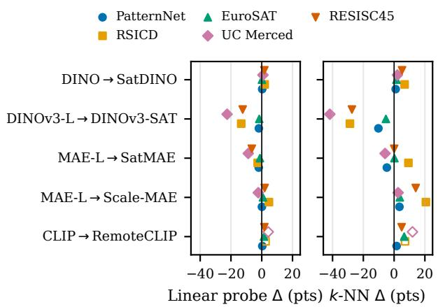
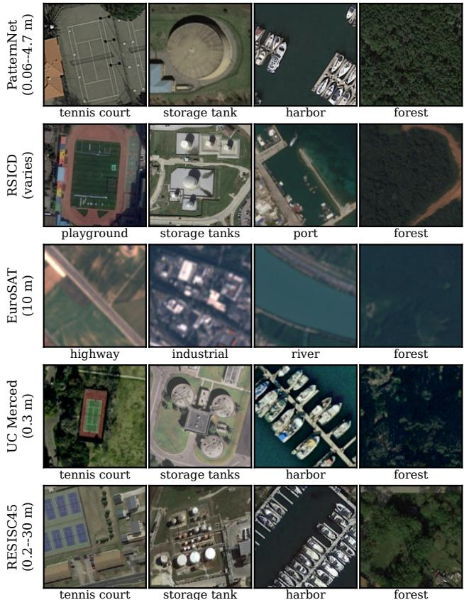
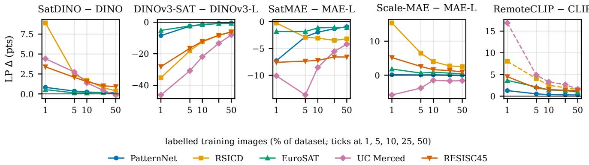
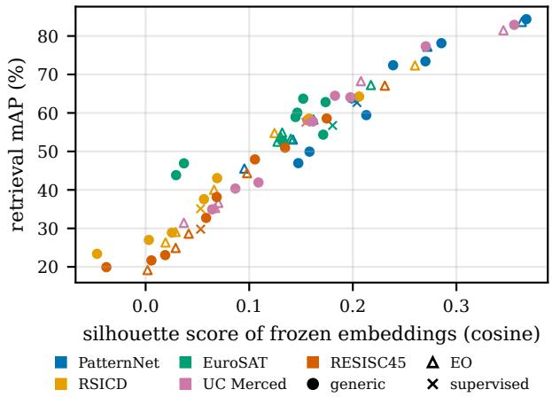

# Satellite Pretraining Is Not One Thing: A Matched-Pair Study of Generic and Earth-Observation Foundation Models for Scene Classification

Sandarbh Agrawal Rakshith Sathish Ashwathi Nambiar

SatSure Analytics India Pvt. Ltd., Bengaluru, India

sandarbh15@gmail.com, rakshith@satsure.co, ashwathi@satsure.co

## Abstract

Geospatial foundation models are increasingly pretrained on satellite and aerial imagery, yet practitioners mapping land use and land cover with few labels must still decide whether such an encoder is worth choosing over a strong generic one. Prior comparisons rarely isolate the pretrain ing data: candidate encoders differ at once in objective, architecture, size, data and preprocessing. We study the question with five matched pairs — an Earth-observation (EO) encoder and a generic counterpart sharing objective and architecture (DINO/SatDINO, DINOv3/DINOv3- SAT, MAE/SatMAE, MAE/Scale-MAE, CLIP/RemoteCLIP) — embedded in a benchmark of 14 frozen encoders on five RGB scene-classification datasets spanning 0.06–30 m ground sample distance. Every encoder receives its native preprocessing; we evaluate k-NN, linear and attentive probes as well as image retrieval over six random low-label splits, with paired per-image significance tests. EO pretraining is not uniformly helpful: for the public checkpoints we study, on most datasets and metrics it significantly improves three pairs (SatDINO, Scale-MAE and RemoteCLIP, the latter judged only on datasets it never saw) and significantly hurts two (linear probe: DINOv3-SAT by up to 22.5 points, SatMAE by up to 8.8) — including opposite outcomesfor SatMAE and Scale-MAE, two masked autoencoders pretrained on the same fMoW-RGB imagery. The verdicts hold under patch-token pooling and learned attentive probing, concentrate on small man-made objects such as courts, palaces and storage tanks, and are largest when labels are scarcest (1–5% of the data). Across encoders, the silhouette score of the frozen embedding predicts k-NN accuracy and retrieval mAP almost perfectly (Spearman $\rho \ge 0 . 9 6$ on four offive datasets). For label-scarce EO scene classification, “pretrained on satellite imagery” is therefore not a reliable selection criterion; each candi date checkpoint must be validated on the target data.

## 1. Introduction

Mapping land use and land cover from overhead imagery underpins environmental monitoring, agriculture and urban planning, but labelled data remain scarce and expensive to collect for every new region, sensor and class taxonomy. Self-supervised foundation models [5] promise to close this gap: a frozen encoder pretrained once on large unlabelled corpora is adapted to a new task with a handful of labels. Two families compete for this role. Generic encoders are pretrained on natural or web images — DINO [6], DI-NOv2/v3 [38, 47], MoCo v3 [8], MAE [21], I-JEPA [1] or CLIP [43]. Earth-observation (EO) encoders are pretrained on satellite or aerial imagery [51], often by applying the same recipe to a remote-sensing corpus: Sat-MAE [11] and Scale-MAE [44] adapt masked autoencoding, SatDINO [49] and DINOv3-SAT [47] adapt selfdistillation, and RemoteCLIP [30] continues CLIP’s image– text training on remote-sensing captions.

A practitioner choosing between them faces a simple question that is surprisingly hard to answer from the literature: does EO pretraining actually buy anything over a strong generic encoder? Earlier studies compared indomain and ImageNet pretraining for remote-sensing transfer with mixed conclusions [37, 45], and Corley et al. [12] showed that once inputs are resized and normalised as during pretraining, ImageNet models remain a strong baseline against many EO models. Benchmarks such as GEO-Bench [28] and PANGAEA [34] compare many EO foundation models across tasks. Yet in such comparisons the candidates differ simultaneously in objective, architecture, model size, pretraining data and preprocessing, so a ranking cannot tell why one encoder beats another — in particular, whether the satellite pretraining data is responsible. Rankings are further confounded by evaluation details: which token is used as the image feature, how features are normalised, and whether conclusions survive a probe that can re-weight patch tokens [41].

We address this with a controlled, matched-pair design. For five EO encoders we evaluate a generic counterpart with the same objective and architecture, so that the pretraining data (and, where unavoidable, details of the recipe) is the main difference: DINO→SatDINO, DINOv3→DINOv3-SAT, MAE→SatMAE, MAE→Scale-MAE and CLIP→RemoteCLIP (Tab. 1). The pairs sit inside a benchmark of 14 frozen encoders on five RGB sceneclassification datasets whose ground sample distance ranges from 0.06 m to 30 m. We focus on the low-label regime that motivates foundation models in EO and on frozen features, which isolate representation quality from fine-tuning choices. Our contributions are:

  
Figure 1. EO-pretrained minus generic counterpart for the five matched pairs on five datasets (percentage points, mean over six splits). Hollow markers: datasets RemoteCLIP saw during pretraining. With the linear probe (left), three EO encoders help and two hurt; k-NN (right) gives the same verdict for every pair except SatMAE, which is better on RSICD but worse on PatternNet and UC Merced.

• A controlled comparison of EO and generic pretraining through five matched pairs, with native preprocessing for every encoder, three probes plus retrieval, six random splits and paired per-image significance tests.

• The finding that EO pretraining is not one thing: on most datasets it significantly helps three pairs and significantly hurts two (Fig. 1). SatMAE and Scale-MAE — both masked autoencoders on the same fMoW-RGB imagery [10] — land on opposite sides, so for these checkpoints the pretraining recipe matters as much as the domain.

• Evidence that the verdicts are robust to the read-out (CLS, patch mean, attentive probing), concentrate on small man-made objects, and grow as labels become scarce (1– 5%).

• An analysis linking accuracy to the class separability of frozen embeddings, which explains both differences between encoders and differences in difficulty between datasets.

## 2. Related work

Self-supervised visual pretraining. Contrastive methods learn invariance between augmented views (SimCLR [7], MoCo [20], MoCo v3 [8]); BYOL [18] and DINO [6] remove negatives through self-distillation, a line continued by iBOT [59], DINOv2 [38] and DINOv3 [47], which adds register tokens [13]. Masked image modelling reconstructs hidden patches (BEiT [3], MAE [21]), and I-JEPA [1] predicts masked content in latent space. CLIP [43] instead aligns images with captions. All encoders we evaluate are Vision Transformers [16], except for a supervised ResNet [19] baseline pretrained on ImageNet [14]. A known property of masked models is that their features are less linearly separable than those of joint-embedding methods [1, 21], which makes the choice of probe part of any comparison.

Earth-observation foundation models. Early EO selfsupervision exploited geography and time: GASSL [2] and SeCo [33] contrast views of the same location, and SSL4EO-S12 [52] provides a large multi-modal pretraining corpus. SatMAE [11] and Scale-MAE [44] adapt MAE to satellite imagery, the latter with ground-sample-distanceaware positional encodings; CROMA [17] fuses radar and optical data; Prithvi [25], SatlasPretrain [4] and DOFA [56] target multi-spectral or multi-sensor inputs. SatDINO [49] trains DINO on fMoW [10], DINOv3 [47] releases a satellite variant trained on 493M Maxar images, and Remote-CLIP [30] continually pretrains CLIP on captioned remotesensing data. Surveys review this rapidly growing family [5, 51].

Does in-domain pretraining help? Neumann et al. [37] and Risojevic and Stojni´ c [´ 45] compared in-domain and ImageNet pretraining for remote-sensing classification, and Corley et al. [12] showed that matching the resize and normalisation used in pretraining makes ImageNet models a strong baseline against EO models. GEO-Bench [28] and PANGAEA [34] benchmark EO foundation models across tasks and sensors. More broadly, ImageNet accuracy does not always predict transfer [27], and evaluation choices such as the architecture and the probe change the ranking of selfsupervised models [26, 41]. We build on these works but differ in design: instead of ranking heterogeneous models, we compare matched generic/EO pairs, apply each model’s native preprocessing [12], test robustness to the read-out with attentive probing [41], and report paired significance per split.

## 3. Experimental setup

Encoders and matched pairs. We evaluate 14 frozen encoders (Tab. 1): a supervised ResNet-18 [19]; eight generic self-supervised or image–text models (DINO [6], DINOv3 ViT-B and ViT-L [47], I-JEPA [1], MoCo v3 [8], MAE ViT-B and ViT-L [21], CLIP [43]); and five EO encoders (DINOv3-SAT [47], SatDINO [49], SatMAE [11], Scale-MAE [44], RemoteCLIP [30]). Each EO encoder is paired with the generic model that shares its objective and architecture. The pairs control for the training objective and backbone, but not for every detail of the recipe: the DI-NOv3 pair also differs in its pretraining corpus size (LVD-1689M vs. SAT-493M), Scale-MAE adds a scale-aware positional encoding, and RemoteCLIP is initialised from the very CLIP checkpoint it is paired with (we measured a mean cosine similarity of 0.999 between the two image encoders weight matrices). SatDINO and Scale-MAE can take the ground sample distance (GSD) as input; since our datasets do not provide a reliable per-image GSD, we drop Sat-DINO’s GSD token and use Scale-MAE’s default resolution of 1 m, as in the TorchGeo implementation [48], which may understate both models.

<table><tr><td>Encoder</td><td>Params</td><td>Objective</td><td>Pretraining data</td><td>Feature</td><td>Normalisation</td></tr><tr><td>Supervised</td><td></td><td></td><td></td><td></td><td></td></tr><tr><td>ResNet-18</td><td>11M</td><td>supervised</td><td>ImageNet-1k (labels)</td><td>GAP</td><td>ImageNet</td></tr><tr><td colspan="6">Generic (natural-image) pretraining</td></tr><tr><td>DINO ViT-B/16</td><td>86M</td><td>self-distillation</td><td>ImageNet-1k</td><td>CLS</td><td>ImageNet</td></tr><tr><td>DINOv3 ViT-B/16</td><td>86M</td><td>self-distillation†</td><td>LVD-1689M (web)</td><td>CLS</td><td>ImageNet</td></tr><tr><td>DINOv3 ViT-L/16</td><td>303M</td><td>self-distillation†</td><td>LVD-1689M (web)</td><td>CLS</td><td>ImageNet</td></tr><tr><td>I-JEPA ViT-H/14</td><td>631M</td><td>latent prediction</td><td>ImageNet-1k</td><td>patch mean</td><td>ImageNet</td></tr><tr><td>MoCo v3 ViT-B/16</td><td>86M</td><td>contrastive</td><td>ImageNet-1k</td><td>CLS</td><td>ImageNet</td></tr><tr><td>MAE ViT-B/16</td><td>86M</td><td>masked reconstruction</td><td>ImageNet-1k</td><td>CLS</td><td>ImageNet</td></tr><tr><td>MAE ViT-L/16</td><td>303M</td><td>masked reconstruction</td><td>ImageNet-1k</td><td>CLS</td><td>ImageNet</td></tr><tr><td>CLIP ViT-L/14</td><td>304M</td><td>image-text contrastive</td><td>WIT-400M (web)</td><td>CLS</td><td>CLIP</td></tr><tr><td colspan="6">EO-specific pretraining</td></tr><tr><td>DINOv3-SAT ViT-L/16</td><td>303M</td><td>self-distillation†</td><td>SAT-493M (Maxar)</td><td>CLS</td><td>SAT-493M</td></tr><tr><td>SatDINO ViT-B/16</td><td>86M</td><td>self-distillation</td><td>fMoW-RGB</td><td>CLS</td><td>fMoW</td></tr><tr><td>SatMAE ViT-L/16</td><td>303M</td><td>masked reconstruction</td><td>fMoW-RGB</td><td>CLS</td><td>fMoW</td></tr><tr><td>Scale-MAE ViT-L/16</td><td>303M</td><td>masked recon. (scale-aware)</td><td>fMoW-RGB</td><td>CLS</td><td>ImageNet</td></tr><tr><td>RemoteCLIP ViT-L/14</td><td>304M</td><td>image-text contrastive</td><td>CLIP + RS captions</td><td>CLS</td><td>CLIP</td></tr></table>

Table 1. The 14 frozen encoders. “Feature” is the image-level embedding used for k-NN, linear probe (LP) and retrieval; “Normalisation” is the input mean/std each model was pretrained with, which we always apply. †DINOv3 ViT-B/L and DINOv3-SAT ViT-L are distilled from 7B-parameter teachers [47]. ‡CLIP’s final-norm CLS token projected to the joint image–text space. RemoteCLIP is OpenAI CLIP ViT-L/14 continually pretrained on remote-sensing image–caption pairs [30].

Datasets. We use five RGB scene-classification benchmarks with diverse sensors and resolutions (Fig. 2): PatternNet [60] (30,400 aerial images, 38 classes, GSD 0.06–4.7 m), RSICD [32] (8,734 images, 30 classes), EuroSAT [22] (Sentinel-2 RGB, 10 m GSD, 10 land-cover classes; we use the 16,200-image training split of the public release), UC Merced [57] (2,100 images, 21 classes, 0.3 m) and RESISC45 [9] (31,500 images, 45 classes, GSD 0.2– 30 m). RSICD is a captioning dataset; we derive one label per image from the class name in the file name or, failing that, from caption keywords. We restrict the study to RGB because it is the only input all 14 encoders accept; a fair generic-vs-EO comparison is impossible on bands a generic model cannot read, and many EO encoders (SatDINO, Sat-MAE’s RGB variant, Scale-MAE, DINOv3-SAT, Remote-CLIP) are themselves RGB models.

Pretraining overlap. According to [30], RemoteCLIP’s pretraining data include the image–caption sets RSICD, UCM-captions [42] (built on the UC Merced images) and RSITMD [58]. RemoteCLIP has therefore seen two of our test sets; we report these numbers in grey and judge the CLIP→RemoteCLIP pair only on PatternNet, EuroSAT and RESISC45. The other EO encoders are pretrained on fMoW [10] or Maxar imagery [47], which do not include our datasets. Web-scale corpora of the generic models cannot be audited, a caveat shared by all such comparisons.

Preprocessing and features. Images are resized to 256 pixels (shorter side), centre-cropped to 224 and normalised with the statistics each encoder was pretrained with (Tab. 1): ImageNet statistics for the generic models and Scale-MAE (as in TorchGeo), CLIP statistics for CLIP and RemoteCLIP, and the SAT-493M and fMoW statistics released with DINOv3-SAT, SatDINO and Sat-MAE [11, 47, 49], following the recommendation of [12]. The image-level feature is each encoder’s own: the finalnorm CLS token for the ViTs (MAE’s CLS token, used for linear probing in [21]), the average of patch tokens for I-JEPA, which has no CLS token [1], and global average pooling for ResNet-18. For MAE we disable random masking at inference (the Hugging Face implementation masks

  
Figure 2. Example images from each dataset (four classes per dataset), with the dataset’s ground sample distance. Three columns show small man-made objects — the kind of class on which EO pretraining matters most in our per-class analysis (Sec. 4); at EuroSAT’s 10 m resolution such objects are not resolvable, so its row shows land-cover classes.

75% of patches by default). Section 5.1 repeats all experiments with the mean of the final-layer patch tokens (register tokens [13] excluded) and with attentive probing.

Probes and protocol. Each dataset is split into a stratified 10% training and 90% test set — a low-label regime that stresses representation quality — and every experiment is repeated over six random splits (seeds 42, 1–5); we report the mean (standard deviations are in the supplementary material). On the frozen embeddings we evaluate (i) cosine k-NN (k=20; verdicts are unchanged for $k \in \{ 1 , 5 , 1 0 \} )$ on L2-normalised features; (ii) a linear probe (LP): multinomial logistic regression (L-BFGS [29], C=1) on features standardised with training-split statistics, the scikitlearn [40] analogue of the parameter-free BatchNorm that MAE places before its linear probe [21]; (iii) an MLP with one hidden layer of 256 units on the same standardised features (reported in the supplementary material); (iv) retrieval mAP, ranking the training images for every test query by cosine similarity; and (v) Efficient Probing (EP) [41], an attentive probe with 32 learnable queries over the patch tokens, trained with AdamW [31] (1,000 steps, batch 128, weight decay $1 0 ^ { - 4 }$ , cosine schedule), its learning rate chosen from $\{ 3 { \cdot } 1 0 ^ { - 4 } , 1 0 ^ { - 3 } , 3 { \cdot } 1 0 ^ { - 3 } \}$ on a held-out 20% of the seed-42 training split. The LARS, batch-4096 recipe of [41] targets ImageNet and does not fit our 210–3,150 training images, so we use the same fixed recipe for every encoder. A label-budget study repeats k-NN (all encoders, six splits) and the linear probe (the nine pair members, three splits) at 1, 5, 10, 25 and 50% training data. Models are run with Py-Torch [39], timm [53], Hugging Face Transformers [55] and OpenCLIP [24]; all encoders are public checkpoints, listed with every setting in the supplementary material.

Statistical testing. The six splits share most of their test images, so a t-test across splits would overstate significance [36]. We therefore test each split separately and paired at the image level, as recommended by [15]: an exact McNemar test [35] on per-image correctness for the classifiers (k-NN, LP, EP), and a Wilcoxon signed-rank test [54] on per-query average precision for retrieval. Within each split, p-values of all pair comparisons are corrected with the Holm procedure [23], and we report in how many of the six splits a difference is significant at α=0.05.

Separability. To relate accuracy to the geometry of the embedding we compute, per encoder and dataset, the silhouette score [46] of the class labels under cosine distance (on a random 5,000-image sample) and the ratio of mean within-class to mean between-centroid cosine distance, and we visualise embeddings with t-SNE [50].

## 4. Results

Overall picture. Table 2 reports k-NN, linear-probe and retrieval results for all 14 encoders. The strongest encoders come from both families: averaged over the three datasets no encoder saw during pretraining and the three metrics, the generic DINOv3 ViT-L ranks best (mean rank 2.4 of 14), followed by the EO models SatDINO (2.8) and RemoteCLIP (3.2); RemoteCLIP has the best linear probe on RESISC45 (93.0 vs. 92.1 for DINOv3 ViT-L), the hardest unseen dataset, and SatDINO the best on PatternNet and EuroSAT. The weakest encoders also come from both families: SatMAE (mean rank 12.8), the generic MAE ViT-L (11.4) and DINOv3-SAT (11.1) rank at the bottom. Satellite pretraining thus neither guarantees nor rules out a strong encoder.

Matched pairs: EO pretraining helps three times and hurts twice. Table 3 and Fig. 1 isolate the effect of EO pretraining. Three EO encoders improve on their generic counterparts. SatDINO beats DINO on every dataset and metric (linear probe +0.1 to +1.9 points, k-NN +1.0 to +6.8, mAP +3.8 to +11.7), significantly in most cells. Scale-MAE beats MAE ViT-L in k-NN by +2.6 to +20.7 points and in linear probe on four of five datasets, the exception being UC Merced (−2.2, significant in only two of six splits). RemoteCLIP beats CLIP on all three datasets it did not see during pretraining, significantly for every metric (linear probe +0.4 to +1.7, k-NN +1.6 to +6.6, mAP $+ 1 0 . 2 \mathrm { t o } + 1 6 . 1 )$ ; its larger gains on RSICD and UC Merced are confounded by pretraining overlap (Sec. 3). Two EO encoders are significantly worse than their counterparts. DINOv3-SAT trails the web DINOv3 ViT-L — trained with the same recipe and distilled the same way — on every dataset and metric in all six splits, by up to 22.5 linear-probe and 41.8 k-NN points on UC Merced. SatMAE trails MAE ViT-L in linear probe on all five datasets (−1.2 to −8.8), while its k-NN and retrieval results are mixed. Its fMoW input statistics are not the cause: with MAE’s ImageNet statistics, SatMAE changes by about one point at most and still trails on all five datasets.

<table><tr><td></td><td colspan="3">PatternNet</td><td colspan="3">RSICD</td><td colspan="3">EuroSAT</td><td colspan="3">UC Merced</td><td colspan="3">RESISC45</td></tr><tr><td>Encoder</td><td>k-NN</td><td>LP</td><td>mAP</td><td>k-NN</td><td>LP</td><td>mAP</td><td>k-NN</td><td>LP</td><td>mAP</td><td>k-NN</td><td>LP</td><td>mAP</td><td>k-NN</td><td>LP</td><td>mAP</td></tr><tr><td>ResNet-18</td><td>92.9</td><td>96.6</td><td>62.7</td><td>70.0</td><td>76.7</td><td>35.1</td><td>86.9</td><td>90.9</td><td>56.8</td><td>73.5</td><td>85.0</td><td>57.6</td><td>71.6</td><td>77.7</td><td>29.8</td></tr><tr><td>DINO ViT-B/16</td><td>95.3</td><td>98.8</td><td>72.4</td><td>76.5</td><td>87.2</td><td>43.1</td><td>90.7</td><td>96.2</td><td>62.8</td><td>78.4</td><td>92.7</td><td>64.5</td><td>78.7</td><td>89.0</td><td>38.1</td></tr><tr><td>DINOv3 ViT-B/16</td><td>96.3</td><td>98.6</td><td>78.1</td><td>82.8</td><td>89.7</td><td>58.5</td><td>89.7</td><td>95.4</td><td>60.1</td><td>82.3</td><td>94.3</td><td>77.3</td><td>83.1</td><td>89.9</td><td>47.9</td></tr><tr><td>DINOv3 ViT-L/16</td><td>96.8</td><td>98.6</td><td>84.4</td><td>84.5</td><td>91.1</td><td>64.3</td><td>92.0</td><td>95.9</td><td>63.7</td><td>84.9</td><td>95.2</td><td>82.9</td><td>87.0</td><td>92.1</td><td>58.6</td></tr><tr><td>I-JEPA ViT-H/14</td><td>84.8</td><td>97.8</td><td>47.0</td><td>60.2</td><td>82.4</td><td>27.0</td><td>86.4</td><td>95.2</td><td>54.4</td><td>53.5</td><td>85.0</td><td>40.4</td><td>60.1</td><td>83.5</td><td>21.7</td></tr><tr><td>MoCo v3 ViT-B/16</td><td>93.5</td><td>98.6</td><td>63.8</td><td>72.6</td><td>85.4</td><td>37.6</td><td>89.8</td><td>95.6</td><td>58.9</td><td>73.0</td><td>90.9</td><td>57.8</td><td>74.7</td><td>87.1</td><td>32.7</td></tr><tr><td>MAE ViT-B/16</td><td>91.5</td><td>97.9</td><td>59.4</td><td>65.4</td><td>81.3</td><td>28.9</td><td>84.9</td><td>93.0</td><td>52.8</td><td>56.4</td><td>83.6</td><td>41.9</td><td>65.2</td><td>81.7</td><td>23.1</td></tr><tr><td>MAE ViT-L/16 CLIP ViT-L/14</td><td>88.1</td><td>98.3</td><td>49.9</td><td>55.4</td><td>83.7</td><td>23.4</td><td>83.5</td><td>94.9</td><td>46.9</td><td>47.5</td><td>87.2</td><td>34.9</td><td>59.3</td><td>84.3</td><td>19.9</td></tr><tr><td></td><td>95.5</td><td>98.5</td><td>73.4</td><td>84.4</td><td>91.0</td><td>58.1</td><td>81.4</td><td>93.5</td><td>43.8</td><td>76.9</td><td>92.4</td><td>64.1</td><td>85.4</td><td>91.3</td><td>51.0</td></tr><tr><td>DINOv3-SAT ViT-L/16</td><td>86.6</td><td>96.7</td><td>53.1</td><td>55.8</td><td>77.8</td><td>26.3</td><td>86.6</td><td>94.3</td><td>52.5</td><td>43.2</td><td>72.7</td><td>35.3</td><td>59.6</td><td>79.7</td><td>24.9</td></tr><tr><td>SatDINO ViT-B/16</td><td>96.3</td><td>99.1</td><td>77.2</td><td>83.3</td><td>89.1</td><td>54.8</td><td>92.2</td><td>96.4</td><td>67.3</td><td>80.5</td><td>93.5</td><td>68.3</td><td>83.9</td><td>90.7</td><td>44.3</td></tr><tr><td>SatMAE ViT-L/16</td><td>83.4 91.6</td><td>96.3 98.4</td><td>45.5</td><td>64.6</td><td>81.1</td><td>29.1</td><td>83.7 87.2</td><td>93.7 95.7</td><td>53.3 53.8</td><td>41.6</td><td>78.4 85.0</td><td>31.4 36.6</td><td>59.3 73.3</td><td>77.8 86.2</td><td>19.2 28.6</td></tr><tr><td>Scale-MAE ViT-L/16</td><td></td><td>98.8</td><td>58.3</td><td>76.0</td><td>88.4</td><td>40.0</td><td>88.0</td><td></td><td>54.9</td><td>50.1</td><td></td><td></td><td>90.3</td><td></td><td></td></tr><tr><td>RemoteCLIP ViT-L/14*</td><td>97.1</td><td></td><td>83.7</td><td>91.4</td><td>93.4</td><td>72.3</td><td></td><td>94.9</td><td></td><td>88.8</td><td>96.6</td><td>81.5</td><td></td><td>93.0</td><td>67.1</td></tr></table>

Table 2. Frozen-feature results (%, mean over six random 10%/90% train/test splits; standard deviations in the supplementary material). Bold/underline: best/second-best per column. ∗RemoteCLIP was pretrained on RSICD and UC Merced image–caption data [30]; its grey entries are not comparable and are excluded from the ranking.  
Table 3. Matched pairs: each EO model minus its generic counterpart (SatDINO–DINO, DINOv3-SAT–DINOv3 ViT-L, SatMAE–MAE ViT-L, Scale-MAE–MAE ViT-L, RemoteCLIP–CLIP; percentage points, mean over six splits). $\bullet / \neg$ : the EO / generic model is significantly better in at least 5 of the 6 splits (exact McNemar test for LP and k-NN, Wilcoxon signed-rank test on per-query AP for mAP; Holm corrected within each split). Grey: datasets RemoteCLIP saw during pretraining.
<table><tr><td>EO model</td><td colspan="3">PatternNet</td><td colspan="3">RSICD</td><td colspan="3">EuroSAT</td><td colspan="3">UC Merced</td><td colspan="3">RESISC45</td></tr><tr><td></td><td>k-NN</td><td>LP</td><td>mAP</td><td>k-NN</td><td>LP</td><td>mAP</td><td>k-NN</td><td>LP</td><td>mAP</td><td>k-NN</td><td>LP</td><td>mAP</td><td>k-NN</td><td>LP</td><td> $\mathrm { m A P }$ </td></tr><tr><td>SatDINO</td><td> $+ 1 . 0 ^ { \pm }$ </td><td> $+ 0 . 3 ^ { \mathbf { \Delta \pm } }$ </td><td> $+ 4 . 8 ^ { \pm }$ </td><td> $+ 6 . 8 ^ { \pm }$ </td><td> $+ 1 . 9 ^ { \pm }$ </td><td> $+ 1 1 . 7 ^ { \pm }$ </td><td> $+ 1 . 5 ^ { \pm }$ </td><td>+0.1</td><td> $+ 4 . 4 ^ { \pm }$ </td><td> $+ 2 . 1$ </td><td>+0.8</td><td> $+ 3 . 8 ^ { \pm }$ </td><td> $+ 5 . 2 ^ { \pm }$ </td><td> $+ 1 . 7 ^ { \pm }$ </td><td> $+ 6 . 2 ^ { \mathbf { a } }$ </td></tr><tr><td>DINOv3-SAT</td><td> $\cdot 1 0 . 2 ^ { \nabla }$ </td><td> $1 . 9 ^ { \nabla }$ </td><td> $- 3 1 . 3 ^ { \nabla }$ </td><td> $- 2 8 . 7 ^ { \nabla }$ </td><td>-13.3∇</td><td> $- 3 7 . 9 ^ { \nabla }$ </td><td> ${ } _ { - 5 . 3 ^ { \circ } }$ </td><td> $- 1 . 6 ^ { \nabla }$ </td><td> $- 1 1 . 2 ^ { \nabla }$ </td><td> $- 4 1 . 8 ^ { \nabla }$ </td><td> $- 2 2 . 5 ^ { \circ }$ </td><td> $- 4 7 . 6 ^ { \nabla }$ </td><td> $- 2 7 . 4 ^ { \nabla }$ </td><td> $. 1 2 . 4 ^ { \nabla }$ </td><td> $- 3 3 . 7 ^ { \circ }$ </td></tr><tr><td>SatMAE</td><td> $- 4 . 7 ^ { \nabla }$ </td><td> $- 2 . 0 ^ { \nabla }$ </td><td> $- 4 . 4 ^ { \nabla }$ </td><td> $+ 9 . 3 ^ { \pm }$ </td><td> $- 2 . 6 ^ { \circ }$ </td><td> $+ 5 . 7 ^ { \pm }$ </td><td>+0.2</td><td> $- 1 . 2 ^ { \nabla }$ </td><td> $+ 6 . 4 ^ { \Delta }$ </td><td> $- 5 . 9 ^ { \nabla }$ </td><td> $- 8 . 8 ^ { \nabla }$ </td><td> $- 3 . 5 ^ { \circ }$ </td><td>+0.0</td><td> $- 6 . 5 ^ { \circ }$ </td><td> $- 0 . 8 ^ { \nabla }$ </td></tr><tr><td>Scale-MAE</td><td> $+ 3 . 5 ^ { \mathbf { \Delta \Delta } }$ </td><td> $+ 0 . 1$ </td><td> $+ 8 . 3 ^ { \mathbf { \Delta \Delta } }$ </td><td> $+ 2 0 . 7 ^ { \pm }$ </td><td> $+ 4 . 7 ^ { \pm }$ </td><td> $+ 1 6 . 7 ^ { \pm }$ </td><td> $+ 3 . 7 ^ { \pm }$ </td><td> $+ 0 . 8 ^ { \pm }$ </td><td> $+ 6 . 8 ^ { \pm }$ </td><td> $+ 2 . 6$ </td><td> $- 2 . 2$ </td><td> $+ 1 . 7 ^ { \pm }$ </td><td> $+ 1 4 . 0 ^ { \pm }$ </td><td> $+ 1 . 9 ^ { \pm }$ </td><td> $+ 8 . 7 ^ { \pm }$ </td></tr><tr><td>RemoteCLIP</td><td> $+ 1 . 6 ^ { \pm }$ </td><td> $+ 0 . 4 ^ { \pm }$ </td><td> $+ 1 0 . 2 ^ { \pm }$ </td><td> $+ 7 . 1 ^ { \pm }$ </td><td> $+ 2 . 5 ^ { \Delta }$ </td><td> $+ 1 4 . 2 ^ { \Delta }$ </td><td> $+ 6 . 6 ^ { \pm }$ </td><td> $+ 1 . 5 ^ { \pm }$ </td><td> $+ 1 1 . 1 ^ { \pm }$ </td><td> $+ 1 1 . 9 ^ { \pm }$ </td><td> $+ 4 . 2 ^ { \Delta }$ </td><td> $+ 1 7 . 4 ^ { \Delta }$ </td><td> $+ 4 . 9 ^ { \pm }$ </td><td> $+ 1 . 7 ^ { \pm }$ </td><td> $+ 1 6 . 1 ^ { \pm }$ </td></tr></table>

The two MAE pairs are the most informative contrast. SatMAE and Scale-MAE are both ViT-L masked autoencoders pretrained on the same fMoW-RGB imagery [10]; they differ in the recipe — most visibly Scale-MAE’s scaleaware positional encoding and its decoder that reconstructs low- and high-frequency images at different scales [44] — yet Scale-MAE beats the ImageNet MAE in linear probe on four of the five datasets while SatMAE trails it on al five. Likewise, DINOv3-SAT and SatDINO both apply selfdistillation to satellite imagery with opposite outcomes. For the public checkpoints we study, whether EO pretraining helps thus depends on the specific model and its recipe, not on the domain of the pretraining data alone; with one checkpoint per model, we cannot separate the contributions of the data and of the recipe.

The gaps are largest when labels are scarce. Figure 3 varies the labelled fraction from 1% to 50%. The direction of each pair’s effect is largely stable across budgets — it flips only where the gap is close to zero, e.g. SatDINO on EuroSAT and UC Merced at 50% — but its magnitude shrinks as labels grow. With 1% of the labels, SatDINO leads DINO by 8.9 points on RSICD and 4.4 on UC Merced, Scale-MAE leads MAE ViT-L by 15.4 points on RSICD, and RemoteCLIP leads CLIP by 4.5 points on RESISC45 — gaps that fall to 0.4, −0.1, 2.5 and 1.3 points at 50%. Conversely, DINOv3-SAT trails DINOv3 ViT-L by 46.1 linear-probe points on UC Merced and 28.2 on RESISC45 at 1%, versus 8.0 and 6.1 at 50%. The choice of encoder therefore matters most in the label-scarce regime that motivates foundation models for EO mapping, while with abundant labels the probe can partly compensate for a poorer representation.

  
Figure 3. Label budget: EO-minus-generic linear-probe difference (points, mean over three splits) as the labelled training set grows from 1% to 50% of each dataset. Dashed: datasets RemoteCLIP saw during pretraining. At 1%, UC Merced has one labelled image per class. Gaps of either sign are largest when labels are scarcest. Per-encoder accuracies and k-NN results for all 14 encoders are in the supplementary material.

Where EO pretraining helps or hurts. Per-class linearprobe accuracy on RESISC45 (Tab. 4) shows that the effect of EO pretraining is concentrated on classes defined by small man-made objects. The two EO models that hurt fail precisely there: DINOv3-SAT loses 34.7, 34.4 and 33.0 points on basketball courts, palaces and tennis courts, and SatMAE 19.9, 19.5 and 17.4 points on palaces, airports and storage tanks. The EO models that help gain on the same kind of classes: RemoteCLIP on tennis courts (+13.0), basketball courts and baseball diamonds; Scale-MAE on baseball diamonds (+8.5) and ground track fields; SatDINO on railways (+7.0) and tennis courts. Natural scene classes change much less: over thirteen of them (e.g. forest, desert, lake, wetland, sea ice) the mean absolute per-class change is 0.8–3.0 points per pair, against 2.1–12.7 points over all 45 classes. In other words, the pretraining data and recipe matter most for recognising small structures whose apparent size depends on the ground sample distance — an observation consistent with the different native resolutions of the pretraining corpora (e.g. 0.6 m Maxar imagery for DINOv3-SAT [47]) and with Scale-MAE’s explicit modelling of scale, although our experiments do not establish

this mechanism causally.

## 5. Analysis

## 5.1. Are the verdicts artefacts of the read-out?

Frozen-feature comparisons are sensitive to how an imagelevel feature is formed: a CLS token can discard information that a model stores in its patch tokens, which particularly concerns masked models [1, 21, 41]. We therefore reran every experiment with the mean of the final-layer patch tokens for all ViTs, and trained an attentive Efficient Probe (EP) [41] on the patch tokens of every ViT, which learns its own aggregation.

Table 5 shows that four of the five pair verdicts are invariant to the read-out: SatDINO, Scale-MAE and RemoteCLIP stay ahead, and DINOv3-SAT stays behind, under native and patch-mean k-NN, both linear probes and EP, on almost all datasets. The one consistent exception is Scale-MAE on UC Merced, where it trails MAE ViT-L under all three trained probes (EP: −3.8 points, significant in all six splits). The paired tests agree: with EP, Sat-DINO remains significantly better than DINO on Pattern-Net, RSICD and RESISC45, RemoteCLIP than CLIP on EuroSAT and RESISC45, and DINOv3-SAT remains significantly worse than DINOv3 on four datasets, tying only on the near-saturated PatternNet. The fifth pair, SatMAE, is read-out-dependent for k-NN only: its mean k-NN difference flips from −0.2 to +12.0 points under patch-mean pooling, mainly because MAE ViT-L’s own patch-mean k-NN collapses. For trained probes SatMAE stays behind under every read-out.

Two broader regularities emerge (supplementary material). First, the trained linear probe is far more forgiving than k-NN for masked and predictive models: LP exceeds k-NN by 22.9, 19.8 and 19.0 points on average for MAE

<table><tr><td>EO model</td><td>Largest per-class gains of the EO model</td><td>Largest per-class losses of the EO model</td></tr><tr><td>SatDINO DINOv3-SAT</td><td>railway (+7.0), tennis court (+5.7), basketball court (+5.1) mountain (+5.9), chaparral (+0.5), desert (—0.4)</td><td>river (−1.8), roundabout (−1.3), cloud (−1.2) basketball court (−34.7), palace (-34.4), tennis court (-33.0)</td></tr><tr><td>SatMAE</td><td>freeway (+3.7), intersection (+0.1), sea ice (+0.0)</td><td>palace (−19.9), airport (−19.5), storage tank (−17.4)</td></tr><tr><td>Scale-MAE</td><td>(+7.3)</td><td>baseball diamond (+8.5), ground track field (+7.7), freeway rectangular farmland (—3.4), lake (—1.9), island (—1.8)</td></tr><tr><td>RemoteCLIP</td><td>mond (+6.6)</td><td>tennis court (+13.0), basketball court (+7.7), baseball dia- wetland (—2.7), commercial area (—2.6), palace (—1.6)</td></tr></table>

Table 4. RESISC45 classes with the largest change in linear-probe per-class accuracy between each EO model and its generic counterpart (as in Tab. 3; points, mean over six splits). Values are signed: a negative entry among the “gains” means the EO model improves on fewer than three classes.

<table><tr><td></td><td colspan="2">k-NN</td><td colspan="3">Trained probe</td></tr><tr><td>EO model</td><td>native</td><td>patch</td><td>LP</td><td>LP patch</td><td>EP</td></tr><tr><td>SatDINO</td><td>+3.3 (5/5)</td><td>+2.6 (5/5)</td><td>+1.0 (5/5)</td><td>+1.1 (5/5)</td><td>+1.1 (5/5)</td></tr><tr><td>DINOv3-SAT</td><td>-22.7 (0/5)</td><td>-11.7 (0/5)</td><td>-10.3 (0/5)</td><td>-5.0 (0/5)</td><td>-4.6 (0/5)</td></tr><tr><td>SatMAE</td><td>−0.2 (3/5)</td><td>+12.0 (5/5)</td><td>-4.2 (0/5)</td><td>-2.6 (0/5)</td><td>-2.9 (0/5)</td></tr><tr><td>Scale-MAE</td><td>+8.9 (5/5)</td><td>+11.4 (5/5)</td><td>+1.0 (4/5)</td><td>+0.8 (4/5)</td><td>+0.8 (4/5)</td></tr><tr><td>RemoteCLIP</td><td>+4.4 (3/3)</td><td>+2.8 (3/3)</td><td>+1.2 (3/3)</td><td>+0.8 (3/3)</td><td>+0.9 (3/3)</td></tr></table>

Table 5. Does the verdict depend on how features are read out? Mean difference between each EO model and its generic counterpart (as in Tab. 3; points) over the comparable datasets (five; three for RemoteCLIP), and in parentheses the number of datasets where the EO model is ahead. “native”: the encoder’s own feature (Tab. 1); “patch”: mean of final-layer patch tokens; EP: attentive probe on patch tokens [41].

<table><tr><td></td><td rowspan="2"></td><td colspan="2">UC Merced</td><td colspan="2">RSICD</td></tr><tr><td>DINOv3-L Feature</td><td>k-NN LP</td><td>mAP</td><td>k-NN</td><td>LP mAP</td></tr><tr><td>web</td><td>CLS</td><td>84.9</td><td>95.2 82.9</td><td>84.5</td><td>91.1 64.3</td></tr><tr><td>web</td><td>patch mean</td><td>85.9</td><td>95.2 84.4</td><td>86.4</td><td>91.4 68.3</td></tr><tr><td>web</td><td>CLS ⊕ patch</td><td>85.6</td><td>95.6 83.9</td><td>85.4</td><td>91.8 66.0</td></tr><tr><td>SAT</td><td>CLS</td><td>43.2</td><td>72.7 35.3</td><td>55.8</td><td>77.8 26.3</td></tr><tr><td>SAT</td><td>patch mean</td><td>60.5</td><td>84.9 51.7</td><td>76.1</td><td>85.6 47.5</td></tr><tr><td>SAT</td><td>CLS ⊕ patch</td><td>44.7</td><td>81.9 37.0</td><td>59.2</td><td>84.9 28.6</td></tr><tr><td>SAT (IN norm.)</td><td>CLS</td><td>45.6</td><td>74.8 36.5</td><td>57.5</td><td>78.8 26.9</td></tr><tr><td>SAT (IN norm.)</td><td>patch mean</td><td>56.7</td><td>84.2 48.6</td><td>73.5</td><td>84.9 44.8</td></tr><tr><td>SAT (IN norm.) CLS ⊕ patch</td><td></td><td>47.3</td><td>82.0 37.9</td><td>60.2</td><td>84.5 29.0</td></tr></table>

Table 6. DINOv3 ViT-L web vs. SAT (six splits): image-level feature and input normalisation. “IN norm.”: SAT model fed ImageNet statistics instead of its own SAT-493M statistics.

ViT-L, I-JEPA and SatMAE, but only by 4.2 and 5.5 for RemoteCLIP and DINOv3 ViT-L, so rankings based on k-NN or retrieval penalise masked models much more. Second, EP changes the linear-probe accuracy by less than one point on average for every encoder except DINOv3-SAT (+6.0). With 210–3,150 training images, a learned attention pool brings no systematic benefit over a linear probe on a wellchosen token, so the pair verdicts are not an artefact of the linear probe.

Why does DINOv3-SAT fall so far behind? DINOv3- SAT’s gap to its web counterpart is the largest in our study. It is consistent with the DINOv3 authors’ own frozen RGB evaluation on GEO-Bench, where the web 7B model beats the satellite 7B model on m-eurosat (97.0 vs. 94.8) and on five of six classification tasks, while the satellite model leads in canopy-height estimation [47]; the web ViT-L is not evaluated there, which our pair adds. We nevertheless checked whether the gap stems from our evaluation (Tab. 6). Its CLS token is indeed a poor scene descriptor: averaging its patch tokens raises UC Merced k-NN from 43.2 to 60.5 and linear probe from 72.7 to 84.9, whereas the web model is almost insensitive to the choice of feature. Its native SAT-493M normalisation helps only slightly over ImageNet statistics (patch mean: 60.5 vs. 56.7 k-NN). Even with its best feature, however, DINOv3-SAT trails the web model by 25.4 k-NN and 10.6 linear-probe points on UC Merced and by 10.3 and 6.2 on RSICD. The deficit is thus real for frozen scene classification, and consistent with a model whose information resides in patch tokens tuned to 0.6 m Maxar imagery and dense prediction [47].

## 5.2. Class separability tracks neighbourhood-based accuracy

Why do some encoders transfer better, and why are some datasets harder? We relate accuracy to the silhouette score [46] of the frozen embeddings, which measures how much closer an image is to its own class than to the nearest other class. Across the 14 encoders, silhouette predicts accuracy almost perfectly within each dataset: Spearman ρ with k-NN accuracy is 0.96–0.98 on PatternNet, RSICD, UC Merced and RESISC45, and ρ with retrieval mAP is 0.97–0.996 on the same datasets (Fig. 4). The exception is EuroSAT (ρ = 0.68 for k-NN, 0.86 for mAP), presumably because its ten coarse land-cover classes are separated well enough by most encoders that the remaining differences in accuracy no longer track geometry closely. The ratio of within-class to between-class distance gives a similar picture with opposite sign (ρ from −0.74 to −0.96 with k-NN) on the same four datasets, but not on EuroSAT. The agreement is expected, as k-NN, retrieval and the silhouette all rely on cosine neighbourhoods; its practical value is that the silhouette needs no trained probe and only a small labelled sample. Computed on each split’s labelled 10% training set alone (210–3,150 images), it ranks the encoders as the 5,000-image estimate does $( \rho \ge 0 . 9 7 )$ and gives the same correlations $( \rho = 0 . 9 6 \ – 0 . 9 8$ with k-NN, 0.97–0.996 with mAP, on the four datasets). On RESISC45, RemoteCLIP raises CLIP’s silhouette from 0.13 to 0.23, while DINOv3- SAT lowers DINOv3’s from 0.17 to 0.03 (t-SNE projections in the supplementary material).

  
Figure 4. Silhouette score of the frozen embeddings vs. retrieval mAP for all 14 encoders on five datasets (70 points). Spearman $\rho = 0 . 9 7$ across all points; within each dataset $\rho \ge 0 . 8 5$

Separability also accounts for most of the difference in difficulty between datasets, which a summary by class count or resolution does not: PatternNet, with the most classes (38) but the highest mean silhouette (0.22), is the easiest, and RESISC45 and RSICD, with the lowest (0.07 and 0.08), are the hardest. UC Merced is the outlier — intermediate separability (between EuroSAT and PatternNet) but the lowest mean k-NN accuracy (66.5%) — because its 10% split leaves only ten training images per class, which penalises k-NN with k=20 in particular.

Model size helps only some recipes. Within one recipe, more parameters are not always better. Going from DI-NOv3 ViT-B to ViT-L improves k-NN and mAP on every dataset (k-NN +0.5 to +3.9, mAP +3.6 to +10.7 points), whereas going from MAE ViT-B to ViT-L lowers k-NN by 1.4 to 10.1 points and mAP by 3.1 to 9.5 while raising the linear probe by 0.4 to 3.6: the larger masked model’s features are more linearly separable but less well organised for nearest-neighbour use.

## 6. Discussion and conclusion

Implications for practitioners. For label-scarce land-use and land-cover scene classification from RGB imagery, the label “pretrained on satellite imagery” is not a reliable criterion for choosing a frozen encoder. In our matched comparisons, EO pretraining improved three encoders and degraded two, with differences of up to 46 linear-probe points at 1% labels. We therefore recommend (i) validating candidate encoders on a small labelled sample of the target data, where the differences are largest; (ii) feeding each encoder its own pretraining normalisation and checking more than one read-out — a k-NN or retrieval comparison alone strongly penalises masked models, while for some EO models (DINOv3-SAT) patch tokens carry far more information than the CLS token; and (iii) using the silhouette score of the frozen embeddings on that sample as a cheap, labelefficient predictor of k-NN and retrieval quality.

Limitations. Our conclusions are bounded by the design. (1) We study RGB scene classification with frozen encoders; EO pretraining may pay off differently for multispectral or SAR inputs [17, 52, 56], for dense tasks such as segmentation [28, 34, 47], or after fine-tuning. (2) The pairs control objective and architecture but not every factor: corpus size and content, pretraining length and recipe details differ, so our results show that EO pretraining can help or hurt, and on which classes, but not causally which ingredient is responsible; the small-object pattern suggests a role for the resolution of the pretraining imagery that future work could test with controlled rescaling. (3) SatDINO and Scale-MAE are run without their GSD input, which may understate them. (4) RemoteCLIP saw two of our test sets during pretraining; we exclude them from its comparison, but generic web-scale corpora cannot be audited for overlap. (5) RSICD labels are derived from file names and captions and are noisier than the other datasets’ labels, and all datasets are moderate in size.

Conclusion. Five matched pairs show that satellite pretraining is not one thing: depending on the recipe it makes an encoder clearly better or clearly worse than its generic counterpart, most visibly on small man-made structures and with scarce labels, largely regardless of the read-out. We hope such matched comparisons will complement leaderboard benchmarks of geospatial foundation models.

Acknowledgements. This work was supported by SatSure Analytics India Pvt. Ltd., which provided the computational resources.

## References

[1] Mahmoud Assran, Quentin Duval, Ishan Misra, Piotr Bojanowski, Pascal Vincent, Michael Rabbat, Yann LeCun, and Nicolas Ballas. Self-supervised learning from images with a joint-embedding predictive architecture. In IEEE/CVF Conference on Computer Vision and Pattern Recognition (CVPR), pages 15619–15629, 2023. 1, 2, 3, 6

[2] Kumar Ayush, Burak Uzkent, Chenlin Meng, Kumar Tanmay, Marshall Burke, David Lobell, and Stefano Ermon. Geography-aware self-supervised learning. In IEEE/CVF International Conference on Computer Vision (ICCV), pages 10161–10170, 2021. 2

[3] Hangbo Bao, Li Dong, Songhao Piao, and Furu Wei. BEiT: BERT pre-training of image transformers. In International Conference on Learning Representations (ICLR), 2022. 2

[4] Favyen Bastani, Piper Wolters, Ritwik Gupta, Joe Ferdinando, and Aniruddha Kembhavi. SatlasPretrain: A largescale dataset for remote sensing image understanding. In IEEE/CVF International Conference on Computer Vision (ICCV), pages 16726–16736, 2023. 2

[5] Rishi Bommasani, Drew A. Hudson, Ehsan Adeli, Russ Altman, Simran Arora, et al. On the opportunities and risks of foundation models. arXiv preprint arXiv:2108.07258, 2021. 1, 2

[6] Mathilde Caron, Hugo Touvron, Ishan Misra, Herve J´ egou,´ Julien Mairal, Piotr Bojanowski, and Armand Joulin. Emerging properties in self-supervised vision transformers. In IEEE/CVF International Conference on Computer Vision (ICCV), pages 9630–9640, 2021. 1, 2, 3

[7] Ting Chen, Simon Kornblith, Mohammad Norouzi, and Geoffrey Hinton. A simple framework for contrastive learning of visual representations. In International Conference on Machine Learning (ICML), pages 1597–1607, 2020. 2

[8] Xinlei Chen, Saining Xie, and Kaiming He. An empirical study of training self-supervised vision transformers. In IEEE/CVF International Conference on Computer Vision (ICCV), pages 9620–9629, 2021. 1, 2, 3

[9] Gong Cheng, Junwei Han, and Xiaoqiang Lu. Remote sensing image scene classification: Benchmark and state of the art. Proceedings ofthe IEEE, 105(10):1865–1883, 2017. 3

[10] Gordon Christie, Neil Fendley, James Wilson, and Ryan Mukherjee. Functional map of the world. In IEEE/CVF Conference on Computer Vision and Pattern Recognition (CVPR), pages 6172–6180, 2018. 2, 3, 5

[11] Yezhen Cong, Samar Khanna, Chenlin Meng, Patrick Liu, Erik Rozi, Yutong He, Marshall Burke, David B. Lobell, and Stefano Ermon. SatMAE: Pre-training transformers for temporal and multi-spectral satellite imagery. In Advances in Neural Information Processing Systems (NeurIPS), pages 197–211, 2022. 1, 2, 3

[12] Isaac Corley, Caleb Robinson, Rahul Dodhia, Juan M. Lavista Ferres, and Peyman Najafirad. Revisiting pre-trained remote sensing model benchmarks: Resizing and normalization matters. In IEEE/CVF Conference on Computer Vision and Pattern Recognition Workshops (CVPRW), pages 3162– 3172, 2024. 1, 2, 3

[13] Timothee Darcet, Maxime Oquab, Julien Mairal, and Piotr´ Bojanowski. Vision transformers need registers. In International Conference on Learning Representations (ICLR), 2024. 2, 4

[14] Jia Deng, Wei Dong, Richard Socher, Li-Jia Li, Kai Li, and Li Fei-Fei. ImageNet: A large-scale hierarchical im age database. In IEEE Conference on Computer Vision and Pattern Recognition (CVPR), pages 248–255, 2009. 2

[15] Thomas G. Dietterich. Approximate statistical tests for comparing supervised classification learning algorithms. Neural Computation, 10(7):1895–1923, 1998. 4

[16] Alexey Dosovitskiy, Lucas Beyer, Alexander Kolesnikov, Dirk Weissenborn, Xiaohua Zhai, Thomas Unterthiner, Mostafa Dehghani, Matthias Minderer, Georg Heigold, Sylvain Gelly, Jakob Uszkoreit, and Neil Houlsby. An image is worth 16x16 words: Transformers for image recognition at scale. In International Conference on Learning Representa tions (ICLR), 2021. 2

[17] Anthony Fuller, Koreen Millard, and James R. Green. CROMA: Remote sensing representations with contrastive radar-optical masked autoencoders. In Advances in Neu ral Information Processing Systems (NeurIPS), pages 5506– 5538, 2023. 2, 8

[18] Jean-Bastien Grill, Florian Strub, Florent Altche, Corentin´ Tallec, Pierre H. Richemond, Elena Buchatskaya, Carl Doersch, Bernardo Avila Pires, Zhaohan Daniel Guo, Mohammad Gheshlaghi Azar, et al. Bootstrap your own latent: A new approach to self-supervised learning. In Advances in Neural Information Processing Systems (NeurIPS), 2020. 2

[19] Kaiming He, Xiangyu Zhang, Shaoqing Ren, and Jian Sun. Deep residual learning for image recognition. In IEEE Conference on Computer Vision and Pattern Recognition (CVPR), pages 770–778, 2016. 2

[20] Kaiming He, Haoqi Fan, Yuxin Wu, Saining Xie, and Ross Girshick. Momentum contrast for unsupervised visual representation learning. In IEEE/CVF Conference on Computer Vision and Pattern Recognition (CVPR), pages 9726–9735, 2020. 2

[21] Kaiming He, Xinlei Chen, Saining Xie, Yanghao Li, Piotr Dollar, and Ross Girshick. Masked autoencoders are scalable´ vision learners. In IEEE/CVF Conference on Computer Vi sion and Pattern Recognition (CVPR), pages 15979–15988, 2022. 1, 2, 3, 4, 6

[22] Patrick Helber, Benjamin Bischke, Andreas Dengel, and Damian Borth. EuroSAT: A novel dataset and deep learning benchmark for land use and land cover classification. IEEE Journal of Selected Topics in Applied Earth Observa tions and Remote Sensing, 12(7):2217–2226, 2019. 3

[23] Sture Holm. A simple sequentially rejective multiple test procedure. Scandinavian Journal of Statistics, 6(2):65–70, 1979. 4

[24] Gabriel Ilharco, Mitchell Wortsman, Nicholas Carlini, Rohan Taori, Achal Dave, Vaishaal Shankar, Hongseok Namkoong, John Miller, Hannaneh Hajishirzi, Ali Farhadi, and Ludwig Schmidt. OpenCLIP. Zenodo, https:// doi.org/10.5281/zenodo.5143773, 2021. 4

[25] Johannes Jakubik, Sujit Roy, C. E. Phillips, Paolo Fraccaro, Denys Godwin, et al. Foundation models for gen

eralist geospatial artificial intelligence. arXiv preprint arXiv:2310.18660, 2023. 2

[26] Alexander Kolesnikov, Xiaohua Zhai, and Lucas Beyer. Revisiting self-supervised visual representation learning. In IEEE/CVF Conference on Computer Vision and Pattern Recognition (CVPR), pages 1920–1929, 2019. 2

[27] Simon Kornblith, Jonathon Shlens, and Quoc V. Le. Do better ImageNet models transfer better? In IEEE/CVF Conference on Computer Vision and Pattern Recognition (CVPR), pages 2656–2666, 2019. 2

[28] Alexandre Lacoste, Nils Lehmann, Pau Rodriguez, Evan David Sherwin, Hannah Kerner, Bjorn L¨ utjens,¨ Jeremy Andrew Irvin, David Dao, Hamed Alemohammad, Alexandre Drouin, et al. GEO-Bench: Toward foundation models for earth monitoring. In Advances in Neural Information Processing Systems (NeurIPS), Datasets and Benchmarks Track, pages 51080–51093, 2023. 1, 2, 8

[29] Dong C. Liu and Jorge Nocedal. On the limited memory BFGS method for large scale optimization. Mathematical Programming, 45(1–3):503–528, 1989. 4

[30] Fan Liu, Delong Chen, Zhangqingyun Guan, Xiaocong Zhou, Jiale Zhu, Qiaolin Ye, Liyong Fu, and Jun Zhou. RemoteCLIP: A vision language foundation model for remote sensing. IEEE Transactions on Geoscience and Remote Sensing, 62:1–16, 2024. 1, 2, 3, 5

[31] Ilya Loshchilov and Frank Hutter. Decoupled weight decay regularization. In International Conference on Learning Representations (ICLR), 2019. 4

[32] Xiaoqiang Lu, Binqiang Wang, Xiangtao Zheng, and Xuelong Li. Exploring models and data for remote sensing image caption generation. IEEE Transactions on Geoscience and Remote Sensing, 56(4):2183–2195, 2018. 3

[33] Oscar Manas, Alexandre Lacoste, Xavier Gir˜ o-i Nieto,´ David Vazquez, and Pau Rodr´ıguez. Seasonal contrast: Unsupervised pre-training from uncurated remote sensing data. In IEEE/CVF International Conference on Computer Vision (ICCV), pages 9394–9403, 2021. 2

[34] Valerio Marsocci, Yuru Jia, Georges Le Bellier, David Kerekes, Liang Zeng, et al. PANGAEA: Assessing geospatial foundation models capabilities through a global and inclusive benchmark. IEEE Geoscience and Remote Sensing Magazine, 14(1):245–285, 2026. 1, 2, 8

[35] Quinn McNemar. Note on the sampling error of the difference between correlated proportions or percentages. Psychometrika, 12(2):153–157, 1947. 4

[36] Claude Nadeau and Yoshua Bengio. Inference for the generalization error. Machine Learning, 52(3):239–281, 2003. 4

[37] Maxim Neumann, Andre Susano Pinto, Xiaohua Zhai, and Neil Houlsby. In-domain representation learning for remote sensing. arXiv preprint arXiv:1911.06721, 2019. 1, 2

[38] Maxime Oquab, Timothee Darcet, Th ´ eo Moutakanni, Huy´ Vo, Marc Szafraniec, Vasil Khalidov, Pierre Fernandez, Daniel Haziza, Francisco Massa, Alaaeldin El-Nouby, et al. DINOv2: Learning robust visual features without supervision. Transactions on Machine Learning Research (TMLR), 2024. 1, 2

[39] Adam Paszke, Sam Gross, Francisco Massa, Adam Lerer, James Bradbury, et al. PyTorch: An imperative style, high performance deep learning library. In Advances in Neural Information Processing Systems (NeurIPS), 2019. 4

[40] Fabian Pedregosa, Gael Varoquaux, Alexandre Gramfort,¨ Vincent Michel, Bertrand Thirion, et al. Scikit-learn: Machine learning in Python. Journal ofMachine Learning Research, 12:2825–2830, 2011. 4

[41] Bill Psomas, Dionysis Christopoulos, Eirini Baltzi, Ioan nis Kakogeorgiou, Tilemachos Aravanis, Nikos Komodakis, Konstantinos Karantzalos, Yannis Avrithis, and Giorgos To lias. Attention, please! Revisiting attentive probing through the lens of efficiency. In International Conference on Learning Representations (ICLR), 2026. 1, 2, 4, 6, 7

[42] Bo Qu, Xuelong Li, Dacheng Tao, and Xiaoqiang Lu. Deep semantic understanding of high resolution remote sensing image. In International Conference on Computer, Infor mation and Telecommunication Systems (CITS), pages 1–5, 2016. 3

[43] Alec Radford, Jong Wook Kim, Chris Hallacy, Aditya Ramesh, Gabriel Goh, Sandhini Agarwal, Girish Sastry, Amanda Askell, Pamela Mishkin, Jack Clark, Gretchen Krueger, and Ilya Sutskever. Learning transferable visual models from natural language supervision. In International Conference on Machine Learning (ICML), pages 8748–8763, 2021. 1, 2, 3

[44] Colorado J. Reed, Ritwik Gupta, Shufan Li, Sarah Brockman, Christopher Funk, Brian Clipp, Kurt Keutzer, Salvatore Candido, Matt Uyttendaele, and Trevor Darrell. Scale-MAE: A scale-aware masked autoencoder for multiscale geospatial representation learning. In IEEE/CVF International Conference on Computer Vision (ICCV), pages 4065–4076, 2023. 1, 2, 3, 5

[45] Vladimir Risojevic and Vladan Stojni´ c. Do we still need Im-´ ageNet pre-training in remote sensing scene classification? The International Archives of the Photogrammetry, Remote Sensing and Spatial Information Sciences, XLIII-B3-2022: 1399–1406, 2022. 1, 2

[46] Peter J. Rousseeuw. Silhouettes: A graphical aid to the interpretation and validation of cluster analysis. Journal ofCom putational and Applied Mathematics, 20:53–65, 1987. 4, 7

[47] Oriane Simeoni, Huy V. Vo, Maximilian Seitzer, Federico´ Baldassarre, Maxime Oquab, Cijo Jose, Vasil Khalidov, Marc Szafraniec, Seungeun Yi, Michael Ramamonjisoa,¨ et al. DINOv3. arXiv preprint arXiv:2508.10104, 2025. 1, 2, 3, 6, 7, 8

[48] Adam J. Stewart, Caleb Robinson, Isaac A. Corley, Anthony Ortiz, Juan M. Lavista Ferres, and Arindam Banerjee. Torch Geo: Deep learning with geospatial data. In ACM SIGSPA-TIAL International Conference on Advances in Geographic Information Systems, pages 1–12, 2022. 3

[49] Jakub Straka and Ivan Gruber. SatDINO: A deep dive into self-supervised pretraining for remote sensing. arXiv preprint arXiv:2508.21402, 2025. 1, 2, 3

[50] Laurens van der Maaten and Geoffrey Hinton. Visualizing data using t-SNE. Journal of Machine Learning Research, 9:2579–2605, 2008. 4

[51] Yi Wang, Conrad M. Albrecht, Nassim Ait Ali Braham, Lichao Mou, and Xiao Xiang Zhu. Self-supervised learning in remote sensing: A review. IEEE Geoscience and Remote Sensing Magazine, 10(4):213–247, 2022. 1, 2

[52] Yi Wang, Nassim Ait Ali Braham, Zhitong Xiong, Chenying Liu, Conrad M. Albrecht, and Xiao Xiang Zhu. SSL4EO-S12: A large-scale multimodal, multitemporal dataset for self-supervised learning in Earth observation. IEEE Geoscience and Remote Sensing Magazine, 11(3):98–106, 2023. 2, 8

[53] Ross Wightman. PyTorch image models. https : //github.com/huggingface/pytorch-imagemodels, 2019. 4

[54] Frank Wilcoxon. Individual comparisons by ranking methods. Biometrics Bulletin, 1(6):80–83, 1945. 4

[55] Thomas Wolf, Lysandre Debut, Victor Sanh, Julien Chaumond, Clement Delangue, et al. Transformers: State-of-theart natural language processing. In Conference on Empirical Methods in Natural Language Processing: System Demonstrations (EMNLP), pages 38–45, 2020. 4

[56] Zhitong Xiong, Yi Wang, Fahong Zhang, Adam J. Stewart, Joelle Hanna, Damian Borth, Ioannis Papoutsis, Bertrand¨ Le Saux, Gustau Camps-Valls, and Xiao Xiang Zhu. Neural plasticity-inspired multimodal foundation model for Earth observation. arXiv preprint arXiv:2403.15356, 2024. 2, 8

[57] Yi Yang and Shawn Newsam. Bag-of-visual-words and spatial extensions for land-use classification. In ACM SIGSPA-TIAL International Conference on Advances in Geographic Information Systems, pages 270–279, 2010. 3

[58] Zhiqiang Yuan, Wenkai Zhang, Kun Fu, Xuan Li, Chubo Deng, Hongqi Wang, and Xian Sun. Exploring a fine-grained multiscale method for cross-modal remote sensing image retrieval. IEEE Transactions on Geoscience and Remote Sensing, 60:1–19, 2022. 3

[59] Jinghao Zhou, Chen Wei, Huiyu Wang, Wei Shen, Cihang Xie, Alan Yuille, and Tao Kong. iBOT: Image BERT pretraining with online tokenizer. In International Conference on Learning Representations (ICLR), 2022. 2

[60] Weixun Zhou, Shawn Newsam, Congmin Li, and Zhenfeng Shao. PatternNet: A benchmark dataset for performance evaluation of remote sensing image retrieval. ISPRS Journal of Photogrammetry and Remote Sensing, 145:197–209, 2018. 3