# Spatial-Spectral Coupling as Attention: Scaling Shape Correspondence to High-Resolution Surfaces

Bence Demeter1\* Kilian Ehrenreich1∗ Amelie Kleber1∗ Ioana Oprisiu1∗ Philipp Spohn1∗ Christian Wachinger1,2 Fabian Bongratz1,2 Lennart Bastian3†

1Technical University of Munich, Germany 2Munich Center for Machine Learning, Germany 3Imperial College London, United Kingdom

## Abstract

Establishing dense correspondence between highresolution 3D shapes remains challenging due to the spatial–spectral coupling at the core of many functionalmap methods, which grows quadratically with mesh resolution. We observe that this coupling is equivalent to a scaled dot-product attention formulation, with learned descriptors serving as queries and keys and spectral basis functions as values. This connection makes efficient attention implementations directly applicable to shape matching and an effective mechanism for scaling spatial-spectral coupling. We show that optimized quadratic attention implementations can scale modern deep functional map pipelines to large mesh sizes, improving both runtime and memory consumption, while sub-quadratic methods introduce errors, particularly for non-isometric shape pairs, where an exact coupling proves most necessary. These insights motivate Geo-FlashAttention, which restricts the exact softmax to geometry-selected surface patches and achieves near-linear empirical scaling while preserving correspondence accuracy of exact implementations. Across six standard benchmarks and three functional-map pipelines, rigorous analysis shows that efficient couplings preserve correspondence accuracy. At 60k vertices, these insights reduce peak training memory from 106.08 to 5.67 GiB, with Geo-FlashAttention being 1.5× faster per training step than FlashAttention. This enables end-to-end learning for correspondence problems on large meshes such as cortical surfaces, where high resolution is required to preserve disease-relevant intricacies of the surface geometry. The project page is available here.

## 1. Introduction

Large-scale 3D meshes with tens of thousands of vertices are often required to represent whole-body avatars or complex anatomical shapes such as cortical surfaces (see Fig. 1). Establishing fine-grained correspondences between such shapes is a crucial prerequisite for geometryaware analysis and processing, enabling applications such as avatar animation [41], motion transfer [60], and shape editing [59] in computer graphics, as well as intersubject comparison of anatomical variability in biomedical imaging [5, 10, 29, 68]. In particular, accurate correspondences enable the transformation of information across shape instances, allowing local geometric and semantic attributes to be transferred, compared, and statistically analyzed despite substantial variability in shape, pose, or topology [23, 26].

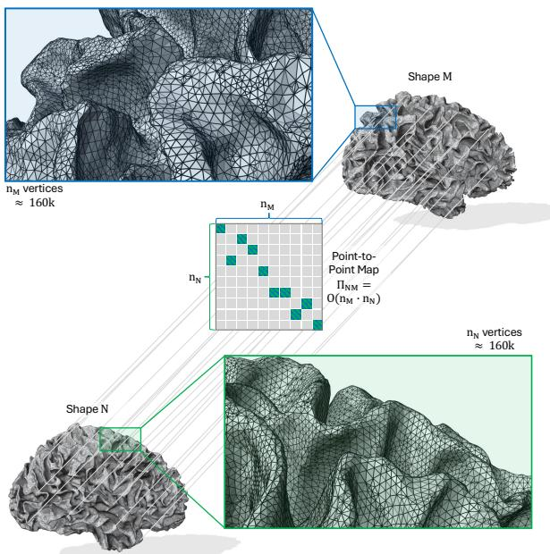  
Figure 1. Scalability challenges of Deep Spectral Methods. Spectral matching methods often rely on recovering a point-topoint map $\Pi _ { N M }$ , either to convert a functional map back to the spatial domain or as an effective regularization. Comparing shape vertex features requires $\mathcal { O } ( n _ { M } \cdot n _ { N } )$ operations, which is infeasible with current strategies.

Many recent advances in non-rigid shape matching build on the functional map framework [47], which avoids the combinatorial search over point-to-point maps by representing correspondence as a compact linear operator acting on a truncated Laplace-Beltrami eigenbasis [52]. Learningbased variants [20, 39] pair this formulation with intrinsic feature extractors [58] that learn descriptors in place of hand-crafted spectral signatures [4, 61], employing unsupervised structural or metric-preservation losses [30, 57].

A dense point-to-point mapping can then be recovered from afunctional map in a number of ways, for instance, by finding the nearest spectral embeddings of the source vertices on the target shape [73] or through refinement procedures [50, 55, 67]. Such spectral-to-spatial conversion is also an essential algorithmic component of numerous methods, providing structure for optimization in the ambient space for both axiomatic [46] and learned methods [12].

However, current approaches are not directly applicable in the high-resolution regime because the soft assignment manifests as a dense n × m similarity matrix between the vertices of the two shapes. Both the forwardand backward-pass require materialization of this matrix, so memory grows quadratically with mesh size: for two shapes with n = m = 100k vertices, a single coupling already occupies roughly 40 GB in single precision. This limitation is particularly restrictive in domains where fine geometric detail is essential. For example, cortical surface analysis routinely employs meshes with more than 100k vertices per hemisphere [16, 28], and contemporary digital human avatars often require similarly high resolutions to faithfully capture anatomy and appearance. Consequently, most existing methods operate on heavily downsampled representations and then transfer predictions to the full-resolution mesh [42]. However, this introduces approximation errors and potentially discards fine-scale geometric information.

In this work, we revisit the coupling operation at the core of functional-map-based correspondence methods. We show that the spatial-spectral interaction underlying these models can be reformulated as scaled dotproduct attention [65], revealing an unexpected connection between geometric correspondence learning and modern transformer architectures. Furthermore, we introduce Geo-FlashAttention, a geometry-aware sparse attention mechanism that exploits the local structure of surfaces to achieve near-linear scaling with mesh size, making end-to-end correspondence learning feasible on meshes that were previously beyond reach. Our main contributions are:

• We show that the spatial–spectral coupling ΠΦM shared by coupled functional-map methods is exactly scaled dotproduct attention, where the learned descriptors act as queries and keys, and the spectral basis as values.

• This makes exact efficient-attention algorithms directly applicable. FlashAttention [17, 18] removes the $\mathcal { O } ( n _ { N } n _ { M } )$ memory of the coupling, preserving the correspondence up to floating-point rounding.

• We show that linearised (kernelised) couplings [15, 32] are, in contrast, a real approximation. They significantly compromise accuracy, which worsens with non-isometry.

• We thus introduce Geo-FlashAttention, a block-sparse coupling that evaluates the exact softmax over surfacepatch candidates, scales near-linearly, and enables training of coupled methods on high-resolution meshes.

• This enables applications such as shape matching for cortical surfaces (over 100k vertices per hemisphere), where we show that, within the technical advances of our framework, existing functional-map methods can outperform state-of-the-art learned surface-reconstruction methods.

## 2. Related Work

Our approach draws on three distinct bodies of work: nonrigid shape correspondence, efficient attention, and cortical surface registration. We review each of these subfields, focusing on the functional-map coupling that connects scalable attention to high-resolution correspondence.

Shape correspondence and functional-map coupling. Dense correspondence between non-rigid 3D shapes has been addressed through numerous ways; we outline several trends here, but refer readers to recent surveys for a broader treatment [31, 73]. Classical approaches include minimumdistortion metric embedding [11], conformal alignment [33, 38], and kernel matching; in general, recovering a correspondence under non-isometric deformation while preserving pairwise geometric consistency amounts to an NP-hard quadratic assignment problem [66]. Combinatorial formulations that optimize directly over point-to-point maps [56, 69] provide optimality guarantees but struggle to scale due to this inherent complexity [27]. These families trade off accuracy, robustness to non-isometry, supervision requirements, and scalability.

Within this landscape, functional maps [47] are widely used for dense 3D shape correspondence, especially in unsupervised settings where annotations are difficult to obtain, such as anatomical data [5, 10, 26]. They represent correspondence as a compact linear operator between the eigenbases of two shapes, thereby providing strong structural priors. Because of this structure, the framework learns per-vertex descriptors directly from surface features, with supervision [39] or, later, without ground-truth correspondence [57].

The standard basis used is the intrinsic Laplace–Beltrami eigenbasis, though hybrid functional maps [6] extend it with an extrinsic elastic component to better handle nonisometric deformations. The spectral objective alone does not determine a meaningful pointwise map [62]. Since most applications ultimately require an explicit point-topoint correspondence, high accuracy relies on coupling the operator back to the spatial domain [12]. This coupling is realised either through a soft pointwise map Π = softmax $F _ { N } F _ { M } ^ { \top } / \tau )$ in learned pipelines [12] (Fig. 2), or through iterative refinement such as ZoomOut [44, 46]. The resulting map $\Pi \in \mathbb { R } ^ { n _ { N } \times n _ { M } }$ is dense, and its $O ( n _ { N } n _ { M } )$ memory limits coupled methods to low-resolution meshes. Magnet and Ovsjanikov [43] scale the classical pipeline to dense meshes by approximating the functional spaces and the map itself through subsampling. For learned pipelines, [44] avoids the approximation altogether: only the projection $\Pi \Phi _ { M }$ is ever needed, and they compute it without materializing Π, using the symbolic kernel library KeOps [14] to evaluate the reduction on the fly. This removes the memory bottleneck but remains computationally expensive: every one of the $n _ { N } n _ { M }$ pairwise terms is still evaluated, so the projection remains quadratic in time.

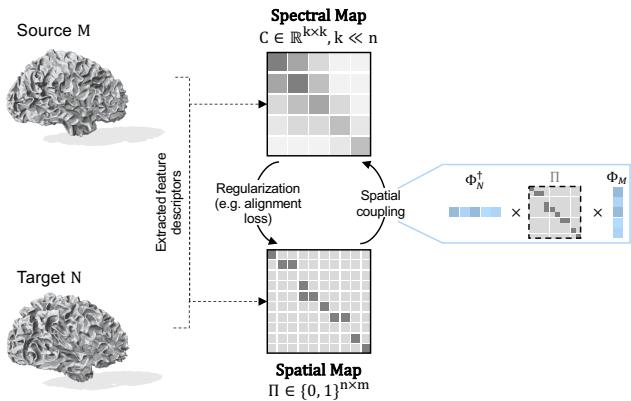  
Figure 2. Spatial-spectral coupling common in functional map methods [12]. Shared encoders extract feature descriptors of both shapes, which are used to construct functional and point-to-point maps coupled in an alignment regularization.

Efficient attention. Scaled dot-product attention [65] is a key building block of modern neural architectures, most apparent in large language models, which popularised it. Its cost grows quadratically with sequence length, and a large literature reduces this cost along three lines. Exact methods keep the softmax but never materialize the full attention matrix, computing the softmax-weighted reduction with hardware-aware tiling $( \mathrm { e . g . }$ , FlashAttention [17, 18]). $\mathsf { A p - }$ proximate methods instead replace the softmax with a kernel feature map, reassociating the product into linear time and memory [15, 32]. A third line restricts each query to a subset of keys through local or block-sparse patterns, keeping the softmax exact over that reduced set while avoiding the quadratic cost of attending to all keys [7, 72]. However, these partitions are defined by sequence structure rather than by the geometry of the domain. Transformers have also been used for non-rigid point-cloud registration [64] and shape correspondence with positional encoding [49]. Riva et al. [53] replace some learned self-attention weights with localized Gaussians to improve training efficiency and correspondence quality. Attention also appears in functionalmap methods, applied over descriptor features for partial shapes [3], or to combine multiple spectral resolutions [36]. These approaches use attention within correspondence arspatial spectralC = ”†N !”Mchitectures. We focus on the existing soft spatial–spectral source any estimatorprojection and evaluate efficient attention kernels for this learned features)operation. Geo-FlashAttention selects geodesic patch support for the descriptor-based softmax, while the Gaussian shape Ntarget point-to-point map functional mapweights of Riva et al. [53] define self-attention within a Transformer.

Registration of cortical surfaces. Establishing corre-mesh filtering and quad-mesh design — functional maps are one instance, not the mechanspondences between cortical surfaces is a prerequisite for comparing brain anatomy across subjects and for the population-level analysis of biomarkers such as cortical thickness, which underpins the study of neurodegenerative diseases like Alzheimer’s [19]. Existing methods fall into three broad families. Spherical registration methods [54, 71] inflate each hemisphere to a sphere and align surfaces in this canonical domain; this is the strategy adopted by the widely used FreeSurfer pipeline [28]. While robust, the inflation step is computationally intensive and inevitably introduces metric distortions that propagate into the resulting correspondences. More recently, deformation-based methods [9] estimate correspondences by directly deforming surfaces in the ambient 3D space. Spectral approaches [40] instead match surfaces in a low-dimensional embedding derived from the Laplace–Beltrami operator, avoiding the spherical parameterization altogether, but modern feature correspondence methods cannot easily scale to the high resolution demanded by intricate cortical surfaces.

## 3. Background & Motivation

## 3.1. Functional Maps and Spectral Constraints

Functional maps provide a compact spectral representation for dense correspondences between 3D shapes. Given a source shape $\mathcal { M }$ with $n _ { M }$ vertices and a target shape $\mathcal { N }$ with $n _ { N }$ vertices, let $\Phi _ { M } \in \mathbb { R } ^ { n _ { M } \times k }$ and $\Phi _ { N } ~ \in ~ \mathbb { R } ^ { n _ { N } \times k }$ contain the first k Laplace–Beltrami eigenfunctions of the respective shapes. A functional map $C _ { M N } \in \mathbb { R } ^ { k \times k }$ represents a linear correspondence between functions expressed in these spectral bases: for a function $f _ { M } \approx \Phi _ { M } a$ on $\mathcal { M } .$ its corresponding function on $\mathcal { N }$ is represented as

$$
f _ { N } \approx \Phi _ { N } C _ { M N } a .
$$

Restricting the representation to the first k eigenfunctions yields a low-dimensional, band-limited approximation of the correspondence, with $k \ll n _ { M } , n _ { N }$ . The functional representation is computationally attractive because the map $C _ { M N }$ is of size $k \times k ,$ , and structural priors such as orthogonality, bijectivity, and Laplacian commutativity can be expressed as algebraic penalties in this basis.

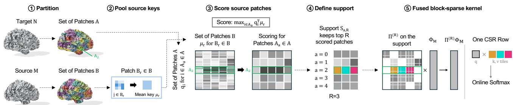  
Figure 3. Overview of Geo-FlashAttention. (1) Target $\mathcal { N }$ and source $\mathcal { M }$ are partitioned into geometrically derived patches $\mathcal { A }$ and B based on vertex positions. (2) Each source patch $B _ { r }$ is summarised by its mean key $\mu _ { r }$ . (3) Target queries are scored against the pooled keys and reduced per patch pair by $s _ { a r } = \operatorname* { m a x } _ { i \in A _ { a } } q _ { i } ^ { \top } \mu _ { r }$ . (4) The R best-scoring source patches per target patch form the support ${ \cal S } _ { a , R } ,$ so every row keeps exactly R patches. (5) A fused block-sparse kernel evaluates the exact softmax without materialising ${ \widetilde \Pi } _ { N M } ^ { ( R ) }$

## 3.2. Spatial-Spectral Coupling

Optimizing correspondence purely in the spectral domain can be insufficient, since the spectral training objective does not in general determine a meaningful pointwise correspondence. Sun et al. [62] illustrate this ambiguity with a degenerate solution in which the learned descriptor functions on each shape take the form $F _ { i } = \Phi _ { i } A _ { 0 }$ , for some fixed coefficient matrix $A _ { 0 }$ . Since the spectral descriptor coefficients are $A _ { i } = \Phi _ { i } ^ { \dagger } F _ { i }$ , this construction gives $A _ { i } = A _ { 0 }$ for every shape. Consequently, the identity functional map $C _ { i j } = I$ satisfies the descriptor-preservation condition $C _ { i j } A _ { i } = A _ { j }$ for every pair. Moreover, the identity map trivially satisfies orthogonality and bijectivity constraints. Thus, even a functional map that is optimal under standard spectral objectives need not yield a meaningful point-to-point correspondence.

This ambiguity motivates coupling the spectral representation back to a spatial correspondence. A discrete pointwise map $\Pi _ { N M } ~ \in ~ \mathbb { R } ^ { n _ { N } \times n _ { M } }$ induces a functional map through the spatial-to-spectral projection

$$
\widetilde { C } _ { M N } = \Phi _ { N } ^ { \dagger } \Pi _ { N M } \Phi _ { M } ,\tag{1}
$$

where † denotes the mass-weighted left inverse. The set of functional maps arising from such pointwise correspondences was formalized by Ren et al. [51] as the space of proper functional maps. Enforcing consistency between a spectrally estimated functional map and one induced from a spatial correspondence provides a simple yet effective way to resolve ambiguities left by purely spectral objectives, and forms the basis of several subsequent functional-map methods [2, 6, 12, 44, 62].

For instance, the ULRSSM framework [12] enforces this consistency through an alignment loss. From learned pervertex descriptors $F _ { M } \in \mathbb { R } ^ { n _ { M } \times d }$ and $F _ { N } \in \mathbb { R } ^ { n _ { N } \times d }$ , it constructs a soft pointwise correspondence

$$
\Pi _ { N M } = \mathrm { S o f t m a x } \left( \frac { F _ { N } F _ { M } ^ { \top } } { \tau } \right) .
$$

Substituting this assignment into Eq. (1) gives the induced functional map, which is compared with the map obtained from the spectral solver branch. Their disagreement is penalized during training, encouraging the spectral solution to remain consistent with a spatially realized correspondence.

Similarly, the ZoomOut algorithm [46] relies on the same spatial-to-spectral coupling, implementing it through iterative refinement. Starting from a functional map at spectral resolution $k ,$ ZoomOut recovers a pointwise map and projects it back into a higher-dimensional basis containing the first $k + \Delta k$ eigenfunctions:

$$
C ^ { ( k + \Delta k ) } = \left( \Phi _ { N } ^ { ( k + \Delta k ) } \right) ^ { \dagger } \Pi ^ { ( k ) } \Phi _ { M } ^ { ( k + \Delta k ) } .
$$

Repeating this process ensures that the refined spectral maps are induced by explicit pointwise correspondences while progressively increasing the spectral resolution. Recent differentiable variants of ZoomOut [44] replace hard nearest-neighbor assignments with soft correspondences, making this spatial-spectral conversion differentiable and thus compatible with end-to-end training.

## 3.3. Scalability of Spatial–Spectral Coupling

The shared computational primitive in both learned functional-map pipelines and refinement methods is the pointwise-to-functional projection $\Phi _ { N } ^ { \dagger } \Pi \Phi _ { M }$

Its dominant cost is the intermediate product $\Pi \Phi _ { M }$ where $\Pi \in \mathbb { R } ^ { n _ { N } \times n _ { M } }$ is a dense soft correspondence and $\Phi _ { M } \in \mathbb { R } ^ { n _ { M } \times k }$ is a truncated spectral basis. Although Π contains $n _ { N } n _ { M }$ pairwise correspondence weights, only the product $\Pi \Phi _ { M }$ is required to construct the induced functional map. The dense correspondence is therefore only an intermediate representation.

A na¨ıve implementation nevertheless materializes Π, incurring $O ( n _ { N } n _ { M } )$ memory and limiting applicability to high-resolution meshes. Magnet and Ovsjanikov [44] observed that this intermediate matrix can be avoided by computing the product $\Pi \Phi _ { M }$ directly, without explicitly constructing Π. This removes the need to store the dense feature assignment while preserving the resulting point map.

Building on this observation, we show that for standard soft correspondences, this reduction can be written as scaled dot-product attention, up to the choice of scale.

4)Geo-FlashAttention4  
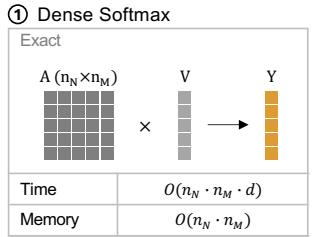

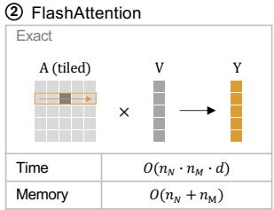

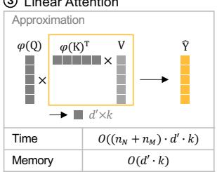

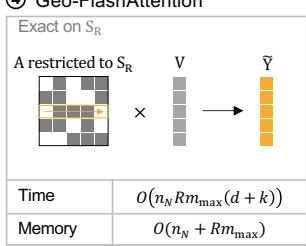  
Figure 4. Comparing attention computations. (1) Dense softmax forms the full $n _ { N } \ \times \ n _ { M }$ correspondence matrix, while FlashAttention (2) tiles A through on-chip memory. (3) Linear attention replaces the softmax kernel by a feature map φ approximating the product. (4) Geo-FlashAttention evaluates exact softmax attention on the induced vertex support by S.

This allows the spatial-to-spectral projection to be evaluated with highly optimized exact attention kernels, connecting spatial-spectral coupling to efficient attention methods developed for scaling transformers.

## 4. Spatial–Spectral Coupling as Attention

The coupling in Eq. (1) requires only the product ΠNMΦM. For the descriptor-based soft assignment, this is

$$
\Pi _ { N M } \Phi _ { M } = \mathrm { S o f t m a x } \left( \frac { F _ { N } F _ { M } ^ { \top } } { \tau } \right) \Phi _ { M } .
$$

We observe that this formulation can be written as Scaled Dot-Product Attention (SDPA), with scale $1 / \tau$ in place of the usual $1 / { \sqrt { d } } .$ , under the identification

$$
Q = F _ { N } , \qquad K = F _ { M } , \qquad V = \Phi _ { M } .
$$

The learned shape descriptors $( Q , K )$ determine the correspondence weights (the attention matrix), while the values (V ) are the spectral basis functions being transported through that correspondence.

This reformulation makes optimized attention variants directly applicable to spatial-spectral shape matching. In particular, we utilize FlashAttention [17, 18], which computes the exact softmax-weighted reduction using hardware-aware tiling, avoiding the explicit materialization of the $n _ { N } \times n _ { M }$ attention matrix. This reduces the memory complexity of the coupling layer from $\mathcal { O } ( n _ { N } n _ { M } )$ to $\mathcal { O } ( n _ { N } \mathrm { ~ + ~ } n _ { M } )$ enabling training on high-resolution meshes.

## 4.1. Approximate Spatial–Spectral Projection

Linear Attention. FlashAttention removes the quadratic memory requirement, but exact attention still has quadratic time complexity. Linear attention [32] instead replaces the exponential kernel by a non-negative feature map $\phi : \mathbb { R } ^ { d } $ $\mathbb { R } ^ { r }$ reassociating the product into linear time and memory:

$$
\mathrm { L i n A t t n } ( Q , K , V ) _ { i } = \frac { \phi ( q _ { i } ) ^ { \top } \sum _ { j = 1 } ^ { n _ { M } } \phi ( k _ { j } ) v _ { j } ^ { \top } } { \phi ( q _ { i } ) ^ { \top } \sum _ { j = 1 } ^ { n _ { M } } \phi ( k _ { j } ) } .\tag{2}
$$

The standard choice $\phi ( x ) = \mathrm { E L U } ( x ) + 1$ is far too diffuse to approximate the sharply peaked coupling in Eq. (1), so we sharpen it with a temperature-matched polynomial factor, $\begin{array} { r } { \phi ( x ) _ { \ell } = \left( \mathrm { E L U } ( x _ { \ell } ) \dot { + } 1 \right) \left( 1 + | x _ { \ell } | / \tau \right) ^ { p } } \end{array}$ with $r { = } d ,$ and additionally evaluate Performer’s random-feature softmax estimator [15]. Regardless of the map, the factorized kernel $\phi ( Q ) \phi ( K ) ^ { \top }$ has rank at most $^ r \cdot$ We observe empirically that accurate correspondence estimation requires the soft vertex assignment to be near-full rank (Sec. 8.1). Linearized couplings are therefore lossy at practical feature dimensions, motivating a sparse alternative.

## 4.2. Geo-FlashAttention

Let $x _ { i } ^ { N } \in \mathbb { R } ^ { 3 }$ denote the position of target vertex i on shape ${ \mathcal { N } } .$ , with normalized query $q _ { i }$ given by the corresponding row of $Q = F _ { N }$ . Similarly, $x _ { i } ^ { M }$ and $k _ { j }$ denote a source vertex position and its normalized key from $K = F _ { M }$ . Using geodesic distances on the mesh, we independently partition the target vertex-index set ${ \mathcal { T } } _ { N } = \{ 1 , . . . , n _ { N } \}$ and source vertex-index set $\mathcal { T } _ { M } = \{ 1 , . . . , n _ { M } \}$ into patch collections A and B, respectively (Fig. 3),

$$
{ \mathcal { T } } _ { N } = \bigcup _ { A _ { a } \in { \mathcal { A } } } A _ { a } , \qquad { \mathcal { T } } _ { M } = \bigcup _ { B _ { r } \in B } B _ { r } .\tag{3}
$$

We use geodesic farthest-point-sampled centers, followed by geodesic nearest-center assignment, and add centers to split oversized patches. For each source patch $B _ { r }$ define its mean key

$$
\mu _ { r } = \frac { 1 } { | B _ { r } | } \sum _ { j \in B _ { r } } k _ { j } .\tag{4}
$$

A target patch $A _ { a }$ scores source patch $B _ { r }$ by

$$
s _ { a r } = \operatorname* { m a x } _ { i \in A _ { a } } q _ { i } ^ { \top } \mu _ { r } .\tag{5}
$$

Let $\boldsymbol { \mathcal { S } } _ { a , R }$ contain the indices of the R largest scores. For $i \in A _ { a } ,$ define $\begin{array} { r } { \chi _ { i j } ^ { ( R ) } = 1 \mathrm { i f } j \in \bigcup _ { r \in S _ { a , R } } B _ { r } } \end{array}$ , and 0 otherwise. We define geometric attention as the soft assignment restricted to this support:

$$
\widetilde { \Pi } _ { N M , i j } ^ { ( R ) } = \frac { \chi _ { i j } ^ { ( R ) } \exp ( q _ { i } ^ { \top } k _ { j } / \tau ) } { \sum _ { \ell = 1 } ^ { n _ { M } } \chi _ { i \ell } ^ { ( R ) } \exp ( q _ { i } ^ { \top } k _ { \ell } / \tau ) } .\tag{6}
$$

Table 1. Correspondence accuracy of feature couplings, as mean geodesic error (×100, ↓) over three seeds ± standard deviation. Within each method block, only the computation of ΠΦ changes. Learned-pipeline rows differ due to coupling and optimization convergence. We run Bonferroni-corrected simultaneous 95% Welch confidence intervals for mean differences from dense runs, for which no statisticall significant differences are detected (they all include zero). Our proposed couplings are in bold.
<table><tr><td>Method</td><td>Coupling</td><td>FAUST</td><td>SCAPE</td><td>SHREC&#x27;19</td><td>SMAL</td><td>DT4D-intra DT4D-inter</td><td></td></tr><tr><td colspan="8">Iterative refnement</td></tr><tr><td>ZoomOut [44, 46] Dense</td><td></td><td> $1 . 7 9 \pm 0 . 0 0$ </td><td> $4 . 3 3 \pm 1 . 3 8$ </td><td> $6 . 1 7 \pm 0 . 1 3$ </td><td> $2 3 . 4 8 \pm 3 . 7 2$ </td><td> $1 . 9 4 \pm 0 . 0 4$ </td><td> $5 . 1 7 \pm 0 . 1 8$ </td></tr><tr><td></td><td>FlashAttention</td><td> $1 . 7 9 \pm 0 . 0 0$ </td><td> $4 . 1 8 \pm 1 . 5 3$ </td><td> $5 . 7 0 \pm 0 . 6 7$ </td><td> $2 5 . 5 1 \pm 2 . 8 1$ </td><td> $1 . 8 7 \pm 0 . 1 5$ </td><td> $5 . 1 3 \pm 0 . 1 5$ </td></tr><tr><td></td><td>Geo-FlashAttention</td><td> $1 . 8 0 \pm 0 . 0 1$ </td><td> $4 . 4 8 \pm 2 . 1 1$ </td><td> $5 . 7 1 \pm 0 . 2 4$ </td><td> $2 4 . 2 9 \pm 1 . 7 3$ </td><td> $2 . 0 3 \pm 0 . 2 5$ </td><td> $6 . 4 8 \pm 2 . 1 8$ </td></tr><tr><td colspan="8">Learned pipelines</td></tr><tr><td>ULRSSM [12]</td><td>Dense</td><td> $1 . 5 6 \pm 0 . 0 4$ </td><td> $1 . 8 7 \pm 0 . 0 2$ </td><td> $4 . 4 5 \pm 0 . 9 8$ </td><td> $4 . 1 4 \pm 0 . 3 5$ </td><td> $0 . 9 6 \pm 0 . 0 5$ </td><td> $4 . 1 2 \pm 0 . 3 3$ </td></tr><tr><td></td><td>FlashAttention</td><td> $1 . 5 8 \pm 0 . 0 1$ </td><td> $1 . 8 8 \pm 0 . 0 2$ </td><td> $4 . 2 9 \pm 0 . 2 9$ </td><td> $4 . 0 1 \pm 0 . 2 6$ </td><td> $1 . 0 0 \pm 0 . 0 8$ </td><td> $4 . 0 1 \pm 0 . 4 9$ </td></tr><tr><td></td><td>Geo-FlashAttention</td><td> $1 . 5 7 \pm 0 . 0 4$ </td><td> $1 . 8 7 \pm 0 . 0 1$ </td><td> $4 . 6 5 \pm 0 . 5 8$ </td><td> $4 . 0 8 \pm 0 . 3 3$ </td><td> $0 . 9 3 \pm 0 . 0 2$ </td><td> $3 . 7 8 \pm 0 . 1 0$ </td></tr><tr><td>HybridFMaps [6]</td><td>Dense</td><td> $1 . 3 6 \pm 0 . 0 1$ </td><td> $1 . 7 9 \pm 0 . 0 3$ </td><td> $3 . 9 4 \pm 0 . 6 2$ </td><td> $3 . 6 8 \pm 0 . 1 1$ </td><td> $0 . 9 6 \pm 0 . 0 3$ </td><td> $3 . 4 9 \pm 0 . 0 5$ </td></tr><tr><td></td><td>FlashAttention</td><td> $1 . 3 7 \pm 0 . 0 1$ </td><td> $1 . 7 8 \pm 0 . 0 2$ </td><td> $3 . 5 7 \pm 0 . 4 1$ </td><td> $3 . 6 2 \pm 0 . 2 0$ </td><td> $1 . 0 0 \pm 0 . 0 3$ </td><td> $3 . 4 7 \pm 0 . 1 6$ </td></tr><tr><td></td><td>Geo-FlashAttention</td><td> $1 . 3 7 \pm 0 . 0 0$ </td><td> $1 . 7 5 \pm 0 . 0 0$ </td><td> $4 . 2 0 \pm 0 . 8 3$ </td><td> $3 . 4 1 \pm 0 . 2 7$ </td><td> $1 . 0 3 \pm 0 . 0 2$ </td><td> $3 . 4 8 \pm 0 . 0 3$ </td></tr></table>

The normalized descriptors score target–source patch pairs. Based on these scores, the top R source patches for each target patch are selected, defining the weights within that support. Once the support is fixed, Eq. (6) is the exact softmax on the selected vertices. Geo-FlashAttention evaluates the resulting block-sparse product $\widetilde { \Pi } _ { N M } ^ { ( R ) } \Phi _ { M }$ directly, replacing the dense product in Eq. (1) without materializing the approximate soft correspondence matrix $\widetilde \Pi _ { N M } ^ { ( R ) } .$

If every source patch contains at most $m _ { \mathrm { m a x } }$ vertices, each target row attends to at most $R m _ { \mathrm { m a x } }$ source vertices. The restricted attention stage therefore costs $\mathcal { O } ( n _ { N } R m _ { \operatorname* { m a x } } ( d + k ) )$ ), while the coarse selection costs $O ( n _ { N } | B | d )$ . Fig. 4 depicts the coupling computations.

## 5. Results

Overview. We implement our framework using the DeepShapeMatchingKit [70], which provides the core PyTorch codebase for our training and evaluation pipelines. For consistency, all reported timing and peak-memory measurements are taken on a single, exclusively allocated H200 NVL with 140 GB of VRAM.

All coupling variants use a shared training framework and, within each experiment, receive identical inputs and scales; only the evaluation of ΠΦ changes. The dense and linearized variants use PyTorch tensor operations, KeOps [14] uses its symbolic reduction, the fp32 SDPA and FlashAttention variants use PyTorch’s SDPA interface, and Geo-FlashAttention uses a custom-implemented Triton kernel [63]. Precisions and backend-specific settings are detailed in Sec. 7.2. For runtime and memory comparisons, we warm up each backend, synchronize CUDA and clear memory between runs, and run the backends back-to-back.

We evaluate on complementary benchmarks spanning near-isometric to strongly non-isometric matching. For near-isometric matching, we use the FAUST [8] dataset, a standard benchmark containing human shapes in various poses, together with SCAPE [1] and the more challenging SHREC’19 [45]. To assess performance under large non-isometric deformations, we evaluate on the SMAL dataset [74], which contains highly varied quadruped animals across different species, and on DeformingThings4D [37] in both its intra- and inter-class settings. Finally, we use the released TOPKIDS [35] meshes (with ≈ 8–12k and ∼ 60k vertices) to evaluate robustness to topological noise and to demonstrate our method’s memory efficiency.

We report the mean and standard deviation over predeclared random seeds. Unless noted otherwise, each configuration uses five seeds.

## 5.1. Equivalence on Standard Benchmarks

Setup. We first assess whether the dense coupling can be replaced within standard evaluation protocols from the literature [6, 12, 20]. Each benchmark is trained and evaluated using its established training and validation sets. Within each method block of Tab. 1 we only vary the point-to-point coupling described in Sec. 4, keeping the model, data, and protocol fixed. We report the mean and standard deviation for each setting1.

Results. Across ULRSSM, HFM, and ZoomOut, we observe no systematic difference in correspondence accuracy between the alternative and dense couplings on the tested benchmarks. The differences in mean error vary in direction across methods and benchmarks, and are generally small relative to the observed seed variability. These results support comparable observed accuracy across model families.

Table 2. Cost and accuracy of ULRSSM [12] couplings on the two released TOPKIDS datasets [35]. Time and peak memory are for one training step at ≈ 12k and ≈ 60k, mean ± standard deviation over five repeats; geodesic error (×100) uses 25 test pairs of the released datasets, mean ± standard deviation over fixed seeds with the best seed in parentheses (seed counts and protocol: Sec. 7.1). ∗Unschedulable: 29.9 days for one 100-epoch run. †Dense training at 60k exceeds 140 GB; 106.08 GiB is one iteration.
<table><tr><td></td><td colspan="3">TOPKIDS (≈ 8–12k vertices)</td><td colspan="3">TOPKIDS-HD (≈ 60k vertices)</td></tr><tr><td>Coupling</td><td>Time (ms) ↓ Peak mem. (GiB) ↓</td><td></td><td>Geo. err. ↓</td><td>Time (ms) ↓</td><td>Peak mem. (GiB) ↓</td><td>Geo. err. ↓</td></tr><tr><td>Exact couplings</td><td></td><td></td><td></td><td></td><td></td><td></td></tr><tr><td>Dense (fp32)</td><td> $6 6 . 0 \pm 7 . 9$ </td><td>5.22</td><td> $1 6 . 5 5 \pm 6 . 8 4 ( 5 . 9 2 )$ </td><td> $7 1 0 . 6 \pm 1 0 5 . 6$ </td><td>106.08</td><td>OOM†</td></tr><tr><td>KeOps (fp32) [44]</td><td> $1 9 4 3 . 2 \pm 7 . 0$ </td><td>1.23</td><td></td><td> $3 8 2 8 5 . 9 \pm 1 1 5 . 5$ </td><td>5.67</td><td>Unsched.*</td></tr><tr><td>SDPA (fp32)</td><td> $7 8 . 9 \pm 5 . 2$ </td><td>1.23</td><td> $1 9 . 3 5 \pm 7 . 4 1 ( 8 . 4 3 )$ </td><td> $8 6 1 . 5 \pm 5 . 0$ </td><td>5.67</td><td> $1 1 . 0 5 \pm 1 . 6 9 ( 8 . 8 3 )$ </td></tr><tr><td>FlashAttention (bf16)</td><td> $4 6 . 4 \pm 0 . 3$ </td><td>1.23</td><td> $1 5 . 6 5 \pm 6 . 5 2 ( 9 . 0 8 )$ </td><td> $2 0 7 . 2 \pm 5 . 0$ </td><td>5.67</td><td> $1 1 . 3 8 \pm 3 . 1 1 ( 7 . 0 2 )$ </td></tr><tr><td>Approximate couplings</td><td></td><td></td><td></td><td></td><td></td><td></td></tr><tr><td>Performer</td><td> $4 4 . 4 \pm 1 . 8$ </td><td>1.23</td><td> $3 7 . 0 6 \pm 1 . 6 8 ( 3 4 . 8 9 )$ </td><td> $1 0 9 . 7 \pm 4 . 8$ </td><td>5.67</td><td> $3 7 . 7 3 \pm 1 . 2 4 ( 3 6 . 3 9 )$ </td></tr><tr><td>Linear attention (ELU)</td><td> ${ \bf 4 3 . 5 \pm 1 . 8 }$ </td><td>1.23</td><td> $3 5 . 1 0 \pm 1 . 8 7 ( 3 2 . 7 0 )$ </td><td> $\mathbf { 1 0 8 . 4 \pm 4 . 9 }$ </td><td>5.67</td><td> $3 0 . 6 0 \pm 0 . 9 1 ( 2 9 . 3 1 )$ </td></tr><tr><td>Geo-FlashAttention (ours)</td><td> $5 2 . 3 \pm 2 . 0$ </td><td>1.23</td><td> $1 3 . 3 0 \pm 7 . 5 1 ( 7 . 2 5 )$ </td><td> $1 3 6 . 2 \pm 4 . 6$ </td><td>5.67</td><td> $8 . 7 9 \pm 1 . 2 8 ( 6 . 9 7 )$ </td></tr></table>

## 5.2. Accuracy–Efficiency Trade-offs

Setup. The standard shape-matching benchmarks contain only 5–8k vertices [20]. At this scale, the coupling only accounts for a small fraction of a training step. We therefore assess scalability of ULRSSM [12] on the two datasets released with the TOPKIDS benchmark [35], using both original (≈ 8–12k vertices) and the high-resolution (≈ 60k) meshes, 26 unit-area meshes each. Tab. 2 reports trainingstep time, peak memory, and geodesic error.

Results. At 12k, training-step times other than KeOps span 1.8×, and every non-dense method uses 1.23 GiB. At 60k, the corresponding time range increases to 7.9×; dense attention requires 106.08 GiB, whereas every nondense method uses 5.67 GiB. FlashAttention is the fastest feasible exact coupling. Because its kernel is available only in half precision, fp32 SDPA dispatches to the memoryefficient kernel [48] and is 4.2× slower at 60k. The measured KeOps [44] step time would yield approximately one month for a complete run. This is due to the constant overhead of symbolic reduction, because KeOps materializes a general-purpose fp32 kernel much slower than tuned attention kernels, and forming gradients re-evaluates the unstored reduction, increasing its relative cost in training.

Finally, we fit $\scriptstyle { y = c N ^ { a } }$ over seven decimated resolutions from 5k to 60k vertices, yielding isolated empirically estimated scaling exponents of a=1.97 for dense attention, 1.83 for FlashAttention, and 0.81 for Geo-FlashAttention. The performance crossover is near 20k vertices, which is far below cortical resolution. In Sec. 8.2 we report the fitting protocol, the full-step exponents, and the complete runtime and memory curves. On the released low-resolution benchmark, the best fixed seed attains the published ULRSSM value of 9.2 for every exact coupling (5.9–9.1) and for Geo-FlashAttention (7.3), while both linearized couplings stay far above it (32.7 at best). At both resolutions, Geo-

Table 3. Topological noise. Mean geodesic error (×100) on the released TOPKIDS benchmark [35], over its 25 test pairs at their released resolution (≈ 8–12k) and following existing protocols [6, 12]. Published rows are quoted as reported. GeoFA uses Euclidean patches with an error of 4.33 ± 0.42 over three seeds.
<table><tr><td>Method</td><td>Geo. err. ↓</td></tr><tr><td>ZoomOut [46]</td><td>33.7</td></tr><tr><td>AttentiveFMaps [36]</td><td>23.4</td></tr><tr><td>Deep Shells [25]</td><td>13.7</td></tr><tr><td>Smooth Shells [24]</td><td>10.8</td></tr><tr><td>ULRSSM [12]</td><td>9.2</td></tr><tr><td>Synchronous Diffusion [13]</td><td>5.4</td></tr><tr><td>HFM [6, 70]</td><td>4.6</td></tr><tr><td>HFM + Geo-FlashAttention (ours)</td><td>3.9</td></tr></table>

FlashAttention achieves accuracy comparable to exact couplings and substantially lower error than linearized methods. Variability over seeds is reported in Sec. 7.1.

Linearized couplings. FlashAttention and fp32 SDPA are exact kernels and change only the arithmetic, whereas linear attention replaces the softmax kernel with an approximation, and thus changes the correspondence itself. Measured against the dense reference over five seeds, ELU is significantly worse on four of the six benchmarks and Performer on five, the largest differences occurring on the strongly non-isometric SMAL and DT4D-inter, consistent with the difficulty of representing a sharply peaked coupling with the low-rank feature maps discussed in Sec. 4. In Sec. 8.1 we report errors per benchmark and significance levels, and in Sec. 8.3 we examine the sharpness that causes this.

Approximate couplings can act as regularization. A reduced point-to-point coupling can, in some cases, achieve more than merely approximating its dense counterpart. Because each query patch distributes its correspondence mass over a small candidate set rather than over the whole surface (Sec. 7.2), implausible correspondences receive exactly zero weight during training, and the restriction can act as a regularizer when the input geometry is unreliable. We evaluate this on the TOPKIDS benchmark (≈ 8–12k vertices), where one reference mesh is matched against 25 scans of children, with their surfaces merged at points of self-contact, thereby probing robustness to topological noise rather than deformation. Tab. 3 compares HFM with Geo-FlashAttention against published results. With Euclidean patches, HFM reaches 3.9, below both reported values for dense-coupled HFM (5.0 and 4.6). Sec. 8.5 shows how Euclidean patches join surfaces in self-contact.

Table 4. Label transfer and area distortion on cortical surfaces, averaged over 90 validation pairs of the Mindboggle dataset. Left: manually corrected DKT31 parcellations as preserved by each map. Right: $D _ { \mathrm { a r e a } } ( S )$ , a map distortion measure. S is the number of geodesic-Voronoi regions, and $D _ { \mathrm { a r e a } }$ growing with S. For Geo-FA, we report the mean over three seeds. All methods are run under identical settings. ∗FreeSurfer [28] generated the reference labels prior to manual correction, so it is expected to score strongly on labe transfer while confounding the evaluation w.r.t. parcelation labels.
<table><tr><td rowspan="2" colspan="2">Method</td><td colspan="2">Label transfer</td><td colspan="3"> $D _ { \mathrm { a r e a } }$  ↓ by regions S</td></tr><tr><td>mIoU ↑</td><td>Acc. ↑</td><td>10</td><td>40</td><td>200</td></tr><tr><td colspan="2">FreeSurfer* [28]</td><td>0.718</td><td>0.851</td><td>0.0601</td><td>0.1129</td><td>0.1772</td></tr><tr><td colspan="2">FBM [40]</td><td>0.619</td><td>0.795</td><td>0.0367</td><td>0.0783</td><td>0.2394</td></tr><tr><td colspan="2">V2C-Flow [9]</td><td>0.568</td><td>0.753</td><td>0.0823</td><td>0.1192</td><td>0.2085</td></tr><tr><td colspan="2">ULRSSM [12] + Geo-FlashAttention</td><td>0.633</td><td>0.800</td><td>0.0184</td><td>0.0325</td><td>0.0706</td></tr><tr><td colspan="2"></td><td></td><td></td><td></td><td></td><td></td></tr><tr><td rowspan="4"></td><td rowspan="4"></td><td rowspan="4">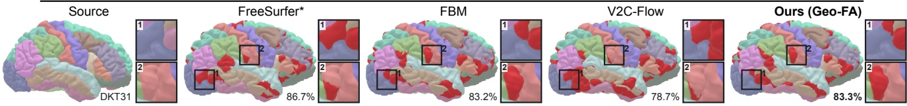</td><td rowspan="4"></td><td rowspan="4"></td><td></td></tr><tr><td></td></tr><tr><td></td></tr><tr><td></td></tr></table>

Figure 5. Label transfer between two held-out Mindboggle-101 subjects (lateral pial view). Source DKT31 labels are transferred to the target. Disagreements with the target’s manually corrected labels are highlighted in red. Zoomed regions are depicted in numbered boxes Percentages give vertex accuracy between the pairs. ∗Reference labels were initialized with FreeSurfer before manual correction.

## 5.3. Cortical Surface Matching

Representing the human cortical surface at its native reconstruction resolution requires more than 100k vertices per hemisphere [16, 28]. At this resolution, dense coupling exceeds practical memory limits (Tab. 2), whereas FlashAttention permits functional-map training on cortical surfaces. Setup. Mindboggle-101 [34] is the largest set of manually corrected human brain surfaces, providing 101 subjects with a DKT31 cortical parcellation each. We focus on the right-hemisphere white surfaces consisting of 122–166k vertices at native resolution and train on 91 × 90 = 8,190 mesh pairs derived from 91 distinct subjects. The evaluation is performed on the remaining ten validation subjects. We run ULRSSM [12] coupled by Geo-FlashAttention (R=64), using WKS [4] and anatomical features as input (see Sec. 7.3).

Baselines. FreeSurfer [28] inflates each hemisphere to a sphere and registers it to a folding-based atlas. Fast Brain Matching [40] (FBM) is the classical spectral correspondence, taken in its geometry-only configuration with no anatomical features. V2C-Flow [9] deforms the FsAverage template to each subject, so correspondence follows from the shared template topology. Sec. 7.3 gives each configuration and how each map is transferred to our meshes.

Metrics. Cortical surfaces lack ground-truth dense correspondence, so the geodesic error of Tab. 1 is unavailable. We therefore transfer the manually corrected DKT31 parcellation [34] (31 regions per hemisphere, delineated along folding landmarks) through each map, reporting vertex accuracy and region-averaged IoU (Tab. 4). Because those labels were FreeSurfer-initialized before manual correction, agreement with FreeSurfer’s own parcellation is partly built into the reference, so we add a label-free score. We subdivide M into S geodesic Voronoi regions, assign each vertex of N to the region containing its $\Pi _ { N M }$ -image, and report the mean absolute log-area ratio $D _ { \mathrm { a r e a } } ( S ) \ =$ $| S | ^ { - 1 } \dot { \sum } _ { s \in \cal S } \left| \log ( a _ { s } ^ { \mathcal { M } } / a _ { s } ^ { \mathcal { N } } ) \right|$ over the regions S non-empty on both surfaces, where $a _ { s } ^ { \mathcal { M } }$ and $a _ { s } ^ { \mathcal { N } }$ are region and preimage areas divided by their native surface’s total area. It is zero for a locally area-preserving map and grows with stretching or compression. Sec. 7.3 gives the construction in full.

Results. Our model attains the lowest area distortion at every scale (Tab. 4), between 49.8 % and 60.1 % below the best baseline. On label transfer, it ranks second on both scores, ahead of V2C-Flow and FBM but behind FreeSurfer, which is used to generate the reference labels and is therefore favored by that metric. $D _ { \mathrm { a r e a } }$ scores only the correspondence map. Fig. 5 shows the transferred cortical labels and local disagreements with the target reference in two zoomed regions.

## 6. Conclusion, Limitations & Future Work

We identifiy spatial–spectral coupling as an attention operation, allowing efficient kernels to scale functional-map pipelines without sacrificing accuracy. Building on this simple yet effective insight, the proposed Geo-FlashAttention demonstrates that geometry-aware sparsification is better suited than linearization, enabling correspondence learning on substantially larger meshes.

Limitations and Future Work. Our reformulation applies only when the correspondence is consumed through a matrix product. Geo-FlashAttention additionally depends on a fixed candidate budget and lacks approximation guarantees. We measure scaling empirically. Moreover, evaluation on cortical surfaces is limited by the absence of dense ground truth. Adaptive candidate selection and stronger evaluation protocols are promising future directions.

Acknowledgements. The authors are grateful to the TU Munich Data Innovation Lab, which generously hosted this project. LB was supported by the UK Royal Society through grant NIF/R1/254128. The authors declare no conflicts of interest.

## References

[1] Dragomir Anguelov, Praveen Srinivasan, Daphne Koller, Sebastian Thrun, Jim Rodgers, and James Davis. SCAPE: Shape completion and animation of people. ACM TOG (SIG-GRAPH), 24(3):408–416, 2005. 6

[2] Souhaib Attaiki and Maks Ovsjanikov. Understanding and improving features learned in deep functional maps. In CVPR, pages 1316–1326, 2023. 4

[3] Souhaib Attaiki, Gautam Pai, and Maks Ovsjanikov. DPFM: Deep partial functional maps. In 3DV, pages 175–185, 2021. 3

[4] Mathieu Aubry, Ulrich Schlickewei, and Daniel Cremers. The wave kernel signature: A quantum mechanical approach to shape analysis. In ICCVW, pages 1626–1633, 2011. 2, 8

[5] Lennart Bastian, Alexander Baumann, Emily Hoppe, Vincent Burgin, Ha Young Kim, Mahdi Saleh, Benjamin Busam,¨ and Nassir Navab. S3M: Scalable statistical shape modeling through unsupervised correspondences. In MICCAI, pages 459–469, 2023. 1, 2

[6] Lennart Bastian, Yizheng Xie, Nassir Navab, and Zorah Lahner. Hybrid functional maps for crease-aware non- ¨ isometric shape matching. In CVPR, pages 3313–3323, 2024. 2, 4, 6, 7

[7] Iz Beltagy, Matthew E. Peters, and Arman Cohan. Longformer: The long-document transformer. arXiv preprint arXiv:2004.05150, 2020. 3

[8] Federica Bogo, Javier Romero, Matthew Loper, and Michael J. Black. FAUST: Dataset and evaluation for 3D mesh registration. In CVPR, pages 3794–3801, 2014. 6

[9] Fabian Bongratz, Anne-Marie Rickmann, and Christian Wachinger. Neural deformation fields for template-based reconstruction of cortical surfaces from MRI. Medical Image Analysis, 93:103093, 2024. 3, 8, 2

[10] Fabian Bongratz, Jan Fecht, Anne-Marie Rickmann, and Christian Wachinger. V2C-Long: Longitudinal cortex reconstruction with spatiotemporal correspondence. Imaging Neuroscience, 3:imag a 00500, 2025. 1, 2

[11] Alexander M. Bronstein, Michael M. Bronstein, and Ron Kimmel. Numerical Geometry of Non-Rigid Shapes. Springer, 2008. 2

[12] Dongliang Cao, Paul Roetzer, and Florian Bernard. Unsupervised learning of robust spectral shape matching. ACM TOG (SIGGRAPH), 42(4):1–15, 2023. 2, 3, 4, 6, 7, 8

[13] Dongliang Cao, Zorah Lahner, and Florian Bernard. Syn-¨ chronous diffusion for unsupervised smooth non-rigid 3D shape matching. In ECCV, pages 262–281, 2024. 7

[14] Benjamin Charlier, Jean Feydy, Joan Alexis Glaunes,\` Franc¸ois-David Collin, and Ghislain Durif. Kernel opera tions on the GPU, with autodiff, without memory overflows. Journal of Machine Learning Research, 22(74):1–6, 2021. 3, 6

[15] Krzysztof Choromanski, Valerii Likhosherstov, David Dohan, Xingyou Song, Andreea Gane, Tamas Sarl´ os, Peter´ Hawkins, Jared Davis, Afroz Mohiuddin, Łukasz Kaiser, David Belanger, Lucy Colwell, and Adrian Weller. Rethinking attention with Performers. In ICLR, 2021. 2, 3, 5

[16] Anders M. Dale, Bruce Fischl, and Martin I. Sereno. Cortical surface-based analysis. I. Segmentation and surface reconstruction. NeuroImage, 9(2):179–194, 1999. 2, 8

[17] Tri Dao. FlashAttention-2: Faster attention with better par allelism and work partitioning. In ICLR, 2024. 2, 3, 5

[18] Tri Dao, Daniel Y. Fu, Stefano Ermon, Atri Rudra, and Christopher Re. FlashAttention: Fast and memory-efficient´ exact attention with IO-awareness. In NeurIPS, pages 16344–16359, 2022. 2, 3, 5

[19] Bradford C. Dickerson, Akram Bakkour, David H. Salat, Eric Feczko, Jenni Pacheco, Douglas N. Greve, Fran Grodstein, Christopher I. Wright, Deborah Blacker, H. Diana Rosas, Reisa A. Sperling, Alireza Atri, John H. Growdon, Bradley T. Hyman, John C. Morris, Bruce Fischl, and Randy L. Buckner. The cortical signature of Alzheimer’s disease: Regionally specific cortical thinning relates to symptom severity in very mild to mild AD dementia and is detectable in asymptomatic amyloid-positive individuals. Cerebral Cortex, 19(3):497–510, 2009. 3

[20] Nicolas Donati, Abhishek Sharma, and Maks Ovsjanikov. Deep geometric functional maps: Robust feature learning for shape correspondence. In CVPR, pages 8592–8601, 2020. 2, 6, 7

[21] Nicolas Donati, Etienne Corman, Simone Melzi, and Maks Ovsjanikov. Complex Functional Maps: A Conformal Link Between Tangent Bundles. Computer Graphics Forum, 41 (1):317–334, 2022. 1

[22] Nicolas Donati, Etienne Corman, and Maks Ovsjanikov. Deep orientation-aware functional maps: Tackling symmetry issues in shape matching. In Proceedings of the IEEE/CVF Conference on Computer Vision and Pattern Recognition, pages 742–751, 2022. 1

[23] Viktoria Ehm, Nafie El Amrani, Yizheng Xie, Lennart Bastian, Maolin Gao, Weikang Wang, Lu Sang, Dongliang Cao,

Tobias Weißberg, Zorah Lahner, Daniel Cremers, and Flo-¨ rian Bernard. Beyond complete shapes: A benchmark for quantitative evaluation of 3D shape surface matching algorithms. Computer Graphics Forum, 44(5):e70186, 2025. 1

[24] Marvin Eisenberger, Zorah Lahner, and Daniel Cremers.¨ Smooth shells: Multi-scale shape registration with functional maps. In CVPR, pages 12265–12274, 2020. 7

[25] Marvin Eisenberger, Aysim Toker, Laura Leal-Taixe, and´ Daniel Cremers. Deep shells: Unsupervised shape correspondence with optimal transport. In NeurIPS, pages 10491– 10502, 2020. 7

[26] Nafie El Amrani, Dongliang Cao, and Florian Bernard. A universal and flexible framework for unsupervised statistical shape model learning. In MICCAI, pages 26–36, 2024. 1, 2

[27] N. El Amrani, P. Roetzer, and F. Bernard. High-resolution 3d shape matching with global optimality and geometric consistency. Computer Graphics Forum, 44(5):e70208, 2025. 2

[28] Bruce Fischl. FreeSurfer. NeuroImage, 62(2):774–781, 2012. 2, 3, 8

[29] Bruce Fischl, Martin I. Sereno, Roger B. H. Tootell, and Anders M. Dale. High-resolution intersubject averaging and a coordinate system for the cortical surface. Human Brain Mapping, 8(4):272–284, 1999. 1

[30] Oshri Halimi, Or Litany, Emanuele Rodola, Alex M. Bron-\` stein, and Ron Kimmel. Unsupervised learning of dense shape correspondence. In CVPR, pages 4370–4379, 2019. 2

[31] Alexandra Heuschling, Hannah Meinhold, and Leif Kobbelt. Establishing shape correspondences: A survey. Computer Graphics Forum, page e70406, 2026. Eurographics Stateof-the-Art Report. 2

[32] Angelos Katharopoulos, Apoorv Vyas, Nikolaos Pappas, and Franc¸ois Fleuret. Transformers are RNNs: Fast autoregressive transformers with linear attention. In ICML, pages 5156–5165, 2020. 2, 3, 5

[33] Vladimir G. Kim, Yaron Lipman, and Thomas Funkhouser. Blended intrinsic maps. ACM TOG (SIGGRAPH), 30(4):1– 12, 2011. 2

[34] Arno Klein and Jason Tourville. 101 labeled brain images and a consistent human cortical labeling protocol. Frontiers in Neuroscience, 6:171, 2012. 8, 2

[35] Zorah Lahner, Emanuele Rodol¨ a, Michael M. Bronstein,\` Daniel Cremers, Oliver Burghard, Luca Cosmo, Alexander Dieckmann, Reinhard Klein, and Yusuf Sahillioglu.˘ SHREC’16: Matching of deformable shapes with topological noise. In Eurographics Workshop on 3D Object Retrieval (3DOR), pages 55–60, 2016. 6, 7

[36] Lei Li, Nicolas Donati, and Maks Ovsjanikov. Learning multi-resolution functional maps with spectral attention for robust shape matching. In NeurIPS, pages 29336–29349, 2022. 3, 7

[37] Yang Li, Hikari Takehara, Takafumi Taketomi, Bo Zheng, and Matthias Nießner. 4DComplete: Non-rigid motion estimation beyond the observable surface. In ICCV, pages 12706–12716, 2021. 6

[38] Yaron Lipman and Thomas Funkhouser. Mobius voting for¨ surface correspondence. ACM TOG (SIGGRAPH), 28(3):1– 12, 2009. 2

[39] Or Litany, Tal Remez, Emanuele Rodola, Alex Bronstein, and Michael Bronstein. Deep functional maps: Structured prediction for dense shape correspondence. In ICCV, pages 5659–5667, 2017. 2

[40] Herve Lombaert, Leo Grady, Jonathan R. Polimeni, and´ Farida Cheriet. Fast brain matching with spectral correspondence. In Information Processing in Medical Imaging (IPMI), pages 660–673, 2011. 3, 8, 2

[41] Matthew Loper, Naureen Mahmood, Javier Romero, Gerard Pons-Moll, and Michael J. Black. SMPL: A skinned multiperson linear model. ACM TOG (SIGGRAPH Asia), 34(6): 1–16, 2015. 1

[42] Filippo Maggioli, Daniele Baieri, Emanuele Rodola, and Si-\` mone Melzi. ReMatching: Low-resolution representations for scalable shape correspondence. In ECCV, pages 183– 200, 2024. 2

[43] Robin Magnet and Maks Ovsjanikov. Scalable and efficient functional map computations on dense meshes. Computer Graphics Forum, 42(2):89–101, 2023. 3

[44] Robin Magnet and Maks Ovsjanikov. Memory-scalable and simplified functional map learning. In CVPR, pages 4041– 4050, 2024. 3, 4, 6, 7

[45] Simone Melzi, Riccardo Marin, Emanuele Rodola, Umberto\` Castellani, Jing Ren, Adrien Poulenard, Peter Wonka, and Maks Ovsjanikov. SHREC’19: Matching humans with different connectivity. In Eurographics Workshop on 3D Object Retrieval (3DOR), pages 121–128, 2019. 6

[46] Simone Melzi, Jing Ren, Emanuele Rodola, Abhishek\` Sharma, Peter Wonka, and Maks Ovsjanikov. ZoomOut: Spectral upsampling for efficient shape correspondence. ACM TOG (SIGGRAPH Asia), 38(6):1–14, 2019. 2, 3, 4, 6, 7

[47] Maks Ovsjanikov, Mirela Ben-Chen, Justin Solomon, Adrian Butscher, and Leonidas Guibas. Functional maps: A flexible representation of maps between shapes. ACM TOG (SIG-GRAPH), 31(4):1–11, 2012. 2

[48] Markus N. Rabe and Charles Staats. Self-attention does not need O(n2) memory. arXiv preprint arXiv:2112.05682, 2021. 7

[49] Alessandro Raganato, Gabriella Pasi, and Simone Melzi. Attention and positional encoding are (almost) all you need for shape matching. Computer Graphics Forum, 42(5):e14912, 2023. 3

[50] Jing Ren, Adrien Poulenard, Peter Wonka, and Maks Ovsjanikov. Continuous and orientation-preserving correspondences via functional maps. ACM TOG (SIGGRAPH Asia), 37(6):1–16, 2018. 2

[51] Jing Ren, Simone Melzi, Peter Wonka, and Maks Ovsjanikov. Discrete optimization for shape matching. Com puter Graphics Forum, 40(5):81–96, 2021. 4

[52] Martin Reuter, Franz-Erich Wolter, and Niklas Peinecke. Laplace–Beltrami spectra as “Shape-DNA” of surfaces and solids. Computer-Aided Design, 38(4):342–366, 2006. 2

[53] Alessandro Riva, Alessandro Raganato, and Simone Melzi. Localized gaussians as self-attention weights for point clouds correspondence. In Smart Tools and Applications in Graphics – Eurographics Italian Chapter Conference. The Eurographics Association, 2024. 3

[54] Emma C. Robinson, Saad Jbabdi, Matthew F. Glasser, Jesper Andersson, Gregory C. Burgess, Michael P. Harms, Stephen M. Smith, David C. Van Essen, and Mark Jenkinson. MSM: A new flexible framework for Multimodal Surface Matching. NeuroImage, 100:414–426, 2014. 3

[55] Emanuele Rodola, Michael M\` oller, and Daniel Cremers.¨ Point-wise map recovery and refinement from functional correspondence. In Vision, Modeling, and Visualization (VMV), pages 25–32, 2015. 2

[56] Paul Roetzer and Florian Bernard. SpiderMatch: 3D shape matching with global optimality and geometric consistency. In CVPR, pages 14543–14553, 2024. 2

[57] Jean-Michel Roufosse, Abhishek Sharma, and Maks Ovsjanikov. Unsupervised deep learning for structured shape matching. In ICCV, pages 1617–1627, 2019. 2

[58] Nicholas Sharp, Souhaib Attaiki, Keenan Crane, and Maks Ovsjanikov. DiffusionNet: Discretization agnostic learning on surfaces. ACM TOG, 41(3):1–16, 2022. 2

[59] Olga Sorkine and Marc Alexa. As-rigid-as-possible surface modeling. In Eurographics Symposium on Geometry Processing (SGP), pages 109–116, 2007. 1

[60] Robert W. Sumner and Jovan Popovic. Deformation transfer´ for triangle meshes. ACM TOG (SIGGRAPH), 23(3):399– 405, 2004. 1

[61] Jian Sun, Maks Ovsjanikov, and Leonidas Guibas. A concise and provably informative multi-scale signature based on heat diffusion. Computer Graphics Forum, 28(5):1383– 1392, 2009. 2

[62] Mingze Sun, Shiwei Mao, Puhua Jiang, Maks Ovsjanikov, and Ruqi Huang. Spatially and spectrally consistent deep functional maps. In ICCV, pages 14497–14507, 2023. 2, 4

[63] Philippe Tillet, H. T. Kung, and David Cox. Triton: An intermediate language and compiler for tiled neural network computations. In ACM SIGPLAN Int. Workshop on Machine Learning and Programming Languages (MAPL), pages 10– 19, 2019. 6

[64] Giovanni Trappolini, Luca Cosmo, Luca Moschella, Riccardo Marin, Simone Melzi, and Emanuele Rodola. Shape\` Registration in the Time of Transformers. In Advances in Neural Information Processing Systems, pages 5731–5744. Curran Associates, Inc., 2021. 3

[65] Ashish Vaswani, Noam Shazeer, Niki Parmar, Jakob Uszkoreit, Llion Jones, Aidan N. Gomez, Łukasz Kaiser, and Illia Polosukhin. Attention is all you need. In NeurIPS, pages 5998–6008, 2017. 2, 3

[66] Matthias Vestner, Zorah Lahner, Amit Boyarski, Or Litany,¨ Ron Slossberg, Tal Remez, Emanuele Rodola, Alex Bronstein, Michael Bronstein, Ron Kimmel, and Daniel Cremers. Efficient Deformable Shape Correspondence via Kernel Matching. In 3DV, pages 517–526, 2017. 2

[67] Matthias Vestner, Roee Litman, Emanuele Rodola, Alex\` Bronstein, and Daniel Cremers. Product manifold filter: Non-rigid shape correspondence via kernel density estimation in the product space. In CVPR, pages 3327–3336, 2017. 2

[68] Tony Danjun Wang, Lennart Bastian, Tobias Czempiel, Christian Heiliger, and Nassir Navab. Beyond role-based

surgical domain modeling: Generalizable re-identification in the operating room. Medical Image Analysis, 105:103687, 2025. 1

[69] Thomas Windheuser, Ulrich Schlickewei, Frank R. Schmidt, and Daniel Cremers. Geometrically consistent elastic match ing of 3D shapes: A linear programming solution. In ICCV, pages 2134–2141, 2011. 2

[70] Yizheng Xie, Lennart Bastian, Congyue Deng, Thomas W. Mitchel, Maolin Gao, and Daniel Cremers. DeepShape-MatchingKit: Accelerated functional map solver and shape matching pipelines revisited. In CVPRW, pages 159–168, 2026. 6, 7, 2

[71] B. T. Thomas Yeo, Mert R. Sabuncu, Tom Vercauteren, Nicholas Ayache, Bruce Fischl, and Polina Golland. Spherical Demons: Fast diffeomorphic landmark-free surface registration. IEEE Transactions on Medical Imaging, 29(3): 650–668, 2010. 3

[72] Manzil Zaheer, Guru Guruganesh, Kumar Avinava Dubey, Joshua Ainslie, Chris Alberti, Santiago Ontan˜on, Philip´ Pham, Anirudh Ravula, Qifan Wang, Li Yang, and Amr Ahmed. Big Bird: Transformers for longer sequences. In NeurIPS, pages 17283–17297, 2020. 3

[73] Aleksei Zhuravlev, Lennart Bastian, Dongliang Cao, Nafie El Amrani, Paul Roetzer, Viktoria Ehm, Riccardo Marin, Hiroki Nishizawa, Shigeo Morishima, Christian Theobalt, Nas sir Navab, Daniel Cremers, Florian Bernard, Zorah Lahner,¨ and Vladislav Golyanik. Non-rigid 3D shape correspon dences: From foundations to open challenges and opportunities. Computer Graphics Forum, 45(2):e70397, 2026. Eurographics State-of-the-Art Report. 2

[74] Silvia Zuffi, Angjoo Kanazawa, David Jacobs, and Michael J. Black. 3D menagerie: Modeling the 3D shape and pose of animals. In CVPR, pages 6365–6373, 2017. 6

# Spatial-Spectral Coupling as Attention: Scaling Shape Correspondence to High-Resolution Surfaces

Supplementary Material

We organize the supplementary materials as follows. Sec. 7.1 describes our evaluation protocol for comparison of attention kernels. Sec. 7.2 lists the software, backends, architectures, losses, and learning rate schedules. Sec. 7.3 provides the Mindboggle-101 evaluation protocol, configurations and the label-transfer metric behind Tab. 4. Sec. 8.1 quantifies what the linearized couplings cost in accuracy and coupling rank. In Sec. 8.2, we assess scaling characteristics of the different couplings across seven decimated TOPKIDS resolutions. In Sec. 8.3, we analyze whether the fixed softmax temperature of linear attention variants is optimal and whether it can be learned. Sec. 8.4 shows qualitative transfers across spatial–spectral couplings and cortical correspondence methods. Sec. 8.5 assesses the Euclidean patch construction against an improved geodesic patch variant it approximates. In Sec. 8.6 we sweep the candidate budget R across benchmarks. Sec. 8.7 presents the geodesic error distributions for Tabs. 1 and S3.

## 7. Evaluation and Implementation Details

## 7.1. Evaluation Protocol

Seeds and statistics. The deep functional maps (DFM) literature commonly reports the best of N runs. As we seek to distinguish between computational modules and their effect in various algorithms, we instead report the mean and standard deviation over five pre-declared seeds unless noted otherwise. We observe that SGD optimization in the deep variants sometimes converges to discontinuous part-exchanging maps despite comparable training objectives (Fig. S1), a known failure mode of DFM methods [21, 22]. On SMAL and DT4D-inter this variability is concentrated in pairs containing one bistable shape, horse 05 and GoalkeeperScoop, respectively, and occurs across couplings rather than identifying a particular kernel. Excluding these pairs reduces the errors of the learned methods, making their behavior more predictable and enabling easier comparison between runs. We thus apply this exclusion identically to every row to separate the kernel comparison from the finite-seed flip draw, and report the all-pairs values alongside them in Tab. S1. SHREC’19 likewise contains visibly bistable shapes, but in the main-table results, we retain all shape pairs as the variance is generally high. Separately, one isolated ULRSSM dense seed on SMAL was replaced under a pre-declared, label-free within-arm rule: its closest-peer map disagreement exceeded 1.4× the arm median.

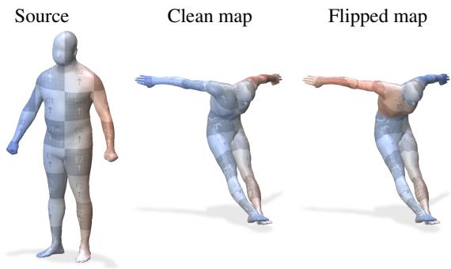  
Figure S1. Seed-dependent flip on SHREC’19 shape 28. The source is coloured by signed lateral coordinate and pulled through the predicted map. One seed preserves the sides, while another exchanges them over the upper body.

Table S1. All-pairs results. Mean geodesic error $( \times 1 0 0 , \downarrow )$ including the bistable pairs omitted from the corresponding SMAL and DT4D-inter cells of Tabs. 1 and S3. The exclusion consistently improves the mean across learned pipelines. It does not improve ZoomOut on SMAL, whose errors are distributed broadly rather than concentrated on the bistable pairs.
<table><tr><td>Method</td><td>Coupling</td><td>SMAL</td><td>DT4D-inter</td></tr><tr><td rowspan="4">ZoomOut</td><td>Dense</td><td> $2 3 . 2 3 \pm 4 . 0 2$ </td><td> $8 . 0 3 \pm 2 . 4 9$ </td></tr><tr><td>FlashAttention</td><td> $2 5 . 3 7 \pm 2 . 9 1$ </td><td> $9 . 2 5 \pm 2 . 3 2$ </td></tr><tr><td>Geo-FlashAttention</td><td> $2 4 . 2 0 \pm 1 . 9 5$ </td><td> $1 1 . 2 2 \pm 0 . 8 5$ </td></tr><tr><td>Dense</td><td> $5 . 1 2 \pm 0 . 7 0$ </td><td> $4 . 4 9 \pm 0 . 2 9$ </td></tr><tr><td rowspan="5">ULRSSM</td><td>FlashAttention</td><td> $4 . 6 4 \pm 0 . 6 9$ </td><td> $6 . 1 7 \pm 2 . 2 6$ </td></tr><tr><td>Geo-FlashAttention</td><td> $5 . 4 3 \pm 0 . 5 7$ </td><td> $5 . 0 0 \pm 1 . 9 6$ </td></tr><tr><td>Linear (ELU)</td><td> $6 . 8 2 \pm 0 . 8 7$ </td><td> $8 . 1 9 \pm 1 . 4 3$ </td></tr><tr><td>Performer</td><td> $7 . 5 4 \pm 1 . 2 6$ </td><td> $1 0 . 9 4 \pm 0 . 9 7$ </td></tr><tr><td>Dense</td><td> $4 . 0 7 \pm 0 . 7 0$ </td><td> $3 . 7 2 \pm 0 . 1 1$ </td></tr><tr><td rowspan="3">HFM</td><td>FlashAttention</td><td> $3 . 9 8 \pm 0 . 4 4$ </td><td> $3 . 7 2 \pm 0 . 1 6$ </td></tr><tr><td>Geo-FlashAttention</td><td> $3 . 6 2 \pm 0 . 2 4$ </td><td> $3 . 6 7 \pm 0 . 0 2$ </td></tr><tr><td></td><td></td><td></td></tr></table>

TOPKIDS. TOPKIDS has no bistable shape, so no pairs are excluded there: Tab. 2 reports all 25 test pairs. On the released benchmarks every coupling uses the same five seeds.

## 7.2. Implementation Details and Hyperparameters

Software and exact backends. We use PyTorch 2.3.0 with CUDA 12.1. KeOps evaluates the same sum-softmaxweight reduction as an fp32 LazyTensor, per the authors’ original implementation. fp32 SDPA and bf16 FlashAttention utilize PyTorch’s scaled dot-product attention interface. Linearized backends. Performer uses 256 orthogonal random features in fp32, with the projection fixed by seed 42 across runs. Linear attention uses the amplified ELU feature map of Sec. 4 with polynomial amplification $\scriptstyle { p = 5 } .$

<table><tr><td rowspan="2">Benchmark</td><td colspan="4">ULRSSM / HFM</td><td colspan="2">diff. ZoomOut</td></tr><tr><td>pairs</td><td>epochs</td><td>iters</td><td>TTA</td><td>pairs</td><td>iters</td></tr><tr><td>FAUST</td><td>6400</td><td>15</td><td>96 000</td><td>0</td><td>3160</td><td>31 600</td></tr><tr><td>SCAPE</td><td>2601</td><td>30</td><td>78 030</td><td>0</td><td>1275</td><td>12750</td></tr><tr><td>SHREC&#x27;19</td><td>9001</td><td>10</td><td>90 010</td><td>12</td><td>4435</td><td>44350</td></tr><tr><td>SMAL</td><td>841</td><td>20</td><td>16 820</td><td>15</td><td>406</td><td>4060</td></tr><tr><td>DT4D-H</td><td>8879</td><td>10</td><td>88790</td><td>0/15</td><td>8702</td><td>87020</td></tr><tr><td>TOPKIDS</td><td>676</td><td>100</td><td>67600</td><td>15</td><td>一</td><td></td></tr></table>

Table S2. Training schedule per benchmark, batch size one. SHREC’19 trains on FAUST and SCAPE; one DT4D training serves the intra- and inter-class evaluations (0 and 15 testtime adaptation (TTA) steps). Differentiable ZoomOut trains ten epochs everywhere, with no TTA beyond its ten refinement iterations, and is not run on TOPKIDS.

Differentiable ZoomOut. ZoomOut is a standard refinement procedure, but in the differentiable variant the descriptors it refines are learned. We use ten refinement iterations, growing the spectral dimension from 20 to 120 in steps of 10, with blur $\sigma { = } 1 0 ^ { - 2 }$ normalized by the maximum pairwise feature distance. It uses 128 eigenfunctions and a DiffusionNet of width 256 with four blocks, no dropout and a 32-dimensional output, trained with Adam at $1 0 ^ { - 4 }$ $\beta = ( 0 . 9 , 0 . 9 9 )$ and no weight decay, the learning rate dropping tenfold after the fifth of ten epochs. Its loss is the unweighted sum of three terms: the orthogonality defect of the initial $2 0 \times 2 0$ map, that of the refined $1 2 0 \times 1 2 0$ map, and the disagreement between the initial map and the leading $2 0 \times 2 0$ block of the refined one, which is detached. Each term is normalized by $1 0 0 / k ^ { 2 }$ for a given k. We keep ZoomOut’s Gaussian coupling $\mathrm { S o f t m a x } ( - \| q - k \| ^ { 2 } / ( 2 \sigma ^ { 2 } ) )$ . To run it through the attention backends, we augment the queries and keys so that the negative squared distance is equivalent to a dot product. Exact SDPA then evaluates the same Gaussian weights, and Geo-FlashAttention restricts them to its sparse support.

Training. We use the standard implementations provided by DeepShapeMatchingKit [70]. ULRSSM and HFM use a DiffusionNet [58] with width 128, four blocks, and dropout, which maps 128-dimensional auto-scaled WKS channels (raw, augmented vertex coordinates on SMAL, as in the reference implementation) to 256-dimensional descriptors. Both the WKS descriptors and DiffusionNet’s spectral diffusion use the first 128 Laplace–Beltrami eigenpairs, while the functional map is solved at 200 eigenfunctions on every benchmark. Optimizer settings are as follows: we use Adam at learning rate $1 0 ^ { - 3 }$ , with the default $\beta = ( 0 . 9 , 0 . 9 9 9 )$ and no weight decay, cosine-annealed to $1 0 ^ { - 4 }$ over the run without warmup, on one pair per step.

## 7.3. Cortical Evaluation Details

Dataset and surfaces. Mindboggle-101 pools 101 T1- weighted MRI scans from several collections, so acquisition site and protocol vary across the set. The white and pial surfaces are FreeSurfer reconstructions [28], and the DKT31 labels were produced by FreeSurfer’s automated parcellation and then corrected by hand [34]. Every method uses the same FreeSurfer reconstructions, except V2C-Flow, which is itself a reconstruction tool. The ten held-out subjects yield 90 shape pairs, with each subject in 18 of them.

Configurations. For our comparison in Tab. 4 we use ULRSSM [12] with 200 Laplace–Beltrami eigenfunctions and a DiffusionNet extractor on 134 anatomical channels (WKS, curvature, FreeSurfer sulcal depth and cortical thickness), coupled by geodesic Geo-FlashAttention (R=64) at ${ \tau } { = } 0 . 0 7 .$ , averaged over three seeds. Each run is scheduled for three epochs (24 570 pairs). Validation runs every 500 iterations on the ten held-out subjects, scoring the parcellation Jaccard of the transferred labels. Early stopping is conducted with a patience of 25. We evaluate these final checkpoints on the same validation subjects. Among the baselines, FreeSurfer [28] matches vertices on the registered sphere, selecting the source vertex with the largest barycentric weight. FBM [40] uses $K { = } 5 0$ graph-Laplacian eigenvectors and no anatomical features; and V2C-Flow [9] deforms the 163,842-vertex FsAverage template, and its correspondence is transferred to our meshes by nearestneighbor lookup.

Label transfer. The Desikan–Killiany–Tourville protocol assigns each vertex to one of 31 cortical regions per hemisphere, delineated along folding landmarks [34]. Accuracy is the fraction of vertices whose transferred label matches the manual one. mIoU intersects the transferred and manual vertex sets for each region and averages them across regions, so small and large regions count equally. Because the labels were FreeSurfer-initialized before manual correction, agreement with FreeSurfer’s own parcellation is partly built into the reference, which is why we report the labelfree $D _ { \mathrm { a r e a } }$ beside them.

Area distortion. The S regions partitioning M are geodesic Voronoi cells based on farthest-point samples on the input meshes (unrelated to the candidate patches of Sec. 4.2). We partition both surfaces by the lumped vertex mass $M _ { v v }$ (Sec. 3.1), so no area is lost at region boundaries, and we average the metric over all non-empty regions on both surfaces. Each region area is divided by its native surface’s total area before taking the log ratio.

## 8. Additional Empirical Results

## 8.1. Cost of Linearized Couplings

Linear attention replaces the softmax kernel with an approximate computation. Unlike the exact kernels of Tab. 1, it therefore changes the correspondence computations themselves, and affects the resulting training dynamics. We report the performance drop across standard benchmarks in Tab. S3.

Dense FlashAttention Linear attention Geo-FlashAttention (ours)  
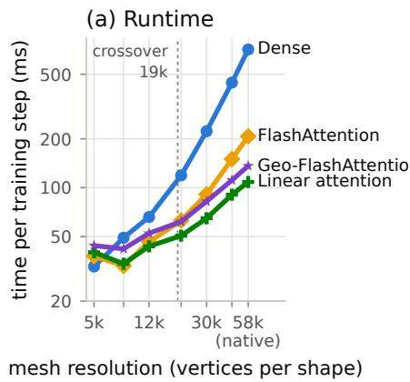

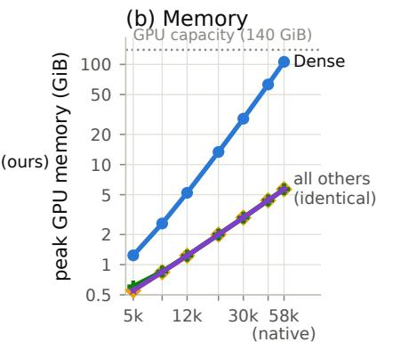  
mesh resolution (vertices per shape)

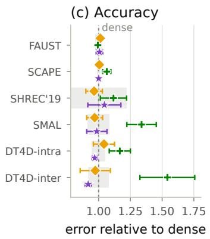  
Figure S2. Training time and peak memory across seven TOPKIDS resolutions, and accuracy relative to the dense coupling on the standard benchmarks. In (c), markers are means over five seeds, error bars their standard deviation, and the grey band the spread of the dense reference; the rows repeat the ULRSSM block of Tab. 1 and the ELU column of Tab. S3 under the same seeds and exclusions (Sec. 7.1). Non-dense methods share a single memory curve. One representative per class of coupling is shown; Performer, KeOps and fp32 SDPA are omitted.

Table S3. Cost of linearized couplings. Mean geodesic error (×100, ↓); unlike Tab. 1, these approximate the softmax kernel and change the correspondence. Markers: two-sample t-test against the dense reference over five seeds, $^ { * } p \ < 0 . 0 5 , ^ { * * } p <$ 0.01, $^ { * * * } p < 0 . 0 0 1$
<table><tr><td rowspan="2">Benchmark</td><td>Dense</td><td colspan="2">Linear attention</td></tr><tr><td>(reference)</td><td>ELU</td><td>Performer</td></tr><tr><td>FAUST</td><td> $1 . 5 6 \pm 0 . 0 4$ </td><td> $1 . 5 5 \pm 0 . 0 1$ </td><td> $1 . 9 3 \pm 0 . 1 3 ^ { \ast \ast \ast }$ </td></tr><tr><td>SCAPE</td><td> $1 . 8 7 \pm 0 . 0 2$ </td><td> $1 . 9 9 \pm 0 . 0 6 ^ { \ast \ast }$ </td><td> $2 . 4 7 \pm 0 . 1 0 ^ { * * }$ </td></tr><tr><td>SHREC&#x27;19</td><td> $4 . 4 5 \pm 0 . 9 8$ </td><td> $4 . 9 7 \pm 0 . 4 6$ </td><td> $5 . 6 4 \pm 1 . 4 2$ </td></tr><tr><td>SMAL</td><td> $4 . 1 4 \pm 0 . 3 5$ </td><td> $5 . 5 4 \pm 0 . 4 8 ^ { \ast \ast \ast }$ </td><td> $6 . 8 5 \pm 1 . 1 5 ^ { \ast \ast \ast }$ </td></tr><tr><td>DT4D-intra</td><td> $0 . 9 6 \pm 0 . 0 5$ </td><td> $1 . 1 2 \pm 0 . 0 8 ^ { \ast \ast }$ </td><td> $1 . 2 9 \pm 0 . 1 2 ^ { \ast \ast \ast }$ </td></tr><tr><td>DT4D-inter</td><td> $4 . 1 2 \pm 0 . 3 3$ </td><td> $6 . 3 5 \pm 0 . 8 9 ^ { \ast \ast \ast }$ </td><td> $9 . 3 7 \pm 1 . 0 6 ^ { \ast \ast \ast }$ </td></tr></table>

ELU is similar to the dense coupling on FAUST but significantly worse on four of the six benchmarks. Performer is notably worse on five. Both comparisons are inconclusive on SHREC’19, where seed variance is large. The largest gaps are on SMAL and DT4D-inter, the most significantly non-isometric datasets. This is consistent with the difficulty of representing a sharply peaked softmax with the low-rank feature maps of Sec. 4, which we further examine in Sec. 8.3.

Rank of the converged coupling. In Sec. 4, we state that the soft assignment is typically near-full rank. This is an empirical observation, which we observe in the following settings. On one converged FlashAttention checkpoint per benchmark and 20–40 test pairs, we replace the exact product ΠΦ by each approximation and report the relative Frobenius error of the induced 200 × 200 functional map (Tab. S4). Rank is near-full everywhere: even the optimal rank-m truncation of Π by SVD errs by 0.36–0.59 on every benchmark at m=200, the spectral dimension, and reaching $\sim 1 0 ^ { - 2 }$ requires m=1024.

With increasing deviation from isometry, the effective row support grows from 24 vertices on FAUST to 54 on SMAL. Over the same range, top-k truncation error increases 5× and spherical-kernel error 2.3×, whereas optimal truncation and Nystrom show no corresponding degra-¨ dation. We study the associated sharpness in more detail in Sec. 8.3, and Tab. S3 shows the effect on training dynamics in terms of the final geodesic error.

## 8.2. Empirical Scaling with Mesh Resolution

Setup. To assess the scaling complexity of Geo-FlashAttention compared to other methods, we decimate the released TOPKIDS-HD scans to six uniform resolutions from 5k to 45k vertices, rescaled to unit area. Together with the native scans (58k vertices on average, quoted as 60k in the main text), this yields seven resolutions. At each resolution, we time the coupling and the full training step on one H200 NVL, and fit the exponent a in $y = c N ^ { a }$ by least squares on log y against log N over the four upper resolutions (20k, 30k, 45k and native), properly accounting for startup overheads. We report scaling coefficients from empirical fits over this decimation range.

Results. At 5k the methods differ by only 1.3× per training step, because the feature extractor dominates the computation cost. At 60k, we see the coupling dominating. The fitted runtime exponents of the isolated coupling are a=1.97 for dense attention, 1.83 for FlashAttention, 0.81 for linear attention and 0.81 for Geo-FlashAttention. The full-step exponents are 1.67, 1.13, 0.73 and 0.74, as feature extraction and spectral operations add fixed costs. Peak training memory scales with a=1.94 for dense attention and a=0.98 for every non-dense method, which stay within 0.01 GiB of one another at 60k. Candidate construction makes Geo-FlashAttention slower at small resolutions, but it crosses

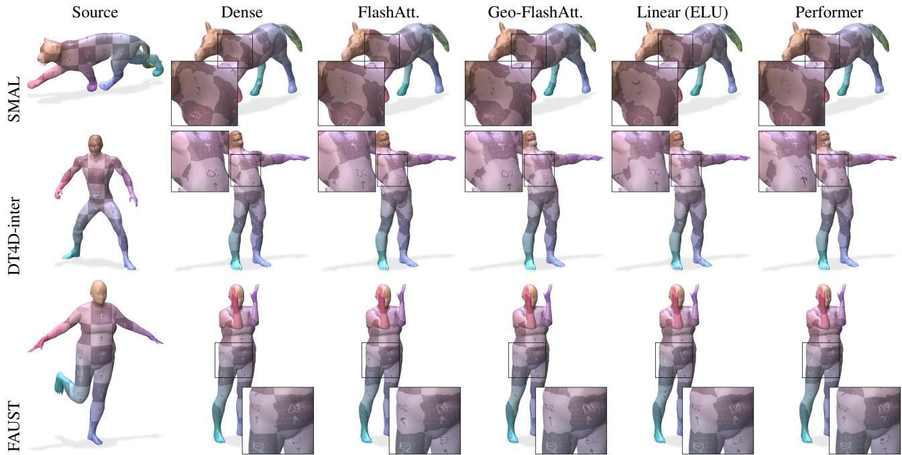  
Figure S3. Qualitative comparison of spatial–spectral couplings. Texture is transferred through maps estimated from the same shape pair and seed. The exact couplings preserve the same regions. On SMAL and DT4D-inter, Performer fragments the transferred grid, whereas ELU mainly shifts region boundaries, consistent with Tab. S3. All couplings appear similar on FAUST.

Table S4. Approximating a converged coupling. Each method approximates the converged point-to-point coupling Π. We assess optimal rank-m truncation by SVD, Nystrom with¨ m landmarks, top-k row truncation, or the spherical kernel (p=32). Entries report the relative Frobenius error of the functional map induced by the approximated coupling, for one converged checkpoint per benchmark. Support is the effective number of vertices per softmax row. Benchmarks are ordered by support; best per column in bold.
<table><tr><td></td><td></td><td colspan="2">SVD</td><td>Nyström</td><td>top-k</td><td>spherical</td></tr><tr><td>Benchmark support</td><td></td><td>m=200</td><td>m=1024</td><td>m=1024</td><td>k=128</td><td>p=32</td></tr><tr><td>FAUST</td><td>24.1</td><td>0.449</td><td>0.0209</td><td>0.149</td><td>0.0027</td><td>0.028</td></tr><tr><td>SCAPE</td><td>24.0</td><td>0.459</td><td>0.0133</td><td>0.160</td><td>0.0062</td><td>0.038</td></tr><tr><td>DT4D</td><td>36.0</td><td>0.587</td><td>0.0233</td><td>0.126</td><td>0.0113</td><td>0.041</td></tr><tr><td>SMAL</td><td>54.4</td><td>0.358</td><td>0.0058</td><td>0.157</td><td>0.0134</td><td>0.064</td></tr></table>

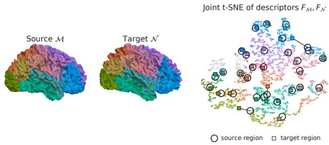  
Figure S4. Learned cortical descriptors. One Mindboggle pair, colored by DKT regions, with the joint t-SNE embedding of its descriptors.

FlashAttention near 20k vertices. At 60k, its coupling is 3.0×, and its training step is 1.5× faster, at the same peak memory. Fig. S2 shows the full curves.

## 8.3. Coupling Sharpness and Non-Isometry

The temperature τ=0.07 of the soft correspondence (Sec. 4) is inherited from prior work [12] and held fixed in every experiment. Here, we ask whether that constant is optimal, whether its optimum is constant, and how this sharpness affects linear couplings.

To vary sharpness continuously around a specific temperature, we replace the exponential kernel on the normalized descriptors with the bandwidth-matched spherical kernel $( ( 1 + q _ { i } ^ { \top } k _ { j } ) / 2 ) ^ { p }$ , which approximates exp $( q _ { i } ^ { \top } k _ { j } / \tau )$ on the unit sphere and matches τ at $p = 2 / \tau \approx 2 9 . \mathrm { ~ A ~ }$ larger p is sharper. We assess the product using a single converged run per benchmark and a fixed subset of test pairs, measuring the alignment loss of the induced functional map relative to the exact softmax.

Table S5. Euclidean vs. geodesic patches. P1: vertices whose assigned patch is not their geodesically nearest. P2: patches that are not connected regions, and vertices outside the largest piece of their patch. Averages over all meshes of each benchmark; the geodesic partition has none by construction. Violations are common and do not grow with resolution.
<table><tr><td colspan="2"></td><td colspan="2">P1 viol. P2 viol. (%)</td></tr><tr><td>Benchmark</td><td>|V|</td><td>(%)</td><td>patches vertices</td></tr><tr><td>FAUST</td><td>5.0k</td><td>10.6</td><td>9.2 4.4</td></tr><tr><td>SCAPE</td><td>5.0k</td><td>6.1 2.2</td><td>0.6</td></tr><tr><td>SHREC&#x27;19</td><td>5.2k</td><td>10.1 8.3</td><td>4.0</td></tr><tr><td>SMAL</td><td>5.2k</td><td>13.0 13.3</td><td>5.8</td></tr><tr><td>TOPKIDS</td><td>10.4k</td><td>12.3 11.2</td><td>2.6</td></tr><tr><td>TOPKIDS-HD</td><td>60k</td><td>11.3</td><td>6.2 1.6</td></tr><tr><td>Cortex</td><td>146k</td><td>8.0 14.8</td><td>2.9</td></tr></table>

Table S6. Support quality under either partition on SMAL (400 test pairs), by candidate budget R. Recall: ground-truth correspondent inside the support. Mass: dense softmax mass the support retains. The two partitions differ marginally.
<table><tr><td></td><td></td><td colspan="2">Recall</td><td colspan="2">Mass</td></tr><tr><td>R</td><td> $| { \cal S } _ { a , R } |$ </td><td>Euc.</td><td>Geo.</td><td>Euc.</td><td>Geo.</td></tr><tr><td>4</td><td>132</td><td>0.685</td><td>0.698</td><td>0.716</td><td>0.735</td></tr><tr><td>8</td><td>260</td><td>0.829</td><td>0.841</td><td>0.860</td><td>0.879</td></tr><tr><td>12</td><td>379</td><td>0.882</td><td>0.888</td><td>0.907</td><td>0.921</td></tr><tr><td>16</td><td>487</td><td>0.909</td><td>0.913</td><td>0.931</td><td>0.941</td></tr><tr><td>24</td><td>692</td><td>0.939</td><td>0.940</td><td>0.954</td><td>0.961</td></tr><tr><td>40</td><td>1078</td><td>0.964</td><td>0.965</td><td>0.973</td><td>0.977</td></tr><tr><td>64</td><td>1632</td><td>0.979</td><td>0.980</td><td>0.984</td><td>0.987</td></tr></table>

  
(a) Source

  
(b) FBM

  
(c) FreeSurfer

  
(e) ULRSSM + FlashAtt. (ours)

(d) V2C-Flow  
Figure S5. Smooth-field transfer on Mindboggle-101. A source field is transferred to a held-out target using each correspondence method.  
  
(a) Source

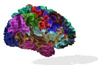

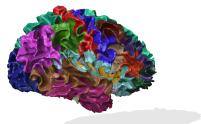

(b) FBM  

(d) V2C-Flow  
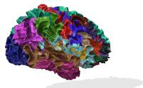  
(e) ULRSSM  
FlashAtt. (ours)

(c) FreeSurfer  
  
(f) Ground truth  
Figure S6. Cortical parcellation transfer on Mindboggle-101. DKT31 source labels are transferred to the same target; the final panel shows its ground-truth atlas.

Table S7. Restricted vs. dense coupling. Top: $\| \hat { C } - C \| _ { F } / \| C \| _ { F }$ between the functional maps computed through the restricted and the dense coupling. Bottom: dense argmax retained at $R = 4 0$ , the criterion budget R∗, and pointmap agreement with dense at $R \ = \ 4 0 .$ . The error decreases smoothly with R and is largest on the non-isometric benchmarks.
<table><tr><td>R FAUST</td><td>SCAPE</td><td>SHREC&#x27;19</td><td>SMAL</td><td>DT4D</td></tr><tr><td>4</td><td>5.4e-2</td><td>4.9e-2</td><td>2.1e-1 1.3e-1</td><td>4.8e-2</td></tr><tr><td>8</td><td>1.4e-2</td><td>1.7e-2</td><td>1.2e-1 5.7e-2</td><td>1.2e-2</td></tr><tr><td>16</td><td>6.8e-3</td><td>1.1e-2</td><td>7.0e-2</td><td>2.9e-2 5.5e-3</td></tr><tr><td>32</td><td>4.0e-3</td><td>6.6e-3</td><td>3.9e-2</td><td>1.8e-2 3.4e-3</td></tr><tr><td>40</td><td>3.3e-3</td><td>5.6e-3</td><td>3.2e-2</td><td>1.4e-2 3.0e-3</td></tr><tr><td>64</td><td>1.9e-3</td><td>3.6e-3</td><td>1.8e-2</td><td>6.5e-3 2.0e-3</td></tr><tr><td>128</td><td>5.6e-4</td><td>1.4e-3</td><td>5.2e-3</td><td>1.5e-3 9.3e-4</td></tr><tr><td> $R ^ { * } .$ </td><td>dense argmax retained at 1.000</td><td>1.000</td><td> $R = 4 0$  0.997</td><td>0.987 1.000</td></tr><tr><td></td><td>8</td><td>smallest budget retaining 99% 8</td><td>24 56</td><td>8</td></tr><tr><td>map agreement with dense at 0.992</td><td>0.995</td><td> $R = 4 0$  0.949</td><td>0.960</td><td>0.994</td></tr></table>

Results. We observe that the optimal sharpness depends on the benchmark and even changes sign with non-isometry. On FAUST the objective falls to 0.67 of the softmax value at $p \approx 9 6 ;$ ; SCAPE, DT4D and TOPKIDS-HD show optima near p ≈ 48 (0.95–0.96). On the strongly non-isometric SMAL, sharpening beyond the matched point only hurts (1.06 at $p { = } 3 2$ , 1.39 at $p { = } 1 2 8 )$ . These results suggest that near-isometric matching prefers an almost unimodal coupling, while non-isometric matching relies on the blur of the softer softmax.

We also learn p jointly with the descriptors, selecting checkpoints with the sharpness-independent hard assignment. On SMAL, all five seeds converge to $p \approx 6 3$ (within ±1) and reduce validation error relative to the fixed-τ softmax in every seed, by 9 % on average. On FAUST, p continues to increase under the shorter schedule but gives slightly worse validation error than the fixed-τ softmax. Thus the preferred sharpness is benchmark-dependent and changes as the descriptors co-adapt. These diagnostic results are not directly comparable to Tab. 1, where we keep τ fixed in the reported comparisons because optimizing sharpness modulates the coupling rather than its implementation.

## 8.4. Qualitative Results

Cortical surfaces. Figs. S5 and S6 provide complementary views of a held-out Mindboggle-101 pair: the smooth field reveals local distortion, while the DKT31 labels show region-level alignment. ULRSSM with FlashAttention produces coherent fields and region boundaries comparable to the specialized baselines, consistent with the quantitative results in Sec. 5.3.

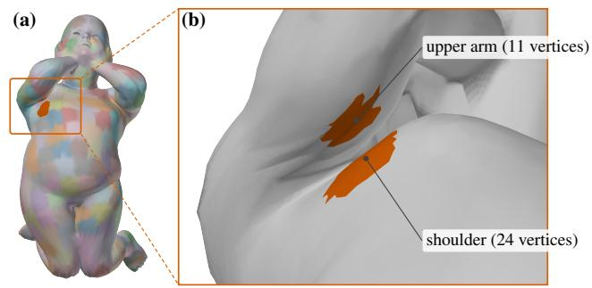

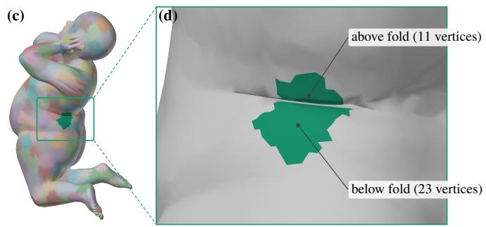  
Figure S7. Euclidean patches on self-contact regions in TOPKIDS. Euclidean patch partition of a TOPKIDS shape (kid06, 353 patches). (a, c) One patch highlighted in each; (b, d) close-ups of the boxed regions. Neither patch is a connected region: each covers two surface pieces that touch in $\mathbb { R } ^ { 3 }$ but are separated along the surface, the underside of the upper arm and the shoulder (b), and the two sides of an abdominal skin fold (d).

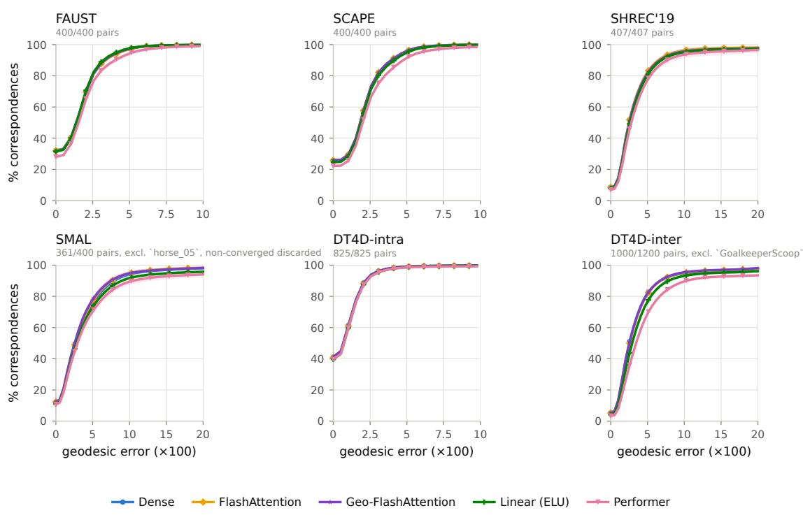  
Figure S8. Geodesic error distributions. Cumulative fraction of correspondences below each error threshold, using the same runs and exclusions as Tabs. 1 and S3. Near-isometric panels span 0–10 and the others 0–20; pair counts and exclusions are shown in each panel.

## 8.5. Patch Construction: Euclidean and Geodesic Voronoi Cells

We compare Euclidean patches built from vertex positions with the intrinsic geodesic Voronoi partition used in Sec. 4.2, in which every vertex belongs to the center nearest along the surface (P1) and every cell is a connected region (P2). Tab. S5 measures how often Euclidean patches violate these two properties, and Tab. S6 what this costs the coupling. Our released implementation builds geodesic patches by default and retains the Euclidean ones for completeness.

TOPKIDS self-contact. By grouping spatially adjacent surface parts across extrinsic self-contact, Euclidean patch embeddings may regularize the coupling on TOPKIDS (Fig. S7).

## 8.6. Candidate Budget R

The budget R of Geo-FlashAttention fixes only the support of the sparse attention. Sweeping it traces how closely the restricted coupling approximates the dense one. Tab. S7 reports, per benchmark, the relative error of the functional map computed through the restricted coupling against the dense one, the fraction of query rows whose dense argmax remains inside the support, and the agreement of the recovered point maps. R∗ summarizes each sweep as the smallest budget that retains the dense argmax for 99% of rows.

## 8.7. Geodesic Error Distributions

Fig. S8 shows that, across benchmarks, the maximum separation among exact couplings is 0.06–2.46 percentage points over the full error distribution. The linearized variants lag on SMAL and DT4D-inter but track the exact couplings on FAUST, SCAPE and DT4D-intra, consistent with Tab. S3.