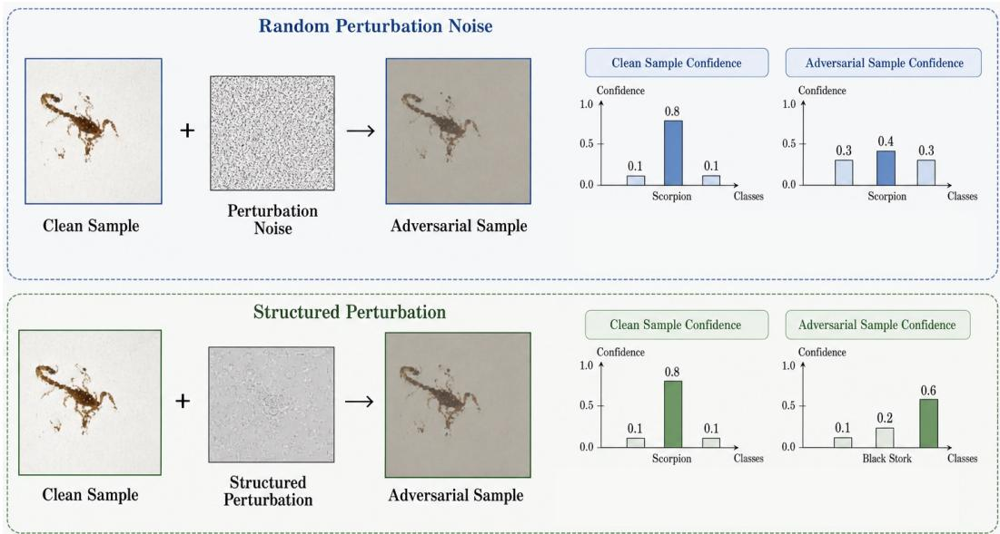
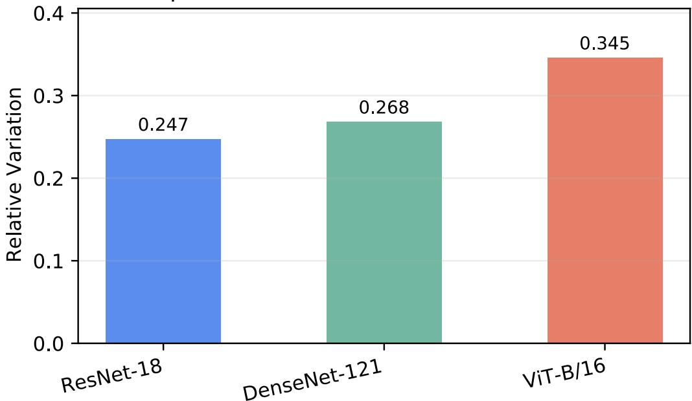
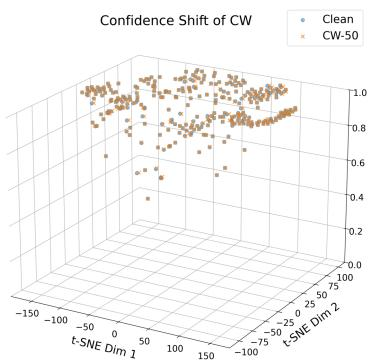
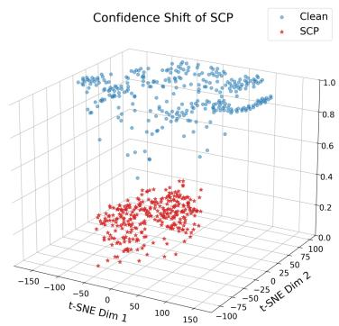
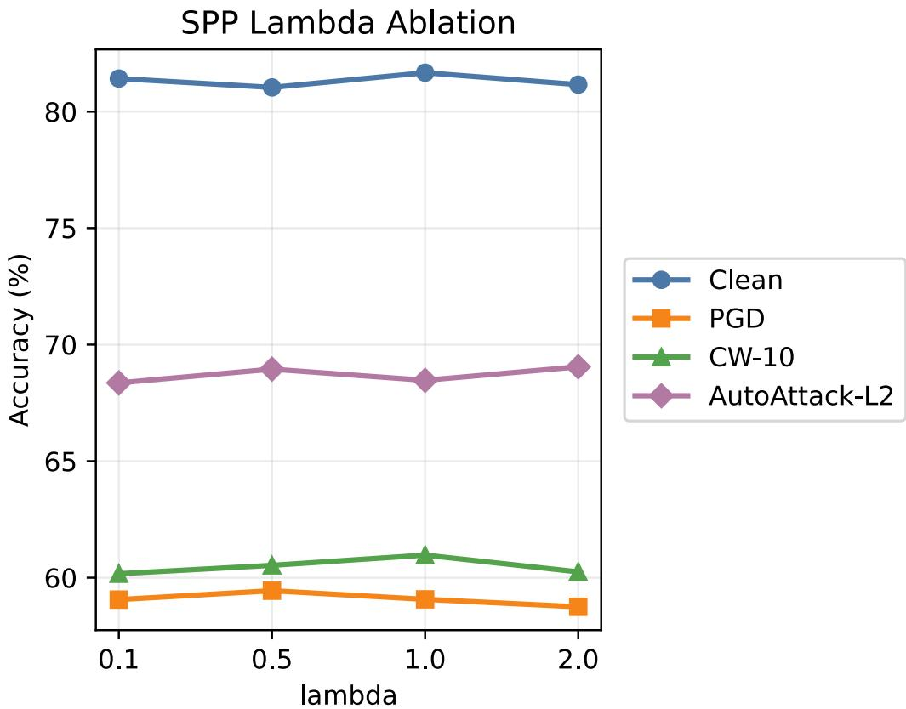

# Structured Confidence Perturbation via Fisher Geometry for Adversarial Training

Chenlong Wei Xi’an Jiaotong-Liverpool University China Chenlong.Wei23@student.xjtlu.edu.cn

Chong Zhang Xi’an Jiaotong-Liverpool University China Chong.Zhang19@student.xjtlu.edu.cn

Fangyu Wu Xi’an Jiaotong-Liverpool University China Fangyu.Wu02@xjtlu.edu.cn

Hanling Wang University of California, San Diego United States haw168@ucsd.edu

Qinkai Yu   
University of Exeter   
England   
qy269@exeter.ac.uk

Xiaobo Jin∗ Xi’an Jiaotong-Liverpool University China Xiaobo.Jin@xjtlu.edu.cn

## Abstract

Adversarial training is often plagued by “pseudo-attacks”—perturbations that significantly increase the loss value but fail to truly alter the model’s confidence structure. To address this, we propose two complementary approaches to directly attack and defend against confidence structure deformation. First, building upon the traditional loss maximization perspective, we introduce a hybrid objective that integrates cross-entropy and KL divergence, encouraging adversarial examples to simultaneously disrupt prediction accuracy and distribution consistency. Second, we geometrically reconstruct adversarial training by generating perturbations that maximize the distribution distance on the confidence manifold. Theoretical analysis shows that the optimal perturbation direction aligns with the principal eigenvectors of the Fisher information matrix. We also propose an efficient algorithm to avoid high-dimensional matrix computations. Experiments on multiple datasets and model architectures demonstrate that our method outperforms existing methods in adversarial robustness and robust transferability, particularly excelling in structural perturbations within high-confidence regions. Code repository: https://github. com/wnzgy/SCP.

## 1 Introduction

Deep neural networks (DNNs) have achieved remarkable progress across numerous applications; however, despite their impressive performance, they remain highly susceptible to adversarial perturbations which conduct imperceptible modifications to inputs that cause incorrect predictions [1]. This vulnerability has raised significant concerns in safety–critical domains such as image recognition [2], autonomous driving [3], and anomaly detection [4]. Among various defense strategies, adversarial training has emerged as one of the most effective methods for improving model robustness [5, 6]. By jointly optimizing over clean and adversarial samples, it encourages models to learn stable decision boundaries under input perturbations.

Existing adversarial training methods are commonly grouped into gradient-based approaches, optimization-based formulations, and attack-driven adversarial sample generation. Gradient-based methods such as FGSM and PGD [7, 8] construct perturbations by following the loss gradient, offering high computational efficiency but ensuring robustness only in a local linear neighborhood. Optimization-based defenses treat adversarial training as a min–max problem and explicitly minimize the worst-case loss under bounded perturbations, often using solvers like L-BFGS [9] or zero-order optimization [10]; however, their computational overhead is typically prohibitive for large-scale models. Meanwhile, adversarial attack–based methods [11] generate perturbed samples directly by designing black-box or white-box attacks: black-box methods rely solely on model outputs, whereas white-box attacks exploit full model gradients and internal structures.

Prevailing adversarial training methods largely share a common heuristic: they craft perturbations by maximizing the classification loss with respect to the true label. While effective in reducing the predicted probability of the true class, this loss-centric paradigm often fails to induce meaningful, global changes in the model’s output distribution. As illustrated in Fig. 1, even when the loss is increased, the relative ordering of confidence across classes may remain intact—a phenomenon we term pseudo-attacks. We define a "pseudo-attack" as a perturbation δ satisfying $\mathcal { L } ( x + \delta , y ) > \mathcal { L } ( x , y )$ but arg maxk $p ( y = k | x + \delta ) = \arg \operatorname* { m a x } _ { k } p ( y = k | x )$ . Even if the top-1 remains unchanged, the relative confidence ranking and distribution shape can still maintain local stability, meaning that the geometric vulnerability of the model near the decision boundary is not truly challenged. Such perturbations do not genuinely challenge the structural geometry of the model’s confidence manifold, leaving underlying vulnerabilities exposed.

  
Figure 1: Most previous methods add perturbation noise to a single discriminant value f(x) for adversarial training (top), while our SCP adds structured perturbations to the statistical manifold $\{ p ( y | x ; \theta ) | x \in X \}$ for adversarial training (bottom).

To move beyond local loss maximization, we argue that adversarial robustness should be grounded in the geometric stability of the model’s confidence distribution. In this paper, we introduce a unified adversarial training framework that operates directly on the statistical manifold of output probabilities. Our main contributions are summarized as follows:

• We propose an enhanced Single Point Perturbation (SPP) strategy that combines crossentropy (CE) and Kullback–Leibler (KL) divergence into a hybrid objective. Unlike prior uses of KL as a regularizer [12], we deploy it actively during attack generation to disrupt both the top-1 prediction and the overall confidence structure.

• We develop a SCP framework that reformulates adversarial search as maximizing the distance between probability distributions on the confidence manifold. We show theoretically that the optimal perturbation aligns with the principal eigenvector of the Fisher Information

Matrix (FIM), which captures the local curvature of the manifold. To enable scalable computation, we derive an efficient eigen-decomposition that avoids explicit manipulation of high-dimensional FIM.

• Extensive experiments on CIFAR-10, CIFAR-100, and Tiny-ImageNet demonstrate that our methods consistently improve adversarial robustness and enhance attack transferability across architectures. By directly targeting the geometric roots of model vulnerability, SCP and SPP advance the state of the art in adversarial training, offering a principled and computationally feasible path toward truly robust deep learning systems.

## 2 Related work

Adversarial Training and Geometry. Adversarial training (AT) has evolved from a local noise defense strategy into a holistic paradigm that reshapes the decision manifold of deep neural networks. Early mainstream gradient-based methods, such as FGSM [7] and PGD [8], primarily constructed adversarial perturbations within a local ϵ-sphere along the direction of steepest loss increase. While effective, their robustness was often limited to these direct input neighborhoods. To seek more globally stable solutions, optimization-based frameworks [8, 12] modeled adversarial training as a minimax game. Although subsequent acceleration strategies, such as FreeAT [13], YOPO [14], improved training efficiency, they essentially still followed the same loss-centric heuristic. In recent years, some methods, including feature scattering [15] and MART [16], have attempted to learn more transferable features through feature space alignment or hard example reweighting, but they often neglect the underlying geometry of the data manifold.

Many existing approaches rely on maximizing the cross-entropy (CE) loss to measure adversarial vulnerability, while methods such as TRADES maximize distributional discrepancy during attack generation. This approach is essentially a “pointwise suppression” of the true logit, which typically fails to induce a global distortion of the model’s confidence structure. While TRADES [12] and ensemble-based approaches [17] introduce KL divergence or diversity constraints, they generally treat distributional disparity as a scalar penalty rather than a structural measure. Our work breaks with this convention by redefining adversarial perturbations as geometric transformations on the confidence manifold and asserting that true robustness stems from the manifold’s geometric stability under structural stress.

Information-Theoretic Perspectives. The application of KL divergence in adversarial training has traditionally been limited to its use as a scalar measure of distributional disparity. A common practice is to use it as a consistency regularization term to balance the tradeoff between natural accuracy and adversarial robustness (e.g., TRADES [12] or gradient-smoothing approaches [18]). Another perspective stems from knowledge distillation, where KL divergence guides distribution alignment [19], thereby facilitating the learning of robust representations. However, most of these paradigms overlook the profound informational geometric meaning of KL divergence. Within the informational geometry framework, the KL divergence between two neighboring probability distributions is equivalent to a second-order approximation of the Mahalanobis distance defined by the Fisher information matrix (FIM).

Existing defense methods utilize its size for constraint but fail to fully leverage its potential as a tool for discovering structured vulnerabilities. Our research bridges this gap by transforming KL divergence from a passive regularization term into an active target for attack generation. By maximizing the manifold distance along the Fisher principal eigenvectors, we can systematically disrupt the global structure of the confidence distribution, rather than merely suppressing local outputs, forcing the model to learn a more resilient geometric representation and effectively overcoming the evaluation blind spots inherent in traditional paradigms.

## 3 Methodology

Traditional adversarial training generates perturbations by maximizing the loss function (e.g., crossentropy CE), but such methods only locally suppress the logit of the true class, ignoring the global geometry of the confidence distribution (Fig. 1). We propose that true robustness should stem from the model’s stability on the confidence manifold, i.e., the input perturbation should maximize the structural deformation of the output probability distribution. To this end, we design two complementary strategies:

• Local Single-Point Perturbation (SPP): Jointly optimizes CE and KL divergence, simultaneously disrupting prediction accuracy and distribution consistency;

• Global Structured Confidence Perturbation (SCP): From an information geometry perspective, it generates perturbations using the principal eigendirections of the Fisher Information Matrix (FIM), directly manipulating the curvature of the confidence manifold.

## 3.1 Geometric motivation: from single points to manifold deformation

Let the model be $f _ { \theta } : \mathcal { X } \to R ^ { K }$ , where θ denotes the parameters and K is the number of classes. The softmax output $p ( \boldsymbol { y } | \boldsymbol { x } ; \boldsymbol { \theta } )$ defines a statistical manifold. Each input x corresponds to a point on P, and a perturbation $\delta$ moves x to $x ^ { \prime } = x + \delta .$ , inducing a trajectory on the manifold. Traditional adversarial training aims to maximize the cross-entropy loss $\mathcal { L } _ { \mathrm { C E } } ( y , x ^ { \prime } )$ , which only affects the probability of the true class. In contrast, we propose to maximize a distance metric K $\dot { \cdot } ( p ( y | x ) , p ( y | \dot { x } ^ { \prime } ) )$ ) on $\mathbb { P } ,$ which captures global changes in the confidence structure.

## 3.2 Adversarial training with single point perturbation (SPP)

Previous TRADES [12] introduces a defense objective that balances accuracy and robustness via a KL-divergence regularizer

$$
\arg \operatorname* { m i n } _ { \theta } [ \mathcal { L } _ { \mathrm { C E } } ( y , f _ { \theta } ( x ) ) + \lambda \operatorname* { m a x } _ { \delta : \| \delta \| _ { P } \leq \epsilon } \mathrm { K L } ( f _ { \theta } ( x ) , f _ { \theta } ( x + \delta ) ) ] ,\tag{1}
$$

where CE is the cross-entropy loss, KL is the Kullback-Leibler divergence and λ controls the trade-off between accuracy and robustness.

Unlike the TRADES [12] method, we repurpose this formulation for attack generation. Specifically, we define a hybrid loss (as shown in Alg. 1)

$$
\begin{array} { r } { \mathcal { L } _ { \mathrm { S P P } } ( x ^ { \prime } , x , y ) = \mathcal { L } _ { \mathrm { C E } } ( y , f _ { \theta } ( x ^ { \prime } ) ) + \mathbf { K L } ( f _ { \theta } ( x ) , f _ { \theta } ( x ^ { \prime } ) ) , } \end{array}\tag{2}
$$

and generate adversarial examples by maximizing L within an ϵ−ball

$$
x ^ { \prime } = x + \arg \operatorname* { m a x } _ { \| \delta \| \leq \alpha } \mathcal { L } _ { \mathrm { S P P } } ( x + \delta , x , y ) ,\tag{3}
$$

where the first term encourages misclassification, while the second term disrupts the entire output distribution, preventing pseudo-attacks that leave the confidence ordering intact.

## 3.3 Adversarial training with structured confidence perturbation (SCP)

SCP transforms adversarial training into a geometric optimization problem on a confidence manifold.

## 3.3.1 Theoretical foundation

For the sake of convenience, we ignore the model parameter θ. By the following theorem, we can conclude that the KL divergence between any two conditional distributions $p ( y | x )$ and $p ( \boldsymbol { y } | \boldsymbol { x } ^ { \prime } )$ is approximately equal to half the Mahalanobis distance between x and $x ^ { \prime }$ , where the covariance parameter matrix is the inverse of the Fisher information matrix. The detailed derivation is provided in Appendix A.

Theorem 1 (Local approximation of KL divergence). For any two class confidence distributions $p ( y | x )$ and $p ( \boldsymbol { y } | \boldsymbol { x } ^ { \prime } )$ , where x and $x ^ { \prime }$ are the inputs of the model and y is the class label of the model output, we have

$$
\mathrm { K L } ( p ( y | x ) , p ( y | x ^ { \prime } ) ) \approx \frac { 1 } { 2 } ( x ^ { \prime } - x ) ^ { T } F ( x ) ( x ^ { \prime } - x ) = \frac { 1 } { 2 } \delta ^ { T } F ( x ) \delta ,\tag{4}
$$

where $F ( x )$ is the Fisher information matrix (FIM) defined as follows

$$
F ( x ) = \mathbb { E } _ { p ( y \mid x ) } [ \nabla _ { x } \log p ( y | x ) \nabla _ { x } \log p ( y | x ) ^ { T } ] .\tag{5}
$$

Algorithm 1 Adversarial training with single point perturbation (SPP)   
1: Input: DNN model $f _ { \boldsymbol { \theta } } ( \boldsymbol { x } ) ;$ dataset D with K classes; batch size m; learning rate $\eta ;$ radius for   
adversaries $\epsilon ;$ step size α and S for attack iterations; number of epochs $T .$   
2: Randomly initialize the network parameter θ and $\delta \sim 0 . 0 0 1 \cdot \mathcal { N } ( \mathrm { \dot { 0 } } , 1 )$   
3: for $t = \stackrel { \cdot } { 0 , } 1 , 2 , \cdot \cdot \cdot , T$ do   
4: for each batch $\pmb { \cal B } = \{ ( x _ { i } , y _ { i } ) \} _ { i = 1 } ^ { m }$ in D do   
5: $\tilde { B } = \varnothing$   
6: for $( x _ { i } , y _ { i } )$ in B do   
7: ${ \hat { x } } _ { i } = x _ { i } + \delta$   
8: for $s = 1 , 2 , \ldots , S$ do   
9: $\mathcal { L } _ { \mathrm { S P P } } = \mathcal { L } _ { \mathrm { C E } } \left( y _ { i } , f _ { \theta } \left( \hat { x } _ { i } \right) \right) + \mathrm { K L } \left( f _ { \theta } \left( x _ { i } \right) , f _ { \theta } \left( \hat { x } _ { i } \right) \right)$   
10: $\hat { x } _ { i } \gets \hat { x } _ { i } + \alpha \cdot \mathrm { s i g n } \left( \nabla _ { \hat { x } _ { i } } \mathcal { L } _ { \mathrm { S P P } } \right)$   
11: end for   
12: $\tilde { B } \gets \tilde { B } \cup \{ ( \hat { x } _ { i } , y _ { i } ) \}$   
13: end for   
14: $\tilde { B }  \tilde { B } \cup B$   
15: $\begin{array} { r l } { \theta  \theta - \frac { \eta } { 2 m } \cdot \nabla _ { \theta } \sum _ { ( x , y ) \in \tilde { \mathcal { B } } } \mathcal { L } _ { \mathrm { C E } } ( y , f _ { \theta } ( x ) ) } \end{array}$   
16: end for   
17: end for   
18: Output: Trained model $f _ { \theta }$

Theorem 1 reveals that the KL divergence between two nearby conditional distributions is locally approximated by the quadratic form ${ \frac { 1 } { 2 } } \delta ^ { \top } F ( x ) \delta$ . This establishes that the Fisher Information Matrix $\bar { F ( x ) }$ defines a Riemannian metric on the statistical manifold of output distributions $\{ p ( \boldsymbol { y } | \boldsymbol { x } ; \boldsymbol { \theta } ) \}$ . The most sensitive perturbation direction at a given input x is therefore the one that maximizes this KL divergence under a fixed Euclidean norm constraint $\| \delta \| _ { 2 } = \epsilon \mathbf { : }$

$$
\operatorname* { m a x } _ { \| \delta \| _ { 2 } = \epsilon } \delta ^ { \top } F ( x ) \delta .\tag{6}
$$

By the Rayleigh–Ritz theorem, the maximum is attained when $\delta$ is aligned with the principal eigenvector of $F ( x )$ , and the maximal KL divergence equals $\frac { \epsilon ^ { 2 } } { 2 } \lambda _ { \mathrm { m a x } } ( F ( x ) )$ .

This geometric insight provides the foundation for SCP: rather than following the gradient of crossentropy loss, which only suppresses the true class probability, we perturb along the direction that maximally deforms the entire confidence manifold. The FIM not only captures local curvature but also identifies the input direction that induces the most radical structural change in the output distribution, enabling a more principled approach to adversarial training.

Theorem 2 (FIM for softmax model). For a deep learning model whose last layer uses a softmax function to implement classification tasks, where the input vector of softmax is f(x), the Fisher information matrix is

$$
F ( x ) = \nu a r ( \nabla _ { x } f ) ,\tag{7}
$$

where $\nabla _ { x } f ( x )$ is the gradient matrix (Jacobian matrix) of the vector $f ( x )$ with respect to the input x and var represents the variance ofthe matrix random variable. The proofis provided in Appendix A.2.

## 3.3.2 Efficient algorithm design

The Fisher information matrix of x for the discrete variable y is defined as

$$
F ( x ) = \sum _ { k = 1 } ^ { K } p ( y _ { k } | x ) [ \nabla _ { x } \log p ( y _ { k } | x ) \nabla _ { x } \log p ( y _ { k } | x ) ^ { T } ] .\tag{8}
$$

Further, let $q _ { k } = \nabla _ { x } \log p ( y _ { k } | x )$ and $\lambda _ { k } = p ( y _ { k } | x )$ , we can write the Fisher information matrix in a more compressed form

$$
F ( x ) = Q \Lambda Q ^ { T } ,\tag{9}
$$

where

$$
Q = [ q _ { 1 } \quad q _ { 2 } \quad \cdots \quad q _ { K } ] \in \mathbb { R } ^ { d \times K } ,\tag{10}
$$

and

$$
\boldsymbol { \Lambda } = \left[ \begin{array} { l l l l } { \lambda _ { 1 } } & & & \\ & { \lambda _ { 2 } } & & \\ & & { \ddots } & \\ & & & { \lambda _ { K } } \end{array} \right] \in \mathbb { R } ^ { K \times K } .\tag{11}
$$

Notice that d is the dimension of the image x and K is the number of classes $( d \gg K )$ . It can be seen that the $( x ^ { \prime } - x )$ (or δ) that maximizes the KL divergence is the eigenvector of $F ( x )$ associated with the largest eigenvalue. However, directly storing or decomposing the Fisher matrix is very costly.

Here we introduce a technique to solve this problem. While Fisher information matrix $F \in \mathbb { R } ^ { d \times d }$ we construct a matrix :

$$
B = \Lambda ^ { 1 / 2 } Q ^ { T } Q \Lambda ^ { 1 / 2 } \in \mathbb { R } ^ { K \times K } .\tag{12}
$$

Let the eigenvector of $F$ be $v _ { F }$ ,and the eigenvector of B be $v _ { B }$ , the relation of $v _ { F }$ and $v _ { B }$ can be represented as follows:

$$
v _ { F } = Q \Lambda ^ { 1 / 2 } v _ { B } .\tag{13}
$$

According to (13), we can simply decompose a $K \times K$ matrix B instead of directly dealing with the Fisher Information Matrix.

To obtain the adversarial examples, we select the eigenvector corresponding to the largest eigenvalue, which is the most sensitive direction of the model. Finally, we get our adversarial algorithm SCP Alg. 2

Algorithm 2 Adversarial training with structured confidence perturbation (SCP)   
1: Input: DNN classifier $f _ { \boldsymbol { \theta } } ;$ dataset D with K classes; batch size m; learning rate η; radius for   
adversaries ϵ;number of epochs $T$   
2: Randomly initialize the network parameter θ   
3: for $t = \stackrel { \triangledown } { \boldsymbol { 0 } , } 1 , 2 , \cdots , T$ do   
4: for each batch $\boldsymbol { B } = \{ ( x _ { i } , y _ { i } ) \} _ { i = 1 } ^ { m }$ in $\mathcal { D }$ do   
5: $\tilde { B } = \varnothing$   
6: $p ( y _ { k } | x _ { i } ; \theta ) = \mathrm { s o f t m a x } ( f _ { \theta } ( x _ { i } ) )$   
7: $\begin{array} { r } { Q _ { i } = \left[ q _ { 1 } , q _ { 2 } , \dotsc , q _ { K } \right] , q _ { k } = \nabla _ { x } \log p ( y _ { k } | x _ { i } ; \theta ) } \end{array}$   
8: $\Lambda _ { i } = \mathrm { d i a g } ( p ( y _ { 1 } | x _ { i } ) , p ( y _ { 2 } | x _ { i } ) , \dots , p ( y _ { K } | x _ { i } ) )$   
9: for $( x _ { i } , y _ { i } )$ in B do   
10: $B _ { i } = \Lambda _ { i } ^ { 1 / 2 } Q _ { i } ^ { T } Q _ { i } \Lambda _ { i } ^ { 1 / 2 }$   
11: Decompose $B _ { i }$ and find the principal eigenvector $v _ { B _ { i } } ^ { * }$ which corresponds to the largest   
eigenvalue $\lambda _ { B _ { i } } ^ { * }$   
12: $v _ { F _ { i } } = Q _ { i } \Lambda _ { i } ^ { 1 / 2 } v _ { B _ { i } } ^ { * }$   
13: $\hat { x } _ { i }  x _ { i } + \epsilon \cdot \mathrm { s i g n } ( v _ { F _ { i } } )$   
14: $\tilde { B } \gets \tilde { B } \cup \{ ( \hat { x } _ { i } , y _ { i } ) \}$   
15: end for   
16: $\tilde { B }  \tilde { B } \cup B$   
17: $\begin{array} { r } { \mathcal { L } _ { \mathrm { S C P } } = \frac { 1 } { 2 m } \sum _ { ( x , y ) \in \tilde { \cal B } } \mathcal { L } _ { \mathrm { C E } } ( y , f _ { \theta } ( x ) ) } \end{array}$   
18: $\theta  \theta - \eta \nabla _ { \theta } \dot { \mathcal { L } } _ { \mathrm { S C P } }$   
19: end for   
20: end for   
21: Output: Trained model $f _ { \theta }$

Finally, we summarize the differences between our method and TRADES: TRADES combines clean cross-entropy with a KL robustness regularizer in the training objective, and its inner maximization generates perturbations by maximizing the KL divergence between clean and perturbed predictions. SPP instead directly maximizes $\mathrm { C E } + \mathrm { K } \mathbf { \bar { I } }$ in the attack generation stage, actively disrupting distribution consistency, and then uses the generated examples for standard adversarial training. SCP further replaces the gradient direction geometrically with the principal eigenvector of the FIM.

## 4 Experiments

## 4.1 Datasets and settings

We used three common and popular datasets for image classification: CIFAR-10 [20], CIFAR-100 [20], and Tiny-ImageNet [21]. CIFAR-10 contains 60,000 color images of size $3 2 \times 3 2$ in 10 categories. CIFAR-100 contains 60,000 color images of size $3 2 \times 3 2$ in 100 categories. Tiny-ImageNet is a subset of ImageNet [22] with 200 categories, similar to the ImageNet dataset, where each category contains 500 color images of size $6 4 \times 6 4$

To comprehensively evaluate the relationship between model geometry and attack resistance, we conduct experiments on representative architectures with distinct structural characteristics:

• ResNet[23]: It introduces residual connections, allowing gradients to bypass nonlinear layers directly. Skip connections stabilize the gradient flow, reduce gradient vanishing/explosion, and reduce variance, so its maximum eigenvalue is relatively low.

• DenseNet[24]: Each layer of DenseNet receives the output of all previous layers as input. With more gradient paths and gradients dispersed to each layer, its variance is potentially the smallest among the considered models.

• ViT[25]: Vision Transformer (ViT) is based on the self-attention mechanism, which causes the gradient to involve global interactions, potentially introducing large variance; however, LayerNorm and residual connections help stabilize the gradient.

The batch size on each dataset is 32, the learning rate η is $3 \times 1 0 ^ { - 4 }$ , and the maximum perturbation range coefficient ϵ is 8/255 in training section. The adversarial training contains 100 epochs. All experiments were conducted on a server equipped with six NVIDIA GeForce RTX 3090 GPUs. At the same time, we introduce CW[26] and AutoAttack[27] as our counter-test methods. We test our SCP method on multiple datasets and baseline models. The specific parameters of AutoAttack are $\epsilon = 0 . 5$ , the type of norm is L2; the parameter settings of the CW-10 method are as follows: the learning rate is 0.01, the confidence threshold is 0, and the number of iterations is 10.

## 4.2 Evaluation metrics

Assume that the test set is D, the set of all instances predicted correctly by the model M is T, and a(x) represents the perturbed sample generated by the clean input x. We can define the following three main metrics: STD, ADV, and ASR:

• Standard Accuracy (STD) [28] represents the standard test accuracy of in-distribution generalization, which is the accuracy obtained by testing the model using the original test sample, i.e, $\begin{array} { r } { \mathrm { S T D } = \frac { | T | } { | D | } } \end{array}$

• Adversarial Robust Accuracy (ADV) Adversarial robust accuracy is a method used to evaluate the performance of a model when facing adversarial samples. When we use a dataset consisting of perturbed samples generated by test samples to test the model obtained through adversarial training, the classification accuracy obtained is called ADV accuracy. In our experiments with attack methods AutoAttack, it is defined as $\begin{array} { r } { \mathrm { A D V } = \frac { | \sum _ { ( x , y ) \in T } M ^ { \prime } ( a ( x ) ) = y | } { | D | } } \end{array}$

• Attack Success Rate (ASR) ASR measures the proportion of samples that an attacker can cause the model to make incorrect predictions and is used to measure the robustness of the model. It is worth noting that for the above three measurements, using the ADV under AutoAttack, we have the following relationship $\begin{array} { r } { \mathrm { A S R } = 1 - \frac { \mathrm { A D V } } { \mathrm { S T D } } } \end{array}$

## 4.3 Comparison on attack metrics

We compare our SCP algorithm with state-of-the-art (SOTA) adversarial training methods on three widely used image classification datasets (CIFAR-10, CIFAR-100 and Tiny-ImageNet) using ResNet18, ResNet34, and ResNet50 [23] as baseline models. These architectures were chosen as the common intersection of models used in recent adversarial training literature, balancing computational efficiency and representativeness. Adversarial examples are generated with a perturbation budget (ϵ ) customized for each dataset and the performance is evaluated using STD, ADV, and ASR, where lower ASR indicates higher robustness.

Table 1: Comparison of adversarial training methods on CIFAR-10, CIFAR-100, and Tiny-ImageNet. Red: best; blue: second best.
<table><tr><td rowspan=1 colspan=14>ResNet-18                  ResNet-34                  ResNet-50Dataset      MethodSTD ↑CW-10↑AA↑ASR STD ↑CW-10↑AA↑ ASR↓STD↑CW-10↑AA↑ ASR↓</td></tr><tr><td rowspan=1 colspan=4>PGD [8]     78.87%46.20%</td><td rowspan=1 colspan=4>62.37%20.92%77.74%50.26%</td><td rowspan=1 colspan=3>64.24%17.37%75.38%</td><td rowspan=1 colspan=1>48.30%</td><td rowspan=1 colspan=2>62.49%17.10%</td></tr><tr><td rowspan=1 colspan=1></td><td rowspan=1 colspan=2>TRADES [12]80.72%</td><td rowspan=1 colspan=1>48.74%</td><td rowspan=1 colspan=4>64.93%19.56% 82.47%49.15%</td><td rowspan=1 colspan=3>67.31%18.38%80.20%</td><td rowspan=1 colspan=1>50.09%</td><td rowspan=1 colspan=2>64.69% 19.34%</td></tr><tr><td rowspan=1 colspan=1></td><td rowspan=1 colspan=2>MIFGSM [29]81.92%</td><td rowspan=1 colspan=1>50.98%</td><td rowspan=1 colspan=7>64.11%21.74% 81.35%53.30%65.06%20.02%78.86%</td><td rowspan=1 colspan=1>49.39%</td><td rowspan=1 colspan=2>61.78% 21.66%</td></tr><tr><td rowspan=1 colspan=1></td><td rowspan=1 colspan=3>NIFGSM [30]81.28%52.07%</td><td rowspan=1 colspan=4>65.08% 19.93%82.63%52.26%</td><td rowspan=1 colspan=3>67.39% 18.44%81.33%</td><td rowspan=1 colspan=1>54.91%</td><td rowspan=1 colspan=2>67.13% 17.46%</td></tr><tr><td rowspan=2 colspan=1>CIFAR-10</td><td rowspan=2 colspan=2>DIFGSM [31]81.51%JITTER [32] 77.99%</td><td rowspan=1 colspan=1>50.18%</td><td rowspan=1 colspan=1>64.23%21.20%</td><td rowspan=1 colspan=2>80.76%</td><td rowspan=1 colspan=1>53.31%</td><td rowspan=1 colspan=1>67.03%1</td><td rowspan=1 colspan=2>7.00%79.61%</td><td rowspan=1 colspan=1>52.47%</td><td rowspan=1 colspan=1>66.00%</td><td rowspan=1 colspan=1>17.10%</td></tr><tr><td rowspan=1 colspan=1>77.99%</td><td rowspan=1 colspan=1>50.02%</td><td rowspan=1 colspan=1>64.92%1</td><td rowspan=1 colspan=1>6.76% 8</td><td rowspan=1 colspan=1>0.07%</td><td rowspan=1 colspan=1>50.47%</td><td rowspan=1 colspan=1>65.79%</td><td rowspan=1 colspan=1>17.83%7</td><td rowspan=1 colspan=1>2.11%</td><td rowspan=1 colspan=1>47.03%</td><td rowspan=1 colspan=1>60.36%</td><td rowspan=1 colspan=1>16.29%</td></tr><tr><td rowspan=1 colspan=1></td><td rowspan=1 colspan=1>PIFGSM[33]</td><td rowspan=1 colspan=1>82.61%</td><td rowspan=1 colspan=1>48.37%</td><td rowspan=1 colspan=1>64.22%</td><td rowspan=1 colspan=1>22.26%</td><td rowspan=1 colspan=1>82.51%</td><td rowspan=1 colspan=1>52.29%</td><td rowspan=1 colspan=1>67.00%</td><td rowspan=1 colspan=1>18.80%8</td><td rowspan=1 colspan=1>0.40%</td><td rowspan=1 colspan=1>52.74%</td><td rowspan=1 colspan=1>67.79%</td><td rowspan=1 colspan=1>15.68%</td></tr><tr><td rowspan=1 colspan=1></td><td rowspan=1 colspan=1>VNIFGSM[34]</td><td rowspan=1 colspan=1>76.08%</td><td rowspan=1 colspan=1>47.53%</td><td rowspan=1 colspan=1>59.31%</td><td rowspan=1 colspan=1>22.04%</td><td rowspan=1 colspan=1>74.50%</td><td rowspan=1 colspan=1>46.88%</td><td rowspan=1 colspan=1>59.27%</td><td rowspan=1 colspan=1>20.44%6</td><td rowspan=1 colspan=1>2.17%</td><td rowspan=1 colspan=1>41.34%</td><td rowspan=1 colspan=1>49.17%</td><td rowspan=1 colspan=1>20.91%</td></tr><tr><td rowspan=1 colspan=1></td><td rowspan=1 colspan=1>SPP(Ours)</td><td rowspan=1 colspan=1>81.90%</td><td rowspan=1 colspan=1>60.33%</td><td rowspan=1 colspan=1>70.15%</td><td rowspan=1 colspan=1>14.35%</td><td rowspan=1 colspan=1>82.49%</td><td rowspan=1 colspan=1>60.79%</td><td rowspan=1 colspan=1>70.66%</td><td rowspan=1 colspan=1>14.34%8</td><td rowspan=1 colspan=1>3.12%</td><td rowspan=1 colspan=1>61.10%</td><td rowspan=1 colspan=1>70.99%</td><td rowspan=1 colspan=1>14.59%</td></tr><tr><td rowspan=1 colspan=1></td><td rowspan=1 colspan=1>SCP(Ours)</td><td rowspan=1 colspan=1>82.69%</td><td rowspan=1 colspan=1>55.25%</td><td rowspan=1 colspan=1>70.47%</td><td rowspan=1 colspan=1>14.78%</td><td rowspan=1 colspan=1>83.17%</td><td rowspan=1 colspan=1>55.47%</td><td rowspan=1 colspan=1>71.50%</td><td rowspan=1 colspan=1>14.03%8</td><td rowspan=1 colspan=1>3.24%</td><td rowspan=1 colspan=1>59.02%</td><td rowspan=1 colspan=1>72.50%</td><td rowspan=1 colspan=1>12.90%</td></tr><tr><td rowspan=1 colspan=1></td><td rowspan=1 colspan=1>PGD [8]</td><td rowspan=1 colspan=1>41.70%</td><td rowspan=1 colspan=1>21.57%</td><td rowspan=1 colspan=1>28.94%3</td><td rowspan=1 colspan=1>0.60% 4</td><td rowspan=1 colspan=1>0.58%</td><td rowspan=1 colspan=1>27.18%</td><td rowspan=1 colspan=1>28.41%</td><td rowspan=1 colspan=1>29.99%3</td><td rowspan=1 colspan=1>5.34%</td><td rowspan=1 colspan=1>25.57%</td><td rowspan=1 colspan=1>25.64%</td><td rowspan=1 colspan=1>27.45%</td></tr><tr><td rowspan=1 colspan=1></td><td rowspan=1 colspan=1>TRADES [12]</td><td rowspan=1 colspan=1>46.46%</td><td rowspan=1 colspan=1>28.98%</td><td rowspan=1 colspan=1>32.07%</td><td rowspan=1 colspan=1>30.97%</td><td rowspan=1 colspan=1>44.50%</td><td rowspan=1 colspan=1>31.43%</td><td rowspan=1 colspan=1>32.66%</td><td rowspan=1 colspan=1>26.61%3</td><td rowspan=1 colspan=1>6.17%</td><td rowspan=1 colspan=1>22.21%</td><td rowspan=1 colspan=1>22.20%</td><td rowspan=1 colspan=1>38.62%</td></tr><tr><td rowspan=1 colspan=1></td><td rowspan=1 colspan=1>MIFGSM [29]</td><td rowspan=1 colspan=1>48.47%</td><td rowspan=1 colspan=1>22.09%</td><td rowspan=1 colspan=1>30.43%</td><td rowspan=1 colspan=1>37.22%</td><td rowspan=1 colspan=1>37.22%47.39%</td><td rowspan=1 colspan=1>30.98%</td><td rowspan=1 colspan=1>31.85%</td><td rowspan=1 colspan=1>32.79%3</td><td rowspan=1 colspan=1>9.70%</td><td rowspan=1 colspan=1>27.93%</td><td rowspan=1 colspan=1>27.93%</td><td rowspan=1 colspan=1>29.65%</td></tr><tr><td rowspan=1 colspan=1></td><td rowspan=1 colspan=1>NIFGSM [30]</td><td rowspan=1 colspan=1>46.19%</td><td rowspan=1 colspan=1>30.26%</td><td rowspan=1 colspan=1>31.93%</td><td rowspan=1 colspan=1>30.87%</td><td rowspan=1 colspan=1>46.20%</td><td rowspan=1 colspan=1>30.26%</td><td rowspan=1 colspan=1>31.29%</td><td rowspan=1 colspan=1>32.27%</td><td rowspan=1 colspan=1>40.92%</td><td rowspan=1 colspan=1>25.18%</td><td rowspan=1 colspan=1>25.16%</td><td rowspan=1 colspan=1>38.51%</td></tr><tr><td rowspan=2 colspan=1>CIFAR-100</td><td rowspan=1 colspan=1>DIFGSM [31]</td><td rowspan=1 colspan=1>47.42%</td><td rowspan=1 colspan=1>30.30%</td><td rowspan=1 colspan=1>31.89%</td><td rowspan=1 colspan=1>32.75%</td><td rowspan=1 colspan=1>46.35%</td><td rowspan=1 colspan=1>31.15%</td><td rowspan=1 colspan=1>32.28%</td><td rowspan=1 colspan=1>30.36%4</td><td rowspan=1 colspan=1>1.57%</td><td rowspan=1 colspan=1>28.77%</td><td rowspan=1 colspan=1>28.79%</td><td rowspan=1 colspan=1>30.74%</td></tr><tr><td rowspan=1 colspan=1>JITTER [32]</td><td rowspan=1 colspan=1>41.35%</td><td rowspan=1 colspan=1>25.66%</td><td rowspan=1 colspan=1>29.22%2</td><td rowspan=1 colspan=1>9.33% 4</td><td rowspan=1 colspan=1>2.76%</td><td rowspan=1 colspan=1>29.10%</td><td rowspan=1 colspan=1>30.22%</td><td rowspan=1 colspan=1>29.33%3</td><td rowspan=1 colspan=1>2.45%</td><td rowspan=1 colspan=1>24.34%</td><td rowspan=1 colspan=1>24.39%</td><td rowspan=1 colspan=1>24.84%</td></tr><tr><td rowspan=1 colspan=1></td><td rowspan=1 colspan=1>PIFGSM[33]</td><td rowspan=1 colspan=1>50.34%</td><td rowspan=1 colspan=1>30.44%</td><td rowspan=1 colspan=1>32.66%</td><td rowspan=1 colspan=1>35.12%</td><td rowspan=1 colspan=1>49.10%</td><td rowspan=1 colspan=1>32.54%</td><td rowspan=1 colspan=1>33.68%</td><td rowspan=1 colspan=1>31.41%4</td><td rowspan=1 colspan=1>0.83%</td><td rowspan=1 colspan=1>28.39%</td><td rowspan=1 colspan=1>28.45%</td><td rowspan=1 colspan=1>30.32%</td></tr><tr><td rowspan=1 colspan=1></td><td rowspan=1 colspan=1>VNIFGSM[34]</td><td rowspan=1 colspan=1>35.22%</td><td rowspan=1 colspan=1>21.65%</td><td rowspan=1 colspan=1>24.16%</td><td rowspan=1 colspan=1>31.40%</td><td rowspan=1 colspan=1>36.70%</td><td rowspan=1 colspan=1>23.80%</td><td rowspan=1 colspan=1>24.65%</td><td rowspan=1 colspan=1>32.83%</td><td rowspan=1 colspan=1>31.25%</td><td rowspan=1 colspan=1>21.58%</td><td rowspan=1 colspan=1>21.56%</td><td rowspan=1 colspan=1>31.01%</td></tr><tr><td rowspan=1 colspan=1></td><td rowspan=1 colspan=1>SPP(Ours)</td><td rowspan=1 colspan=1>43.92%</td><td rowspan=1 colspan=1>31.20%</td><td rowspan=1 colspan=1>31.96%</td><td rowspan=1 colspan=1>27.23%</td><td rowspan=1 colspan=1>45.45%</td><td rowspan=1 colspan=1>30.51%</td><td rowspan=1 colspan=1>32.50%</td><td rowspan=1 colspan=1>28.49%4</td><td rowspan=1 colspan=1>2.76%</td><td rowspan=1 colspan=1>29.49%</td><td rowspan=1 colspan=1>30.70%</td><td rowspan=1 colspan=1>28.20%</td></tr><tr><td rowspan=1 colspan=1></td><td rowspan=1 colspan=1>SCP(Ours)</td><td rowspan=1 colspan=1>44.18%</td><td rowspan=1 colspan=1>32.01%</td><td rowspan=1 colspan=1>32.38%</td><td rowspan=1 colspan=1>26.71%</td><td rowspan=1 colspan=1>44.88%</td><td rowspan=1 colspan=1>32.43%</td><td rowspan=1 colspan=1>32.90%</td><td rowspan=1 colspan=1>26.69%4</td><td rowspan=1 colspan=1>2.25%</td><td rowspan=1 colspan=1>31.96%</td><td rowspan=1 colspan=1>31.86%</td><td rowspan=1 colspan=1>24.59%</td></tr><tr><td rowspan=1 colspan=1></td><td rowspan=1 colspan=1>PGD [8]</td><td rowspan=1 colspan=1>30.55%</td><td rowspan=1 colspan=1>20.33%</td><td rowspan=1 colspan=1>20.32%</td><td rowspan=1 colspan=1>33.49%</td><td rowspan=1 colspan=1>29.91%</td><td rowspan=1 colspan=1>21.95%</td><td rowspan=1 colspan=1>21.95%</td><td rowspan=1 colspan=1>26.61%2</td><td rowspan=1 colspan=1>8.87%</td><td rowspan=1 colspan=1>17.98%</td><td rowspan=1 colspan=1>17.97%</td><td rowspan=1 colspan=1>37.76%</td></tr><tr><td rowspan=1 colspan=1></td><td rowspan=1 colspan=1>TRADES [12]</td><td rowspan=1 colspan=1>33.29%</td><td rowspan=1 colspan=1>19.57%</td><td rowspan=1 colspan=1>19.57%</td><td rowspan=1 colspan=1>41.21%</td><td rowspan=1 colspan=1>32.12%</td><td rowspan=1 colspan=1>19.89%</td><td rowspan=1 colspan=1>22.79%</td><td rowspan=1 colspan=1>29.05%3</td><td rowspan=1 colspan=1>3.09%</td><td rowspan=1 colspan=1>21.44%</td><td rowspan=1 colspan=1>21.44%</td><td rowspan=1 colspan=1>35.21%</td></tr><tr><td rowspan=1 colspan=1></td><td rowspan=1 colspan=1>MIFGSM [29]</td><td rowspan=1 colspan=1>34.06%</td><td rowspan=1 colspan=1>20.19%</td><td rowspan=1 colspan=1>20.73%3</td><td rowspan=1 colspan=1>9.14% 3</td><td rowspan=1 colspan=1>5.14%</td><td rowspan=1 colspan=1>19.38%</td><td rowspan=1 colspan=1>21.11%</td><td rowspan=1 colspan=1>39.93%3</td><td rowspan=1 colspan=1>4.37%</td><td rowspan=1 colspan=1>20.97%</td><td rowspan=1 colspan=1>20.99%</td><td rowspan=1 colspan=1>38.93%</td></tr><tr><td rowspan=1 colspan=1></td><td rowspan=1 colspan=1>NIFGSM [30]</td><td rowspan=1 colspan=1>36.43%</td><td rowspan=1 colspan=1>19.50%</td><td rowspan=1 colspan=1>21.28%</td><td rowspan=1 colspan=1>41.59%</td><td rowspan=1 colspan=1>32.29%</td><td rowspan=1 colspan=1>22.60%</td><td rowspan=1 colspan=1>22.59%</td><td rowspan=1 colspan=1>30.04%3</td><td rowspan=1 colspan=1>3.38%</td><td rowspan=1 colspan=1>20.26%</td><td rowspan=1 colspan=1>20.29%</td><td rowspan=1 colspan=1>39.22%</td></tr><tr><td rowspan=2 colspan=1>Tiny-ImageNet</td><td rowspan=1 colspan=1>DIFGSM [31]</td><td rowspan=1 colspan=1>34.70%</td><td rowspan=1 colspan=1>18.98%</td><td rowspan=1 colspan=1>22.83%3</td><td rowspan=1 colspan=1>4.21% 3</td><td rowspan=1 colspan=1>1.54%</td><td rowspan=1 colspan=1>22.72%</td><td rowspan=1 colspan=1>22.71%</td><td rowspan=1 colspan=1>28.00%3</td><td rowspan=1 colspan=1>4.49%</td><td rowspan=1 colspan=1>22.86%</td><td rowspan=1 colspan=1>22.88%</td><td rowspan=1 colspan=1>33.66%</td></tr><tr><td rowspan=1 colspan=1>JITTER [32]</td><td rowspan=1 colspan=1>30.10%</td><td rowspan=1 colspan=1>21.25%</td><td rowspan=1 colspan=1>21.23%</td><td rowspan=1 colspan=1>29.47%</td><td rowspan=1 colspan=1>31.58%</td><td rowspan=1 colspan=1>22.95%</td><td rowspan=1 colspan=1>22.95%</td><td rowspan=1 colspan=1>27.33%2</td><td rowspan=1 colspan=1>9.79%</td><td rowspan=1 colspan=1>21.08%</td><td rowspan=1 colspan=1>21.08%</td><td rowspan=1 colspan=1>29.24%</td></tr><tr><td rowspan=1 colspan=1></td><td rowspan=1 colspan=1>PIFGSM[33]</td><td rowspan=1 colspan=1>35.93%</td><td rowspan=1 colspan=1>21.48%</td><td rowspan=1 colspan=1>22.09%</td><td rowspan=1 colspan=1>38.52%</td><td rowspan=1 colspan=1>32.92%</td><td rowspan=1 colspan=1>23.07%</td><td rowspan=1 colspan=1>23.06%</td><td rowspan=1 colspan=1>29.95%3</td><td rowspan=1 colspan=1>3.82%</td><td rowspan=1 colspan=1>24.55%</td><td rowspan=1 colspan=1>24.55%</td><td rowspan=1 colspan=1>27.41%</td></tr><tr><td rowspan=2 colspan=1></td><td rowspan=1 colspan=1>VNIFGSM[34]</td><td rowspan=1 colspan=1>25.66%</td><td rowspan=1 colspan=1>16.97%</td><td rowspan=1 colspan=1>16.99%</td><td rowspan=1 colspan=1>33.79%</td><td rowspan=1 colspan=1>33.79% 24.75%</td><td rowspan=1 colspan=1>17.00%</td><td rowspan=1 colspan=1>17.03%</td><td rowspan=1 colspan=1>31.19%2</td><td rowspan=1 colspan=1>0.56%</td><td rowspan=1 colspan=1>12.84%</td><td rowspan=1 colspan=1>12.83%</td><td rowspan=1 colspan=1>37.60%</td></tr><tr><td rowspan=1 colspan=2>SPP(Ours)   34.43%</td><td rowspan=1 colspan=1>24.13%</td><td rowspan=1 colspan=1>24.30%</td><td rowspan=1 colspan=1>29.42%</td><td rowspan=1 colspan=1>34.38%</td><td rowspan=1 colspan=1>23.51%</td><td rowspan=1 colspan=1>23.83%</td><td rowspan=1 colspan=1>30.69%3</td><td rowspan=1 colspan=1>4.54%</td><td rowspan=1 colspan=1>24.82%</td><td rowspan=1 colspan=2>24.93% 27.82%</td></tr><tr><td rowspan=1 colspan=1></td><td rowspan=1 colspan=2>SCP(Ours)   33.49%</td><td rowspan=1 colspan=1>23.08%</td><td rowspan=1 colspan=1>23.20%</td><td rowspan=1 colspan=1>30.73%</td><td rowspan=1 colspan=1>33.33%</td><td rowspan=1 colspan=1>23.32%</td><td rowspan=1 colspan=1>23.70%</td><td rowspan=1 colspan=1>28.89%</td><td rowspan=1 colspan=1>33.80%</td><td rowspan=1 colspan=1>24.02%</td><td rowspan=1 colspan=2>24.32% 28.05%</td></tr></table>

Driven by its geometric approach to perturbing the belief manifold rather than traditional scalar loss optimization, SCP demonstrates competitive performance, particularly on the CIFAR-10 and CIFAR-100 datasets. As shown in Table 1, SCP frequently achieves the highest robust accuracy under AutoAttack (AA). For instance, on CIFAR-10 with ResNet-50, SCP achieves an AA of 72.50%, surpassing SPP (70.99%) and significantly outperforming baseline methods. Conversely, SPP exhibits superior performance on the Tiny-ImageNet dataset. Across all three ResNet architectures on Tiny-ImageNet, SPP yields higher Standard Accuracy (STD) than SCP. Its Attack Success Rate (ASR) is lower on ResNet-18 and ResNet-50; on ResNet-34, SPP has an ASR of 30.69%, compared with SCP’s 28.89%.

From a dataset perspective, SCP consistently minimizes the Attack Success Rate (ASR) compared to traditional methods like PGD and TRADES, validating its focus on structured belief perturbations over heuristic input space attacks. This advantage is most performed on CIFAR-10 and CIFAR-100. For example, using the ResNet-50 architecture on CIFAR-10, SCP achieves a remarkable ASR of 12.90%, which is a substantial improvement over TRADES (19.34%) and PGD (17.10%). Even on the more challenging CIFAR-100 dataset, SCP maintains this robust superiority; with ResNet-50, it suppresses the ASR to 24.59%, whereas competitive baselines like MIFGSM and PIFGSM struggle with ASRs of 29.65% and 30.32%, respectively.

The proposed methods, SPP and SCP, perform exceptionally well across varying model depths: ResNet-18, ResNet-34, and ResNet-50, demonstrating that the geometric disruption of the belief manifold scales effectively with network complexity. Unlike SOTA baselines such as PIFGSM, which witness a performance drop as model depth increases (e.g., dropping to 40.83% STD on CIFAR-100/ResNet-50), the proposed methods exhibit enhanced adversarial resilience without suffering catastrophic drops in standard accuracy. On CIFAR-10/ResNet-50, both SPP and SCP maintain high clean accuracy (STD) of 83.12% and 83.24% respectively, while simultaneously securing the highest CW-10 and AA scores in the comparison.

Table 2: Comparison with recent adversarial training baselines on CIFAR-10. Red: best; blue: second best.
<table><tr><td>Dataset</td><td>Method</td><td>Model</td><td>STD↑</td><td>AA↑</td><td>ASR↓</td></tr><tr><td rowspan="8">CIFAR-10</td><td>RPF [35]</td><td>PreActResNet-18</td><td>84.21%</td><td>53.89%</td><td>36.01%</td></tr><tr><td>RAMP [36]</td><td>PreActResNet-18</td><td>82.10%</td><td>66.60%</td><td>18.88%</td></tr><tr><td>GAWP [37]</td><td>PreActResNet-18</td><td>88.07%</td><td>68.89%</td><td>21.78%</td></tr><tr><td>LOAT [38]</td><td>ResNet-18</td><td>77.97%</td><td>55.66%</td><td>28.61%</td></tr><tr><td>RAT [39]</td><td>ResNet-18</td><td>81.87%</td><td>60.19%</td><td>26.48%</td></tr><tr><td>AR-AT [40]</td><td>ResNet-18</td><td>86.80%</td><td>62.45%</td><td>28.05%</td></tr><tr><td>SPP (Ours)</td><td>ResNet-18</td><td>81.90%</td><td>70.15%</td><td>14.35%</td></tr><tr><td>SCP (Ours)</td><td>ResNet-18</td><td>82.69%</td><td>70.47%</td><td>14.78%</td></tr></table>

Table 3: Comparison of DenseNet121 and ViT-B/16 on CIFAR-10. Red: best; blue: second best.
<table><tr><td rowspan="2">Dataset</td><td rowspan="2">Method</td><td colspan="4">DenseNet121</td><td colspan="4">ViT-B/16</td></tr><tr><td>STD↑</td><td>CW-10↑</td><td>AA↑</td><td>ASR↓</td><td>STD↑</td><td>CW-10↑</td><td>AA↑</td><td>ASR↓</td></tr><tr><td rowspan="6">CIFAR-10</td><td>TRADES [12]</td><td>76.24%</td><td>48.56%</td><td>62.27%</td><td>18.32%</td><td>71.60%</td><td>47.37%</td><td>48.55%</td><td>32.19%</td></tr><tr><td>MIFGSM [29]</td><td>77.35%</td><td>49.79%</td><td>61.03%</td><td>21.10%</td><td>74.14%</td><td>50.36%</td><td>52.39%</td><td>29.34%</td></tr><tr><td>DIFGSM [31]</td><td>77.75%</td><td>49.21%</td><td>62.68%</td><td>19.38%</td><td>70.90%</td><td>47.43%</td><td>48.53%</td><td>31.55%</td></tr><tr><td>PIFGSM [33]</td><td>78.87%</td><td>49.41%</td><td>63.33%</td><td>19.70%</td><td>68.22%</td><td>45.13%</td><td>46.32%</td><td>32.10%</td></tr><tr><td>SPP (Ours)</td><td>81.62%</td><td>60.38%</td><td>69.15%</td><td>15.28%</td><td>68.12%</td><td>44.55%</td><td>45.37%</td><td>33.40%</td></tr><tr><td>SCP (Ours)</td><td>82.49%</td><td>57.43%</td><td>69.79%</td><td>15.40%</td><td>66.20%</td><td>43.03%</td><td>46.94%</td><td>29.09%</td></tr></table>

On Tiny-ImageNet, SCP has lower STD than SPP at all three depths and higher ASR at two of the three depths. We attribute this behavior to three factors. First, the large number of classes (200) inflates the estimation variance of the Fisher Information Matrix, degrading the accuracy of its principal eigenvector. Second, the underfitting on this dataset may violate SCP’s assumption of a well-converged confidence manifold, making its single-step perturbation unreliable. Third, SPP’s multi-step signed gradient updates are inherently more robust to gradient noise and do not rely on explicit geometric estimation, offering greater stability under challenging training conditions.

## 4.4 Comparison with recent baselines

We further compare our methods with recent adversarial training baselines under the CIFAR-10 setting.

As shown in Table 2, the proposed methods remain highly competitive against recent adversarial training baselines under the AutoAttack evaluation. SCP achieves the best robust accuracy of 70.47%, while SPP obtains the second-best result of 70.15%, both surpassing the strongest non-ours baseline GAWP (68.89%). SPP and SCP also reduce ASR to 14.35% and 14.78%, respectively, compared with RAMP’s 18.88%. These results indicate that our confidence-geometry-based training improves robustness rather than merely increasing clean accuracy.

## 4.5 Cross-architecture evaluation

To comprehensively evaluate the relationship between model geometry and attack resistance, we conduct experiments on representative architectures with distinct structural characteristics, as shown in Table 3:

For DenseNet121, both SPP and SCP maintain their superiority, with SCP achieving an outstanding STD of 82.49% and a robust AA of 69.79%. This aligns with our expectations: DenseNet’s dense skip connections disperse gradient flow across layers, effectively minimizing gradient variance and providing a stable, smooth geometric manifold that perfectly suits our covariance-based perturbation estimation. Conversely, on the ViT-B/16 architecture, we observe a systemic performance degradation across all evaluated adversarial training methods, including our SPP/SCP and established baselines like TRADES and PIFGSM. The standard accuracy (STD) and robust accuracy (AA) for all methods drop significantly compared to their CNN counterparts. We attribute this phenomenon to two fundamental conflicts between the ViT architecture and current gradient-based adversarial training paradigms:

• Lack of Local Inductive Bias and Severe Underfitting: Unlike CNNs, ViTs lack translational invariance and local inductive biases. They are notoriously data-hungry and prone to severe underfitting when trained from scratch on small-scale datasets like CIFAR-10. Introducing strong adversarial constraints (whether through TRADES’ KL-divergence or our geometric manifold perturbations) acts as an excessive regularization that further chokes the model’s representation capacity, leading to the observed collapse in STD.

• High Gradient Variance and Manifold Instability: ViTs rely heavily on global self-attention mechanisms, meaning that spatial perturbations interact globally across the entire image patch sequence. This global interaction induces highly non-local and high-variance gradients. Since almost all current adversarial training methods (especially our SCP, which relies on the Fisher Information Matrix for local geometric approximation) depend on stable local gradient information, the noisy gradient landscape of ViT causes the estimated worst-case perturbation directions to become highly inaccurate. This instability explains why neither traditional PGD-based methods nor our covariance-guided framework can achieve optimal robustness on Vision Transformers without specialized architectural adaptations.

## 4.6 Diagnostic analysis on ViT-B/16

To provide direct evidence for the above explanation, we further measure gradient variation on CIFAR-10. For each mini-batch b, we compute the mean input-gradient norm $\begin{array} { r } { g _ { x } ^ { ( b ) } = \frac { 1 } { m } \sum _ { i = 1 } ^ { m } \| \nabla _ { x _ { i } } \mathcal { L } _ { b } \| _ { 2 } } \end{array}$ Their relative variation is computed as

$$
\mathrm { R V } ( g ) = \frac { \mathrm { s t d } _ { b } ( g ^ { ( b ) } ) } { \mathrm { m e a n } _ { b } ( g ^ { ( b ) } ) } ,\tag{14}
$$

where a larger value indicates a noisier gradient landscape across batches.

As shown in Fig. 2, ViT-B/16 exhibits the largest input-gradient variation (0.345), compared with ResNet-18 (0.247) and DenseNet-121 (0.268). It also shows a more dispersed FIM directionstability distribution than the CNN architectures. These observations support our claim that ViT-B/16 produces noisier local gradients and less reliable local geometric estimates, which weakens SCP on this architecture.

## 4.7 Cross-model transferability

We next evaluate whether adversarial examples generated on one architecture can transfer to different target architectures. We use three ResNet-18 source models trained with PGD, TRADES, and PIFGSM, generate AutoAttack-L2 adversarial examples on CIFAR-10, and directly evaluate the same adversarial examples on DenseNet-121 and ViT-B/16 target models without re-optimizing them on the target models. This follows the standard black-box transfer setting [41].

Let D be the test set, M be a target model, and $x _ { \mathrm { a d v } } ^ { s , A }$ be the adversarial example generated by attack A on a source model s. Since transfer attacks should only count samples that the target model originally classifies correctly, we first define the clean-correct subset

$$
T _ { M } = \{ ( x , y ) \in D : M ( x ) = y \} .\tag{15}
$$

The transfer robust accuracy and attack success rate are computed as

$$
\mathrm { A c c } _ { s  M } ^ { A } = \frac { | \{ ( x , y ) \in T _ { M } : M ( x _ { \mathrm { a d v } } ^ { s , A } ) = y \} | } { | T _ { M } | } .\tag{16}
$$

Table 4 reports results for each combination of attack, source model, and target training method, where each entry is formatted as Robust Acc.

Input Gradient Variation Across Batches  
  
Figure 2: Diagnostic analysis of gradient variation on CIFAR-10.

Table 4: Cross-model transfer results on CIFAR-10. AutoAttack-L2 adversarial examples are generated on ResNet-18 source models and evaluated on DenseNet-121 and ViT-B/16 target models. Each entry reports robust accuracy ↑. The best and second-best results in each column are highlighted in red and blue, respectively.
<table><tr><td rowspan="2">Method</td><td colspan="3">DenseNet121</td><td colspan="3">ViT-B/16</td></tr><tr><td>PGD</td><td>TRADES</td><td>PIFGSM</td><td>PGD</td><td>TRADES</td><td>PIFGSM</td></tr><tr><td>TRADES[12]</td><td>92.94%</td><td>93.17%</td><td>92.63%</td><td>91.68%</td><td>92.29%</td><td>90.58%</td></tr><tr><td>MIFGSM [29]</td><td>92.41%</td><td>92.54%</td><td>90.59%</td><td>92.03%</td><td>92.58%</td><td>90.94%</td></tr><tr><td>DIFGSM [31]</td><td>92.80%</td><td>92.99%</td><td>91.37%</td><td>92.02%</td><td>92.87%</td><td>91.26%</td></tr><tr><td>PIFGSM [33]</td><td>93.03%</td><td>92.61%</td><td>91.52%</td><td>91.83%</td><td>92.12%</td><td>90.73%</td></tr><tr><td>SPP (Ours)</td><td>94.23%</td><td>94.33%</td><td>93.89%</td><td>91.13%</td><td>91.68%</td><td>90.22%</td></tr><tr><td>SCP (Ours)</td><td>94.65%</td><td>94.64%</td><td>94.22%</td><td>93.10%</td><td>93.14%</td><td>92.19%</td></tr></table>

As shown in Table 4, target models trained with our methods are generally less affected by transferred adversarial examples. Under AutoAttack, SCP gives the best transfer robustness for both DenseNet-121 and ViT-B/16 across the reported source models, while SPP usually ranks second on DenseNet-121.

## 4.8 FIM spectrum analysis

To further inspect the geometric effect of different training methods, we compute the maximum eigenvalue $\lambda _ { \operatorname* { m a x } } ( \bar { F } )$ of the input Fisher Information Matrix on CIFAR-10. We use the low-dimensional matrix decomposition described in Sec. 3.3.2 to obtain the FIM spectrum efficiently. A smaller $\lambda _ { \operatorname* { m a x } } ( F )$ means that the model’s output distribution changes less sharply along its most sensitive local direction.

As shown in Table 5, SCP produces the largest fraction of samples with low curvature. This supports the geometric intuition that SCP training flattens the most sensitive direction of the confidence manifold, reducing sharp local confidence changes.

Table 5: FIM maximum eigenvalue statistics on CIFAR-10 using ResNet-18.
<table><tr><td>Method</td><td>Median  $\lambda _ { \operatorname* { m a x } } \downarrow$ </td><td> $P ( \lambda _ { \mathrm { m a x } } \le 0 . 0 1 )$  ↑</td><td> $P ( \lambda _ { \mathrm { m a x } } \le 0 . 1 ) $  人</td></tr><tr><td>PGD</td><td>0.1438</td><td>33.96%</td><td>47.62%</td></tr><tr><td>TRADES</td><td>0.3011</td><td>24.36%</td><td>40.93%</td></tr><tr><td>PIFGSM</td><td>0.1332</td><td>33.10%</td><td>47.84%</td></tr><tr><td>MIFGSM</td><td>0.2257</td><td>26.83%</td><td>43.39%</td></tr><tr><td>SPP</td><td>0.1131</td><td>32.61%</td><td>48.98%</td></tr><tr><td>SCP</td><td>0.0287</td><td>45.03%</td><td>56.06%</td></tr></table>

## 4.9 Visualization of the confidence shift

To validate the primary motivation of our Structured Confidence Perturbation (SCP) framework— specifically,we utilize t-SNE [42] to project the high-dimensional latent features from the penultimate layer of a ResNet-18 model into a 2D coordinate system (X and Y axes). The Z-axis represents the model’s prediction confidence, defined as the maximum softmax probability of the predicted class. Figure 3 illustrates the distribution shift between clean samples and adversarial examples generated by CW[26] and our SCP method on the CIFAR-10 dataset.

As shown in Figure 3, benign samples (represented by blue points) cluster into distinct regions and reside on a high-confidence plateau, with Z-axis values consistently near 1.0. CW attack lead to many adversarial points remaining in high-confidence zones (represented by orange points). This phenomenon confirms the existence of pseudo-attacks, where the perturbation fails to disrupt the model’s belief structure fundamentally. In contrast, our SCP method induces a much more radical deformation of the confidence landscape (represented by red points). The confidence scores for SCPgenerated samples drop sharply, indicating that our method effectively explores the most vulnerable regions of the statistical manifold.

  
Figure 3: 3D visualization comparison of confidence shift on CIFAR-10 (left: CW, right: SCP). The X-Y plane represents t-SNE projected features, and the Z-axis represents the prediction confidence.

## 4.10 Time and space complexity

We analyze the computational efficiency of SPP and SCP to demonstrate their practical feasibility. While SPP follows a standard linear complexity, the primary bottleneck for SCP has been solved by using the decomposition technique; see Eq. (13).

Table 6: Time and space complexity of SPP and SCP with direct and indirect decomposition.
<table><tr><td>Method</td><td></td><td>Space complexity Time complexity</td></tr><tr><td>SPP</td><td> $O ( d )$ </td><td> $O ( d )$ </td></tr><tr><td>SCP (direct)</td><td> $O ( d ^ { 2 } )$ </td><td> $O ( K d ^ { 2 } + d ^ { 3 } )$ </td></tr><tr><td>SCP (indirect)</td><td> $O ( d K )$ </td><td> $O ( d K ^ { 2 } + K ^ { 3 } )$ </td></tr></table>

As shown in Table 6, our optimization reduces SCP’s complexity, since $K \ll d \left( { \mathrm { K } } { = } 1 0 / 1 0 0 / 2 0 0 \right)$ d=3072/12288) in most classification tasks. This approach ensures that our geometric paradigm remains scalable and feasible for large-scale deep learning systems.

## 4.11 Ablation study

Effectiveness of Hybrid loss: To verify the effectiveness of the proposed hybrid loss function, we present a comparison in Table 7 among the PGD (CE only), the TRADES (KL only), and our proposed hybrid loss SPP (CE+KL) on the CIFAR10 dataset using ResNet-18.

As shown in Table 1, the proposed hybrid loss strategy achieves superior performance across all metrics compared with using either loss component individually. The SPP (CE+KL) method achieves the highest Clean Accuracy of 81.90% and the highest AutoAttack accuracy of 70.15%. This represents a significant improvement over the CE-only baseline and also outperforms the KL-only approach. In terms of ASR, the hybrid loss achieves the strongest defense, reducing ASR to 14.35%. This is notably lower than both the CE-only (20.92%) and KL-only (19.56%) configurations.

These results confirm that combining CE and KL losses allows the model to learn more robust features without compromising standard accuracy, demonstrating the effectiveness of the SPP hybrid loss design.

Table 7: Comparison of the hybrid loss SPP(CE+KL) with PGD(CE) and TRADES(KL) on CIFAR10 using ResNet-18.
<table><tr><td>Loss Type</td><td>Clean Acc↑</td><td>AA↑</td><td>ASR↓</td></tr><tr><td>CE only</td><td>78.87%</td><td>62.37%</td><td>20.92%</td></tr><tr><td>KL only</td><td>80.72%</td><td>64.93%</td><td>19.56%</td></tr><tr><td>CE + KL (SPP)</td><td>81.90%</td><td>70.15%</td><td>14.35%</td></tr></table>

We further analyze the sensitivity of SPP to the KL-loss weight. In this experiment, the SPP training objective is

$$
\begin{array} { r } { \mathcal { L } _ { \mathrm { S P P } } = \mathcal { L } _ { \mathrm { C E } } + \lambda \mathcal { L } _ { \mathrm { K L } } , } \end{array}\tag{17}
$$

where λ controls the contribution of the distribution-consistency term. We train ResNet-18 on CIFAR-10 with $\lambda \in \{ 0 . 1 , 0 . 5 , 1 . 0 , 2 . 0 \}$ and evaluate the trained models under clean, PGD, CW-10, and AutoAttack-L2 settings.

As shown in Fig. 4, the SPP performance is stable across a broad range of λ. The clean and attack accuracies fluctuate only mildly, indicating that the CE and KL terms are complementary rather than requiring fragile tuning. In particular, λ = 1.0 gives the best clean and CW-10 performance, while λ = 2.0 achieves the best accuracy.

  
Figure 4: SPP lambda ablation on CIFAR-10 using ResNet-18.

## 5 Conclusion

We address the “pseudo-attack” problem using two complementary approaches—Single Point Perturbation (SPP) and Structured Confidence Perturbation (SCP)—systematically attacking and strengthening the model’s confidence structure stability from two levels: local sample-level perturbation and global manifold-level deformation, respectively. SPP integrates a hybrid loss function combining CE and KL, while SCP further models adversarial perturbation as a distance maximization problem on the confidence manifold from an information geometry perspective. SCP’s scalable computation makes it suitable for large-scale classification tasks. Experimental results show that the proposed method significantly improves adversarial robustness on multiple standard datasets and model architectures. Visualization analysis further confirms that SCP effectively induces global deformation of the confidence distribution, preventing adversarial examples from remaining in high-confidence regions. Future research directions include exploring its potential to improve robustness in generative models and self-supervised learning.

## References

[1] Anirban Chakraborty, Manaar Alam, Vishal Dey, Anupam Chattopadhyay, and Debdeep Mukhopadhyay. A survey on adversarial attacks and defences. CAAI Transactions on Intelligence Technology, 2021.

[2] Sandy Huang, Nicolas Papernot, Ian Goodfellow, Yan Duan, and Pieter Abbeel. Adversarial attacks on neural network policies. arXiv, 2017.

[3] Kabid Hassan Shibly, Md Delwar Hossain, Hiroyuki Inoue, Yuzo Taenaka, and Youki Kadobayashi. Towards autonomous driving model resistant to adversarial attack. Applied Artificial Intelligence, 2023.

[4] Haiqi Zhu, Shaohui Liu, and Feng Jiang. Adversarial training of lstm-ed based anomaly detection for complex time-series in cyber-physical-social systems. Pattern Recognition Letters, 2022.

[5] Insaf Kraidia, Afifa Ghenai, and Samir Brahim Belhaouari. Defense against adversarial attacks: robust and efficient compressed optimized neural networks. Scientific Reports, 2024.

[6] Shuai Zhou, Chi Liu, Dayong Ye, Tianqing Zhu, Wanlei Zhou, and Philip S Yu. Adversarial attacks and defenses in deep learning: From a perspective of cybersecurity. ACM Computing Surveys, 2022.

[7] Ian J Goodfellow, Jonathon Shlens, and Christian Szegedy. Explaining and harnessing adversarial examples. arXiv:1412.6572, 2014.

[8] Aleksander Madry, Aleksandar Makelov, Ludwig Schmidt, Dimitris Tsipras, and Adrian Vladu. Towards deep learning models resistant to adversarial attacks, 2019.

[9] Dong C Liu and Jorge Nocedal. On the limited memory bfgs method for large scale optimization. Mathematical programming, 1989.

[10] John C Duchi, Michael I Jordan, Martin J Wainwright, and Andre Wibisono. Optimal rates for zero-order convex optimization: The power of two function evaluations. IEEE Transactions on Information Theory, 2015.

[11] Cho-Jui Hsieh Yao Li, Minhao Cheng and Thomas C. M. Lee. A review of adversarial attack and defense for classification methods. The American Statistician, 2022.

[12] Hongyang Zhang, Yaodong Yu, Jiantao Jiao, Eric Xing, Laurent El Ghaoui, and Michael Jordan. Theoretically principled trade-off between robustness and accuracy. In ICML, 2019.

[13] Ali Shafahi, Mahyar Najibi, Mohammad Amin Ghiasi, Zheng Xu, John Dickerson, Christoph Studer, Larry S Davis, Gavin Taylor, and Tom Goldstein. Adversarial training for free! NeurIPS, 2019.

[14] Dinghuai Zhang, Tianyuan Zhang, Yiping Lu, Zhanxing Zhu, and Bin Dong. You only propagate once: Accelerating adversarial training via maximal principle. NeurIPS, 2019.

[15] Haichao Zhang and Jianyu Wang. Defense against adversarial attacks using feature scatteringbased adversarial training. NeurIPS, 2019.

[16] Yisen Wang, Difan Zou, Jinfeng Yi, James Bailey, Xingjun Ma, and Quanquan Gu. Improving adversarial robustness requires revisiting misclassified examples. In ICLR, 2020.

[17] Florian Tramèr, Alexey Kurakin, Nicolas Papernot, Ian Goodfellow, Dan Boneh, and Patrick McDaniel. Ensemble adversarial training: Attacks and defenses. arXiv:1705.07204, 2017.

[18] Maksym Andriushchenko and Nicolas Flammarion. Understanding and improving fast adversarial training. NeurIPS, 2020.

[19] Taiqiang Wu, Chaofan Tao, Jiahao Wang, Runming Yang, Zhe Zhao, and Ngai Wong. Rethinking kullback-leibler divergence in knowledge distillation for large language models. In ACL, 2025.

[20] Alex Krizhevsky. Learning multiple layers of features from tiny images. Technical report, Citeseer, 2009.

[21] Ya Le and Xuan Yang. Tiny imagenet visual recognition challenge. CS 231N, 2015.

[22] Jia Deng, Wei Dong, Richard Socher, Li-Jia Li, Kai Li, and Li Fei-Fei. Imagenet: A large-scale hierarchical image database. In CVPR, 2009.

[23] Kaiming He, Xiangyu Zhang, Shaoqing Ren, and Jian Sun. Deep residual learning for image recognition. In CVPR, 2016.

[24] Gao Huang, Zhuang Liu, Laurens Van Der Maaten, and Kilian Q Weinberger. Densely connected convolutional networks. In CVPR, 2017.

[25] Alexey Dosovitskiy, Lucas Beyer, Alexander Kolesnikov, Dirk Weissenborn, Xiaohua Zhai, Thomas Unterthiner, Mostafa Dehghani, Matthias Minderer, Georg Heigold, Sylvain Gelly, et al. An image is worth 16x16 words: Transformers for image recognition at scale. arXiv:2010.11929, 2020.

[26] Nicholas Carlini and David Wagner. Towards evaluating the robustness of neural networks. In IEEE SP, 2017.

[27] Francesco Croce and Matthias Hein. Reliable evaluation of adversarial robustness with an ensemble of diverse parameter-free attacks. In ICML, 2020.

[28] Chenhao Lin, Xiang Ji, Yulong Yang, Qian Li, Zhengyu Zhao, Zhe Peng, Run Wang, Liming Fang, and Chao Shen. Hard adversarial example mining for improving robust fairness. IEEE TIFS, 2024.

[29] Yinpeng Dong, Fangzhou Liao, Tianyu Pang, Hang Su, Jun Zhu, Xiaolin Hu, and Jianguo Li. Boosting adversarial attacks with momentum. In CVPR, 2018.

[30] Jiadong Lin, Chuanbiao Song, Kun He, Liwei Wang, and John E Hopcroft. Nesterov accelerated gradient and scale invariance for adversarial attacks. arXiv:1908.06281, 2019.

[31] Cihang Xie, Zhishuai Zhang, Yuyin Zhou, Song Bai, Jianyu Wang, Zhou Ren, and Alan L Yuille. Improving transferability of adversarial examples with input diversity. In CVPR, 2019.

[32] Leo Schwinn, René Raab, An Nguyen, Dario Zanca, and Bjoern Eskofier. Exploring misclassifications of robust neural networks to enhance adversarial attacks. Applied intelligence, 2023.

[33] Lianli Gao, Qilong Zhang, Jingkuan Song, Xianglong Liu, and Heng Tao Shen. Patch-wise attack for fooling deep neural network. In ECCV, 2020.

[34] Xiaosen Wang and Kun He. Enhancing the transferability of adversarial attacks through variance tuning. In CVPR, 2021.

[35] Minjing Dong and Chang Xu. Adversarial robustness via random projection filters. In CVPR, 2023.

[36] Enyi Jiang and Gagandeep Singh. Ramp: Boosting adversarial robustness against multiple lp perturbations for universal robustness, 2024.

[37] Yixuan Jiang and Hsiao-Dong Chiang. Geometry-aware weight perturbation for adversarial training. Electronics, 2024.

[38] Xiangyu Yin and Wenjie Ruan. Boosting adversarial training via fisher-rao norm-based regularization. In CVPR, 2024.

[39] Gaojie Jin, Xinping Yi, Dengyu Wu, Ronghui Mu, and Xiaowei Huang. Randomized adversarial training via taylor expansion. In CVPR, 2023.

[40] Futa Waseda, Ching-Chun Chang, and Isao Echizen. Rethinking invariance regularization in adversarial training to improve robustness-accuracy trade-off. In ICLR, 2025.

[41] Nicolas Papernot, Patrick McDaniel, Ian Goodfellow, Somesh Jha, Z. Berkay Celik, and Ananthram Swami. Transferability in machine learning: from phenomena to black-box attacks using adversarial samples. In arXiv:1605.07277, 2016.

[42] Laurens van der Maaten and Geoffrey Hinton. Visualizing data using t-sne. JMLR, 2008.

## A Theoretical proofs

## A.1 Theoretical proofs on KL divergence under general discrete distribution

Theorem A.1. For any two discrete probability distributions $p ( y | x )$ and $p ( \boldsymbol { y } | \boldsymbol { x } ^ { \prime } )$ , we have

$$
\mathrm { K L } ( p ( y | x ) , p ( y | x ^ { \prime } ) ) \approx \frac { 1 } { 2 } ( x ^ { \prime } - x ) ^ { T } F ( x ) ( x ^ { \prime } - x ) ,\tag{A.1}
$$

where

$$
F ( x ) = \mathbb { E } _ { p ( y \mid x ) } [ \nabla _ { x } \log p ( y | x ) \nabla _ { x } \log p ( y | x ) ^ { T } ] .\tag{A.2}
$$

Proof. First, we perform Taylor’s second-order expansion of the function log $p ( \boldsymbol { y } | \boldsymbol { x } ^ { \prime } )$ at point x

$$
\begin{array} { l } { \displaystyle \log p ( \boldsymbol { y } | \boldsymbol { x } ^ { \prime } ) \approx \log p ( \boldsymbol { y } | \boldsymbol { x } ) + ( \nabla _ { \boldsymbol { x } } \log p ( \boldsymbol { y } | \boldsymbol { x } ) ) ^ { T } ( \boldsymbol { x } ^ { \prime } - \boldsymbol { x } ) } \\ { \displaystyle \quad + \frac { 1 } { 2 } ( \boldsymbol { x } ^ { \prime } - \boldsymbol { x } ) ^ { T } \nabla _ { \boldsymbol { x } } ^ { 2 } \log p ( \boldsymbol { y } | \boldsymbol { x } ) ( \boldsymbol { x } ^ { \prime } - \boldsymbol { x } ) , } \end{array}\tag{A.3}
$$

then substitute it into the KL divergence

$$
\mathbb { D } ( p ( y | x ) | | p ( y | x ^ { \prime } ) ) = \sum _ { i = 1 } ^ { K } p ( y _ { i } | x ) [ \log p ( y _ { i } | x ) - \log p ( y _ { i } | x ^ { \prime } ) ]
$$

to get

$$
\begin{array} { l } { \displaystyle \mathbb { D } ( p ( \boldsymbol { y } | \boldsymbol { x } ) | | p ( \boldsymbol { y } | \boldsymbol { x } ^ { \prime } ) ) = - ( \boldsymbol { x } ^ { \prime } - \boldsymbol { x } ) ^ { T } \sum _ { i = 1 } ^ { K } p ( y _ { i } | \boldsymbol { x } ) \nabla \log p ( y _ { i } | \boldsymbol { x } ) } \\ { \displaystyle - \frac { 1 } { 2 } ( \boldsymbol { x } ^ { \prime } - \boldsymbol { x } ) ^ { T } \biggl ( \sum _ { i = 1 } ^ { K } p ( y _ { i } | \boldsymbol { x } ) \nabla ^ { 2 } \log p ( y _ { i } | \boldsymbol { x } ) \biggr ) ( \boldsymbol { x } ^ { \prime } - \boldsymbol { x } ) . } \end{array}\tag{A.4}
$$

For the first term above, we have

$$
\sum _ { i = 1 } ^ { K } p ( y _ { i } | x ) \nabla \log p ( y _ { i } | x ) = \nabla \sum _ { i = 1 } ^ { K } p ( y _ { i } | x ) = 0 .
$$

For the second term above, we have

$$
\begin{array} { r l } & { \nabla _ { x } \log p ( y _ { i } | x ) = \frac { \nabla _ { x } p ( y _ { i } | x ) } { p ( y _ { i } | x ) } , } \\ & { \nabla _ { x } ^ { 2 } \log p ( y _ { i } | x ) = \frac { p ( y _ { i } | x ) \nabla _ { x } ^ { 2 } p ( y _ { i } | x ) - \nabla _ { x } p ( y _ { i } | x ) \nabla _ { x } p ( y _ { i } | x ) ^ { T } } { p ( y _ { i } | x ) ^ { 2 } } } \\ & { \qquad = \frac { \nabla _ { x } ^ { 2 } p ( y _ { i } | x ) } { p ( y _ { i } | x ) } - \nabla _ { x } \log p ( y _ { i } | x ) \nabla _ { x } \log p ( y _ { i } | x ) ^ { T } , } \end{array}
$$

further we get

$$
\begin{array} { l } { \displaystyle \sum _ { i = 1 } ^ { K } p ( y _ { i } | x ) \nabla _ { x } ^ { 2 } \log p ( y _ { i } | x ) } \\ { = \displaystyle \sum _ { i = 1 } ^ { K } \left\{ \nabla _ { x } ^ { 2 } p ( y _ { i } | x ) - p ( y _ { i } | x ) \big [ \nabla _ { x } \log p ( y _ { i } | x ) \nabla _ { x } \log p ( y _ { i } | x ) ^ { T } \big ] \right\} , } \\ { = \nabla _ { x } ^ { 2 } \displaystyle \sum _ { i = 1 } ^ { K } p ( y _ { i } | x ) - \mathbb { E } _ { p ( y | x ) } \big [ \nabla _ { x } \log p ( y | x ) \nabla _ { x } \log p ( y | x ) ^ { T } \big ] , } \\ { = - \mathbb { E } _ { p ( y | x ) } \big [ \nabla _ { x } \log p ( y | x ) \nabla _ { x } \log p ( y | x ) ^ { T } \big ] = - F . } \end{array}\tag{A.5}
$$

Finally, we arrive at our conclusion.

## A.2 Proof of the Fisher information matrix for deep learning models

Theorem A.2. Proof. According to Theorem 1, the Fisher information matrix F measures the sensitivity of the model output distribution $p ( y | x )$ to the input x. For classification tasks, F is defined as

$$
F = \mathbb { E } _ { p ( y | x ) } [ \nabla _ { x } \log p ( y | x ) \nabla _ { x } \log p ( y | x ) ^ { T } ] .\tag{A.6}
$$

Next we need to estimate the maximum eigenvalue of the Fisher information matrix for some models. For classification, we assume the model outputs K probabilities $y _ { i }$

$$
y _ { i } = p ( y = i | x ) = \frac { e ^ { f _ { i } ( x ) } } { \sum _ { k = 1 } ^ { K } e ^ { f _ { k } ( x ) } } ,\tag{A.7}
$$

then

$$
\log p ( y = i | x ) = f _ { i } ( x ) - \log \sum _ { k = 1 } ^ { K } e ^ { f _ { k } ( x ) } .\tag{A.8}
$$

Its gradient with respect to the input x is (let $f _ { i } = f _ { i } ( x ) ,$ ):

$$
\begin{array} { l } { \nabla _ { x } \log p ( y = i | x ) = \nabla _ { x } f _ { i } - { \displaystyle \sum _ { k = 1 } ^ { K } } \left( { \displaystyle \sum _ { j = 1 } ^ { K } } e ^ { f _ { j } } \right) ^ { - 1 } e ^ { f _ { k } } \nabla _ { x } f _ { k } } \\ { = \nabla _ { x } f _ { i } - { \displaystyle \sum _ { k = 1 } ^ { K } } p ( y = k | x ) \nabla _ { x } f _ { k } } \\ { = \nabla _ { x } f _ { i } - \mathbb { E } _ { p ( y | x ) } [ \nabla _ { x } f ] . } \end{array}\tag{A.9}
$$

The covariance formula is defined as:

$$
\operatorname { C o v } ( X ) = \mathbb { E } [ ( X - \mathbb { E } [ X ] ) ( X - \mathbb { E } [ X ] ) ^ { T } ] .\tag{A.10}
$$

$$
= \mathbb { E } [ ( X X ^ { T } ] ) - \mathbb { E } [ X ] \mathbb { E } [ X ] ^ { T } ]\tag{A.11}
$$

Let $\mu = \mathbb { E } _ { p ( y | x ) } [ \nabla _ { x } f ]$ denote the mean gradient, then the Fisher information matrix can be represented as follows :

$$
\begin{array} { r l } {  { F = \sum _ { k = 1 } ^ { K } p ( y = k | x ) [ ( \nabla _ { x } f _ { k } - \mu ) ( \nabla _ { x } f _ { k } - \mu ) ^ { T } ] } } \\ & { = \mathbb { E } _ { p ( y | x ) } [ ( \nabla _ { x } f - \mu ) ( \nabla _ { x } f - \mu ) ^ { T } ] } \\ & { = \mathbb { E } [ \nabla _ { x } f \nabla _ { x } f ^ { T } ] - \mathbb { E } [ \nabla _ { x } f ] \mathbb { E } [ \nabla _ { x } f ] ^ { T } } \\ & { = \operatorname { v a r } ( \nabla _ { x } f ) } \end{array}\tag{A.12}
$$

Theorem A.3. Proof. The Fisher information matrix of x for the discrete variable y is defined as

$$
F ( x ) = \sum _ { k = 1 } ^ { K } p ( y _ { k } | x ) [ \nabla _ { x } \log p ( y _ { k } | x ) \nabla _ { x } \log p ( y _ { k } | x ) ^ { T } ] .\tag{A.13}
$$

Further, let $q _ { k } = \nabla _ { x } \log p ( y _ { k } | x )$ and $\lambda _ { k } = p ( y _ { k } | x )$ , we can write the Fisher information matrix in a more compressed form

$$
F ( x ) = Q \Lambda Q ^ { T } ,\tag{A.14}
$$

where

$$
Q = [ q _ { 1 } \quad q _ { 2 } \quad \cdots \quad q _ { K } ] \in \mathbb { R } ^ { d \times K }\tag{A.15}
$$

and

$$
\Lambda = \left[ \begin{array} { l l l l l } { \lambda _ { 1 } } & { } & { } & { } & { } \\ { } & { \lambda _ { 2 } } & { } & { } & { } \\ { } & { } & { \ddots } & { } & { } \\ { } & { } & { } & { } & { \lambda _ { K } } \end{array} \right] \in \mathbb { R } ^ { K \times K }\tag{A.16}
$$

Where d is the dimension of the image x and K is the number of the classes $( d \gg K )$ .While Fisher information matrix $F \in \mathbb { R } ^ { d \times d }$ ,we construct a matrix :

$$
B = \Lambda ^ { 1 / 2 } Q ^ { T } Q \Lambda ^ { 1 / 2 } \in \mathbb { R } ^ { K \times K }\tag{A.17}
$$

$$
B v _ { B } = \lambda _ { B } v _ { B }\tag{A.18}
$$

$$
\Lambda ^ { 1 / 2 } Q ^ { T } Q \Lambda ^ { 1 / 2 } v _ { B } = \lambda _ { B } v _ { B }\tag{A.19}
$$

$$
Q \Lambda Q ^ { T } ( Q \Lambda ^ { 1 / 2 } v _ { B } ) = \lambda _ { B } Q \Lambda ^ { 1 / 2 } v _ { B }\tag{A.20}
$$

$$
F ( Q \Lambda ^ { 1 / 2 } v _ { B } ) = \lambda _ { B } ( Q \Lambda ^ { 1 / 2 } v _ { B } )\tag{A.21}
$$

Then we have:

$$
v _ { F } = Q \Lambda ^ { 1 / 2 } v _ { B }\tag{A.22}
$$