# TMAL: Topology-preserving Multi-offset Affinity Learning for Curvilinear Structure Segmentation

Suho Han1∗, Soungsill Park1∗, Kanghyun Ryu2†, and Yoseob Han1†

1Soongsil University, Republic of Korea

2Korea Institute of Science and Technology, Republic of Korea

suhohan@soongsil.ac.kr, sspark@ssu.ac.kr, khryu@kist.re.kr, yoseob.han@ssu.ac.kr ∗Equal contribution †Co-corresponding authors

## Abstract

Curvilinear structures such as retinal vessels and surface cracks need both pixel-level accuracy and structural continuity. Pixel-wise supervision does not model the connections between pixels, and topology-based losses still produce ordinary masks. Connectivity-based methods predict these connections directly, but they use binary connectivity targets over a fixed local range. Such labels give the same value to thin segments and to thick regions, and they cannot describe connections at larger offsets. To address these limitations, we propose Topology-preserving Multioffset Affinity Learning (TMAL). TMAL uses soft affinities that emphasize thin regions near the boundary, and it predicts directional affinities at several offsets to reach further. It then combines these affinities with weights that come from the decoder features, so local continuity and wider context are used together. An auxiliary segmentation branch adds region-level supervision and keeps the overlap accuracy high. On the retinal vessel dataset DRIVE and the crack inspection dataset DeepCrack, TMAL reaches the highest Dice, IoU, and clDice scores, and it greatly reduces the connected-component error ∆β . Code is available at https://github.com/suho-han/TMAL.

## 1. Introduction

Curvilinear structure segmentation finds thin and long patterns, such as blood vessels in medical images and cracks in industrial images. Good segmentation needs both pixellevel accuracy and structural continuity. Even a small local error can break a thin branch and split one structure into several pieces. Such errors then harm later tasks that assume continuous paths, such as vessel analysis and crack inspection.

Most methods treat segmentation as pixel-wise classification. They label each pixel as foreground or background and optimize binary cross-entropy and Dice losses [12]. These losses improve local accuracy and region overlap, but they do not supervise the relations between foreground pixels. Therefore, a prediction can have high pixel accuracy and still contain broken branches. Topology-based methods attack this problem through the training objective. They reward centerline preservation [16] or low-cost paths between components [3]. However, their outputs are still ordinary masks and do not represent pixel-to-pixel connections.

Connectivity-based methods predict directional connections between pixels [21, 22]. Their targets are binary, so every positive connection receives the same value. This treats thin segments like thick ones, even though thin segments break more easily. These methods also read a fixed local neighborhood, usually at one-pixel offsets, so they cannot describe connections at larger offsets.

To overcome these limitations, we propose Topologypreserving Multi-offset Affinity Learning (TMAL), shown in Figure 1. It replaces binary connectivity targets with soft affinities from the Inverted Distance Transform (IDT). This target measures how close a pixel is to the boundary and how thick the structure is, so it gives larger values to thin regions near the boundary, where breaks are more likely. Multi-offset Affinity Prediction (MAP) predicts directional affinities at several offsets, and Affinity Fusion (AF) weights them adaptively from the decoder features. Auxiliary Segmentation (AuxSeg) adds pixel-level supervision during training, so the model does not trade region-level accuracy for connectivity.

Our main contributions are summarized as follows:

• We replace binary connectivity targets with soft directional affinities derived from boundary distance, with larger values in thin, boundary-adjacent regions.

• We design MAP to predict affinities at several sampling offsets and AF to combine them with adaptive weights.

• TMAL improves overlap and skeleton agreement, and it substantially reduces the connected-component error $\Delta \beta _ { 0 }$ on a medical dataset, DRIVE [18] and an industrial dataset, DeepCrack [11].

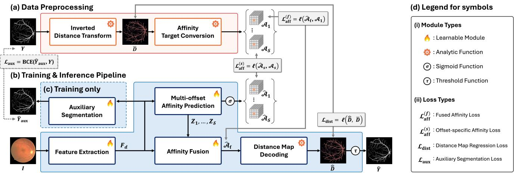  
Figure 1. Overview of the proposed TMAL framework. (a) The Inverted Distance Transform (IDT) maps the binary ground-truth mask Y to the inverted distance map $\dot { \bar { \mathcal { D } } } ,$ from which Affinity Target Conversion (ATC) derives the targets $\{ \mathcal { A } _ { s } \} _ { s \in \mathcal { S } }$ . (b) Feature Extraction (FE) maps the input image I to the decoder feature $F _ { \mathrm { d } }$ , which Multi-offset Affinity Prediction (MAP) and Affinity Fusion (AF) turn into the fused affinity $\hat { A } _ { \mathrm { f } }$ , and Distance Map Decoding (DMD) into $\hat { \bar { \mathcal { D } } }$ and the mask $\hat { Y }$ . (c) Auxiliary Segmentation (AuxSeg), used only during training, predicts $\hat { Y } _ { \mathrm { a u x } }$ from $F _ { \mathrm { d } } .$ . (d) Legend for the module and loss symbols.

## 2. Related Work

Mask-based Approaches. Encoder-decoder networks are still the main design for dense prediction. U-Net [15] set the pattern with a contracting path for context and a symmetric expanding path for localization. Later variants change how the decoder selects and combines features, such as the attention gates of Attention U-Net [14] and the channel and spatial attention of CS-Net [13]. Others change the encoder or the output stage, such as the context encoder of CE-Net [5] and the full-resolution aggregation and dualthreshold recovery of FR-UNet [10]. Generative methods instead model the mask as a distribution. GANs regularize that distribution [17], and SegDiff [1] and MedSegDiff [19] denoise it with an image-conditioned DDPM [7]. All of these methods produce pixel-wise masks and never represent the relations between neighboring pixels.

Distance-based Approaches. Distance-based methods build their targets from distance transforms. Shape-aware Segmentation [20] predicts signed distance maps as a global shape prior. Boundary Loss [9] instead weights its objective by the distance to the ground-truth contour. More recently, the SAUNA transform [2] encodes annotation uncertainty from boundary proximity and vessel thickness for retinal vessels. All of these methods attach distance information to single pixels. We instead use it to describe directional relations between pairs of pixels, and we put more weight on connectivity in thin structures.

Topology-based Approaches. Topology-based methods add a topological term to the training objective. clDice [16] measures how well a prediction agrees with its morphological skeleton and gives a differentiable soft form of that measure. CAPE [3] picks node pairs from the groundtruth graph and forces low-cost paths between them. These losses improve topology through supervision alone and never model connectivity between foreground pixels.

Connectivity-based Approaches. Recent methods predict connectivity directly in order to model directional relations. BiconNet [22] combines each direction with its opposite by Bilateral Voting. DconnNet [21] separates directional information across latent channels in its decoder. Both replace pixel-wise mask prediction with directional connectivity prediction, but their targets are binary and cover only a fixed eight-neighborhood. Neither method varies the target with local thickness, and that is where thin structures break.

## 3. Method

Let $I \in \mathbb { R } ^ { 3 \times H \times W }$ denote the input image, $Y \in \{ 0 , 1 \} ^ { H \times W }$ the binary ground-truth mask, and $\hat { Y } \in \mathsf { \bar { \{ 0 , 1 \} } } ^ { H \times W }$ the predicted mask.

## 3.1. Directional Connectivity Modeling

Let $\mathcal { O } \ = \ \{ { \big ( } o _ { x } , o _ { y } { \big ) } \ | \ o _ { x } , o _ { y } \ \in \ \{ - 1 , 0 , + 1 \} , { \big ( } o _ { x } , o _ { y } { \big ) } \ \neq$ $( 0 , 0 ) \}$ denote the eight unit directions, taken in the fixed order $\mathbf { \bar { \mathcal { O } } } = \{ ( o _ { x } ^ { k } , o _ { y } ^ { k } ) \} _ { k = 1 } ^ { 8 }$ in Figure 2(a). We write ¯k for the direction opposite to k, so that $( o _ { x } ^ { \bar { k } } , o _ { y } ^ { \bar { k } } ) = - ( o _ { x } ^ { k } , o _ { y } ^ { k } )$ Each branch carries a direction set of eight elements that is closed under negation. Branches $s = 1$ and $s = 2$ use O itself, and Section 3.2 introduces a rotated set. A directional pair is given by a direction k and a sampling offset s. The pair links pixel $p = ( i , j )$ to pixel $q = ( i + s \cdot o _ { x } ^ { k } , j + s \cdot o _ { y } ^ { k } )$ Here s is a spatial distance, not a change of feature-map resolution. The pair is unordered, because direction ¯k at the same offset links q back to p, as shown in Figure 2(a).

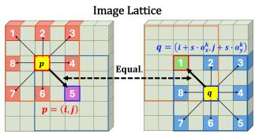

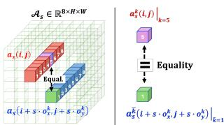  
(a) Image-domain Perspective  
(b) Affinity-domain Perspective

Figure 2. Direction indexing and the symmetry of a directional pair. Direction k from p and direction k¯ from q select the same pair, seen (a) in the image domain and (b) in the affinity domain. (b) writes $a _ { s } ( i , j ) = \{ a _ { s } ^ { k } ( i , j ) \} _ { k = 1 } ^ { 8 }$ for the eight-channel affinity vector at pixel (i, j).  
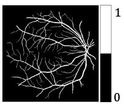  
(a) Y

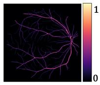  
(b) D

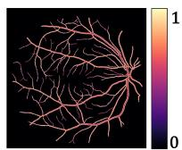  
(c) D¯  
Figure 3. (a) The binary ground-truth mask Y, (b) the Euclidean distance map D, and (c) the inverted distance map ${ \bar { \mathcal { D } } } ,$ , which peaks on thin branches and near boundaries where D is smallest.

Let $y ( i , j )$ be the value of Y at pixel $( i , j )$ Prior connectivity-based models [21, 22] read this pair at the single offset s = 1, so q is the immediate neighbor of $p .$ They use the binary connectivity target:

$$
\begin{array} { r } { c ^ { k } ( i , j ) = y ( i , j ) \cdot y ( i + o _ { x } ^ { k } , j + o _ { y } ^ { k } ) , \quad k = 1 , \dots , 8 . } \end{array}\tag{1}
$$

This gives $\mathcal { C } = \{ c ^ { k } \} _ { k = 1 } ^ { 8 } \in \{ 0 , 1 \} ^ { 8 \times H \times W }$ . A value of one means that pixel $( i , j )$ and its neighbor in direction k are both foreground. The target depends only on the two endpoints, so $\overline { { { c } } } ^ { k } ( p ) = y ( p ) \ : y ( q ) = \overline { { { c } } } ^ { \bar { k } } ( q )$ and the two directions of a pair carry the same value, as shown in Figure 2(b).

Conventional connectivity-based models predict Cˆ and supervise it against C with BCE-based objectives. TMAL keeps this directional pair formulation of Equation (1), but it replaces the binary value C with a continuous affinity A and the single offset s = 1 with a set of offsets S.

## 3.2. Data Preprocessing

In Figure 1(a), the IDT converts the binary ground-truth mask Y into a continuous inverted distance map D¯, and Affinity Target Conversion (ATC) derives multi-offset affinity targets $\{ \mathcal { A } _ { s } \} _ { s \in \mathcal { S } }$ from it.

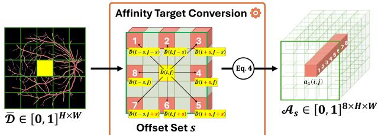  
(a) Affinity Target Conversion

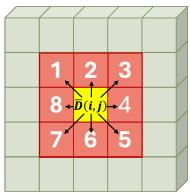

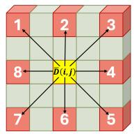  
(b) s = 1  
(c) s = 2

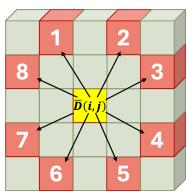  
(d) s = 2′  
Figure 4. (a) ATC samples the targets $\mathcal { A } _ { s }$ from the inverted dis tance map D¯ by Equation (4). (b)–(d) The sampling patterns used here: $s = 1 , s = 2 ,$ and the rotated eight-direction variant $s = 2 ^ { \prime }$

Inverted Distance Transform. Let $\begin{array} { r c l } { \Omega _ { 1 } } & { = } & { \{ ( i , j ) \} } \end{array}$ $y ( i , j ) = 1 \}$ and $\Omega _ { 0 } = \{ ( i , j ) ~ | ~ y ( i , j ) = 0 \}$ denote the foreground and background pixel sets. The Euclidean Distance Transform first gives each foreground pixel its distance to the nearest background pixel, and zero elsewhere.

$$
\begin{array} { r l } & { \mathcal { D } ( i , j ) } \\ & { = \left\{ \begin{array} { l l } { \displaystyle \operatorname* { m i n } _ { ( u , v ) \in \Omega _ { 0 } } \sqrt { ( i - u ) ^ { 2 } + ( j - v ) ^ { 2 } } , } & { ( i , j ) \in \Omega _ { 1 } , } \\ { 0 , } & { ( i , j ) \in \Omega _ { 0 } . } \end{array} \right. } \end{array}\tag{2}
$$

Then the distance map D is inverted and normalized so that boundary-adjacent and thin regions receive larger values. The normalized inverted distance map $\bar { \mathcal D }$ is defined as

$$
\bar { \mathcal { D } } ( i , j ) = \left\{ \begin{array} { l l } { \displaystyle \frac { d _ { \operatorname* { m a x } } - \mathcal { D } ( i , j ) } { d _ { \operatorname* { m a x } } - d _ { \operatorname* { m i n } } } , } & { ( i , j ) \in \Omega _ { 1 } , } \\ { 0 , } & { ( i , j ) \in \Omega _ { 0 } , } \end{array} \right.\tag{3}
$$

where $\begin{array} { r l r } { d _ { \mathrm { m a x } } } & { { } = } & { \operatorname* { m a x } _ { ( i , j ) \in \Omega _ { 1 } } { \cal D } ( i , j ) } \end{array}$ and $\begin{array} { r l } { d _ { \operatorname* { m i n } } } & { { } = } \end{array}$ mi $\mathsf { 1 } _ { ( i , j ) \in \Omega _ { 1 } } \mathscr { D } ( i , j )$ . The resulting map $\bar { \mathcal { D } } \in \left[ 0 , 1 \right] ^ { H \times W }$ is largest in thin regions and near boundaries. It is smallest inside thick centers, which is the opposite of D, as shown in Figure 3.

Affinity Target Conversion. The IDT function replaces the binary connectivity target C with the inverted distance map D¯, which is continuous. ATC replaces it with an affinity $\mathbf { \bar { \alpha } } _ { a _ { s } ^ { k } ( i , j ) } ^ { - } \in [ 0 , 1 ]$ that emphasizes thin regions near the boundary, as shown in Figure 4(a).

Let S be the set of branch indices, where each $s \in \mathcal { S }$ gives one sampling offset. The affinity at offset s is the product of the two inverted distances at the endpoints:

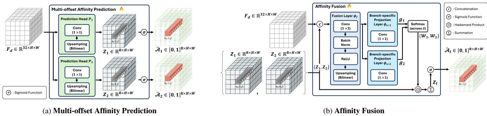  
Figure 5. (a) MAP predicts directional affinities $\{ \hat { A } _ { s } \} _ { s \in \mathcal { S } }$ from the shared decoder feature $F _ { \mathrm { d } } .$ . (b) $F _ { \mathrm { d } }$ and the branch logits $\{ Z _ { s } \} _ { s \in { \mathcal { S } } }$ are concatenated and passed through the fusion layer ϕ and branch-specific projection layers $\{ \phi _ { s } \} _ { s \in { \mathcal { S } } }$ to produce per-direction spatial weights $\mathcal { W } _ { s }$ . The fused logits are obtained by summing the products of $\mathcal { W } _ { s }$ and $Z _ { s }$ across branches. The figure shows the main setting ${ \mathcal { S } } = \{ 1 , 2 \}$

$$
a _ { s } ^ { k } ( i , j ) = \bar { \mathcal { D } } ( i , j ) \cdot \bar { \mathcal { D } } ( i + s \cdot o _ { x } ^ { k } , ~ j + s \cdot o _ { y } ^ { k } ) ,\tag{4}
$$

for $k ~ = ~ 1 , \dots , 8$ Stacking the eight directions gives the continuous, direction-aware target $\mathcal { A } _ { s } \ = \ \{ a _ { s } ^ { k } \} _ { k = 1 } ^ { 8 } \ \in$ $[ 0 , 1 ] ^ { 8 \times H \times W }$ . Equation (4) is symmetric in the two endpoints, so $a _ { s } ^ { k } ( p ) \ : = \ : a _ { s } ^ { \bar { k } } ( q )$ at every offset $s \in \mathcal { S }$ . This is equivalent to $c ^ { k }$ being satisfied when $s = 1$ in Equation (1).

Figure 4(b–d) shows the three sampling patterns used here. In Figure 4(b), branch $s = 1$ reads the eight neighbors of the $3 \times 3$ window. Branch $s = 2$ scales them onto the $5 \times 5$ neighborhood as shown in Figure 4(c). Therefore, the branch set $\{ { \mathcal { A } } _ { 1 } , { \mathcal { A } } _ { 2 } \}$ carries a short local step and a wider reach at the same time. The primed branch $s = 2 ^ { \prime }$ in Figure 4(d) is the rotated counterpart of the axis-aligned branch $s = 2$ . It keeps the same $5 \times 5$ window but reads the displacements $\mathcal { O } ^ { \prime } = \{ ( \pm 1 , \pm 2 ) , ( \pm 2 , \pm 1 ) \}$ instead of $\{ ( \pm 2 , 0 ) , ( 0 , \pm 2 ) , ( \pm 2 , \pm 2 ) \}$

## 3.3. Feature Extraction

The pipeline begins with the FE module, as shown in Figure 1(b). FE provides the representation $F _ { \mathrm { d } } \in \mathbb { R } ^ { C _ { d } }$ ×H×W that MAP, AF, and AuxSeg all use. An ImageNet-pretrained ResNet-34 [6] encoder $\phi _ { \mathrm { e n c } }$ extracts multi-level features from the input image I. An upsampling decoder $\phi _ { \mathrm { d e c } }$ then merges them into the FE representation $F _ { \mathrm { d } }$

$$
F _ { \mathrm { d } } = \phi _ { \mathrm { d e c } } ( \phi _ { \mathrm { e n c } } ( I ) ) ,\tag{5}
$$

where $C _ { d } = 3 2 $ is used in this study.

## 3.4. Multi-offset Affinity Prediction

MAP uses one lightweight prediction head $\mathcal { P } _ { s } ( \cdot )$ on the FE representation $F _ { \mathrm { d } }$ for each branch $s \in S$ , as shown in Figure 5(a). Each head applies a $1 \times 1$ convolution and bilinear upsampling to $F _ { \mathrm { d } }$ and predicts an eight-channel logit map $\bar { Z _ { s } } \in \bar { \mathbb { R } } ^ { 8 \times \bar { H } \times W }$ . An element-wise sigmoid $\sigma ( \cdot )$ then turns these logits into per-direction affinities $\hat { \mathcal { A } } _ { s } \in \left[ 0 , 1 \right] ^ { 8 \times H \times W }$

$$
Z _ { s } = { \mathcal { P } } _ { s } ( F _ { \mathrm { d } } ) , \qquad { \hat { \mathcal { A } } } _ { s } = \sigma ( Z _ { s } ) .\tag{6}
$$

## 3.5. Affinity Fusion

AF combines the offset branches using per-direction spatial weights, as shown in Figure 5(b).

AF first concatenates the branch logits $Z _ { s }$ with the FE representation $F _ { \mathrm { d } }$ and passes them through the fusion layer $\phi _ { f }$ , which consists of a $3 \times 3$ convolution, batch normalization [8], ReLU and bilinear upsampling. A branchspecific projection layer $\phi _ { s }$ then produces one gating logit map $g _ { s } \ \overset { \_ } { \in } \ \overset { \_ } { \mathbb { R } } ^ { 8 \times H \times W }$ for each $s \in S$ . A softmax over the branches turns these logits into per-direction spatial weight maps $\mathcal { W } _ { s } \in \left[ 0 , 1 \right] ^ { 8 \times H \times \mathbf { \breve { W } } }$ as

$$
\mathcal { W } _ { s } ^ { k } ( i , j ) = \frac { \exp \bigl ( g _ { s } ^ { k } ( i , j ) \bigr ) } { \sum _ { r \in S } \exp ( g _ { r } ^ { k } ( i , j ) ) } , \quad \sum _ { s \in S } \mathcal { W } _ { s } ^ { k } ( i , j ) = 1 .
$$

AF finally sums the products of each weight map $\mathcal { W } _ { s }$ and logit map $Z _ { s } ,$ , and a sigmoid gives the fused affinity map $\mathcal { \bar { A } } _ { \mathrm { f } } ^ { \smile } \in [ 0 , \bar { 1 } ] ^ { 8 \times H \times W }$

$$
Z _ { \mathrm { f } } = \sum _ { s \in { \cal S } } { \mathcal W } _ { s } \odot Z _ { s } , \qquad \hat { \mathcal A } _ { \mathrm { f } } = \sigma ( Z _ { \mathrm { f } } ) ,\tag{7}
$$

where ⊙ denotes the Hadamard product.

We optimize all continuous targets with the Smooth L1 loss $\ell ( \cdot , \cdot )$ [4]. The affinity predictions are supervised as

$$
\begin{array} { r } { \mathcal { L } _ { \mathrm { a f f } } ^ { ( \mathrm { f } ) } = \ell \Big ( \hat { A } _ { \mathrm { f } } , \mathcal { A } _ { 1 } \Big ) , \quad \mathcal { L } _ { \mathrm { a f f } } ^ { ( s ) } = \ell \Big ( \hat { A } _ { s } , \mathcal { A } _ { s } \Big ) , } \end{array}\tag{8}
$$

where (f) marks the fused map and (s) branch s. The fused map $\hat { A } _ { \mathrm { f } }$ from every branch set $s$ is supervised by $\mathcal { L } _ { \mathrm { a f f } } ^ { ( \mathrm { f } ) } \left\{ 0 \mathcal { A } _ { 1 } \right.$ because the offset-1 bilateral step of Section 3.6 decodes that map. It lets the wider offsets act as context, so that the offset-1 affinity becomes more accurate. Each branch keeps its own offset, and $\mathcal { L } _ { \mathrm { a f f } } ^ { ( s ) }$ regresses $\hat { \mathcal { A } } _ { s }$ against $\mathcal { A } _ { s }$

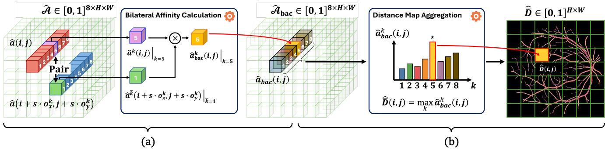  
Figure 6. DMD turns a predicted affinity map into an inverted distance map in two steps. (a) Bilateral Affinity Calculation multiplies the response of direction k at $( i , j )$ by the response of the opposite direction k¯ at the paired pixel. Stacking the eight directions gives the bilateral map $\hat { \mathcal { A } } _ { \mathrm { b a c } } . ~ ( \mathrm { b } )$ Distance Map Aggregation then takes the maximum over the eight directions and gives the predicted inverted distance map $\hat { \bar { D } } .$

## 3.6. Distance Map Decoding

DMD in Figure 6 converts a predicted affinity map $\hat { A }$ into an inverted distance map $\hat { \bar { \mathcal { D } } } \in \left[ 0 , 1 \right] ^ { H \times W }$ in two steps, Bilateral Affinity Calculation (BAC) and Distance Map $\mathrm { A g \mathrm { - } }$ gregation (DMA). During the training phase, we apply it to the fused map $\hat { \mathcal { A } } _ { \mathrm { f } }$ and each branch map $\hat { \mathcal { A } } _ { s }$ for deep supervision. The two paths give $\hat { \bar { \mathcal { D } } } ^ { ( \mathrm { f } ) }$ and $\hat { \bar { \mathcal { D } } } ^ { ( s ) }$ , and only $\hat { \bar { D } } ^ { ( \mathrm { f } ) }$ is thresholded into the final binary mask $\hat { Y }$ .

Step 1: Bilateral Affinity Calculation. For every direction k, BAC multiplies the response at $( i , j )$ in direction k by the opposite-direction ¯k response at the paired pixel $( i + s \cdot o _ { x } ^ { k } , \ \bar { j } + s \cdot o _ { y } ^ { k } )$ , as shown in Figure 6(a). The bilateral affinity map $\hat { \mathcal { A } } _ { \mathrm { b a c } } \doteq \left[ 0 , 1 \right] ^ { 8 \times H \times W }$ is:

$$
\hat { a } _ { \mathrm { b a c } } ^ { k } ( i , j ) = \hat { a } ^ { k } ( i , j ) \cdot \hat { a } ^ { \bar { k } } ( i + s \cdot o _ { x } ^ { k } , j + s \cdot o _ { y } ^ { k } ) ,\tag{9}
$$

where $k = 1 , \dots , 8$ and $\bar { k }$ is the opposite direction of $k .$ $\{ \hat { a } _ { \mathrm { b a c } } ^ { k } \} _ { k = 1 } ^ { 8 }$ is the set of all channels of the bilateral affinity map Aˆbac.

Step 2: Distance Map Aggregation. In Figure 6(b), taking the maximum across directions turns $\hat { \mathcal { A } } _ { \mathrm { b a c } }$ into the predicted inverted distance map $\hat { \bar { \mathcal { D } } } \in [ 0 , 1 ] ^ { H \times W }$

$$
\hat { \bar { \mathcal { D } } } ( i , j ) = \operatorname* { m a x } _ { k } \hat { a } _ { \mathrm { b a c } } ^ { k } ( i , j ) .\tag{10}
$$

Collapsing a target-consistent affinity map returns $\bar { \mathcal { D } } ( i , j )$ scaled by the largest inverted distance among the sampled neighbors. That factor approaches one in the thin regions near the boundary that the target emphasizes. Therefore, we supervise the predicted inverted distance map directly instead of inverting it:

$$
\mathcal { L } _ { \mathrm { d i s t } } ^ { ( \ast ) } = \ell \Big ( \hat { \bar { D } } ^ { ( \ast ) } , \bar { D } \Big ) , \quad \ast \in \{ \mathrm { f } , s \} .\tag{11}
$$

Thresholding the predicted inverted distance map $\hat { \bar { D } } ^ { ( \mathrm { f } ) }$ gives the binary mask $\hat { \hat { Y } } \in \left\{ 0 , 1 \right\} ^ { H \times W }$ :

$$
\hat { Y } ( i , j ) = \left\{ \begin{array} { l l } { 1 , } & { \hat { \bar { D } } ^ { ( \mathrm { f } ) } ( i , j ) > \tau , } \\ { 0 , } & { \mathrm { o t h e r w i s e } , } \end{array} \right.\tag{12}
$$

where $\tau = 0 . 5$ is used in this study.

## 3.7. Auxiliary Segmentation

The AuxSeg module regularizes affinity learning with pixellevel mask supervision taken from the FE representation $F _ { \mathrm { d } }$ as shown in Figure 1(c). Direct mask supervision complements the regression target and helps keep region-level accuracy. During training the AuxSeg branch predicts a binary mask $\hat { Y } _ { \mathrm { a u x } }$ , and a binary cross-entropy (BCE) loss supervises as

$$
\mathcal { L } _ { \mathrm { a u x } } = \mathrm { B C E } \Big ( \hat { Y } _ { \mathrm { a u x } } , Y \Big ) .\tag{13}
$$

The AuxSeg module is discarded at inference.

## 3.8. Training Objectives

All five loss terms supervise each branch, while the fused output uses only the affinity, distance, and Dice losses. ${ \mathcal L } _ { \mathrm { a f f } }$ optimizes all continuous targets with the Smooth L1 loss $\ell ( \cdot , \cdot )$ [4]. ${ \mathcal { L } } _ { \mathrm { d i s t } }$ shapes the profile toward $\bar { \mathcal { D } } _ { }$ ${ \mathcal { L } } _ { \mathrm { d i c e } }$ is the soft Dice loss [12] between $\hat { \bar { \mathcal { D } } } ^ { ( * ) }$ and $Y$ with $* \in \{ \mathrm { f } , s \}$ and it counters the imbalance between foreground and background. ${ \mathcal { L } } _ { \mathrm { b a c } }$ supervises the bilateral affinity after BAC with the same offset-1 target used for local connectivity. The edge term $\mathcal { L } _ { \mathrm { e d g e } }$ follows the edge-decoupled supervision, and the edge set comes from the binary connectivity.

The training loss for branch s is then

$$
\begin{array} { r l } & { \mathcal { L } ^ { ( s ) } = \lambda _ { \mathrm { a f f } } \mathcal { L } _ { \mathrm { a f f } } ^ { ( s ) } + \lambda _ { \mathrm { d i s t } } \mathcal { L } _ { \mathrm { d i s t } } ^ { ( s ) } + \lambda _ { \mathrm { d i c e } } \mathcal { L } _ { \mathrm { d i c e } } ^ { ( s ) } } \\ & { ~ + \lambda _ { \mathrm { b a c } } \mathcal { L } _ { \mathrm { b a c } } ^ { ( s ) } + \lambda _ { \mathrm { e d g e } } \mathcal { L } _ { \mathrm { e d g e } } ^ { ( s ) } . } \end{array}\tag{14}
$$

Table 1. Quantitative comparison on DRIVE [18] and DeepCrack [11]. Higher is better for Dice, IoU and clDice; lower is better for $\Delta \beta _ { 0 } ,$ $\Delta \beta _ { 1 }$ and HD95. Methods are grouped as mask-, topology-, and connectivity-based approaches. Bold and underlining denote the best and second-best results, respectively; the shaded row denotes TMAL.
<table><tr><td rowspan="2">Categories</td><td rowspan="2">Methods</td><td colspan="5">DRIVE [18]</td><td colspan="6">DeepCrack [11]</td></tr><tr><td>Dice↑</td><td>IoU↑ clDice ↑</td><td> $\Delta \beta _ { 0 } \downarrow$ </td><td></td><td> $\Delta \beta _ { 1 } \downarrow$ </td><td>HD95↓</td><td>Dice↑</td><td>IoU↑</td><td>clDice ↑</td><td> $\Delta \beta _ { 0 } \downarrow$   $\Delta \beta _ { 1 } \downarrow$ </td><td>HD95↓</td></tr><tr><td rowspan="6">(a) Mask</td><td>U-Net [15]</td><td>0.7813</td><td>0.6415</td><td>0.7818</td><td>446.15</td><td>6.20</td><td>9.85 0.7931</td><td>0.6814</td><td>0.8586</td><td></td><td>4.93 1.31</td><td>30.66</td></tr><tr><td>FR-UNet [10]</td><td>0.7573</td><td>0.6097 0.7716</td><td>484.65</td><td>7.20</td><td>10.55</td><td>0.6748</td><td>0.5593</td><td>0.7366</td><td>5.33</td><td>0.93</td><td>61.12</td></tr><tr><td>CS-Net [13]</td><td>0.75560.6076</td><td>0.7611</td><td>454.65</td><td>5.85</td><td>11.41</td><td>0.8051</td><td>0.6945</td><td>0.8721</td><td>5.42</td><td>1.43</td><td>32.79</td></tr><tr><td>V-GAN [17]</td><td>0.8167</td><td>0.6905 0.8168</td><td>300.65</td><td>5.50</td><td>7.44</td><td>0.6249</td><td>0.4933</td><td>0.7021</td><td>5.74</td><td>1.54</td><td>52.27</td></tr><tr><td>SegDiff [1]</td><td>0.7186</td><td>0.5617 0.6998</td><td>369.65</td><td>9.30</td><td>11.28</td><td></td><td>0.79000.6729</td><td>0.8624</td><td>5.65</td><td>1.53</td><td>14.44</td></tr><tr><td>MedSegDiff [19]</td><td>0.7569 0.6092</td><td>0.7168</td><td>204.45</td><td>4.95</td><td>2.59</td><td>0.7749</td><td>0.6452</td><td>0.8797</td><td>4.62</td><td>1.70</td><td>47.89</td></tr><tr><td rowspan="2">(b) Topology</td><td>clDice [16]</td><td>0.6561</td><td>0.4888</td><td>0.8159 513.30</td><td></td><td>5.20</td><td>9.08</td><td>0.7673</td><td>0.6642</td><td>0.8258</td><td>4.22 2.11</td><td>48.92</td></tr><tr><td>CAPE [3]</td><td>0.7097 0.5503</td><td>0.7570</td><td>307.10</td><td>6.75</td><td>3.97</td><td>0.8049</td><td>0.6896</td><td>0.8698</td><td>7.08</td><td>4.27</td><td>19.92</td></tr><tr><td rowspan="2">(c) Connectivity</td><td>DconnNet [21]</td><td>0.7762 0.6346</td><td>0.7835</td><td>452.80</td><td>5.35</td><td>9.48</td><td>0.8252</td><td>0.7134</td><td>0.8927</td><td>4.51</td><td>1.05</td><td>26.38</td></tr><tr><td>TMAL (Ours)</td><td>0.8295 0.7090</td><td>0.8773</td><td>24.50</td><td>20.95</td><td>8.48</td><td>0.8439</td><td>0.7427</td><td>0.9074</td><td>1.98</td><td>0.88</td><td>29.17</td></tr></table>

The training loss of the fused output is

$$
\mathcal { L } ^ { ( \mathrm { f } ) } = \lambda _ { \mathrm { a f f } } \mathcal { L } _ { \mathrm { a f f } } ^ { ( \mathrm { f } ) } + \lambda _ { \mathrm { d i s t } } \mathcal { L } _ { \mathrm { d i s t } } ^ { ( \mathrm { f } ) } + \lambda _ { \mathrm { d i c e } } \mathcal { L } _ { \mathrm { d i c e } } ^ { ( \mathrm { f } ) } ,\tag{15}
$$

where $\lambda _ { \mathrm { a f f } } = 0 . 3 , \lambda _ { \mathrm { d i s t } } = 1 . 0 , \lambda _ { \mathrm { d i c e } } = 1 . 0 , \lambda _ { \mathrm { b a c } } = 0 . 2 ,$ and $\lambda _ { \mathrm { e d g e } } = 1 . 0$ weight the five loss terms.

Finally, the total loss is

$$
\mathcal { L } _ { \mathrm { t o t a l } } = \lambda _ { \mathrm { f } } \mathcal { L } ^ { ( \mathrm { f } ) } + \sum _ { s \in \mathcal { S } } \lambda _ { s } \mathcal { L } ^ { ( s ) } + \lambda _ { \mathrm { a u x } } \mathcal { L } _ { \mathrm { a u x } } ,\tag{16}
$$

where $\lambda _ { \mathrm { f } } = 1 . 0$ is the weight of the fused output and $\lambda _ { \mathrm { a u x } } =$ 0.5 is the weight of the auxiliary objective. The two branch objectives use $( \lambda _ { 1 } , \lambda _ { 2 } ) ~ = ~ ( 0 . 5 , 0 . 3 )$ for the main setting ${ \mathcal { S } } = \{ 1 , 2 \}$ . Sec. S3 in the supplementary material lists the branch weights for the ablation settings and definition of the loss functions that are not defined in the paper.

## 4. Experiments

## 4.1. Experimental Setup

Datasets. We evaluate TMAL on two curvilinearstructure datasets from different domains and use the official split of each. DRIVE [18] provides 40 color fundus images of 565 × 584 pixels with binary vessel masks, split evenly into 20 training and 20 testing images. Deep-Crack [11] comprises 537 concrete-surface images of 544× 384 pixels annotated for cracks, with 300 used for training and 237 for testing.

Implementation Details. FE uses the encoder and decoder of Section 3.3. Each image and its labels are resized to 512 × 512. At inference we run the network on the same $5 1 2 \times 5 1 2$ input and binarize the predicted inverted distance map at $\tau = 0 . 5$ . All metrics are computed at this resolution rather than at the native image size, and no field-of-view mask or post-processing is applied. Sec. S1 in the supplementary material gives the optimizer, the learning rate schedule, the training length and the augmentation settings for each dataset.

Baseline Protocol. All baseline results in Table 1 come from our own training runs. Among the mask-based baselines, the encoder-decoder models U-Net [15], FR-UNet [10] and CS-Net [13] are retrained from scratch with BCE and no architectural changes. We retrain every other baseline with its official implementation and published configuration. This group contains the generative V-GAN [17], SegDiff [1] and MedSegDiff [19], the topologybased clDice [16] and CAPE [3], and the connectivity-based DconnNet [21]. Because every method is trained and evaluated under this common 512 × 512 protocol, the absolute values differ from those reported in the original papers.

Evaluation Metrics. We measure region overlap with Dice and IoU. Overlap scores alone cannot capture the connectivity of thin structures, so we also report clDice [16], two Betti-count errors $\Delta \beta _ { 0 }$ and $\Delta \beta _ { 1 }$ , and the 95th percentile Hausdorff distance (HD95). clDice measures agreement with the morphological skeleton, and the two Bettinumber errors measure topology preservation. $\Delta \beta _ { 0 }$ compares the numbers of connected components and $\Delta \beta _ { 1 }$ compares the numbers of loops. HD95 measures the 95thpercentile boundary distance in pixels, taken symmetrically between the predicted and ground-truth boundaries.

## 4.2. Experimental Results

Table 1 compares TMAL with mask-based, topology-based and connectivity-based methods, and Figure 7 shows representative predictions. TMAL achieves the highest Dice, IoU and clDice and the lowest $\Delta \beta _ { 0 }$ on both datasets. TMAL reduces the lowest baseline $\Delta \beta _ { 0 }$ by 88.0% on DRIVE and by 53.1% on DeepCrack, so its gains reach beyond pixel-wise accuracy to component-level continuity.

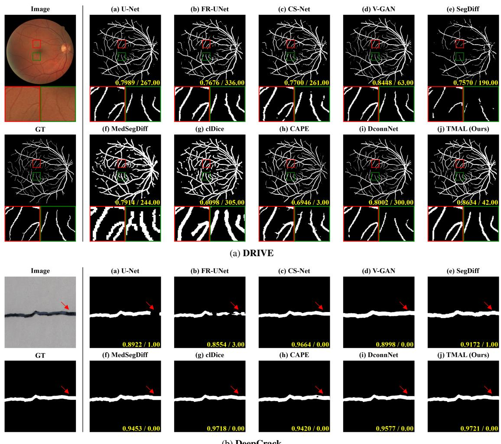  
Figure 7. Qualitative comparison on DRIVE [18] and DeepCrack [11]. On DRIVE, red and green boxes mark the two regions enlarged beneath each panel; on DeepCrack, red arrows mark the corresponding regions. The highlighted regions illustrate differences in branch continuity and false-positive responses. Yellow values give Dice $' \Delta \beta _ { 0 }$ for each example.

DconnNet [21], the closest prior method in design, uses binary connectivity targets within a fixed eightneighborhood. The much lower $\Delta \beta _ { 0 }$ of TMAL agrees with the intended benefit of distance-aware targets and wider offsets. In the examples of Figure 7, TMAL also keeps the highlighted vessel and crack structures without an obvious break, which supports the connectivity improvements of Table 1.

## 4.3. Ablation Studies

Table 2 ablates TMAL on DRIVE along three axes: the segmentation label, the objective terms and the branch set. Figures of each ablation study is in Sec. S5 of the supplementary material.

Segmentation Label. Table 2(a) compares three segmentation labels, the binary mask Y , the standard distance map

D and the inverted distance map $\bar { \mathcal { D } } .$ . Replacing the soft affinity target with the binary mask Y in Table 2(a)(i) reduces Dice, IoU and clDice, and increases $\Delta \beta _ { 0 }$ by more than an order of magnitude. However, the binary mask attains the lowest $\Delta \beta _ { 1 }$ of the study, namely 5.15 against 20.95 for the inverted distance map D¯. A binary mask leaves thin branches broken, whereas a soft affinity target reconnects them and can also close a loop the ground truth does not contain. The standard distance map D in Table 2(a)(ii) is worse on every metric than D¯ in (d), which supports emphasizing thin regions near the boundary instead of structure centerlines.

Objective Terms. Table 2(b) ablates the fused objective $\mathcal { L } ^ { \mathrm { ( f ) } }$ and the auxiliary objective $\mathcal { L } _ { \mathrm { a u x } } .$ The full TMAL model in (d) attains a Betti-0 error of $\Delta \beta _ { 0 } = 2 4 . 5 0$ . Removing both terms in (b)(i) increases this error to 67.65, and removing $\mathcal { L } ^ { \mathrm { ( f ) } }$ alone in (b)(ii) yields a comparable 68.50; the overlap scores and $\Delta \beta _ { 1 }$ degrade in the same way. The degradation is therefore driven almost entirely by $\bar { \mathcal { L } } ^ { ( \mathrm { f } ) }$ , although this comparison should be read with care, since removing $\mathcal { L } ^ { \mathrm { ( f ) } }$ also leaves the fused path unsupervised and (b)(ii) thus cannot separate the absence of the loss from an untrained fusion branch. Omitting $\mathcal { L } _ { \mathrm { a u x } }$ alone in (b)(iii) is far less harmful, raising $\Delta \beta _ { 0 }$ to only 31.35, but it still lowers the overlap scores and increases both Betti-number errors relative to (d), indicating that the auxiliary supervision provides useful regularization for affinity learning.

Table 2. Ablation study on DRIVE [18]. Each group replaces one setting, shown in parentheses. Removing $\mathcal { L } ^ { \mathrm { ( f ) } }$ also removes AF. In group (c), primed offsets denote the rotated direction set. Higher is better for Dice, IoU and clDice; lower is better for $\Delta \beta _ { 0 } , \Delta \beta _ { 1 }$ and HD95. Bold and underlining denote the best and second-best results, respectively; the shaded row denotes TMAL.
<table><tr><td colspan="4">Ablation Studies</td><td colspan="5">DRIVE [18]</td></tr><tr><td colspan="3">Components (Ours Setting)</td><td>Configurations (Other Settings)</td><td>Dice ↑ IoU↑</td><td>clDice ↑</td><td> $\Delta \beta _ { 0 } \downarrow$ </td><td> $\Delta \beta _ { 1 } \downarrow$ </td><td>HD95↓</td></tr><tr><td rowspan="2">(a)</td><td rowspan="2">Segmentation Label  $( \hat { \mathcal { D } } )$ </td><td>(i)</td><td>Binary Mask Y</td><td>0.7766 0.6350</td><td>0.7805</td><td>480.20</td><td>5.15</td><td>9.34</td></tr><tr><td>(ii) Distance Map D</td><td></td><td>0.8268 0.7051</td><td>0.8760</td><td>27.95</td><td>21.15</td><td>8.52</td></tr><tr><td rowspan="2">(b)</td><td rowspan="2">Objective Terms  $( \mathrm { w } / \mathcal { L } ^ { ( \mathrm { f } ) } \mathrm { a n d } \mathcal { L } _ { \mathrm { a u x } } )$ </td><td>(i) w/o  $\overline { { \mathcal { L } ^ { ( \mathrm { f } ) } } }$ </td><td>and  $\mathcal { L } _ { \mathrm { a u x } }$ </td><td>0.8242 0.7013</td><td>0.8745</td><td>67.65</td><td>21.95</td><td>8.42</td></tr><tr><td>(ii) w/o  $\mathcal { L } ^ { \mathrm { ( f ) } }$ </td><td></td><td>0.8269 0.7052</td><td>0.8752</td><td>68.50</td><td>21.75</td><td>8.54</td></tr><tr><td rowspan="6">(c)  $( S = \{ 1 , 2 \} )$ </td><td rowspan="6">Branch Set</td><td>(iii)  $\mathrm { w } / \mathrm { o } \ \mathcal { L } _ { \mathrm { a u x } }$ </td><td></td><td>0.8243 0.7015</td><td>0.8720</td><td>31.35</td><td>21.20</td><td>8.45</td></tr><tr><td>(i)  ${ \cal { S } } = \{ 1 \}$ </td><td></td><td>0.8264 0.7045</td><td>0.8759</td><td>30.10</td><td>20.95</td><td>8.36</td></tr><tr><td>(ii)  $S = \{ 2 \}$ </td><td></td><td>0.8184 0.6928</td><td>0.8648</td><td>44.50</td><td>17.90</td><td>8.55</td></tr><tr><td>(iii)  $S = \{ 1 , 2 , 3 \}$ </td><td></td><td>0.8277 0.7064</td><td>0.8748</td><td>29.05</td><td>20.70</td><td>8.70</td></tr><tr><td>(iv)  $S = \{ 1 , 2 , 3 , 4 \}$ </td><td></td><td>0.8266 0.7048</td><td>0.8742</td><td>33.50</td><td>21.20</td><td>8.50</td></tr><tr><td>(v)  ${ \cal { S } } = \{ 1 , 2 ^ { \prime } \}$ </td><td></td><td>0.8265 0.7046</td><td>0.8745</td><td>35.95</td><td>21.25</td><td>8.37</td></tr><tr><td>(d) TMAL (Ours) (Setting: D, w/</td><td colspan="2">(vi)  $S = \{ 1 , 2 , 2 ^ { \prime } \}$   $\overline { { \mathcal { L } ^ { ( \mathrm { f } ) } } }$  and</td><td>0.8270  $\mathcal { L } _ { \mathrm { a u x } } , S = \{ 1 , 2 \} )$  0.8295</td><td>0.7053 0.7090</td><td>0.8756 0.8773</td><td>34.10 24.50</td><td>20.75 20.95</td><td>8.16 8.48</td></tr></table>

Branch Set. Table 2(c) varies the branch set S in two respects: the number of sampling offsets, and whether the direction set at offset 2 is rotated. A single offset yields a higher $\Delta \beta _ { 0 }$ than the proposed pair, both for the short step $\mathcal { A } _ { 1 }$ in (c)(i) and for the wider step $\boldsymbol { A } _ { 2 }$ in (c)(ii). Enlarging the set beyond two offsets trades topological accuracy for overlap accuracy: $\mathcal { S } = \{ 1 , 2 , 3 \}$ in (c)(iii) attains the best Dice and IoU among the ablated variants, yet it and $\mathcal { S } = \{ 1 , 2 , 3 , 4 \}$ in (c)(iv) both raise $\Delta \beta _ { 0 }$ above the proposed setting ${ \cal { S } } = \{ 1 , 2 \}$ . To probe non-axis-aligned directions, we introduce the rotated branch $s \ : = \ : 2 ^ { \prime }$ of Figure 4(d) in two ways: in (c)(v) it replaces s = 2, giving ${ \cal S } = \{ 1 , 2 ^ { \prime } \}$ , and in (c)(vi) it is added to the proposed setting, giving $\cal { S } = \{ 1 , 2 , 2 ^ { \prime } \}$ . Under the same setting, neither variant improves the overlap scores or $\Delta \beta _ { 0 }$ . However, variant (c)(vi) does attain the best HD95 in Table 2, consistent with the uniform sampling radius of O′ aiding boundary localization. Therefore, we adopt $\mathcal { S } = \{ 1 , 2 \}$ for TMAL.

## 5. Conclusion

We presented TMAL, which replaces binary connectivity targets with soft directional affinities built from the inverted distance map, so the supervision follows local thickness and marks the structures that break most easily. TMAL predicts these affinities at several sampling offsets and combines them with adaptive weights. On DRIVE and Deep-Crack it reduces the connected-component error $\Delta \beta _ { 0 }$ and also improves the overlap and skeleton-based metrics.

Limitations. The affinity target constrains pairwise connectivity, so it does not directly optimize loop structure or the worst-case boundary distance. $\Delta \beta _ { 1 }$ rises on DRIVE and HD95 does not reach the best value. The sampling offsets are also fixed in advance and shared across the image.

Future Work. An affinity target that also constrains loops and boundaries would turn these properties into a controllable trade-off. The sampling offsets could likewise be learned.

## Acknowledgments

This work was supported by the IITP(Institute of Information & Coummunications Technology Planning & Evaluation)-ITRC(Information Technology Research Center) grant funded by the Korea government(Ministry of Science and ICT)(IITP-2026-RS-2020-II201602), by the National Research Foundation of Korea(NRF) grant funded by the Korea government(MSIT) (RS-2025-24533373), by the Cyber Investigation Support Technology Development Program(No.RS-2025-02304983) of the Korea Institute of Police Technology (KIPoT) funded by the Korean National Police Agency and by the G-LAMP Program of the National Research Foundation of Korea (NRF) grant funded by the Ministry of Education (No. RS-2025-25441317).

## References

[1] Tomer Amit, Tal Shaharbany, Eliya Nachmani, and Lior Wolf. Segdiff: Image segmentation with diffusion probabilistic models. arXiv preprint arXiv:2112.00390, 2021. 2, 6

[2] Trung D. Q. Dang, Huy Hoang Nguyen, and Aleksei Tiulpin. Image-level regression for uncertainty-aware retinal image segmentation. In Proceedings of the Winter Conference on Applications of Computer Vision, pages 4194–4204, 2025. 2

[3] Elyar Esmaeilzadeh, Ehsan Garaaghaji, Farzad Hallaji Azad, and Doruk Oner. Cape: Connectivity-aware path enforcement loss for curvilinear structure delineation. In International Conference on Medical Image Computing and Computer-Assisted Intervention, pages 183–193. Springer, 2025. 1, 2, 6

[4] Ross Girshick. Fast r-cnn. In Proceedings ofthe IEEE international conference on computer vision, pages 1440–1448, 2015. 4, 5

[5] Zaiwang Gu, Jun Cheng, Huazhu Fu, Kang Zhou, Huaying Hao, Yitian Zhao, Tianyang Zhang, Shenghua Gao, and Jiang Liu. Ce-net: Context encoder network for 2d medical image segmentation. IEEE Transactions on Medical Imaging, 38(10):2281–2292, 2019. 2

[6] Kaiming He, Xiangyu Zhang, Shaoqing Ren, and Jian Sun. Deep residual learning for image recognition. In Proceedings ofthe IEEE conference on computer vision and pattern recognition, pages 770–778, 2016. 4

[7] Jonathan Ho, Ajay Jain, and Pieter Abbeel. Denoising diffusion probabilistic models. Advances in neural information processing systems, 33:6840–6851, 2020. 2

[8] Sergey Ioffe and Christian Szegedy. Batch normalization: Accelerating deep network training by reducing internal covariate shift. In International conference on machine learning, pages 448–456. pmlr, 2015. 4

[9] Hoel Kervadec, Jihene Bouchtiba, Christian Desrosiers, Eric Granger, Jose Dolz, and Ismail Ben Ayed. Boundary loss for highly unbalanced segmentation. Medical Image Analysis, 67:101851, 2021. 2

[10] Wentao Liu, Huihua Yang, Tong Tian, Zhiwei Cao, Xipeng Pan, Weijin Xu, Yang Jin, and Feng Gao. Full-resolution network and dual-threshold iteration for retinal vessel and coronary angiograph segmentation. IEEE journal of biomedical and health informatics, 26(9):4623–4634, 2022. 2, 6

[11] Yahui Liu, Jian Yao, Xiaohu Lu, Renping Xie, and Li Li. Deepcrack: A deep hierarchical feature learning architecture for crack segmentation. Neurocomputing, 338:139–153, 2019. 2, 6, 7

[12] Fausto Milletari, Nassir Navab, and Seyed-Ahmad Ahmadi. V-net: Fully convolutional neural networks for volumetric medical image segmentation. In 2016 Fourth International Conference on 3D Vision (3DV), pages 565–571. IEEE, 2016. 1, 5

[13] Lei Mou, Yitian Zhao, Li Chen, Jun Cheng, Zaiwang Gu, Huaying Hao, Hong Qi, Yalin Zheng, Alejandro Frangi, and Jiang Liu. Cs-net: Channel and spatial attention network for curvilinear structure segmentation. In International Confer-

ence on Medical Image Computing and Computer-Assisted Intervention, pages 721–730. Springer, 2019. 2, 6

[14] Ozan Oktay, Jo Schlemper, Loic Le Folgoc, Matthew Lee, Mattias Heinrich, Kazunari Misawa, Kensaku Mori, Steven McDonagh, Nils Y Hammerla, Bernhard Kainz, et al. Attention u-net: Learning where to look for the pancreas. arXiv preprint arXiv:1804.03999, 2018. 2

[15] Olaf Ronneberger, Philipp Fischer, and Thomas Brox. Unet: Convolutional networks for biomedical image segmentation. In International Conference on Medical image computing and computer-assisted intervention, pages 234–241. Springer, 2015. 2, 6

[16] Suprosanna Shit, Johannes C Paetzold, Anjany Sekuboyina, Ivan Ezhov, Alexander Unger, Andrey Zhylka, Josien PW Pluim, Ulrich Bauer, and Bjoern H Menze. cldice-a novel topology-preserving loss function for tubular structure segmentation. In Proceedings of the IEEE/CVF conference on computer vision and pattern recognition, pages 16560– 16569, 2021. 1, 2, 6

[17] Jaemin Son, Sang Jun Park, and Kyu-Hwan Jung. Retinal vessel segmentation in fundoscopic images with generative adversarial networks. arXiv preprint arXiv:1706.09318, 2017. 2, 6

[18] Joes Staal, Michael D Abramoff, Meindert Niemeijer, Max A\` Viergever, and Bram Van Ginneken. Ridge-based vessel seg mentation in color images of the retina. IEEE transactions on medical imaging, 23(4):501–509, 2004. 2, 6, 7, 8

[19] Junde Wu, Rao Fu, Huihui Fang, Yu Zhang, Yehui Yang, Haoyi Xiong, Huiying Liu, and Yanwu Xu. Medsegdiff: Medical image segmentation with diffusion probabilistic model. In Medical imaging with deep learning, pages 1623– 1639. PMLR, 2024. 2, 6

[20] Yuan Xue, Hui Tang, Zhi Qiao, Guanzhong Gong, Yong Yin, Zhen Qian, Chao Huang, Wei Fan, and Xiaolei Huang. Shape-aware organ segmentation by predicting signed dis tance maps. In Proceedings ofthe AAAI Conference on Arti ficial Intelligence, pages 12565–12572, 2020. 2

[21] Ziyun Yang and Sina Farsiu. Directional connectivitybased segmentation of medical images. In Proceedings of the IEEE/CVF conference on computer vision and pattern recognition, pages 11525–11535, 2023. 1, 2, 3, 6, 7

[22] Ziyun Yang, Somayyeh Soltanian-Zadeh, and Sina Farsiu. Biconnet: An edge-preserved connectivity-based approach for salient object detection. Pattern recognition, 121:108231, 2022. 1, 2, 3

# TMAL: Topology-preserving Multi-offset Affinity Learning for Curvilinear Structure Segmentation

Supplementary Material

This document provides additional material for the main paper. It includes implementation details in Section S1, additional explanation about the affinity target A in Section S2, the full loss definitions in Section S3, metric definitions in Section S4, and additional analysis and qualitative results in Section S5.

Following the main paper, $s$ is the set of branch indices and each $s \in S$ gives one sampling offset, $F _ { \mathrm { d } }$ denotes the decoder feature produced by Feature Extraction (FE), and $\bar { \mathcal D }$ denotes the normalized inverted distance map. The superscript (f) denotes a term for the fused map and (s) the corresponding term for branch s.

## S1. Implementation Details

Preprocessing We resize the images, binary masks, and distance maps to $5 1 2 \times 5 1 2$ and normalize image intensities to $[ - 1 . 6 , 1 . 6 ]$ Training augmentation is HSV jitter with hue, saturation and value shifts of at most 30, 5 and 15 levels, a random shift, scale and aspect-ratio jitter of at most 10%, random horizontal and vertical flips, and random $9 0 °$ rotations. We do not use test-time augmentation.

Optimization We train TMAL on one NVIDIA RTX PRO 6000 GPU, with Adam on DRIVE and AdamW on DeepCrack. The baselines use their published optimizer settings. We use a separate schedule for each dataset, as shown in Table S1. DeepCrack has 300 training images, whereas DRIVE has 20, so we train DeepCrack for fewer epochs with a lower learning rate. We fix the random seed and enable deterministic kernels. We hold out no validation split, so no checkpoint selection or early stopping takes place and every reported number comes from the last-epoch model.

Table S1. Optimization settings of the reported runs.
<table><tr><td></td><td>DRIVE [6]</td><td>DeepCrack [2]</td></tr><tr><td>Epochs</td><td>500</td><td>100</td></tr><tr><td>Batch size</td><td>4</td><td>8</td></tr><tr><td>Optimizer</td><td>Adam</td><td>AdamW</td></tr><tr><td>Learning rate</td><td> $3 . 8 \times 1 0 ^ { - 3 }$ </td><td> $1 \times 1 0 ^ { - 4 }$ </td></tr><tr><td>Schedule</td><td>polynomial (0.9) cosine annealing</td><td></td></tr><tr><td>Weight decay</td><td>0</td><td> $1 \times 1 0 ^ { - 4 }$ </td></tr></table>

Inference At inference we run the network once on the same $5 1 2 \times 5 1 2$ input and binarize the predicted inverted distance map at $\tau = 0 . 5$ . We discard AuxSeg, so only the affinity path produces the reported binary mask.

Auxiliary Segmentation AuxSeg is a training-only onechannel mask head. In the main paper, we directly apply the auxiliary head $\phi _ { \mathrm { a u x } }$ to the decoder feature $F _ { \mathrm { d } } \mathrm { { : } }$

$$
M _ { \mathrm { a u x } } = \phi _ { \mathrm { a u x } } ( F _ { \mathrm { d } } ) , \qquad \hat { Y } _ { \mathrm { a u x } } = \sigma ( M _ { \mathrm { a u x } } ) .\tag{S1}
$$

Here $\phi _ { \mathrm { a u x } }$ denotes a shallow convolutional head, implemented as a $3 \times 3$ convolution followed by batch normalization and ReLU, and then a 1 × 1 convolution: $\phi _ { \mathrm { a u x } } ( \cdot ) =$ $\mathrm { C o n v _ { 1 \times 1 } ( R e L U ( B N ( C o n v _ { 3 \times 3 } ( \cdot ) ) ) ) }$ . The decoder feature has $C _ { d } = 3 2 $ channels. The auxiliary loss is the binary cross-entropy of Equation (13) of the main paper,

$$
\mathcal { L } _ { \mathrm { a u x } } = \mathrm { B C E } \Big ( \hat { Y } _ { \mathrm { a u x } } , Y \Big ) ,\tag{S2}
$$

which we evaluate as BCEWithLogits $( M _ { \mathrm { a u x } } , Y )$ on the logits for numerical stability. AuxSeg is discarded at inference, so it changes only the training objective and not the deployed affinity-decoding path.

Choice of Fusion Mode in AF Table S2 compares the fusion choices under the reported inverted-distance setting.

The proposed configuration uses Decoder-guided Directional Offset Fusion (DG-DOF), which fuses branch logits rather than affinity probabilities. It concatenates the decoder feature $F _ { \mathrm { d } }$ with all branch logits $\{ Z _ { s } \} _ { s \in { \mathcal { S } } }$ , applies the shared fusion layer $\phi _ { \mathrm { f } }$ , and predicts branch-specific gating logits through $\phi _ { s }$ . A softmax across branches gives perpixel, per-direction weights $\mathcal { W } _ { s } ,$ , so each fused directional logit is an adaptive convex combination over offsets. This choice keeps the offset-specific branches supervised separately, while the fused map, supervised by the offset-1 target, uses wider-offset evidence as context for the final bilateral decoding. For the two-branch setting below, $Z _ { 1 }$ and $Z _ { 2 }$ denote the branch logits at offsets 1 and 2, respectively.

No Fusion (NF) in Equation S3 decodes $Z _ { 1 }$ while training both branches. Decoder-guided Residual (DGR) in Equation S4 adds to $Z _ { 1 }$ a residual from $F _ { \mathrm { d } } , \ Z _ { 1 }$ , and $Z _ { 2 }$ DGR outperformed NF; logit fusion improves numerical stability. Directional Offset Fusion (DOF) in Equation S5 convexly combines $Z _ { 1 }$ and $Z _ { 2 }$ . DG-DOF in Equation S6 conditions its weights on $F _ { \mathrm { d } }$ and serves as Affinity Fusion (AF).

Table S2. Fusion-mode ablation under the inverted-distance setting. All rows use the standard eight directions, Smooth L1 supervision, AuxSeg weight 0.5, and Distance Map Aggregation by the maximum over the eight directions. All rows use $S = \{ 1 , 2 \}$ with branch loss weights $( \lambda _ { 1 } , \lambda _ { 2 } ) \ = \ ( 0 . 5 , 0 . 3 )$ . The no-fusion row keeps both branches but has no AF module, so the offset-1 branch logits are decoded directly as in Equation (S3). Higher is better for Dice, IoU and clDice; lower is better for $\Delta \beta _ { 0 } , \Delta \beta _ { 1 }$ and HD95. Bold denotes the best result in each column; the shaded row is the proposed configuration.

<table><tr><td rowspan="2">Fusion mode</td><td colspan="5">DRIVE [6]</td></tr><tr><td>Dice ↑</td><td>IoU↑ clDice ↑</td><td> $\overline { { \Delta \beta _ { 0 } \downarrow } }$ </td><td> $\overline { { \Delta \beta _ { 1 } \iota } }$ </td><td>HD95↓</td></tr><tr><td>NF</td><td>0.8269</td><td>0.7052</td><td>0.8752</td><td>68.50 21.75</td><td>8.54</td></tr><tr><td>DGR</td><td>0.8285 0.7076</td><td>0.8760</td><td>28.85</td><td>21.10</td><td>8.37</td></tr><tr><td>DOF</td><td>0.8248</td><td>0.7021 0.8743</td><td>25.10</td><td>20.40</td><td>8.57</td></tr><tr><td>DG-DOF</td><td>0.8295 0.7090</td><td>0.8773</td><td>24.50</td><td>20.95</td><td>8.48</td></tr></table>

The candidate fusion modes are

$$
\begin{array} { r l } { \mathrm { N F } \colon } & { { } Z _ { \mathrm { f } } = Z _ { 1 } . } \end{array}\tag{S3}
$$

$$
\begin{array} { r l } & { \mathrm { 2 } : \quad Z _ { \mathrm { f } } = Z _ { 1 } + \beta \odot r , \quad r = \phi _ { r } ( h _ { \mathrm { d g r } } ) , } \\ & { \quad \beta = \sigma ( \phi _ { \beta } ( h _ { \mathrm { d g r } } ) ) , } \\ & { \quad h _ { \mathrm { d g r } } = \phi _ { \mathrm { d g r } } ( [ F _ { \mathrm { d } } , Z _ { 1 } , Z _ { 2 } ] ) . } \end{array}\tag{S4}
$$

$$
\begin{array} { r l } { \displaystyle \mathrm { D O F } \colon } & { \displaystyle Z _ { \mathrm { f } } = \sum _ { s \in { \mathcal S } } { \mathcal W } _ { s } \odot Z _ { s } , } \\ & { \displaystyle { \mathcal W } _ { s } = \mathrm { s o f t m a x } _ { s } \big ( \phi _ { s } \big ( h _ { \mathrm { d o f } } \big ) \big ) , } \\ & { \displaystyle h _ { \mathrm { d o f } } = \phi _ { \mathrm { d o f } } \big ( \big [ Z _ { 1 } , Z _ { 2 } \big ] \big ) . } \end{array}\tag{S5}
$$

$$
\begin{array} { r l } { \mathrm { D G \mathrm { - } D O F } \colon } & { \displaystyle Z _ { \mathrm { f } } = \sum _ { s \in { \cal S } } \mathcal { W } _ { s } \odot Z _ { s } , } \\ & { \displaystyle \mathcal { W } _ { s } = \mathrm { s o f t m a x } _ { s } \big ( \phi _ { s } ( h _ { \mathrm { f } } ) \big ) , } \\ & { \displaystyle h _ { \mathrm { f } } = \phi _ { f } \big ( [ F _ { \mathrm { d } } , Z _ { 1 } , Z _ { 2 } ] \big ) . } \end{array}\tag{S6}
$$

Each mode has its own fusion layer. For DG-DOF, $\phi _ { f }$ is the fusion layer and $\phi _ { s }$ is the branch-specific projection layer of the main paper. The notation [·] denotes channel concatenation, and all weights are spatial and directionspecific. Table S2 reports these three multi-offset variants together with the no-fusion baseline.

## S2. Affinity Target Details

This section collects properties of the affinity target that the main paper states only in summary.

Degenerate Cases We construct the normalized inverted distance map as

$$
\bar { \mathcal { D } } ( i , j ) = \left\{ \begin{array} { l l } { \displaystyle \frac { d _ { \operatorname* { m a x } } - \mathcal { D } ( i , j ) } { d _ { \operatorname* { m a x } } - d _ { \operatorname* { m i n } } } , } & { ( i , j ) \in \Omega _ { 1 } , } \\ { 0 , } & { ( i , j ) \in \Omega _ { 0 } . } \end{array} \right.\tag{S7}
$$

If $d _ { \operatorname* { m a x } } = d _ { \operatorname* { m i n } }$ , the denominator vanishes and the normalization can cause a division-by-zero error. However, none of the samples in DRIVE or DeepCrack exhibited this degenerate case.

Rotated Direction Set The primed branch $2 ^ { \prime }$ replaces the axis-aligned offsets $\{ ( \pm 2 , 0 ) , ( 0 , \pm 2 ) , ( \pm 2 , \pm 2 ) \}$ at offset two with $\{ ( \pm 1 , \pm 2 ) , ( \pm 2 , \pm 1 ) \}$ . Both sets have eight elements inside the same $5 \times 5$ window and both are closed under negation, so the opposite-direction indexing of the main paper, and with it the shared target of a direction pair, applies unchanged. The rotated set places all eight samples at radius ${ \sqrt { 5 } } ,$ whereas the axis-aligned set mixes radii 2 and $2 { \sqrt { 2 } } .$

## S3. Loss Definitions

Smooth L1 We use the Smooth L1 loss $\ell ( \cdot , \cdot ) [ 1 ]$ for all continuous affinity and distance targets. The loss is applied element-wise and averaged over the map:

$$
\ell ( x , y ) = \left\{ \begin{array} { l l } { 0 . 5 ( x - y ) ^ { 2 } } & { | x - y | < \delta , } \\ { \delta } & { \mathrm { o t h e r w i s e } , } \end{array} \right.\tag{S8}
$$

with $\delta = 1 . 0$ in all experiments.

Bilateral Consistency Term After Bilateral Affinity Calculation, we compare $\hat { \mathcal { A } } _ { \mathrm { b a c } } ^ { ( s ) } = \{ \hat { a } _ { \mathrm { b a c } } ^ { k , ( s ) } \} _ { k = 1 } ^ { 8 }$ of branch s with the offset-1 affinity target used for local connectivity:

$$
\mathcal { L } _ { \mathrm { b a c } } ^ { ( s ) } = \ell \Big ( \hat { \mathcal { A } } _ { \mathrm { b a c } } ^ { ( s ) } , \mathcal { A } _ { 1 } \Big ) .\tag{S9}
$$

The offset-1 affinity target is symmetric in the two endpoints, so both directions have the same target value. Following BiconNet [10], we reuse this target for both the pre-BAC directional fused map and every branch’s bilateral map. This reuse is a design choice, not an algebraic identity: if a pre-BAC directional term were satisfied exactly, the bilateral product would equal the elementwise square of its prediction. The bilateral term therefore couples the two halves of each direction pair through their product rather than acting as a constraint that can be met exactly. We apply it to the branches only.

Dice Term Each decoded inverted distance map also carries a soft Dice loss [3] against the ground-truth mask ${ \mathit { Y } } ,$

$$
\mathcal { L } _ { \mathrm { d i c e } } ^ { ( * ) } = 1 - \frac { 2 \sum _ { i , j } \hat { \bar { D } } ^ { ( * ) } ( i , j ) y ( i , j ) + \varepsilon } { \sum _ { i , j } \hat { \bar { D } } ^ { ( * ) } ( i , j ) + \sum _ { i , j } y ( i , j ) + \varepsilon } , \quad * \in \{ \mathrm { f } , s \} ,\tag{S10}
$$

where $\varepsilon = 1 0 ^ { - 4 }$ . This loss provides region-level supervision for the affinity path. Unlike the Size Density Loss of

DconnNet [9], it does not weight classes by size because both benchmarks contain one foreground class.

Edge-decoupled Term Each branch loss also includes the edge-decoupled term of BiconNet [10]. Let $c ^ { k }$ denote the binary connectivity target from the main paper. Because our affinity targets are continuous, we construct $\mathcal { C } = \{ c ^ { k } \} _ { k = 1 } ^ { 8 }$ from the ground-truth mask Y rather than from the distanceaware affinity target. The binary edge target is calculated from the connectivity target as

$$
\begin{array} { c } { { e ( i , j ) = { \bf 1 } \left[ 0 < \displaystyle \sum _ { k = 1 } ^ { 8 } c ^ { k } ( i , j ) < 8 \right] , } } \\ { { \mathcal { E } = \{ ( i , j ) \mid e ( i , j ) = 1 \} . } } \end{array}\tag{S11}
$$

Thus, an edge pixel is a foreground pixel whose connectivity vector contains both zeros and ones. Following the edge-decoupled formulation of BiconNet [10], which DconnNet [9] adopts as part of its Bicon loss, the per-pixel edge term for branch s is

$$
\begin{array} { r l } & { \ell _ { \mathrm { B C E } } \bigg ( 1 - \underset { \boldsymbol { k } } { \mathrm { m i n } } \hat { a } _ { \mathrm { b a c } } ^ { \boldsymbol { k } , ( s ) } ( i , j ) , y ( i , j ) \bigg ) } \\ & { \qquad = \ell _ { \mathrm { B C E } } \bigg ( \underset { \boldsymbol { k } } { \mathrm { m i n } } \hat { a } _ { \mathrm { b a c } } ^ { \boldsymbol { k } , ( s ) } ( i , j ) , 0 \bigg ) , \quad ( i , j ) \in \mathcal { E } , } \end{array}\tag{S12}
$$

where $y ( i , j ) = 1$ for every $( i , j ) \in \mathcal { E }$ . This drives the smallest bilateral response, corresponding to a disconnected direction, toward zero. We sum this term over the edge pixels and normalize it by the mass of their minimum bilateral responses,

$$
\mathcal { L } _ { \mathrm { e d g e } } ^ { ( s ) } = \frac { - \sum _ { ( i , j ) \in \mathcal { E } } \log \left( 1 - \operatorname* { m i n } _ { k } \hat { a } _ { \mathrm { b a c } } ^ { k , ( s ) } ( i , j ) \right) } { \operatorname* { m a x } \left( \sum _ { ( i , j ) \in \mathcal { E } } \operatorname* { m i n } _ { k } \hat { a } _ { \mathrm { b a c } } ^ { k , ( s ) } ( i , j ) , 1 0 ^ { - 8 } \right) } .\tag{S13}
$$

Total Objective The total objective groups losses by decoded map rather than by term type. Each branch s collects all five terms at its own sampling offset:

$$
\begin{array} { r l } & { \mathcal { L } ^ { ( s ) } = \lambda _ { \mathrm { a f f } } \mathcal { L } _ { \mathrm { a f f } } ^ { ( s ) } + \lambda _ { \mathrm { d i s t } } \mathcal { L } _ { \mathrm { d i s t } } ^ { ( s ) } } \\ & { ~ + \lambda _ { \mathrm { d i c e } } \mathcal { L } _ { \mathrm { d i c e } } ^ { ( s ) } + \lambda _ { \mathrm { b a c } } \mathcal { L } _ { \mathrm { b a c } } ^ { ( s ) } + \lambda _ { \mathrm { e d g e } } \mathcal { L } _ { \mathrm { e d g e } } ^ { ( s ) } . } \end{array}\tag{S14}
$$

The fused map contributes only three of them. Its bilateral and edge terms are not part of the objective:

$$
\mathcal { L } ^ { ( \mathrm { f } ) } = \lambda _ { \mathrm { a f f } } \mathcal { L } _ { \mathrm { a f f } } ^ { ( \mathrm { f } ) } + \lambda _ { \mathrm { d i s t } } \mathcal { L } _ { \mathrm { d i s t } } ^ { ( \mathrm { f } ) } + \lambda _ { \mathrm { d i c e } } \mathcal { L } _ { \mathrm { d i c e } } ^ { ( \mathrm { f } ) } .\tag{S15}
$$

The total objective adds the auxiliary branch:

$$
\mathcal { L } _ { \mathrm { t o t a l } } = \lambda _ { \mathrm { f } } \mathcal { L } ^ { ( \mathrm { f } ) } + \sum _ { s \in \mathcal { S } } \lambda _ { s } \mathcal { L } ^ { ( s ) } + \lambda _ { \mathrm { a u x } } \mathcal { L } _ { \mathrm { a u x } } .\tag{S16}
$$

We set $\lambda _ { \mathrm { a f f } } = 0 . 3 , \lambda _ { \mathrm { d i s t } } = 1 . 0 , \lambda _ { \mathrm { d i c e } } = 1 . 0 , \lambda _ { \mathrm { b a c } } = 0 . 2 ,$ $\lambda _ { \mathrm { e d g e } } = 1 . 0 , ( \lambda _ { 1 } , \lambda _ { 2 } ) = ( 0 . 5 , 0 . 3 ) , \lambda _ { \mathrm { f } } = 1 . 0 , \mathrm { a n d } \lambda _ { \mathrm { a u x } } =$ 0.5. For the branch sets with more than two offsets we additionally set $( \lambda _ { 3 } , \lambda _ { 4 } ) = ( 0 . 3 , 0 . 2 )$

## S4. Metric Definitions

This section gives the formal definitions of the evaluation metrics reported in the main paper. Let $Y \in \{ 0 , 1 \} ^ { H \times W }$ denote the ground-truth mask and $\hat { Y } \in \{ 0 , 1 \} ^ { H \times \mathrm { W } }$ the predicted mask, and let Ω denote the image domain. The pixellevel true positives, false positives, and false negatives are

$$
\begin{array} { r l } & { \mathrm { T P } = | \boldsymbol { Y } \cap \hat { \boldsymbol { Y } } | , } \\ & { \mathrm { F P } = | ( \Omega \setminus \boldsymbol { Y } ) \cap \hat { \boldsymbol { Y } } | , } \\ & { \mathrm { F N } = | \boldsymbol { Y } \cap ( \Omega \setminus \hat { \boldsymbol { Y } } ) | . } \end{array}\tag{S17}
$$

Dice and IoU

$$
{ \mathrm { D i c e } } = { \frac { 2 \mathrm { T P } } { \mathrm { 2 T P } + \mathrm { F P } + \mathrm { F N } } } ,\tag{S18}
$$

$$
\mathrm { I o U } = { \frac { \mathrm { T P } } { \mathrm { T P } + \mathrm { F P } + \mathrm { F N } } } .\tag{S19}
$$

Dice measures foreground overlap, whereas IoU measures the proportion of the ground-truth–prediction union that is correctly predicted as foreground.

clDice clDice [5] measures topology-aware overlap between the prediction and ground truth through their morphological skeletons. Let Skel(·) denote the morphological skeletonization operator, implemented using skimage.morphology.skeletonize. The topology precision and sensitivity are

$$
\begin{array} { r l } & { T _ { \mathrm { p r e c } } ( Y , \hat { Y } ) = \frac { \vert Y \cap \mathrm { S k e l } ( \hat { Y } ) \vert } { \vert \mathrm { S k e l } ( \hat { Y } ) \vert } , } \\ & { T _ { \mathrm { s e n s } } ( Y , \hat { Y } ) = \frac { \vert \hat { Y } \cap \mathrm { S k e l } ( Y ) \vert } { \vert \mathrm { S k e l } ( Y ) \vert } . } \end{array}\tag{S20}
$$

The clDice score is their harmonic mean:

$$
\mathrm { c l D i c e } ( Y , \hat { Y } ) = \frac { 2 T _ { \mathrm { p r e c } } T _ { \mathrm { s e n s } } } { T _ { \mathrm { p r e c } } + T _ { \mathrm { s e n s } } } .\tag{S21}
$$

Betti-number Error Betti numbers characterize topology in a binary mask $[ 7 ] . \beta _ { 0 }$ is the number of separate foreground components. A break in a vessel or crack can split one structure into several components and thus increase $\beta _ { 0 }$ $\beta _ { 1 }$ is the number of enclosed holes. An unwanted closed loop can create an extra hole and increase $\beta _ { 1 }$

$$
\Delta \beta _ { k } = \left| \beta _ { k } \Big ( \hat { Y } \Big ) - \beta _ { k } ( Y ) \right| .\tag{S22}
$$

A zero error means that the prediction and ground truth have the same number of components or holes. However, this metric compares only the counts, not their locations, so a missing structure and an extra structure can cancel each other [7]. We therefore interpret it together with clDice and HD95.

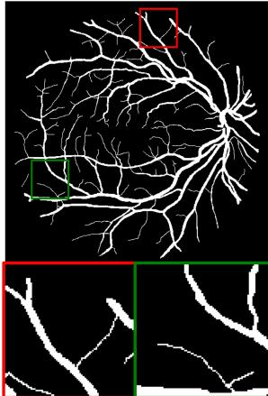  
(a) Ground Truth

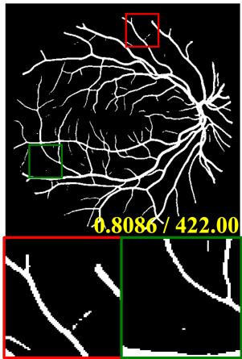  
(b) Y

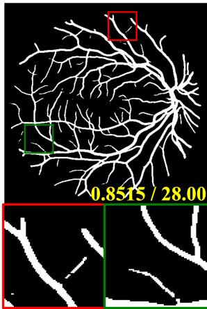  
(c) D

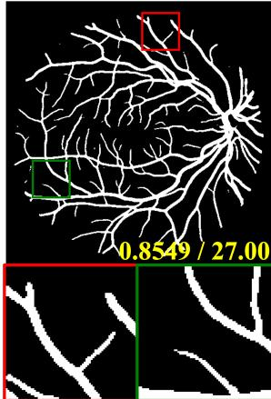  
(d) D¯  
(Ours)

Figure S1. Qualitative comparison of the segmentation-label ablation on DRIVE. (a) Ground-truth mask. (b) to (d) predictions obtained using the binary ground-truth mask Y, the standard distance map D, and the proposed inverted distance map D¯, respectively, as the source segmentation labels for affinity supervision. Red and green boxes mark the two regions enlarged underneath each panel. Yellow values give the Dice score and $\Delta \beta _ { 0 }$  
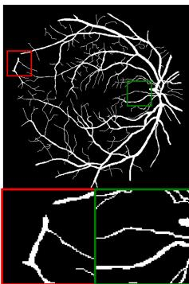  
(a) Ground Truth

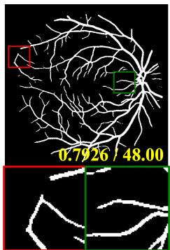  
(b) S = {1}

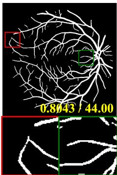  
(c) S = {1, 2}  
(Ours)

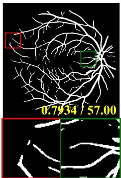  
(d) S = {1, 2′}

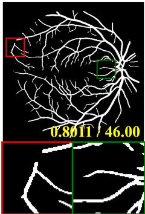  
(e) S = {1, 2, 2′}  
Figure S2. Qualitative comparison of the branch-set ablation on DRIVE, varying the direction set at offset 2. (a) Ground-truth mask. (b) to (e) predictions with $S = \{ 1 \} , S = \{ 1 , 2 \} , S = \{ 1 , 2 ^ { \prime } \}$ and $\cal { S } = \{ 1 , 2 , 2 ^ { \prime } \}$ , respectively. The red and green boxes mark the two regions enlarged underneath each panel, and the yellow values give the Dice score and $\Delta \beta _ { 0 }$ . The best configuration $\mathcal { S } = \{ 1 , 2 \}$ is labeled (Ours) in the figure.

Hausdorff Distance The Hausdorff distance measures separation between the predicted and ground-truth boundaries. Let $\partial Y$ and $\partial \hat { Y }$ denote their boundary point sets. For boundary point sets A and B, we define the directed and symmetric Hausdorff distances as

$$
h ( A , B ) = \operatorname* { m a x } _ { a \in A } \operatorname* { m i n } _ { b \in B } \| a - b \| ,\tag{S23}
$$

$$
\mathrm { H D } ( Y , \hat { Y } ) = \operatorname* { m a x } \{ h ( \partial \hat { Y } , \partial Y ) , h ( \partial Y , \partial \hat { Y } ) \} .\tag{S24}
$$

We report HD95, replacing the outer maximum with the 95th percentile of point-to-boundary distances to reduce sensitivity to outliers. Lower values indicate better boundary agreement.

## S5. Additional Analysis and Results

The figures in this section illustrate the ablation table of the main paper. Figure S1 corresponds to its segmentation-label block, whereas Figure S2 and Figure S3 both belong to its branch-set block, the former varying the direction set at offset 2 and the latter the number of sampling offsets. The objective-term block is quantitative only and has no counterpart here. The sampling patterns that these branch sets use are drawn in Figure 4 of the main paper.

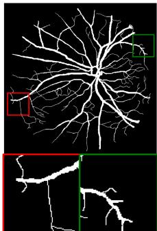  
(a) Ground Truth

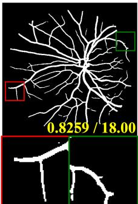  
(b) S = {1}

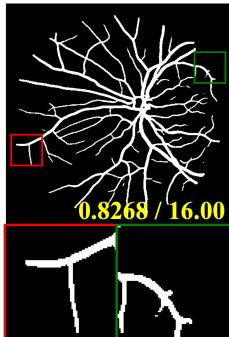  
(c) S = {1, 2}  
(Ours)

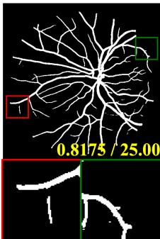  
(d) S = {1, 2, 3}

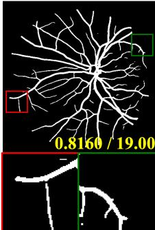  
(e) S = {1, 2, 3, 4}

Figure S3. Qualitative comparison of the branch-set ablation on DRIVE, varying the number of sampling offsets. (a) Ground-truth mask. (b) to (e) predictions with S = {1}, S = {1, 2}, S = {1, 2, 3} and $\mathcal { S } = \{ 1 , 2 , 3 , 4 \}$ , respectively. The red and green boxes mark the two regions enlarged underneath each panel, and the yellow values give the Dice score and $\Delta \beta _ { 0 }$ . The best configuration $S = \{ 1 , 2 \}$ is labeled (Ours) in the figure.  
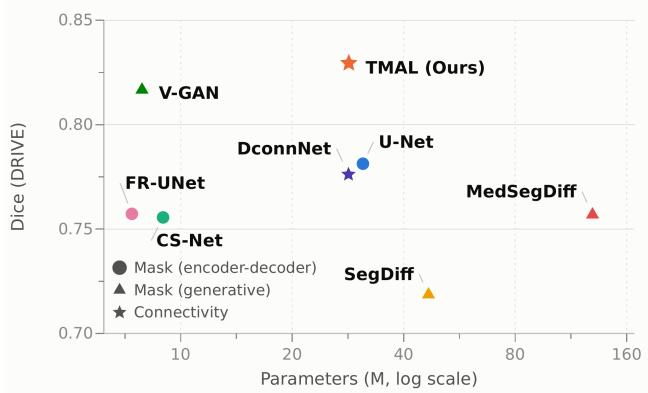  
Figure S4. Parameter count against Dice score on DRIVE for TMAL and representative baselines. Marker shape follows the grouping of Table 1 of the main paper, with the mask-based methods split into the encoder-decoder and the generative ones. Topology-based methods are losses added to an existing backbone, so their parameter counts equal those of that backbone and they are not plotted separately. All counts are total parameters under one shared setup.

Figure S4 places TMAL against the baselines in the Dice-versus-params plane on DRIVE. TMAL has 28.44 M parameters against the 28.38 M of DconnNet [9], the closest connectivity-based baseline, so TMAL uses about 0.2% more parameters. Thus, the reported gains are not accompanied by a substantial increase in parameter count. For context, U-Net [4] has a comparable parameter count of 31.04 M, whereas MedSegDiff [8], the largest model in the comparison, has 129.40 M.

## References

[1] Ross Girshick. Fast r-cnn. In Proceedings ofthe IEEE international conference on computer vision, pages 1440–1448, 2015. 11

[2] Yahui Liu, Jian Yao, Xiaohu Lu, Renping Xie, and Li Li. Deepcrack: A deep hierarchical feature learning architecture for crack segmentation. Neurocomputing, 338:139–153, 2019. 10

[3] Fausto Milletari, Nassir Navab, and Seyed-Ahmad Ahmadi. V-net: Fully convolutional neural networks for volumetric medical image segmentation. In 2016 Fourth International Conference on 3D Vision (3DV), pages 565–571. IEEE, 2016. 11

[4] Olaf Ronneberger, Philipp Fischer, and Thomas Brox. Unet: Convolutional networks for biomedical image segmentation. In International Conference on Medical image computing and computer-assisted intervention, pages 234–241. Springer, 2015. 14

[5] Suprosanna Shit, Johannes C Paetzold, Anjany Sekuboyina, Ivan Ezhov, Alexander Unger, Andrey Zhylka, Josien PW Pluim, Ulrich Bauer, and Bjoern H Menze. cldice-a novel topology-preserving loss function for tubular structure segmentation. In Proceedings of the IEEE/CVF conference on computer vision and pattern recognition, pages 16560– 16569, 2021. 12

[6] Joes Staal, Michael D Abramoff, Meindert Niemeijer, Max A\` Viergever, and Bram Van Ginneken. Ridge-based vessel segmentation in color images of the retina. IEEE transactions on medical imaging, 23(4):501–509, 2004. 10, 11

[7] Nico Stucki, Johannes C Paetzold, Suprosanna Shit, Bjoern Menze, and Ulrich Bauer. Topologically faithful image segmentation via induced matching of persistence barcodes. In Proceedings of the 40th International Conference on Ma chine Learning, pages 32698–32727, 2023. 12

[8] Junde Wu, Rao Fu, Huihui Fang, Yu Zhang, Yehui Yang, Haoyi Xiong, Huiying Liu, and Yanwu Xu. Medsegdiff: Medical image segmentation with diffusion probabilistic model. In Medical imaging with deep learning, pages 1623– 1639. PMLR, 2024. 14

[9] Ziyun Yang and Sina Farsiu. Directional connectivitybased segmentation of medical images. In Proceedings of the IEEE/CVF conference on computer vision and pattern recognition, pages 11525–11535, 2023. 12, 14

[10] Ziyun Yang, Somayyeh Soltanian-Zadeh, and Sina Farsiu. Biconnet: An edge-preserved connectivity-based approach for salient object detection. Pattern recognition, 121:108231, 2022. 11, 12