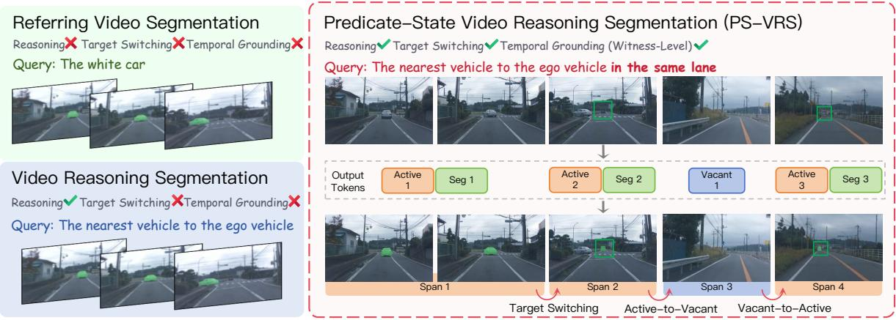
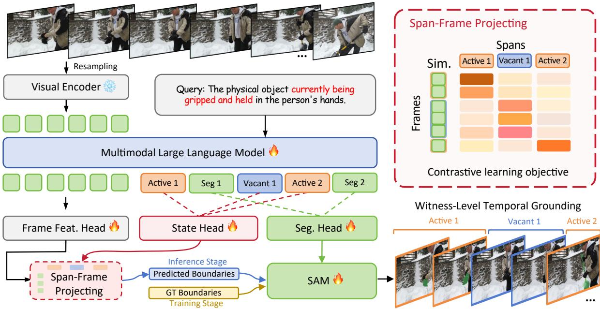
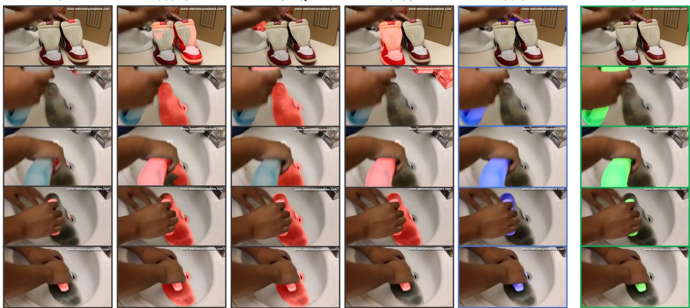
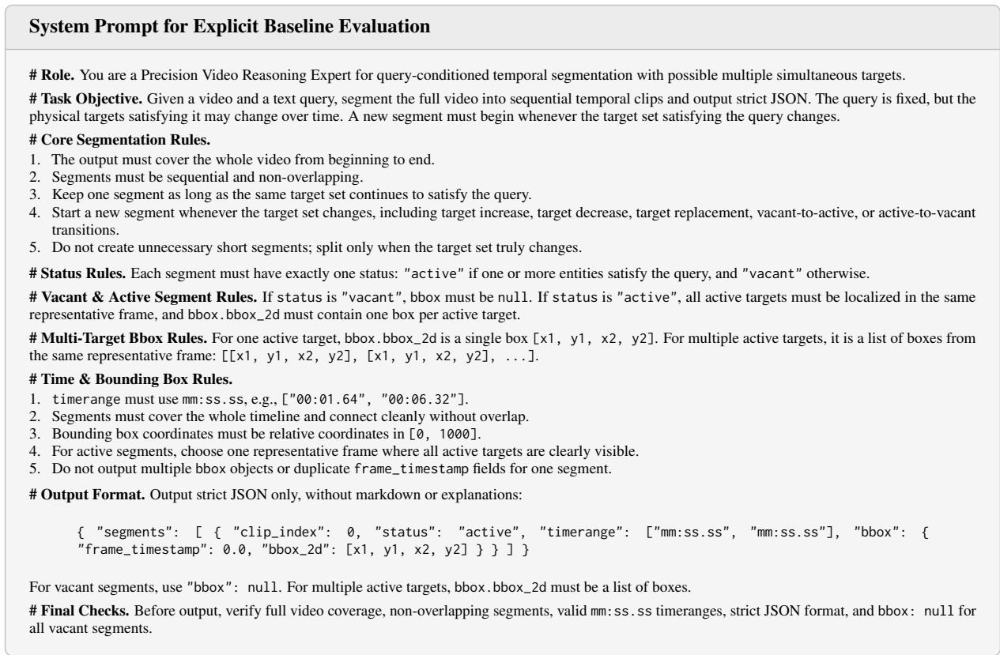
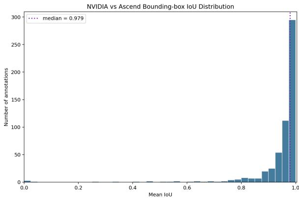
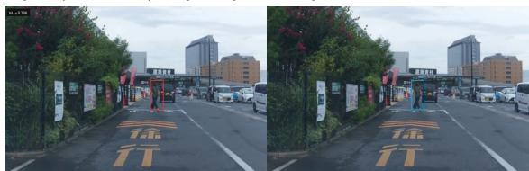
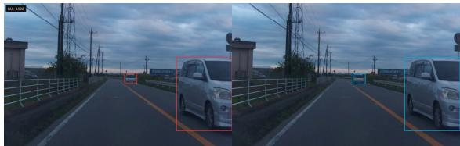
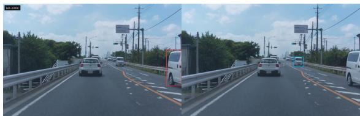

# The Target Is a Predicate: Predicate-State Grounding for Semantic-Level Video Reasoning Segmentation

Yuhuan Hong<sup>1</sup>\* Yiming Ren<sup>1</sup>\* Zhiqiang Lin<sup>1</sup>\* Feize Wu<sup>2</sup>\* Xingyun Liu<sup>3</sup> Yitong Xie<sup>3</sup> Lei Zhou<sup>4</sup> Lisheng Wu<sup>4</sup> Junjie Wang<sup>1†</sup> Yujiu Yang<sup>1†</sup>

<sup>1</sup>Tsinghua University <sup>2</sup>Peking University

<sup>3</sup>Sun Yat-sen University <sup>4</sup>Yinwang intelligent Technology Co., Ltd hongyh25@mails.tsinghua.edu.cn yang.yujiu@sz.tsinghua.edu.cn

## Abstract

In this paper, we introduce Predicate-State Video Reasoning Segmentation (PS-VRS), where a query defines a dynamic predicate $P ( o , t )$ over objects and time rather than a fixed object identity. Existing methods typically treat the target as permanently active once identified, leading to over-emission of masks during vacant intervals and failure to handle target switching. To address this, we construct PS-Bench, a large-scale benchmark with 2,077 videos and 16,250 queries annotated with explicit active/vacant predicate states, temporal intervals, and pixel masks. We further propose Predicate-State Grounding (PSG), a State-Bind-Emit pipeline that: (1) predicts [ACTIVE]/[VACANT] state tokens; (2) aligns them to video frames via dense cross-modal similarity; and (3) emits masks via SAM2 only for active states. Experiments show that PSG outperforms existing baselines by +9.32 J&F on PS-Bench and significantly reduces false-positive mask emissions. Our results demonstrate the effectiveness of explicit predicate-state modeling for video reasoning segmentation with dynamic visual witnesses.

## 1 Introduction

Language-guided video segmentation has evolved from referring to explicit objects towards reasoning over implicit conditions, relations, and temporal dynamics (Lai et al., 2024; Bai et al., 2024; Shen et al., 2025; Shen and Zhang, 2025). In many real-world scenarios, a user query does not specify a persistent object identity but instead defines a predicate over objects and time. For example, “If the person releases his right hand, what object will fall?” — the valid visual witness may be an apple at one moment, become absent for several frames, and later become a tissue. The query defines a time-dependent Boolean predicate $P _ { Q } ( o , t )$ at each moment, a model must decide whether any object satisfies the predicate, segment the current visual witness if it exists, and emit no mask otherwise.

As shown in Fig. 1, existing task formulations cover only part of this setting. Referring Video Object Segmentation (Wu et al., 2022; Ding et al., 2023) assumes a fixed target object referred to by the query. Video Reasoning Segmentation (Deng et al., 2025; Yan et al., 2024) introduces implicit queries that require world knowledge or motion understanding. However, their annotation and evaluation protocols typically treat the target as an active referent once identified, without explicitly representing predicate-state transitions such as target switching, active-to-vacant, or vacant-to-active changes. Consequently, they do not directly evaluate whether a visible object remains query-valid, or whether the predicate has no valid witness at a given moment. In fact, many VRS methods couple semantic validity with mask generation, predicting what to segment without explicitly deciding whether the query predicate is active (Lin et al., 2025; Bai et al., 2024). This results in severe over-emission of invalid masks, especially during vacant intervals or when the target identity switches.

To address this, we introduce Predicate-State Video Reasoning Segmentation (PS-VRS). Under PS-VRS, a reasoning query is formalized as $P _ { Q } ( o , t )$ , and the output must satisfy three requirements: 1) Predicate-state reasoning, determining whether the predicate is active or vacant over time; 2) Witness-level temporal grounding, localizing semantic segments and their transition boundaries; and 3) State-conditioned pixel segmentation, segmenting the current visual witness only for active states while emitting no mask for vacant states.

Then, we propose PSG (Predicate-State Grounding), a method that decouples the task via a State-Bind-Emit mechanism. PSG first predicts the active/vacant predicate state using dedicated [ACTIVE] and [VACANT] tokens, associates active states with their current visual witnesses via dense cross-modal alignment, and conditionally emits masks only under active states using [SEG] tokens projected into a SAM2 (Ravi et al., 2024) decoder. This design separates semantic validity from mask generation, supporting different visual witnesses across active segments while reducing the emission of invalid masks in vacant states.

  
Figure 1: Task formulation comparison. Referring Video Object Segmentation segments explicitly referred targets, while Video Reasoning Segmentation introduces implicit reasoning queries but typically lacks explicit target switching and temporal predicate-state boundaries. PS-VRS treats the query as a predicate over objects and time, requiring reasoning, target switching, active/vacant temporal grounding, and pixel-level masks for active segments.

To evaluate more complex language-guided segmentation scenarios, we construct PS-Bench, a large-scale benchmark with 2,077 videos, 16,250 queries, and approximately 1.57M masks. Each query is annotated as a sequence of temporal predicate states with active/vacant labels, target descriptions, reasoning annotations, and pixel-level masks for active intervals. PS-Bench has an average duration of 45.81 seconds and 3.82 semantic segments per sample, including 2.18 active and 1.64 vacant segments, making it substantially more challenging than existing datasets. Compared with existing benchmarks, PS-Bench jointly evaluates implicit reasoning, dynamic visual witnesses, predicatestate temporal grounding, and pixel-level segmentation.

Experiments show that PSG significantly outperforms strong baselines on PS-Bench, achieving a +9.32 J &F improvement and reducing false-positive mask emissions in vacant states by a large margin. Ablations confirm that explicit state modeling is critical for this improvement.

Our contributions are threefold:

• We define Predicate-State Video Reasoning Segmentation (PS-VRS) and introduce PS-Bench, a benchmark for evaluating dynamic visual witnesses, active/vacant predicate states, visible-butinvalid cases, and pixel-level masks in videos.

• We propose PSG, a Predicate-State Grounding method that decomposes segmentation into predicate-state inference, witness binding, and state-conditioned mask emission.

• We provide a diagnostic evaluation showing that active-frame metrics understate full-video grounding failures, while explicit predicate-state modeling reduces invalid mask emission under query-conditioned transitions.

## 2 Related Work

From Referring to Predicate-State Reasoning Video Segmentation. Task formulations in language-guided video segmentation have evolved from referring video object segmentation (RVOS) to reasoning video segmentation (RVS). This progression aligns with broader efforts to make multimodal outputs more controllable and their supporting evidence more traceable (Ren et al., 2025, 2026). RVOS datasets such as Ref-YouTube-VOS (Seo et al., 2020), Ref-DAVIS (Khoreva et al., 2018), and MeViS (Ding et al., 2023) assume that the query describes a persistent object that can be tracked across frames. The model’s output is a continuous mask track for that object. MeViS introduced motion expressions (“the person walking slowly”), but still assumes a single, continuously present target.

Reasoning segmentation (Deng et al., 2025; Lai et al., 2024; Li et al., 2025; Kao et al., 2026; Munasinghe et al., 2025) extends this to implicit queries that require world knowledge, causal inference, or relational reasoning. In the video domain, recent works such as VISA (Yan et al., 2024), VideoLISA (Bai et al., 2024), VRS-HQ (Gong et al., 2025), VideoGLaMM (Munasinghe et al., 2025), GLUS (Lin et al., 2025), and VideoSeg-R1 (Xu et al., 2026) combine MLLMs with mask decoders to generate spatiotemporal masks for queries that do not name a specific object (Bagchi et al., 2025; Zhang et al., 2025; Fei et al., 2025; Zheng et al., 2025; Han et al., 2025). However, their annotation and evaluation protocols still treat the target as an active referent once identified; they do not explicitly represent predicate states where the valid witness may disappear (active → vacant) or switch to a different object (target switching). Consequently, these methods tend to over-emit masks in vacant intervals and fail to adapt to dynamic predicate transitions.

State Modeling in Video Segmentation. Modeling temporal state changes has been explored in action segmentation, event detection, and object state tracking (Bagchi et al., 2025; Han et al., 2025). However, most work focuses on predefined state vocabularies (e.g., “open/closed”) rather than query-defined predicates. Closer to our setting, (Fei et al., 2025) and (Zheng et al., 2025) incorporate chain-of-thought reasoning into video segmentation, but they still lack explicit vacant state modeling. To the best of our knowledge, no prior benchmark or method formalizes the predicate as a time-dependent Boolean function over objects, requiring the model to output both active and vacant intervals with conditional mask generation.

Benchmark Comparison. Table 1 summarizes existing language-guided video segmentation benchmarks. While MeViS (Ding et al., 2023) and GroundMore (Deng et al., 2025) provide some temporal diversity, they do not annotate vacant segments or target switching. PS-Bench introduces three novel features: (i) explicit active/vacant predicate-state labels; (ii) an average of 3.82 semantic segments per sample (2.18 active, 1.64 vacant); and (iii) long videos (45.81 s average), requiring the model to reason about state changes over extended durations. To the best of our knowledge, PS-Bench is the first benchmark designed specifically for predicate-state video reasoning segmentation.

<table><tr><td>Benchmark</td><td>Videos</td><td>Dur./Vid.</td><td>Queries</td><td>Masks</td><td>Avg. Segs. (A/V)</td></tr><tr><td>Ref-YouTube-VOS</td><td>3,978</td><td>5.45s</td><td>15,009</td><td>131k</td><td>1†</td></tr><tr><td>MeViS</td><td>2,006</td><td>13.16s</td><td>33,072</td><td>443k</td><td>1†</td></tr><tr><td>Ref-DAVIS17</td><td>90</td><td>2.87s</td><td>1,544</td><td>13.5k</td><td>1†</td></tr><tr><td>GroundMore</td><td>1.7k</td><td>9.61s</td><td>7.6k</td><td>249.5k</td><td>1†</td></tr><tr><td>PS-Bench</td><td>2,077</td><td>45.81s</td><td>16,250</td><td>1,569k</td><td>3.82 (2.18/1.64)</td></tr></table>

Table 1: Statistics of representative language-guided video segmentation benchmarks. A/V denotes active/vacant predicate-state segments. <sup>†</sup>Existing datasets do not explicitly annotate active/vacant predicate states and are treated as single active segments for comparison.

## 3 Predicate-State Video Reasoning Segmentation Framework

## 3.1 Task Definition

Predicate-State Video Reasoning Segmentation (PS-VRS) takes as input a video clip $V \in$ $\mathbb { R } ^ { T \times H \times W \times 3 }$ and a natural language query Q, and outputs a sequence of temporal intervals with predicate states and pixel-level masks. Unlike conventional Referring Video Object Segmentation (RVOS), which typically assumes an identityconsistent target track, PS-VRS treats the query as a time-dependent Boolean predicate $P _ { Q } ( o , t ) \in$ $\{ 0 , 1 \}$ over objects and time. The target is therefore the current visual witness satisfying the predicate, rather than a fixed object identity. This requires the model to infer when the predicate is active and what should be segmented at each moment.

Formally, the output is defined as $\begin{array} { r l } { \mathcal { O } } & { { } = } \end{array}$ $\{ ( [ t _ { s } ^ { i } , t _ { e } ^ { i } ] , s ^ { i } , \mathcal { M } ^ { i } ) \} _ { i = 1 } ^ { N } ,$ where $[ t _ { s } ^ { i } , t _ { e } ^ { i } ]$ denotes the temporal interval of the i-th semantic segment, and $s ^ { i } \in \{ 1 , 0 \}$ denotes its predicate state. Here, $s ^ { i } = 1$ indicates an active state with a valid visual witness, while $s ^ { i } = 0$ indicates a vacant state where no valid witness exists. The spatial prediction $\mathcal { M } ^ { i }$ is conditioned on $s ^ { i } \colon$

$$
\mathcal { M } ^ { i } = \left\{ \begin{array} { l l } { \left\{ M _ { t } \in \{ 0 , 1 \} ^ { H \times W } \mid t _ { s } ^ { i } \leq t \leq t _ { e } ^ { i } \right\} , } & { s ^ { i } = 1 , } \\ { \left\{ M _ { t } = \emptyset \mid t _ { s } ^ { i } \leq t \leq t _ { e } ^ { i } \right\} , } & { s ^ { i } = 0 . } \end{array} \right.\tag{1}
$$

Therefore, active segments require pixel-level localization of the current visual witness, whereas vacant segments require the model to emit no mask.

## 3.2 PS-Bench Benchmark

To support PS-VRS, we construct PS-Bench, a benchmark for evaluating predicate-state reasoning, witness-level temporal grounding, and pixellevel segmentation in long-form videos. We curate videos from diverse sources, including CoVLA (Arai et al., 2025), ActivityNet (Caba Heilbron et al., 2015), and VDC (Chai et al., 2025), whose multi-stage interactions and continuous scene evolution naturally induce predicates that may remain active, become vacant, or be reinstantiated by different visual witnesses. Each query is annotated as predicate-state segments with active/vacant labels, target descriptions, reasoning annotations, and pixel-level masks for active intervals; dataset statistics are summarized in Table 1. More detailed statistics on the dataset splits, source composition, and predicate-state distributions are provided in Appendix E.

  
Figure 2: Overview of the Predicate-State Grounding (PSG) Segmentation architecture. PSG decouples semantic validity from mask generation via a strict State-Bind-Emit pipeline. (1) State: A Multimodal Large Language Model (MLLM) infers the dynamic predicate states by generating discrete structural reasoning tokens ([ACTIVE], [VACANT], and [SEG]). (2) Bind: The Span-Frame Projecting module performs dense cross-modal alignment, binding these abstract state tokens to continuous video frames to establish frame-level temporal boundaries. (3) Emit: The [SEG] token acts as a semantic prompt for SAM to decode masks exclusively during active spans. Mask decoding is bypassed during predicted vacant intervals, substantially reducing invalid mask emission.

## 4 Method

## 4.1 Architecture

To address PS-VRS, we propose PSG, a Predicate-State Grounding architecture built on an MLLM and SAM2. As shown in Fig. 2, PSG decomposes video reasoning segmentation into a State–Bind– Emit pipeline:

1) State: the MLLM predicts a predicate-state sequence with [ACTIVE] and [VACANT] tokens.

2) Bind: the predicted state tokens are aligned to video frames to obtain temporal intervals for each predicate state.

3) Emit: each active state is paired with a [SEG] token, whose hidden state is projected into a SAM2 prompt embedding for mask decoding; vacant states emit no mask.

This decomposition separates semantic validity from mask generation, enabling different active segments to bind different visual witnesses while suppressing mask emission in vacant intervals.

## 4.1.1 State Generation with Predicate-State Tokens

Given a query Q and sampled context frames {V<sub>t</sub>}, the MLLM generates a discrete predicate-state sequence. We use [ACTIVE] and [VACANT] to denote whether the query-defined predicate has a valid visual witness, and append a [SEG] token to each active state for mask emission. For example, [ACTIVE][SEG] [VACANT] [ACTIVE][SEG] represents two active semantic segments separated by a vacant segment. This sequence exposes predicatestate transitions before pixel-level mask decoding.

## 4.1.2 Temporal Binding via State-Frame Alignment

The generated predicate-state tokens specify the order of semantic segments, but they do not directly provide temporal boundaries. To ground these discrete states in the video, we align state-token representations with frame-level visual features.

Specifically, let $\mathcal { H } = \{ h _ { i } \} _ { i = 1 } ^ { N } \subset \mathbb { R } ^ { d _ { \mathrm { t x t } } }$ denote the hidden states of the predicate-state tokens, and let $\mathcal { X } = \{ x _ { t } \} _ { t = 1 } ^ { T } \subset \mathbb { R } ^ { d _ { \mathrm { v i s } } }$ denote the visual features of sampled context frames. We project them into a shared D-dimensional normalized space:

$$
v _ { i } = \frac { \Phi _ { \mathrm { t x t } } ( h _ { i } ) } { \Vert \Phi _ { \mathrm { t x t } } ( h _ { i } ) \Vert _ { 2 } } , \quad f _ { t } = \frac { \Phi _ { \mathrm { v i s } } ( x _ { t } ) } { \Vert \Phi _ { \mathrm { v i s } } ( x _ { t } ) \Vert _ { 2 } } ,\tag{2}
$$

where $\Phi _ { \mathrm { t x t } }$ and $\Phi _ { \mathrm { v i s } }$ are modality-specific MLPs. We then compute a state-frame similarity matrix:

$$
S _ { i , t } = \alpha \cdot \langle v _ { i } , f _ { t } \rangle ,\tag{3}
$$

where α is a learnable logit scale.

During inference, we preserve the generated state order and locate each boundary through adjacent-state competition. We scan the sampled context frames temporally and transition from state i to state $i + 1$ once the successor obtains higher similarity for w consecutive frames. The resulting boundaries partition the video into ordered, contiguous, and non-overlapping predicate-state intervals.

## 4.1.3 State-Conditioned Mask Emission

For each grounded active segment $( s ^ { i } = 1 )$ , we extract the hidden state of its paired [SEG] token, $h _ { m } ^ { \mathrm { s e g } }$ , and project it into a visual prompt embedding.

Vacant segments $( s ^ { i } ~ = ~ 0 )$ do not produce a [SEG] token and therefore do not invoke mask decoding. Therefore, mask emission is conditioned on predicate state, allowing PSG to generate masks only for active segments and reduce invalid predictions in vacant intervals.

## 4.2 Joint Spatiotemporal Optimization

Training data formulation. Since the MLLM processes videos as sampled context frames, we format each training example as a multi-image conversation. Given uniformly sampled frames $\{ V _ { 1 } , \ldots , V _ { T } \}$ and a query Q, the prompt is constructed as:

```html
USER: <image><sub>1</sub> <image><sub>2</sub> . . . <image><sub>T</sub> {query}
ASSISTANT: [ACTIVE][SEG][VACANT][ACTIVE][SEG]
```

The target token sequence is constructed from the ground-truth predicate-state segments: [ACTIVE] and [VACANT] represent the ordered predicate states, while [SEG] is appended to each active state as the mask-emission token. We optimize PSG with a joint objective:

$$
\mathcal { L } = \lambda _ { \mathrm { C E } } \mathcal { L } _ { \mathrm { C E } } + \lambda _ { \mathrm { t e m p } } \mathcal { L } _ { \mathrm { t e m p } } + \lambda _ { \mathrm { m a s k } } \mathcal { L } _ { \mathrm { m a s k } } .\tag{4}
$$

Language modeling loss. The language modeling loss supervises the autoregressive generation of the predicate-state sequence:

$$
\mathcal { L } _ { \mathrm { C E } } = - \sum _ { j = 1 } ^ { L } \log P ( y _ { j } \mid y _ { < j } , V _ { \mathrm { c t x } } , Q ) ,\tag{5}
$$

where y denotes the target token sequence consisting of [ACTIVE], [VACANT], and [SEG] tokens. This loss trains the MLLM to represent predicatestate transitions in temporal order.

State-frame alignment loss. To align predicatestate tokens with video frames, we supervise the state-frame similarity matrix S using a binary alignment matrix $\bar { Y ^ { \mathrm { t e m p } } } \bar { \in } \{ 0 , 1 \} ^ { N \times T }$ . Here, $Y _ { i , t } ^ { \mathrm { { \bar { t e m p } } } } =$ 1 if frame t lies within the ground-truth temporal interval of semantic segment i, and 0 otherwise. We optimize the alignment with a BCE loss:

$$
\mathcal { L } _ { \mathrm { t e m p } } = \frac { 1 } { N T } \sum _ { i = 1 } ^ { N } \sum _ { t = 1 } ^ { T } \mathcal { L } _ { \mathrm { B C E } } \left( S _ { i , t } , Y _ { i , t } ^ { \mathrm { t e m p } } \right) .\tag{6}
$$

This objective provides temporal supervision for both active and vacant predicate states.

Active-only mask supervision. Pixel-level supervision is applied only to active segments, where valid visual witnesses exist. For each active segment i, we sample a denser set of supervision frames $\mathcal { F } _ { i } ^ { \mathrm { a c t } }$ within its temporal interval and compute a BCE-Dice segmentation loss:

$$
\mathcal { L } _ { \mathrm { m a s k } } = \frac { 1 } { \sum _ { i : s ^ { i } = 1 } | \mathcal { F } _ { i } ^ { \mathrm { a c t } } | } \sum _ { \{ i | s ^ { i } = 1 \} } \sum _ { t \in \mathcal { F } _ { i } ^ { \mathrm { a c t } } } \mathcal { L } _ { \mathrm { s e g } } ^ { ( i , t ) } ,\tag{7}
$$

$$
\mathcal { L } _ { \mathrm { s e g } } ^ { ( i , t ) } = \mathcal { L } _ { \mathrm { B C E } } \left( \hat { M } _ { t } ^ { ( i ) } , M _ { t } ^ { ( i ) } \right) + \mathcal { L } _ { \mathrm { D i c e } } \left( \hat { M } _ { t } ^ { ( i ) } , M _ { t } ^ { ( i ) } \right)\tag{8}
$$

where $\hat { M } _ { t } ^ { ( i ) }$ and $\boldsymbol { M } _ { t } ^ { ( i ) }$ denote the predicted and ground-truth masks. By excluding vacant segments from mask supervision, the spatial objective is aligned with predicate-state validity.

## 4.3 Inference

During inference, PSG samples context frames and uses the MLLM to generate an ordered predicatestate sequence. We ground this sequence with localized adjacent-state competition, which assigns each context frame by comparing the similarity between its current state and the next state in the generated order. A state transition is triggered only when the next state consistently obtains higher similarity within a sliding window of w context frames, yielding stable and contiguous temporal intervals. Unsampled dense frames inherit the assignment of their nearest context frame.

Mask decoding is invoked only for [ACTIVE] intervals. For each active interval, the paired [SEG] token is projected into a SAM2 prompt embedding to decode masks within that interval, while [VACANT] intervals directly produce empty masks. This segment-level inference confines mask generation to semantically valid intervals and reduces invalid emissions in vacant states.

## 5 Experiments

## 5.1 Experimental Settings

Implementation details. We build PSG on Qwen3.5-4B (Qwen Team, 2026) with SAM2 (Ravi et al., 2024) as the mask decoder. During training, we sample MLLM context frames uniformly at 1 fps, and sample denser masksupervision frames at 2 fps within active segments. All experiments are conducted in bfloat16 precision with DeepSpeed ZeRO-2 (Rajbhandari et al., 2020) on 4 NVIDIA H200 GPUs. Additional optimization details are provided in Sec. A.

We train on a mixture of PS-Bench, MeViS (Ding et al., 2023), and Ref-YouTube-VOS (Seo et al., 2020). To make existing datasets compatible with PS-VRS, we convert their annotations into our predicate-state format: frames with valid masks are treated as active, while frames where the target disappears are marked as vacant. Since these datasets are not designed for predicate-state reasoning, their converted samples mostly contain active segments, while PS-Bench provides explicit active/vacant transitions and dynamic visual witnesses.

Evaluation metrics. We evaluate both spatial segmentation and temporal predicate-state grounding. For spatial quality, we report the standard video object segmentation metrics J, F, and their mean J &F. For temporal grounding, we compute mIoU between predicted and ground-truth predicate-state intervals using greedy matching over continuous temporal IoU scores.

Explicit state-segmented baselines. For generalist MLLMs that can reason over video but cannot directly output dense masks, we use a two-stage explicit baseline pipeline. The model first outputs a structured temporal partition:

```jsonl
{
" segments ": [
{
" status ": " active / vacant ",
" timerange ": [" start ", "end "],
" bbox ": [[ x1 , y1 , x2 , y2 ]] or null
}
]
}
```

For active segments, the predicted boxes are used as prompts to initialize masks on key frames, followed by propagation within the predicted interval. Vacant segments directly output empty masks. The full prompt, parsing rules, and validity checks are provided in Sec. C.

## 5.2 Main Results on PS-Bench

We report the main results on PS-Bench in Table 2. We compare PSG against large-scale MLLMs adapted with an explicit predicate-state pipeline, previous VRS models, and the Qwen3.5-4B base model. Spatial quality is evaluated by J, F, and J &F, while temporal predicate-state grounding is evaluated by mIoU. Overall, PSG achieves the best spatial performance and strong temporal grounding with a compact 4B backbone.

Explicit predicate-state modeling enables temporal grounding. As shown in Table 2, previous VRS methods produce masks without explicit predicate-state intervals, so temporal mIoU is not directly applicable to them. In contrast, PSG explicitly predicts active/vacant temporal intervals and achieves 57.79 overall mIoU, with 68.17 mIoU on the VT subset. Compared with the Qwen3.5- 4B base model, PSG improves overall mIoU from 49.41 to 57.79, showing that the proposed stateframe alignment is essential for grounding predicate states in time.

Target-switching transitions are the main challenge. We split PS-Bench into Visibility Transition (VT) and Target Switching (TS) subsets. VT mainly involves changes in spatial presence, such as a target entering or leaving the camera view, while TS requires reasoning over queryconditioned state or identity changes. TS accounts for 77.0% of the transition cases and exposes a much larger gap between existing VRS methods and PSG. For example, GLUS (Lin et al., 2025) drops from 66.29 J&F on VT to 47.46 on TS, whereas PSG maintains 60.27 J &F on TS, improving over GLUS by 12.81 points. This suggests that TS is not merely a visibility problem, but requires tracking whether the query-defined predicate is satisfied by a changing visual witness.

<table><tr><td rowspan="2">Method</td><td rowspan="2">Params</td><td colspan="8">Spatial</td><td colspan="3">Temporal</td></tr><tr><td></td><td>J</td><td></td><td></td><td>F</td><td></td><td>J&amp;F</td><td></td><td></td><td>mIoU</td><td></td></tr><tr><td></td><td></td><td>VT</td><td>TS</td><td>All</td><td>VT</td><td>TS</td><td>All</td><td>VT</td><td>TS</td><td>All VT</td><td>TS</td><td>All</td></tr><tr><td>Predicate-State VRS Methods (Adapted from Large-scale MLLM)</td><td></td><td></td><td></td><td></td><td></td><td></td><td></td><td></td><td></td><td></td><td></td><td></td></tr><tr><td>Gemini-3.1-Pro Qwen3-VL-Max</td><td>N/A</td><td>56.78</td><td>54.66</td><td>55.25</td><td>58.06</td><td>55.50</td><td>56.21</td><td>57.42 55.08</td><td>55.73</td><td>47.62</td><td>43.68</td><td>44.49</td></tr><tr><td></td><td>235B</td><td>60.39</td><td>51.08</td><td>53.71</td><td>63.10</td><td>53.71</td><td>56.37</td><td>61.75</td><td>52.39 55.05</td><td>56.38</td><td>51.86</td><td>52.81</td></tr><tr><td>Kimi-K2.5 Qwen3.5-Max</td><td>1T N/A</td><td>60.96 63.84</td><td>55.04 54.15</td><td>56.68 56.87</td><td>63.78 68.49</td><td>56.06 56.97</td><td>58.20 60.20</td><td>62.37 66.17</td><td>55.55 55.56</td><td>57.44 58.54</td><td>57.21 49.84</td><td>51.30</td></tr><tr><td></td><td></td><td>Previous Video Reasoning </td><td></td><td></td><td></td><td></td><td></td><td></td><td></td><td>62.56</td><td>57.04</td><td>58.21</td></tr><tr><td></td><td></td><td></td><td></td><td></td><td></td><td></td><td></td><td> Segmentation (VRS) Methods</td><td></td><td></td><td></td><td></td></tr><tr><td>VISA</td><td>7B</td><td>30.91</td><td>20.19</td><td>23.15</td><td>34.14</td><td>23.70</td><td>26.59</td><td>32.53</td><td>21.94</td><td>24.87</td><td></td><td></td></tr><tr><td>VideoLISA</td><td>3.8B</td><td>34.04</td><td>25.40</td><td>27.78</td><td>36.65</td><td>28.02</td><td>30.41</td><td>35.34</td><td>26.71</td><td>29.09</td><td></td><td></td></tr><tr><td>VRS-HQ GLUS</td><td>13B 7B</td><td>61.07 65.15</td><td>46.57</td><td>50.57</td><td>62.54 67.44</td><td>48.12 48.28</td><td>52.10</td><td>61.80</td><td>47.35</td><td>51.33</td><td></td><td></td></tr><tr><td></td><td></td><td></td><td>46.64</td><td>51.76</td><td></td><td></td><td>53.58</td><td>66.29</td><td>47.46 52.67</td><td></td><td></td><td></td></tr><tr><td> VRS Methods (Base Model &amp; Ours)</td><td></td><td></td><td>Predicate-State</td><td></td><td></td><td></td><td></td><td></td><td></td><td></td><td></td><td></td></tr><tr><td>Qwen3.5-4B</td><td>4B</td><td>29.80</td><td>29.21</td><td>29.35</td><td>34.43</td><td>31.49</td><td>32.21</td><td>32.11</td><td>30.35</td><td>30.78</td><td>57.60 46.93</td><td>49.41</td></tr><tr><td>Ours</td><td>4B</td><td>65.58</td><td>59.61</td><td>61.26</td><td>67.36</td><td>60.93</td><td>62.71</td><td>66.47</td><td>60.27</td><td>61.99 68.17</td><td>54.85</td><td>57.79</td></tr></table>

Table 2: Quantitative comparison on PS-Bench. The baseline methods are grouped into adapted large-scale MLLMs, previous VRS models, and our baseline comparison. Our proposed PSG establishes a new state-of-the-art for predicate-state VRS. It outperforms previous specialized methods by a large margin and demonstrates highly competitive spatial and temporal grounding against massive MLLMs using only 4B parameters. VT and TS denote the Visibility Transition and Target Switching subsets, respectively. "–" indicates the inability of previous VRS models to predict explicit temporal state boundaries, making temporal evaluation inapplicable.

State-conditioned binding improves spatial segmentation. Beyond prior VRS models, PSG also outperforms large-scale two-stage MLLM baselines in spatial segmentation. It achieves the best overall J&F score of 61.99, surpassing Qwen3.5- Max (58.54), Kimi-K2.5 (57.44), and Qwen3-VL-Max (55.05), despite using a compact 4B backbone. Large MLLMs remain competitive in temporal mIoU, but their decoupled text-to-box-to-mask pipeline can lose fine-grained visual information during mask generation. By contrast, PSG directly binds active predicate states to mask-emission tokens, improving spatial quality while retaining explicit temporal grounding.

## 5.3 Generalization to MeViS

We further evaluate PSG on MeViS, where it achieves the best J&F score of 57.1, outperforming VideoSeg-R1 by 1.8 points and GLUS-a by 5.8 points, as shown in Table 3. To assess crossdataset generalization, we additionally train PSG exclusively on PS-Bench and directly evaluate it on MeViS without in-domain supervision. Even under this setting, PSG remains highly competitive, achieving 51.5 J &F and surpassing GLUS-a and VRS-HQ. These results suggest that predicate-state modeling generalizes beyond PS-Bench while preserving strong spatial segmentation performance.

## 5.4 Ablation Study

As shown in Table 4, we ablate the two key design choices in PSG: explicit predicate-state modeling and explicit vacant-state modeling.

Explicit predicate-state modeling is essential. Removing the state modeling branch causes a severe drop in J &F from 61.99 to 31.79. This variant directly decodes masks across frames without predicting active/vacant predicate states, indicating that spatial mask decoding alone cannot reliably determine when the query-defined predicate is valid. Without an explicit temporal state variable, the model tends to treat every frame as a potential segmentation frame, conflating active targets with vacant or query-invalid intervals.

Explicit [VACANT] modeling improves nowitness handling. Replacing [VACANT] with a fixed threshold reduces $\mathcal { I } \& \mathcal { F }$ from 61.99 to 55.97. Although thresholding can suppress some lowconfidence predictions, it does not learn the semantic condition under which no valid witness exists. This suggests that absence in PS-VRS is not merely a low-confidence case, but a queryconditioned semantic state that must be explicitly represented. The learnable [VACANT] token better handles vacant or visible-but-invalid intervals, helping suppress invalid mask emission while preserving active-state segmentation quality.

Query: The cleaning implement currently being utilized in the cleaning process.  
VISA  
VideoLISA  
VRS-HQ  
GLUS  
Ours  
GT  
  
Figure 3: Qualitative comparison on dynamic predicate-state transitions. For the query about the cleaning implement currently being used, the valid visual witness changes over time and is absent in the initial frames. PSG suppresses mask emission during the vacant state and rebinds the active state to the query-valid witness when the used implement changes. In contrast, existing baselines often segment visually plausible but query-invalid objects, or continue emitting masks across invalid states.

<table><tr><td>Method</td><td>J</td><td>F</td><td>J&amp;F</td></tr><tr><td>VideoGLaMM</td><td>42.1</td><td>48.2</td><td>45.2</td></tr><tr><td>VideoLISA</td><td>41.3</td><td>47.6</td><td>44.4</td></tr><tr><td>VISA</td><td>41.8</td><td>47.1</td><td>44.5</td></tr><tr><td>CoT-RVS</td><td>42.7</td><td>49.1</td><td>45.9</td></tr><tr><td>ViLLa</td><td>46.6</td><td>52.3</td><td>49.4</td></tr><tr><td>VRS-HQ</td><td>48.0</td><td>53.7</td><td>50.9</td></tr><tr><td>GLUS-s</td><td>47.5</td><td>53.2</td><td>50.3</td></tr><tr><td>GLUS-a</td><td>48.5</td><td>54.2</td><td>51.3</td></tr><tr><td>VideoSeg-R1</td><td>52.7</td><td>57.8</td><td>55.3</td></tr><tr><td>Ours†</td><td>47.8</td><td>55.2</td><td>51.5</td></tr><tr><td>Ours</td><td>54.1</td><td>60.2</td><td>57.1</td></tr></table>

Table 3: Quantitative comparison on MeViS. <sup>†</sup> denotes our model trained exclusively on PS-Bench and directly evaluated on MeViS without in-domain supervision. With the complete training mixture, PSG achieves the best overall performance.

State error analysis. We further examine whether each frame is correctly identified as active or vacant. For methods without explicit state predictions, we treat a frame as active when the model emits a non-empty mask and as vacant otherwise.

<table><tr><td>Method</td><td>J</td><td>F</td><td>J&amp;F</td></tr><tr><td>with state</td><td>61.26</td><td>62.71</td><td>61.99</td></tr><tr><td>w/o vacant</td><td>55.08</td><td>56.87</td><td>55.97</td></tr><tr><td>w/o state</td><td>30.99</td><td>32.60</td><td>31.79</td></tr></table>

Table 4: Ablation study on predicate-state modeling. Removing explicit state modeling causes a large performance drop, while replacing [VACANT] with thresholding also degrades performance.

<table><tr><td>Method</td><td>False Active ↓</td><td>False Vacant↓</td></tr><tr><td>VISA</td><td>49.23</td><td>1.13</td></tr><tr><td>VideoLISA</td><td>53.67</td><td>0.12</td></tr><tr><td>VRS-HQ</td><td>26.00</td><td>10.42</td></tr><tr><td>GLUS</td><td>31.44</td><td>5.09</td></tr><tr><td>Ours</td><td>19.70</td><td>12.09</td></tr></table>

Table 5: State errors on PS-Bench. False Active denotes the percentage of ground-truth vacant frames predicted as active, while False Vacant denotes the percentage of ground-truth active frames predicted as vacant.

As shown in Table 5, previous VRS methods tend to predict most frames as active, resulting in low False Vacant rates but frequent False Active errors. In contrast, PSG reduces the False Active rate to 19.70%, compared with 26.00% for VRS-HQ and 31.44% for GLUS. These results demonstrate that explicit predicate-state modeling substantially reduces spurious predictions during vacant intervals, although balancing the two types of state errors remains an open challenge.

## 5.5 Qualitative Results

Fig. 3 shows a challenging example where the query-defined target is not a fixed object identity, but the cleaning implement currently being used. At the beginning of the sequence, no valid visual witness exists, so the correct behavior is to emit no mask. As the interaction evolves, the queryvalid witness appears and later changes with the cleaning action. PSG follows this predicate-state transition by suppressing masks in the vacant state and decoding masks only for the active witness. By contrast, prior VRS baselines often select visually salient but query-invalid objects, or keep emitting masks when the predicate state changes. This example illustrates the benefit of explicit predicate-state grounding for both invalid-mask suppression and dynamic witness binding.

## 6 Conclusion

We introduced Predicate-State Video Reasoning Segmentation (PS-VRS), which formulates a language query as a predicate over objects and time rather than a fixed object identity. To support this task, we constructed PS-Bench with active/- vacant predicate-state annotations, dynamic visual witnesses, temporal intervals, and pixel-level masks. We further proposed PSG, a Predicate-State Grounding method that separates state inference, witness binding, and state-conditioned mask emission through explicit [ACTIVE], [VACANT], and [SEG] tokens. Experiments show that explicit predicate-state modeling improves full-video grounding, especially under query-conditioned transitions where existing methods often over-emit masks in invalid or vacant states. We hope PS-VRS and PS-Bench encourage future work on stateaware video reasoning segmentation beyond fixedobject grounding.

## Limitations

PSG grounds predicate states from context frames sampled at 1 fps, with unsampled frames inheriting their nearest-frame assignments. While interpretable, this design quantizes temporal boundaries and may miss rapid or ambiguous transitions. Moreover, despite achieving 73.70% greedy-match accuracy, its segment-count and exact-sequence accuracies are only 40.57% and 30.50%, indicating that local matches do not guarantee recovery of the complete state structure. Adaptive sampling, boundary refinement, and hierarchical state modeling may improve temporal precision and sequence consistency.

Our current implementation uses a compact 4B MLLM and SAM2 because long-video training and dense mask supervision are computationally demanding. We leave scaling to larger reasoning backbones, longer video contexts, and stronger segmentation models for future work.

## Acknowledgments

This work was partially supported by the National Key Research and Development Program of China under Grant No. 2024YFB2808903, the Shenzhen Science and Technology Program under Grant No. ZDCY20250901103533010 and Tsinghua SIGS KA Cooperation Fund.

## References

Hidehisa Arai, Keita Miwa, Kento Sasaki, Yu Yamaguchi, Kohei Watanabe, Shunsuke Aoki, and Issei Yamamoto. 2025. Covla: Comprehensive vision-language-action dataset for autonomous driving. Preprint, arXiv:2408.10845.

Anurag Bagchi, Zhipeng Bao, Yu-Xiong Wang, Pavel Tokmakov, and Martial Hebert. 2025. Refereverything: Towards segmenting everything we can speak of in videos. In Proceedings of the IEEE/CVF International Conference on Computer Vision, pages 23221–23231.

Zechen Bai, Tong He, Haiyang Mei, Pichao Wang, Ziteng Gao, Joya Chen, Lei Liu, Zheng Zhang, and Mike Zheng Shou. 2024. One token to seg them all: Language instructed reasoning segmentation in videos. In NeurIPS.

Fabian Caba Heilbron, Victor Escorcia, Bernard Ghanem, and Juan Carlos Niebles. 2015. Activitynet: A large-scale video benchmark for human activity understanding. In Proceedings ofthe ieee conference on computer vision and pattern recognition, pages 961–970.

Nicolas Carion, Laura Gustafson, Yuan-Ting Hu, Shoubhik Debnath, Ronghang Hu, Didac Suris, Chaitanya Ryali, Kalyan Vasudev Alwala, Haitham Khedr, Andrew Huang, Jie Lei, Tengyu Ma, Baishan Guo, Arpit Kalla, Markus Marks, Joseph Greer, Meng Wang, Peize Sun, Roman Rädle, and 19 others. 2026. Sam 3: Segment anything with concepts. Preprint, arXiv:2511.16719.

Wenhao Chai, Enxin Song, Yilun Du, Chenlin Meng, Vashisht Madhavan, Omer Bar-Tal, Jenq-Neng

Hwang, Saining Xie, and Christopher D. Manning. 2025. Auroracap: Efficient, performant video detailed captioning and a new benchmark. Preprint, arXiv:2410.03051.

Andong Deng, Tongjia Chen, Shoubin Yu, Taojiannan Yang, Lincoln Spencer, Yapeng Tian, Ajmal Saeed Mian, Mohit Bansal, and Chen Chen. 2025. Motiongrounded video reasoning: Understanding and perceiving motion at pixel level. In CVPR, pages 8625– 8636. Computer Vision Foundation / IEEE.

Henghui Ding, Chang Liu, Shuting He, Xudong Jiang, and Chen Change Loy. 2023. Mevis: A large-scale benchmark for video segmentation with motion expressions. In ICCV, pages 2694–2703. IEEE.

Hao Fei, Shengqiong Wu, Wei Ji, Hanwang Zhang, Meishan Zhang, Mong-Li Lee, and Wynne Hsu. 2025. Video-of-thought: Step-by-step video reasoning from perception to cognition. CoRR, abs/2501.03230.

Sitong Gong, Yunzhi Zhuge, Lu Zhang, Zongxin Yang, Pingping Zhang, and Huchuan Lu. 2025. The devil is in temporal token: High quality video reasoning segmentation. In CVPR, pages 29183–29192. Computer Vision Foundation / IEEE.

Songhao Han, Wei Huang, Hairong Shi, Le Zhuo, Xiu Su, Shifeng Zhang, Xu Zhou, Xiaojuan Qi, Yue Liao, and Si Liu. 2025. Videoespresso: A large-scale chainof-thought dataset for fine-grained video reasoning via core frame selection. In Proceedings ofthe Computer Vision and Pattern Recognition Conference, pages 26181–26191.

Edward J. Hu, Yelong Shen, Phillip Wallis, Zeyuan Allen-Zhu, Yuanzhi Li, Shean Wang, Lu Wang, and Weizhu Chen. 2022. Lora: Low-rank adaptation of large language models. In The Tenth International Conference on Learning Representations, ICLR 2022, Virtual Event, April 25-29, 2022. OpenReview.net.

Shiu-hong Kao, Yu-Wing Tai, and Chi-Keung Tang. 2026. CoT-RVS: Zero-shot chain-of-thought reasoning segmentation for videos. arXiv preprint arXiv:2505.18561.

Anna Khoreva, Anna Rohrbach, and Bernt Schiele. 2018. Video object segmentation with language referring expressions. In Computer Vision - ACCV 2018 - 14th Asian Conference on Computer Vision, Perth, Australia, December 2-6, 2018, Revised Selected Papers, Part IV, volume 11364 of Lecture Notes in Computer Science, pages 123–141. Springer.

Xin Lai, Zhuotao Tian, Yukang Chen, Yanwei Li, Yuhui Yuan, Shu Liu, and Jiaya Jia. 2024. Lisa: Reasoning segmentation via large language model. In Proceedings of the IEEE/CVF conference on computer vision and pattern recognition, pages 9579–9589.

Yifan Li, Yingda Yin, Lingting Zhu, Weikai Chen, Shengju Qian, Xin Wang, and Yanwei Fu. 2025. Revseg: Incentivizing the reasoning chain for video segmentation with reinforcement learning. arXiv preprint arXiv:2512.02835.

Lang Lin, Xueyang Yu, Ziqi Pang, and Yu-Xiong Wang. 2025. GLUS: global-local reasoning unified into A single large language model for video segmentation. In CVPR, pages 8658–8667. Computer Vision Foundation / IEEE.

Shehan Munasinghe, Hanan Gani, Wenqi Zhu, Jiale Cao, Eric Xing, Fahad Shahbaz Khan, and Salman Khan. 2025. Videoglamm: A large multimodal model for pixel-level visual grounding in videos. In 2025 IEEE/CVF Conference on Computer Vision and Pattern Recognition (CVPR), pages 19036–19046. IEEE.

Qwen Team. 2026. Qwen3.5: Towards native multimodal agents.

Samyam Rajbhandari, Jeff Rasley, Olatunji Ruwase, and Yuxiong He. 2020. Zero: memory optimizations toward training trillion parameter models. In Proceedings of the International Conference for High Performance Computing, Networking, Storage and Analysis, SC 2020, Virtual Event /Atlanta, Georgia, USA, November 9-19, 2020, page 20. IEEE/ACM.

Nikhila Ravi, Valentin Gabeur, Yuan-Ting Hu, Ronghang Hu, Chaitanya Ryali, Tengyu Ma, Haitham Khedr, Roman Rädle, Chloe Rolland, Laura Gustafson, Eric Mintun, Junting Pan, Kalyan Vasudev Alwala, Nicolas Carion, Chao-Yuan Wu, Ross Girshick, Piotr Dollár, and Christoph Feichtenhofer. 2024. Sam 2: Segment anything in images and videos. Preprint, arXiv:2408.00714.

Yiming Ren, Zhiqiang Lin, Yu Li, Gao Meng, Weiyun Wang, Junjie Wang, Zicheng Lin, Jifeng Dai, Yujiu Yang, Wenhai Wang, and Ruihang Chu. 2025. Anycap project: A unified framework, dataset, and benchmark for controllable omni-modal captioning. CoRR, abs/2507.12841.

Yiming Ren, Junjie Wang, Yuxin Meng, Yihang Shi, Zhiqiang Lin, Ruihang Chu, Yiran Xu, Ziming Li, Yunfei Zhao, Zihan Wang, Yu Qiao, Ruiming Tang, Minghao Liu, and Yujiu Yang. 2026. Sinbench: Tracing native evidence chains in longcontext multimodal scientific interleaved literature. CoRR, abs/2601.10108.

Seonguk Seo, Joon-Young Lee, and Bohyung Han. 2020. Urvos: Unified referring video object segmentation network with a large-scale benchmark. In European conference on computer vision, pages 208–223. Springer.

Yiqing Shen, Chenjia Li, Fei Xiong, Jeong-O. Jeong, Tianpeng Wang, Michael Latman, and Mathias Unberath. 2025. Reasoning segmentation for images and videos: A survey. CoRR, abs/2505.18816.

Yiqing Shen and Dell Zhang. 2025. A survey of language-guided video object segmentation: from referring to reasoning. Vicinagearth, 2(1):1–20.

Kimi Team. 2026. Kimi K2.5: visual agentic intelligence. CoRR, abs/2602.02276.

Qwen Team. 2025. Qwen3-vl technical report. CoRR, abs/2511.21631.

Jiannan Wu, Yi Jiang, Peize Sun, Zehuan Yuan, and Ping Luo. 2022. Language as queries for referring video object segmentation. In CVPR, pages 4964– 4974. IEEE.

Zishan Xu, Yifu Guo, Yuquan Lu, Fengyu Yang, Junxin Li, and Lihua Cai. 2026. Videoseg-r1: Reasoning video object segmentation via reinforcement learning. In AAAI, pages 11496–11504. AAAI Press.

Cilin Yan, Haochen Wang, Shilin Yan, Xiaolong Jiang, Yao Hu, Guoliang Kang, Weidi Xie, and Efstratios Gavves. 2024. VISA: reasoning video object segmentation via large language models. In ECCV (15), Lecture Notes in Computer Science, pages 98–115. Springer.

Shuyi Zhang, Xiaoshuai Hao, Yingbo Tang, Lingfeng Zhang, Pengwei Wang, Zhongyuan Wang, Hongxuan Ma, and Shanghang Zhang. 2025. Video-cot: A comprehensive dataset for spatiotemporal understanding of videos based on chain-of-thought. In Proceedings of the 33rd ACM International Conference on Multimedia, pages 12745–12752.

Rongkun Zheng, Lu Qi, Xi Chen, Yi Wang, Kun Wang, and Hengshuang Zhao. 2025. Villa: Video reasoning segmentation with large language model. In Proceedings of the IEEE/CVF International Conference on Computer Vision, pages 23667–23677.

## Appendix

## A Additional Implementation Details

Model architecture. We instantiate PSG with Qwen3.5-4B (Qwen Team, 2026) as the multimodal large language model and SAM2 (Ravi et al., 2024) as the mask decoder. The predicate-state grounding module contains modality-specific projection heads for predicate-state tokens and frame features, which are used to compute the stateframe similarity matrix. The [SEG] hidden state is mapped to a SAM2 prompt embedding through an MLP prompt projector.

Trainable parameters. We apply LoRA (Hu et al., 2022) to the attention projections of the MLLM with rank r = 8 and scaling factor α = 16. The LoRA adapters, task-specific token embeddings, state-frame projection heads, prompt projection head, and SAM2 mask decoder are trainable. The vision encoder is kept frozen to preserve its visual representation ability.

Optimization. We use AdamW with $\beta _ { 1 } = 0 . 9$ and $\beta _ { 2 } = 0 . 9 5$ . The base learning rate is set to $3 \times 1 0 ^ { - 4 }$ and follows a cosine decay schedule after a 10-step linear warmup. We train the model for 30 epochs with gradient clipping set to 1.0. Training is conducted in bfloat16 precision with DeepSpeed ZeRO-2 (Rajbhandari et al., 2020) on 4 NVIDIA H200 GPUs.

Frame sampling. For MLLM context input, videos are uniformly sampled at 1 fps and capped at a maximum of 120 context frames. For mask supervision, we sample denser supervision frames at 2 fps within ground-truth active intervals and cap the total number of mask-supervision frames at 240. At inference time, temporal grounding is performed on sampled context frames, and unsampled dense frames inherit the predicate-state assignment of their nearest sampled context frame.

## B Training Data Conversion

We train PSG on a mixture of PS-Bench, MeViS (Ding et al., 2023), and Ref-YouTube-VOS (Seo et al., 2020). Since MeViS and Ref-YouTube-VOS are not originally annotated in the PS-VRS format, we convert their annotations into predicate-state sequences.

For each converted sample, frames with valid target masks are assigned to an active state and supervised with a [ACTIVE][SEG] token pair. Frames in which the target is absent are assigned to a vacant state and supervised with a [VACANT] token. Because these datasets are primarily designed for referring video segmentation, most converted examples contain a single active segment. Nevertheless, the conversion allows them to provide useful spatial mask supervision while preserving vacant intervals when target disappearance is annotated.

## C Explicit State-Segmented Baseline Pipeline

Some generalist multimodal models can perform temporal reasoning but do not directly output dense masks. To evaluate them under PS-VRS, we implement a decoupled two-stage explicit statesegmented pipeline. The first stage asks the model to produce predicate-state intervals and representative spatial boxes. The second stage uses the predicted boxes as prompts for mask generation and propagation.

Prompt objective. The model is instructed to partition the entire video into continuous, nonoverlapping temporal segments. Each segment should be assigned either an active status, indicating that a valid visual witness satisfies the query-defined predicate, or a vacant status, indicating that no valid witness exists. For each active segment, the model also predicts a representative timestamp and a bounding box for the visual witness. Vacant segments contain no bounding box.

Output schema. The model is required to output a JSON object in the following format:

```jsonl
{
"segments": [
{
"clip_index": 0,
"status": "active",
"timerange": ["00:00.00", "00:05.00"],
"target_description": "query-valid witness",
"reasoning": "brief justification",
"bbox": {
"frame_timestamp": 2.50,
"bbox_2d": [[x1, y1, x2, y2]]
}
},
{
"clip_index": 1,
"status": "vacant",
"timerange": ["00:05.00", "00:08.00"],
"target_description": null,
"reasoning": "no valid witness",
"bbox": null
}
]
}
```  
Validity checks. We parse the predicted JSON and sort segments by their starting times. Invalid segments, malformed timestamps, or boxes outside the image boundary are discarded or clipped to valid ranges. When the predicted segments do not fully cover the video, uncovered regions are assigned the nearest neighboring state to obtain a complete temporal partition.

Mask generation and propagation. For each active segment, the predicted bounding box is used as a spatial prompt to initialize a mask on the representative key frame. The initialized mask is then propagated within the predicted active temporal interval using the same video mask decoder. For vacant segments, the output is directly set to an empty mask for all frames in the interval. This pipeline enables generalist models to be evaluated under the PS-VRS protocol while keeping temporal reasoning and mask generation decoupled.

System prompt. The complete system prompt used for explicit temporal reasoning is shown in Fig. 4.

## D Additional Evaluation Details

Spatial metrics. We evaluate pixel-level segmentation using standard video object segmentation metrics. Region similarity is measured by J , contour accuracy by F, and their mean by J &F. For methods that do not output masks on vacant segments, empty masks are used for those intervals.

Temporal grounding metric. Temporal predicatestate grounding is evaluated by matching predicted intervals to ground-truth predicate-state intervals. We compute the temporal Intersection over Union (IoU) between predicted and ground-truth intervals and apply greedy matching within each video. The reported mIoU is the average temporal IoU over matched intervals across active and vacant states.

State error metrics. To diagnose predicate-state failures, we report two frame-level state error rates. False Active measures the percentage of groundtruth vacant frames predicted as active, reflecting invalid mask emission. Conversely, False Vacant measures the percentage of ground-truth active frames predicted as vacant, reflecting missed mask emission. Together, they characterize the trade-off between over-prediction and over-suppression.

Inference Efficiency. We compare the end-to-end inference efficiency of PSG with representative VRS methods under the same hardware and implementation protocol. As shown in Table 6, PSG is approximately 9× faster than GLUS and 4× faster than VideoLISA and VRS-HQ. GLUS repeatedly performs multimodal reasoning over individual frames, while existing sequence-level methods still decode masks throughout the video. In contrast, PSG performs predicate-state reasoning over sparsely sampled context frames and invokes mask decoding only within predicted active intervals, avoiding redundant reasoning and segmentation during vacant periods.

<table><tr><td>Method</td><td>Relative Runtime ↓</td></tr><tr><td>VideoLISA</td><td>4.0×</td></tr><tr><td>VRS-HQ GLUS</td><td>4.0× 9.0×</td></tr><tr><td>Ours</td><td>1.0×</td></tr></table>

Table 6: Normalized end-to-end inference time on the PS-Bench test set, with the runtime of PSG normalized to 1.0. All methods are evaluated under the same hardware and implementation protocol.
<table><tr><td>Category</td><td>Distribution</td></tr><tr><td>Data split</td><td>Train / Val. / Test = 7:2:1</td></tr><tr><td>Source videos</td><td>CoVLA: 817; ActivityNet: 906; VDC: 354</td></tr><tr><td>Predicate state</td><td>Active: 46.6%; Vacant: 53.4%</td></tr><tr><td>Transition type</td><td>VT: 22.96%; TS: 77.04%</td></tr></table>

Table 7: Detailed statistics of PS-Bench. The active/- vacant distribution is computed over query-conditioned frame annotations, while the VT/TS distribution is manually computed over the test split.

## E PS-Bench Construction and Statistics

Detailed Dataset Statistics. As summarized in Table 7, PS-Bench follows a 7:2:1 train/- validation/test split and contains videos from CoVLA (Arai et al., 2025), ActivityNet (Caba Heilbron et al., 2015), and VDC (Chai et al., 2025). Active and vacant states account for 46.6% and 53.4% of the query-conditioned frame annotations, respectively, ensuring substantial coverage of nowitness periods. Among the annotated transition cases, 22.96% involve visibility transitions (VT), while 77.04% involve target switching (TS), reflecting the benchmark’s emphasis on dynamic visual witnesses.

Annotation Pipeline. We construct PS-Bench with a multi-stage annotation pipeline that combines multimodal model assistance, automatic mask propagation, and human verification. SAM3 is used only for dataset annotation.

• Stage 1: Query and predicate-state generation. We use Kimi-K2.5 (Team, 2026) to generate reasoning-oriented queries with structured temporal annotations. Each query is decomposed into semantic segments with active/vacant states, temporal boundaries, target descriptions for active segments, and reasoning explanations. The generated queries are designed to cover predicatestate transitions, including target changes and

  
Figure 4: Explicit baseline prompt. System prompt used to adapt generalist MLLMs to predicate-state temporal segmentation with explicit active/vacant states, target-set transitions, and bounding-box localization.

vacant intervals.

• Stage 2: Spatial grounding and human filtering. For active segments, we use Qwen3-VL-32B-Instruct (Team, 2025) to localize representative visual witnesses with bounding boxes on selected key frames. Human annotators then refine temporal boundaries, check target consistency, and remove ambiguous or low-quality samples.

• Stage 3: Dense mask propagation. We use SAM3 (Carion et al., 2026) to propagate keyframe boxes into pixel-level masks within active temporal intervals. Vacant intervals are assigned empty masks, explicitly separating predicatestate reasoning from spatial mask generation.

• Stage 4: Human verification. We conduct an additional round of manual verification and mask refinement, with emphasis on the test set. This step improves spatial accuracy, temporal consistency, and semantic correctness across dynamic visual witnesses.

Target-Switching Annotation. A target-switching transition is annotated when the predicate remains active but its valid visual witness changes. For example, given the query “the nearest vehicle to the ego vehicle in the same lane,” a change from vehicle A to vehicle B is represented as Active(A) → Active(B), without inserting an artificial vacant interval.

Annotator qualification and briefing. The human annotation and verification process was conducted by a team of five qualified annotators, each holding at least a master’s degree. Annotators were instructed on the task definition, annotation protocol, quality requirements, and the intended research use of the data before participating in the annotation process. The briefing covered active/vacant predicate-state labels, temporal boundary refinement, target consistency, and pixel-level mask verification. Further personal or institutional details are omitted due to confidentiality agreements.

Cross-platform consistency of spatial grounding. We additionally conduct an auxiliary crossplatform study of the Stage 2 spatial-grounding procedure using Qwen3-VL-8B-Instruct. We deploy the same model checkpoint on NVIDIA GPUs and Ascend NPUs and evaluate it on 100 videos containing 942 segment annotations, including 641 active segments. Both deployments use identical prompts, candidate key frames, model weights,

Target: The pedestrian currently crossing or walking within the driving lane of the camera vehicle

  
Figure 5: Distribution of pairwise bounding-box IoUs between the NVIDIA and Ascend deployments of Qwen3-VL-8B-Instruct. IoU is computed over the 559 annotations for which both deployments select the same candidate frame. The median IoU is 0.979.

and greedy decoding with the temperature set to zero. The valid-box generation rates on active segments are 88.61% and 88.77% for NVIDIA and Ascend, respectively, while the bounding-box presence agreement across all annotations reaches 99.68%. Among the 567 annotations for which both deployments produce a box, 559 (98.59%) select the same candidate frame. As shown in Figure 5, these same-frame predictions achieve a mean IoU of 0.945 and a median IoU of 0.979. Moreover, 97.85%, 95.71%, and 86.58% of the paired predictions exceed IoU thresholds of 0.5, 0.75, and 0.9, respectively, with 34.35% producing exactly identical boxes. Overall, the two deployment stacks exhibit highly consistent spatial-grounding behavior, with no systematic degradation observed on Ascend. As qualitatively illustrated in Figure 6, the two deployment stacks generally localize the same visual witnesses with closely aligned bounding boxes, while occasional inconsistent predictions remain.

## F Reproducibility and Release Plan

Upon publication, we will release the code, PS-Bench annotations, benchmark splits, evaluation scripts, and baseline configurations to support reproducibility and future research on Predicate-State Video Reasoning Segmentation. For videos derived from third-party sources, we will follow the corresponding dataset licenses and provide metadata or retrieval instructions when raw video redistribution is not permitted. The code and evaluation toolkit will be released under the MIT License. As PSG can localize query-defined targets in videos, its deployment in privacy-sensitive applications should include appropriate privacy and data-use safeguards.



Target: The vehicle(s) currently occupying the adjacent lane traveling in the opposite direction  


Target: The vehicle(s) currently traveling in the opposite direction (oncoming traffic in the lane to the right).  
  
Figure 6: Qualitative cross-platform comparison of bounding-box annotations generated by Qwen3-VL-8B-Instruct. Each row corresponds to the same query and candidate key frame, with the NVIDIA prediction shown on the left in red and the Ascend prediction shown on the right in cyan. Pairwise IoU is reported in the upper-left corner. The examples include both consistent and inconsistent predictions across the two deployment stacks.