# Towards Reliable VLM Judges: State-Conditional Invariance and Presentation-Aware Diagnostics

Qinan Zhang<sup>∗</sup> Xinyu Wang<sup>∗</sup> Qihang Jin<sup>∗</sup> Tianyuan Wang Hongbing Luo Pengfei Li Wenjun Lv Yu Kang Jian Di<sup>†</sup>

University of Science and Technology of China {qinanzhang,xinyu\_wang,qihangjin,dijian}@mail.ustc.edu.cn

## Abstract

Vision-language models (VLMs) are increasingly used as automated judges for multimodal and embodied tasks, yet aggregate accuracy or consistency alone does not reveal whether a judge changes its verdict for the right reason. We propose State-Conditional Invariance (SCI), a reliability principle requiring a judge to remain stable under semantics-preserving changes in presentation while responding to causal interventions that change the task outcome. We instantiate SCI in GridWM-Judge, a simulator-grounded diagnostic benchmark built from deterministic MiniGrid trajectories with aligned Full, evidence-removal, and counterfactual variants, plus presentation and representation probes. Across five diagnostic tasks, GridWM-Judge tests local perception, action-conditioned transitions, presentation stability, representation exchangeability, and Full–CF causal discrimination. Our diagnostic evaluations reveal heterogeneous failure modes, including sensitivity to evidence presentation and encoding, low activation on successful trajectories, and weak paired counterfactual discrimination. Perception-controlled analyses further indicate that visual grounding and objective recovery are substantial, model-dependent bottlenecks. These results motivate jointly reporting correctness, presentation stability, and causal sensitivity instead of relying on a single score.

## 1 Introduction

Vision-language models (VLMs) are increasingly used not only as answer generators but also as automated judges. In text-only settings, LLM-based judges have been used to compare conversational responses and evaluate instruction-following systems [1–3]. In multimodal settings, this paradigm has expanded to rubric-based vision-language evaluation and in-the-wild preference assessment [4–6], as well as multimodal reward, critic, and agent evaluation [7–9]. Such judges are attractive because they provide scalable alternatives to rule-based metrics and expensive human annotations. However, once a VLM judge is used to decide whether an embodied trajectory succeeds or fails, reliability becomes more subtle than aggregate accuracy: a judge may be correct for the wrong reason, stable because it defaults to one verdict, or unstable under changes that should not affect the task outcome.

This raises a simple but fundamental question: when should a vision-languagejudge change its mind? Our answer is that a reliable judge should change its verdict when the underlying world changes, but not when only the presentation of the same evidence changes. For example, a successful trajectory should receive the same verdict under different layouts, explicitly indexed frame orderings, rendering styles, or prompt framing; conversely, a minimal intervention that changes the trajectory outcome from success to failure should change the verdict. We formalize this requirement as State-Conditional

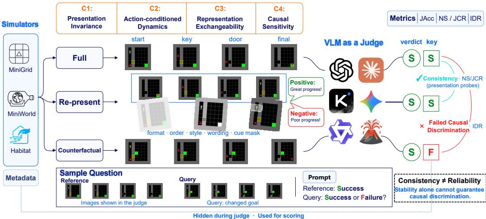  
Figure 1: Overview of GridWM-Judge. The framework integrates simulator-based exam generation, VLM judging, and automatic scoring to assess four SCI diagnostic conditions (C1–C4). Ground-truth metadata are hidden from judges and used for scoring. The example illustrates that presentation consistency alone does not guarantee causal discrimination or reliable judging.

Invariance (SCI): given the same simulator-grounded trajectory semantics s, a judge’s verdict yˆ should be conditionally independent of nuisance presentation variables ϕ,

$$
{ \hat { y } } \perp \phi \mid s .\tag{1}
$$

SCI is therefore a selective invariance principle: a reliable judge should be insensitive to how evidence is presented when trajectory semantics are preserved, but should change its verdict when the task outcome changes. We use presentation for temporal display order, visual appearance, and linguistic framing within a fixed input format; representation refers to evidence packaging, such as Composite versus Split images. Both are aspects of the evidence interface: C1 probes presentation invariance, whereas C3 tests representation exchangeability.

Existing multimodal judge benchmarks do not fully isolate this distinction. Many evaluate agreement with human preferences, rubric-following ability, reward-model quality, or arena-style rankings [5–8]. These evaluations are valuable, but they often conflate two questions: whether a judge is robust to nuisance presentation changes, and whether it remains responsive to causal changes in the underlying task outcome. This distinction is especially important for embodied evaluation, where a counterfactual trajectory may look visually similar to a successful one while differing in a causally decisive event. In other words, existing benchmarks either evaluate judge agreement, preference alignment, or embodied reasoning ability, but rarely provide paired controls that jointly separate presentation invariance from causal sensitivity.

We introduce GridWM-Judge, a grid-world and world-model-inspired diagnostic benchmark for evaluating VLM judges under SCI. Built on deterministic grid-world environments, GridWM-Judge uses the simulator as a Single Source of Truth (SSOT) for states, actions, events, and success predicates. For each trajectory group, it constructs aligned FULL, evidence-removal, and counterfactual variants, and evaluates them through presentation probes and evidence representations. This design separates presentation variants, where the world is fixed but the evidence interface changes, from causal counterfactuals, where an intervention changes the task outcome.

Figure 1 summarizes the overall diagnostic pipeline. Our main contributions can be summarized as:

• We formulate VLM judge reliability as State-Conditional Invariance, separating nuisance presentation changes from causal outcome changes.

• We instantiate SCI in GridWM-Judge, an executable benchmark with aligned trajectory variants, counterfactual interventions, and presentation probes.

• We characterize heterogeneous failure patterns, including presentation sensitivity, representation fragility, response bias, and weak causal discrimination, while using perception and action controls to qualify their interpretation.

## 2 Related Work

Model-based judges and multimodal evaluation. LLM-as-a-judge is now widely used for scalable evaluation of open-ended model outputs, from comparative or rubric-based text evaluation [1–3, 10– 12] to multimodal judging, preference assessment, reward modeling, and critic or agent evaluation [4–8, 13, 14, 9]. These works establish the utility of model-based judges, but primarily study human preference alignment, rubric following, or reward quality. GridWM-Judge instead asks whether a VLM judge changes its verdict for the right reason under simulator-grounded presentation and causal controls.

Judge reliability, bias, and presentation effects. A growing literature studies the reliability of model judges themselves, including fairness concerns, selection bias, verbosity bias, rubric sensitivity, and inconsistency across prompts or candidates [15–18]. In multimodal judging, VLM evaluators may be unreliable under benign changes in video evidence, judge composition, or input presentation [19, 20]. Separately, VLMs are known to suffer from visual hallucination, image-context reasoning failures, and object hallucination [21–23]. Long-context and image-sequence studies further show that models can depend on where and how evidence is presented [24, 25]. Recent work further identifies informativeness bias in VLM judges, where detailed responses can be preferred despite conflicting with visual evidence [26]. Relatedly, Li et al. [27] investigate unimodal spurious correlations in multimodal reward models. Together, these findings motivate examining how judges respond to changes in evidence presentation and underlying task semantics. GridWM-Judge instead uses simulator-grounded trajectories and controlled probes to diagnose presentation and representation sensitivity, response bias, and failures of causal discrimination.

Embodied evaluation, world models, and counterfactual diagnostics. Controlled environments such as BabyAI and MiniGrid support auditable grounded language and navigation experiments [28, 29], while video and embodied benchmarks such as CLEVRER and COVER evaluate causal or counterfactual reasoning over dynamic scenes [30, 31]. World-model research studies actionconditioned prediction, planning, and generative environment modeling [32–40]. Recent grid-world and VLM diagnostics ask whether models solve, plan, act, or form internal world-model-like representations [41–44]; GridWM-Judge instead evaluates whether a VLM can reliably judge what happened in a trajectory under aligned presentation and causal counterfactuals.

## 3 State-Conditional Invariance

We formalize VLM judge reliability as State-Conditional Invariance (SCI). Our goal is not to infer whether a VLM has an internal world model, but to test whether its success/failure verdict behaves correctly under controlled changes to the world and to the presentation of evidence. A reliable judge should remain invariant under semantics-preserving presentation changes, while remaining sensitive to causal interventions that change the task outcome. This selective-invariance view is related to invariant prediction, causal invariance, counterfactual reasoning, and shortcut learning [45–48], but we apply it to judge verdicts rather than to learned predictors, fairness criteria, or agent policies.

## 3.1 Setup and SCI Principle

Let $g \in { \mathcal { G } }$ denote a simulator-based trajectory group. Each group contains an aligned state trajectory, action sequence, rendered evidence, mission text, outcome label, and audit metadata. We write

$$
\begin{array} { r } { \boldsymbol { s } _ { g } = ( s _ { g , 0 : T } , a _ { g , 0 : T - 1 } , m _ { g } ) , \qquad \ell _ { g } = h ( s _ { g } ) , \qquad \hat { \boldsymbol { y } } _ { g } ^ { v , \phi } \in \{ 0 , 1 \} , } \end{array}\tag{2}
$$

where $s _ { g }$ denotes simulator-grounded trajectory semantics, h is the simulator success predicate, $\ell _ { g } \in \{ 0 , 1 \}$ is the resulting success/failure label, v is the trajectory variant, and $\phi$ is the presentation variable. In our benchmark, $v \in \{ \mathrm { f u l l } , \mathrm { n o c u e } , \mathrm { c f } \}$ denotes a successful full trajectory, an evidenceremoval diagnostic variant, and a counterfactual failure variant, respectively. For variant-specific rollouts, we use $s _ { g } ^ { v }$ and $\ell _ { g } ^ { v } = h ( s _ { g } ^ { v } )$ ; Full and CF share a group identifier and prescribed action sequence but may follow different state trajectories. The variable $\phi$ describes temporal order, visual appearance, and prompt framing within a fixed evidence representation. We use r for the Composite/Split representation when comparing formats, suppressing this index elsewhere for clarity.

Table 1: SCI diagnostic conditions and their benchmark instantiations. Tasks C and D use distinct evaluation protocols. Full metric definitions are provided in Appendix A.
<table><tr><td>Condition</td><td>Question</td><td>Instantiation</td><td>Metrics</td></tr><tr><td>C1: Presentation Invariance</td><td>Stable under semantics-preserving presentation changes?</td><td>Task C: temporal, visual, and framing probes</td><td>NS, JCR, LES</td></tr><tr><td>Dynamics</td><td>C2: Action-conditioned Do transition predictions depend on actions?</td><td>Task A: next-state prediction; action shuffle/mask</td><td> $\mathrm { A c c } _ { A 1 } , \Delta _ { \mathrm { s h u f f e } } ,$   $\Delta _ { \mathrm { m a s k } }$ </td></tr><tr><td>C3: Representation Exchangeability</td><td>Consistent across Composite/Split interfaces?</td><td>Task C: Composite/Split comparison</td><td> ${ \mathrm { V C C } } _ { \mathrm { r e p } }$ </td></tr><tr><td>C4: Causal Sensitivity</td><td>Does the judge distinguish matched Full/CF outcomes?</td><td>Task C: Full/CF pairs; Task D: reference-aided Full/CF</td><td> $p _ { \mathrm { a c t i v e } } , \mathrm { I D R } _ { \mathrm { r a w } } ,$   $\mathrm { I D R } _ { \mathrm { c o n d } }$ </td></tr></table>

SCI expresses nuisance invariance as conditional independence of the verdict and presentation, given the underlying trajectory semantics:

$$
{ \hat { Y } } \perp \Phi \mid S .\tag{3}
$$

We assess this requirement by comparing verdicts across semantics-preserving presentations. Reliable judging additionally requires correct decisions on successful Full trajectories and their matched CF failures:

$$
\hat { y } _ { g } ^ { \mathrm { f u l l } , \phi } = \hat { y } _ { g } ^ { \mathrm { f u l l } , \phi _ { 0 } } \quad \mathrm { f o r } \phi \in \Phi _ { \mathrm { e q } } ( s _ { g } ) , \qquad \hat { y } _ { g } ^ { \mathrm { f u l l } , \phi _ { 0 } } = 1 , \hat { y } _ { g } ^ { \mathrm { c f } , \phi _ { 0 } } = 0 .\tag{4}
$$

Thus, SCI is not ordinary robustness: it asks whether invariance is appropriate. A reliable judge should ignore nuisance presentation changes, but respond to state changes that alter the task outcome.

## 3.2 Diagnostic Conditions and Metrics

GridWM-Judge instantiates SCI through four diagnostic conditions. Table 1 summarizes the reliability question, benchmark instantiation, and main metrics. The tasks are not independent leaderboards; they diagnose complementary failure sources in the same judge.

We report four classes of metrics. Correctness anchors, such as $\mathrm { J A c c } _ { \mathrm { n e u } }$ and $\operatorname { A c c } _ { \operatorname { c f } } .$ , measure whether the judge accepts successful trajectories and rejects counterfactual failures. Presentation and representation metrics, such as NS, JCR, LES, and $\mathrm { \bar { V } C C _ { r e p } }$ , measure whether verdicts remain stable under semantics-preserving changes. Causal-sensitivity metrics, especially $p _ { \mathrm { a c t i v e } } , \mathrm { I D R } _ { \mathrm { r a w } } .$ and $\mathrm { I D R } _ { \mathrm { c o n d } } .$ , measure whether the judge discriminates successful full trajectories from matched counterfactual failures. Task-specific controls, including Task A/B/E metrics, help distinguish perception or action-conditioning failures from higher-level causal judgment failures.

We interpret consistency metrics only together with correctness and causal sensitivity. A mode can be stable simply because it always predicts the same label. We therefore summarize failures as presentation leakage, representation fragility, action-ignorant heuristics, causal misgrounding, and stability traps; full definitions and degenerate-judge criteria are provided in Appendix A. Perception and output-format controls help interpret these diagnostic flags.

## 4 GridWM-Judge: Benchmark Construction

GridWM-Judge instantiates the SCI framework in executable grid-world tasks. The benchmark is designed around three requirements: (i) the simulator provides an auditable source of truth for states, actions, events, and outcomes; (ii) trajectory-level evaluations support controlled presentation changes and causal interventions; and (iii) the tasks diagnose complementary components of judge reliability rather than forming a single leaderboard. Figure 2 summarizes the six MiniGrid environments, aligned trajectory variants, task-specific dataset composition, and separately reported 3D extensions.

## 4.1 Environment Suite

Our original Tier-0 suite comprises six deterministic MiniGrid environment families [29]. They cover object interaction, ordered door opening, hazard navigation, memory, and multi-room navigation, while remaining compact enough to provide symbolic states, rendered observations, discrete actions, and unambiguous success predicates. MiniGrid is not intended to approximate open-ended embodied benchmarks [49]; instead, it lets us audit whether a VLM judge changes its verdict when the world changes or merely when the same evidence is presented differently. Detailed environment descriptions and specific dataset generation procedures are provided in Appendix B.

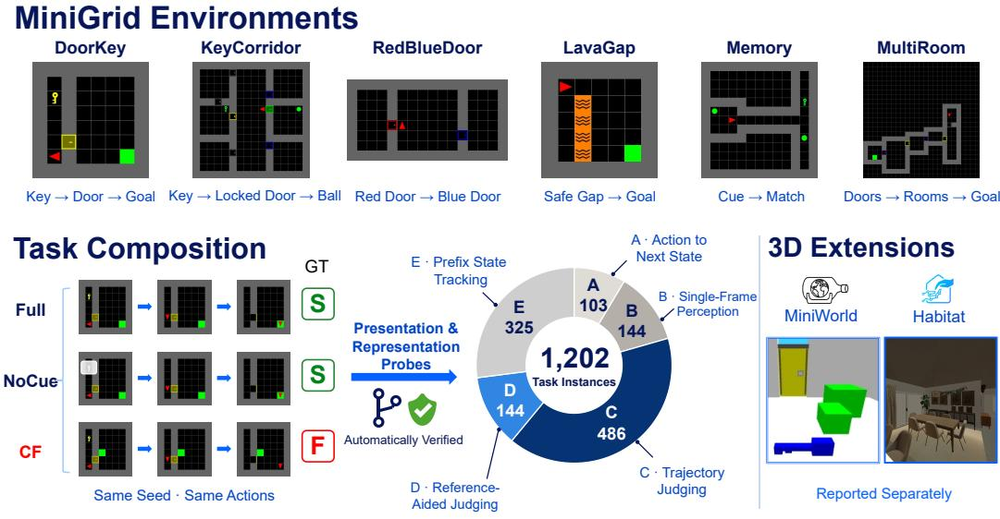  
Figure 2: Benchmark anatomy and dataset composition. GridWM-Judge comprises six MiniGrid environment families and five diagnostic tasks. Simulator-generated Full, NoCue, and CF variants support controlled judging and presentation probes, while task-specific perception and transition tests provide complementary controls. The original benchmark contains 1,202 model-facing task instances; supplementary 3D extensions are evaluated separately.

## 4.2 Trajectory Groups and Variants

For trajectory-level judging tasks, the source unit is a trajectory group $g \in { \mathcal { G } } _ { : }$ , which contains aligned simulator states, actions, rendered frames, mission text, outcome labels, and audit metadata. For each sampled environment seed, we first construct a successful FULL trajectory using a deterministic planner. We then derive matched variants when supported by the task: NOCUE, which removes selected early evidence while preserving the success outcome, and CF, a counterfactual failure generated by a localized simulator intervention followed by rerollout under the same action sequence. Although the actions are fixed, simulator states and renderings may diverge after the intervention; Full and CF outcomes are independently verified by the simulator. Thus, NOCUE probes evidence dependence without changing the success outcome, whereas CF tests responses to outcome-changing interventions. NoCue is not treated as a semantics-preserving presentation transform.

Local perception and transition-control tasks are generated from task-specific source units, such as environment-level states or local transitions, and are reported as model-facing task instances. This distinction lets GridWM-Judge combine trajectory-level Full/NoCue/CF diagnostics with local Task A/B/E controls without treating all items as the same type of group. All generated items pass task-appropriate validation gates before entering the benchmark, including action-identity checks across aligned variants, FULL-success and CF-failure outcome gates, masking-window constraints, interaction preservation checks, physics consistency checks, and symbolic state-encoding checks when applicable. Full generation details and validator definitions are given in Appendix B.

## 4.3 Presentations and Diagnostic Tasks

GridWM-Judge distinguishes two aspects of the evidence interface. Temporal order, visual style, and linguistic framing define presentation probes (C1), while Composite and Split formats provide alternative representations for testing exchangeability (C3).

The released benchmark contains five diagnostic tasks. Tasks B and E are perception controls that test whether the model can parse local states, objects, and structured scene information before higher-level judgment failures are interpreted. Task C asks for success/failure judgments under presentation and representation changes. Task A tests action-conditioned transition understanding through next-observation prediction and action ablations. Task D is the primary causal-sensitivity test, comparing successful FULL trajectories with matched CF failures. Full task interfaces, prompt templates, schemas, and representative examples are provided in Appendix C.

## 4.4 Dataset Release and 3D Extension

The benchmark is released as machine-readable exam files with image paths, prompts, labels, and group metadata. Model-facing fields include only rendered evidence, mission text, action text, and task instructions; audit-only metadata, such as symbolic states, intervention records, labels, rewards, and validation logs, are reserved for auditing and scoring. Full schemas, data cards, metadata, and reproducibility instructions are provided in Appendix F.

Availability. The benchmark, including exam files, prompts, validation records, and scoring resources, is available through the code repository and dataset release. Implementation details, model configurations, data schemas, and reproducibility instructions are documented in Appendix F.

## 5 Diagnostic Experiments

We evaluate model-based judges against the four SCI diagnostic conditions, focusing on causal discrimination, presentation stability, and representation exchangeability.

## 5.1 Experimental Setup

Models, tasks, and representations. We evaluate a diverse set of proprietary and open VLM judges, including frontier general-purpose models, lightweight flash-style models, and representative open VLM families when complete runs are available [50–52]. Each model acts as an external judge rather than an agent. We evaluate the five MiniGrid tasks described in Section 4, with Tasks B/E providing perception controls, Task A testing action-conditioned transitions, Task C examining presentation and representation effects, and Task D evaluating causal discrimination. The key representation comparison is between composite storyboards and split-image inputs, which encode the same trajectory semantics but expose evidence through different interfaces.

Inference, metrics, and statistics. All models receive task-specific instructions with the same model-facing fields: rendered evidence, mission text when available, action text, and the required answer format, following standard instruction-following and judge-prompting protocols [53, 1, 2]. We use deterministic decoding when supported. Responses are parsed using task-specific scoring rules; invalid outputs and execution failures are tracked separately. The main Task-C summaries use the released eligible-pair protocol, whereas dedicated Task-D and expanded evaluations report conservative all-group estimates. The main Task D metrics are $\mathrm { J A c c } _ { \mathrm { n e u } } , \mathrm { A c c } _ { \mathrm { c f } } , p _ { \mathrm { a c t i v e } } , \mathrm { I D R } _ { \mathrm { r a w } }$ , and $\mathrm { I D R } _ { \mathrm { c o n d } } ;$ Task C additionally reports presentation and representation metrics such as NS, JCR, LES, and $\mathrm { { V C C } _ { r e p } . }$ . We interpret consistency metrics only together with correctness and causal sensitivity, because a constant-verdict judge can be stable without being reliable. Full model identifiers, prompts, parsing rules and other experimental settings are provided in Appendix F.

## 5.2 Analysis

Table 2 and Figure 3 summarize Task-C diagnostics of activation, paired discrimination, and representation sensitivity. We use $( p _ { \mathrm { a c t i v e } } , \mathrm { I D R } _ { \mathrm { r a w } } )$ as the primary causal-sensitivity coordinates because they jointly indicate whether a judge accepts genuine successful trajectories and rejects matched counterfactual failures. Dedicated reference-aided Task-D results with clustered confidence interval and other expanded evaluations are reported in Appendix D.

Finding 1: Accuracy does not imply causal sensitivity. Task-C paired diagnostics show that Full acceptance and counterfactual rejection capture different aspects of judge behavior. A judge that predicts failure almost everywhere may achieve high CF rejection but low activation, while a success-biased judge may accept Full trajectories without rejecting their matched CFs. Dedicated reference-aided Task D confirms this distinction: GPT-5.4 achieves Full acceptance of 0.750, CF rejection of 0.500, and raw IDR of 0.333, whereas Claude Sonnet 4.6 obtains 0.250, 0.917, and 0.250, respectively (Table 13 in Appendix D). On 432 expanded Task-D groups, their raw IDRs are 0.322 and 0.088, respectively, with group-bootstrap 95% CIs of [0.278, 0.366] and [0.062, 0.116] (Table 22 in Appendix D). Thus, we assess causal sensitivity jointly through $( p _ { \mathrm { a c t i v e } } , \mathrm { I D R } _ { \mathrm { r a w } } )$ , with conditional IDR interpreted only when activation is sufficient.

Table 2: Task-C diagnostics under Composite (C) and Split (S) evidence interfaces. Deg. denotes the degenerate status under the corresponding representation; AF denotes all-fail degeneracy, SB denotes success bias, and — denotes non-degenerate behavior.
<table><tr><td rowspan="2">Model</td><td rowspan="2"> $\mathbf { J } \mathrm { A c c } _ { \mathrm { n e u } }$  C/S</td><td colspan="2">pactive</td><td colspan="2"> $\mathrm { I D R } _ { \mathrm { r a w } }$ </td><td rowspan="2"> $\mathrm { V C C } _ { \mathrm { r e p } }$ </td><td rowspan="2">Deg. (C/S)</td></tr><tr><td>C</td><td>S</td><td>C</td><td>S</td></tr><tr><td>Claude Sonnet  $4 . 6 ^ { \dagger }$ </td><td>0.06/0.11</td><td>0.06</td><td>0.12</td><td>0.06</td><td>0.12</td><td>0.924</td><td>AF/—</td></tr><tr><td>GPT-40</td><td>0.28/0.78</td><td>0.28</td><td>0.78</td><td>0.22</td><td>0.72</td><td>0.706</td><td>—1—</td></tr><tr><td>GPT-5.4</td><td>0.06/0.06</td><td>0.06</td><td>0.06</td><td>0.06</td><td>0.06</td><td>1.000</td><td>AF/AF</td></tr><tr><td>Gemini 3 Flash</td><td>0.72/0.67</td><td>0.72</td><td>0.67</td><td>0.67</td><td>0.67</td><td>0.707</td><td>—1—</td></tr><tr><td>Gemini 2.5 Flash Lite</td><td>0.50/0.67</td><td>0.50</td><td>0.67</td><td>0.28</td><td>0.56</td><td>0.796</td><td>—1—</td></tr><tr><td>Gemini 2.0 Flash†</td><td>0.00/0.61</td><td>0.00</td><td>0.59</td><td>0.00</td><td>0.53</td><td>0.544</td><td>AF/—</td></tr><tr><td>Kimi K2.5</td><td>0.39/0.72</td><td>0.50</td><td>0.72</td><td>0.36</td><td>0.72</td><td>0.661</td><td>—1—</td></tr><tr><td>Qwen3-32B‡</td><td>1.00/0.67</td><td>1.00</td><td>0.67</td><td>0.00</td><td>0.00</td><td>0.667</td><td>SB/—</td></tr><tr><td>Qwen3-235B</td><td>0.67/0.67</td><td>0.67</td><td>0.67</td><td>0.00</td><td>0.00</td><td>0.743</td><td>—1—</td></tr><tr><td>Qwen3-8B</td><td>0.67/0.00</td><td>0.67</td><td>0.00</td><td>0.00</td><td>0.00</td><td>0.407</td><td>—/AF</td></tr></table>

<sup>†</sup> Composite is all-fail degenerate, while Split is non-degenerate.  
<sup>‡</sup> Success-biased degenerate under Composite.

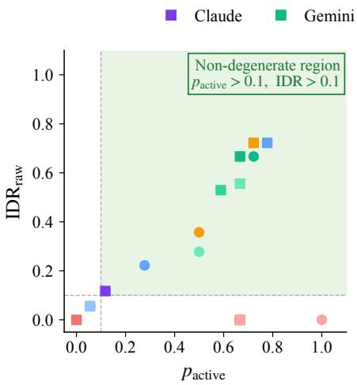  
(a) Causal sensitivity

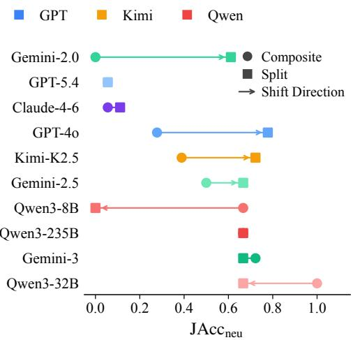  
(b) Composite-to-split shift  
Figure 3: Task-C diagnostic results. (a) plots Full activation against raw paired Full–CF discrimination under Composite and Split interfaces. (b) shows the corresponding representation shifts in Full-trajectory accuracy and discrimination. Together, the panels illustrate that high acceptance, paired discrimination, and representation consistency need not coincide.

Finding 2: Representation changes judge behavior. Task-C presentation probes reveal varying stability across temporal, visual, and framing changes (Figure 4). Composite and Split interfaces also produce different verdicts for matched trajectories, demonstrating sensitivity to evidence presentation and packaging. Although Split yields a higher mean raw IDR in Table 3, the across-model difference is not statistically significant $( p = 0 . 0 6 3 )$ ). Moreover, the compared interfaces also differed in prompt wording and run conditions, so the effect cannot be attributed solely to image layout. We use $\mathrm { V C C } _ { \mathrm { r e p } }$ to quantify representation consistency and report matched transition analyses in Appendix D. Matched temporal, noise, and style probes show both correctness degradation and rescue, although none of the 180 probe-level comparisons survives the specified Holm correction.

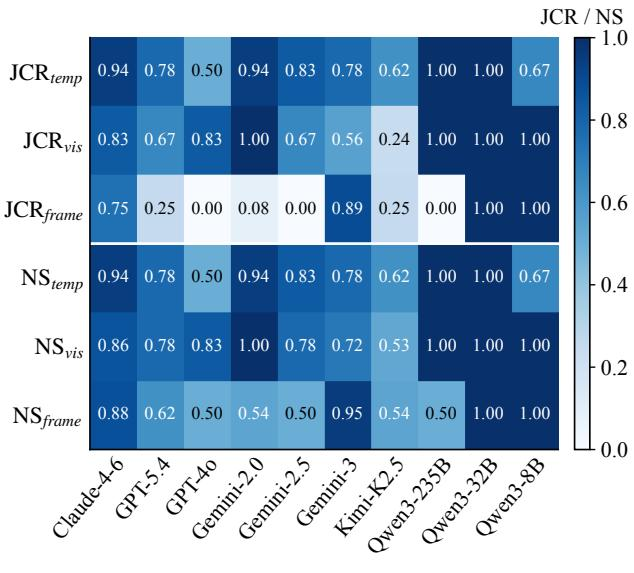  
(a) Model-by-probe stability

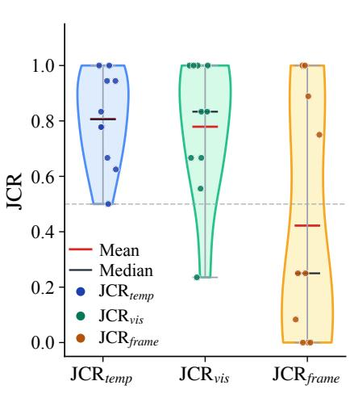  
(b) Probe-family summary

Figure 4: Presentation stability across probe families. (a) compares NS and JCR across temporal, visual, and framing probes for each model. (b) summarizes the corresponding JCR distributions.  
Table 3: Composite–Split representation ablation. Reported values are model-wise means, with ∆ = Split − Composite. W/T/L denotes improvements, ties, and degradations across models; the last column reports Wilcoxon signed-rank p-values. All comparisons are not significant at $p < 0 . 0 5$
<table><tr><td>Metric</td><td>Composite Mean</td><td>Split Mean</td><td>Mean  $\Delta$ </td><td>Median  $\Delta$ </td><td>W/T/L</td><td>p-value</td></tr><tr><td> ${ \mathrm { J A c c } } _ { \mathrm { n e u } } \ 1$ </td><td>0.433</td><td>0.494</td><td>+0.061</td><td>+0.028</td><td>5/2/3</td><td>0.617</td></tr><tr><td> $p _ { \mathrm { a c t i v e } } \uparrow$ </td><td>0.444</td><td>0.493</td><td>+0.048</td><td>+0.031</td><td>5/2/3</td><td>0.641</td></tr><tr><td> $\mathrm { I D R } _ { \mathrm { r a w } } \uparrow$ </td><td>0.163</td><td>0.337</td><td>+0.173</td><td>+0.031</td><td>5/5/0</td><td>0.063</td></tr><tr><td> $\mathrm { I D R } _ { \mathrm { c o n d } }$ </td><td>0.624</td><td>0.720</td><td>+0.096</td><td>+0.038</td><td>4/4/0</td><td>0.125</td></tr></table>

\*For $\mathrm { I D R } _ { \mathrm { c o n d } }$ , models with undefined or low-activation conditional IDR are excluded from W/T/L counting according to the reporting rule in Appendix A.

Finding 3: Stable judgments can mask failure; local controls reveal additional bottlenecks. High NS or JCR does not imply reliability: a model can remain stable while failing to discriminate matched Full/CF outcomes because it defaults to a constant verdict or shortcut rule [48]. Figure 5 and Table 4 provide complementary Task-B/E perception and Task-A transition controls. For example, GPT-5.4 achieves Task-B Acc@0.90 of 0.111 despite an all-row mean component score of 0.616, showing that high-threshold accuracy can obscure partial scene recovery. Task-A ablation effects are generally small or mixed, providing limited evidence about action-conditioned reasoning on their own. In a matched 98-group Oracle-State experiment, GPT-5.4’s raw IDR increases from 0.469 with Pixel evidence to 0.765 with State evidence, highlighting visual grounding and objective recovery as potential bottlenecks. Together, these controls help distinguish plausible failure sources without uniquely identifying their causes (Appendix D).

Summary. Across diagnostic tasks, correctness, stability, and causal discrimination reveal comple mentary failure modes. Expanded MiniGrid and 3D evaluations further support interpreting judge behavior through these dimensions rather than a single aggregate score. (Appendices D and E).

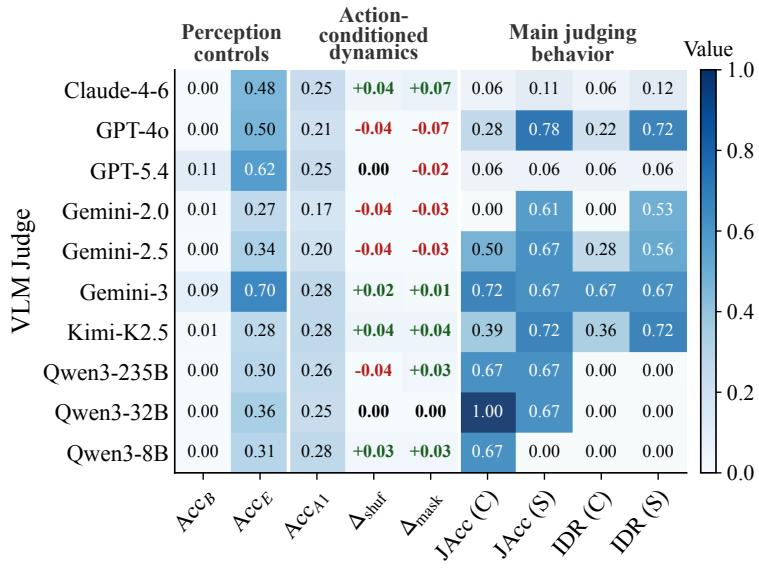  
(a) Task A/B/E local controls

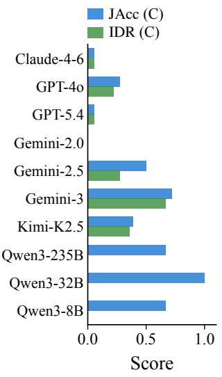  
(b) Failure-source localization  
Figure 5: Local controls and judgment outcomes. (a) compares Task-B/E perception scores, Task-A transition accuracy and action-ablation effects, and Task-C judging metrics across models. (b) contrasts Task-C Full acceptance and raw intervention discrimination. These complementary diagnostics help interpret, but do not uniquely identify, failure sources.

Table 4: Local diagnostic controls. Task B reports Acc@0.90, the fraction of items meeting a 0.90 threshold on the normalized weighted scene-component score; Task E measures object/state recognition, and Task A measures next-observation prediction. Action-ablation differences are computed as baseline accuracy minus ablated accuracy.
<table><tr><td>Model</td><td>B_Acc</td><td>E_Acc</td><td>Acc_A1</td><td> $\Delta _ { \mathbf { s h u f } }$ </td><td> $\Delta _ { \mathrm { m a s k } }$ </td></tr><tr><td>Claude Sonnet 4.6</td><td>0.000</td><td>0.477</td><td>0.252</td><td>+0.039</td><td>+0.068</td></tr><tr><td>GPT-40</td><td>0.000</td><td>0.495</td><td>0.214</td><td>-0.039</td><td>-0.068</td></tr><tr><td>GPT-5.4</td><td>0.111</td><td>0.615</td><td>0.252</td><td>+0.000</td><td>-0.019</td></tr><tr><td>Gemini 2.0 Flash</td><td>0.007</td><td>0.274</td><td>0.175</td><td>-0.038</td><td>-0.025</td></tr><tr><td>Gemini 2.5 Flash Lite</td><td>0.000</td><td>0.345</td><td>0.204</td><td>-0.039</td><td>-0.029</td></tr><tr><td>Gemini 3 Flash</td><td>0.090</td><td>0.702</td><td>0.282</td><td>+0.019</td><td>+0.010</td></tr><tr><td>Kimi K2.5</td><td>0.007</td><td>0.280</td><td>0.282</td><td>+0.039</td><td>+0.039</td></tr><tr><td>Qwen3-235B</td><td>0.000</td><td>0.305</td><td>0.262</td><td>-0.039</td><td>+0.029</td></tr><tr><td>Qwen3-32B</td><td>0.000</td><td>0.357</td><td>0.252</td><td>+0.000</td><td>+0.000</td></tr><tr><td>Qwen3-8B</td><td>0.000</td><td>0.311</td><td>0.282</td><td>+0.029</td><td>+0.029</td></tr></table>

## 6 Conclusion

We introduced GridWM-Judge, a simulator-grounded benchmark for auditing model-based judges through State-Conditional Invariance (SCI). By combining matched trajectory variants, controlled evidence-interface probes, and action/perception controls, the benchmark distinguishes appropriate verdict stability from responsiveness to outcome-changing interventions. Across evaluated judges, apparent consistency and successful-trajectory acceptance do not guarantee reliable paired causal discrimination; additional controls reveal model-dependent grounding and response-format bottlenecks. Expanded MiniGrid evaluations and supplementary MiniWorld/Habitat experiments extend these diagnostics to more 2D and 3D settings. Our findings motivate evaluating judge reliability through correctness, presentation stability, and causal sensitivity jointly, rather than relying on a single score.

## Acknowledgments and Disclosure of Funding

Funding. This work was supported in part by the Anhui Provincial Innovation Breakthrough Plan (Grant No. 202523j08050018), the Anhui Innovation Platform Construction – High-Level New R&D Institution Project (Grant No. 202524vb12010005), the Centrally Guided Local Science and Technology Development Special Fund of Anhui Province (Grant No. 202407a12020009), and the National Key R&D Program of China (Grant No. 2022YFB3206904).

Competing Interests. The authors declare no competing interests.

## References

[1] Lianmin Zheng, Wei-Lin Chiang, Ying Sheng, Siyuan Zhuang, Zhanghao Wu, Yonghao Zhuang, Zi Lin, Zhuohan Li, Dacheng Li, Eric Xing, Hao Zhang, Joseph Gonzalez, and Ion Stoica. Judging LLM-asa-judge with MT-Bench and Chatbot Arena. In Advances in Neural Information Processing Systems (NeurIPS), volume 36, pages 46595–46623, 2023.

[2] Yang Liu, Dan Iter, Yichong Xu, Shuohang Wang, Ruochen Xu, and Chenguang Zhu. G-Eval: NLG evaluation using GPT-4 with better human alignment. In Proceedings ofthe 2023 Conference on Empirical Methods in Natural Language Processing (EMNLP), pages 2511–2522, 2023.

[3] Lianghui Zhu, Xinggang Wang, and Xinlong Wang. JudgeLM: Fine-tuned large language models are scalable judges. In International Conference on Learning Representations (ICLR), 2025.

[4] Seongyun Lee, Seungone Kim, Sue Park, Geewook Kim, and Minjoon Seo. Prometheus-Vision: Visionlanguage model as a judge for fine-grained evaluation. In Findings ofthe Associationfor Computational Linguistics: ACL 2024, pages 11286–11315, 2024.

[5] Dongping Chen, Ruoxi Chen, Shilin Zhang, Yaochen Wang, Yinuo Liu, Huichi Zhou, Qihui Zhang, Yao Wan, Pan Zhou, and Lichao Sun. MLLM-as-a-judge: Assessing multimodal LLM-as-a-judge with vision language benchmark. In Proceedings ofthe 41st International Conference on Machine Learning (ICML), volume 235, pages 6562–6595, 2024.

[6] Yujie Lu, Dongfu Jiang, Wenhu Chen, William Yang Wang, Yejin Choi, and Bill Yuchen Lin. WildVision: Evaluating vision-language models in the wild with human preferences. In Advances in Neural Information Processing Systems (NeurIPS), volume 37, pages 48224–48255, 2024.

[7] Tianyi Xiong, Xiyao Wang, Dong Guo, Qinghao Ye, Haoqi Fan, Quanquan Gu, Heng Huang, and Chunyuan Li. LLaVA-Critic: Learning to evaluate multimodal models. In Proceedings ofthe IEEE/CVF Conference on Computer Vision and Pattern Recognition (CVPR), pages 13618–13628, 2025.

[8] Lei Li, Yuancheng Wei, Zhihui Xie, Xuqing Yang, Yifan Song, Peiyi Wang, Chenxin An, Tianyu Liu, Sujian Li, Bill Yuchen Lin, Lingpeng Kong, and Qi Liu. VL-RewardBench: A challenging benchmark for vision-language generative reward models. In Proceedings ofthe IEEE/CVF Conference on Computer Vision and Pattern Recognition (CVPR), pages 24657–24668, 2025.

[9] Mingchen Zhuge, Changsheng Zhao, Dylan Ashley, Wenyi Wang, Dmitrii Khizbullin, Yunyang Xiong, Zechun Liu, Ernie Chang, Raghuraman Krishnamoorthi, Yuandong Tian, et al. Agent-as-a-judge: Evaluate agents with agents. In Proceedings of the 42nd International Conference on Machine Learning (ICML), 2025.

[10] Junlong Li, Shichao Sun, Weizhe Yuan, Run-Ze Fan, Hai Zhao, and Pengfei Liu. Generative judge for evaluating alignment. In International Conference on Learning Representations (ICLR), 2024.

[11] Seungone Kim, Jamin Shin, Yejin Cho, Joel Jang, Shayne Longpre, Hwaran Lee, Sangdoo Yun, Seongjin Shin, Sungdong Kim, James Thorne, et al. Prometheus: Inducing fine-grained evaluation capability in language models. In International Conference on Learning Representations (ICLR), 2024.

[12] Xuechen Li, Tianyi Zhang, Yann Dubois, Rohan Taori, Ishaan Gulrajani, Carlos Guestrin, Percy Liang, and Tatsunori B. Hashimoto. Alpacaeval: An automatic evaluator of instruction-following models. https://github.com/tatsu-lab/alpaca\_eval, 5 2023.

[13] Michihiro Yasunaga, Luke Zettlemoyer, and Marjan Ghazvininejad. Multimodal RewardBench: Holistic evaluation of reward models for vision language models. arXiv preprint arXiv:2502.14191, 2025.

[14] Di Zhang, Jingdi Lei, Junxian Li, Xunzhi Wang, Yujie Liu, Zonglin Yang, Jiatong Li, Weida Wang, Suorong Yang, Jianbo Wu, Peng Ye, Wanli Ouyang, and Dongzhan Zhou. Critic-V: VLM critics help catch VLM errors in multimodal reasoning. In Proceedings ofthe IEEE/CVF Conference on Computer Vision and Pattern Recognition (CVPR), pages 9050–9061, 2025.

[15] Peiyi Wang, Lei Li, Liang Chen, Zefan Cai, Dawei Zhu, Binghuai Lin, Yunbo Cao, Lingpeng Kong, Qi Liu, Tianyu Liu, et al. Large language models are not fair evaluators. In Proceedings of the 62nd Annual Meeting ofthe Associationfor Computational Linguistics (ACL), Volume 1: Long Papers, pages 9440–9450, 2024.

[16] Chujie Zheng, Hao Zhou, Fandong Meng, Jie Zhou, and Minlie Huang. Large language models are not robust multiple choice selectors. In International Conference on Learning Representations (ICLR), 2024.

[17] Keita Saito, Akifumi Wachi, Koki Wataoka, and Youhei Akimoto. Verbosity bias in preference labeling by large language models. arXiv preprint arXiv:2310.10076, 2023.

[18] Sijun Tan, Siyuan Zhuang, Kyle Montgomery, William Y Tang, Alejandro Cuadron, Chenguang Wang, Raluca Ada Popa, and Ion Stoica. JudgeBench: A benchmark for evaluating LLM-based judges. In International Conference on Learning Representations (ICLR), 2025.

[19] Md Tahmid Rahman Laskar, Mohammed Saidul Islam, Ridwan Mahbub, Ahmed Masry, Mizanur Rahman, Amran Bhuiyan, Mir Tafseer Nayeem, Shafiq Joty, Enamul Hoque, and Jimmy Xiangji Huang. Judging the Judges: Can large vision-language models fairly evaluate chart comprehension and reasoning? In Proceedings ofthe 63rd Annual Meeting ofthe Associationfor Computational Linguistics (ACL), Volume 6: Industry Track, pages 1203–1216, 2025.

[20] Ming Liu and Wensheng Zhang. Is your video language model a reliable judge? In International Conference on Learning Representations (ICLR), 2025.

[21] Tianrui Guan, Fuxiao Liu, Xiyang Wu, Ruiqi Xian, Zongxia Li, Xiaoyu Liu, Xijun Wang, Lichang Chen, Furong Huang, Yaser Yacoob, Dinesh Manocha, and Tianyi Zhou. HallusionBench: An advanced diagnostic suite for entangled language hallucination and visual illusion in large vision-language models. In Proceedings of the IEEE/CVF Conference on Computer Vision and Pattern Recognition (CVPR), pages 14375–14385, 2024.

[22] Yifan Li, Yifan Du, Kun Zhou, Jinpeng Wang, Wayne Xin Zhao, and Ji-Rong Wen. Evaluating object hallucination in large vision-language models. In Proceedings of the 2023 Conference on Empirical Methods in Natural Language Processing (EMNLP), pages 292–305, 2023.

[23] Junyang Wang, Yiyang Zhou, Guohai Xu, Pengcheng Shi, Chenlin Zhao, Haiyang Xu, Qinghao Ye, Ming Yan, Ji Zhang, Jihua Zhu, et al. Evaluation and analysis of hallucination in large vision-language models. arXiv preprint arXiv:2308.15126, 2023.

[24] Nelson F Liu, Kevin Lin, John Hewitt, Ashwin Paranjape, Michele Bevilacqua, Fabio Petroni, and Percy Liang. Lost in the middle: How language models use long contexts. Transactions ofthe Associationfor Computational Linguistics, 12:157–173, 2024.

[25] Xiyao Wang, Yuhang Zhou, Xiaoyu Liu, Hongjin Lu, Yuancheng Xu, Feihong He, Jaehong Yoon, Taixi Lu, Fuxiao Liu, Gedas Bertasius, et al. Mementos: A comprehensive benchmark for multimodal large language model reasoning over image sequences. In Proceedings ofthe 62nd Annual Meeting ofthe Associationfor Computational Linguistics (ACL), Volume 1: Long Papers, pages 416–442, 2024.

[26] Xiaohan Zou, Roshan Sridhar, Mohammadtaher Safarzadeh, and Dan Roth. When vision-language models judge without seeing: Exposing informativeness bias. In Proceedings of the 64th Annual Meeting of the Association for Computational Linguistics (ACL), Volume 1: Long Papers, pages 15417–15448, 2026.

[27] Zichao Li, Xueru Wen, Jie Lou, Yuqiu Ji, Yaojie Lu, Xianpei Han, Debing Zhang, and Le Sun. The devil is in the details: Tackling unimodal spurious correlations for generalizable multimodal reward models. In Proceedings of the 42nd International Conference on Machine Learning (ICML), volume 267, pages 36281–36297, 2025.

[28] Maxime Chevalier-Boisvert, Dzmitry Bahdanau, Salem Lahlou, Lucas Willems, Chitwan Saharia, Thien Huu Nguyen, and Yoshua Bengio. BabyAI: First steps towards grounded language learning with a human in the loop. In International Conference on Learning Representations (ICLR), 2019.

[29] Maxime Chevalier-Boisvert, Bolun Dai, Mark Towers, Rodrigo Perez-Vicente, Lucas Willems, Salem Lahlou, Suman Pal, Pablo Samuel Castro, and Jordan Terry. Minigrid & Miniworld: Modular & customiz able reinforcement learning environments for goal-oriented tasks. In Advances in Neural Information Processing Systems (NeurIPS), volume 36, pages 73383–73394, 2023.

[30] Kexin Yi, Chuang Gan, Yunzhu Li, Pushmeet Kohli, Jiajun Wu, Antonio Torralba, and Joshua B. Tenenbaum. CLEVRER: collision events for video representation and reasoning. In International Conference on Learning Representations (ICLR), 2020.

[31] Qiji Zhou, Yifan Gong, Guangsheng Bao, Hongjie Qiu, Jinqiang Li, Xiangrong Zhu, Huajian Zhang, and Yue Zhang. Reasoning is all you need for video generalization: A counterfactual benchmark with sub-question evaluation, 2025. Findings of ACL 2025.

[32] Danijar Hafner, Timothy Lillicrap, Ian Fischer, Ruben Villegas, David Ha, Honglak Lee, and James Davidson. Learning latent dynamics for planning from pixels. In Proceedings ofthe 36th International Conference on Machine Learning (ICML), 2019.

[33] Danijar Hafner, Timothy Lillicrap, Jimmy Ba, and Mohammad Norouzi. Dream to control: Learning behaviors by latent imagination. In International Conference on Learning Representations (ICLR), 2020.

[34] Nicklas Hansen, Hao Su, and Xiaolong Wang. TD-MPC2: Scalable, robust world models for continuous control. In International Conference on Learning Representations (ICLR), 2024.

[35] Julian Schrittwieser, Ioannis Antonoglou, Thomas Hubert, Karen Simonyan, Laurent Sifre, Simon Schmitt, Arthur Guez, Edward Lockhart, Demis Hassabis, Thore Graepel, Timothy Lillicrap, and David Silver. Mastering atari, go, chess and shogi by planning with a learned model. Nature, 588(7839):604–609, 2020.

[36] Jake Bruce, Michael D Dennis, Ashley Edwards, Jack Parker-Holder, Yuge Shi, Edward Hughes, Matthew Lai, Aditi Mavalankar, Richie Steigerwald, Chris Apps, et al. Genie: Generative interactive environments. In Proceedings ofthe 41st International Conference on Machine Learning (ICML), volume 235, pages 4603–4623, 2024.

[37] Jack Parker-Holder, Philip Ball, Jake Bruce, Vibhavari Dasagi, Kristian Holsheimer, Christos Kaplanis, Alexandre Moufarek, Guy Scully, Jeremy Shar, Jimmy Shi, Stephen Spencer, Jessica Yung, Michael Dennis, Sultan Kenjeyev, Shangbang Long, Vlad Mnih, Harris Chan, Maxime Gazeau, Bonnie Li, Fabio Pardo, Luyu Wang, Lei Zhang, Frederic Besse, Tim Harley, Anna Mitenkova, Jane Wang, Jeff Clune, Demis Hassabis, Raia Hadsell, Adrian Bolton, Satinder Singh, and Tim Rocktäschel. Genie 2: A largescale foundation world model. Google DeepMind blog, 2024. URL https://deepmind.google/blog/ genie-2-a-large-scale-foundation-world-model/.

[38] Shaofeng Yin, Jialong Wu, Siqiao Huang, Xingjian Su, Xu He, Jianye Hao, and Mingsheng Long. Trajectory world models for heterogeneous environments. In Proceedings of the 42nd International Conference on Machine Learning (ICML), pages 72462–72484, 2025.

[39] Haoyi Duan, Hong-Xing Yu, Sirui Chen, Li Fei-Fei, and Jiajun Wu. WorldScore: A unified evaluation benchmark for world generation. In Proceedings ofthe IEEE/CVF International Conference on Computer Vision (ICCV), pages 27713–27724, 2025.

[40] Archana Warrier, Dat Nguyen, Michelangelo Naim, Moksh Jain, Yichao Liang, Karen Schroeder, Cambridge Yang, Joshua B. Tenenbaum, Sebastian Josef Vollmer, Kevin Ellis, and Zenna Tavares. Benchmarking world-model learning with environment-level queries. In Proceedings ofthe 43rd International Conference on Machine Learning (ICML), volume 306, pages 133215–133246, 2026.

[41] Weijiang Li, Yilin Zhu, Rajarshi Das, and Parijat Dube. Do LLMs build spatial world models? evidence from grid-world maze tasks. In ICLR 2026 the 2nd Workshop on World Models: Understanding, Modelling and Scaling, 2026.

[42] Alex F Spies, William Edwards, Michael I Ivanitskiy, Adrians Skapars, Tilman Räuker, Katsumi Inoue, Alessandra Russo, and Murray Shanahan. Transformers use causal world models in maze-solving tasks. In ICLR 2025 Workshop on World Models: Understanding, Modelling and Scaling, 2025.

[43] Raghu Arghal, Phoebe Chen, Niall Dalton, Evgenii Kortukov, Calum Mcnamara, Angelos Nalmpantis, Moksh Nirvaan, Gabriele Sarti, and Mario Giulianelli. A behavioural and representational evaluation of goal-directedness in language model agents. In Proceedings of the 43rd International Conference on Machine Learning (ICML), volume 306, pages 3434–3451, 2026.

[44] Qiyue Gao, Xinyu Pi, Kevin Liu, Junrong Chen, Ruolan Yang, Xinqi Huang, Xinyu Fang, Lu Sun, Gautham Kishore, Bo Ai, Stone Tao, Mengyang Liu, Jiaxi Yang, Chao-Jung Lai, Chuanyang Jin, Jiannan Xiang, Benhao Huang, Zeming Chen, David Danks, Hao Su, Tianmin Shu, Ziqiao Ma, Lianhui Qin, and Zhiting Hu. Do vision-language models have internal world models? Towards an atomic evaluation. In Findings of the Associationfor Computational Linguistics: ACL 2025, pages 26170–26195, 2025.

[45] Martin Arjovsky, Léon Bottou, Ishaan Gulrajani, and David Lopez-Paz. Invariant risk minimization. arXiv preprint arXiv:1907.02893, 2019.

[46] Jonas Peters, Peter Bühlmann, and Nicolai Meinshausen. Causal inference by using invariant prediction: identification and confidence intervals. Journal of the Royal Statistical Society Series B: Statistical Methodology, 78(5):947–1012, 2016.

[47] Matt J Kusner, Joshua Loftus, Chris Russell, and Ricardo Silva. Counterfactual fairness. Advances in neural information processing systems, 30, 2017.

[48] Robert Geirhos, Jörn-Henrik Jacobsen, Claudio Michaelis, Richard Zemel, Wieland Brendel, Matthias Bethge, and Felix A Wichmann. Shortcut learning in deep neural networks. Nature Machine Intelligence, 2(11):665–673, 2020.

[49] Linxi Fan, Guanzhi Wang, Yunfan Jiang, Ajay Mandlekar, Yuncong Yang, Haoyi Zhu, Andrew Tang, De-An Huang, Yuke Zhu, and Anima Anandkumar. MineDojo: Building open-ended embodied agents with internet-scale knowledge. In Advances in Neural Information Processing Systems (NeurIPS), volume 35, pages 18343–18362, 2022.

[50] Jinze Bai, Shuai Bai, Shusheng Yang, Shijie Wang, Sinan Tan, Peng Wang, Junyang Lin, Chang Zhou, and Jingren Zhou. Qwen-VL: A versatile vision-language model for understanding, localization, text reading, and beyond. arXiv preprint arXiv:2308.12966, 2023. URL https://arxiv.org/abs/2308.12966.

[51] Haotian Liu, Chunyuan Li, Qingyang Wu, and Yong Jae Lee. Visual instruction tuning. In Advances in Neural Information Processing Systems (NeurIPS), volume 36, pages 34892–34916, 2023.

[52] Weihan Wang, Qingsong Lv, Wenmeng Yu, Wenyi Hong, Ji Qi, Yan Wang, Junhui Ji, Zhuoyi Yang, Lei Zhao, Xixuan Song, et al. CogVLM: Visual expert for pretrained language models. In Advances in Neural Information Processing Systems (NeurIPS), volume 37, pages 121475–121499, 2024.

[53] Long Ouyang, Jeffrey Wu, Xu Jiang, Diogo Almeida, Carroll Wainwright, Pamela Mishkin, Chong Zhang, Sandhini Agarwal, Katarina Slama, Alex Ray, et al. Training language models to follow instructions with human feedback. In Advances in neural information processing systems (NeurIPS), volume 35, pages 27730–27744, 2022.

## Appendix Overview

This appendix provides additional details supporting the main paper. Appendix A defines SCI conditions, metrics, statistical procedures, and failure modes. Appendix B describes MiniGrid environments, dataset construction, validation, and composition. Appendix C presents task interfaces, prompts, and representative examples. Appendix D reports supplementary MiniGrid results, expanded evaluations, ablations, and failure analyses. Appendix E presents MiniWorld and Habitat 3D evaluations. Appendix F documents implementation, data release, and reproducibility protocols. Appendix G discusses limitations, societal impact, and future directions.

## A Formal Definitions and Metrics

This appendix expands the State-Conditional Invariance (SCI) framework summarized in Section 3. We define the simulator-grounded trajectory semantics, presentation variables, trajectory variants, and representation formats used by GridWM-Judge; formalize the four diagnostic conditions C1–C4; and provide metric and statistical definitions for the results reported in the main text. We also define the failure modes and degenerate-judge criteria used throughout the analysis, including presentation leakage, representation fragility, action-ignorant heuristics, causal misgrounding, and stability traps.

## A.1 State and Presentation Variables

Trajectory groups. Let $g \in { \mathcal { G } }$ denote a trajectory group generated from the simulator. Each group contains an aligned action sequence, state trajectory, rendered evidence, mission or task text, outcome labels, and audit metadata. We write

$$
s _ { g } = ( s _ { g , 0 : T } , a _ { g , 0 : T - 1 } , m _ { g } )\tag{5}
$$

for the simulator-grounded trajectory semantics, where $s _ { g , 0 : T }$ is the symbolic simulator-state sequence, $a _ { g , 0 : T - 1 }$ is the fixed action sequence, and $m _ { g }$ is the mission text when provided. The binary outcome label is computed by the simulator success predicate,

$$
\ell _ { g } = h ( s _ { g } ) , \qquad \ell _ { g } \in \{ 0 , 1 \} .\tag{6}
$$

By convention, $\ell _ { g } = 1$ denotes success and $\ell _ { g } = 0$ denotes failure. The rendered images shown to a model are generated from simulator states but are not treated as privileged state in the model-facing prompt.

Trajectory variants. For variant-specific simulator rollouts, we write $s _ { g } ^ { v }$ and $\ell _ { g } ^ { v } = h ( s _ { g } ^ { v } )$ . For each sampled group, GridWM-Judge constructs aligned variants $v \in \{ \mathrm { f u l l }$ , nocue, cf} when supported by the corresponding task. The FULL variant is a successful rollout, so $\ell _ { g } ^ { \mathrm { f u l l } } = 1$ . The NOCUE variant removes selected early visual evidence while preserving the success outcome, $\ell _ { q } ^ { \mathrm { n o c u e } } = 1 ;$ it is an evidence-removal diagnostic, not a semantics-preserving presentation transform. The CF variant is a counterfactual failure generated by a minimal simulator intervention followed by rerollout under the unchanged action sequence, with $\ell _ { q } ^ { \mathrm { c f } } = 0$ . Full and NoCue share the successful outcome but not necessarily the same rendered evidence; CF can follow a different state trajectory after the declared intervention while retaining the prescribed action sequence.

Presentations and representations. A VLM judge receives a presentation of trajectory evidence and produces a binary verdict

$$
\hat { y } _ { g } ^ { v , \phi } \in \{ 0 , 1 \} ,\tag{7}
$$

where v denotes the trajectory variant. The presentation variable $\phi$ describes temporal display order, visual appearance, and linguistic framing within a fixed evidence representation. We could denote the canonical presentation by

$$
\phi _ { 0 } = ( \mathrm { t e m p / o r i g , v i s / c l e a n , f r a m e / n e u } ) .\tag{8}
$$

We use r to denote the Composite/Split evidence format when testing representation exchangeability. Oracle-State and Pixel+State inputs are treated separately as evidence conditions that alter the information available to the judge, rather than equivalent representations for C3.

State-Conditional Invariance. The core reliability principle is State-Conditional Invariance (SCI): conditioned on the same underlying trajectory semantics $s ,$ the judge’s verdict should be independent of nuisance presentation variables $\phi ,$

$$
{ \hat { Y } } \perp \Phi \mid S .\tag{9}
$$

As an operational sample-level check, for a semantics-preserving presentation transform $\phi \in \Phi _ { \mathrm { e q } } ( s _ { g } )$ a reliable judge should satisfy

$$
\hat { y } _ { g } ^ { \mathrm { f u l l } , \phi } = \hat { y } _ { g } ^ { \mathrm { f u l l } , \phi _ { 0 } } .\tag{10}
$$

SCI is therefore not ordinary robustness. It does not require the verdict to be unchanged under all input changes. Instead, it asks whether invariance is appropriate: the verdict should remain stable under presentation changes that preserve $s _ { g } ,$ , but should change under causal interventions that alter the outcome.

## A.2 Four Diagnostic Conditions

We decompose judge reliability into four diagnostic conditions, each instantiated by one or more tasks in GridWM-Judge.

C1: Presentation Invariance. For the same underlying trajectory semantics $s _ { g }$ , the judge should be invariant to nuisance presentation transforms:

$$
\forall v \in \mathcal { V } _ { \mathrm { f i x e d } } , \quad \forall \phi \in \Phi _ { \mathrm { e q } } ( s _ { g } ^ { v } ) , \quad \hat { y } _ { g } ^ { v , \phi } = \hat { y } _ { g } ^ { v , \phi _ { 0 } } .\tag{11}
$$

In GridWM-Judge, $\Phi _ { \mathrm { e q } }$ includes temporal presentation transforms (e.g., original versus reversed display order), visual transforms $( \mathrm { e . g . }$ , clean, noisy, or style-adjusted renderings), and prompt-framing transforms (e.g., neutral, positive, or negative preambles). These transforms are designed to preserve the trajectory semantics and the success label. C1 is mainly tested by Task C through the NS, JCR, Flip, and LES metrics defined below. In the main analysis, C1 is evaluated within a fixed trajectory condition; Full–CF differences are never counted as presentation invariance because they change the underlying outcome.

C2: Action-Conditioned Dynamics. Judge-relevant reasoning should depend on actionconditioned state transitions, rather than on terminal-frame heuristics or superficial visual matching. This condition is conceptually aligned with action-conditioned world-model learning and modelbased control [32–35]. Let f denote the implicit transition model needed to predict future states. A minimal requirement is

$$
f ^ { ( k ) } ( s _ { t } , a _ { t : t + k - 1 } ) \approx s _ { t + k } , \quad k \geq 1 .\tag{12}
$$

Task A tests the one-step case by asking the model to select the correct next observation $o _ { t + 1 }$ from four candidates given the current observation $o _ { t }$ and action $a _ { t } .$ Action-shuffling and action-masking ablations provide behavioral evidence of whether predictions depend on the supplied action.

C3: Representation Exchangeability. The same trajectory semantics may be presented through different but equivalent evidence formats, such as a composite storyboard or split-image representation. This concern is related to evidence-ordering and image-sequence reasoning effects observed in longcontext and multimodal settings [24, 25]. A reliable judge should not be bound to a single interface:

$$
\hat { y } _ { g } ^ { v , r , \phi } = \hat { y } _ { g } ^ { v , r ^ { \prime } , \phi } , \qquad \mathrm { f o r t h e ~ s a m e ~ } ( g , v , \phi ) ,\tag{13}
$$

whenever these representations encode the same trajectory semantics. In the main experiments, C3 is tested primarily by comparing composite and split-image presentations; Structured-state and Pixel+State inputs are instead used as perception-controlled evidence conditions: they alter the information available to the judge and are not treated as purely exchangeable visual layouts.

C4: Causal Sensitivity. A judge should be insensitive to nuisance transforms but sensitive to causal interventions. For each group, the counterfactual variant changes the simulator state or initial condition so that the same action sequence leads to failure:

$$
\begin{array} { r l } & { s _ { g } ^ { \mathrm { f u l l } } \to s _ { g } ^ { \mathrm { c f } } , } \\ & { \ell _ { g } ^ { \mathrm { f u l l } } = 1 , \qquad \ell _ { g } ^ { \mathrm { c f } } = 0 . } \end{array}\tag{14}
$$

A reliable judge should therefore satisfy

$$
\hat { y } _ { g } ^ { \mathrm { f u l l } , \phi _ { 0 } } = 1 \quad \mathrm { a n d } \quad \hat { y } _ { g } ^ { \mathrm { c f } , \phi _ { 0 } } = 0 .\tag{15}
$$

C4 is mainly tested by Task D, which directly compares full successful trajectories with counterfactual failures. Task C also contains paired Full/CF diagnostic rows; however, its Composite/Split protocol is distinct from the reference-aided Task-D contract.

Task mapping and NoCue. The tasks are not independent leaderboards; they diagnose different components of SCI. Task C tests presentation invariance and representation sensitivity (C1/C3), Task D tests causal sensitivity (C4), Task A tests action-conditioned transition understanding (C2), and Tasks B/E provide perception and state recognition controls. The NoCue variant probes whether the judge depends on early visual cues, but it is not counted as either a semantics-preserving presentation transform for C1 or a causal intervention for C4.

## A.3 Metrics Formulation

We define all metrics as empirical estimates over their applicable item sets. Let $\mathbf { 1 } [ \cdot ]$ be the indicator function. Unless otherwise stated, $G = | { \mathcal { G } } |$ denotes the number of trajectory groups in the relevant task, variant set, and representation condition.

Correctness anchors. The main correctness anchor is the neutral full-trajectory judgment accuracy:

$$
\mathrm { J A c c } _ { \mathrm { n e u } } = \frac { 1 } { G } \sum _ { g \in \mathcal { G } } \mathbf { 1 } \big [ \hat { y } _ { g } ^ { \mathrm { f u l l } , \phi _ { 0 } } = 1 \big ] ,\tag{16}
$$

where all full trajectories are successful by construction. We also report variant-wise accuracies:

$$
\mathrm { A c c } _ { \mathrm { f u l l } } = \frac { 1 } { G } \sum _ { g } { \bf 1 } \big [ \hat { y } _ { g } ^ { \mathrm { f u l l } , \phi _ { 0 } } = 1 \big ] ,\tag{17}
$$

$$
\mathrm { A c c } _ { \mathrm { n o c u e } } = \frac { 1 } { G } \sum _ { g } { \bf 1 } \big [ \hat { y } _ { g } ^ { \mathrm { n o c u e } , \phi _ { 0 } } = 1 \big ] ,\tag{18}
$$

and

$$
\mathrm { A c c } _ { \mathrm { c f } } = \frac { 1 } { G } \sum _ { g } { \bf 1 } \big [ \hat { y } _ { g } ^ { \mathrm { c f } , \phi _ { 0 } } = 0 \big ] .\tag{19}
$$

Here $\operatorname { A c c } _ { \mathrm { n o c u e } }$ is diagnostic because the NoCue trajectory preserves the success outcome while removing selected early evidence. We also track the success prediction rate

$$
\mathrm { S u c c C } = \frac { 1 } { | \mathcal { T } | } \sum _ { i \in \mathcal { T } } \mathbf { 1 } [ \hat { y } _ { i } = 1 ] ,\tag{20}
$$

over the relevant binary judgment set $\mathcal { T } ,$ as a label-bias indicator.

Presentation invariance: NS and JCR. For a probe family $F \in$ {temp, vis, frame}, let $\Phi _ { F } ( g )$ be the set of non-baseline presentations in that family for group $g _ { \colon }$ and let $\phi _ { F , 0 }$ be the family-specific baseline. The Nuisance Stability score is

$$
\mathrm { N S } _ { F } = \frac { 1 } { | \mathscr { D } _ { F } | } \sum _ { ( g , \phi ) \in \mathscr { D } _ { F } } \mathbf { 1 } \big [ \hat { y } _ { g } ^ { \mathrm { f u l l } , \phi _ { F , 0 } } = \hat { y } _ { g } ^ { \mathrm { f u l l } , \phi } \big ] ,\tag{21}
$$

where $\mathcal { D } _ { F } = \{ ( g , \phi ) : g \in \mathcal { G } , \phi \in \Phi _ { F } ( g ) \}$ . The baseline itself is not counted as a trivial selfcomparison.

We also compute the Judge Consistency Rate (JCR). Let $\Phi _ { F } ^ { \mathrm { a l l } } ( g ) = \{ \phi _ { g , F , 1 } , \dots , \phi _ { g , F , M _ { F } } \}$ contain all probe instances in family $F .$ , including the family baseline when applicable. Then

$$
\mathrm { J C R } _ { F } = \frac { 1 } { G } \sum _ { g \in \mathcal { G } } \mathbf { 1 } \Big [ \hat { y } _ { g } ^ { \mathrm { f u l l } , \phi _ { g , F , 1 } } = \cdot \cdot \cdot = \hat { y } _ { g } ^ { \mathrm { f u l l } , \phi _ { g , F , M _ { F } } } \Big ] .\tag{22}
$$

The corresponding flip rate is

$$
\mathrm { F l i p } _ { F } = 1 - \mathrm { J C R } _ { F } .\tag{23}
$$

High NS or JCR is not sufficient for reliability, because a constant-verdict judge can be perfectly stable.

Presentation leakage: LES. To measure whether a presentation family systematically shifts verdicts, we estimate a leakage effect size. For each family $F$ , we fit a mixed-effects logistic model over pooled binary predictions:

$$
\begin{array} { l } { { \mathrm { l o g i t ~ P r } ( \hat { Y } _ { g , \phi } = 1 ) = \displaystyle { \beta _ { 0 } + \sum _ { k = 1 } ^ { K _ { F } } \beta _ { F , k } { \bf 1 } [ \phi _ { F } = k ] + u _ { g } } , } } \\ { { u _ { g } \sim { \cal N } ( 0 , \sigma _ { g } ^ { 2 } ) . } } \end{array}\tag{24}
$$

where $u _ { g }$ is a group-level random intercept and the dummy variables encode the presentation identity within family $F$ . We define

$$
\mathrm { L E S } _ { F } = \operatorname* { m a x } _ { k } | \beta _ { F , k } | .\tag{25}
$$

We also report the odds ratio $\exp ( \beta _ { F , k } )$ and the standardized effect size

$$
d _ { \mathrm { l o g i t } , F } = \frac { \mathrm { L E S } _ { F } } { \pi / \sqrt { 3 } } .\tag{26}
$$

A large and statistically significant $\mathrm { L E S } _ { F }$ indicates presentation leakage: the verdict depends systematically on how the same trajectory evidence is presented.

Representation exchangeability. For two equivalent representations r and $r ^ { \prime } ,$ , such as composite and split storyboards, we define the Verdict Consistency Coefficient as

$$
\mathrm { V C C } _ { r , r ^ { \prime } } = \frac { 1 } { | \mathcal { P } _ { r , r ^ { \prime } } | } \sum _ { g \in \mathcal { P } _ { r , r ^ { \prime } } } \mathbf { 1 } \Big [ \hat { y } _ { g } ^ { r } = \hat { y } _ { g } ^ { r ^ { \prime } } \Big ] ,\tag{27}
$$

where $\mathcal { P } _ { { r } , { r } ^ { \prime } }$ is the set of groups evaluated under both representations. When all groups are paired, this reduces to an average over matched groups. In the main tables, this is reported as $\mathrm { V C C } _ { \mathrm { r e p } } ^ { \cdot }$ for the composite–split comparison. We can further condition this metric on the baseline representation’s predicted verdict:

$$
\operatorname { V C C } _ { \mathrm { r e p } | \mathrm { c o m p } = 1 } = \operatorname* { P r } ( \hat { y } ^ { \mathrm { s p l i t } } = \hat { y } ^ { \mathrm { c o m p } } \mid \hat { y } ^ { \mathrm { c o m p } } = 1 ) ,\tag{28}
$$

and analogously for $\hat { y } ^ { \mathrm { c o m p } } = 0$ . When oracle-state evidence is available, we additionally measure verdict agreement between oracle-state and pixel conditions as $\mathrm { V C C } _ { \mathrm { o r a c l e } }$

$$
\mathrm { V C C } _ { \mathrm { o r a c l e } } = \mathrm { P r } ( \hat { y } ^ { \mathrm { o r a c l e } } = \hat { y } ^ { \mathrm { p i x e l } } ) .\tag{29}
$$

Unlike $\mathrm { V C C } _ { \mathrm { r e p } } ,$ this is an evidence-condition diagnostic rather than a pure C3 exchangeability measure, because the available information differs between conditions.

Causal sensitivity: IDR. C4 is measured by whether the judge discriminates successful full trajectories from their counterfactual failures. Define

$$
\begin{array} { r l } & { { \cal A } _ { g } = { \bf 1 } \left[ \hat { y } _ { g } ^ { \mathrm { f u l l } , \phi _ { 0 } } = 1 \right] , } \\ & { { \cal C } _ { g } = { \bf 1 } \left[ \hat { y } _ { g } ^ { \mathrm { c f } , \phi _ { 0 } } = 0 \right] . } \end{array}\tag{30}
$$

The raw Intervention Discrimination Rate is

$$
\mathrm { I D R } _ { \mathrm { r a w } } = \frac { 1 } { G } \sum _ { g \in \mathcal { G } } A _ { g } C _ { g } .\tag{31}
$$

The number of active groups is

$$
\begin{array} { l } { G _ { \mathrm { a c t i v e } } = \displaystyle \sum _ { g \in \mathcal { G } } A _ { g } , } \\ { p _ { \mathrm { a c t i v e } } = \displaystyle \frac { G _ { \mathrm { a c t i v e } } } { G } . } \end{array}\tag{32}
$$

Since a model that almost never predicts success on full trajectories cannot meaningfully be tested for full-to-counterfactual discrimination, we also report the conditional IDR:

$$
\mathrm { I D R } _ { \mathrm { c o n d } } = \frac { \sum _ { g } A _ { g } C _ { g } } { G _ { \mathrm { a c t i v e } } } , \quad \mathrm { i f } G _ { \mathrm { a c t i v e } } > 0 .\tag{33}
$$

Equivalently,

$$
\mathrm { I D R } _ { \mathrm { c o n d } } = { \frac { \mathrm { I D R } _ { \mathrm { r a w } } } { p _ { \mathrm { a c t i v e } } } } .\tag{34}
$$

We additionally track the reverse error

$$
\mathrm { I D R } _ { \mathrm { r e v } } = \mathrm { P r } ( \hat { y } ^ { \mathrm { f u l l } , \phi _ { 0 } } = 0 \wedge \hat { y } ^ { \mathrm { c f } , \phi _ { 0 } } = 1 ) ,\tag{35}
$$

which should be close to zero for a sensible judge.

Task-specific eligibility. For the Task-C summaries in Table 2 $, \mathrm { J A c c } _ { \mathrm { n e u } }$ is computed over all 18 Full groups per representation, treating unparseable Full verdicts as incorrect. In contrast, $p _ { \mathrm { a c t i v e } }$ and $\mathrm { I D R } _ { \mathrm { r a w } }$ use the subset of groups with parseable verdicts for both Full and CF. For example, Kimi ${ \mathrm { K } } 2 . 5$ under Composite yields 7/18 for JAcc, 7/14 for activation, and $5 / 1 .$ 4 for raw IDR. Dedicated Task-D and Scale-2 analyses instead use all complete groups, counting invalid outputs as incorrect.

Task-specific diagnostic metrics. Task A reports one-step transition accuracy:

$$
\operatorname { A c c } _ { A 1 } = \frac { 1 } { N _ { A } } \sum _ { i = 1 } ^ { N _ { A } } \mathbf { 1 } [ \hat { c } _ { i } = c _ { i } ^ { \star } ] ,\tag{36}
$$

where $c _ { i } ^ { \star }$ is the correct next-observation choice among four candidates. When multi-step variants are available, we analogously report $\operatorname { A c c } _ { A k }$ for k-step prediction. To test whether the model uses the action condition, we compute action-ablation drops:

$$
\begin{array} { r } { \Delta _ { \mathrm { s h u f f e } } = \mathrm { A c c } _ { A 1 } ^ { \mathrm { o r i g } } - \mathrm { A c c } _ { A 1 } ^ { \mathrm { s h u f f e } } , } \\ { \Delta _ { \mathrm { m a s k } } = \mathrm { A c c } _ { A 1 } ^ { \mathrm { o r i g } } - \mathrm { A c c } _ { A 1 } ^ { \mathrm { m a s k } } . } \end{array}\tag{37}
$$

If these drops are small and statistically insignificant, it provides evidence that the model is more likely to rely on an action-ignorant heuristic for this diagnostic.

Task B measures structured perception from a single frame. Let $S _ { B } ( i ) \in [ 0 , 1 ]$ be the component-level score for item i under the canonical schema. We report

$$
\begin{array} { c l l } { { \displaystyle \mathrm { B } _ { - } \mathrm { M e a n S c o r e } = \frac { 1 } { N _ { B } } \sum _ { i = 1 } ^ { N _ { B } } S _ { B } ( i ) , } } \\ { { \displaystyle \mathrm { B } _ { - } \mathrm { A c c } = \frac { 1 } { N _ { B } } \sum _ { i = 1 } ^ { N _ { B } } \mathbf { 1 } [ S _ { B } ( i ) \geq 0 . 9 0 ] . } } \end{array}\tag{38}
$$

Here $S _ { B } ( i )$ is the normalized weighted component score, with invalid or unavailable outputs assigned zero. B\_Acc@0.90 is the high-threshold component accuracy, not JSON exact-match accuracy. Task E analogously reports object/state classification accuracy and mean score:

$$
\begin{array} { c } { { \displaystyle \mathrm { E } _ { - } \mathrm { A c c } = \frac { 1 } { N _ { E } } \sum _ { i = 1 } ^ { N _ { E } } { \bf 1 } [ \hat { z } _ { i } = z _ { i } ^ { \star } ] } , }  \\ { { \ } } \\ { { \mathrm { E } _ { - } \mathrm { M e a n S c o r e } = \frac { 1 } { N _ { E } } \sum _ { i = 1 } ^ { N _ { E } } S _ { E } ( i ) . } } \end{array}\tag{39}
$$

These perception-oriented diagnostics help separate failures caused by visual parsing or interface mismatch from failures in causal judgment.

Metric summary. Table 5 lists the metrics used in the paper and the primary diagnostic question each addresses.

## A.4 Failure-Mode Taxonomy and Degenerate-Judge Criteria

The metrics above are intended for diagnosis rather than for constructing a single leaderboard. We therefore interpret each metric through a failure-mode taxonomy. A model may exhibit multiple failure modes at once, and degenerate judges are flagged before drawing conclusions from stability or intervention metrics.

• Presentation leakage (C1). The verdict changes under semantics-preserving temporal, visual, or framing transforms. This is reflected by low ${ \mathrm { N S } } _ { F }$ or $\mathrm { J C R } _ { F } ,$ , high $\mathrm { F l i p } _ { F } ,$ or a non-negligible leakage effect size $\mathrm { L E S } _ { F }$ . It indicates that the judge is sensitive to how the same trajectory evidence is presented.

• Representation fragility (C3). Equivalent evidence formats, such as composite storyboards and split-image sequences, yield inconsistent verdicts. This is reflected by low $\mathrm { V C C } _ { \mathrm { r e p } }$ or, when available, low $\mathrm { V C C } _ { \mathrm { o r a c l e } }$ . It indicates that the judge is bound to a particular evidence interface rather than to the underlying trajectory semantics.

• Action-ignorant heuristic (C2). Task-A performance does not decrease after action shuffling or action masking. This is reflected by small $\Delta _ { \mathrm { s h u f f e } }$ or $\Delta _ { \mathrm { m a s k } }$ despite nontrivial $\operatorname { A c c } _ { A 1 }$ . It suggests that the model relies on visual matching or terminal-frame shortcuts rather than action-conditioned transition reasoning.

Table 5: Summary of SCI metrics. All metrics are empirical estimates over their applicable taskspecific item sets.
<table><tr><td>Metric</td><td>Formula sketch</td><td>Task(s)</td><td>Interpretation</td></tr><tr><td> $\mathbf { J } \mathbf { A c c _ { n e u } }$ </td><td> $\begin{array} { r } { \frac { 1 } { G } \sum _ { g } { \bf 1 } [ \hat { y } _ { g } ^ { \mathrm { f u l l } } = 1 ] } \end{array}$ </td><td>C/D</td><td>Neutral full-trajectory correctness anchor</td></tr><tr><td> $\operatorname { A c c } _ { \operatorname { f u l l } }$ </td><td> $\begin{array} { r } { \frac { 1 } { G } \sum _ { a } \mathbf { 1 } [ \hat { y } _ { a } ^ { \mathrm { f u l l } } = 1 ] } \end{array}$ </td><td>C/D</td><td>Variant-wise full success acceptance</td></tr><tr><td> $\operatorname { A c c } _ { \mathrm { n o c u e } }$ </td><td> $\begin{array} { r } { \frac { 1 } { G } \sum _ { g } ^ { \mathcal { S } } \mathbf { 1 } [ \hat { y } _ { g } ^ { \mathrm { n o c u e } } = 1 ] } \end{array}$ </td><td>C/D</td><td>NoCue success accuracy; evidence-removal diagnostic</td></tr><tr><td> $\operatorname { A c c } _ { \operatorname { c f } }$ </td><td> $\begin{array} { r } { \frac { 1 } { G } \sum _ { g } { \bf 1 } [ \hat { y } _ { g } ^ { \mathrm { c f } } = 0 ] } \end{array}$ </td><td>D; C if CF probes</td><td>Counterfactual-failure rejection accuracy</td></tr><tr><td> $\operatorname { S u c c C }$ </td><td> $\begin{array} { r } { \frac { 1 } { | \mathcal { T } | } \sum _ { i } \mathbf { 1 } [ \hat { y } _ { i } = 1 ] } \end{array}$ </td><td>are included C/D</td><td>Overall success-verdict rate; label-bias indica-</td></tr><tr><td> $p _ { \mathrm { a c t i v e } }$ </td><td> $G _ { \mathrm { a c t i v e } } / G$ </td><td>C/D</td><td>tor Rate at which the judge accepts genuine full successes</td></tr><tr><td> $\mathrm { I D R } _ { \mathrm { r a w } }$ </td><td> $\begin{array} { r } { { \frac { 1 } { G } } \sum _ { g } A _ { g } C _ { g } } \end{array}$ </td><td>C/D</td><td>Joint Full-CF discrimination without condi- tioning away inactivity</td></tr><tr><td> $\mathrm { I D R } _ { \mathrm { c o n d } }$ </td><td> $\textstyle \sum _ { g } A _ { g } C _ { g } / G _ { \mathrm { a c t i v e } }$ </td><td>C/D</td><td>CF rejection conditional on accepting the matched full trajectory</td></tr><tr><td> $\mathrm { I D R } _ { \mathrm { r e v } }$ </td><td> $\mathrm { P r } ( \hat { y } ^ { \mathrm { f u l l } } = 0 \land \hat { y } ^ { \mathrm { c f } } = 1 )$ </td><td>D</td><td>Reverse Full–CF ordering error</td></tr><tr><td> ${ \mathrm { N S } } _ { F }$ </td><td>Pairwise agreement with family base- line</td><td>C</td><td>Stability under a presentation family F</td></tr><tr><td> $\mathrm { J C R } _ { F }$ </td><td>All-presentations-same indicator av- eraged over groups</td><td>C</td><td>Per-group consistency across all probes in  $F$ </td></tr><tr><td> ${ \mathrm { F l i p } } _ { F }$ </td><td> $1 \mathrm { ~ - ~ } \mathrm { J C R } _ { F } \mathrm { ~ }$ </td><td>C</td><td>Presentation-induced verdict flips</td></tr><tr><td> $\mathrm { L E S } _ { F }$ </td><td>maxk |βF, k | from logistic model</td><td>C</td><td>Systematic presentation leakage effect size</td></tr><tr><td> $d _ { \mathrm { l o g i t } , F }$ </td><td> $\mathrm { L E S } _ { F } / ( \pi / \sqrt { 3 } )$ </td><td>C</td><td>Standardized logit-scale leakage effect size</td></tr><tr><td> $\mathrm { V C C } _ { \mathrm { r e p } }$ </td><td> $\begin{array} { r } { \frac { 1 } { | \mathcal { P } | } \sum _ { g } \mathbf { 1 } [ \hat { y } _ { g } ^ { \mathrm { c o m p } } = \hat { y } _ { g } ^ { \mathrm { s p l i t } } ] } \end{array}$ </td><td>C</td><td>Composite-split representation exchangeabil- ity</td></tr><tr><td> $\mathrm { V C C } _ { \mathrm { o r a c l e } }$ </td><td> $\mathrm { P r } ( \hat { y } ^ { \mathrm { o r a c l e } } = \hat { y } ^ { \mathrm { p i x e l } } )$ </td><td>Optional C/D</td><td>Agreement between oracle state-table and vi- sual evidence</td></tr><tr><td> $\operatorname { A c c } _ { A 1 }$ </td><td> $\begin{array} { r } { \frac { 1 } { N _ { A } } \sum _ { i } \mathbf { 1 } [ \hat { c } _ { i } = c _ { i } ^ { \star } ] } \end{array}$ </td><td>A</td><td>One-step action-conditioned transition accu- racy</td></tr><tr><td> $\operatorname { A c c } _ { A k }$ </td><td>Analogous k-step choice accuracy</td><td>Optional A</td><td>Multi-step transition accuracy when available</td></tr><tr><td> $\Delta _ { \mathrm { s h u f f l e } } , \Delta _ { \mathrm { m a s k } }$ </td><td>Accuracy drops from original Task A</td><td>A</td><td>Whether action text affects next-state predic- tion</td></tr><tr><td> $\mathrm { B \_ M e a n S c o r e , B \_ A c c }$ </td><td>Mean weighted component score; ac- curacy at threshold 0.90</td><td>B</td><td>Structured scene-perception control</td></tr><tr><td>E_Acc, E_MeanScore</td><td>Exact-match accuracy; mean compo- nent score</td><td>E</td><td>Object/state tracking control</td></tr></table>

• Causal misgrounding (C4). The model fails to distinguish a successful FULL trajectory from its matched counterfactual failure. This is reflected by low $\mathrm { I D R } _ { \mathrm { r a w } }$ or low/unstable $\mathrm { I D R } _ { \mathrm { c o n d } }$ after checking $p _ { \mathrm { a c t i v e } }$ and $G _ { \mathrm { a c t i v e } }$ . It indicates that the judge does not reliably respond to an intervention that changes the simulator outcome.

• Stability trap (cross-cutting). The model has high consistency under presentation probes but low correctness or low causal sensitivity. In this regime, high NS or JCR reflects a constant verdict or shortcut decision rule rather than reliable judging.

We additionally flag degenerate judges before interpreting SCI metrics:

• All-fail degenerate: $p _ { \mathrm { a c t i v e } } ~ < ~ 0 . 1$ . The model rarely accepts genuine successful full trajectories, so high $\operatorname { A c c } _ { \operatorname { c f } }$ or high stability is not evidence of reliability.

• Success-biased degenerate: $p _ { \mathrm { a c t i v e } } > 0 . 9$ and Pr $( \hat { y } ^ { \mathrm { c f } } = 1 ) > 0 . 9$ (equivalently, $\mathrm { A c c } _ { \mathrm { c f } } <$ 0.1). The model accepts both full and CF trajectories, so high full-trajectory accuracy does not imply causal sensitivity.

• Low-activation unstable: $0 < G _ { \mathrm { a c t i v e } } < 1 0 . \mathrm { I D R _ { c o n d } }$ may be reported descriptively, but it should not be treated as strong evidence because the active set is too small.

These labels are interpretive diagnostics, not additional tasks. They are used to connect the four SCI conditions to the qualitative failure cases reported in Appendix D.

## A.5 Statistical Testing and Uncertainty Estimation

Bootstrap confidence intervals. For reported proportions and paired metrics, including $\mathrm { J A c c } _ { \mathrm { n e u } } ,$ $\mathrm { A c c } _ { \mathrm { c f } } , p _ { \mathrm { a c t i v e } } , \mathrm { I D R } _ { \mathrm { r a w } } , \mathrm { I D R } _ { \mathrm { c o n d } }$ , NS, JCR, and VCC, we use percentile bootstrap intervals. Because multiple items may share the same underlying trajectory group, the default procedure is a clustered bootstrap: resample trajectory groups with replacement, include all items associated with the resampled groups, recompute the metric, and report the 2.5th and 97.5th percentiles over the bootstrap estimates. This preserves within-group dependence induced by shared states, actions, and variants.

Paired significance tests. For paired binary comparisons, such as composite versus split predictions on the same group or baseline versus ablated Task-A predictions on the same item, we use McNemar’s exact test when the number of discordant pairs is small and the continuity-corrected McNemar test otherwise. If $n _ { 0 1 }$ and $n _ { 1 0 }$ are the two discordant counts, the large-sample statistic is

$$
\chi _ { \mathrm { M c N e m a r } } ^ { 2 } = \frac { ( | n _ { 0 1 } - n _ { 1 0 } | - 1 ) ^ { 2 } } { n _ { 0 1 } + n _ { 1 0 } } .\tag{40}
$$

Across-model Composite/Split comparisons in Table 3 use the Wilcoxon signed-rank test on paired model-level summary metrics. Item-level paired binary comparisons are analyzed separately using McNemar tests.

Low-activation regimes. $\mathrm { I D R } _ { \mathrm { c o n d } }$ can be misleading when the active set is small. We therefore apply the following reporting rule:

1. If $G _ { \mathrm { a c t i v e } } = 0 , \mathrm { I D R } _ { \mathrm { c o n d } }$ is undefined.

2. I $\mathrm { f } \ 0 < G _ { \mathrm { a c t i v e } } < 1 0$ , report $\mathrm { I D R } _ { \mathrm { c o n d } }$ only as a descriptive value, mark it as unstable, and do not use it as evidence of causal sensitivity.

3. If $G _ { \mathrm { a c t i v e } } \geq 1 0$ , report $\mathrm { I D R } _ { \mathrm { c o n d } }$ with a clustered bootstrap confidence interval, but still interpret it together with $p _ { \mathrm { a c t i v e } }$ and $\mathrm { I D R } _ { \mathrm { r a w } }$

In all cases, the main C4 diagnostic plot should show both $p _ { \mathrm { a c t i v e } }$ and $\mathrm { I D R } _ { \mathrm { r a w } }$

Degenerate-judge criteria. Degenerate-judge criteria are defined in Section A.4. In the statistical workflow below, these criteria are applied before interpreting conditional causal-sensitivity metrics or high stability scores.

Minimal workflow. The statistical workflow used for C4-style diagnostics is:

1. compute $A _ { g } , C _ { g } , p _ { \mathrm { a c t i v e } } , \mathrm { I D R } _ { \mathrm { r a w } }$ , and $\mathrm { I D R } _ { \mathrm { c o n d } } \mathrm { : }$

2. bootstrap group-level confidence intervals for the reported rates;

3. flag low-activation or degenerate regimes before interpreting $\mathrm { I D R } _ { \mathrm { c o n d } }$ ;

4. use paired tests for representation or ablation comparisons;

5. interpret stability metrics only jointly with correctness and causal sensitivity.

## B Environment Details and Dataset Generation

This appendix expands Section 4 by documenting the MiniGrid Tier-0 environments, the construction of aligned trajectory variants, the validation gates used before exam generation, and the dataset composition. The purpose of this appendix is to make the simulator-grounded source of truth inspectable: for each sampled seed we retain the symbolic state sequence, action sequence, rendered observations, mission text, outcome labels, and audit metadata, while exposing only the model-facing evidence to the VLM judge. Full JSON/JSONL schemas, repository paths, decoding parameters, and response parsing rules are provided separately in Appendix F.

## B.1 MiniGrid Environment Cards

GridWM-Judge uses six deterministic MiniGrid environments as the 2D Tier-0 suite. They cover object interaction, ordered door opening, hazard navigation, memory-dependent choice, and multiroom traversal. Each environment provides a compact symbolic state, an agent-centric rendered observation, a discrete action space, and an unambiguous success predicate. Table 6 summarizes the environment-level causal structure used by the benchmark.

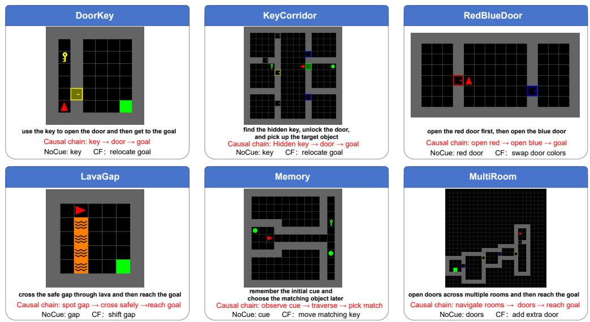  
Figure 6: Representative MiniGrid environment cards. Each panel shows one canonical seed, the mission text, and a short causal-chain annotation.

Figure 6 visualizes representative seeds and causal chains for the six MiniGrid environments summarized in Table 6. For each environment, object identities and causal events are inferred from the simulator state rather than from rendered pixels alone. DoorKey records whether the agent is carrying the key and the door state; KeyCorridor resolves the mission target and the color-matched key/door pair; RedBlueDoor checks the red-before-blue ordering; LavaGap identifies the barrier and the unique safe gap; Memory identifies the cue object and the matching terminal object; and MultiRoom tracks door toggles, room transitions, and entry into the goal room. These symbolic event traces are used only for generation and validation, not as model-facing inputs.

Table 6: MiniGrid environment cards. The table lists the causal evidence that the judge should use, the evidence removed in NoCue, and the minimal counterfactual intervention used to create matched failures.
<table><tr><td>Environment</td><td>Causal chain and success condition NoCue evidence removal</td><td></td><td>CF intervention</td></tr><tr><td>DoorKey</td><td>ing door → reach goal. Success re- is visible before pickup. quires positive reward and terminal</td><td>Pick up key → unlock/open match- Mask early frames in which the key</td><td>Relocate or remove the goal at t = 0 so that the unchanged action se- quence no longer reaches the true goal.</td></tr><tr><td>KeyCorridor</td><td>goal entry. to locked door → unlock door → pre-pickup window. reach the mission target object.</td><td>Pick up color-matched key → return Mask the door-matched key in the</td><td>Remove the mission target object before rollout, so the same action sequence cannot satisfy the pickup objective.</td></tr><tr><td>RedBlueDoor</td><td>sequence. Opening blue before red dence is retained. is invalid.</td><td>Open red door → open blue door Mask the red door before the first Replace or block the blue-door pas- → pass through the ordered-door red-door interaction; blue-door evi- sage before rollout, preserving the</td><td>early red-door subtask but prevent- ing final success.</td></tr><tr><td>LavaGap</td><td>lava barrier → cross through the gap pre-crossing frames. → reach goal without stepping on lava.</td><td>Identify the single safe gap in the Mask visible lava evidence in early Relocate or remove the goal out-</td><td>side the planned path while keep- ing the safe-crossing behavior phys- ically valid.</td></tr><tr><td>Memory</td><td>ridor → choose the matching termi- entry. nal object.</td><td>Observe cue object → traverse cor- Mask the cue object before corridor Swap the correct and distractor ter-</td><td>minal objects before rollout, so the same remembered choice becomes</td></tr><tr><td>MultiRoom</td><td>goal room and reach the goal.</td><td>Traverse a sequence of rooms, open- Mask early door/goal evidence be- Remove the final goal object before ing intervening doors, then enter the fore entering the goal-containing rollout, preserving room traversal room.</td><td>wrong. but preventing terminal success.</td></tr></table>

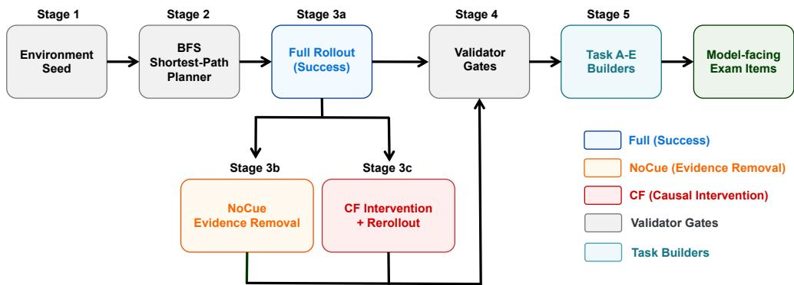  
Figure 7: Dataset generation pipeline from environment seed to validated exam item. Each seed first produces a successful Full rollout; the aligned NoCue and CF variants are then constructed, validated, and converted into task-specific exam items. The model-facing prompts contain only rendered evidence and task instructions, while symbolic states, labels, and intervention metadata remain audit-only.

## B.2 Dataset Generation Pipeline

The atomic unit for Tasks C and D is a trajectory group $g = ( s _ { 0 : T } , a _ { 0 : T - 1 } , m , \ell , \eta )$ , containing a simulator state sequence, action sequence, mission text, outcome label, and audit metadata. A trajectory group contains a successful Full rollout, an evidence-removal NoCue variant, and a counterfactual CF variant. Tasks A, B, and E are derived from the same validated simulator rollouts but expose more localized transition, perception, or prefix-checkpoint interfaces, as described in Appendix C. Figure 7 shows the full generation pipeline from environment seed to validated modelfacing exam items.

Stage 1: successful full rollout. For each environment seed, we reset the simulator with a deterministic layout and use an environment-specific shortest-path planner to construct a successful rollout. The planner operates over symbolic states and inserts required interaction actions, such as pickup and toggle. Rollouts with truncation, missing critical events, or ambiguous terminal outcomes are rejected before any exam item is produced.

Stage 2: evidence-removal variant. The NoCue variant keeps the same action sequence and the same simulator outcome as Full, but masks selected early rendered tiles that reveal the causal evidence. The masked frames must occur strictly before the first interaction with the target evidence. Thus NoCue is an outcome-preserving evidence-removal diagnostic: it tests whether the judge relies on early causal evidence, but it is not counted as a semantics-preserving presentation transform for C1 or as a causal intervention for C4. Table 7 lists the environment-specific evidence targets, mask budgets, and alignment thresholds used for NOCUE construction. Figure 8 illustrates a representative NOCUE audit, showing how the target evidence is masked while preserving the rollout outcome.

Stage 3: counterfactual failure variant. The CF variant applies a minimal simulator intervention before action execution and then rerolls the unchanged action sequence. Depending on the environment, the intervention removes, relocates, swaps, or blocks the causal target. The validation contract requires the counterfactual rollout to be a physically valid execution of the same action sequence and to fail for the intended causal reason. Exact positional identity with Full is required for NoCue; for CF, state divergence is allowed only when it is induced by the declared intervention under the unchanged actions.

Table 7: Per-environment NoCue targets and masking constraints. The mask budget is intentionally conservative so that masking removes the target evidence without changing the overall trajectory presentation.
<table><tr><td>Environment</td><td>Masked target evidence</td><td>Max masked frames</td><td>Alignment threshold</td></tr><tr><td>DoorKey</td><td>Key before pickup</td><td>5</td><td>0.70</td></tr><tr><td>KeyCorridor</td><td>Color-matched key before pickup</td><td>5</td><td>0.70</td></tr><tr><td>RedBlueDoor</td><td>Red door before first red-door toggle</td><td>5</td><td>0.70</td></tr><tr><td>LavaGap</td><td>Lava evidence before safe crossing</td><td>4</td><td>0.70</td></tr><tr><td>Memory</td><td>Cue object before corridor entry</td><td>10</td><td>0.70</td></tr><tr><td>MultiRoom</td><td>Door/goal evidence before goal-room entry</td><td>12</td><td>0.70</td></tr></table>

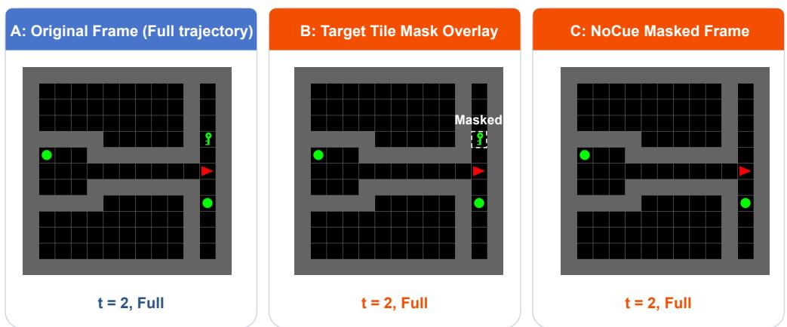  
Figure 8: Example NoCue audit. The panels show the original frame, the target-tile mask overlay, and the resulting NoCue masked frame used to remove selected early evidence while preserving the rollout outcome.

Stage 4: rendering and exam assembly. Validated rollouts are rendered into the presentation formats used by the task interfaces. Task C uses event-anchored sparse storyboards and presentation probes such as temporal order and visual style changes. Task D uses matched Full/CF trajectory evidence for causal-sensitivity tests. Task E uses prefix-only checkpoint evidence and deliberately hides terminal frames. The detailed prompt templates, split-image/composite layouts, and example questions are provided in Appendix C.

## B.3 Validator Gates and Quality Control

All generated groups pass validation before they enter the benchmark. The validators prevent datageneration artifacts from being mistaken for VLM-judge failures. Table 8 summarizes the gates used in the release pipeline.

Environment-specific semantic checks instantiate E1. DoorKey requires key pickup before door open ing; KeyCorridor requires the color-matched key before the locked-door interaction; RedBlueDoor requires the red door to be opened before the blue door; LavaGap requires crossing through the safe gap and never stepping on lava; Memory requires cue observation before the terminal choice; and MultiRoom requires the expected sequence of door toggles and goal-room entry.

## B.4 Dataset Composition

We report the benchmark in terms of exam rows rather than only raw trajectories, because the same validated trajectory group can instantiate multiple variants and presentation conditions. Table 9 summarizes the paper-facing MiniGrid benchmark used in the main experiments. The table describes the diagnostic role of each task, the source environments, the number of model-facing exam rows, and the variant or probe structure used to construct those rows.

The five tasks serve complementary diagnostic roles rather than forming a single undifferentiated leaderboard. Task A probes local action-conditioned transition understanding; Task B and Task E provide perception and state recognition controls; Task C instantiates presentation and representation probes; and Task D provides the matched intervention setting for causal-sensitivity analysis. For Task D, the primary C4 comparison is the paired Full/CF judgment, while retained NoCue rows are used only as auxiliary evidence-removal diagnostics. Model-specific run information, aggregate exclusions, and per-model results are reported separately in the experimental appendices.

Table 8: Validator gates. The gates jointly enforce action alignment, outcome correctness, physically valid rerollout, and correct isolation of model-facing evidence from audit-only state.
<table><tr><td>Gate</td><td>Purpose</td><td>Rule</td><td>Scope</td></tr><tr><td>D1</td><td>Action identity</td><td>The action IDs are identical across matched variants in the same group.</td><td>all variants</td></tr><tr><td>D2</td><td>Length consistency</td><td>Frames and states align with the action sequence: |s0:T | = |a0:T−1| +1. all variants Model-facing inputs contain only rendered evidence, mission/action text, all tasks</td><td></td></tr><tr><td>D3</td><td>Input isolation</td><td>and task instructions; labels, rewards, states, and intervention metadata remain audit-only.</td><td></td></tr><tr><td>D4</td><td>Outcome contract</td><td>Full succeeds, NoCue preserves the Full outcome, and CF fails without C/D truncation artifacts.</td><td></td></tr><tr><td>D5</td><td>No interaction masking</td><td>NoCue never masks the frame in which the agent is facing or interacting NoCue with the target evidence.</td><td></td></tr><tr><td>D6</td><td>Physics validity</td><td>NoCue preserves the exact state trajectory; CF is a valid rerollout under all variants the same action sequence, with divergence allowed only as a consequence of the declared intervention.</td><td></td></tr><tr><td>E1</td><td>Causal-chain completeness</td><td>Environment-specific critical events occur in the required order, e.g., key all envs before door, red before blue, gap crossing without lava contact, cue before terminal choice.</td><td></td></tr><tr><td>E2</td><td>State encoding validity</td><td>Symbolic states use valid MiniGrid object, color, and state indices and all variants remain aligned with rendered frames.</td><td></td></tr><tr><td>N1</td><td>Mask coverage/alignment</td><td>Masked pixels overlap the intended target tile with mean IoU at least 0.70 NoCue and satisfy the global mask budget.</td><td></td></tr><tr><td>CF1</td><td>Intervention audit</td><td>The counterfactual target is removed, relocated, swapped, or blocked ac- CF cording to the environment card, and the failure is attributable to that intervention.</td><td></td></tr></table>

Table 9: Dataset composition for the MiniGrid benchmark. Counts are reported at the exam-row level, since a single validated trajectory group may produce multiple model-facing items through variants, presentation probes, or task-specific interfaces.
<table><tr><td>Task</td><td>Diagnostic role</td><td>Environments</td><td>Exam rows</td><td>Variant/probe structure</td></tr><tr><td>A</td><td>Action-conditioned next-observation prediction</td><td>Six core environments</td><td>103</td><td>Local transitions from 18 source trajectories; 103 baseline questions</td></tr><tr><td>B</td><td>Single-frame perception and interface control</td><td>Six core environments</td><td>144</td><td>6 × 12 × 2 = 144: 12 source groups per environment, two frames per group; structured scene parsing</td></tr><tr><td>C</td><td>Presentation invariance and representation sensitivity</td><td>KeyCorridor, MultiRoom, RedBlueDoor</td><td>486</td><td>18 groups: 18 × 3 × 2 × 3 = 324 temporal/visual items, plus 18 × 3 × 3 = 162 framing items</td></tr><tr><td>D</td><td>Causal sensitivity under matched intervention</td><td>Six core environments</td><td>144</td><td>6 × 2 × 3 × 4 = 144: two query groups per environment, three variants, four presentation conditions; successful Full references</td></tr><tr><td>E</td><td>Prefix/checkpoint perception control</td><td>UnlockPickup, BlockedUnlockPickup</td><td>325</td><td>48 source trajectories (24 per environment); 136 identity and 189 checkpoint-status questions</td></tr></table>

## B.5 Data Format and Access Boundary

Each exam item separates the evidence shown to the VLM judge from the simulator metadata used for auditing and scoring. The model-facing payload consists of the rendered image or image sequence, the mission or action text when required by the task, the task instruction, and the requested answer format. Audit-only fields include the ground-truth label, success flag, reward, termination status, symbolic state trace, action IDs, random seed, NoCue metadata, and CF intervention metadata. This separation is a core part of the benchmark design: the VLM must judge from the same visual/textual evidence that appears in the prompt, while the simulator state remains available for reproducible validation.

A simplified schematic of an exam item is shown below:

"uid": "C.keycorridor.s000001.full.orig.clean",   
"task": "C",   
"env\_task": "keycorridor",   
"group\_id": "s000001",   
"variant": "full",   
"presentation": {   
"temporal": "orig",

"visual": "clean",   
"rep": "composite"   
},   
"model\_input": {   
"image": "...",   
"prompt": "..."   
},   
"audit\_only": {   
"label": 1,   
"success": true,   
"state\_seq": "...",   
"cf\_meta": null   
}   
}

The exact field names, file locations, dataset card, license, model identifiers, API parameters, and response parsing rules are documented in Appendix F. Keeping those implementation details in Appendix F avoids duplicating schema definitions across appendices and keeps Appendix B focused on the data-generation logic that supports the main SCI claims.

## C Task Interfaces and Prompt Templates

GridWM-Judge contains five diagnostic task interfaces. This appendix specifies what each modelfacing item shows to the VLM judge, what answer format is expected, and how the gold answer is obtained from simulator-grounded metadata. Appendix A gives the mathematical definitions of the metrics, Appendix B describes trajectory generation and validation, and Appendix F gives the full machine-readable schemas, decoding settings, and unified output parsing rules. Throughout this appendix, model-facing fields denote information provided to the VLM judge, whereas labels, rewards, symbolic states, intervention records, and audit metadata are used only for scoring and validation. Table 10 summarizes the model-facing evidence, required answer format, and diagnostic role for the five task interfaces. Figure 9 gives representative model-facing layouts for the five tasks, illustrating the difference between local controls, presentation probes, transition prediction, and causal trajectory judgment.

## C.1 Task B and E: Perception Controls

Tasks B and E are local controls. They are not intended to establish SCI by themselves; instead, they test whether the model can parse the visual interface before higher-level failures in Tasks C and D are interpreted as presentation or causal-reasoning failures.

Task B: structured scene perception. Task B presents a single egocentric MiniGrid observation and asks the model to produce a structured description of the local state. The item includes a generic instruction explaining the requested fields, but it does not include the mission, action sequence, reward, terminal flag, or symbolic state.

Table 10: Summary of the five task interfaces. Appendix C describes the model-facing input/output contract; Appendix A defines the metrics computed from these outputs.
<table><tr><td></td><td>Task Model-facing evidence</td><td>Required answer</td><td>Diagnostic role</td></tr><tr><td>B</td><td>Single MiniGrid frame with a generic Structured JSON scene scene-description instruction</td><td>description or component labels</td><td>Perception and interface control</td></tr><tr><td>E</td><td>Prefix-only sparse storyboard before JSON label for the first picked the terminal state</td><td>object or checkpoint status</td><td>Object/state tracking control</td></tr><tr><td>C</td><td>Sparse trajectory storyboard with presentation, framing, and representation probes</td><td>Binary success/failure verdict</td><td>Presentation invariance; representation exchangeability</td></tr><tr><td>A</td><td>and four candidate next observations</td><td></td><td>Current observation, action condition, Multiple-choice next-state labelAction-conditioned transition diagnostic</td></tr><tr><td>D</td><td>Full-trajectory evidence for matched Binary success/failure verdict FULL and CF variants</td><td></td><td>Causal sensitivity under intervention</td></tr></table>

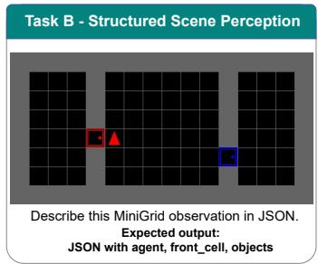

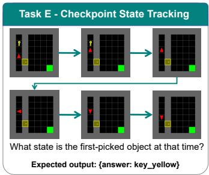

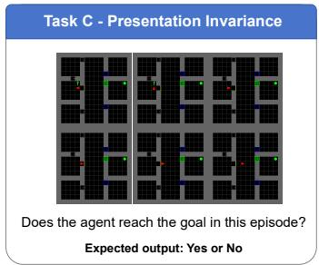

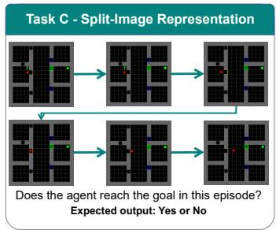

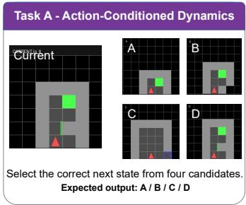

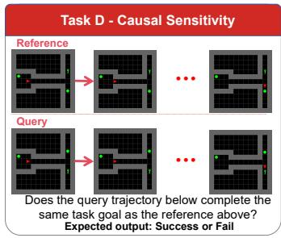  
Figure 9: Representative model-facing interfaces for the five GridWM-Judge tasks. Task B uses a single-frame structured perception query; Task E uses a prefix-only checkpoint storyboard; Task C presents the same trajectory through composite or split-image evidence formats; Task A asks for the correct action-conditioned next observation; and Task D compares matched Full/CF trajectory judgments. Audit-only simulator states, labels, rewards, and intervention metadata are not shown to the model.

Prompt template. You are given one MiniGrid observation. Describe the visible local state using JSON only. Include the agent direction, whether the agent is carrying an object, the front cell, and visible objects. Do not infer hidden objects.

The canonical output is a JSON object with fields such as agent, front\_cell, and objects. A representative schema-level example is:

```jsonl
{
"agent": {
"dir": "right",
"carrying": null
},
"front_cell": {
"type": "key",
"color": "yellow",
"state": null
},
"objects": [
{"type": "key", "color": "yellow", "relative_pos": "front"},
{"type": "door", "color": "yellow", "state": "locked"}
]
}
```

Gold answers are derived from simulator-grounded annotations corresponding to the rendered frame. Task B reports a normalized weighted component score and Acc@0.90, the fraction of items whose score reaches 0.90. Invalid or unavailable outputs receive zero in the conservative all-row analysis.

Task E: checkpoint-style long-range state tracking. Task E presents a prefix-only sparse storyboard from frame 0 through a checkpoint $t _ { c } ,$ where $t _ { c }$ is strictly before the terminal frame. The model must answer an object-identity or object-status question without using a terminal shortcut. The item does not expose symbolic state, reward, success labels, or future frames after $t _ { c } .$

Identity-query template. Below is a MiniGrid trajectory storyboard showing the trajectory up to the last shown frame only. Earlier in the shown trajectory, what was the first object the agent picked up? Answer using JSON only: {"answer":"<label>"}.

Status-query template. Below is a MiniGrid trajectory storyboard showing the trajectory up to the last shown frame only. By the last shown frame, what is the status of the first object the agent picked up earlier? Answer using JSON only: {"answer":"<label>"}.

The identity label space contains object–color labels such as key\_yellow, key\_green, key\_purple, ball\_yellow, ball\_green, and related colors appearing in the canonical artifact. The status label space contains holding, dropped, and reacquired\_and\_holding. Gold labels are derived from the simulator’s object-tracking events before or at $t _ { c } \mathrm { : }$ the first pickup event determines the tracked object, and the object’s checkpoint inventory/grid status determines the status label.

## C.2 Task C: Presentation Invariance Tests

Task C is the main interface for presentation-aware binary judging. It asks whether a trajectory satisfies the task goal, while varying how the same trajectory evidence is presented. In the SCI terminology, temporal order, visual style, and prompt framing instantiate C1 presentation probes, while composite versus split-image evidence formats instantiate the C3 representation exchangeability probe. These changes should not alter the verdict when the underlying simulator semantics are unchanged.

Input and answer contract. The model sees a sparse storyboard built from event-anchored keyframes and a short success/failure question. The mission text is included when the item uses an environment-level goal. The action sequence, symbolic states, terminal flag, reward, intervention metadata, and gold label are not shown.

Neutral prompt template. Below is a storyboard from one MiniGrid trajectory.

Task goal: {mission\_string}

Did the trajectory satisfy this goal? Answer with ONLY: Yes or No.

The output is mapped to a binary verdict, with Yes/Success corresponding to success and No/Fail corresponding to failure. The exact parser and invalid-response handling are specified in Appendix F.

Probe axes. Table 11 summarizes the Task C trajectory, presentation, and representation axes. Task C items are organized by trajectory condition and presentation condition. The trajectory condition may be Full, NoCue, or CF; only the presentation and representation axes are used as semanticspreserving invariance probes within a fixed trajectory condition. NoCue removes early visual evidence while preserving the successful outcome, and CF changes the underlying outcome through a simulator intervention. Therefore, full–counterfactual changes should be interpreted as causal sensitivity rather than presentation invariance.

Table 11: Task C probe axes and their interpretation. Presentation and representation probes are evaluated within a fixed trajectory condition. When CF rows are present, Full–CF differences are treated as causal/outcome changes rather than semantics-preserving presentation changes.
<table><tr><td>Axis</td><td>Values</td><td>Interpretation</td></tr><tr><td>Trajectory condition Full, NoCue, CF</td><td></td><td>Changes the evidence condition or the underlying outcome; not all levels are semantics-preserving.</td></tr><tr><td>Temporal order</td><td>original, reversed</td><td>C1 presentation probe over frame order- ing.</td></tr><tr><td>Visual style</td><td>clean, noisy, style-transformed</td><td>C1 presentation probe over low-level ren- dering perturbations.</td></tr><tr><td>Prompt framing</td><td>neutral, positive, negative</td><td>C1 presentation probe over wording or prior-framing changes, without changing the task goal or evidence.</td></tr><tr><td>Representation</td><td></td><td>composite storyboard, split images C3 equivalent-evidence-format probe for representation exchangeability.</td></tr></table>

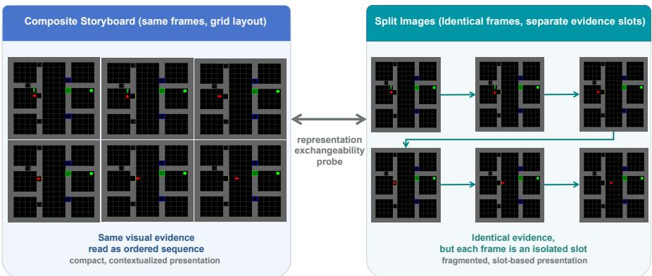  
Figure 10: Composite storyboard versus split-image representation for Task C. The left panel arranges selected event-anchored keyframes into a compact storyboard (Composite format). The right panel presents the same keyframes as individually numbered images (Split-image format). Both formats convey identical trajectory semantics evidence.

Storyboard and representation formats. Figure 10 illustrates the composite storyboard and split-image representations used for the C3 exchangeability probe. For composite inputs, the selected keyframes are arranged into a compact grid and read left-to-right, top-to-bottom unless the temporal probe reverses the order. For split-image inputs, the same selected frames are supplied as separate images slots. Exact prompts and run conditions are documented with the associated evaluation artifacts. The selected frames are event-complete: they prioritize causally relevant events such as first object visibility, pickup, door toggling, hazard crossing, goal visibility, and terminal evidence. Matched conditions for the same trajectory group should use the same frame indices whenever the corresponding frames exist, so that differences in verdicts can be attributed to the intended presentation or causal variable rather than accidental frame selection.

Visual and framing variants. The clean condition uses the original rendering. The noisy condition applies mild deterministic image noise that should not alter the MiniGrid state. The style condition applies deterministic color, contrast, brightness, or sharpness adjustments. Prompt-framing variants should change only the wording around the same evidence and goal; they must not add hints, labels, rewards, or causal explanations. For example, positive framing can say that the trajectory may have succeeded, whereas negative framing can say that it may have failed, but both must ask the same binary question over the same visual evidence.

Framing prompt templates. All framing variants use the same images, mission text, and answer format; only the preamble changes. The neutral framing is:

Below is a storyboard from one MiniGrid trajectory.

Task goal: {mission\_string}

Did the trajectory satisfy this goal? Answer with ONLY: Yes or No.

The positive framing is:

The trajectory may show successful progress toward the task goal. Please judge only from the visual evidence.

Task goal: {mission\_string}

Did the trajectory satisfy this goal? Answer with ONLY: Yes or No.

The negative framing is:

The trajectory may contain a failure to complete the task goal. Please judge only from the visual evidence.

Task goal: {mission\_string}

Did the trajectory satisfy this goal? Answer with ONLY: Yes or No.

## C.3 Task A: Action-Conditioned Dynamics

Task A tests whether the VLM judge uses the action condition to identify the correct next observation. Unlike Tasks C and D, Task A is a local transition interface rather than a trajectory-level success/failure judgment.

Input and prompt. The item shows a current observation $o _ { t }$ , an action condition, and four candidate next observations labeled A–D. The candidates are rendered from MiniGrid states and are arranged as a multiple-choice panel. One candidate is the true next observation $o _ { t + 1 }$ under the action; the other candidates are visually similar negatives. Figure 11 shows the multiple-choice layout used for Task A; the correct/wrong annotations are included only for illustration and are never shown to the model.

Prompt template. Action: {action\_string}.

On the left is the current state. On the right are four candidate next states (A, B, C, D). Select the correct next state after executing the action. Answer with ONLY one letter: A, B, C, or D.

Candidate construction. Negative candidates are selected to avoid trivial recognition. Sametrajectory negatives are preferred, because they share the same environment, objects, and visual style but correspond to different timesteps. If needed, cross-trajectory negatives with similar local configurations are used as fallback. Candidate order is randomized with the gold candidate uniformly placed among A–D.

Action ablations. Task A supports three action conditions. In the baseline condition, the true action is shown. In the shuffle condition, the action field is replaced by a mismatched action sampled from the action label space. In the mask condition, the action field is replaced with an unknown-action token. The ablated interfaces should not expose an action identifier that trivially recovers the original action. Large accuracy drops indicate sensitivity to the supplied action condition. Small or mixed differences are compatible with action-insensitive behavior but do not establish it alone.

Ablated action templates. The baseline condition displays the true action as Action: {action\_string}. In the shuffle condition, the same field is replaced by a different action sampled from the MiniGrid action set: Action: {shuffled\_action\_string}. In the mask condition, the action field is replaced by Action: unknown. The image candidates and answer format remain unchanged across these conditions.

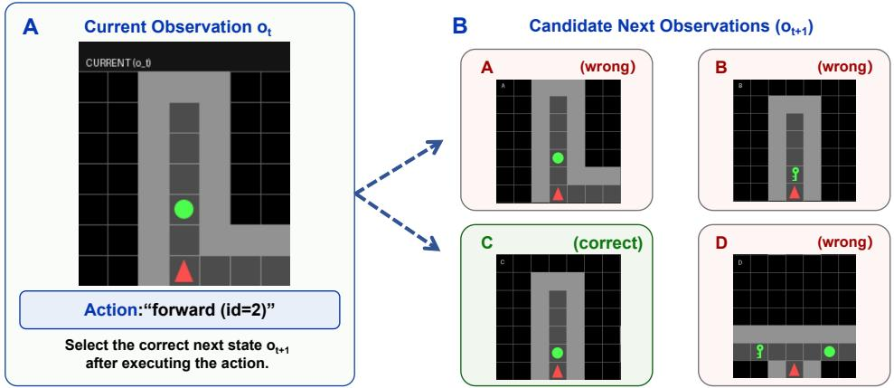  
Figure 11: Layout of a Task A multiple-choice item. The current observation $o _ { t }$ and the action text are shown on the left. Four candidate next observations (A–D) are rendered on the right. One candidate is the true next observation $o _ { t + 1 } ;$ the others are visually similar hard negatives. Dashed annotations indicate which candidate is the correct transition and which negatives share the same trajectory or similar visual configurations. The gold answer is the letter of the correct candidate. Correct/wrong annotations are shown only for illustration and are not included in model-facing inputs.

## C.4 Task D: Causal Sensitivity Tests

Task D is the primary interface for causal sensitivity. It compares matched successful Full trajectories against CF trajectories generated by a minimal simulator intervention and rerollout under the unchanged action sequence. The intended question is whether the judge changes its verdict when the underlying task outcome changes.

Input and prompt. The dedicated reference-aided Task-D protocol contains (1) a successful Reference rollout that illustrates the intended task objective and (2) a separate Query rollout whose outcome must be judged. The Query may correspond to a Full, NoCue, or CF variant; Full/CF are the primary paired conditions for discrimination. The judge must infer the specific objective from the Reference and return Success or Fail for the Query; audit-only gold labels, rewards, simulator success flags, and intervention metadata are excluded from the input.

Prompt template. Below are two storyboard trajectories from the same MiniGrid environment. Reference trajectory: This trajectory is a known successful example of completing the task in this environment. Query trajectory: Determine whether this trajectory also completes the same task goal as the reference trajectory. Answer with ONLY: Success or Fail.

Gold answer and scoring. The gold answer is Success for the matched successful Full trajectory and Fail for the corresponding CF trajectory. The main C4 metrics are computed over paired Full–CF groups and are defined in Appendix A. If a NoCue version is included in the Task D artifact, it should be treated as an evidence-removal diagnostic rather than as the causal-intervention pair used for C4.

Representative paired case. Figure 12 illustrates a representative DoorKey Full/CF pair. The pair keeps the same action sequence. In the Full trajectory, the agent picks up the key, unlocks the door, and reaches the goal. In the matched CF trajectory, the initial intervention relocates or removes the goal so that the same action sequence no longer satisfies the task. A reliable judge should accept the Full montage and reject the matched CF montage, while not changing its verdict merely because the same montage is shown in a different but semantically equivalent representation.

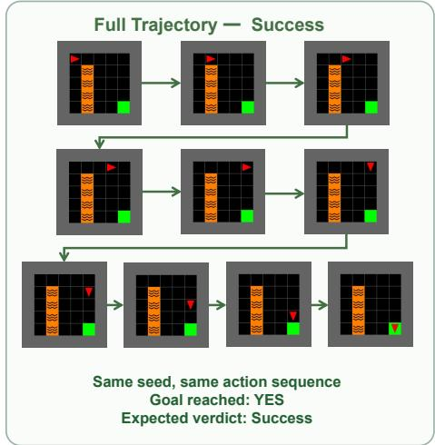

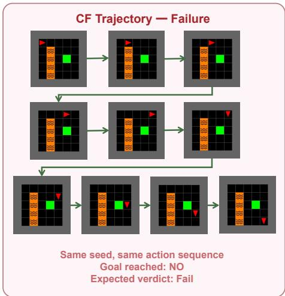  
Figure 12: Illustration of a matched Full/CF pair for Task D (DoorKey example). Both panels show the same action sequence in the same visual format. In the Full trajectory (left), the goal is reachable and the agent completes the task; the gold verdict is Success. In the matched CF trajectory (right), a minimal intervention relocates the goal before the episode starts; the same action sequence now fails. The gold verdict is Fail. A reliable judge should accept the Full and reject the CF.

## D Supplementary Results and Analysis

This appendix provides detailed MiniGrid evaluations supporting the SCI diagnostics in the main paper. We report model-level and environment-level results, reference-aided causal discrimination, presentation and representation sensitivity, perception and output-compliance controls, and matched prompt ablations. Expanded evaluations further examine the stability of these findings with larger trajectory sets and clustered uncertainty estimates. Throughout, Task C and Task D retain their distinct judging protocols, and statistical comparisons follow the eligibility and rules defined in Appendix A. Qualitative cases and additional model-family results complement the quantitative analysis.

## D.1 Main MiniGrid Diagnostics

The main Task-C results are summarized in Table 2. We provide additional diagnostics of representation consistency and reference-aided causal discrimination below, followed by environment-level and controlled experimental analyses.

Representation consistency. The main paper reports that composite and split-image evidence formats can change judge behavior even when the underlying trajectory semantics are fixed. Table 12 provides a compact representation-consistency summary using VCC. Higher values indicate that the judge gives the same verdict across equivalent evidence formats; 1.0 would indicate perfect representation exchangeability.

The mean VCC values are around 0.68–0.70, indicating that representation consistency is imperfect across the model suite. These results support the need to report representation exchangeability separately from both plain accuracy and causal-sensitivity metrics.

Reference-Aided Task-D Results. The dedicated Task-D evaluation provides a successful Reference and a Composite-format Query, which the judge labels Success or Fail. Table 13 reports paired causal discrimination on 12 complete Full/CF Query groups per model, using strict verdict parsing and an all-group denominator. Invalid or truncated outputs are counted as incorrect. The resulting activation and CF-rejection profiles differ substantially: GPT-5.4 obtains $p _ { \mathrm { a c t i v e } } = 0$ .750 and $\mathrm { I D R } _ { \mathrm { r a w } } = 0 . 3 3 3$ , whereas Claude Sonnet 4.6 obtains 0.250 and 0.250, respectively. These estimates also motivate the larger-scale analyses reported below.

## D.2 Environment-Level Breakdown

The aggregate results above may hide environment-specific failure patterns. Figure 13 therefore reports an environment-level breakdown for the Task C MiniGrid settings. We restrict this plot to the three environments that share the same Task C presentation and representation probe structure— KeyCorridor, MultiRoom, and RedBlueDoor—so that the environment comparison is not confounded by task-specific coverage differences. Scores are averaged over composite and split representations.

Table 12: Task-C representation consistency. $V C C _ { \mathrm { r e p } , C } ^ { \mathrm { p o o l e d } }$ measures verdict agreement between matched Composite and Split inputs, pooled across Full and CF trajectory conditions. NoCue is excluded from this pooled comparison.
<table><tr><td>Model</td><td> $V C C _ { \mathrm { r e p } , C } ^ { \mathrm { p o o l e d } }$ </td></tr><tr><td>Claude Sonnet 4.6</td><td>0.69</td></tr><tr><td>Gemini 2.0 Flash</td><td>0.66</td></tr><tr><td>Gemini 2.5 Flash Lite</td><td>0.66</td></tr><tr><td>Gemini 3 Flash</td><td>0.73</td></tr><tr><td>GPT-40</td><td>0.71</td></tr><tr><td>GPT-5.4</td><td>0.66</td></tr><tr><td>Kimi K2.5</td><td>0.76</td></tr><tr><td>Qwen3-8B</td><td>0.66</td></tr><tr><td>Qwen3-32B</td><td>0.66</td></tr><tr><td>Qwen3-235B</td><td>0.66</td></tr><tr><td>Mean</td><td>0.68</td></tr></table>

Table 13: Reference-aided Task-D discrimination (strict/all-groups). Strict all-group estimates over 12 matched Full/CF Query groups per model. Confidence intervals are reported for raw IDR using group-level and environment-level bootstrap resampling.
<table><tr><td>Model</td><td> $p _ { \mathrm { a c t i v e } }$ </td><td> $\mathrm { I D R } _ { \mathrm { r a w } }$ </td><td>Group 95% CI</td><td>Env. 95% CI</td></tr><tr><td>Claude Sonnet 4.6</td><td>0.250</td><td>0.250</td><td>[0.000,0.500]</td><td>[0.000,0.583]</td></tr><tr><td>Gemini 2.0 Flash</td><td>0.667</td><td>0.583</td><td>[0.333,0.833]</td><td>[0.250,0.917]</td></tr><tr><td>Gemini 2.5 Flash Lite</td><td>0.750</td><td>0.167</td><td>[0.000,0.417]</td><td>[0.000,0.333]</td></tr><tr><td>Gemini 3 Flash</td><td>0.833</td><td>0.167</td><td>[0.000,0.417]</td><td>[0.000,0.500]</td></tr><tr><td>GPT-40</td><td>0.750</td><td>0.500</td><td>[0.250,0.750]</td><td>[0.167,0.833]</td></tr><tr><td>GPT-5.4</td><td>0.750</td><td>0.333</td><td>[0.083,0.583]</td><td>[0.083,0.667]</td></tr><tr><td>Kimi K2.5</td><td>0.167</td><td>0.000</td><td>[0.000,0.000]</td><td>[0.000,0.000]</td></tr><tr><td>Qwen3-235B</td><td>1.000</td><td>0.000</td><td>[0.000,0.000]</td><td>[0.000,0.000]</td></tr><tr><td>Qwen3-32B</td><td>0.000</td><td>0.000</td><td>[0.000,0.000]</td><td>[0.000,0.000]</td></tr><tr><td>Qwen3-8B</td><td>1.000</td><td>0.000</td><td>[0.000,0.000]</td><td>[0.000,0.000]</td></tr></table>

(a) $p _ { \mathrm { a c t i v e } }$  
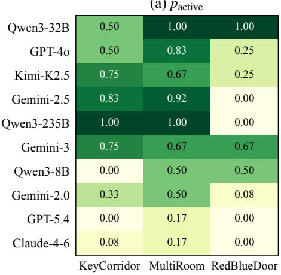

(b) IDR<sub>raw</sub>  
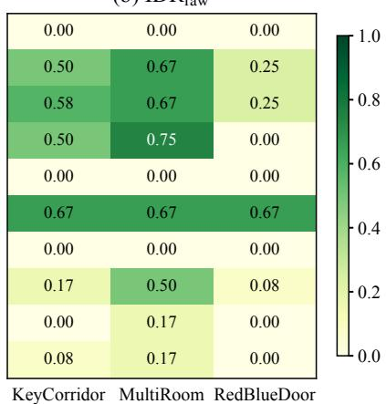  
Environment  
Figure 13: Environment-level MiniGrid breakdown for Task C. The heatmaps report (a) Fulltrajectory activation $p _ { \mathrm { a c t i v e } }$ and (b) raw paired Full–CF discrimination $\mathrm { I D R } _ { \mathrm { r a w } } .$ . Each environment contains six trajectory groups per representation under neutral presentation. Scores are averaged equally across Composite and Split, using all groups and counting invalid verdicts as incorrect.

## D.3 Task-B Output Compliance and Failure-Source Accounting

Task B reports Acc@0.90, the all-row fraction whose normalized, weighted scene-component score reaches at least 0.90; it is not JSON exact-match accuracy. The submitted ten-model run contains 1,440 responses: 897 strict JSON outputs, 269 deterministically recoverable outputs, 121 other unparsable outputs, 72 explicit truncations, 81 API errors, and no missing responses. Deterministic recovery is limited to JSON extraction, syntax normalization, and canonical field names. Table 14 reports response validity and all-row performance, while Table 15 breaks down component-level recovery on parseable responses. Together, they distinguish output compliance from partial scene understanding.

Separate generation-fix check. On the same 114 Gemini 3 Flash Task-B UIDs, a separately labeled output-generation/routing fix improved parsing from 0.208 to 0.993, the all-row mean component score from 0.168 to 0.788, and Acc@0.90 from 0.090 to 0.451. This additional run diagnoses an output pipeline limitation and does not silently replace the originally submitted scores. High-threshold failures therefore cannot be equated with total absence of partial spatial or object understanding.

Table 14: Task-B output compliance and partial semantic recovery. Every model has 144 submitted rows. Mean-all includes infrastructure and format failures as zero; mean-parsed conditions on deterministically parsed responses. The all-row Acc@0.90 values correspond to the Task-B results reported in Table 4.
<table><tr><td>Model</td><td>Parsed n</td><td>API</td><td>Trunc.</td><td>Other unparse.</td><td>Acc@0.90</td><td>Mean-all / parsed</td></tr><tr><td>Claude Sonnet 4.6</td><td>141</td><td>0</td><td>0</td><td>3</td><td>0.000</td><td>0.186 / 0.190</td></tr><tr><td>Gemini 2.0 Flash</td><td>63</td><td>81</td><td>0</td><td>0</td><td>0.007</td><td>0.099 / 0.226</td></tr><tr><td>Gemini 2.5 Flash Lite</td><td>140</td><td>0</td><td>0</td><td>4</td><td>0.000</td><td>0.157 / 0.161</td></tr><tr><td>Gemini 3 Flash</td><td>30</td><td>0</td><td>0</td><td>114</td><td>0.090</td><td>0.168 / 0.807</td></tr><tr><td>GPT-40</td><td>144</td><td>0</td><td>0</td><td>0</td><td>0.000</td><td>0.223 / 0.223</td></tr><tr><td>GPT-5.4</td><td>144</td><td>0</td><td>0</td><td>0</td><td>0.111</td><td>0.616 / 0.616</td></tr><tr><td>Kimi K2.5</td><td>72</td><td>0</td><td>72</td><td>0</td><td>0.007</td><td>0.210 / 0.420</td></tr><tr><td>Qwen3-235B</td><td>144</td><td>0</td><td>0</td><td>0</td><td>0.000</td><td>0.400 / 0.400</td></tr><tr><td>Qwen3-32B</td><td>144</td><td>0</td><td>0</td><td>0</td><td>0.000</td><td>0.119/0.119</td></tr><tr><td>Qwen3-8B</td><td>144</td><td>0</td><td>0</td><td>0</td><td>0.000</td><td>0.119 /0.119</td></tr></table>

Table 15: Task-B component scores on parsed rows only. The parsed support varies considerably across models and must not be interpreted as a uniform full-sample estimate.
<table><tr><td>Model</td><td>Nparsed</td><td>Position</td><td>Carrying</td><td>Front cell</td><td>Object Jaccard</td></tr><tr><td>Claude Sonnet 4.6</td><td>141</td><td>0.064</td><td>0.709</td><td>0.035</td><td>0.182</td></tr><tr><td>Gemini 2.0 Flash</td><td>63</td><td>0.206</td><td>0.714</td><td>0.095</td><td>0.052</td></tr><tr><td>Gemini 2.5 Flash Lite</td><td>140</td><td>0.043</td><td>0.721</td><td>0.007</td><td>0.111</td></tr><tr><td>Gemini 3 Flash</td><td>30</td><td>1.000</td><td>0.867</td><td>0.533</td><td>0.817</td></tr><tr><td>GPT-40</td><td>144</td><td>0.201</td><td>0.708</td><td>0.090</td><td>0.058</td></tr><tr><td>GPT-5.4</td><td>144</td><td>0.903</td><td>0.847</td><td>0.444</td><td>0.228</td></tr><tr><td>Kimi K2.5</td><td>72</td><td>0.569</td><td>0.694</td><td>0.208</td><td>0.254</td></tr><tr><td>Qwen3-235B</td><td>144</td><td>0.618</td><td>0.715</td><td>0.257</td><td>0.014</td></tr><tr><td>Qwen3-32B</td><td>144</td><td>0.000</td><td>0.715</td><td>0.000</td><td>0.000</td></tr><tr><td>Qwen3-8B</td><td>144</td><td>0.000</td><td>0.715</td><td>0.000</td><td>0.000</td></tr></table>

## D.4 Perception-Controlled Oracle-State Hierarchy

The Oracle-State control evaluates GPT-5.4 and Gemini 3.1 Pro on 98 shared groups in nine environments. Each group includes a successful Reference from which the judge must recover the task type and objective before classifying a separate Query. The Pixel condition supplies rendered frames; State adds selected observable trajectory facts; and Pixel+State provides both. The state allowlist excludes the exact objective, gold verdict, reward, success, and termination fields. These are differences in available evidence, not merely alternative layouts of identical pixels.

Table 16: Oracle-State diagnostic hierarchy (98 shared groups). Task, objective and verdict are the individually scored stages; joint requires their simultaneous success. These values correspond to the same matched three-arm experiment.
<table><tr><td>Model</td><td>Evidence</td><td>Task</td><td>Objective</td><td>Verdict</td><td>Joint</td></tr><tr><td>GPT-5.4</td><td>Pixel</td><td>0.442</td><td>0.405</td><td>0.731</td><td>0.320</td></tr><tr><td>GPT-5.4</td><td>State</td><td>0.905</td><td>0.905</td><td>0.895</td><td>0.820</td></tr><tr><td>GPT-5.4</td><td>Pixel+State</td><td>0.854</td><td>0.874</td><td>0.881</td><td>0.765</td></tr><tr><td>Gemini 3.1 Pro</td><td>Pixel</td><td>0.704</td><td>0.395</td><td>0.755</td><td>0.347</td></tr><tr><td>Gemini 3.1 Pro</td><td>State</td><td>0.949</td><td>0.912</td><td>0.973</td><td>0.895</td></tr><tr><td>Gemini 3.1 Pro</td><td>Pixel+State</td><td>0.983</td><td>0.929</td><td>0.997</td><td>0.929</td></tr></table>

For GPT-5.4, State increases joint task/objective/verdict accuracy from 0.320 to 0.820 and raw IDR from 0.469 to 0.765; for Gemini, those values increase from 0.347 to 0.895 and from 0.602 to 0.929. The group interval for GPT’s gain excludes zero, but the more conservative environment-level interval includes zero. These contrasts implicate visual/interface grounding and objective recovery as major, model-dependent bottlenecks without establishing that every Pixel error originates in causal reasoning. Tables 16 and 17 report the corresponding stage-wise and paired metrics.

Table 17: Oracle-State paired Full/CF diagnostics. 95% intervals apply to raw IDR and are based on complete matched groups.
<table><tr><td>Model</td><td>Evidence</td><td> $p _ { a c t i v e }$ </td><td> $\mathrm { I D R } _ { r a w }$ </td><td>Group 95% CI</td><td> $\mathrm { I D R } _ { c o n d }$ </td></tr><tr><td>GPT-5.4</td><td>Pixel</td><td>0.745</td><td>0.469</td><td>[0.367,0.571]</td><td>0.630</td></tr><tr><td>GPT-5.4</td><td>State</td><td>0.929</td><td>0.765</td><td>[0.684,0.847]</td><td>0.824</td></tr><tr><td>GPT-5.4</td><td>Pixel+State</td><td>0.918</td><td>0.765</td><td>[0.684,0.847]</td><td>0.833</td></tr><tr><td>Gemini 3.1 Pro</td><td>Pixel</td><td>0.612</td><td>0.602</td><td>[0.500,0.694]</td><td>0.983</td></tr><tr><td>Gemini 3.1 Pro</td><td>State</td><td>1.000</td><td>0.929</td><td>[0.878,0.980]</td><td>0.929</td></tr><tr><td>Gemini 3.1 Pro</td><td>Pixel+State</td><td>1.000</td><td>0.990</td><td>[0.969,1.000]</td><td>0.990</td></tr></table>

## D.5 Matched Presentation and Representation Probes

Presentation changes preserve simulator state, actions, and outcome labels but may change perceptual accessibility. The submitted ten-endpoint tests therefore report both correctness degradation and correctness rescue on exact matched items. Holm correction is applied within the 180-cell family (60 per probe type).

Table 18: Historical matched presentation effects. Counts aggregate exactly matched comparisons across the original model suite. None of the 180 cells survives the stated global Holm correction.
<table><tr><td>Probe</td><td>Exact pairs</td><td>Degradation</td><td>Rescue</td><td>∆Acc.</td><td>Correctness flip</td></tr><tr><td>Noise</td><td>1080</td><td>59</td><td>75</td><td>+0.015</td><td>0.124</td></tr><tr><td>Style</td><td>1080</td><td>46</td><td>55</td><td>+0.008</td><td>0.094</td></tr><tr><td>Temporal reversal</td><td>1080</td><td>136</td><td>92</td><td>-0.041</td><td>0.211</td></tr></table>

Table 19: Outcome-stratified historical Composite/Split transitions. Flips are changes in predicted verdict, whereas gain/loss counts refer to correctness and may cancel in the net mean. Historical interfaces also varied in prompt wording, packaging, and run date; these contrasts do not isolate image resolution or tiling. The CF mean effect is exploratory and unadjusted.
<table><tr><td>Variant</td><td>Pairs</td><td>Verdict flip</td><td>Gain / Loss</td><td>∆Accuracy</td><td>95% CI</td></tr><tr><td>Full</td><td>1620</td><td>35.7%</td><td>277 /274</td><td>+0.002</td><td>[-0.173,0.167]</td></tr><tr><td>NoCue</td><td>1620</td><td>33.8%</td><td>235 /293</td><td>-0.036</td><td>[-0.198,0.122]</td></tr><tr><td>CF</td><td>1620</td><td>25.6%</td><td>328 / 84</td><td>+0.151</td><td>[0.028,0.272]</td></tr></table>

In the original 270 finer Composite/Split comparison cells, only 10 survived the stated global Holm correction. In a separate Scale-2 probe check comprising 101 groups, ten environment configurations and 12 Full/CF cells, no comparison survived that experiment’s own global Holm correction. These multiple-testing families are distinct and should not be merged post hoc. Tables 18 and 19 summarize the matched presentation and representation effects.

## D.6 Matched Prompt-Structure Ablation

A further Task-D study evaluates identical groups, images, and ordering under three prompting conditions: Direct, Structured Verdict, and Structured Rationale. The results demonstrate changes in response bias, not a monotonic benefit from requesting more reasoning (Table 20).

For GPT-5.4, the Rationale–Direct raw IDR difference is +0.031, with a paired 95% CI from −0.102 to +0.163. For Claude, the Rationale–Verdict difference is −0.173, with a CI from −0.286 to −0.071.

## D.7 Expanded Scale-2 Evaluation and Clustered Uncertainty

The expanded scale-2 evaluations provide substantially larger task-specific samples without pooling them with the base MiniGrid results. Table 21 summarizes the evaluation scale and environment coverage. Task C and Task D use distinct judging contracts, and model coverage varies by task. Table 22 reports the corresponding paired causal diagnostics and uncertainty estimates.

Table 20: Paired Task-D prompt ablation. The three arms use matched Task-D groups; the reported intervals apply to raw IDR.
<table><tr><td>Model</td><td>Prompt</td><td>Full accept</td><td> $_ \mathrm { C F \ r e j e c t }$ </td><td> $\mathrm { I D R } _ { r a w }$  [95% CI]</td><td> $\mathrm { I D R } _ { c o n d }$ </td></tr><tr><td>GPT-5.4</td><td>Direct</td><td>0.827</td><td>0.541</td><td>0.367 [0.276,0.459]</td><td>0.444</td></tr><tr><td>GPT-5.4</td><td>Structured verdict</td><td>0.704</td><td>0.520</td><td>0.265 [0.184,0.357]</td><td>0.377</td></tr><tr><td>GPT-5.4</td><td>Structured rationale</td><td>0.449</td><td>0.878</td><td>0.398 [0.306,0.490]</td><td>0.886</td></tr><tr><td>Claude Sonnet 4.6</td><td>Direct</td><td>0.255</td><td>0.939</td><td>0.224 [0.143,0.306]</td><td>0.880</td></tr><tr><td>Claude Sonnet 4.6 Structured verdict</td><td></td><td>0.694</td><td>0.816</td><td>0.541 [0.439,0.643]</td><td>0.779</td></tr><tr><td></td><td>Claude Sonnet 4.6 Structured rationale</td><td>0.520</td><td>0.796</td><td>0.367 [0.276,0.459]</td><td>0.706</td></tr></table>

Table 21: Expanded Evaluation scale and coverage. The expanded evaluation increases taskspecific sample coverage while preserving the distinct Task-C and Task-D protocols. Counts refer to exam rows and complete source groups, not independent model evaluations.
<table><tr><td>Task</td><td>Base rows</td><td>Expanded rows</td><td>Ratio</td><td>Source groups</td><td>Env. configs</td></tr><tr><td>A</td><td>103</td><td>1,030</td><td>10.0×</td><td>76</td><td>9</td></tr><tr><td>C</td><td>486</td><td>1,326</td><td>2.7×</td><td>442</td><td>10</td></tr><tr><td>D</td><td>144</td><td>1,296</td><td>9.0×</td><td>432</td><td>9</td></tr></table>

Table 22: Scale-2 paired diagnostics. C and D use different judging contracts. Only evaluated model-task combinations are shown. Confidence intervals apply to raw IDR, with intact trajectorygroup and environment-configuration resampling reported separately.
<table><tr><td>Task</td><td>Model</td><td>Groups</td><td>Pactive</td><td>CF rej.</td><td> $\mathrm { I D R } _ { r a w }$ </td><td>Group 95% CI</td><td>Env. 95% CI</td></tr><tr><td>C</td><td>GPT-5.4</td><td>442</td><td>0.523</td><td>0.629</td><td>0.314</td><td>[0.271,0.357]</td><td>[0.249,0.372]</td></tr><tr><td>C</td><td>Claude Sonnet 4.6</td><td>442</td><td>0.043</td><td>0.993</td><td>0.043</td><td>[0.025,0.063]</td><td>[0.009,0.107]</td></tr><tr><td>D</td><td>GPT-5.4</td><td>432</td><td>0.720</td><td>0.530</td><td>0.322</td><td>[0.278,0.366]</td><td>[0.226,0.461]</td></tr><tr><td>D</td><td>Claude Sonnet 4.6</td><td>432</td><td>0.113</td><td>0.933</td><td>0.088</td><td>[0.062,0.116]</td><td>[0.037,0.189]</td></tr><tr><td>D</td><td>Gemini 3 Flash</td><td>432</td><td>0.972</td><td>0.637</td><td>0.613</td><td>[0.567,0.660]</td><td>[0.335,0.767]</td></tr><tr><td>D</td><td>Qwen3-32B</td><td>432</td><td>1.000</td><td>0.000</td><td>0.000</td><td>[0.000,0.000]</td><td>[0.000,0.000]</td></tr></table>

All reported confidence intervals use 20,000 percentile-bootstrap resamples. The primary intervals resample intact trajectory groups, preserving their Full/NoCue/CF dependence and matched models; the sensitivity analysis resamples complete environment configurations. Invalid and unparsable outputs count as incorrect in these all-group summaries.

For Task C, the conditional IDR estimates were 0.602 for GPT-5.4 and 1.000 for Claude Sonnet 4.6; for Task D, they were 0.447 and 0.776 for the same two models, 0.631 for Gemini 3 Flash, and 0.000 for the Qwen3-32B. On Task-D groups, the paired GPT-5.4 minus Claude Sonnet 4.6 difference in raw IDR was +0.234, with group-bootstrap 95% CI [+0.185, +0.282] and environment-bootstrap 95% CI [+0.127, +0.358]. The larger groups sharpen the uncertainty analysis, but the point estimates do not all remain numerically constant: Claude’s original Task-D IDR is 0.250, versus 0.088 on Scale-2. The supported conclusion is persistence of heterogeneous activation, CF rejection, and paired discrimination rather than invariant model rankings.

## D.8 Qualitative and Exploratory Results

To complement the aggregate metrics, Figure 14 shows representative qualitative failures selected from the final frozen MiniGrid manifest. The purpose is not to introduce new metrics, but to make the failure-mode taxonomy in Appendix A concrete.

Exploratory LLaVA-Family Results. For completeness, we also evaluated LLaVA-family multimodal models under the same MiniGrid diagnostic protocol. These runs are exploratory and are not used for the main claims, because they extend the model suite beyond the primary judge set discussed in the main text. Table 23 summarizes the compact results.

The exploratory LLaVA results are substantially below the main judge suite on both correctness and intervention-discrimination metrics. The main failure surface appears to combine visual-interface parsing difficulty with weak causal-discrimination ability. We therefore report these results only as a reference point for open VLM-family models, not as evidence for the primary SCI claims.

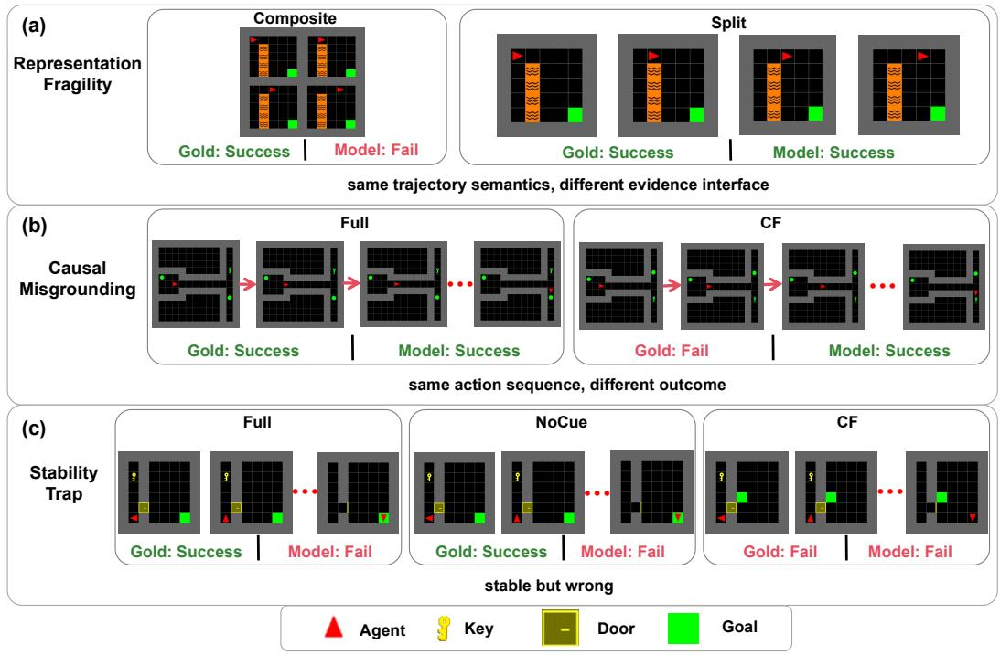  
Figure 14: Representative MiniGrid failure cases. Each row shows the model-facing evidence, simulator-derived gold label, and model verdict before and after the diagnostic change. Row 1 illustrates representation fragility, where the same Full trajectory is judged differently under composite and split representations. Row 2 illustrates causal misgrounding, where a matched Full/CF pair receives an incorrect or unchanged verdict. Row 3 illustrates a stability trap, where the model remains stable across evidence conditions but is wrong or degenerate. Gold labels are derived from simulator state and are not shown to the model.

Table 23: Exploratory LLaVA-family model performance on MiniGrid Tier-0. The metrics are averaged over composite and split representations. These results are reported as auxiliary evidence rather than as part of the main model suite.
<table><tr><td>Model</td><td></td><td>Task C Acc. Task A Acc.</td><td>Task E Acc. Strict Rate</td><td></td></tr><tr><td>LLaVA-Critic-R1-7B</td><td>0.33</td><td>0.28</td><td>0.11</td><td>0.27</td></tr><tr><td>LLaVA-Critic-7B</td><td>0.65</td><td>0.25</td><td>0.00</td><td>0.00</td></tr><tr><td>LLaVA-OneVision-7B</td><td>0.63</td><td>0.27</td><td>0.00</td><td>0.00</td></tr><tr><td>LLaVA-OneVision-Chat</td><td>0.63</td><td>0.24</td><td>0.00</td><td>0.00</td></tr><tr><td>Mean</td><td>0.56</td><td>0.26</td><td>0.03</td><td>一</td></tr></table>

## D.9 Summary

The supplementary MiniGrid analyses reinforce three complementary observations. First, judge accuracy, verdict stability, and paired causal discrimination capture distinct aspects of reliability, as shown by the reference-aided and expanded evaluations. Second, presentation and representation probes reveal model-dependent interface sensitivity, while prompt ablations expose substantial changes in activation and rejection behavior. Third, perception controls, output-compliance analyses, and Oracle-State comparisons identify additional bottlenecks that cannot be attributed uniquely to causal reasoning. Together, these results support the joint use of correctness, invariance, and causal-sensitivity diagnostics.

## E 3D Extensions: MiniWorld and Habitat

We extend GridWM-Judge to two simulated 3D environments, MiniWorld and Habitat-Sim/HSSD, to examine SCI diagnostics under richer visual evidence. These evaluations cover action-conditioned transitions, trajectory judgments, presentation effects, and paired causal discrimination, using simulator-grounded outcomes for evaluation.

## E.1 MiniWorld Environments and Diagnostic Tasks

We include a small MiniWorld extension as a 3D external-validity probe for GridWM-Judge. Unlike the Tier-0 MiniGrid suite, which is designed for tightly audited symbolic-state control, MiniWorld renders trajectories from a first-person 3D viewpoint. This introduces viewpoint variation, depth cues, partial occlusion, object-scale variation, and navigation ambiguity while preserving the same simulator-backed single-source-of-truth principle used throughout the benchmark. Figure 15 illustrates the MiniWorld evidence interface, simulator metadata, and matched success/failure structure.

The MiniWorld extension examines whether SCI diagnostics remain informative under first-person 3D visual evidence. We retain simulator-grounded state traces, actions, observations, and outcome labels, while exposing only task-relevant evidence to the judge. For each MiniWorld rollout, we retain a simulator state trace, an action sequence, rendered visual evidence, a mission or task description, and an outcome label. The model-facing item contains only rendered evidence and task instructions; states, intervention records, labels, and validation metadata remain audit-only. Table 24 summarizes how the MiniWorld extension mirrors the SCI diagnostic logic while remaining separate from the Tier-0 MiniGrid results.

The MiniWorld extension focuses on three diagnostic questions: (i) whether the judge can use action-conditioned 3D evidence, (ii) whether success/failure judgments change under prompt framing, and (iii) whether the judge distinguishes successful trajectories from matched failure cases. We report the resulting accuracies separately from the MiniGrid Tier-0 results.

Table 24: MiniWorld extension design. The 3D extension mirrors the SCI diagnostic logic of MiniGrid but is reported separately because the visual interface and trajectory distribution differ from the Tier-0 2D suite.
<table><tr><td>Component</td><td>Diagnostic role</td><td>Model-facing evidence</td><td>Reported output</td></tr><tr><td>MiniWorld suite</td><td></td><td>3D external-validity probe First-person RGB storyboards; simulator Env./group/item state traces retained as audit metadata</td><td>counts</td></tr><tr><td>Task A-style</td><td>C2: action-conditioned evidence use</td><td>Current 3D observation, action text, and AccA candidate next observations or trajectory slices</td><td></td></tr><tr><td>Task C-style</td><td>trajectory judgment</td><td>C1: presentation-sensitive Composite 3D storyboard with mission and AccC action context</td><td></td></tr><tr><td>Framing probe</td><td>C1: prompt-framing sensitivity</td><td>Alternative framing prompt applied to the same 3D trajectory evidence</td><td>∆frame C</td></tr><tr><td>Task D-style</td><td>C4: causal sensitivity</td><td>matched failure or counterfactual evidence</td><td>D</td></tr></table>

## E.2 MiniWorld Results and Analysis

Table 25 reports MiniWorld results as a 3D external-validity probe rather than as a second leaderboard. The table should be read along three axes: action-conditioned evidence use $( \operatorname { A c c } _ { A } )$ , trajectory-level success/failure judgment $( \operatorname { A c c } _ { C } )$ ), and Task-D-style failure discrimination (Acc ). The framing-delta columns report how much the same evaluation changes under the finalized alternative framing prompt.

Figure 16 visualizes the same MiniWorld results as a diagnostic profile, separating accuracy-style axes from framing effects across models. The main pattern is that no single MiniWorld accuracy number explains judge reliability. For example, GEMINI 3 FLASH is among the strongest models on the trajectory-level and Task-D-style columns, with $\mathrm { A c c } _ { C } = 0 . 8 1$ and $\mathrm { A c c } _ { D } = 0 . 7 8$ . However, its Task-C score changes under framing $( \Delta _ { C } ^ { \mathrm { f r a m e } } = - 0 . 0 7 )$ , showing that strong trajectory-level accuracy does not by itself imply presentation invariance. Similarly, GPT-4O obtains a high $\mathrm { A c c } _ { C } = 0 . 7 5$ but a lower $\mathrm { A c c } _ { D } = 0 . 5 0$ , indicating that success/failure judgment and matched failure discrimination should be interpreted separately.

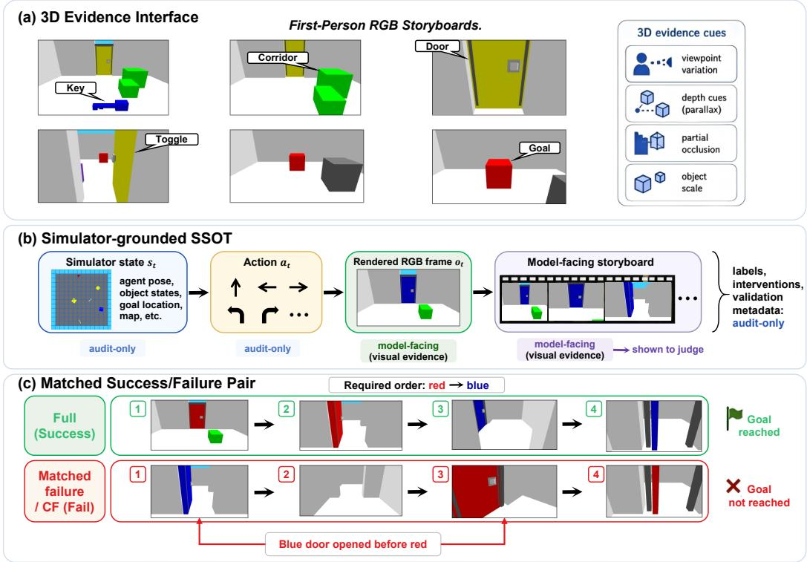  
Figure 15: MiniWorld evidence interface and simulator-grounded source of truth. The figure shows representative first-person 3D frames, aligned simulator state/action traces, and a matched success/failure pair. Rendered frames are model-facing, while states, interventions, and labels remain audit-only metadata.

Model ranking also changes across diagnostic axes. KIMI K2.5 obtains the highest $\operatorname { A c c } _ { C _ { C _ { } } }$ in this MiniWorld evaluation (0.82), but its Task-D-style score is lower than that of GEMINI 3 FLASH (0.54 vs. 0.78). Conversely, CLAUDE-SONNET-4-6 performs better on $\operatorname { A c c } _ { D } \left( 0 . 6 8 \right)$ than on Acc<sub>C</sub> (0.38). This separation is consistent with the SCI framing: presentation robustness, trajectory-level correctness, and Task-D-style failure discrimination are distinct properties and should not be collapsed into a single aggregate score.

The mean MiniWorld scores remain close to the mid-range: $\operatorname { A c c } _ { A } = 0 . 5 0 , \operatorname { A c c } _ { C } = 0 . 5 9$ , and $\mathrm { A c c } _ { D } = 0 . 5 4$ . This suggests that the 3D extension is not saturated by current judges. In particular, several models remain near chance on Task-D-style metrics, and GEMINI-2.0-FLASH obtains a low $\mathrm { A c c } _ { D } = 0 . 2 0$ . Because the current MiniWorld result file reports aggregate accuracies rather than paired IDR-style discrimination rates, these numbers should be interpreted as coarse diagnostic evidence rather than as the full C4 analysis used in MiniGrid.

Compared with the 2D MiniGrid benchmark, the MiniWorld extension preserves the same methodological logic but exposes a different failure surface. Both settings use simulator-backed labels, aligned visual evidence, and controlled presentation or causal variants. MiniWorld additionally introduces first-person 3D perception burdens, including camera pose, partial observability, occlusion, depth cues, and object-scale variation. It is therefore best viewed as a stress test of whether SCI-style diagnostics remain informative under a richer evidence interface, not as a replacement for the fully audited Tier-0 MiniGrid suite.

Table 25: MiniWorld diagnostic results. Values are point estimates from the MiniWorld composite SSOT result file. $\Delta ^ { \mathrm { f r a m e } }$ denotes the change from the neutral prompt to the alternative framing probe; negative values indicate lower accuracy under framing. Because the current MiniWorld result file reports aggregate accuracies rather than paired Full–CF discrimination rates, $\operatorname { A c c } _ { D }$ should be interpreted as a coarse Task-D-style failure-discrimination diagnostic rather than the full C4 IDR analysis used in MiniGrid. Support counts are provided in the released MiniWorld manifest.
<table><tr><td>Model</td><td> $\operatorname { A c c } _ { A }$ </td><td> $\operatorname { A c c } _ { C _ { \mathit { C } } }$ </td><td> $\Delta _ { C } ^ { \mathrm { f r a m e } }$ </td><td> $\operatorname { A c c } _ { D }$ </td><td> $\Delta _ { D } ^ { \mathrm { f r a m e } }$ </td></tr><tr><td>Claude Sonnet 4.6</td><td>0.50</td><td>0.38</td><td> $+ 0 . 1 2$ </td><td>0.68</td><td>-0.13</td></tr><tr><td>Gemini 2.0 Flash</td><td>0.40</td><td>0.43</td><td>-0.15</td><td>0.20</td><td>+0.17</td></tr><tr><td>Gemini 2.5 Flash Lite</td><td>0.48</td><td>0.35</td><td>+0.02</td><td>0.50</td><td>-0.01</td></tr><tr><td>Gemini 3 Flash</td><td>0.55</td><td>0.81</td><td>-0.07</td><td>0.78</td><td>+0.02</td></tr><tr><td>GPT-40</td><td>0.55</td><td>0.75</td><td>-0.16</td><td>0.50</td><td>+0.05</td></tr><tr><td>GPT-5.4</td><td>0.50</td><td>0.51</td><td>+0.03</td><td>0.66</td><td>-0.02</td></tr><tr><td>Kimi K2.5</td><td>0.50</td><td>0.82</td><td>-0.14</td><td>0.54</td><td>+0.01</td></tr><tr><td>Qwen3-8B</td><td>0.49</td><td>0.67</td><td>-0.11</td><td>0.50</td><td>+0.00</td></tr><tr><td>Qwen3-32B</td><td>0.49</td><td>0.67</td><td>-0.11</td><td>0.50</td><td>+0.00</td></tr><tr><td>Qwen3-235B</td><td>0.51</td><td>0.55</td><td>-0.03</td><td>0.50</td><td>+0.00</td></tr><tr><td>Mean</td><td>0.50</td><td>0.59</td><td>-0.06</td><td>0.54</td><td>+0.01</td></tr></table>

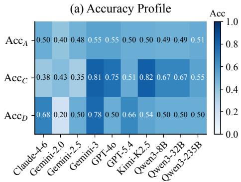

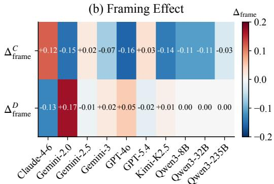

<table><tr><td rowspan=1 colspan=1>Model</td><td rowspan=1 colspan=1> $\operatorname { A c c } _ { A }$ </td><td rowspan=1 colspan=1> $\operatorname { A c c } _ { C _ { C _ { } } }$ </td><td rowspan=1 colspan=1>AccD</td><td rowspan=1 colspan=1> $\Delta _ { C } ^ { \mathrm { f r a m e } }$ </td><td rowspan=1 colspan=1> $\Delta _ { D } ^ { \mathrm { f r a m e } }$ </td></tr><tr><td rowspan=1 colspan=1>Mean</td><td rowspan=1 colspan=1>0.50</td><td rowspan=1 colspan=1>0.59</td><td rowspan=1 colspan=1>0.54</td><td rowspan=1 colspan=1>-0.06</td><td rowspan=1 colspan=1>+0.01</td></tr></table>

Figure 16: MiniWorld diagnostic profile across models. (a) Accuracy Profile: point-estimate accuracies for three MiniWorld diagnostic axes: action-conditioned evidence use $( \operatorname { A c c } _ { A } )$ , trajectorylevel success/failure judgment $( \operatorname { A c c } _ { C } )$ , and Task-D-style failure discrimination $( \operatorname { A c c } _ { D } )$ . Darker cells indicate higher accuracy, and the overlaid numbers give the corresponding point estimates. (b) Framing Effect: changes in accuracy under the finalized alternative framing prompt, computed relative to the corresponding neutral prompt as $\Delta _ { C } ^ { \mathrm { f r a m e } } = \mathrm { A c c } _ { C } ^ { \mathrm { f r a m e } } - \mathrm { A c c } _ { C }$ and $\Delta _ { D } ^ { \mathrm { f r a m e } } = \mathrm { A c c } _ { D } ^ { \mathrm { f r a m e } } -$ $\operatorname { A c c } _ { D }$ . Negative values indicate lower accuracy under framing, while positive values indicate higher accuracy. The summary row reports the mean value of each metric across models. The figure highlights that MiniWorld model rankings differ across diagnostic axes and that framing sensitivity is not reducible to overall accuracy.

## E.3 Habitat-Sim/HSSD Experimental Setup

We evaluate GridWM-Judge in Habitat-Sim using HSSD synthetic articulated indoor scenes, with GPT-5.4 and Gemini 3 Flash as the evaluated VLM judges. Task A comprises 150 action-conditioned transition items from 10 scenes per model. Tasks C and D evaluate the same 100 underlying Query groups across 18 scenes, with matched Full/CF conditions. Task C uses trajectory-level judgments, whereas Task D additionally provides a successful Reference to establish the task objective. Counterfactual failures are generated through articulated action-effect interventions while preserving the Query action sequence.

Table 26: Habitat synthetic-3D evaluation. N denotes transition items for Task A and matched Query groups for Tasks C/D. For Tasks C/D, accuracy is the mean of Full acceptance and CF rejection. Raw IDR is reported with group-bootstrap 95% confidence intervals.
<table><tr><td>Model</td><td>Task</td><td>N</td><td>Scenes</td><td>Acc.</td><td> $p _ { \mathrm { a c t i v e } }$ </td><td>CF rej.</td><td> $\mathrm { I D R } _ { \mathrm { r a w } }$ </td><td>Group 95% CI</td></tr><tr><td>GPT-5.4</td><td>A</td><td>150</td><td></td><td>100.447</td><td>一</td><td>一</td><td>一</td><td>I</td></tr><tr><td>Gemini 3 Flash A</td><td></td><td>150</td><td></td><td>100.553</td><td>1</td><td>一</td><td>一</td><td>1</td></tr><tr><td>GPT-5.4</td><td>C</td><td>100</td><td>18</td><td>0.590</td><td>0.280</td><td>0.900</td><td>0.230</td><td>[0.150,0.320]</td></tr><tr><td>Gemini 3 Flash C</td><td></td><td>100</td><td></td><td>180.720</td><td>0.870</td><td>0.570</td><td>0.470</td><td>[0.370,0.570]</td></tr><tr><td>GPT-5.4</td><td>D</td><td>100</td><td></td><td>18 0.550</td><td>0.580</td><td>0.520</td><td>0.160</td><td>[0.090,0.240]</td></tr><tr><td>Gemini 3 Flash D</td><td></td><td>100</td><td></td><td>18 0.590</td><td>0.970</td><td>0.210</td><td>0.200</td><td>[0.120,0.280]</td></tr></table>

## E.4 Habitat Results

Table 26 reports the HSSD evaluation results. The findings reveal distinct patterns of Full activation, CF rejection, and paired discrimination under synthetic 3D visual evidence. For GPT-5.4 on Task C, Full activation is 0.280 and CF rejection reaches 0.900, but raw IDR is only 0.230. Conversely, Gemini 3 Flash achieves 0.970 Full activation on reference-aided Task D, yet its CF rejection is 0.210 and raw IDR is 0.200. These contrasting profiles show that aggregate accuracy and successfultrajectory acceptance do not fully characterize paired causal discrimination. The results extend the central SCI diagnostic distinction to a richer synthetic 3D setting.

Cross-simulator interpretation. MiniWorld and Habitat-Sim/HSSD use different visual interfaces, intervention protocols, and model subsets. Their results are therefore analyzed separately rather than pooled into a single ranking. Both evaluations demonstrate the diagnostic value of distinguishing judgment correctness, presentation sensitivity, and causal discrimination under simulated 3D evidence.

## F Implementation Details and Reproducibility

This appendix documents the implementation, data release, schema conventions, prompting and parsing protocol, and reproducibility information for GridWM-Judge. The experiments comprise the base MiniGrid Task A–E diagnostics, the Scale-2 Task A/C/D scale extension, the MiniWorld and Habitat Task A/C/D 3D environment extensions, and controlled analyses. Scale-2 expands the trajectory bank and environment coverage. MiniWorld and Habitat evaluate judging in 3D environments. The controlled analyses use Oracle-State evidence to control for visual perception, structured-CoT conditions to examine response format and reasoning, and matched presentation probes to compare evidence representations and presentation changes. The following sections describe the code, data, configurations, and commands used to generate, run, and score these experiments.

## F.1 Code and Data Availability

The public code and dataset are available at the following links:

Code: GitHub repository.

Data: Hugging Face dataset.

The released artifacts include the generated exam files, rendered images, ground-truth annotations, prompt templates, validation metadata, scoring scripts, and result summaries used in the paper. The code is released under the MIT License. Project-authored dataset annotations and metadata use Apache-2.0. HSSD-derived rendered images retain CC BY-NC 4.0 and the associated attribution requirements; third-party assets are not relicensed by this release. Component-specific terms are documented in the dataset card and the Habitat LICENSES.md file.

## F.2 Repository Structure and Compute

The repository is organized around generation, inference, scoring, and export scripts. The top-level structure is:

Table 27: Main software dependencies in the core reproduction environment; Habitat uses a separate environment.
<table><tr><td>Dependency</td><td>Version</td><td>License</td><td>Purpose</td></tr><tr><td>MiniGrid</td><td>3.0.0</td><td>Apache 2.0</td><td>Grid-world environments</td></tr><tr><td>Gymnasium</td><td>1.2.3</td><td>MIT</td><td>Environment interface</td></tr><tr><td>OpenAI SDK</td><td>2.29.0</td><td>Apache 2.0</td><td>API inference client</td></tr><tr><td>MiniWorld</td><td>2.1.0</td><td>Apache 2.0</td><td>3D environments</td></tr><tr><td>Pygame</td><td>2.6.1</td><td>LGPL</td><td>Rendering support</td></tr><tr><td>Pillow</td><td>12.1.1</td><td>HPND</td><td>Image processing</td></tr></table>

Towards-Reliable-VLM-Judge/   
scripts/ # shell launchers   
tools/   
minigrid/ # trajectory and exam generation   
miniworld/ # MiniWorld workflows   
habitat/ # Habitat generation and validation   
exams/ # exam and request assembly   
inference/ # shared inference gateway   
scoring/ # parsers, scores and aggregation   
experiments/ # controlled diagnostic analyses   
utils/ # shared helpers   
environments/ # Conda environment specifications   
requirements/ # pinned Python dependencies   
README.md   
LICENSE

Generated trajectories, exams, responses, and scores are written to an external run directory selected by the user, rather than bundled with the source repository.

This work involves no model training or fine-tuning. Dataset generation and validation are CPUbound and use fixed seeds. VLM inference is performed either through external APIs or local inference for open-weight models. Local model runs use a single NVIDIA RTX 4060 Ti 16GB GPU. On our reference generation setup, generating the 1,202 base MiniGrid Task A–E exam items takes approximately 3.6 minutes. The 3,652 Scale-2 Task A/C/D items take 25.8 minutes, the 214 MiniWorld Task A/C/D items take 7.9 minutes, and the 550 Habitat Task A/C/D items take 82.1 minutes. Generation time does not scale directly with the number of exam items: multiple presentation variants can share the same underlying trajectory.

For example, the 486 base Task C items are derived from 18 trajectory groups with temporal, visual, and framing variations, whereas the 1,326 Scale-2 Task C items use 442 trajectory groups with three variants per group (Full, NoCue, and CF). Scale-2 therefore requires substantially more trajectory simulation, planning, validation, and frame rendering, rather than merely more presentations of existing trajectories. Its construction also includes reference matching and candidate-quality checks. The base and Scale-2 totals cover different task sets (A–E versus A/C/D), so their item counts alone are not comparable measures of generation workload.

The dominant runtime and monetary cost comes from VLM inference. Table 27 lists the main software dependencies used for generation, inference, rendering, and scoring in the core reproduction environment (Python 3.12.12). Dependency versions are pinned in the released environment specifications and lock files. Habitat uses a separate Python 3.9.23 environment with Habitat-Sim 0.3.3, NumPy 1.26.4, and Pillow 10.4.0; its environment specification and lock file are released separately.

## F.3 Data Format and Metadata

The released benchmark uses JSONL files, with one exam item per line. The distinction between model-facing and audit-only fields is semantic: native exam records generally use task-specific, flat fields rather than universal model\_input and audit\_only containers. Only the designated prompt and ordered image inputs are sent to a VLM judge in the pixel-based experiments. Audit-only fields contain simulator states, labels, intervention metadata, validation logs, and other information used only for scoring and reproducibility.

The following is a conceptual illustration of that separation, not the literal on-disk schema:

```json
{
"uid": "C.keycorridor.g000001.full.orig.clean.comp",
"task": "C",
"schema_version": "gridwm.exam.v1",
"env_task": "keycorridor",
"group_id": "g000001",
"variant": "full",
"presentation": {
"temporal": "orig",
"visual": "clean",
"framing": "neutral",
"rep": "composite"
},
"model_input": {
"images": ["relative/path/to/image_or_frame.png"],
"prompt": "model-facing task instruction"
},
"audit_only": {
"label": 1,
"success": true,
"state_seq": "relative/path/to/state_trace.json",
"actions": ["forward", "toggle", "..."],
"reward": 1.0,
"nocue_meta": null,
"cf_meta": null,
"validator_status": "passed"
}
}
```

Task-specific records implement this logical separation. Task A items store the action condition and multiple-choice candidate order. Task B items store the structured perception target, including agent direction, carried object, front cell, and visible objects. Task C items store trajectory variant and presentation-probe metadata. Task D items store matched Full/CF group identifiers for causalsensitivity scoring. Task E items store the checkpoint index and object/status label. Actual field names and example JSONL records are provided by the released task files. For example, a native Task C record uses top-level fields such as uid, task, schema\_version, env\_task, group\_id, variant, temporal, visual, image, prompt, answer, and label. Here image and prompt specify modelfacing evidence; answer and label are retained for scoring and are not appended to the prompt. Other tasks may assemble their prompt or image list when exporting inference requests. The Croissant reading tables are derived views in which nested arrays and objects are encoded as reversible JSON strings; the original exam JSONLs retain their native structure.

For Task B, directions follow the MiniGrid convention:

<table><tr><td>Value</td><td>Direction</td></tr><tr><td>0</td><td>right / east</td></tr><tr><td>1</td><td>down / south</td></tr><tr><td>2</td><td>left / west</td></tr><tr><td>3</td><td>up / north</td></tr></table>

Door states follow the MiniGrid object-state convention: state 0 denotes open, state 1 denotes closed, and state 2 denotes locked. The front\_cell occupancy type may be empty, wall, door, goal, ball, key, lava, or box. The objects list contains only visible non-background objects (keys, balls, doors, goals, lava, and boxes), excluding the front cell itself; walls, floors, and empty cells are not listed as objects. Agent information is reported separately under agent.

Table 28: Model aliases used in the paper and corresponding inference route. Exact endpoint strings and run metadata are included in the released machine-readable logs.
<table><tr><td>Alias in paper</td><td>Model family / provider</td><td>Inference route</td></tr><tr><td>Claude Sonnet 4.6</td><td>Claude Sonnet family</td><td>API</td></tr><tr><td>GPT-40</td><td>GPT-4o family</td><td>API</td></tr><tr><td>GPT-5.4</td><td>GPT-5-family judge run</td><td>API</td></tr><tr><td>Gemini 3 Flash</td><td>Gemini Flash family</td><td>API</td></tr><tr><td>Gemini 3.1 Pro</td><td>Gemini Pro family (Oracle analysis)</td><td>API</td></tr><tr><td>Gemini 2.5 Flash Lite</td><td>Gemini Flash Lite family</td><td>API</td></tr><tr><td>Gemini 2.0 Flash</td><td>Gemini Flash family</td><td>API</td></tr><tr><td>Kimi K2.5</td><td>Kimi family</td><td>API</td></tr><tr><td>Qwen3-8B</td><td>Qwen open-weight family</td><td>local/API run</td></tr><tr><td>Qwen3-32B</td><td>Qwen open-weight family</td><td>local/API run</td></tr><tr><td>Qwen3-235B</td><td>Qwen large open-weight family</td><td>local/API run</td></tr></table>

## F.4 Prompting, Decoding, and Parsing

All models are evaluated as external judges of model-facing evidence. In the pixel-based experiments, the prompts contain only rendered images, mission or action text when required by the task, task instructions, and the expected answer format. They do not contain ground-truth labels, rewards, simulator states, validation flags, or intervention metadata. The Oracle-State control analysis adds simulator-derived state evidence in its State and Pixel+State conditions to control for visual perception; Pixel remains the image-only condition. These analysis conditions do not expose the gold verdict, reward, exact simulator mission, or audit-only validation and intervention annotations.

The evaluated model aliases in the paper are summarized in Table 28. Exact provider endpoint strings, run timestamps, and API parameters are recorded in the released run metadata files.

The following table reports the decoding settings for the base MiniGrid direct-answer experiments; temperature is set to zero when supported by the provider:
<table><tr><td>Parameter</td><td>Value</td></tr><tr><td>temperature</td><td>0.0</td></tr><tr><td>top_p</td><td>not set unless required by provider</td></tr><tr><td>top_k</td><td>not set unless required by provider</td></tr><tr><td>max tokens, Task A</td><td>512</td></tr><tr><td>max tokens, Task B</td><td>2048</td></tr><tr><td>max tokens, Task C/D/E</td><td>256</td></tr></table>

The output-token limits above are not shared by all experiments or reruns. Controlled analyses, including the four-field Oracle-State responses, and truncation-recovery reruns may use larger output budgets. For example, the Gemini 3.1 Pro Oracle run uses an 8192-token limit. Experiment-specific run metadata governs these exceptions; a response that reaches its output limit may be truncated and is scored according to the actual recoverability of its answer.

Invalid, empty, refused, or unparsable responses are logged separately. In conservative all-group analyses, such outputs are counted as incorrect. The main Task-C paired metrics retain the released valid-pair eligibility rules, whereas dedicated Task-D and Scale-2 analyses use their specified allgroup protocols (Appendix A). The parser is task-specific:

Task A. The parser extracts the first isolated multiple-choice label in {A,B,C,D}. If no valid label is found, the response is marked invalid.

Tasks C and D. Binary success/failure judgments are parsed with case-insensitive keyword matching. Success words include success, succeed, succeeded, successful, and yes. Failure words include fail, failed, failure, and no. If both classes appear, the parser applies the deterministic conflict rule implemented in the released scoring script; otherwise invalid or ambiguous outputs are marked incorrect.

Tasks B and E. The scorers distinguish strict, recoverable, and failed parses rather than rejecting all formatting deviations. Task B first extracts a JSON object and attempts standard JSON parsing, with limited recovery for surrounding text, code fences, and trailing commas. Task B requires the expected structured fields for the agent, front cell, and visible objects. Task E expects a JSON object with an answer field and also attempts recovery from code fences or surrounding text. Unambiguously recoverable answers contribute to the scores, with parse modes logged separately. Exact-match and component-level scores are both logged when applicable.

## F.5 Reproduction Commands and Reporting

Table 29: Reproducibility summary.
<table><tr><td>Item</td><td>Documentation / release location</td></tr><tr><td>Code</td><td>public GitHub repository</td></tr><tr><td>Dataset</td><td>public Hugging Face dataset</td></tr><tr><td>Exam files</td><td>JSONL files in dataset release</td></tr><tr><td>Rendered images</td><td>image folders referenced by JSONL records</td></tr><tr><td>Prompt templates</td><td>repository and dataset metadata</td></tr><tr><td>Ground-truth labels</td><td>audit-only fields in JSONL records</td></tr><tr><td>Model outputs</td><td>prediction logs and score files</td></tr><tr><td>Scoring scripts</td><td>tools/scoring/, via scripts/score.sh</td></tr><tr><td>Random seeds</td><td>workflow-specific; see commands and run metadata</td></tr><tr><td>Training or fine-tuning</td><td>none</td></tr><tr><td>Dataset license</td><td>Apache-2.0; HSSD images: CC BY-NC 4.0</td></tr><tr><td>Code license</td><td>MIT License</td></tr><tr><td>Privacy</td><td>synthetic simulator data only; no human subjects or scraped images</td></tr></table>

Table 29 summarizes the released artifacts and documentation needed to reproduce the benchmark results. A typical reproduction workflow is:

```shell
# 1. Install dependencies
conda env create -f environments/core.yml
conda activate gridwm-repro-core
python -m pip install -r requirements/core.lock.txt
export RUN_ROOT="$HOME/gridwm-runs"
# 2. Generate validated trajectories and exam items
bash scripts/generate_minigrid.sh --profile formal \
--output "$RUN_ROOT/base"
# 3. Run model inference
export BUNDLE="$RUN_ROOT/base/minigrid/bundle"
export REQUESTS="$BUNDLE/_requests_from_manifest"
bash scripts/infer.sh \
--requests "$REQUESTS/requests_ABCDE_full.jsonl" \
--protocol chat --base-url "$VLM_BASE_URL" --model "$MODEL" \
--max-tokens 8192 --temperature 0 --workers 2 --rps 1 \
--output "$RUN_ROOT/base-responses"
# 4. Score predictions and export metrics
bash scripts/score.sh --protocol minigrid \
--exam-dir "$BUNDLE/exam" \
--responses "$RUN_ROOT/base-responses/responses.jsonl" \
--ci --output "$RUN_ROOT/base-scores"
```

Set VLM\_BASE\_URL and MODEL, and configure the provider credentials as documented in the repository README, before inference. The inference command illustrates the shared launcher with an 8192- token budget. For the base MiniGrid direct-answer settings, run task-specific request files with the corresponding limits listed above. The repository README provides wrappers for the other environments and analysis protocols.

Seeds are workflow-specific. The generation launcher defaults to 830000; base Task A exam sampling uses 42. Habitat navigation generation uses base seed 20260725, while its action-candidate construction and exam sampling use 20260726. The structured-CoT and Oracle-State scoring protocols use bootstrap seeds 20260724 and 20260725, respectively; the general confidence-interval workflow defaults to 20261103. Seeds and overrides should be reported with the corresponding generation or scoring command.

The released scoring scripts include the deterministic metric aggregation and uncertainty-estimation procedures used to produce the tables and figures in the paper.

## G Scope and Impact

This appendix discusses the scope, limitations, and broader impacts of GridWM-Judge. We summarize the validity boundaries of the controlled diagnostics, consider responsible benchmark use and release, and outline directions for extending SCI evaluation to more diverse models and environments.

## G.1 Scope and Limitations

Table 30 summarizes the scope of claims supported by our work and the corresponding limitations.

Controlled diagnostic scope. GridWM-Judge is designed as a controlled diagnostic benchmark rather than a realistic robotics benchmark. The Tier-0 evaluation suite uses MiniGrid-style symbolic environments because they provide auditable states, actions, object identities, and success predicates. This control is essential for constructing aligned Full, NoCue, and CF variants, and for separating presentation changes from causal interventions. The corresponding limitation is that MiniGrid abstracts away continuous perception, 3D geometry, photorealistic appearance, multi-agent interaction, and real-world sensor noise. Our results therefore diagnose reliability failures under controlled embodied trajectories; they should not be interpreted as direct estimates of deployment performance in real robotic systems.

Environment and agent-behavior scope. The current benchmark emphasizes short-horizon, discrete-action navigation and interaction tasks with deterministic simulator dynamics. The trajectories are produced by deterministic planners so that the underlying success/failure labels and causal events can be audited exactly. This design does not cover noisy control, partial actuation failure, stochastic policies, exploration behavior, or suboptimal agent trajectories. Future versions should include more diverse behavior policies and longer-horizon tasks, but the present paper intentionally uses deterministic rollouts to isolate judge-side failures rather than agent-side failures.

Table 30: Scope of claims and corresponding limitations.
<table><tr><td>Axis</td><td>What the paper supports</td><td>What remains outside scope</td></tr><tr><td>Domain</td><td>predicates.</td><td>Controlled MiniGrid diagnostics with Direct deployment claims for real auditable states, actions, and success robots, photorealistic video, or open- ended embodied tasks.</td></tr><tr><td>Agent behavior</td><td>judge-side reliability failures.</td><td>Deterministic rollouts that isolate Noisy control, stochastic policies, sub- optimal exploration, and long-horizon recovery behavior.</td></tr><tr><td>Presentation</td><td>matched trajectory semantics.</td><td>Temporal, visual, prompt-framing, All possible UI formats, natural- and representation-format probes over language task framings, or video en- codings.</td></tr><tr><td>Models</td><td>A finite set of model-based judges un- Universal claims about all VLMs, fu- der documented task-specific evalua- ture models, or heavily optimized tion protocols.</td><td>prompting/training regimes.</td></tr><tr><td>Metrics</td><td>presentation stability, representation or safety certificate. exchangeability, and causal sensitivity.</td><td>Diagnostic evidence for correctness, A single deployment-readiness score</td></tr></table>

Model and prompting scope. The evaluated models constitute a finite set of model-based judges under the task-specific prompting and decoding protocols described in Appendix F. The benchmark is not a comprehensive leaderboard over all proprietary and open VLMs. The reported failures should be read as evidence that current representative judges can violate state-conditional invariance, not as a universal impossibility result. Likewise, we use standard judge prompts rather than systematically optimizing chain-of-thought prompting, few-shot demonstrations, tool use, self-consistency voting, or specialized fine-tuning. Although we include controlled prompt-structure ablations, we do not exhaustively optimize few-shot demonstrations, tool use, self-consistency voting, or specialized fine-tuning. Better prompting or training may improve some scores, but such improvements would need to be tested under the same causal and presentation controls.

Task and SCI-condition scope. GridWM-Judge operationalizes four diagnostic conditions: presentation invariance, action-conditioned dynamics, representation exchangeability, and causal sensitivity. Task C primarily probes presentation invariance through temporal, visual, and prompt-framing perturbations; Task A probes action-conditioned transition use; the composite–split comparison probes representation exchangeability; and Task D probes causal sensitivity through matched Full/CF com parisons. Tasks B and E are local perception and state-tracking controls that help interpret higher-level failures. This coverage is diagnostic rather than exhaustive: a judge that performs well on these tasks may still fail under different environments, longer contexts, ambiguous goals, or naturalistic video evidence.

NoCue interpretation. NoCue removes selected early visual evidence while preserving the underlying successful trajectory. It is therefore an evidence-removal diagnostic, not a semanticspreserving presentation transformation in the same sense as temporal order, visual style, prompt framing, or representation format. We use NoCue to ask whether a judge relies on early causal cues, but we do not treat NoCue stability alone as proof of presentation invariance.

3D extensions. The MiniWorld and Habitat experiments in Appendix E provide supplementary 3D diagnostic evaluations. They should be interpreted separately from the Tier-0 MiniGrid results because the 3D environments introduce different perceptual and rendering factors. We do not aggregate MiniWorld, Habitat and MiniGrid results into a single headline score.

Threats to validity. We summarize three main validity threats. First, internal validity may be affected by parser ambiguity, API nondeterminism, or generator artifacts. We mitigate these risks by using constrained answer formats, deterministic parsing rules, fixed seeds where applicable, and validation gates over generated trajectories. Second, external validity is limited by the synthetic grid-world domain and by the finite set of evaluated models. The MiniWorld and Habitat extensions partially probe this issue but do not eliminate it. Third, construct validity depends on whether SCI captures the aspects of judge reliability that matter in downstream use. We view SCI as a necessary diagnostic principle: a reliable judge should not change its verdict merely because evidence is reformatted, and should change when a causal intervention changes the outcome. However, SCI is not sufficient for deployment safety, because real settings may involve ambiguous goals, incomplete observations, distribution shift, and human factors not represented here.

## G.2 Societal Impact and Outlook

Table 31 summarizes the main impact considerations and recommended mitigations for responsible release and use.

Positive impacts. VLM judges are increasingly used to evaluate multimodal and embodied systems. A diagnostic benchmark such as GridWM-Judge can help researchers identify when a judge is correct for the wrong reason, unstable under benign presentation changes, or insensitive to causal outcome changes. This may reduce overreliance on opaque aggregate accuracy and encourage more careful reporting of judge reliability, especially in evaluation pipelines that influence model selection, dataset curation, or simulated safety testing.

Risks of overclaiming and misuse. The main risk is not that the benchmark directly enables harmful physical actions, since it uses synthetic grid-world data and releases no personal, private, or safety-critical operational data. The more realistic risk is overclaiming: users may treat high GridWM-Judge scores as a guarantee that a VLM judge is safe for real-world robotics or high-stakes decision-making. This would be inappropriate. The benchmark should be used as one diagnostic layer, not as a deployment certificate. Another risk is benchmark gaming: once examples and prompts are public, models or systems may be tuned to exploit the benchmark without genuinely improving causal grounding. Future releases should therefore include held-out diagnostic slices and versioned evaluation protocols.

Table 31: Impact considerations and recommended mitigations.
<table><tr><td>Consideration</td><td>Potential concern</td><td>Mitigation in this paper / release</td></tr><tr><td>Overclaiming</td><td>readiness guarantees.</td><td>Treating SCI scores as deployment- Explicitly state the controlled diag- nostic scope and report limitations alongside results.</td></tr><tr><td>Benchmark gaming</td><td>reliability.</td><td>Tuning models to public prompts Document prompts and probes; plan or examples without improving real versioned splits and held-out diag- nostic slices for future releases.</td></tr><tr><td>Misuse of judge diagnostics</td><td>judge weaknesses.</td><td>Crafting inputs that exploit known Frame results as reliability audits and avoid presenting the benchmark as an adversarial attack toolkit.</td></tr><tr><td>Privacy and data rights</td><td>tories.</td><td>Releasing sensitive images or trajec- Use simulator-generated synthetic data with no human subjects or pri- vate data.</td></tr><tr><td>Compute cost</td><td>many variants.</td><td>Repeated VLM inference across Provide modular subsets, determin- istic scripts, and transparent com- pute reporting.</td></tr></table>

Responsible release. The dataset is synthetic and simulator-generated. It does not contain humansubject data, personal information, scraped images, or private trajectories. The release should nevertheless include documentation of generation scripts, prompt templates, schemas, validation logs, licenses for dependencies, and known limitations. We recommend that any public release state that the benchmark evaluates VLM judges under controlled MiniGrid, MiniWorld, and Habitat environments, and that it is not intended as a standalone safety evaluation for deployed embodied systems.

Environmental considerations. MiniGrid trajectory generation and validation are lightweight relative to large-scale VLM inference. The main compute footprint comes from repeated model calls over multiple tasks, variants, and presentation probes. The benchmark is intentionally modular so that researchers can run smaller diagnostic subsets when compute is limited. Reporting compute resources and inference settings in Appendix F is important for reproducibility and for understanding the environmental cost of evaluation.

Future directions. The most important next step is to test whether the same SCI failures persist in richer domains, such as longer MiniWorld tasks, photorealistic simulators, real robot videos, and embodied tasks with ambiguous or compositional goals. A second direction is to expand the model suite, including open-weight VLMs, video-language models, and specialized judge models. A third direction is to evaluate mitigation strategies such as structured output constraints, calibrated abstention, evidence localization, multi-view inputs, self-consistency, or training on counterfactual diagnostic data. Future benchmark versions should also include adversarially selected but simulatorvalid trajectories to test whether apparent judge reliability survives more challenging causal and presentation shifts.

Conclusion on scope. GridWM-Judge provides reproducible diagnostics for examining whether model-based judges respond appropriately to presentation changes and causal interventions. Its findings are bounded by the evaluated domains, models, and protocols, and should not be interpreted as deployment or safety guarantees.