# UniFlow-RS: Unified Generative Prediction for Heterogeneous Remote-Sensing Tasks

Jianlong He1 Liang Liao2 Jing Xiao1 Chaofeng Chen1,3,\* Gui-Song Xia1

1School of Artificial Intelligence, Wuhan University 2Hangzhou Institute of Technology, Xidian University 3Institute for Math and AI, Wuhan

§ GitHub: https://github.com/MindVision-AI/UniFlow-RS € Project Page: https://elaxegan.github.io/uniflow-rs/

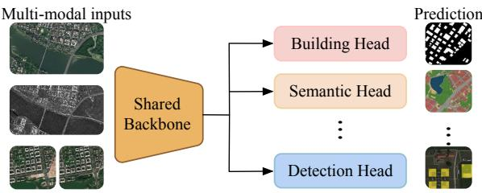  
(a) Task-Specific Predictors

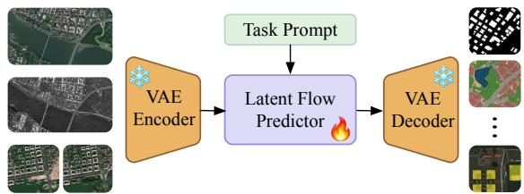  
(b) Unified Generative Predictor

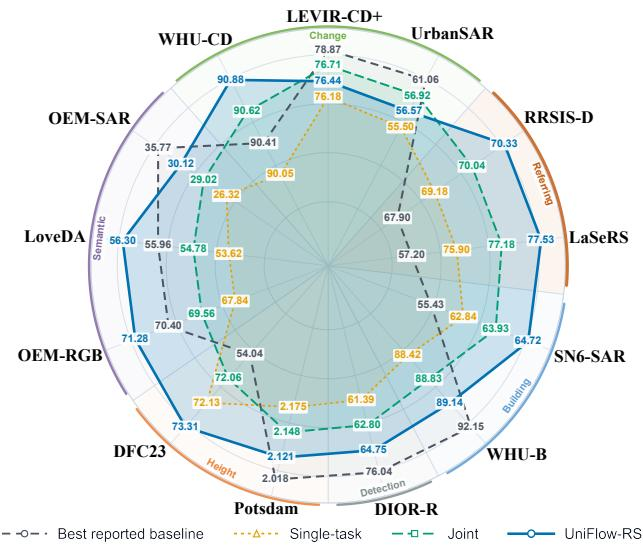  
(c) Competitive performance across six tasks  
Figure 1: UniFlow-RS unifies heterogeneous remote-sensing perception through a shared generative prediction process. Unlike prior multi-task models that share representations but retain task-specific predictors, UniFlow-RS uses a single generative predictor across six tasks and achieves competitive performance on thirteen datasets.

## Abstract

Remote-sensing foundation models increasingly unify representations across sensing modalities and down stream tasks, yet their prediction mechanisms remain largely task-specific. Separate decoders, prediction heads, and objectives leave prediction fragmented across tasks. This naturally raises a question: can heterogeneous remote-sensing tasks share the prediction process? UniFlow-RS answers this question with a single latent flow-matching predictor shared across tasks. This requires addressing two key challenges: unifying heterogeneous prediction spaces and harmonizing joint optimization across tasks. First, we cast heterogeneous task outputs into structured visual targets in a common latent space, allowing them to be modeled by the same pretrained flow predictor. Task-dependent conditioning further accommodates differences in input configurations. Second, we optimize all tasks with a common Flow Matching objective, eliminating task-specific prediction losses. To mitigate optimization mismatch across tasks and modalities, we introduce Task–Modality Adaptive Timestep Sampling (TMAS), which dynamically allocates training timesteps according to the online learning state of each task–modality group. Using a single shared model, UniFlow-RS handles six tasks and thirteen datasets, surpassing recent task-specific state-of-the-art methods on several benchmarks while remaining competitive on the others. Beyond these benchmarks, the same checkpoint demonstrates strong zero-shot transfer across unseen datasets, task settings, occlusion conditions, and near-infrared false-color imagery, without target-specific adaptation.

## 1 Introduction

Remote-sensing interpretation increasingly requires models to operate across diverse tasks, sensing modalities, and input configurations. Discriminative foundation models such as SkySense and MTP (Guo et al., 2024; Wang et al., 2024a) have substantially advanced representation reuse across optical, SAR, multi-temporal observations, and downstream tasks. However, as illustrated in Figure 1(a), most unified models still retain task-specific prediction heads, decoders, or output mechanisms after the shared representation, leaving the final prediction stage fragmented across tasks. This exposes a remaining gap in unified remote-sensing perception: can heterogeneous remote-sensing tasks share not only representations, but the prediction process itself?

Generative foundation models provide a natural route toward this goal by reformulating prediction as conditional visual generation. Recent work has shown that pretrained image generators can serve as generalist visual predictors (Gabeur et al., 2026), while flow matching provides a simple formulation for conditional generation through velocity-based transport (Lipman et al., 2023; Liu et al., 2023). In remote sensing, generative models have further demonstrated strong flexibility across sensing modalities and generation settings (Jakubik et al., 2025; Chen et al., 2026). This suggests a unified paradigm for generalist remote-sensing perception: encoding diverse structured outputs as visual representations and predicting them with a shared latent flow model.

Making this paradigm work in remote sensing requires resolving two key mismatches. The first is a prediction-space and conditioning mismatch. Remote-sensing tasks involve heterogeneous outputs, from binary masks and semantic maps to height fields, referred regions, and rotated instances, with inputs spanning optical/SAR, single-/bi-temporal, and optional text conditioning. A unified predictor must therefore accommodate these heterogeneous output structures and input conditioning configurations without resorting to task-specific branches. The second is an optimization mismatch. Even under a unified prediction formulation, different task–modality groups can exhibit different learning dynamics along the flow trajectory. A fixed timestep distribution imposes the same sampling schedule on groups whose optimization needs may differ substantially.

We introduce UniFlow-RS, a latent-flow framework that addresses these two mismatches with a single generative predictor shared across heterogeneous remote-sensing tasks. As shown in Figure 1(b), UniFlow-RS replaces a collection of task-specific predictors with one pretrained latent flow predictor and one shared LoRA (Hu et al., 2022) adapter, together with a frozen VAE for target encoding and decoding. All tasks are trained with the same Flow Matching objective, without learned task-specific output heads or task-specific losses. To make this shared predictor applicable across tasks, UniFlow-RS maps task-specific structured targets into a common VAE-compatible visual latent space, while different tasks are specified through task-dependent input conditioning. We further design deterministic recovery rules to convert the generated latent outputs back into their native evaluation formats. Building on this unified prediction space, we address the heterogeneous optimization dynamics across different tasks with Task–Modality Adaptive Timestep Sampling (TMAS). TMAS dynamically reallocates timestep-level training budget according to the online learning state of each task–modality group, allowing the sampling schedule to adapt to group-specific optimization needs.

As shown in Figure 1(c), UniFlow-RS covers six remote-sensing tasks across thirteen datasets, spanning optical, SAR, bi-temporal, continuous-output, language-conditioned, and instance-level prediction settings. Despite using a shared LoRA adapter, UniFlow-RS surpasses the best reported results on multiple benchmarks while remaining competitive on the others.

Our contributions are threefold:

• We introduce a unified remote-sensing framework in which heterogeneous tasks share the prediction process itself, rather than only representations. A single pretrained latent flow predictor and shared LoRA support six tasks under the same Flow Matching objective, without learned task-specific output heads or losses.

• We formulate heterogeneous remote-sensing outputs in a common structured visual space and combine it with task-dependent conditioning, allowing diverse output structures, sensing modalities, and input configurations to be handled by one latent predictor.

• We formulate heterogeneous task–modality learning dynamics along the flow trajectory as a timestep-allocation problem and propose TMAS, which adaptively adjusts timestep sampling based on the online learning state of each group, improving joint optimization and convergence.

## 2 Related Work

Unified remote-sensing models. Remote-sensing foundation models have increasingly moved toward shared representations across sensing modalities and downstream tasks. SkySense and MTP (Guo et al., 2024; Wang et al., 2024a) establish transferable representations across heterogeneous observations, while SkySense V2 (Zhang et al., 2025b) further advances multimodal representation learning. SelectiveMAE (Wang et al., 2025) explores scalable masked pretraining, and FedSense (Tan et al., 2025) investigates distributed foundation-model learning. S5 and RingMoE (Lv et al., 2026; Bi et al., 2026) extend representation sharing across datasets and modalities. Despite these advances, unification largely remains at the representation level, with heterogeneous tasks relying on specialized prediction heads, decoders, or objectives. This makes the prediction interface task-dependent and requires additional architectural design when introducing new tasks. In contrast, UniFlow-RS unifies the prediction process itself by mapping heterogeneous outputs into a common structured visual space and sharing a single generative predictor and training objective. This unified interface enables new dense prediction tasks without additional learned heads, facilitating cross-task knowledge sharing and generalization to unseen data distributions.

Generative models for structured perception. Pretrained generative models offer transferable visual priors, making them particularly promising for remote sensing, where dense annotations are costly and scarce. Painter (Wang et al., 2023) unifies visual tasks through masked image modeling, while InstructDiffusion (Geng et al., 2024) and InstructCV (Gan et al., 2024) explore instruction-conditioned diffusion for visual prediction. FlowDIS (Sargsyan and Navasardyan, 2026) further applies Flow Matching to language-guided segmentation. However, extending this paradigm to core remote-sensing perception tasks, such as building extraction, change detection, semantic segmentation, and height estimation, remains challenging due to heterogeneous output structures, sensing modalities, input configurations, and optimization dynamics. We address these challenges through structured visual targets, observation-initialized latent flow prediction, and task–modality adaptive timestep sampling, enabling diverse remote-sensing tasks to share a unified generative prediction process.

Adaptive optimization for heterogeneous joint training. Multi-task optimization methods such as Grad-Norm (Chen et al., 2018b) and PIVRG (Qin et al., 2025) mitigate task imbalance through gradient- or performancebased adjustments. In generative modeling, Improved DDPM (Nichol and Dhariwal, 2021) employs loss-aware timestep sampling, while Adaptive Non-Uniform Timestep Sampling (Kim et al., 2025) learns a sampling policy based on estimated objective reduction. Heterogeneous remote-sensing perception presents a distinct challenge: diverse sensing modalities and output structures exhibit different learning dynamics along the flow trajectory of a shared predictor. We therefore design TMAS specifically for heterogeneous remote-sensing joint training, adapting timestep allocation to the persistent difficulty and learning activity of each task–modality group.

## 3 UniFlow-RS

In this section, we introduce the latent flow formulation (Sec. 3.1), then specify the target representations and task-dependent conditioning (Sec. 3.2). Finally, we present TMAS, which adapts timestep sampling for each task–modality group (Sec. 3.3). Figure 2 summarizes the framework.

## 3.1 Unified latent flow formulation

We build on a pretrained latent flow model and jointly train a single shared LoRA adapter across all tasks. The pretrained parameters of the image VAE, text encoder, and MMDiT backbone remain frozen. Let E, D, and T denote the VAE encoder, VAE decoder, and text encoder, respectively, and let θ denote the trainable LoRA parameters.

For a target y from task τ and dataset d, a deterministic rendering operator $C _ { \tau , d }$ converts y into a structured visual target. Its latent representation is $z _ { y } = E ( C _ { \tau , d } ( y ) )$ , which allows all tasks to share the same latent prediction space without task-specific neural output heads. We construct the source latent $z _ { s }$ from the input observations and connect it to the target latent $z _ { y }$ through a linear path:

$$
z _ { t } = ( 1 - t ) z _ { y } + t z _ { s } , \qquad v ^ { \star } = z _ { s } - z _ { y } , \qquad t \in [ 0 , 1 ] .\tag{1}
$$

The visual condition $c _ { I }$ and text condition $c _ { T }$ are detailed in Sec. 3.2.

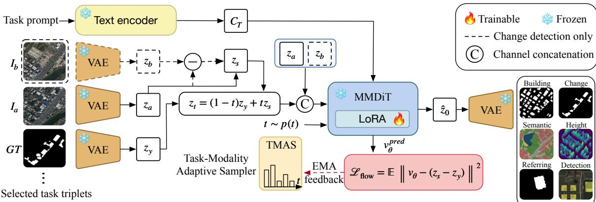  
Figure 2: Overview of UniFlow-RS. Native task outputs are rendered as structured visual targets and encoded by a frozen VAE. A pretrained MMDiT with one shared trainable LoRA predicts the conditional velocity field, while TMAS adapts timestep sampling from online Flow Matching errors. At inference, transport starts from the task-dependent source latent; the shared VAE decoder and deterministic recovery operators then produce native task predictions.

The shared MMDiT predicts the velocity $v _ { \theta } \big ( z _ { t } , c _ { I } , c _ { T } , t \big )$ with the standard flow matching objective

$$
\mathcal { L } _ { \mathrm { f l o w } } = \mathbb { E } \Big [ \| v _ { \theta } ( z _ { t } , c _ { I } , c _ { T } , t ) - v ^ { \star } \| _ { 2 } ^ { 2 } \Big ] .\tag{2}
$$

At inference, we solve $\begin{array} { r } { \frac { \mathrm { d } \boldsymbol { z } _ { t } } { \mathrm { d } t } = \boldsymbol { v } _ { \theta } \big ( \boldsymbol { z } _ { t } , \boldsymbol { c } _ { I } , \boldsymbol { c } _ { T } , t \big ) } \end{array}$ from t = 1 to t = 0 with $z _ { 1 } = z _ { s }$ , obtaining $\hat { z } _ { y } = z _ { 0 }$ . The native prediction is recovered as $\hat { y } = R _ { d } ( D ( \hat { z } _ { y } ) )$ where $R _ { d }$ is the deterministic operator to convert the visual output to its native evaluation format. All tasks therefore share the latent space, velocity predictor, trainable adapter, and the frozen VAE encoder and decoder. Appendix C.2 visualizes the intermediate transport states across all six tasks.

## 3.2 Structured Visual Targets and Task-Dependent Conditioning

Structured visual targets. Remote-sensing tasks have substantially different native outputs. Building extraction and referring segmentation produce binary masks; change detection includes both binary building-change masks and categorical flood-change maps; semantic segmentation produces categorical maps; height estimation predicts continuous values; and rotated detection returns oriented instances.

We encode these heterogeneous outputs as visual targets, i.e., images, using $C _ { \tau , d }$ . Binary outputs are represented as two-tone masks, categorical outputs as class-coded maps, height values through a log-compressed grayscale encoding, and rotated instances as class-coded canvases, from which the native instances are recovered via deterministic geometric post-processing. When datasets within the same task follow different label ontologies, $C _ { \tau , d }$ first aligns their labels to a shared semantic definition before visual encoding.

These conversions are deterministic and non-learned, providing a common interface to the pretrained image VAE. Detailed palettes, height transformations, ontology mappings, recovery procedures, and frozen-VAE round-trip analyses are provided in Appendix B.

Task-dependent conditioning. Most tasks take a single image as input, whereas change detection uses a pair of temporal observations and referring segmentation additionally requires a language query. We accommodate these task-dependent input configurations through the source state and conditioning inputs of the same flow model. Let $I _ { a }$ denote the current observation and $z _ { a } = E ( I _ { a } )$ its latent representation. We use $c _ { T } = T ( q )$ to encode a fixed task instruction or, for referring segmentation, the sample’s original expression (Appendix A.1). For bi-temporal tasks, the previous observation $I _ { b }$ is additionally encoded as $z _ { b } = E ( I _ { b } )$ . The source state and visual condition are

$$
\left[ z _ { s } , c _ { I } \right] = \left\{ \begin{array} { l l } { \left[ z _ { a } , \left[ \mathbf { 0 } , z _ { a } \right] \right] , } & { \mathrm { s i n g l e - i m a g e ~ t a s k s } , } \\ { \left[ z _ { a } - z _ { b } , \left[ z _ { b } , z _ { a } \right] \right] , } & { \mathrm { b i - t e m p o r a l ~ t a s k s } , } \end{array} \right.\tag{3}
$$

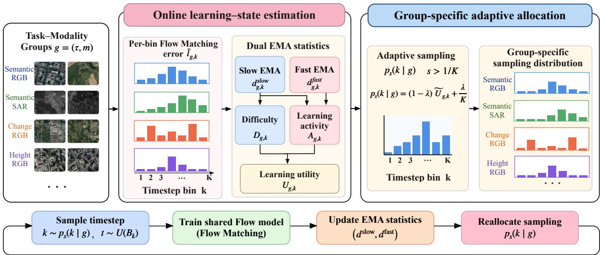  
Figure 3: Task–Modality Adaptive Timestep Sampling. Each group is indexed by task and modality. TMAS tracks group-specific Flow Matching error at two timescales, converts the resulting learning state into a sampling utility, and adjusts the timestep distribution after uniform warm-up. A persistent uniform component ensures continued exploration across the flow trajectory.

where $[ \cdot , \cdot ]$ denotes channel-wise concatenation, and 0 has the same shape as $z _ { a }$ . The source state $z _ { s }$ initializes the flow, while $c _ { I }$ provides visual context. We use $z _ { a }$ as the source for single-image tasks to preserve input structure, and $z _ { a } - z _ { b }$ for change detection while conditioning on $[ z _ { b } , z _ { a } ]$ to retain both observations. We validate these choices in Sec. 4.3.

## 3.3 Task–Modality Adaptive Timestep Sampling

The formulation above unifies heterogeneous tasks under a shared latent predictor and Flow Matching objective, but it does not eliminate differences in their optimization dynamics.

In particular, different tasks and modalities may exhibit distinct learning difficulties along the flow trajectory due to differences in output structure and sensing characteristics

A single global timestep distribution may oversample regions that are already well learned for some groups while undersampling more challenging regions for others.

A simple solution is to sample more often from regions with larger prediction errors. However, error magnitude alone does not tell us how a region is being learned. A high-error region may have plateaued, whereas a moderateerror region may still be changing rapidly. We therefore use two signals: persistent difficulty, which describes where a group remains difficult, and learning activity, which describes where its error is still changing. TMAS estimates these signals for each task–modality group and uses them to adapt timestep sampling online. Figure 3 gives an overview.

Online learning-state estimation. We define each task–modality group as $g = ( \tau , m )$ , where τ denotes the task and m the physical modality. Datasets with the same task and modality share one sampling profile. We divide [0, 1] into K equal-width bins and let $\bar { \ell } _ { g , k }$ be the mean normalized velocity-prediction error observed for group g at bin k.

To characterize both persistent difficulty and recent learning dynamics, we maintain fast and slow exponential moving averages (EMAs) of the bin-wise error:

$$
d _ { g , k } ^ { \mathrm { f a s t } }  ( 1 - \frac { 1 } { K } ) d _ { g , k } ^ { \mathrm { f a s t } } + \frac { 1 } { K } \bar { \ell } _ { g , k } , d _ { g , k } ^ { \mathrm { s l o w } }  ( 1 - \frac { 1 } { K ^ { 2 } } ) d _ { g , k } ^ { \mathrm { s l o w } } + \frac { 1 } { K ^ { 2 } } \bar { \ell } _ { g , k } .\tag{4}
$$

The slow EMA captures the long-term difficulty of a bin, while the fast EMA is more sensitive to recent updates. Their discrepancy therefore reflects ongoing learning dynamics: $d _ { g , k } ^ { \mathrm { f a s t } } < d _ { g , k } ^ { \mathrm { s l o w } }$ suggests recent improvement, while $d _ { g , k } ^ { \mathrm { f a s t } } > d _ { g , k } ^ { \mathrm { s l o w } }$ reflects increasing error which can indicate forgetting or cross-task interference.

Implementation details including error normalization, initialization, aggregation, and unseen-bin handling are given in Appendix D.

Absolute Flow Matching errors can have different scales across task–modality groups. We therefore measure difficulty relative to other timestep bins of the same group. Before computing the sampling scores, we convert the raw EMA states into stable sampling-time estimates: unobserved bins are assigned a conservative group-level fallback, and all estimates are lower-bounded by ϵ for numerical stability. We denote the resulting estimates by $\tilde { d } _ { g , k } ^ { \mathrm { s l o w } }$ and $\tilde { d } _ { g , k } ^ { \mathrm { f a s t } }$ ; the exact fallback rule is given in Appendix D. We then define

$$
D _ { g , k } = \frac { \tilde { d } _ { g , k } ^ { \mathrm { s l o w } } } { \frac { 1 } { K } \sum _ { j = 1 } ^ { K } \tilde { d } _ { g , j } ^ { \mathrm { s l o w } } } , \quad A _ { g , k } = \operatorname* { m i n } \Biggl \{ \left| \frac { \tilde { d } _ { g , k } ^ { \mathrm { s l o w } } - \tilde { d } _ { g , k } ^ { \mathrm { f a s t } } } { \tilde { d } _ { g , k } ^ { \mathrm { s l o w } } } \right| , 1 \Biggr \} .\tag{5}
$$

Here, $D _ { g , k } > 1$ indicates that bin k is more difficult than the group average, while $A _ { g , k }$ measures how strongly its error is changing relative to its long-term level. We use the absolute fast–slow discrepancy because both rapid improvement and rapid degradation indicate active learning dynamics.

We combine them into

$$
U _ { g , k } = ( D _ { g , k } + \epsilon ) \left( \frac 1 K + A _ { g , k } \right) ,\tag{6}
$$

where $\epsilon > 0$ ensures numerical stability. Difficulty provides the base allocation, while activity gives additional weight to bins whose learning state is changing. The offset $1 / K$ ensures that a difficult but temporarily stable bin still receives training budget when the fast and slow estimates are close.

Group-specific adaptive allocation. The estimates are unreliable early in training because many group–bin pairs have only been observed a few times. We therefore use uniform timestep sampling for the first $1 / K$ fraction of training. Let $s \in [ 0 , 1 ]$ denote normalized training progress. The probability of sampling bin k for group g is

$$
p _ { s } ( k \mid g ) = \left\{ \frac { 1 } { K } , \qquad \quad s \leq \frac { 1 } { K } , \right.\tag{7}
$$

where $\lambda \in ( 0 , 1 ]$ controls the trade-off between uniform exploration and adaptive sampling. After selecting a bin, t is sampled uniformly within it. The uniform term $\lambda / K$ prevents a bin that is underestimated early from being permanently neglected.

TMAS thus assigns different timestep distributions to different task–modality groups while keeping the task and dataset sampling proportions unchanged.

## 4 Experiments

## 4.1 Experimental setup

We use the frozen FLUX.2 [klein] 4B Base MMDiT (Black Forest Labs, 2026), together with its frozen VAE and a frozen Qwen3-4B-FP8 text encoder (Qwen Team, 2025). A rank-32 LoRA with approximately 49.1M trainable parameters is shared across all tasks. We train for 60k optimizer steps with batch size 32 on four NVIDIA RTX 6000 Ada GPUs using AdamW and an initial learning rate of $5 \times 1 0 ^ { - 5 }$ , halved at 20k, 35k, and 50k steps. Unless otherwise specified, inference uses two flow steps. TMAS uses $K = 1 0$ timestep bins and exploration weight $\lambda = 0 . 2 ;$ all remaining sampler coefficients are fixed analytically from K, with $\epsilon = 1 0 ^ { - 6 }$ for numerical stability.

We evaluate six tasks across thirteen datasets, following the official splits and native metrics whenever available. We further assess zero-shot generalization on five additional datasets across three settings. All evaluations use the same jointly trained checkpoint without target-specific adaptation. Full details of the datasets, preprocessing, and evaluation metrics are provided in the appendix. For controlled comparisons among unified model variants, we

(a) Building extraction

WHU Building (IoU ↑ )

SpaceNet6 (IoU ↑ )

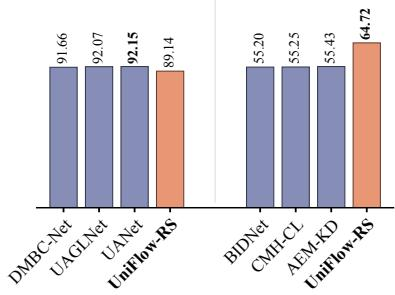  
(b) Change detection

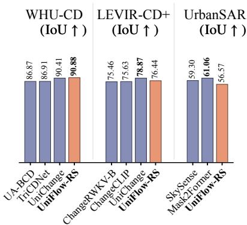  
(c) Semantic segmentation  
LoveDA OEM-RGB OEM-SAR (mIoU ↑ ) (mIoU ↑ ) (mIoU ↑ )

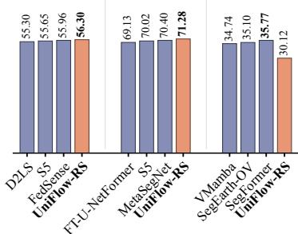  
(d) Height estimation  
Potsdam (RMSE ↓ )  
DFC23 (δ1 ↑ )

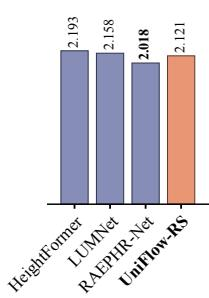

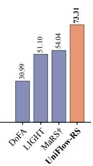

(e) Referring segmentation  
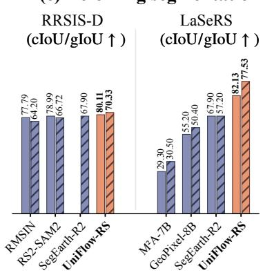

(f) Rotated detection DIOR-R (mAP50 ↑ )  
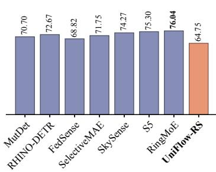  
Figure 4: Main benchmark comparison across six tasks and thirteen datasets. Each panel reports the dataset-native metric indicated above the bars, with arrows showing the preferred direction. All UniFlow-RS results are obtained from the same shared checkpoint.

additionally report unified task score (UTS), which first averages the eligible native metrics within each task and then assigns equal weight to all six training tasks. Zero-shot transfer results are reported separately and are not included in UTS.

## 4.2 Main results

Figure 4 compares UniFlow-RS with representative unified and task-specific baselines across all thirteen datasets. All UniFlow-RS results are obtained from a single jointly trained checkpoint with a shared LoRA, without task-specific fine-tuning or learned output heads. Full numerical comparisons, venue–year information, and dataset-specific notes are provided in Appendix F (Tables 15 and 16).

UniFlow-RS achieves the best results in our comparison on WHU-CD (Ji et al., 2019), LoveDA (Wang et al., 2021), OpenEarthMap-RGB (Xia et al., 2023), SpaceNet 6 SAR (Shermeyer et al., 2020), DFC23 (Liu et al., 2024a), RRSIS-D (Liu et al., 2024b), and LaSeRS (Xin et al., 2026), while maintaining competitive performance across all six tasks. These results demonstrate the effectiveness of a shared generative prediction process across diverse sensing modalities and output structures.

The task-wise results also reflect different compatibility with the unified prediction interface. Referring segmentation benefits from the shared dense prediction prior and explicit language conditioning, making its binary-mask output well aligned with conditional latent transport. In contrast, rotated detection requires recovering discrete instances and precise oriented geometry from a generated class-coded canvas. Without task-specific box or orientation losses, small generation errors can be amplified during deterministic instance recovery, making detection more challenging.

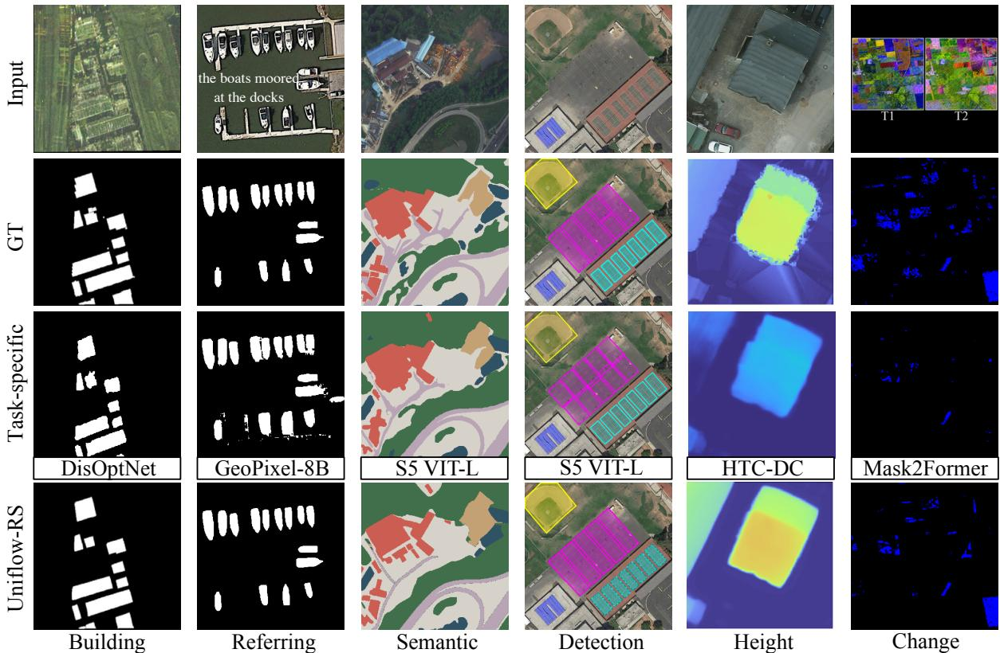  
Figure 5: Qualitative comparison of task-specific baselines and UniFlow-RS across six tasks. Baseline names are shown below the corresponding task-specific predictions.

Qualitative results. Figure 5 compares the shared UniFlow-RS predictor with task-specific baselines (Kang et al., 2022; Shabbir et al., 2025; Lv et al., 2026; Chen et al., 2023; Cheng et al., 2022a) across six tasks. Overall, UniFlow-RS produces cleaner predictions with fewer spurious regions, more coherent semantic boundaries, and better-preserved spatial structures. In change detection, it recovers more change regions while suppressing isolated responses, whereas in rotated detection, it produces more coherent instance layouts.

Notably, in building extraction and height estimation, UniFlow-RS generates smoother and more spatially continuous predictions that better follow the underlying scene structures. Although some predictions do not perfectly match the ground-truth annotations, they often remain visually plausible and consistent with human perception of the scene. These observations highlight the potential of generative prediction to capture meaningful spatial priors and produce structurally coherent outputs, rather than merely reproducing annotation patterns. Additional qualitative comparisons across all six tasks are provided in Appendix G.

## 4.3 Analysis

Table 1: Comparison of task-specific and joint adaptation. Single-task uses one LoRA per task, whereas the joint variants share one LoRA.
<table><tr><td>Setting</td><td>Building IoU ↑</td><td>Change IoU ↑</td><td>Semantic mIoU↑</td><td>Height δ1↑</td><td>Ref. gIoU↑</td><td>Det. mAP50↑</td><td>UTS ↑</td></tr><tr><td>Single-task</td><td>75.63</td><td>73.91</td><td>49.26</td><td>72.13</td><td>72.54</td><td>61.39</td><td>67.48</td></tr><tr><td>Joint</td><td>76.38</td><td>74.75</td><td>51.12</td><td>72.06</td><td>73.61</td><td>62.80</td><td>68.45</td></tr><tr><td>Joint + TMAS</td><td>76.93</td><td>74.63</td><td>52.57</td><td>73.31</td><td>73.93</td><td>64.75</td><td>69.35</td></tr></table>

Joint training vs. task-specific training. Table 1 compares a single jointly trained model with six independently trained task-specific models, all using the same Fixed Beta sampler. Joint training increases UTS from 67.48 to 68.45, with improvements on five of the six tasks. This suggests that heterogeneous tasks can benefit from the joint training process which includes more diverse datasets. With TMAS, the jointly trained model further improves UTS to 69.35.

Table 2: Comparison of timestep-sampling strategies under joint training. All results are measured after 60k updates. Steps denotes the first update reaching the final UTS of Fixed Beta, NR means not reached.
<table><tr><td>Sampler</td><td>Building IoU ↑</td><td>Change IoU ↑</td><td>Semantic mIoU↑</td><td>Height  $\delta _ { 1 } \uparrow$ </td><td>Ref. gIoU ↑</td><td>Det. mAP50 ↑</td><td>UTS ↑</td><td>Steps ↓</td></tr><tr><td>Uniform</td><td>75.92</td><td>74.42</td><td>50.31</td><td>71.84</td><td>73.20</td><td>61.95</td><td>67.94</td><td>NR</td></tr><tr><td>Fixed Beta (2.5, 1)</td><td>76.38</td><td>74.75</td><td>51.12</td><td>72.06</td><td>73.61</td><td>62.80</td><td>68.45</td><td>60k</td></tr><tr><td>Adaptive non-uniform</td><td>75.98</td><td>74.36</td><td>50.47</td><td>72.13</td><td>73.72</td><td>62.20</td><td>68.14</td><td>58k</td></tr><tr><td>Global adaptive</td><td>76.54</td><td>74.61</td><td>51.68</td><td>72.33</td><td>73.52</td><td>63.03</td><td>68.62</td><td>53k</td></tr><tr><td>TMAS w/o activity</td><td>76.74</td><td>74.48</td><td>52.23</td><td>72.96</td><td>73.87</td><td>63.88</td><td>69.03</td><td>44k</td></tr><tr><td>TMAS</td><td>76.93</td><td>74.63</td><td>52.57</td><td>73.31</td><td>73.93</td><td>64.75</td><td>69.35</td><td>37k</td></tr></table>

Task–modality adaptive timestep sampling. Table 2 compares fixed and adaptive timestep-sampling strategies under the same joint-training protocol. Compared with Fixed Beta (68.45 UTS), global adaptive sampling improves UTS to 68.62, while introducing task–modality-specific difficulty profiles increases it to 69.03. Incorporating learning activity raises UTS to 69.35, with the largest gains over Fixed Beta in rotated detection (+1.95), semantic segmentation (+1.45), and height estimation (+1.25). TMAS reaches the final performance of Fixed Beta in 37k updates, requiring 38.3% fewer training steps. In comparison, Adaptive Non-Uniform Timestep Sampling (Kim et al., 2025) achieves a final UTS of 68.14, despite first reaching the Fixed Beta reference at 58k updates. These results demonstrate the benefits of adapting timestep allocation to the difficulty and learning activity of task–modality groups. Additional component ablations are provided in Appendix D.2.

Figure 6 illustrates the timestep-wise difficulty profiles across task–modality groups after normalizing out the global error trend. SAR building extraction and semantic segmentation exhibit higher relative errors at larger timesteps, whereas RGB change detection and rotated detection show greater difficulty near the target end of the flow trajectory. These distinct profiles motivate group-specific timestep allocation. Unlike a global sampler that uses a shared distribution across tasks, TMAS adapts the sampling distribution to each group’s learning state, consistent with its improvements over fixed and global sampling in Table 2.

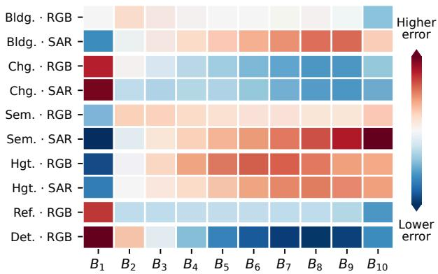  
Figure 6: Task–modality timestep difficulty.

Table 3: Zero-shot transfer to unseen datasets under visual and visual–language out-of-distribution (OOD) shifts. EarthReason includes both visual and language shifts, whereas RISBench mainly introduces a visual shift. All UniFlow-RS results use the same jointly trained checkpoint.
<table><tr><td colspan="3">EarthReason (Visual+Language OOD)</td><td colspan="3">RISBench (Visual OOD)</td></tr><tr><td>Method</td><td>cIoU ↑</td><td>gIoU ↑</td><td>Method</td><td>cIoU ↑</td><td>gIoU ↑</td></tr><tr><td>FLUX.2-Klein Base</td><td>17.74</td><td>17.04</td><td>FLUX.2-Klein Base</td><td>6.38</td><td>7.74</td></tr><tr><td>RS2-SAM2-RRSISD (AAAI&#x27;26)</td><td>35.48</td><td>36.55</td><td>VisionReasoner (ICLR&#x27;26)</td><td>46.98</td><td>51.62</td></tr><tr><td>UniFlow-RS</td><td>44.23</td><td>48.24</td><td>UniFlow-RS</td><td>70.92</td><td>64.62</td></tr></table>

Generalization beyond the training datasets. We evaluate the same jointly trained UniFlow-RS checkpoint on two unseen referring-segmentation datasets without target-specific adaptation. RISBench mainly introduces a visual domain shift while retaining explicit referring expressions, whereas EarthReason additionally contains more implicit, reasoning-oriented language queries. As shown in Table 3, UniFlow-RS achieves 70.92/64.62 cIoU/gIoU on RISBench and 44.23/48.24 on EarthReason, outperforming the corresponding baselines by 23.94/13.00 and

8.75/11.69 points, respectively. The results show that the shared predictor generalizes to unseen visual and language distributions without additional adaptation.

Table 4: Zero-shot transfer to unseen tasks under occlusion. Chesapeake RSC evaluates road extraction under treecanopy occlusion (IoU, F1, and canopy-road recall $R _ { \mathrm { c a n o p y } } ) _ { \mathrm { ; } }$ , while PIE evaluates four-class semantic segmentation under clear and synthetic-cloud conditions. All models are evaluated without target-domain adaptation.
<table><tr><td colspan="4">Chesapeake RSC (Canopy occlusion)</td><td colspan="4">PIE (Cloud occlusion)</td></tr><tr><td>Method</td><td>IoU↑</td><td>F1↑</td><td> $R _ { \mathrm { c a n o p y } }$  ←</td><td>Method</td><td>Clear</td><td>Thin</td><td>Thick</td></tr><tr><td>FLUX.2-Klein Base</td><td>13.05</td><td>23.08</td><td>17.22</td><td>FLUX.2-Klein Base</td><td>9.73</td><td>10.32</td><td>7.16</td></tr><tr><td>S5 ViT-L (AAAI&#x27;26)</td><td>37.40</td><td>54.43</td><td>13.71</td><td>S5 ViT-L (AAAI&#x27;26)</td><td>36.62</td><td>14.17</td><td>4.76</td></tr><tr><td>RoadGIE (CVPR&#x27;26)</td><td>50.49</td><td>67.10</td><td>29.75</td><td>MM-OVSeg (CVPR&#x27;26)</td><td>24.07</td><td>19.82</td><td>16.61</td></tr><tr><td>UniFlow-RS</td><td>52.20</td><td>68.59</td><td>38.89</td><td>UniFlow-RS</td><td>38.92</td><td>32.21</td><td>24.52</td></tr></table>

Zero-shot transfer to unseen tasks. We further evaluate the same jointly trained UniFlow-RS checkpoint on two unseen tasks without target-specific adaptation. As shown in Table 4, UniFlow-RS achieves 52.20 IoU and 38.89 canopy-road recall on Chesapeake RSC, outperforming the automatic RoadGIE baseline by 1.71 and 9.14 points, respectively. On PIE, UniFlow-RS achieves 38.92, 32.21, and 24.52 mIoU under clear, thin-cloud, and thick-cloud conditions. Compared with S5, the improvements increase from 2.30 points under clear conditions to 18.04 and 19.76 points under thin and thick clouds, respectively. These results demonstrate the ability of the shared generative predictor to generalize to unseen task settings and maintain robust performance under visual occlusion. Detailed evaluation protocols are provided in Appendix C.5.

Source-state initialization. We isolate the sourcestate design in Eq. 3 under fixed visual conditioning. Figure 7(a) shows that $z _ { a }$ improves all five singleimage tasks over Gaussian initialization by 2.64–3.44 points, confirming the benefit of preserving input structure. For bi-temporal change detection, the mean score increases from 70.36 with Gaussian initialization to 72.54 with $z _ { a } ,$ , 73.82 with $| z _ { a } - z _ { b } |$ , and 74.63 with $z _ { a } - z _ { b }$ , showing that preserving directional temporal differences is beneficial.

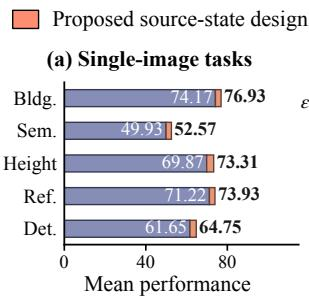  
Alternative source states

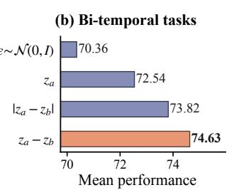  
Figure 7: Source-state initialization ablation.

## 5 Conclusion

We presented UniFlow-RS, a unified latent-flow framework for heterogeneous remote-sensing perception. Instead of sharing only representations while retaining task-specific predictors, UniFlow-RS unifies the prediction process through a pretrained flow model with a jointly trained LoRA. Structured visual targets and task-dependent conditioning enable six tasks across thirteen datasets to share the same latent prediction space and Flow Matching objective, without learned task-specific output heads or losses. To better optimize this shared predictor, TMAS adapts timestep sampling to the online learning state of each task–modality group.

Across a diverse set of benchmarks, the resulting model remains competitive with task-specific methods, benefits from joint training, and demonstrates strong zero-shot generalization across unseen datasets, task settings, and sensing conditions without target-specific adaptation. Overall, our results demonstrate the potential of a shared generative prediction process as a foundation for generalist remote-sensing perception, and motivate further research toward more scalable and broadly transferable unified models.

## References

Hanbo Bi, Yingchao Feng, Boyuan Tong, Mengyu Wang, Haichen Yu, Yongqiang Mao, Hao Chang, Wenhui Diao, Peijin Wang, Yue Yu, Hanyang Peng, Yehong Zhang, Kun Fu, and Xian Sun. RingMoE: Mixture-of-modalityexperts multi-modal foundation models for universal remote sensing image interpretation. IEEE Transactions on Pattern Analysis and Machine Intelligence, 48(4):4388–4405, 2026. doi: 10.1109/TPAMI.2025.3643453.

Black Forest Labs. FLUX.2 [klein] 4B Base, 2026. URL https://huggingface.co/black-forest-labs/FLUX.2-klein-b ase-4B. Model card. Accessed September 22, 2026. Code: https://github.com/black-forest-labs/flux2.

Haoyang Chen, Jing Zhang, Hebaixu Wang, Shiqin Wang, Pohsun Huang, Jiayuan Li, Haonan Guo, Di Wang, Zheng Wang, and Bo Du. Any2Any: Unified arbitrary modality translation for remote sensing. arXiv preprint arXiv:2603.04114, 2026. doi: 10.48550/arXiv.2603.04114.

Keyan Chen, Zhengxia Zou, and Zhenwei Shi. Building extraction from remote sensing images with sparse token transformers. Remote Sensing, 13(21):4441, 2021. doi: 10.3390/rs13214441.

Liang-Chieh Chen, Yukun Zhu, George Papandreou, Florian Schroff, and Hartwig Adam. Encoder-decoder with atrous separable convolution for semantic image segmentation. In Proceedings ofthe European Conference on Computer Vision, pages 801–818, 2018a. URL https://www.ecva.net/papers/eccv\_2018/papers\_ECCV/html/Lia ng-Chieh\_Chen\_Encoder-Decoder\_with\_Atrous\_ECCV\_2018\_paper.php.

Sining Chen, Yilei Shi, Zhitong Xiong, and Xiao Xiang Zhu. HTC-DC Net: Monocular height estimation from single remote sensing images. IEEE Transactions on Geoscience and Remote Sensing, 61:1–18, 2023. doi: 10.1109/TGRS.2023.3321255.

Zhan Chen, Yidan Zhang, Xiyu Qi, Yongqiang Mao, Xin Zhou, Lei Wang, and Yunping Ge. HeightFormer: A multilevel interaction and image-adaptive classification–regression network for monocular height estimation with aerial images. Remote Sensing, 16(2):295, 2024. doi: 10.3390/rs16020295.

Zhao Chen, Vijay Badrinarayanan, Chen-Yu Lee, and Andrew Rabinovich. GradNorm: Gradient normalization for adaptive loss balancing in deep multitask networks. In Proceedings of the 35th International Conference on Machine Learning, pages 794–803, 2018b.

Bowen Cheng, Ishan Misra, Alexander G. Schwing, Alexander Kirillov, and Rohit Girdhar. Masked-attention mask transformer for universal image segmentation. In Proceedings ofthe IEEE/CVF Conference on Computer Vision and Pattern Recognition, pages 1290–1299, 2022a.

Gong Cheng, Jiabao Wang, Ke Li, Xingxing Xie, Chunbo Lang, Yanqing Yao, and Junwei Han. Anchor-free oriented proposal generator for object detection. IEEE Transactions on Geoscience and Remote Sensing, 60: 1–11, 2022b.

Sijun Dong, Libo Wang, Bo Du, and Xiaoliang Meng. ChangeCLIP: Remote sensing change detection with multimodal vision-language representation learning. ISPRS Journal of Photogrammetry and Remote Sensing, 208:53–69, 2024. doi: 10.1016/j.isprsjprs.2024.01.004.

Shouhang Du, Jianghe Xing, Shaoyu Wang, Xiongwu Xiao, Jun Li, and Hao Liu. LUMNet: Land use knowledge guided multiscale network for height estimation from single remote sensing images. IEEE Geoscience and Remote Sensing Letters, 21:1–5, 2024. doi: 10.1109/LGRS.2024.3374526.

Valentin Gabeur, Shangbang Long, Songyou Peng, Paul Voigtlaender, Shuyang Sun, Yanan Bao, Karen Truong, Zhicheng Wang, Wenlei Zhou, Jonathan T. Barron, et al. Image generators are generalist vision learners. arXiv preprint arXiv:2604.20329, 2026. doi: 10.48550/arXiv.2604.20329.

Yulu Gan, Sungwoo Park, Alexander Schubert, Anthony Philippakis, and Ahmed M. Alaa. InstructCV: Instructiontuned text-to-image diffusion models as vision generalists. In International Conference on Learning Representations, 2024.

Zigang Geng, Binxin Yang, Tiankai Hang, Chen Li, Shuyang Gu, Ting Zhang, Jianmin Bao, Zheng Zhang, Houqiang Li, Han Hu, Dong Chen, and Baining Guo. InstructDiffusion: A generalist modeling interface for vision tasks. In Proceedings of the IEEE/CVF Conference on Computer Vision and Pattern Recognition, pages 12709–12720, 2024.

Xin Guo, Jiangwei Lao, Bo Dang, Yingying Zhang, Lei Yu, Lixiang Ru, Liheng Zhong, Ziyuan Huang, Kang Wu, Dingxiang Hu, et al. SkySense: A multi-modal remote sensing foundation model towards universal interpretation for earth observation imagery. In Proceedings of the IEEE/CVF Conference on Computer Vision and Pattern Recognition, pages 27672–27683, 2024.

Lukas Hoyer, Dengxin Dai, and Luc Van Gool. DAFormer: Improving network architectures and training strategies for domain-adaptive semantic segmentation. In Proceedings ofthe IEEE/CVF Conference on Computer Vision and Pattern Recognition, pages 9924–9935, 2022. URL https://openaccess.thecvf.com/content/CVPR2022/html/ Hoyer\_DAFormer\_Improving\_Network\_Architectures\_and\_Training\_Strategies\_for\_Domain-Adaptive\_Se mantic\_CVPR\_2022\_paper.html.

Edward J. Hu, Yelong Shen, Phillip Wallis, Zeyuan Allen-Zhu, Yuanzhi Li, Shean Wang, Lu Wang, and Weizhu Chen. LoRA: Low-rank adaptation of large language models. In International Conference on Learning Representations, 2022.

Ziyue Huang, Yongchao Feng, Qingjie Liu, and Yunhong Wang. MutDet: Mutually optimizing pre-training for remote sensing object detection. In Computer Vision – ECCV 2024, pages 1–17, 2024. doi: 10.1007/978-3-031 -73254-6\_1.

ISPRS. 2D semantic labeling contest – Potsdam, n.d. URL https://www.isprs.org/resources/datasets/benchmarks/ UrbanSemLab/2d-sem-label-potsdam.aspx. Dataset resource. Accessed September 22, 2026.

Johannes Jakubik, Felix Yang, Benedikt Blumenstiel, Erik Scheurer, Rocco Sedona, Stefano Maurogiovanni, Jente Bosmans, Nikolaos Dionelis, Valerio Marsocci, Niklas Kopp, et al. TerraMind: Large-scale generative multimodality for earth observation. In Proceedings ofthe IEEE/CVF International Conference on Computer Vision, pages 7383–7394, 2025.

Donggon Jang, Yucheol Cho, Suin Lee, Taehyeon Kim, and Daeshik Kim. MMR: A large-scale benchmark dataset for multi-target and multi-granularity reasoning segmentation. In The Thirteenth International Conference on Learning Representations, 2025.

Shunping Ji, Shiqing Wei, and Meng Lu. Fully convolutional networks for multisource building extraction from an open aerial and satellite imagery data set. IEEE Transactions on Geoscience and Remote Sensing, 57(1): 574–586, 2019.

Jian Kang, Zhirui Wang, Ruoxin Zhu, Junshi Xia, Xian Sun, Ruben Fernandez-Beltran, and Antonio Plaza. DisOptNet: Distilling semantic knowledge from optical images for weather-independent building segmentation. IEEE Transactions on Geoscience and Remote Sensing, 60:1–15, 2022. doi: 10.1109/TGRS.2022.3165209.

Myunsoo Kim, Donghyeon Ki, Seong-Woong Shim, and Byung-Jun Lee. Adaptive non-uniform timestep sampling for accelerating diffusion model training. In Proceedings ofthe IEEE/CVF Conference on Computer Vision and Pattern Recognition, pages 2513–2522, 2025. doi: 10.1109/CVPR52734.2025.00240.

Xin Lai, Zhuotao Tian, Yukang Chen, Yanwei Li, Yuhui Yuan, Shu Liu, and Jiaya Jia. LISA: Reasoning segmentation via large language model. In Proceedings ofthe IEEE/CVF Conference on Computer Vision and Pattern Recognition, pages 9579–9589, 2024.

Hakjin Lee, Minki Song, Jamyoung Koo, and Junghoon Seo. Hausdorff distance matching with adaptive query denoising for rotated detection transformer. In Proceedings ofthe IEEE/CVF Winter Conference on Applications ofComputer Vision, pages 1872–1882, 2025.

Yang Lei and Wanshou Jiang. A relation-aware and edge-preserving height refinement network for single-view height estimation from remote sensing images. IEEE Journal ofSelected Topics in Applied Earth Observations and Remote Sensing, 18:12988–13002, 2025. doi: 10.1109/JSTARS.2025.3567064.

Jiepan Li, Wei He, Weinan Cao, Liangpei Zhang, and Hongyan Zhang. UANet: An uncertainty-aware network for building extraction from remote sensing images. IEEE Transactions on Geoscience and Remote Sensing, 62: 1–13, 2024. doi: 10.1109/TGRS.2024.3361211.

Jiepan Li, Wei He, Zhuohong Li, Yujun Guo, and Hongyan Zhang. Overcoming the uncertainty challenges in detecting building changes from remote sensing images. ISPRS Journal ofPhotogrammetry and Remote Sensing, 220:1–17, 2025a. doi: 10.1016/j.isprsjprs.2024.11.017.

Kaiyu Li, Ruixun Liu, Xiangyong Cao, Xueru Bai, Feng Zhou, Deyu Meng, and Zhi Wang. SegEarth-OV: Towards training-free open-vocabulary segmentation for remote sensing images. In Proceedings of the IEEE/CVF Conference on Computer Vision and Pattern Recognition, pages 10545–10556, 2025b. doi: 10.1109/CVPR5273 4.2025.00986.

Yaron Lipman, Ricky T. Q. Chen, Heli Ben-Hamu, Maximilian Nickel, and Matthew Le. Flow matching for generative modeling. In International Conference on Learning Representations, 2023.

Guozhang Liu, Baochai Peng, Ting Liu, Pan Zhang, Mengke Yuan, Chaoran Lu, Ningning Cao, Sen Zhang, Simin Huang, Tao Wang, et al. Large-scale fine-grained building classification and height estimation for semantic urban reconstruction: Outcome of the 2023 IEEE GRSS data fusion contest. IEEE Journal of Selected Topics in Applied Earth Observations and Remote Sensing, 17:11194–11207, 2024a.

Sihan Liu, Yiwei Ma, Xiaoqing Zhang, Haowei Wang, Jiayi Ji, Xiaoshuai Sun, and Rongrong Ji. Rotated multiscale interaction network for referring remote sensing image segmentation. In Proceedings ofthe IEEE/CVF Conference on Computer Vision and Pattern Recognition, pages 26658–26668, 2024b.

Xingchao Liu, Chengyue Gong, and Qiang Liu. Flow straight and fast: Learning to generate and transfer data with rectified flow. In International Conference on Learning Representations, 2023.

Yuqi Liu, Tianyuan Qu, Zhisheng Zhong, Bohao Peng, Shu Liu, Bei Yu, and Jiaya Jia. VisionReasoner: Unified reasoning-integrated visual perception via reinforcement learning. In International Conference on Learning Representations, 2026. URL https://openreview.net/forum?id=QoDOwjsbAq.

Liang Lv, Di Wang, Jing Zhang, and Lefei Zhang. S5: Scalable semi-supervised semantic segmentation in remote sensing. Proceedings ofthe AAAI Conference on Artificial Intelligence, 40(10):7726–7734, 2026. doi: 10.1609/aaai.v40i10.37715.

Yongqiang Mao, Xian Sun, Xingliang Huang, and Kaiqiang Chen. LIGHT: Joint individual building extraction and height estimation from satellite images through a unified multitask learning network. In IEEE International Geoscience and Remote Sensing Symposium, 2023. URL https://arxiv.org/abs/2304.01090.

Alexander Quinn Nichol and Prafulla Dhariwal. Improved denoising diffusion probabilistic models. In Proceedings ofthe 38th International Conference on Machine Learning, pages 8162–8171, 2021.

Hao Pei, Peishuang Ni, Yiguo Qiao, Jianlai Chen, Wenkang Liu, Hanwen Yu, Fan Wu, Gang Xu, and Mengdao Xing. AEM-KD: Adversarial entropy minimization for cross-modality knowledge distillation in SAR building segmentation. IEEE Journal of Selected Topics in Applied Earth Observations and Remote Sensing, 19: 16201–16219, 2026. doi: 10.1109/JSTARS.2026.3686377.

Chenxu Peng, Chenxu Wang, Yimian Dai, Yongxiang Liu, Ming-Ming Cheng, and Xiang Li. RoadGIE: Towards a global-scale aerial benchmark for generalizable interactive road extraction. In Proceedings ofthe IEEE/CVF Conference on Computer Vision and Pattern Recognition, pages 13285–13295, 2026. URL https://github.com/c haineypung/RoadGIE.

Xiaohan Qin, Xiaoxing Wang, and Junchi Yan. Revisiting fairness in multitask learning: A performance-driven approach for variance reduction. In Proceedings ofthe IEEE/CVF Conference on Computer Vision and Pattern Recognition, pages 20492–20501, 2025. doi: 10.1109/CVPR52734.2025.01908.

Qwen Team. Qwen3 technical report. arXiv preprint arXiv:2505.09388, 2025. doi: 10.48550/arXiv.2505.09388

Caleb Robinson, Isaac Corley, Anthony Ortiz, Rahul Dodhia, Juan M. Lavista Ferres, and Peyman Najafirad. Seeing the roads through the trees: A benchmark for modeling spatial dependencies with aerial imagery, 2024. URL https://arxiv.org/abs/2401.06762.

Fu Rong, Meng Lan, Qian Zhang, and Lefei Zhang. RS2-SAM2: Customized SAM2 for referring remote sensing image segmentation. Proceedings ofthe AAAI Conference on Artificial Intelligence, 40(11):8751–8759, 2026. doi: 10.1609/aaai.v40i11.37828.

F. Rottensteiner, G. Sohn, J. Jung, M. Gerke, C. Baillard, S. Benitez, and U. Breitkopf. The ISPRS benchmark on urban object classification and 3D building reconstruction. In ISPRS Annals ofthe Photogrammetry, Remote Sensing and Spatial Information Sciences, volume I-3, pages 293–298, 2012. doi: 10.5194/isprsannals-I-3-293 -2012.

Andranik Sargsyan and Shant Navasardyan. FlowDIS: Language-guided dichotomous image segmentation with flow matching. In Proceedings ofthe IEEE/CVF Conference on Computer Vision and Pattern Recognition, pages 42039–42048, 2026.

Akashah Shabbir, Mohammed Zumri, Mohammed Bennamoun, Fahad Shahbaz Khan, and Salman Khan. GeoPixel: Pixel grounding large multimodal model in remote sensing. In Proceedings ofthe 42nd International Conference on Machine Learning, volume 267 of Proceedings ofMachine Learning Research, pages 54095–54111, 2025.

Li Shen, Yao Lu, Hao Chen, Hao Wei, Donghai Xie, Jiabao Yue, Rui Chen, Shouye Lv, and Bitao Jiang. S2Looking: A satellite side-looking dataset for building change detection. Remote Sensing, 13(24):5094, 2021. doi: 10.3390/rs13245094.

Jacob Shermeyer, Daniel Hogan, Jason Brown, Adam Van Etten, Nicholas Weir, Fabio Pacifici, Ronny Hänsch, Alexei Bastidas, Scott Soenen, Todd Bacastow, and Ryan Lewis. SpaceNet 6: Multi-sensor all weather mapping dataset. In Proceedings of the IEEE/CVF Conference on Computer Vision and Pattern Recognition Workshops, pages 768–777, 2020. doi: 10.1109/CVPRW50498.2020.00106.

Furong Shi and Tong Zhang. A multi-task network with distance–mask–boundary consistency constraints for building extraction from aerial images. Remote Sensing, 13(14):2656, 2021. doi: 10.3390/rs13142656.

Jian Song, Hongruixuan Chen, Weihao Xuan, Junshi Xia, and Naoto Yokoya. SynRS3D: A synthetic dataset for global 3D semantic understanding from monocular remote sensing imagery. In Advances in Neural Information Processing Systems, volume 37, 2024. URL https://proceedings.neurips.cc/paper\_files/paper/2024/hash/d4f3da3 8b491b44d40a0d5a5b37134ba-Abstract-Datasets\_and\_Benchmarks\_Track.html.

Jieyi Tan, Chengwei Zhang, Bo Dang, and Yansheng Li. Towards privacy-preserved pre-training of remote sensing foundation models with federated mutual-guidance learning. In Proceedings ofthe IEEE/CVF International Conference on Computer Vision, pages 1804–1814, 2025. doi: 10.1109/ICCV51701.2025.00176.

Di Wang, Jing Zhang, Minqiang Xu, Lin Liu, Dongsheng Wang, Erzhong Gao, Chengxi Han, Haonan Guo, Bo Du, Dacheng Tao, and Liangpei Zhang. MTP: Advancing remote sensing foundation model via multi-task pretraining.

IEEE Journal ofSelected Topics in Applied Earth Observations and Remote Sensing, 17:11632–11654, 2024a. doi: 10.1109/JSTARS.2024.3408154.

Fengxiang Wang, Hongzhen Wang, Di Wang, Zonghao Guo, Zhenyu Zhong, Long Lan, Wenjing Yang, and Jing Zhang. Harnessing massive satellite imagery with efficient masked image modeling. In Proceedings of the IEEE/CVF International Conference on Computer Vision, pages 6935–6947, 2025.

Junjue Wang, Zhuo Zheng, Ailong Ma, Xiaoyan Lu, and Yanfei Zhong. LoveDA: A remote sensing land-cover dataset for domain adaptive semantic segmentation. In Proceedings of the Neural Information Processing Systems Track on Datasets and Benchmarks, volume 1, 2021.

Libo Wang, Sijun Dong, Ying Chen, Xiaoliang Meng, Shenghui Fang, and Songlin Fei. MetaSegNet: Metadatacollaborative vision-language representation learning for semantic segmentation of remote sensing images. IEEE Transactions on Geoscience and Remote Sensing, 62:1–11, 2024b. doi: 10.1109/TGRS.2024.3477548.

Xinlong Wang, Wen Wang, Yue Cao, Chunhua Shen, and Tiejun Huang. Images speak in images: A generalist painter for in-context visual learning. In Proceedings ofthe IEEE/CVF Conference on Computer Vision and Pattern Recognition, pages 6830–6839, 2023.

Yuxuan Wang, Lanxin Zeng, Wen Yang, Jian Kang, Huai Yu, Mihai Datcu, and Gui-Song Xia. Extracting building footprints in SAR images via distilling boundary information from optical images. IEEE Transactions on Geoscience and Remote Sensing, 62:1–15, 2024c. doi: 10.1109/TGRS.2024.3359704.

Tianyu Wei, He Chen, Wenchao Liu, Liang Chen, Panzhe Gu, and Jue Wang. Optical and SAR cross-modal hallucination collaborative learning for remote sensing missing-modality building footprint extraction. IEEE Journal of Selected Topics in Applied Earth Observations and Remote Sensing, 19:1183–1196, 2026a. doi: 10.1109/JSTARS.2025.3638382.

Yimin Wei, Aoran Xiao, Hongruixuan Chen, Junshi Xia, and Naoto Yokoya. MM-OVSeg: Multimodal optical– SAR fusion for open-vocabulary segmentation in remote sensing. In Proceedings of the IEEE/CVF Conference on Computer Vision and Pattern Recognition, pages 42202–42212, 2026b. URL https://github.com/Jimmyxich en/MM-OVSeg.

Junshi Xia, Naoto Yokoya, Bruno Adriano, and Clifford Broni-Bediako. OpenEarthMap: A benchmark dataset for global high-resolution land cover mapping. In Proceedings ofthe IEEE/CVF Winter Conference on Applications ofComputer Vision, pages 6254–6264, 2023.

Junshi Xia, Hongruixuan Chen, Clifford Broni-Bediako, Yimin Wei, Jian Song, and Naoto Yokoya. OpenEarthMap-SAR: A benchmark synthetic aperture radar dataset for global high-resolution land cover mapping [software and data sets]. IEEE Geoscience and Remote Sensing Magazine, 13(4):476–487, 2025. doi: 10.1109/MGRS.2025. 3599512.

Zepeng Xin, Kaiyu Li, Luodi Chen, Wanchen Li, Yuchen Xiao, Hui Qiao, Weizhan Zhang, Deyu Meng, and Xiangyong Cao. SegEarth-R2: Towards comprehensive language-guided segmentation for remote sensing images. In Proceedings of the IEEE/CVF Conference on Computer Vision and Pattern Recognition, pages 13199–13210, 2026.

Zhitong Xiong, Yi Wang, Fahong Zhang, Adam J. Stewart, Joëlle Hanna, Damian Borth, Ioannis Papoutsis, Bertrand Le Saux, Gustau Camps-Valls, and Xiao Xiang Zhu. Neural plasticity-inspired multimodal foundation model for earth observation. arXiv preprint arXiv:2403.15356, 2024. doi: 10.48550/arXiv.2403.15356.

Ruoyu Yang, Yinhe Liu, Heng Yan, Yiheng Zhou, Yihan Fu, Han Luo, and Yanfei Zhong. MaRS: A multimodality very-high-resolution remote sensing foundation model with cross-granularity meta-modality learning. Proceedings ofthe AAAI Conference on Artificial Intelligence, 40(14):11685–11693, 2026a. doi: 10.1609/aaai.v 40i14.38153.

Zhenyu Yang, Gensheng Pei, Tao Chen, Xia Yuan, Haofeng Zhang, Xiangbo Shu, and Yazhou Yao. Beyond quadratic: Linear-time change detection with RWKV. Proceedings of the AAAI Conference on Artificial Intelligence, 40(14):11811–11819, 2026b. doi: 10.1609/aaai.v40i14.38167.

Siyuan Yao, Dongxiu Liu, Taotao Li, Shengjie Li, Wenqi Ren, and Xiaochun Cao. UAGLNet: Uncertaintyaggregated global-local fusion network with cooperative cnn-transformer for building extraction. IEEE Transactions on Geoscience and Remote Sensing, 64:1–14, 2026. doi: 10.1109/TGRS.2025.3645320.

Dengke Zhang, Fagui Liu, and Quan Tang. CorrCLIP: Reconstructing patch correlations in CLIP for openvocabulary semantic segmentation. In Proceedings ofthe IEEE/CVF International Conference on Computer Vision, pages 24677–24687, 2025a.

Pan Zhang, Baochai Peng, Chaoran Lu, Quanjin Huang, and Dongsheng Liu. ASANet: Asymmetric semantic

aligning network for RGB and SAR image land cover classification. ISPRS Journal of Photogrammetry and Remote Sensing, 218:574–587, 2024. doi: 10.1016/j.isprsjprs.2024.09.025.

Xu Zhang, Danyang Li, Xiaohang Dong, Tianhao Wu, Hualong Yu, Jianye Wang, Qicheng Li, and Xiang Li. UniChange: Unifying change detection with multimodal large language model. In Proceedings ofthe IEEE/CVF Conference on Computer Vision and Pattern Recognition, pages 42169–42179, 2026.

Yingying Zhang, Lixiang Ru, Kang Wu, Lei Yu, Lei Liang, Yansheng Li, and Jingdong Chen. SkySense V2: A unified foundation model for multi-modal remote sensing. In Proceedings ofthe IEEE/CVF International Conference on Computer Vision, pages 9136–9146, 2025b.

Jiaqi Zhao, Zeyu Ding, Yong Zhou, Hancheng Zhu, Wen-Liang Du, Rui Yao, and Abdulmotaleb El Saddik. OrientedFormer: An end-to-end transformer-based oriented object detector in remote sensing images. IEEE Transactions on Geoscience and Remote Sensing, 62:1–16, 2024a. doi: 10.1109/TGRS.2024.3456240.

Jie Zhao, Zhitong Xiong, and Xiao Xiang Zhu. UrbanSARFloods: Sentinel-1 SLC-based benchmark dataset for urban and open-area flood mapping. In Proceedings of the IEEE/CVF Conference on Computer Vision and Pattern Recognition Workshops, pages 419–429, 2024b.

Xinyu Zhao, Jun Xie, Shengzhe Chen, and Jun Liu. Convex combination star shape prior for data-driven image semantic segmentation. In Proceedings of the IEEE/CVF Conference on Computer Vision and Pattern Recognition, pages 14068–14077, 2025.

Renjie Zhou. TriCDNet: A multi-scale tri-stream interaction network for building change detection. In The International Archives of the Photogrammetry, Remote Sensing and Spatial Information Sciences, volume XLVIII-3/W4-2025, pages 63–69, 2026. doi: 10.5194/isprs-archives-XLVIII-3-W4-2025-63-2026.

Xuechao Zou, Yue Li, Shun Zhang, Kai Li, Shiying Wang, Pin Tao, Junliang Xing, and Congyan Lang. Dynamic dictionary learning for remote sensing image segmentation. In Proceedings of the IEEE/CVF International Conference on Computer Vision, pages 22457–22466, 2025.

## Appendix

## A Dataset Details and Evaluation Protocols

We evaluate six tasks across thirteen public remote-sensing datasets, spanning optical and SAR imagery, singleand bi-temporal inputs, continuous prediction, language-conditioned segmentation, and instance-level detection. We follow the official or released dataset splits and evaluation protocols whenever available. Target-codec choices are determined using the validation split, or the training split when no validation split is provided. Dataset-specific preprocessing and evaluation details are described below.

Dataset-specific protocols. For building extraction, WHU Building uses RGB aerial imagery and follows the provider-defined folders (Ji et al., 2019). For SpaceNet 6, we use SAR imagery and follow the data partitioning strategy commonly adopted by recent baselines. The released building polygons are rasterized onto the corresponding image grids and converted into binary targets using the target codec (Shermeyer et al., 2020).

For change detection, WHU-CD and LEVIR-CD+ use bi-temporal RGB imagery. WHU-CD follows the released 512 × 512 training and test partitions, containing 1,260 and 690 bi-temporal image pairs, respectively, while LEVIR-CD+ follows its released train/test partition (Shen et al., 2021). UrbanSARFloods uses bi-temporal SAR observations and follows the released training/validation lists and held-out event test cases (Zhao et al., 2024b). Geometric transforms are synchronized across both temporal observations and the target.

For semantic segmentation, LoveDA and OpenEarthMap use RGB imagery, whereas OpenEarthMap-SAR uses SAR imagery; all three datasets follow their released partitions (Wang et al., 2021; Xia et al., 2023, 2025). Datasetnative labels are mapped to the canonical visual codebook using deterministic lookup tables, and ignored or unlabeled pixels are excluded from both training loss and evaluation.

For height estimation, Potsdam uses RGB imagery with the 24/14 labeled-train/held-out-test split (ISPRS, n.d.). DFC23 Track 2 provides both RGB and SAR observations and follows the commonly used data split adopted by prior baseline methods (Liu et al., 2024a). Both modalities are used as height-estimation samples during joint training, while the reported benchmark result uses RGB imagery at inference. Invalid height pixels are masked before the log-compressed target encoding.

For referring segmentation, RRSIS-D and LaSeRS use RGB imagery paired with text expressions. RRSIS-D uses its official split (Liu et al., 2024b), whereas LaSeRS uses the released train/test annotations without repartitioning (Xin et al., 2026). For rotated detection, DIOR-R uses RGB imagery and retains its official train/validation/test split (Cheng et al., 2022b).

Common preprocessing. Intensity-normalization statistics are estimated from the training partition. Geometric augmentations are synchronized across inputs and targets, including both temporal observations for change detection. Evaluation predictions are restored to the native image grid before applying the deterministic recovery operator $R _ { d }$

## A.1 Text Prompts and Language Conditioning

The language condition is constructed as $c _ { T } \ = \ T ( q )$ . For building extraction, change detection, semantic segmentation, height estimation, and rotated detection, q is a fixed instruction determined by the dataset and input modality. Referring segmentation instead uses the sample-specific expression provided by the dataset as q. Figures 8 and 9 list the configured fixed instructions. The same text-conditioning protocol is used for training and evaluation.

Prompt assignment and referring expressions. WHU Building uses the optical building prompt, and SpaceNet 6 SAR uses the SAR building prompt. WHU-CD and LEVIR-CD+ share the optical change prompt, whereas UrbanSARFloods uses the SAR flood-change prompt. Potsdam and the optical branch of DFC23 Track 2 share the optical height prompt, while the SAR branch uses its SAR counterpart. The semantic prompts distinguish LoveDA, OpenEarthMap optical, and OpenEarthMap-SAR.

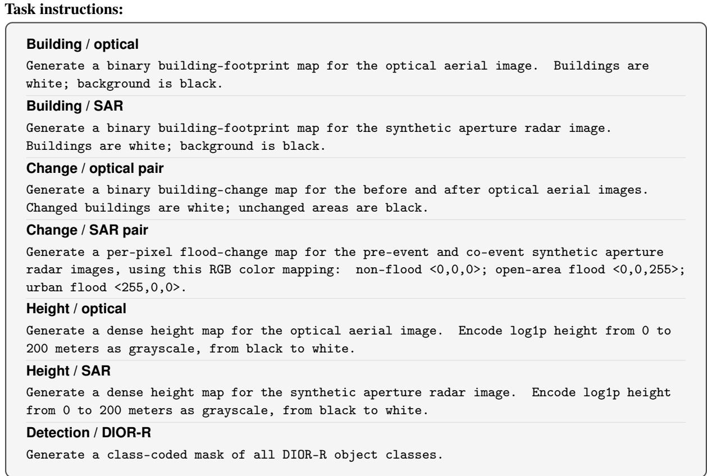  
Figure 8: Fixed text prompts for building extraction, change detection, height estimation, and rotated detection. Prompts are shown verbatim.

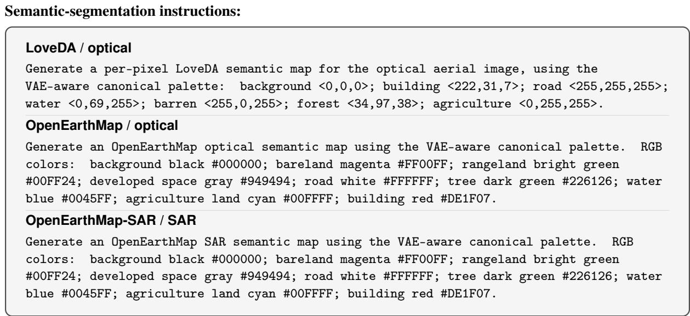  
Figure 9: Dataset- and modality-specific semantic-segmentation prompts. RGB triplets and hexadecimal colors are explicitly included in the prompts.  
For RRSIS-D, we use the annotation’s raw field, falling back to sent when unavailable; for LaSeRS, we use the description field. The dataset expressions are otherwise used unchanged except for whitespace trimming.

Text encoding. We use the frozen Qwen3 text conditioner associated with FLUX.2-Klein Base. Each prompt is passed as the content of a single user message through the tokenizer’s chat template, with add\_generati on\_prompt=True and enable\_thinking=False. The resulting sequence is padded or truncated to 128 tokens, including the chat-template tokens. Hidden states at indices 9, 18, and 27 are concatenated along the feature dimension to obtain a 128 × 7680 condition. Fixed instructions are encoded once and cached, while referring conditions are cached per expression.

## A.2 Evaluation Metrics

Table 5 lists the evaluation measure used for every dataset. Unless stated otherwise, overlap and accuracy scores are reported as percentages, and ignored or invalid pixels are excluded according to the official evaluation protocol.

Table 5: Evaluation metrics for the thirteen datasets. Arrows indicate the preferred direction.
<table><tr><td>Task</td><td>Dataset</td><td>Reported metric(s)</td></tr><tr><td>Building extraction</td><td>WHU Building</td><td>IoU ↑</td></tr><tr><td rowspan="3">Change detection</td><td>SpaceNet 6 (SAR)</td><td>IoU ↑</td></tr><tr><td>WHU-CD</td><td>IoU ↑</td></tr><tr><td>LEVIR-CD+</td><td>IoU ↑</td></tr><tr><td rowspan="3">Semantic segmentation</td><td>UrbanSARFloods (SAR)</td><td>mIoU ↑</td></tr><tr><td>LoveDA</td><td>mIoU↑</td></tr><tr><td>OpenEarthMap-RGB</td><td>mIoU↑</td></tr><tr><td rowspan="3">Height estimation</td><td>OpenEarthMap-SAR</td><td>mIoU↑</td></tr><tr><td>Potsdam</td><td>RMSE (m) ↓</td></tr><tr><td>DFC23 Track 2</td><td> $\delta _ { 1 } \uparrow$ </td></tr><tr><td rowspan="2">Referring segmentation</td><td>RRSIS-D</td><td>cIoU / gIoU ↑</td></tr><tr><td>LaSeRS</td><td>cIoU / gIoU ↑</td></tr><tr><td>Rotated detection</td><td>DIOR-R</td><td>mAP50 ↑</td></tr></table>

Unified Task Score (UTS). For controlled comparisons among unified variants, let $M _ { d } ^ { ( a ) } \in [ 0 , 1 ]$ be the selected higher-is-better score for method a on dataset d. We first average the UTS-eligible datasets within each task and then assign equal weight to all six tasks:

$$
S _ { \tau } ^ { ( a ) } = \frac { 1 0 0 } { | \mathcal { D } _ { \tau } ^ { \mathrm { U T S } } | } \sum _ { d \in \mathcal { D } _ { \tau } ^ { \mathrm { U T S } } } M _ { d } ^ { ( a ) } , \qquad \mathrm { U T S } ( a ) = \frac { 1 } { 6 } \sum _ { \tau \in \mathcal { T } } S _ { \tau } ^ { ( a ) } , \quad | \mathcal { T } | = 6 .\tag{8}
$$

We use IoU for building extraction, IoU or mIoU for change detection, mIoU for semantic segmentation, $\delta _ { 1 }$ for height estimation, gIoU for referring segmentation, and mAP50 for rotated detection. Potsdam RMSE and the complementary cIoU results are reported separately and excluded from UTS. UTS is reported for controlled comparisons among unified-model variants, alongside the native benchmark metrics.

IoU and mIoU. For class $c ,$ intersection over union is

$$
\mathrm { I o U } _ { c } = \frac { \mathrm { T P } _ { c } } { \mathrm { T P } _ { c } + \mathrm { F P } _ { c } + \mathrm { F N } _ { c } } .\tag{9}
$$

For binary building extraction and optical change detection, we report the foreground-class IoU. For multi-class flood and land-cover segmentation, mean IoU averages class-wise IoU over the C evaluated classes,

$$
\mathrm { m I o U } = \frac { 1 } { C } \sum _ { c = 1 } ^ { C } \mathrm { I o U } _ { c } .
$$

Height metrics. Let Ω be the set of valid evaluation pixels, and let $h _ { p }$ and $\hat { h } _ { p }$ denote the reference and predicted height in meters. Potsdam is evaluated with root-mean-square error,

$$
\mathrm { R M S E } = \sqrt { \frac { 1 } { | \Omega | } \sum _ { p \in \Omega } ( \hat { h } _ { p } - h _ { p } ) ^ { 2 } } ,\tag{10}
$$

where lower is better. DFC23 Track 2 uses the threshold accuracy $\delta _ { 1 }$ , i.e., the percentage of valid pixels whose multiplicative error is below 1.25:

$$
\delta _ { 1 } = \frac { 1 0 0 } { | \Omega | } \sum _ { p \in \Omega } { \bf 1 } \left[ \operatorname* { m a x } \left( \frac { \operatorname* { m a x } ( \hat { h } _ { p } , \epsilon ) } { \operatorname* { m a x } ( h _ { p } , \epsilon ) } , \frac { \operatorname* { m a x } ( h _ { p } , \epsilon ) } { \operatorname* { m a x } ( \hat { h } _ { p } , \epsilon ) } \right) < 1 . 2 5 \right] .\tag{11}
$$

We use the official validity mask and set ϵ to avoid division by zero.

Referring-segmentation metrics. For query i, let $I _ { i }$ and $U _ { i }$ be the pixel intersection and union between its predicted and reference masks. gIoU averages the per-query IoUs, whereas cIoU pools pixels across the complete evaluation set:

$$
\mathrm { g I o U } = \frac { 1 0 0 } { N } \sum _ { i = 1 } ^ { N } \frac { I _ { i } } { U _ { i } } , \qquad \mathrm { c I o U } = 1 0 0 \frac { \sum _ { i = 1 } ^ { N } I _ { i } } { \sum _ { i = 1 } ^ { N } U _ { i } } .\tag{12}
$$

gIoU weights every query equally, while cIoU gives greater influence to masks with larger union areas. We use the same cIoU/gIoU names for both referring benchmarks; these correspond to the oIoU/mIoU terminology, respectively, used in the original RRSIS-D evaluation. For zero-shot transfer analyses, we additionally report Pr@α, the percentage of queries whose individual IoU is at least threshold α.

Rotated-detection metric. For each DIOR-R class, AP50 is the area under the precision–recall curve when a prediction is counted as a true positive at a rotated-box IoU threshold of 0.5. mAP50 is the unweighted mean of AP50 over the 20 object classes; duplicate detections are treated as false positives by the standard one-to-one matching procedure.

## B Structured-Target Codecs and Deterministic Recovery

This section specifies the deterministic visual carriers used for each task and evaluates how faithfully they survive the frozen VAE interface before any flow-model learning is involved.

Binary targets. Building extraction, binary change detection, and referring segmentation use a black background and white foreground. This maximizes separation in the visual carrier while keeping recovery a deterministic thresholding operation.

Semantic targets. LoveDA and OpenEarthMap use a shared canonical semantic codebook. Dataset-native class IDs are deterministically mapped into canonical semantics before rendering, and evaluation maps the recovered predictions back to each dataset’s native class IDs. To determine the visual carrier, we compare three palette choices: dataset official palettes, which preserve each dataset’s released visualization colors; a shared canonical palette, which uses one common palette after ontology alignment; and our VAE-aware canonical palette, which keeps the same canonical semantic mapping but selects the visual color codes according to their frozen-VAE round-trip stability. UrbanSARFloods uses a separate three-class flood encoding because its ontology is not a land-cover codebook.

Metric height targets. Potsdam and DFC23 share a log-compressed height representation over [0, 200] meters:

$$
u = { \frac { \log ( 1 + \exp ( h , 0 , 2 0 0 ) ) } { \log ( 2 0 1 ) } } , \qquad C _ { h } ( h ) = ( 2 u - 1 , 2 u - 1 , 2 u - 1 ) ,\tag{13}
$$

with inverse mapping

$$
\begin{array} { r } { \hat { h } = \exp ( \hat { u } \log ( 2 0 1 ) ) - 1 , } \end{array}\tag{14}
$$

where $\hat { u } = \mathrm { c l i p } ( ( \hat { c } + 1 ) / 2 , 0 , 1 )$ for decoded grayscale $\hat { c } \in [ - 1 , 1 ]$ . The three-channel image is only a VAE carrier;   
evaluation is performed on a continuous single-channel height map in meters.

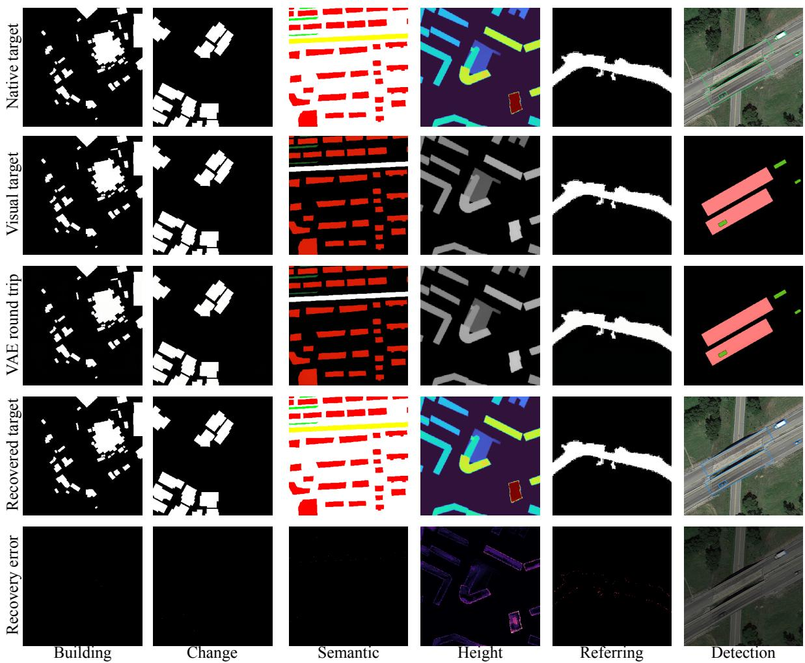  
Figure 10: Frozen-VAE round-trip analysis of the structured visual target space. Columns show building, change, semantic, height, referring, and rotated detection targets; rows show the native target, visual target, VAE round trip, recovered target, and recovery error. The experiment measures whether task semantics are preserved by the frozen VAE independently of flow-model learning.

Multi-class rotated detection targets. DIOR-R is rendered as a 20-class palette canvas. After VAE decoding, each pixel is assigned to its nearest palette code. We then separate connected components by class, extract minimum-area rotated rectangles, and apply deterministic rotated-box post-processing. This recovery path contains no learned parameters and makes representation error measurable at both raster and instance levels.

Direct codec sanity check. Before involving the frozen VAE, we verify the direct deterministic path

$$
y _ { d } ^ { \mathrm { c o d e c } } = R _ { d } ( C _ { \tau ( d ) , d } ( y _ { d } ) ) , \qquad B _ { d } ^ { \mathrm { c o d e c } } = M _ { d } ( y _ { d } ^ { \mathrm { c o d e c } } , y _ { d } ) .\tag{15}
$$

For binary masks, discrete semantic palettes, and valid-range height encodings, this check verifies that the evaluation implementation itself is consistent with the encoding definition. For DIOR-R, we report raster mIoU, mAP50, and split rate after connected components, minimum-area rectangle fitting, and rotated-box post-processing. These numbers quantify the geometry loss introduced by deterministic instance recovery independently of both the VAE and the flow model.

Frozen-VAE round-trip protocol. To isolate representation loss from flow-model prediction error, we evaluate

$$
\tilde { y } _ { d } = R _ { d } \big ( D \big ( E \big ( C _ { \tau ( d ) , d } ( y _ { d } ) \big ) \big ) \big ) , \qquad B _ { d } ^ { \mathrm { r e p r } } = M _ { d } \big ( \tilde { y } _ { d } , y _ { d } \big ) .\tag{16}
$$

All codec comparisons follow the data-split protocol described in Appendix A. The input resolution, VAE precision, and recovery operator are fixed, and only the visual encoding is varied. This protocol isolates representation loss introduced by the frozen VAE and deterministic recovery.

Round-trip results. Figure 10 visualizes the frozen-VAE round trip for all six structured output families.

Binary masks remain visually stable through the round trip, while the error maps make the more subtle palette and geometric deviations in semantic, height, and rotated-instance targets explicit. We next quantify the semantic, height, and rotated-instance visual carriers under the same frozen-VAE round-trip protocol.

Table 6: Semantic-palette ablation under frozen-VAE round-trip evaluation. Results are reported as native mIoU.
<table><tr><td>Semantic target palette</td><td>LoveDA ↑</td><td>OEM-RGB ↑</td><td>OEM-SAR ↑</td><td>Mean ↑</td></tr><tr><td>Dataset official palettes</td><td>99.41</td><td>96.57</td><td>90.79</td><td>95.59</td></tr><tr><td>Shared canonical palette</td><td>99.73</td><td>93.28</td><td>87.91</td><td>93.64</td></tr><tr><td>VAE-aware canonical (ours)</td><td>99.72</td><td>98.83</td><td>99.11</td><td>99.22</td></tr></table>

Semantic-palette ablation. Table 6 shows that simply sharing a canonical palette does not guarantee good compatibility with the frozen VAE: its mean round-trip mIoU is 93.64. Selecting the canonical visual codes according to frozen-VAE round-trip stability raises the mean to 99.22, while retaining a shared semantic codebook across LoveDA and OpenEarthMap. This supports the use of the VAE-aware canonical palette as the semantic visual carrier in the main model.

Table 7: Height-encoding ablation under frozen-VAE round-trip evaluation. Both variants use the same frozen VAE and fixed 0.2-m ground-recovery threshold.
<table><tr><td>Height encoding</td><td>Potsdam RMSE (m) ↓</td><td>DFC23 δ1 (%) ↑</td></tr><tr><td>Linear grayscale</td><td>0.378</td><td>72.22</td></tr><tr><td>Log1p grayscale (ours)</td><td>0.176</td><td>97.42</td></tr></table>

Table 7 compares linear and log-compressed height encodings under the frozen-VAE round-trip protocol. Logcompressed encoding reduces Potsdam RMSE from 0.378 to 0.176 m and improves DFC23 $\delta _ { 1 }$ from 72.22% to 97.42%, demonstrating better preservation of continuous height information through the frozen VAE.

Table 8: DIOR-R raster and instance recovery fidelity. Direct recovery is compared with frozen-VAE round-trip recovery using ground-truth visual targets.
<table><tr><td>Palette</td><td>Recovery path</td><td>Raster mIoU ↑</td><td>mAP50 ↑</td><td>Split↓</td></tr><tr><td>VAE-aware hybrid</td><td>Direct recovery</td><td>100.00</td><td>89.13</td><td>0.14</td></tr><tr><td>Initial palette</td><td>VAE + recovery</td><td>97.90</td><td>89.44</td><td>0.50</td></tr><tr><td>VAE-aware hybrid palette (ours)</td><td>VAE + recovery</td><td>98.43</td><td>90.10</td><td>0.44</td></tr></table>

Table 8 examines the effects of deterministic instance recovery and frozen-VAE reconstruction on DIOR-R. Direct recovery achieves perfect raster fidelity (100.00 mIoU) but yields 89.13 mAP50, revealing geometric losses during instance recovery. Among the VAE round-trip variants, the VAE-aware hybrid palette improves raster mIoU from 97.90 to 98.43 and mAP50 from 89.44 to 90.10, while reducing the split rate from 0.50 to 0.44. Compared with direct recovery, the VAE round trip reduces raster fidelity and increases instance splitting, despite slightly higher aggregate mAP50. Figure 11 further examines these effects on small instances.

## B.1 Small-Instance Geometry and Semantic Boundary Fidelity

Following the aggregate recovery analysis in Table 8, we further examine geometric fidelity for small instances and fine semantic boundaries. We compare direct recovery, $R _ { d } ( C _ { d } ( y _ { d } ) )$ , with VAE round-trip recovery, $R _ { d } ( D ( E ( C _ { d } ( y _ { d } ) ) ) )$ , where $C _ { d }$ abbreviates $C _ { \tau ( d ) , d } .$ Both paths start from ground-truth targets and use the same deterministic recovery procedure.

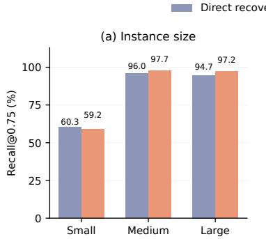

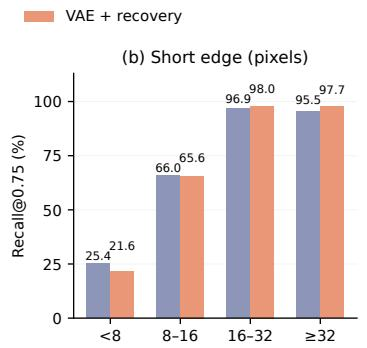

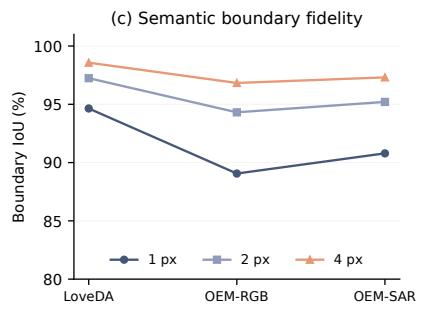  
Figure 11: Recovery fidelity for small instances and semantic boundaries. (a,b) DIOR-R recall at polygon IoU 0.75, grouped by instance area and rotated-box short-edge length, comparing direct and VAE round-trip recovery. (c) Class-macro boundary IoU after VAE round-trip recovery at 1-, 2-, and 4-pixel widths. Direct recovery achieves 100% boundary IoU and is omitted from (c).

Small-instance geometry. Figure 11(a,b) shows that recall at IoU 0.75 decreases from 60.32% to 59.21% for small instances (area $< 3 2 ^ { 2 }$ pixels), and from 25.39% to 21.56% for instances with short edges below 8 pixels after the VAE round trip. For instances matched by both recovery paths at IoU 0.5, mean angular error in the latter group increases from $1 . 0 1 7 ^ { \circ }$ to 1.148◦, measured modulo $1 8 0 ^ { \circ }$ and excluding aspect ratios below 1.1. These results show that thin instances are particularly sensitive to VAE reconstruction, with larger losses in geometric recall.

Semantic boundary fidelity. We evaluate 1,669 LoveDA, 500 OEM-RGB, and 490 OEM-SAR images using the VAE-aware canonical palette. Boundary IoU is computed from class-wise inner bands of 1, 2, and 4 pixels obtained through repeated $3 \times 3$ erosion, with intersections and unions aggregated across images before class averaging. Void neighborhoods and image borders are excluded.

As shown in Figure 11(c), one-pixel boundary IoU reaches 94.64%, 89.06%, and 90.79% on LoveDA, OEM-RGB, and OEM-SAR, respectively, increasing to 98.57%, 96.83%, and 97.31% at four pixels. These results indicate that fine boundaries are more sensitive to VAE reconstruction than broader semantic regions. Together, the analyses reveal the remaining geometric limitations of the shared visual representation despite its high aggregate fidelity.

## C Additional Analyses

This section complements the main-text analysis with detailed source-state results, transport-state visualizations, cross-task interaction, and zero-shot transfer studies.

## C.1 Source-State Initialization Details

Figure 7 summarizes the source-state ablation in the main text. Table 9 reports the corresponding numerical results.   
Visual conditioning is fixed within each panel so that only the source-state initialization changes.

Table 9: Full numerical results for the source-state initialization ablation. Visual conditioning is fixed within each panel.  
(a) Single-image task
<table><tr><td>Source zs</td><td>Bldg. IoU ↑</td><td>Sem. mIoU ↑</td><td>Height  $\delta _ { 1 } \uparrow$ </td><td>Ref. gIoU ↑</td><td>Det. mAP50 ↑</td></tr><tr><td> $\epsilon \sim \mathcal { N } ( 0 , I )$ </td><td>74.17</td><td>49.93</td><td>69.87</td><td>71.22</td><td>61.65</td></tr><tr><td>Current image latent</td><td>76.93</td><td>52.57</td><td>73.31</td><td>73.93</td><td>64.75</td></tr></table>

(b) Bi-temporal change detection
<table><tr><td>Source  $z _ { s }$ </td><td>WHU-CD IoU ↑</td><td>LEVIR-CD+ IoU ↑</td><td>UrbanSAR mIoU ↑</td><td>Mean ↑</td></tr><tr><td> $\epsilon \sim \mathcal { N } ( 0 , I )$ </td><td>86.49</td><td>72.26</td><td>52.32</td><td>70.36</td></tr><tr><td> $z _ { a }$ </td><td>88.91</td><td>74.49</td><td>54.23</td><td>72.54</td></tr><tr><td> $\left| z _ { a } \right.$   $z _ { b } |$ </td><td>90.14</td><td>75.70</td><td>55.61</td><td>73.82</td></tr><tr><td> $z _ { a } - z _ { b }$ </td><td>90.88</td><td>76.44</td><td>56.57</td><td>74.63</td></tr></table>

The numerical results confirm the trends summarized in Fig. 7. For single-image tasks, $z _ { a }$ improves over Gaussian initialization on all five task metrics. For change detection, the mean score increases from 70.36 with Gaussian initialization to 72.54 with $z _ { a } , 7 3 . 8 2$ with $| z _ { a } - z _ { b } |$ , and 74.63 with the signed residual $z _ { a } - z _ { b }$

## C.2 Transport-State Trajectories

Figure 12 visualizes how the shared predictor transports task-dependent source states toward structured visual outputs. We use the same trained UniFlow-RS checkpoint for all six tasks and run ten-step Euler inference to expose intermediate states along the trajectory. The main quantitative evaluation continues to use the default two-step inference setting. For each example, we show solver states at $t = 1 , 0 . 8 1 5 , 0 . 6 1 8 , 0 . 5 2 5 , 0 . 3 9 8 .$ , and 0, with times rounded for presentation.

Input  
Source (t = 1)  
t = 0.815  
t = 0.618  
t = 0.525  
t = 0.398  
GT target  
Final (t = 0)  
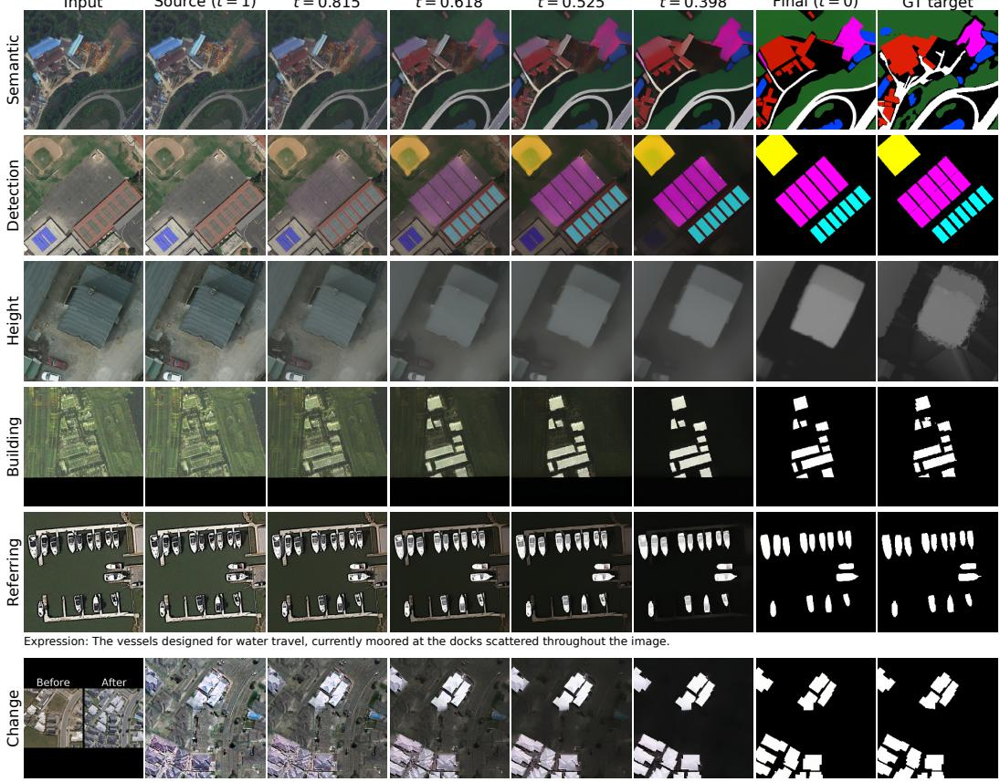  
Figure 12: Transport-state trajectories across six tasks. All rows use the same shared UniFlow-RS checkpoint. From top to bottom: semantic segmentation (LoveDA), rotated detection (DIOR-R), height estimation (Potsdam), building extraction (SpaceNet 6 SAR), referring segmentation (LaSeRS), and change detection (WHU-CD). Columns show the input, decoded source state, selected intermediate states $D ( z _ { t } )$ , final decoded state, and ground truth structured visual target.

Decoded transport states. Each intermediate panel directly decodes the current solver state as $D ( z _ { t } )$ using the frozen VAE decoder. No thresholding, palette snapping, or instance recovery is applied to these intermediate outputs, and the ground-truth structured target is shown only in the rightmost column for reference. Accordingly, height estimation is visualized in its log-compressed grayscale representation, while rotated detection is shown as the generated class-coded canvas before geometric instance recovery. For change detection, the source state is the signed latent difference $z _ { a } - z _ { b }$ (after minus before), so its initial decoding differs from the appearance of either input observation. Referring segmentation uses the sample’s original expression, shown below the corresponding row.

Across the single-image tasks, the decoded states progressively evolve from image-like source representations toward binary, categorical, or continuous target structures. Change detection follows a different trajectory from its latent-difference source. Together, these examples visualize how the same latent flow process produces structurally different outputs across tasks.

## C.3 Cross-Task Interaction

We analyze task gradients on the shared LoRA to understand how different tasks interact during joint training. At the same initialization checkpoint, we compute the gradient of each task loss with respect to the shared LoRA parameters $\phi$ and measure the cosine similarity between task pairs:

$$
g _ { \tau } = \nabla _ { \phi } \mathcal { L } _ { \tau } , \qquad \rho _ { \tau , j } = \frac { g _ { \tau } ^ { \top } g _ { j } } { \| g _ { \tau } \| _ { 2 } \| g _ { j } \| _ { 2 } } .\tag{17}
$$

Positive similarity indicates that two tasks favor aligned parameter updates, while negative similarity indicates conflicting update directions.

We compare UniFlow-RS with a task-specific-head variant. Both use the same frozen FLUX.2/MMDiT backbone, shared LoRA configuration, conditioning inputs, initialization checkpoint, and TMAS setting. The difference lies in their prediction interfaces: UniFlow-RS uses a unified generative predictor, whereas the variant employs independent task-specific heads.

(a) Specific task head  
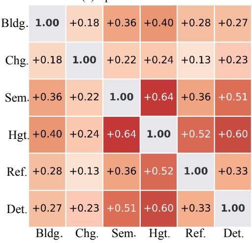

(b) UniFlow-RS  
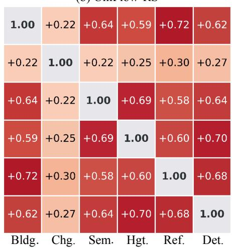  
Figure 13: Pairwise gradient cosine similarities between tasks on the shared LoRA at the same initialization checkpoint: (a) task-specific heads and (b) UniFlow-RS. Diagonal entries are 1 by construction.

Figure 13 shows positive gradient similarities for all fifteen task pairs. UniFlow-RS achieves a higher mean off-diagonal similarity than the task-specific-head variant (0.51 vs. 0.35), indicating greater alignment among task gradients. Building–referring (0.72) and height–detection (0.70) exhibit the strongest alignment, whereas change detection shows weaker alignment with the other tasks (0.22–0.30). These findings suggest that the unified prediction formulation encourages more compatible task updates at the measured checkpoint, consistent with the joint-training improvements in Table 1.

## C.4 Zero-Shot Transfer Details

We extend the main-text zero-shot evaluation with thresholded overlap precision, which measures how often individual queries remain accurate under progressively stricter IoU criteria.

Table 10: Detailed zero-shot transfer results on two unseen datasets. Pr@α denotes the percentage of queries with $\mathrm { I o U } \geq \alpha .$ , and “–” indicates that the corresponding result is not reported.
<table><tr><td>Target</td><td>Method</td><td>cIoU</td><td>gIoU</td><td>Pr@0.5</td><td>Pr@0.6</td><td>Pr@0.7</td><td>Pr@0.8</td><td>Pr@0.9</td></tr><tr><td rowspan="3">EarthReason</td><td>FLUX.2-Klein Base</td><td>17.74</td><td>17.04</td><td>8.92</td><td>4.15</td><td>1.97</td><td>0.78</td><td>0.05</td></tr><tr><td>RS2-SAM2-RRSISD</td><td>35.48</td><td>36.55</td><td>37.14</td><td>32.47</td><td>28.01</td><td>22.51</td><td>14.63</td></tr><tr><td>UniFlow-RS</td><td>44.23</td><td>48.24</td><td>50.88</td><td>45.64</td><td>41.65</td><td>35.79</td><td>24.74</td></tr><tr><td rowspan="3">RISBench</td><td>FLUX.2-Klein Base</td><td>6.38</td><td>7.74</td><td>2.78</td><td>1.44</td><td>0.75</td><td>0.29</td><td>0.07</td></tr><tr><td>VisionReasoner</td><td>46.98</td><td>51.62</td><td></td><td></td><td></td><td></td><td></td></tr><tr><td>UniFlow-RS</td><td>70.92</td><td>64.62</td><td>72.07</td><td>67.31</td><td>60.96</td><td>51.03</td><td>32.47</td></tr></table>

Table 10 reports thresholded overlap precision in addition to cIoU and gIoU. On EarthReason, where both imagery and text queries are out of distribution with respect to joint training, the advantage of UniFlow-RS persists as the overlap criterion becomes stricter: Pr@0.9 increases from 14.63 for RS2-SAM2-RRSISD to 24.74. RISBench, which primarily introduces a visual distribution shift, similarly retains 32.47 Pr@0.9, complementing the unseen-dataset results reported in the main text.

## C.5 Transfer under Canopy and Cloud Occlusion

We evaluate zero-shot transfer on Chesapeake RSC and PIE using the same jointly trained UniFlow-RS checkpoint, without target-specific adaptation.

Chesapeake RSC protocol. We evaluate all 3,000 Chesapeake RSC test images (Robinson et al., 2024) at 512 × 512 resolution, including 466 images without annotated roads. Only RGB inputs are used. The ground truth includes both visible and canopy-occluded roads, with unclassified and no-data pixels excluded. IoU and F1 are computed from dataset-level aggregated pixel counts. We additionally report canopy-road recall, $R _ { \mathrm { c a n o p y } } = \mathrm { T P _ { c a n o p y } } / N _ { \mathrm { c a n o p y } }$ , to measure the recovery of roads beneath tree canopies.

PIE evaluation protocol. We use the PIE-RGB-SAR dataset (Zhang et al., 2024) from the processed release of MM-OVSeg (Wei et al., 2026b), evaluating all 2,432 held-out validation samples. Evaluation covers four semantic classes: road, water, forest, and farmland. Pixels outside these classes remain negatives in the corresponding class-wise evaluations. For RGB-only models, the original 256 × 256 images are resized to 512 × 512 after cloud corruption, and predictions are restored to the native resolution using nearest-neighbor interpolation. Class-wise IoUs are computed from aggregated pixel counts.

Synthetic cloud generation. We generate cloud corruption using SatelliteCloudGenerator, which produces a Perlin-based opacity field a(x). The corrupted image is defined as

$$
I _ { s } ( x ) = ( 1 - s a ( x ) ) I ( x ) + s a ( x ) ,
$$

where $s \in \{ 0 , 0 . 4 5 , 0 . 9 0 \}$ represents clear, thin-cloud, and thick-cloud conditions, respectively. The same opacity field is used across cloud levels for each image. Images are clipped to [0, 1] and converted to 8-bit RGB, preserving originally black pixels. All methods receive the same corrupted RGB observations at each cloud level; MM-OVSeg additionally receives the paired uncorrupted SAR imagery.

Baseline configurations. All models are evaluated with frozen checkpoints and without target-domain adaptation. S5 ViT-L (Lv et al., 2026) uses its released LoveDA segmentation head without test-time augmentation. FLUX.2- Klein Base follows the same structured-target inference protocol as UniFlow-RS, including text conditioning, source-state initialization, frozen VAE, two-step inference, BF16 precision, and deterministic recovery, but without the trained LoRA adapter.

For Chesapeake RSC, we use the automatic road-extraction baseline released with RoadGIE (Peng et al., 2026), consisting of an SMT-base backbone and DaFormer-ASPP decoder (Hoyer et al., 2022) with WorldRoadSeg-360K weights. The model receives no interactive prompts or target annotations. We retain its native 512 × 512 inputs,

RGB normalization, bilinear upsampling, FP32 precision, and a fixed sigmoid threshold of 0.5. A fixed evaluation adapter is used to evaluate the released checkpoint, with strict weight loading.

For PIE, we evaluate MM-OVSeg B16 (Wei et al., 2026b) using its released modelDDSK.pth checkpoint trained on DDHR-SK. We use the official six-class PIE vocabulary, merging background and city predictions into Other, which remains in the confusion matrix but is excluded from the four-class mIoU. Following its released preprocessing, RGB images are resized to 384 × 384, while the native 256 × 256 SAR images are padded to the same size with value 128. Predictions are restored to the native evaluation grid before scoring. The model runs in FP32 without PIE-specific adaptation.

## C.6 Transfer to Near-Infrared False-Color Imagery

We further evaluate zero-shot building extraction on ISPRS Vaihingen (Rottensteiner et al., 2012), whose false-color imagery contains near-infrared, red, and green (IRRG) channels. This setting examines the ability of the shared generative predictor to transfer to a different spectral composition without target-specific adaptation.

Table 11: Zero-shot building extraction on Vaihingen IRRG imagery. Results are aggregated over 17 held-out areas (398 patches). All metrics are reported as percentages.
<table><tr><td>Method</td><td>IoU ↑</td><td>F1↑</td><td>Precision ↑</td><td>Recall ↑</td></tr><tr><td>FLUX.2-Klein Base</td><td>19.56</td><td>32.72</td><td>40.99</td><td>27.22</td></tr><tr><td>SegEarth-OV (CVPR&#x27;25)</td><td>53.00</td><td>69.28</td><td>60.02</td><td>81.91</td></tr><tr><td>CorrCLIP (ICCV&#x27;25)</td><td>49.06</td><td>65.83</td><td>50.09</td><td>95.99</td></tr><tr><td>UniFlow-RS</td><td>86.59</td><td>92.81</td><td>95.57</td><td>90.21</td></tr></table>

Evaluation protocol. We evaluate all 17 held-out Vaihingen areas, partitioned into 398 nonoverlapping 512×512 patches. The original 8-bit IRRG channels are preserved without band substitution or intensity stretching. Padded image boundaries are excluded from evaluation. All non-building classes are treated as background, and patches without buildings are retained. We evaluate binary building extraction without boundary erosion. All methods use the same input imagery and valid-pixel masks, with model-specific preprocessing applied as required.

Baseline configurations. All models use frozen checkpoints without target-domain adaptation. UniFlow-RS and FLUX.2-Klein Base share the same fixed building prompt, two-step inference, 512 × 512 resolution and binary threshold of 0.5.

SegEarth-OV (Li et al., 2025b) follows its released Vaihingen configuration, using CLIP ViT-B/16, SimFeatUp weights, and a six-class vocabulary. CorrCLIP (Zhang et al., 2025a) uses its released implementation with MetaCLIP ViT-B/16, DINO ViT-B/8, and SAM2 Hiera-large. We adopt its dynamic SAM28 variant with eight points per side and the default region-generation and majority-vote procedures. For Vaihingen, we use the same class vocabulary as SegEarth-OV and the released ADE settings, including a 448-pixel internal resize, 336-pixel crops, and a stride of 112 pixels. Both baselines restore predictions to the 512 × 512 grid before extracting building masks.

All prompts, thresholds, and model configurations remain fixed during evaluation. The available S5 checkpoint is excluded because it includes Vaihingen downstream training. Pretraining data and model capacities differ across the compared methods.

Results. As shown in Table 11, UniFlow-RS achieves 86.59 IoU and 92.81 F1, outperforming SegEarth-OV and CorrCLIP by 33.59 and 37.53 IoU points, respectively. It also achieves 95.57 precision while maintaining 90.21 recall, substantially reducing false positives compared with the baselines. These results suggest that the structural priors learned by UniFlow-RS are not confined to the RGB and SAR observations used during training. The shared generative predictor can effectively recover building structures from near-infrared false-color imagery, highlighting its potential for zero-shot transfer across spectral distributions.

## D TMAS Implementation and Component Ablations

## D.1 Estimator and Adaptive Allocation

We provide the implementation details of TMAS, including group-wise error estimation, distributed aggregation, handling of unobserved timestep bins, numerical stabilization, and adaptive sampling.

Group keys and per-sample error. TMAS maintains a sampling profile for each task–modality group $g = ( \tau , m )$ where τ denotes one of the six tasks and m denotes the physical modality of the training sample. Datasets sharing the same task and modality contribute to a common profile, while RGB and SAR observations are assigned to separate profiles. For multimodal datasets, the group is determined by the modality of the sampled view.

The resulting ten groups are

$$
\begin{array} { r l } & { \mathcal { G } = \{ \mathrm { b u i l d i n g / r g b } , \ \mathrm { b u i l d i n g / s a r } , \ \mathrm { c h a n g e / r g b } , \ \mathrm { c h a n g e / s a r } , } \\ & { \qquad \mathrm { s e m a n t i c / r g b } , \ \mathrm { s e m a n t i c / s a r } , \ \mathrm { h e i g h t / r g b } , \ \mathrm { h e i g h t / s a r } , } \\ & { \qquad \mathrm { r e f e r c i n g / r g b } , \ \mathrm { d e t e c t i o n / r g b } \} . } \end{array}
$$

For example, WHU-CD and LEVIR-CD+ jointly update the change/rgb profile.

For each sample i, the estimator computes the token-normalized velocity-prediction error:

$$
\ell _ { i } = \frac { \sum _ { l , c } w _ { i , l } \left( v _ { \theta , i , l , c } - v _ { i , l , c } ^ { \star } \right) ^ { 2 } } { \operatorname* { m a x } ( D _ { z } \sum _ { l } w _ { i , l } , 1 ) } ,\tag{18}
$$

where l and c index packed latent tokens and feature dimensions, respectively, $w _ { i , l }$ denotes the valid-token weight, and $D _ { z }$ is the token feature dimensionality. When no validity mask is used, $w _ { i , l } = 1$ . Each sample is assigned to timestep bin $k _ { i } = \operatorname* { m i n } ( \lfloor K t _ { i } \rfloor , K - 1 )$

Distributed group–bin aggregation. Let $B _ { r } ^ { \circ }$ denote the samples with finite estimator losses on worker r. The group–bin mean error is computed by aggregating loss sums and sample counts across workers:

$$
\bar { \ell } _ { g , k } = \frac { \sum _ { r } \sum _ { i \in \mathcal { B } _ { r } ^ { \circ } } \mathbf { 1 } [ g _ { i } = g , k _ { i } = k ] \ell _ { i } } { \sum _ { r } \sum _ { i \in \mathcal { B } _ { r } ^ { \circ } } \mathbf { 1 } [ g _ { i } = g , k _ { i } = k ] } ,\tag{19}
$$

whenever at least one sample contributes to the group–bin pair. Each EMA state is initialized from its first valid observation and subsequently updated according to Eq. 4. Updates occur only when the corresponding group–bin pair is observed in a microbatch.

Stabilized difficulty and activity. For unobserved timestep bins, we initialize the sampling-time estimates using the mean slow-EMA value of the observed bins within the same group. Specifically, if ${ \mathcal { O } } _ { g }$ is the set of observed bins, each unobserved bin receives $| \mathcal { O } _ { g } | ^ { - 1 } \sum _ { j \in \mathcal { O } _ { g } } d _ { g , j } ^ { \mathrm { s l o w } }$ in both EMA tables. Groups with no observations use a fallback value of 1. All estimates are lower-bounded by ϵ, yielding $\tilde { d } _ { g , k } ^ { \mathrm { f a s t } }$ and $\tilde { d } _ { g , k } ^ { \mathrm { s l o w } }$ . Assigning the same fallback to both EMA tables gives zero learning activity for unobserved bins.

Using these stabilized estimates, the difficulty and learning-activity signals are computed as

$$
\begin{array} { r l } & { D _ { g , k } = \frac { \tilde { d } _ { g , k } ^ { \mathrm { s l o w } } } { K ^ { - 1 } \sum _ { j } \tilde { d } _ { g , j } ^ { \mathrm { s l o w } } } , } \\ & { A _ { g , k } = \operatorname* { m i n } \Biggl \{ \Biggl | \frac { \tilde { d } _ { g , k } ^ { \mathrm { s l o w } } - \tilde { d } _ { g , k } ^ { \mathrm { f a s t } } } { \tilde { d } _ { g , k } ^ { \mathrm { s l o w } } } \Biggl | , 1 \Biggl \} . } \end{array}\tag{20}
$$

$D _ { g , k }$ measures timestep difficulty relative to the group average, while $A _ { g , k }$ captures recent learning activity through the absolute fast–slow EMA discrepancy, accounting for both improving and degrading regions.

For the improvement-only activity ablation, we define

$$
r _ { g , k } = \frac { \tilde { d } _ { g , k } ^ { \mathrm { s l o w } } - \tilde { d } _ { g , k } ^ { \mathrm { f a s t } } } { \tilde { d } _ { g , k } ^ { \mathrm { s l o w } } } ,
$$

and use $A _ { g , k } = \operatorname* { m i n } ( \operatorname* { m a x } ( r _ { g , k } , 0 ) , 1 )$ instead of the default $A _ { g , k } = \operatorname* { m i n } ( | r _ { g , k } | , 1 )$

Utility and numerical safeguards. The sampling utility is computed as

$$
U _ { g , k } = \operatorname* { m a x } \biggl \{ \left( D _ { g , k } + \epsilon \right) \left( \frac { 1 } { K } + A _ { g , k } \right) , \epsilon \biggr \} .\tag{21}
$$

The lower bound extends Eq. 6 with a numerical safeguard. Non-finite relative changes are replaced by zero, and non-finite utilities are replaced by one before normalization. For a group with no observations, all bins have equal utility, resulting in uniform sampling.

Bin and timestep sampling. Following Eq. 7, we first sample a timestep bin and then draw a continuous timestep uniformly within the selected bin:

$$
k \sim \mathrm { C a t e g o r i c a l } ( p _ { s } ( \cdot \mid g ) ) , t \mid k \sim \mathcal { U } \left[ \frac { k } { K } , \frac { k + 1 } { K } \right) .\tag{22}
$$

Training progress is defined as $s = \mathrm { c l i p } ( n / N , 0 , 1 )$ , where n is the number of completed optimizer updates and N is the total training budget. Sampling remains uniform for $s \leq 1 / K$ , after which the group-specific utility mixture determines the timestep distribution. The distribution is updated using online EMA statistics and renormalized for numerical stability.

Default settings and reproducibility. TMAS uses two sampler hyperparameters: the number of timestep bins K and the exploration weight λ. We set $K = 1 0 , \lambda = 0 . 2$ , and $\epsilon = 1 0 ^ { - 6 }$ . The remaining coefficients are determined by K: the fast and slow EMA decay factors are $1 - 1 / K = 0 . 9 0$ and $1 - 1 / K ^ { 2 } = 0 . 9 9$ , respectively; the utility offset is $1 / K = 0 . 1$ ; and the initial uniform phase spans $1 / K = 0 . 1$ of training (6k steps under the 60k-step schedule). The activity signal is bounded to [0, 1].

With $\lambda = 0 . 2$ , each timestep bin retains a minimum sampling probability of $\lambda / K = 0 . 0 2$ . The sampler state is detached from the optimization graph and synchronized across workers. Task and dataset sampling weights remain fixed across all sampler ablations.

## D.2 Ablation of Learning Activity and Exploration

We examine the contributions of learning-activity estimation and uniform exploration in TMAS. The former captures both improving and degrading timestep regions through the absolute fast–slow EMA discrepancy, while the latter provides initial coverage and continued exploration throughout training. We ablate these components to evaluate their effects on joint optimization.

Table 12: Ablation of learning activity and exploration in TMAS. Improvement-only activity considers only decreasing errors. No uniform warm-up removes the initial uniform sampling phase, while no persistent exploration removes the uniform mixture after warm-up. Steps denotes the updates required to reach the final UTS of Fixed Beta.
<table><tr><td>Variant</td><td>Bldg. ↑</td><td>Change ↑</td><td>Sem. ↑</td><td>Height ↑</td><td>Ref. ↑</td><td>Det. ↑</td><td>UTS ↑</td><td>Steps ↓</td></tr><tr><td>Improvement-only activity</td><td>76.79</td><td>74.47</td><td>52.24</td><td>73.06</td><td>73.77</td><td>64.50</td><td>69.14</td><td>42k</td></tr><tr><td>No uniform warm-up</td><td>76.58</td><td>74.29</td><td>51.96</td><td>72.84</td><td>73.51</td><td>64.22</td><td>68.90</td><td>49k</td></tr><tr><td>No persistent exploration  $( \lambda = 0 )$ </td><td>76.71</td><td>74.38</td><td>52.08</td><td>72.96</td><td>73.64</td><td>64.36</td><td>69.02</td><td>45k</td></tr><tr><td>TMAS</td><td>76.93</td><td>74.63</td><td>52.57</td><td>73.31</td><td>73.93</td><td>64.75</td><td>69.35</td><td>37k</td></tr></table>

As shown in Table 12, all three components contribute to the performance of TMAS. Restricting learning activity to improving regions reduces UTS from 69.35 to 69.14, suggesting that increasing-error regions also benefit from additional sampling. Removing uniform warm-up or persistent exploration further reduces UTS to 68.90 and 69.02, respectively. These variants also require more training steps to reach the Fixed Beta reference performance (42k– 49k versus 37k). Together, the results highlight the complementary benefits of tracking bidirectional learning-state changes and maintaining timestep exploration during joint training.

## D.3 Task–Modality Timestep Allocation and Validation Dynamics

We further analyze how TMAS allocates timesteps across heterogeneous task–modality groups and how these allocations relate to validation performance. Figure 14 compares the adaptive sampling distributions with changes in validation Flow Matching error relative to Fixed Beta across ten task–modality groups.

(a) Sampling probability  
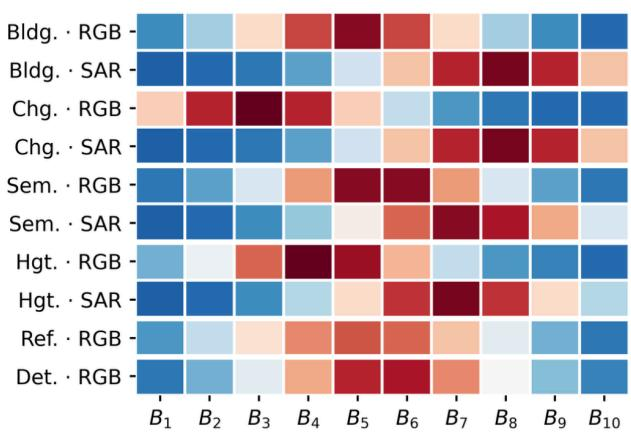

(b) Validation error reduction  
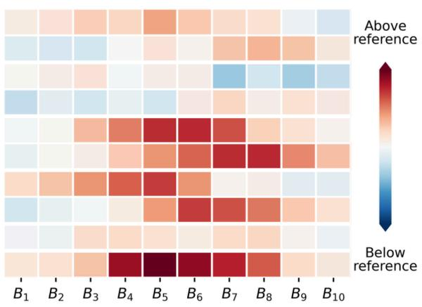  
Figure 14: Task–modality-specific timestep allocation and validation-error changes. (a) TMAS sampling probabilities relative to uniform sampling (1/K). (b) Per-bin reduction in validation Flow Matching error relative to Fixed Beta. Warmer colors indicate higher relative sampling probabilities in (a) and larger error reductions in (b).

Figure 14 (a) reveals distinct timestep allocation profiles across tasks and between RGB and SAR modalities. The corresponding validation-error changes in Figure 14 (b) are also heterogeneous. Semantic segmentation and rotated detection exhibit larger error reductions in selected timestep regions, whereas change detection and referring segmentation show smaller or mixed changes. These patterns are consistent with the task-dependent performance gains in Table 2, supporting the use of group-specific timestep allocation for heterogeneous joint training.

## E Capacity and Efficiency

The main text focuses on predictive sharing and optimization. This section reports the practical cost of that sharing separately, including adapter capacity and wall-clock behavior.

## E.1 Adapter Capacity

Table 13: LoRA capacity and efficiency. Rank 32 is the default used in all other experiments and is highlighted in the Rank column. Bold metric values indicate the best result in each column.
<table><tr><td>Rank</td><td>Trainable params ↓</td><td>UTS ↑</td><td>Peak memory ↓</td><td>Images/s ↑</td></tr><tr><td>8</td><td>12.3M</td><td>67.24</td><td>40.92 GiB</td><td>6.69</td></tr><tr><td>16</td><td>24.6M</td><td>68.91</td><td>41.21 GiB</td><td>6.69</td></tr><tr><td>32</td><td>49.1M</td><td>69.35</td><td>41.53 GiB</td><td>6.69</td></tr><tr><td>64</td><td>98.3M</td><td>69.37</td><td>42.23 GiB</td><td>6.69</td></tr></table>

Table 13 reports the capacity–efficiency trade-off for the shared LoRA adapter. Increasing the rank from 8 to 32 raises UTS from 67.24 to 69.35, while doubling the rank from 32 to 64 yields only a 0.02-point gain (69.37). Trainable parameters grow from 12.3M to 98.3M and peak memory increases from 40.92 to 42.23 GiB, whereas the measured throughput remains unchanged at 6.69 images/s. Rank 32 is therefore used as the default operating point in the other experiments.

## E.2 Inference Efficiency on Referring Segmentation

We evaluate the inference efficiency of UniFlow-RS against two language-conditioned segmentation models, GeoPixel-7B-RES (Shabbir et al., 2025) and LISA-7B-v1 (Lai et al., 2024), with RS2-SAM2-RRSISD (Rong et al., 2026) as a lightweight task-specific reference. Parameter counts include all loaded vision, language, and segmentation components.

Measurement protocol. All methods are evaluated on the same 200 unique RRSIS-D image–expression pairs, sampled with seed 12345 independently of prediction quality. Experiments are conducted sequentially on a single GPU (NVIDIA RTX 6000 Ada), using batch size one and four CPU threads. Each model undergoes 30 warm-up requests followed by three measured rounds, totaling 600 requests.

CUDA-synchronized latency is measured from decoded CPU 512 × 512 images and raw expressions to the final CPU masks, including preprocessing, data transfers, online text encoding, inference, and output recovery. Disk I/O, weight loading, scoring, and visualization are excluded. Peak memory denotes PyTorch allocated memory, including resident model weights. Throughput is measured using serial batch-one inference.

Table 14: End-to-end referring-segmentation efficiency on RRSIS-D. Parameters include all loaded components. Latency is reported in milliseconds and peak memory in GiB. All methods process expressions online with batch size one.
<table><tr><td>Method</td><td>Params (B) ↓</td><td>Mean ↓</td><td>P95↓</td><td>Memory ↓</td><td>Samples/s ↑</td></tr><tr><td>RS2-SAM2-RRSISD</td><td>0.935</td><td>234.90</td><td>238.07</td><td>4.018</td><td>4.257</td></tr><tr><td>LISA-7B-v1</td><td>7.705</td><td>638.48</td><td>721.41</td><td>15.992</td><td>1.566</td></tr><tr><td>GeoPixel-7B-RES</td><td>11.338</td><td>6352.46</td><td>7691.27</td><td>27.193</td><td>0.157</td></tr><tr><td>UniFlow-RS</td><td>8.032</td><td>321.22</td><td>322.35</td><td>13.291</td><td>3.113</td></tr></table>

Model configurations. UniFlow-RS uses two-step flow inference with a BF16 backbone and VAE, together with its resident FP8 text encoder without expression caching. RS2-SAM2 uses FP32 precision and its native SAM/BEiT resolutions of 1024/224 pixels.

GeoPixel retains its released adaptive image partitioning (hd\_num=9), SAM2, BF16 precision, FlashAttention 2, and greedy generation with a 300-token limit. LISA uses BF16 precision, its native conversation template, SAM/CLIP preprocessing at 1024/224 pixels, and a 512-token generation limit. Neither model receives groundtruth prompts or answer tokens. Across all measured requests, neither reaches its generation limit or produces an empty mask. Their mean generated lengths are 8.99 and 8.77 tokens, respectively.

Results. As shown in Table 14, UniFlow-RS achieves a mean latency of 321.22 ms and a throughput of 3.113 samples/s, making it 1.99× faster than LISA and 19.78× faster than GeoPixel. It also requires less peak memory than both models. The lightweight RS2-SAM2 remains faster and more memory-efficient, with 234.90 ms latency and 4.018 GiB peak memory.

These results show that a shared generative predictor can achieve competitive end-to-end inference efficiency compared with language-conditioned segmentation models, while supporting multiple perception tasks through a single checkpoint.

## F Full Benchmark Comparisons

The main text uses Figure 4 as a compact visual summary of performance across the thirteen evaluation sources. For completeness, Tables 15 and 16 report detailed numerical comparisons, including venue–year information and dataset-specific notes.

Table 15: Benchmark comparison for change detection, semantic segmentation, and rotated detection. Gray cells denote results reported by prior work, and bold indicates the best result in each column.
<table><tr><td rowspan="2"></td><td colspan="3">Change detection</td><td colspan="3">Semantic segmentation</td><td>Rotated detection</td></tr><tr><td>WHU-CD IoU ↑</td><td>LEVIR-CD+1 IoU↑</td><td>UrbanSAR LoveDA mIoU↑</td><td>mIoU↑</td><td>OEM-RGB mIoU↑</td><td>OEM-SAR mIoU↑</td><td>DIOR-R mAP50↑</td></tr><tr><td colspan="8">Baselines evaluated on multiple datasets</td></tr><tr><td>UniChange (CVPR&#x27;26)</td><td>90.41</td><td>78.87</td><td></td><td></td><td></td><td></td><td></td></tr><tr><td>SkySense (CVPR&#x27;24)</td><td></td><td></td><td>59.30</td><td></td><td></td><td></td><td>74.27</td></tr><tr><td>MTP (JSTARS&#x27;24)</td><td></td><td></td><td></td><td>54.17</td><td></td><td></td><td>74.54</td></tr><tr><td>SelectiveMAE (ICCV&#x27;25)</td><td></td><td></td><td></td><td>53.92</td><td></td><td></td><td>71.75</td></tr><tr><td>FedSense (ICCV&#x27;25)</td><td></td><td></td><td></td><td>55.96</td><td></td><td></td><td>68.82</td></tr><tr><td>S5 (AAAI&#x27;26)</td><td></td><td></td><td></td><td>55.65</td><td>70.02</td><td></td><td>75.30</td></tr><tr><td>MetaSegNet (TGRS&#x27;24)</td><td></td><td></td><td></td><td>52.00</td><td>70.40</td><td></td><td></td></tr><tr><td colspan="8">Source-specific baselines</td></tr><tr><td>UA-BCD (ISPRS JPRS&#x27;25)</td><td>86.87</td><td></td><td></td><td></td><td></td><td></td><td></td></tr><tr><td>TriCDNet (ISPRS Arch.&#x27;26)</td><td>86.91</td><td></td><td></td><td></td><td></td><td></td><td></td></tr><tr><td>ChangeRWKV-B (AAAI&#x27;26)</td><td></td><td>75.46</td><td></td><td></td><td></td><td></td><td></td></tr><tr><td>ChangeCLIP (ISPRS JPRS&#x27;24)</td><td></td><td>75.63</td><td></td><td></td><td></td><td></td><td></td></tr><tr><td>Mask2Former (CVPR&#x27;22)</td><td></td><td></td><td>61.06</td><td></td><td></td><td></td><td></td></tr><tr><td>D2LS (ICCV&#x27;25)</td><td></td><td></td><td></td><td>55.30</td><td></td><td></td><td></td></tr><tr><td>FT-U-NetFormer (WACV&#x27;23)</td><td></td><td></td><td></td><td></td><td>69.13</td><td></td><td></td></tr><tr><td>VMamba (GRSM&#x27;25)</td><td></td><td></td><td></td><td></td><td></td><td>34.74 35.10</td><td></td></tr><tr><td>SegEarth-OV (CVPR&#x27;25) U-Net-EffNet-B4 (GRSM&#x27;25)</td><td></td><td></td><td></td><td></td><td></td><td>35.13</td><td></td></tr><tr><td>SegFormer (GRSM&#x27;25)</td><td></td><td></td><td></td><td></td><td></td><td>35.77</td><td></td></tr><tr><td></td><td></td><td></td><td></td><td></td><td></td><td></td><td>70.70</td></tr><tr><td>MutDet (ECCV&#x27;24)</td><td></td><td></td><td></td><td></td><td></td><td></td><td></td></tr><tr><td>RHINO-DETR (WACV&#x27;25)</td><td></td><td></td><td></td><td></td><td></td><td></td><td>72.67</td></tr><tr><td>RingMoE (TPAMI&#x27;26)</td><td></td><td>76.44</td><td></td><td></td><td></td><td></td><td>76.04</td></tr><tr><td colspan="8">UniFlow-RS 90.88</td></tr></table>

Table 16: Benchmark comparison for building extraction, height estimation, and referring segmentation.
<table><tr><td></td><td colspan="2">Building extraction</td><td colspan="2">Height estimation</td><td colspan="4">Referring segmentation</td></tr><tr><td>Method</td><td>WHU IoU↑</td><td>SpaceNet 6 SAR IoU ↑</td><td>Potsdam RMSE↓</td><td>DFC23 δ1↑</td><td>RRSIS-D cIoU ↑</td><td>RRSIS-D gIoU ↑</td><td>LaSeRS cIoU ↑</td><td>LaSeRS gIoU ↑</td></tr><tr><td>CCS (SAM2) (CVPR&#x27;25)</td><td>88.58</td><td></td><td></td><td></td><td></td><td></td><td></td><td></td></tr><tr><td>DMBC-Net (Remote Sens.&#x27;21)</td><td>91.66</td><td></td><td></td><td></td><td></td><td></td><td></td><td></td></tr><tr><td>UAGLNet (TGRS&#x27;26)</td><td>92.07</td><td></td><td></td><td></td><td></td><td></td><td></td><td></td></tr><tr><td>UANet (TGRS&#x27;24)</td><td>92.15</td><td></td><td></td><td></td><td></td><td></td><td></td><td></td></tr><tr><td>BIDNet (TGRS&#x27;24)</td><td></td><td>55.20</td><td></td><td></td><td></td><td></td><td></td><td></td></tr><tr><td>CMH-CL (JSTARS&#x27;26)</td><td></td><td>55.25</td><td></td><td></td><td></td><td></td><td></td><td></td></tr><tr><td>AEM-KD (JSTARS&#x27;26)</td><td></td><td>55.43</td><td></td><td></td><td></td><td></td><td></td><td></td></tr><tr><td>HeightFormer (Remote Sens.&#x27;24)</td><td></td><td></td><td>2.193</td><td></td><td></td><td></td><td></td><td></td></tr><tr><td>LUMNet (GRSL&#x27;24)</td><td></td><td></td><td>2.158</td><td></td><td></td><td></td><td></td><td></td></tr><tr><td>RAEPHR-Net (JSTARS&#x27;25)</td><td></td><td></td><td>2.018</td><td></td><td></td><td></td><td></td><td></td></tr><tr><td>DoFA (arXiv&#x27;24)</td><td></td><td></td><td></td><td>30.99</td><td></td><td></td><td></td><td></td></tr><tr><td>LIGHT (IGARSS&#x27;23)</td><td></td><td></td><td></td><td>51.10</td><td></td><td></td><td></td><td></td></tr><tr><td>MaRS (AAAI&#x27;26)</td><td></td><td></td><td></td><td>54.04</td><td></td><td></td><td></td><td></td></tr><tr><td>RMSIN (CVPR&#x27;24)</td><td></td><td></td><td></td><td></td><td>77.79</td><td>64.20</td><td></td><td></td></tr><tr><td>RS2-SAM2 (AAAI&#x27;26)</td><td></td><td></td><td></td><td></td><td>78.99</td><td>66.72</td><td></td><td></td></tr><tr><td>M2A-7B (ICLR&#x27;25)</td><td></td><td></td><td></td><td></td><td></td><td></td><td>29.30</td><td>30.50</td></tr><tr><td>GeoPixel-8B (ICML&#x27;25)</td><td></td><td></td><td></td><td></td><td></td><td></td><td>55.20</td><td>50.40</td></tr><tr><td>SegEarth-R2-3B (CVPR&#x27;26)</td><td></td><td></td><td></td><td></td><td></td><td>67.90</td><td>67.90</td><td>57.20</td></tr><tr><td>UniFlow-RS</td><td>89.14</td><td>64.72</td><td>2.121</td><td>73.31</td><td>80.11</td><td>70.33</td><td>82.13</td><td>77.53</td></tr></table>

## F.1 Comparison with General-Purpose Generative Prediction

General-purpose generative frameworks offer a promising approach to unified visual prediction, but extending them to remote sensing requires accommodating heterogeneous sensing modalities, input configurations, and output structures. We select InstructCV (Gan et al., 2024), an instruction-conditioned diffusion framework, as a representative baseline to investigate this challenge.

Implementation details. We adapt InstructCV to the same six tasks and thirteen datasets while retaining its original Stable Diffusion backbone, image–text conditioning, and diffusion objective, without introducing TMAS or replacing its backbone with FLUX. The adaptation extends its prediction interface to support optical and SAR imagery, bi-temporal observations, continuous height maps, and rotated instances through corresponding visual target representations and recovery procedures.

A single InstructCV model is jointly trained on all thirteen datasets using image–instruction–target triplets, following the same data splits and sampling proportions as UniFlow-RS. The model is initialized from its official pretrained checkpoint and trained with optimization settings appropriate to its diffusion architecture. Training budgets are matched by effective batch size and per-source sample exposure, with GPU-hours reported separately. Inference follows the official settings: 512 × 512 resolution, 100 sampling steps, text guidance of 7.5, and image guidance of 1.5. Both methods are evaluated on identical test splits using the same valid regions and dataset-native metrics. Checkpoint selection and evaluation configurations are determined without using test results.

Table 17: Comparison with InstructCV across six tasks and thirteen datasets. All metrics are percentages except Potsdam RMSE (m). Referring-segmentation results are reported as cIoU/gIoU.
<table><tr><td>Task</td><td>Dataset</td><td>Metric</td><td>InstructCV (ICLR&#x27;24)</td><td>UniFlow-RS</td></tr><tr><td rowspan="2">Building extraction</td><td>WHU Building</td><td>IoU↑</td><td>81.06</td><td>89.14</td></tr><tr><td>SpaceNet 6 (SAR)</td><td>IoU↑</td><td>48.39</td><td>64.72</td></tr><tr><td rowspan="3">Change detection</td><td>WHU-CD</td><td>IoU↑</td><td>83.27</td><td>90.88</td></tr><tr><td>LEVIR-CD+</td><td>IoU ↑</td><td>61.07</td><td>76.44</td></tr><tr><td>UrbanSARFloods</td><td>mIoU↑</td><td>42.16</td><td>56.57</td></tr><tr><td rowspan="3">Semantic segmentation</td><td>LoveDA</td><td>mIoU↑</td><td>42.04</td><td>56.30</td></tr><tr><td>OpenEarthMap-RGB</td><td>mIoU↑</td><td>58.70</td><td>71.28</td></tr><tr><td>OpenEarthMap-SAR</td><td>mIoU↑</td><td>14.72</td><td>30.12</td></tr><tr><td rowspan="2">Height estimation</td><td>Potsdam</td><td>RMSE↓</td><td>2.875</td><td>2.121</td></tr><tr><td>DFC23 Track 2</td><td>δ1↑</td><td>36.82</td><td>73.31</td></tr><tr><td rowspan="2">Referring segmentation</td><td>RRSIS-D</td><td>cIoU/gIoU ↑</td><td>73.17 / 64.27</td><td>80.11 / 70.33</td></tr><tr><td>LaSeRS</td><td>cIoU/gIoU ↑</td><td>69.35 / 63.04</td><td>82.13 / 77.53</td></tr><tr><td>Rotated detection</td><td>DIOR-R</td><td>mAP50 ↑</td><td>40.28</td><td>64.75</td></tr></table>

Results. As shown in Table 17, UniFlow-RS outperforms the adapted InstructCV across all thirteen benchmarks, spanning diverse sensing modalities and output structures. Notable gains include 16.33 IoU points on SpaceNet 6 SAR, 15.40 mIoU points on OpenEarthMap-SAR, and 24.47 mAP50 points on DIOR-R. For height estimation, UniFlow-RS improves DFC23 $\delta _ { 1 }$ from 36.82 to 73.31 and reduces Potsdam RMSE from 2.875 to 2.121 m. These results highlight the challenges of extending general-purpose generative prediction to heterogeneous remote-sensing tasks and demonstrate the effectiveness of a unified prediction framework designed for remote-sensing perception.

## G Additional Qualitative Comparisons

## G.1 Comparisons across the Six Task Families

Figure 15 provides additional examples across all six task families, complementing the numerical results in Appendix F. Each column shows the same input and target with two representative baselines and UniFlow-RS.

(a) Building WHU Building  
(b) Change UrbanSARFloods  
(c) Semantic LoveDA  
(d) Height Potsdam  
(e) Referring RRSIS-D  
(f) Detection DIOR-R  
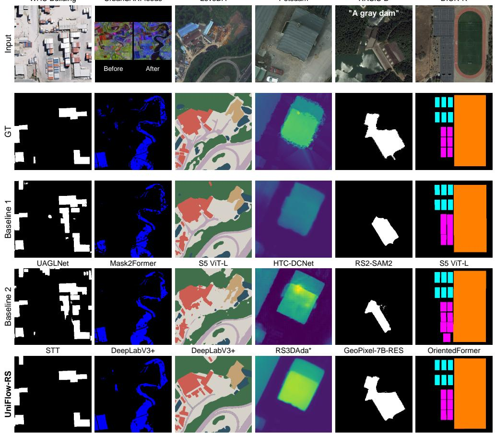  
Figure 15: Additional qualitative comparisons across six tasks. Rows show the input, ground truth, two baseline predictions, and UniFlow-RS. Baseline methods are labeled below each prediction and cited in the text.

Compared methods. We compare with UAGLNet (Yao et al., 2026) and STT (Chen et al., 2021) for building extraction; Mask2Former (Cheng et al., 2022a) and DeepLabV3+ (Chen et al., 2018a) for flood change mapping; S5 ViT-L (Lv et al., 2026) and DeepLabV3+ for LoveDA; HTC-DCNet (Chen et al., 2023) and RS3DAda (Song et al., 2024) for height estimation; RS2-SAM2 (Rong et al., 2026) and GeoPixel-7B-RES (Shabbir et al., 2025) for referring segmentation; and S5 ViT-L and OrientedFormer-R50 (Zhao et al., 2024a) for rotated detection.

Visual observations. UniFlow-RS shows fewer spurious responses in building extraction, follows the curved flooded region in SAR change mapping, and recovers more of the queried gray dam in referring segmentation. It also preserves clearer roof-height variation and separation between adjacent sports facilities. Semantic differences mainly occur around building and land-cover boundaries. Overall, the shared predictor preserves task-specific spatial structures across heterogeneous tasks.

## G.2 Referring Segmentation on Unseen Datasets

Figure 16 presents qualitative zero-shot transfer results on EarthReason and RISBench, complementing the quantitative comparisons in Tables 3 and 10.

On EarthReason, UniFlow-RS successfully identifies water bodies and a baseball field from indirect, reasoningoriented descriptions. On RISBench, it accurately distinguishes the right-hand tennis court from adjacent objects, while the baseball example shows close agreement with VisionReasoner. These examples illustrate the ability of the shared generative predictor to adapt to unseen visual distributions and diverse language expressions without target-specific adaptation.

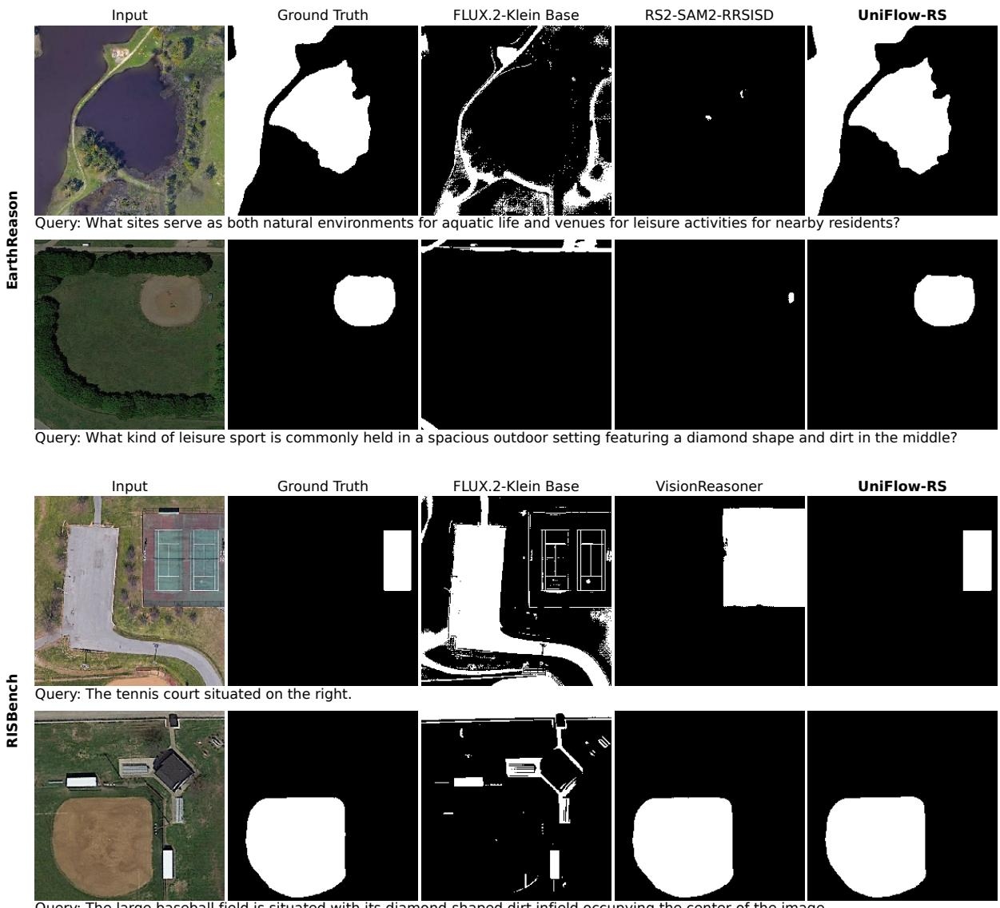  
Figure 16: Qualitative zero-shot referring-segmentation results on EarthReason and RISBench. Each row shows the same image, query, ground truth, and model predictions. Comparisons include FLUX.2-Klein Base, RS2- SAM2-RRSISD (Rong et al., 2026) on EarthReason, and VisionReasoner (Liu et al., 2026) on RISBench. White denotes foreground. VisionReasoner predictions are reproduced using its released checkpoint and official pipeline on the selected examples.

## G.3 Occlusion and Spectral-Composition Transfer

Figure 17 visualizes zero-shot transfer under canopy occlusion, cloud corruption, and spectral shifts, complementing Tables 4 and 11.

On Chesapeake RSC, UniFlow-RS recovers more continuous road structures beneath tree canopies. On PIE, it preserves road and land-cover regions under synthetic cloud occlusion. On Vaihingen IRRG imagery, the model produces more complete building footprints with fewer surrounding false positives. Together, these examples illustrate the ability of the shared generative predictor to preserve spatial structures across unseen task settings and challenging observation conditions.

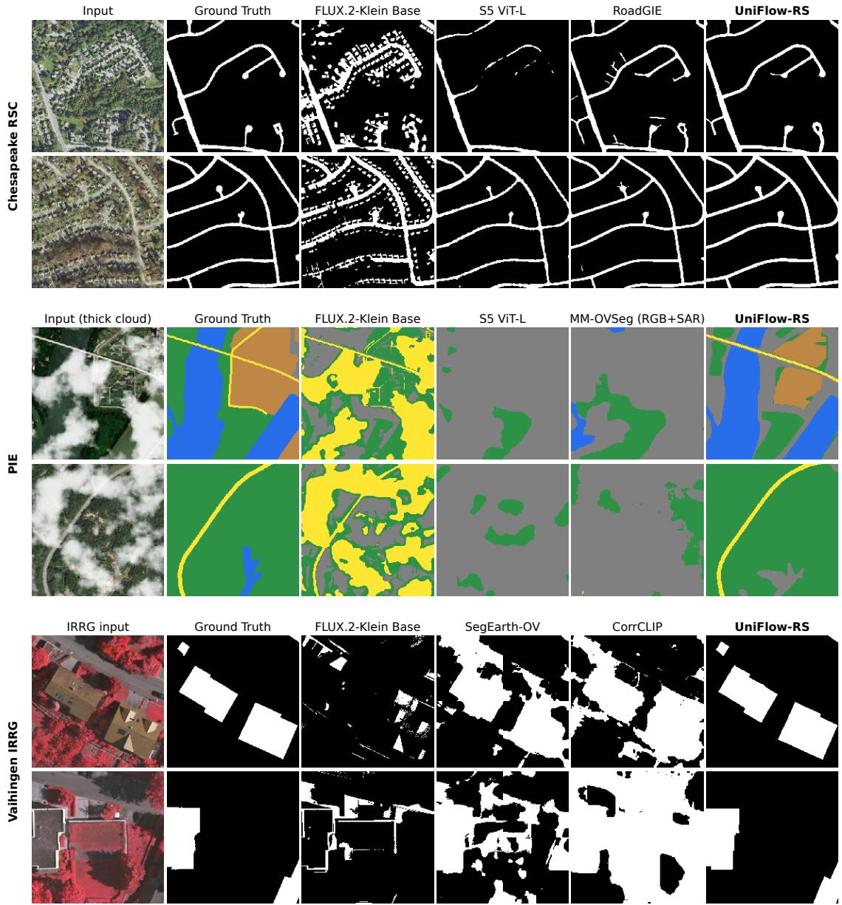  
Figure 17: Qualitative zero-shot transfer under occlusion and spectral shifts. Two examples are shown for each dataset. Comparisons include S5 (Lv et al., 2026), the RoadGIE automatic baseline (Peng et al., 2026), MM-OVSeg (Wei et al., 2026b), SegEarth-OV (Li et al., 2025b), and CorrCLIP (Zhang et al., 2025a). PIE uses synthetic thick-cloud conditions, with MM-OVSeg additionally receiving uncorrupted SAR. Semantic colors indicate road (yellow), water (blue), forest (green), farmland (brown), and Other (gray); binary foreground is shown in white.