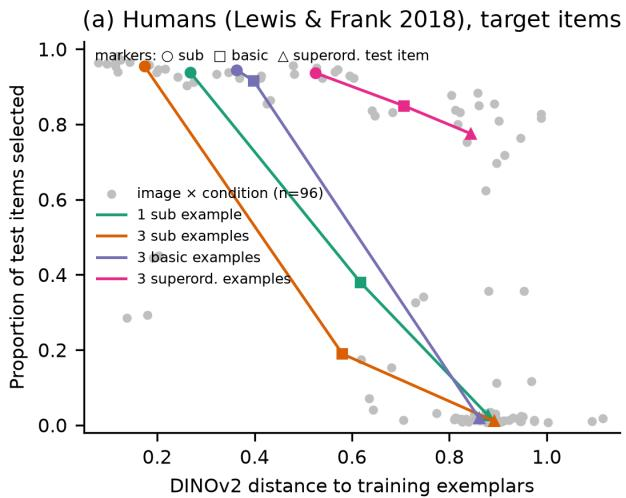
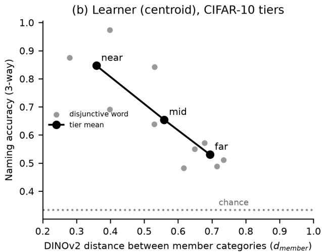
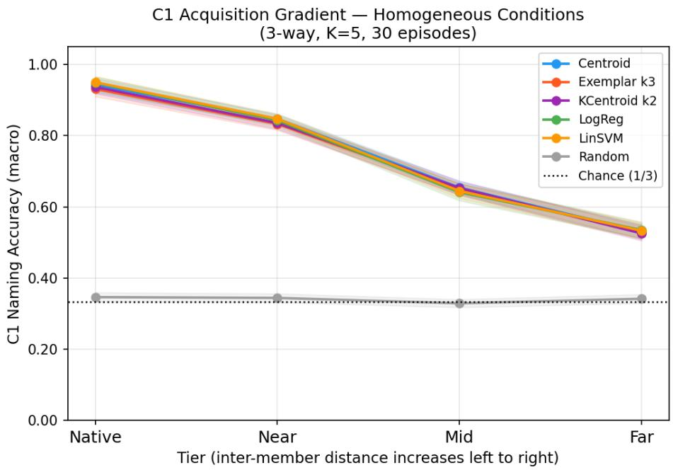
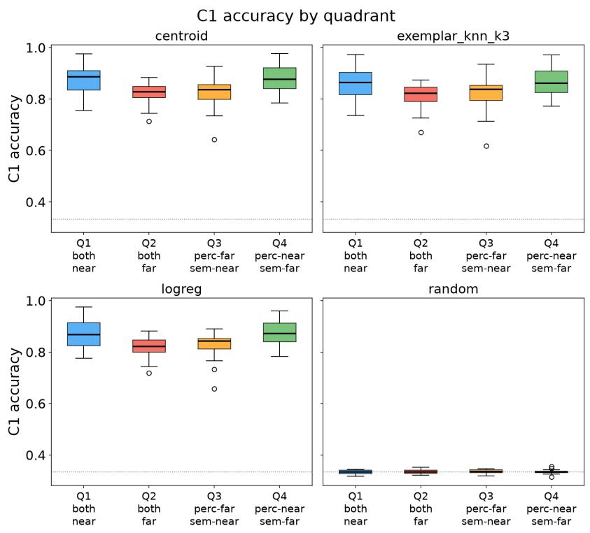
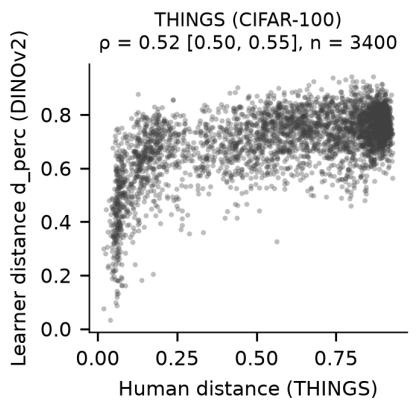
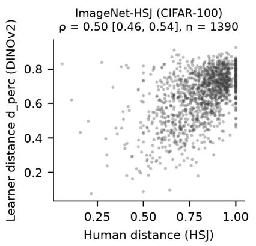
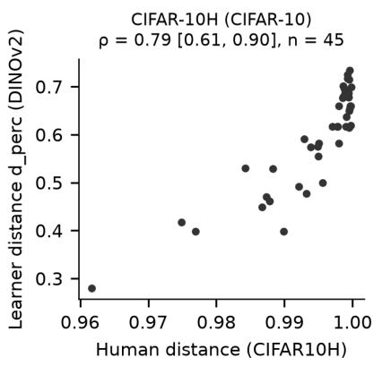
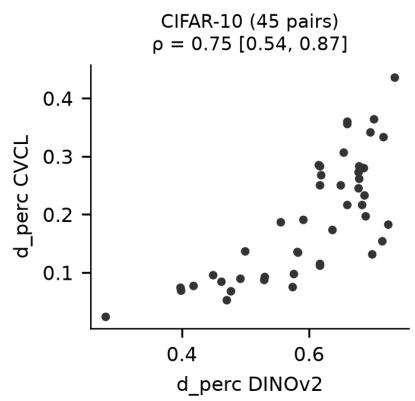
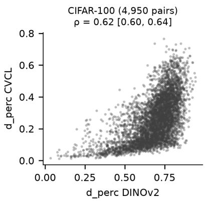
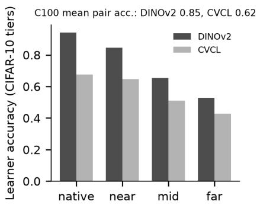

# Visual Similarity in Adult Word Extension and Artificial Word Learning

P. M. Vera Neurocreaciones patricio@neurocreaciones.ai

## Abstract

When two objects share a name, how much does their visual similarity explain, and what do the teaching examples add? First, we reanalyzed trial-level data from a large adult wordextension study (Lewis & Frank, 2018), computing each test image’s distance to the examples shown in the space of a frozen self-supervised visual encoder (DINOv2). Distance was associated with extension (log odds −3.23 per standard deviation; 520 people), and an exploratory post hoc analysis suggested that this association persisted within the taught domain after controlling for taxonomic level and teaching condition. Example composition also mattered: after three examples, adults extended a word to 1.1% of superordinate items when the examples were subordinate and to 77.5% when they were superordinate. Second, in an artificial learner using the same encoder, words joining two categories were learned less accurately the farther apart the categories were (84.7%, 65.4%, and 53.0% naming accuracy for near, mid, and far pairs). The encoder’s distances correlated with human similarity and confusability measures from three datasets (ρ = .501–.795), but this representational alignment did not translate into conclusive evidence that human-derived distances predict learner dificulty, and a second encoder trained on one child’s experience reproduced the tier ordering but not the pair-level efect. The secondary human data were analyzed under an internal plan fixed before the confirmatory analyses (not externally preregistered). Visual similarity accounts for part of how generalization is organized in both systems, while the composition of examples contributes what the distance we used does not capture.

Keywords: word learning; word extension; suspicious coincidence; visual similarity; self-supervised vision models; secondary data analysis; artificial learners

## 1 Introduction

A word can cover several kinds of objects and still be coherent. Children call cats and dogs doggie long before they call frogs and trucks by a common name (Rescorla, 1980), and adults told that three Dalmatians are all feps will typically refuse the label for a cow. Two kinds of explanation are usually ofered for such patterns. Similarity-based accounts hold that a word spreads to referents that resemble its known instances (Nosofsky, 1986; Sloutsky & Fisher, 2004). Bayesian accounts hold that learners infer the most plausible extension from a structured hypothesis space, so that the composition of the examples, and not only their similarity to a test object, determines how far the word is extended (Xu & Tenenbaum, 2007). Developmental work shows both influences: children extend novel nouns by shape (Landau et al., 1988), construe them taxonomically rather than thematically (Markman & Hutchinson, 1984), and project properties by category membership over appearance (Gelman & Markman, 1986).

This article asks a narrow version of this question: when two objects receive the same name, how much is explained by their visual similarity, and what do the examples used to teach the word contribute? Answering it requires a measure of visual similarity that is defined independently of the word-learning behavior under study and can be applied to the exact images people saw. Selfsupervised vision models now provide such a measure. Their embedding spaces are learned without labels and can be queried for any image, and their geometry partly aligns with human similarity judgments (Hebart et al., 2020; Roads & Love, 2021). They are not models of human perception, and human similarity judgments themselves mix perceptual and conceptual information (Hebart et al., 2020, 2023); but they give an explicit, reproducible similarity space in which both human and artificial generalization can be described.

A growing literature asks how far such representations align with human similarity and how alignment can be increased. Alignment with human similarity judgments varies across networks and depends more on training data and objective than on model scale or architecture (Muttenthaler et al., 2023). Representations can be made more human-like by fine-tuning on human perceptual similarity judgments (Fu et al., 2023), which also benefits several downstream vision tasks (Sundaram et al., 2024), or by transferring the hierarchical structure of human judgments across abstraction levels (Muttenthaler et al., 2025). We deliberately used a frozen encoder that was not aligned to human data, so that any convergence with human measures is not built in; the partial alignment we report should be read against this choice. We also used only the global (CLS) embedding of the final layer; intermediate layers and patch-level features may relate diferently to human similarity and were not examined.

We combine two sources of evidence. The first is human: we reanalyzed trial-level data from Lewis and Frank (2018), who conducted a large, multi-experiment replication of the suspiciouscoincidence paradigm of Xu and Tenenbaum (2007) with adults and made their data, stimuli, and code public. Because the exact images are available, we could compute, for every test item, its distance in the encoder’s space to the examples a participant had just seen, and ask whether that distance is associated with the participant’s decision to extend the word. The second is artificial: a learner that operates over the same frozen encoder, for which we fix which categories each word designates and measure whether the learner can name new images. The artificial learner is not a model of the adult participant; it is a controlled system in which the representation is fully known, so that the contribution of similarity in that space can be isolated.

The two parts address diferent behaviors. The adult decided how far to extend a word; the learner tried to recover a taught label. We therefore treat the comparison as a test of how far a shared similarity space describes both, not as evidence of a common mechanism. Our contributions are:

• A secondary analysis of adult word extension showing that distance in a self-supervised visual space is associated with extension, and that its efect depends on the composition of the teaching examples (exploratory).

• A controlled demonstration, in artificial learners, that the learnability of a two-category word decreases with the distance between its categories, with taxonomic relatedness adding no detectable prediction in the sample tested.

• Confirmatory tests of two distinct links between the systems: the encoder’s geometry partially aligns with human similarity and confusability measures, but this representational alignment did not translate into conclusive evidence that human-derived distances predict which words the learner finds hard.

All human data are secondary: they come from experiments designed and run by other teams to answer other questions. We fixed an analysis plan before running the confirmatory analyses (sha256 9b50995eb5e8...). The plan was written after a check of dataset coverage and was not deposited in an external registry; the hash identifies the version of the plan that was used, but it does not certify when the plan was written. We therefore do not describe it as a preregistration. The main deviations from the plan are summarized in Table 1; the Appendix gives a brief history of corrections, and every step is documented in the released deviation log.

<table><tr><td>Deviation</td><td>Description and consequence</td></tr><tr><td>Random effects by person (H4)</td><td>The plan specified random effects by participant identifier (subid). Our initial implementation grouped by experiment × identifier, on the mistaken assumption that identifiers were reused across experiments for different people; they denote persons across experiments (520 people, 600 sessions). All H4 models were re-estimated with random effects by person, as the plan</td></tr><tr><td>First session (H4 sensitivity)</td><td>specified, and these are reported. Conclusions unchanged. Defined by the recorded start time of each session rather than by experiment number; the two criteria differ for one person.</td></tr><tr><td>Teaching-condition labels (ex- ploratory)</td><td>Equivalent condition labels spelled differently across experiments were uni- fied in the descriptive analyses after an error was found; H4 models were not affected.</td></tr><tr><td>Coverage</td><td>THINGS: 3,400 category pairs and 61 sampled pairs, versus 3,486 and 64 planned, due to category mapping. Glasgow norms: 85 words versus 89 planned.</td></tr><tr><td>H2 decision rule</td><td>The ImageNet-HSJ result (uncorrected p = .039, Holm p = .079, interval excluding zero) was not covered by any of the plan&#x27;s decision rules; reported as inconclusive.</td></tr><tr><td>Analyses not run</td><td>Wordbank analyses (data available only through an authenticated service) and overextension analyses (unclear license).</td></tr><tr><td>H6 correction family</td><td>Benjamini-Hochberg correction over 9 tests; the plan did not specify how the family was composed.</td></tr><tr><td>Post hoc H4 analysis</td><td>Incremental contribution of distance within the taught domain (the distance × condition interaction was planned as exploratory and is not a deviation); exploratory, outside the confirmatory family.</td></tr><tr><td>Post hoc analyses after external review</td><td>Moderation by trial order and a superordinate-only model, specified after an automated external review and after the main results were known; ex- ploratory, outside the confirmatory family.</td></tr></table>

Table 1: Main Deviations From the Analysis Plan for the Human Data

## 2 Adults: Visual Distance and the Composition of Examples

## 2.1 Data

Lewis and Frank (2018) ran 12 online experiments with adults in the word-learning paradigm of Xu and Tenenbaum (2007). On each trial a novel word was taught with one subordinate example, three subordinate examples, three basic-level examples, or three superordinate examples (e.g., one Dalmatian; three Dalmatians; three dogs of diferent breeds; three diferent animals), and participants selected, from an array of 24 test images, all the objects that the word could also name. Of the 24 test items, 8 belonged to the taught domain (subordinate, basic-level, and superordinate matches); the rest came from other domains. The suspicious-coincidence efect is the reduction in basic-level generalization after three subordinate examples relative to one. Lewis and Frank (2018) recovered the efect with a large efect size under both sequential and simultaneous presentation, but found it sensitive to trial order: it was absent, or reversed under sequential presentation, when the three-example trials preceded the one-example trial. We used their public, anonymized trial-level data and the original stimulus images. Participant identifiers in that release are assigned across experiments, so the data comprise 600 sessions from 520 distinct people (56 people took part more than once), 7,200 trials, and 172,800 item-level decisions.

## 2.2 Visual Distance

Each image was encoded with the same frozen DINOv2-small encoder used for the artificial learners (Oquab et al., 2023). For every trial and test item we computed $d ,$ the cosine distance between the item’s L2-normalized embedding and the normalized centroid of the training examples shown on that trial. The distance is defined entirely by the images, independently of participants’ responses.

## 2.3 Analysis

The confirmatory hypothesis (H4 in the analysis plan) was that the probability of selecting a test item decreases with $d ,$ controlling for the item’s taxonomic level and the teaching condition. We fitted a logistic mixed model, selected $\sim z ( d )$ + level + condition + (1 + z(d) | person) + (1 | image), over all 24 items. Random efects are grouped by person, as the plan specified (Table 1; the Appendix). Support required a negative coeficient with Holm-adjusted $p < . 0 5$ within the sixtest confirmatory family. Distance was standardized within each model, so a standard deviation corresponds to .219 cosine units over all 24 items and to .296 over the 8 target-domain items; coeficients from the two item sets are therefore not on exactly the same scale. Sensitivity analyses used only the 8 target-domain items, only each person’s first session (identified by its recorded start time), excluded people who participated more than once, or excluded the two experiments that were not preregistered by the original authors. The plan listed a distance × condition interaction as exploratory. A descriptive comparison of conditions and a post hoc test of the incremental contribution of distance were not part of the plan and are reported as exploratory. Two further post hoc exploratory analyses were specified after the main results were known, and before they were run (the Appendix). First, a superordinate-only model restricted to the four superordinate target-domain items of each trial (12 images) compared selected $\sim z ( d ) + \mathrm { c o n d i t i o n }$ with models dropping either term, with random intercepts by person and image (sensitivity: adding a by-person distance slope). Second, a trial-order model used the experiment-level order of the one-example and three-example trials (one-example trial first or last; six experiments each) and tested, by likelihood ratio, whether order moderated the distance slope $( z ( d ) \times \mathrm { o r d e r } , 1 \ d f )$ and the distance × condition interaction $( z ( d ) \times \mathrm { c o n d i t i o n } \times \mathrm { o r d e r } , \textrm { 3 } d f )$ , with Holm correction over these two tests. Order varies only between experiments and is therefore confounded with other experiment-level diferences.

## 2.4 Results

Visual distance was associated with extension: the log odds of selecting an item fell by −3.226 per standard deviation of distance (95% CI [−3.288, −3.164]; Holm-adjusted $p < . 0 0 1 )$ , with level and condition in the model. The estimate was stable across specifications (Table 2): −3.16 with only the 8 target-domain items, −3.17 with first sessions only, −3.12 excluding repeat participants, and −3.11 combining the last restriction with target items. Over all 24 items, however, the coeficient is dominated by the contrast between the taught domain and the other domains, whose items were almost never selected. The target-only analyses address this. In an exploratory post hoc comparison restricted to the 8 target-domain items, adding distance to a model with level and condition (and the same random intercepts) improved fit markedly (likelihood ratio $\chi ^ { 2 } ( 1 ) = 3 , 0 1 7 . 0 , \Delta \mathrm { A I C } = 3 , 0 1 5 . 0 ;$ $\chi ^ { 2 } ( 3 ) = 3 , 6 9 5 . 4$ when the by-person distance slope was also added). Within each taxonomic level the distance slope was negative: −4.22 [−4.46, −3.98] for subordinate, $- 3 . 2 1 \ [ - 3 . 4 0 , \ - 3 . 0 3 ]$ for basic-level, and $- 0 . 9 4 \ [ - 1 . 2 5 , \ - 0 . 6 2 ]$ for superordinate items (log odds per target-model standard

deviation). Distance and level remain correlated by construction in this stimulus set, so these estimates describe an association beyond the coded level, not a separable causal contribution of similarity.
<table><tr><td>Specification (random effects by person)</td><td>People</td><td>Log odds per SD of d [95% CI]</td></tr><tr><td>Primary: all 24 items</td><td>520</td><td>-3.23 [-3.288, -3.164]</td></tr><tr><td>First session only</td><td>520</td><td>-3.17 [-3.23, -3.10]</td></tr><tr><td>Excluding repeat participants</td><td>464</td><td>-3.12 [-3.19, -3.05]</td></tr><tr><td>Excluding non-preregistered experiments</td><td>444</td><td>-3.17 [-3.24, -3.10]</td></tr><tr><td>8 target-domain items</td><td>520</td><td>-3.16 [-3.30, -3.02]</td></tr><tr><td>8 target items, excluding repeat participants</td><td>464</td><td>-3.11 [-3.26, -2.96]</td></tr></table>

Table 2: Association Between Visual Distance and Word Extension in Adults (H4) Note. Logistic mixed models with level and condition as fixed efects and by-person random intercepts and distance slopes plus by-image random intercepts; Wald intervals. All $p < . 0 0 1$

Distance, however, was far from the whole story. Figure 1a shows mean selection for the target-domain items by teaching condition. For superordinate test items, selection was low after one subordinate example (2.6%), three subordinate examples (1.1%), or three basic-level examples (1.8%), but rose to 77.5% after three superordinate examples. Mean distances of these items to the examples difered only modestly across conditions (range .845–.892) (.880, .892, .861, and .845, respectively). The number of examples was the same in the last three conditions; what changed was their composition. The overall mean for superordinate items (20.7%) conceals this contrast. These percentages are descriptive.

In an exploratory model with a distance × condition interaction (random efects by person; all 24 items), the distance slope was $- 2 . 9 2 \ [ - 3 . 0 0 , \ - 2 . 8 5 ]$ after one example and changed little after three subordinate examples (interaction 0.10 [0.04, 0.16]), but became steeper after three basic-level $\left( - 0 . 8 6 \ [ - 0 . 9 4 , \ - 0 . 7 9 ] \right)$ and three superordinate examples $\left( - 1 . 2 9 \ [ - 1 . 3 6 , \ - 1 . 2 2 ] \right)$ ; the interaction improved fit substantially (likelihood ratio $\chi ^ { 2 } ( 3 ) = 2 , 1 3 4 . 2 , p < . 0 0 1 )$ . Thus, how strongly visual distance relates to extension depends on how the word was taught. Note that this model uses all 24 items, whereas the curves in Figure 1a show only the 8 target-domain items.

In the post hoc superordinate-only model (28,800 observations, 520 people, 12 images), condition improved fit given distance $( \chi ^ { 2 } ( 3 ) = 1 8 , 9 0 7 . 2 , p < . 0 0 1 )$ , and distance improved fit given condition $( \chi ^ { 2 } ( 1 ) = 1 5 . 1 4 , p < . 0 0 1 )$ , with a distance coeficient of $- 0 . 2 8 \ [ - 0 . 4 2 , \ - 0 . 1 3 ]$ per within-subset standard deviation. Relative to one example, the condition coeficients were −1.05 [−1.37, −0.73] for three subordinate, $- 0 . 4 9 \ [ - 0 . 7 6 , \ - 0 . 2 2 ]$ for three basic-level, and 7.11 [6.87, 7.36] for three superordinate examples. Adding a by-person distance slope gave similar estimates (distance −0.28 $[ - 0 . 4 2 , - 0 . 1 3 ]$ ; the distance-only model in this sensitivity analysis was singular). In the post hoc trial-order model (172,800 observations, 520 people), the distance × order term was 0.20 [0.12, 0.28] $( \chi ^ { 2 } ( 1 ) = 2 4 . 5 9 , p < . 0 0 1$ , Holm $p < . 0 0 1 )$ , and the three-way distance × condition × order terms gave $\chi ^ { 2 } ( 3 ) = 2 9 . 1 2 \ : ( p < . 0 0 1$ , Holm $p < . 0 0 1 )$ . With the three-way terms in the model, the distance × order term (for the one-example reference condition) fell to 0.06 (p = .25), so moderation of the distance slope by order depended on the teaching condition.

  
EXPLORATORY (post hoc). Different y quantities: (a) extension of a word (selection), (b) naming accuracy; distances also differ

Figure 1: Visual Distance and Generalization in Adults and in the Artificial Learner. Note. Exploratory comparison. (a) Proportion of target-domain test items selected by adults in Lewis and Frank (2018), by teaching condition and test level, against $\mathrm { D I N O v 2 }$ distance to the training examples; gray points are the 96 image × condition units (descriptive logit slope $- 6 . 9 3 \ [ - 7 . 2 9 , \ - 6 . 5 6 ]$ $\rho = \ – . 7 2 )$ . (b) Naming accuracy of the centroid learner for two-category words in CIFAR-10, against the distance between member categories. The vertical axes measure diferent quantities (extension vs. naming accuracy) and should not be compared directly.

## 3 Artificial Learners: A Controlled System

The adult data show an association but cannot isolate the role of similarity, because the experimenter does not control the representation the participant uses. In an artificial learner the representation is known and the extension of each word can be fixed. We summarize the core results of the artificial-learner study (full details of the original experiments are in Vera (2026) and in the project repository).

## 3.1 Method

Images from CIFAR-10 and CIFAR-100 (Krizhevsky, 2009) were encoded once with frozen DINOv2- small (Oquab et al., 2023) (384-dimensional CLS embeddings, L2-normalized). Images were preprocessed with the model’s default Hugging Face image processor: conversion to RGB, bicubic resizing of the shorter side to 256 pixels (the 32 × 32 CIFAR images are therefore upsampled), a $2 2 4 \times 2 2 4$ center crop, rescaling to [0, 1], and normalization with ImageNet means and standard deviations. The same preprocessing was applied to the stimulus images of the adult study. We did not test alternative preprocessing choices (e.g., other interpolation methods or crops). Learners received nonce words (e.g., slithy, mimsy, vorpal; Carroll, 1871) paired with five images each, in 3-way episodes, and were tested on naming held-out images. The main learner represents a word by the normalized mean of its training embeddings (a prototype; equivalent to a prototypical network over a frozen encoder; Snell et al., 2017); exemplar (k-nearest-neighbor) and logistic-regression learners gave the same pattern. Each word was assigned either one category (native) or two categories (disjunctive). Disjunctive words were grouped into near, mid, and far tiers by the cosine distance between the two categories’ centroids (mean .359, .559, and .694). For example, tromble (cat + dog) and mivor (frog + truck) both join exactly two categories; what difers is the distance between them. Thirty paired episodes per condition were run (seed 42), with 95% bootstrap intervals over episodes. The tiers contain few words (3, 3, and 4 category pairs for near, mid, and far), so these intervals reflect episode-level variability and do not generalize over words; the dissociation study below addresses generalization over pairs.

To separate distance in the encoder’s space from taxonomic relatedness, a dissociation study on CIFAR-100 sampled 100 category pairs from the four quadrants formed by median splits of perceptual (DINOv2) distance and semantic distance (one minus WordNet Wu–Palmer similarity; Miller, 1995; Wu and Palmer, 1994), taught each pair as one word, and regressed naming accuracy on both distances, under decision rules specified in advance in an internal plan. The reported dissociation results use the original, pre-specified mapping of class names to WordNet synsets. That mapping selected an unintended sense for 21 classes (e.g., tiger as a fierce person; 42 of the 100 sampled pairs involve at least one of them); with these senses corrected, the conclusion was unchanged (perceptual $\beta = - 0 . 2 2 3$ , semantic $p = 0 . 7 1 8$ , versus -0.212 and 0.660 with the original mapping; with quadrants reassigned, median accuracy remained higher in Q4 than in Q3, .863 vs. .838, $n = 3 5$ discordant pairs). Details are in the released materials.

## 3.2 Results

Naming accuracy was 94.3% [92.2, 96.1] for native words and fell to 84.7% [83.2, 86.1], 65.4% [63.7, 67.2], and 53.0% [51.0, 55.0] for near, mid, and far disjunctive words (chance ≈ 33%; Figure 2). The ordering was the same for every non-random learner and replicated across five master seeds. In the dissociation study, perceptual distance predicted accuracy $( \beta = - 0 . 2 1 2 , p = 1 . 8 7 \times 1 0 ^ { - 7 }$ partial $R ^ { 2 } = 0 . 2 4 5 )$ , whereas semantic distance did not $( p = 0 . 6 6 0$ , partial $R ^ { 2 } = 0 . 0 0 2 ; { \mathrm { F i g u r e ~ 3 } } )$ ; sharing a CIFAR-100 superclass did not add detectable prediction once perceptual distance was controlled $( \beta = 0 . 0 1 5 , p = 0 . 5 2 8 )$ ). Because the learner has no access to semantic information, this is a suficiency result: distance in the learner’s own space sufices to produce the gradient; it does not show that semantics is irrelevant for human learners. Pairs within the same superclass were, on average, learned more accurately (91.5% vs. 84.5%), but only 6 of the 100 pairs fell within a superclass.

  
Figure 2: Naming Accuracy of Artificial Learners Across Concept Tiers. Note. 3-way, 5-shot episodes; shaded bands are 95% bootstrap intervals over 30 episodes. All non-random learners overlap; the random baseline stays at chance.

  
Figure 3: Naming Accuracy by Dissociation Quadrant (CIFAR-100). Note. Quadrants are defined by median splits on perceptual (DINOv2 inter-centroid cosine) and semantic (WordNet Wu–Palmer) distance. Accuracy follows the perceptual axis.

## 4 Testing the Link Between the Two Systems

The two results above use the same similarity space, but the adult result does not show that this space captures human similarity, and the learner result does not show that human similarity predicts learning. We tested these two distinct relations, alignment between similarity measures (H1) and prediction of learner dificulty from human distances (H2), with public human datasets, under the same analysis plan.

## 4.1 Data

We used three independent human datasets that cover CIFAR categories: odd-one-out similarity judgments for THINGS concepts (Hebart et al., 2020, 2023), similarity judgments for ImageNet images (ImageNet-HSJ; Roads and Love, 2021), and human classification uncertainty for the CIFAR-10 test set (CIFAR-10H; Peterson et al., 2019). Each was converted to a distance between category pairs. CIFAR-100 classes were mapped to THINGS concepts by name and WordNet sense, with ambiguous names resolved to the sense shown in the CIFAR images (e.g., mouse as the rodent, tank as the military vehicle); 83 classes were mapped. Three classes that share a single THINGS concept (maple, oak, and willow, all mapped to tree) kept their mapping, but the pairs among them were excluded, which yields 3,400 pairs; cattle and ray have only hyponym matches in THINGS and were used only in a stricter sensitivity mapping. For ImageNet-HSJ, each CIFAR class was assigned the ImageNet synsets in the hyponym closure of its WordNet synset (synsets claimed by more than one class went to the most specific class, and exact ties were dropped); 68 CIFAR-100 classes received at least one synset, and pairs were retained when at least 10 relevant judgments were available, yielding 1,390 pairs. CIFAR-10H uses the CIFAR-10 classes directly. Robustness checks with alternative mappings are in the released materials. All mappings were fixed before human distances were computed. THINGS and ImageNet-HSJ judgments reflect both perceptual and conceptual properties of objects (Hebart et al., 2020), and CIFAR-10H measures confusability rather than similarity; none of them is a pure measure of visual similarity. Confirmatory tests (H1 $\times \ 3 , \mathrm { H 2 } \times 2 , \mathrm { H 4 } )$ were Holm-corrected as one family.

## 4.2 Results

The encoder’s geometry aligns with human measures (H1; supported). DINOv2 distances correlated with THINGS distances (ρ = .523 [.496, .549], 3,400 pairs), ImageNet-HSJ distances $( \rho = . 5 0 1 ~ [ . 4 5 6 , . 5 4 3 ] , 1 , 3 9 0 ~ \mathrm { p a i r s } )$ , and CIFAR-10H confusability $( \rho = . 7 9 5 ~ [ . 6 0 6 , ~ . 8 9 7 ]$ 45 pairs); all Mantel tests reached the smallest attainable permutation p (.0001 with 10,000 permutations), so the Holm-adjusted $p = . 0 0 0 5$ is a bound rather than an estimate (Figure 4). The alignment is partial: a large part of the variance in human distances is not captured.

Human distances do not reliably predict learner dificulty (H2; inconclusive). A different question is whether human distances, which are independent of the learner’s representation, predict which category pairs the learner finds hard. In the dissociation pairs covered by each dataset, with semantic distance in the model, the human coeficient was small for THINGS (β =- $. 0 0 8 , p = . 3 7 4$ , partial $r = - . 1 0 [ - . 3 4 , . 1 6 ] , n = 6 1 )$ and larger for ImageNet-HSJ $( \beta = . 0 3 4 , p = . 0 3 9$ Holm $p = . 0 7 9$ , partial $r = - . 4 1 \ [ - . 6 7 , \ - . 0 7 ] , \ n = 3 2 )$ The two results are not symmetric. For THINGS the estimate was small and its interval included zero. For ImageNet-HSJ the efect was in the predicted direction and its interval excluded zero, but it did not survive Holm correction; the plan’s decision rule did not anticipate this combination, and we report it as inconclusive without reinterpreting the rule (Table 1). Both samples are small, which limits power.

  
Figure 4: Human Distances Versus the Learner’s Embedding-Space Distances (H1). Note. Each point is a category pair. Brackets give 95% bootstrap intervals for Spearman’s ρ.

A child-experience encoder reproduces the tiers but not the pair-level efect (H6; exploratory). To check whether the learner results depend on DINOv2, we repeated the analyses with the vision encoder of CVCL, trained on one child’s head-camera recordings (Vong et al., 2024); CVCL is not a source of human data. Images were resized directly to $2 2 4 \times 2 2 4$ pixels (bicubic, no crop), converted to tensors, and normalized with ImageNet means and standard deviations, following the preprocessing in the released CVCL code; the 512-dimensional outputs were L2- normalized. Its distances correlated with DINOv2 $( \rho = . 7 5$ in CIFAR-10, .62 in CIFAR-100) and with human distances (e.g., THINGS .68, HSJ .43 in CIFAR-100). With CVCL, the tier ordering reappeared in CIFAR-10 (67.5%, 64.7%, 51.1%, 42.8%; $\rho = - . 8 4$ across words), but in CIFAR-100 its pair distances did not predict naming accuracy $( \beta = . 0 0 4 7 ~ [ - . 0 1 8 , . 0 2 8 ] , p = . 6 8 8 )$ , which is inconsistent with the pre-specified criterion (Figure 5). Baseline naming accuracy in CIFAR-100 was also lower with CVCL (.618 vs. .850 with DINOv2), which limits the comparison; the CIFAR-10 tier ordering is descriptive and was not tested inferentially.

  
H6 exploratory; CVCL is not human data

Figure 5: DINOv2 Versus a Child-Experience Encoder (CVCL; H6, Exploratory). Note. Left and center: pair distances in the two encoders. Right: learner naming accuracy by CIFAR-10 tier with each encoder.

Age of acquisition (H5; exploratory). Category coherence in DINOv2 was not related to the age of acquisition of the category names in the Glasgow norms (Scott et al., 2019) in CIFAR-100 (partial $\rho = - . 1 1 , p = . 3 2 , n = 8 5 )$ ; in CIFAR-10 the partial correlation was −.89 (BH p = .0026), but with only ten categories. We do not draw conclusions from H5.

## 5 Discussion

We asked how much visual similarity explains when two objects share a name, and what the teaching examples add. In adults, distance in a self-supervised visual space was associated with the decision to extend a novel word across specifications, and, in an exploratory post hoc test, it added to taxonomic level and teaching condition within the taught domain. In artificial learners operating over the same space, words joining more distant categories were harder to learn, and taxonomic relatedness did not predict accuracy beyond perceptual distance in this sample (only 6 of 100 pairs fell within a superclass); because the learner has no access to semantic information, this is a suficiency result. The encoder’s geometry aligned partially with three independent human measures of similarity and confusability. Taken together, these results suggest that a shared, partly human-aligned similarity space describes part of the organization of generalization in both systems.

The limits are as informative as the associations. First, in adults the composition of the examples changed extension dramatically at comparable distances: three superordinate examples licensed broad extension, whereas three subordinate examples suppressed it, and, in an exploratory analysis, the slope of distance itself depended on the teaching condition. This is the kind of evidence-sensitive inference that Bayesian accounts emphasize (Xu & Tenenbaum, 2007) and that Lewis and Frank (2018) showed to be sensitive to trial order; the distance-to-centroid measure we used does not, by itself, account for these diferences between conditions. In our exploratory post hoc models, terms involving experiment-level trial order improved fit, and within superordinate items both condition and distance improved fit given the other; because order is confounded with other experimentlevel diferences, we do not interpret these terms further. Second, representational alignment did not translate into conclusive evidence that human distances predict learner dificulty: the encoder’s geometry aligned partially with human measures (H1), but human-derived distances did not reliably predict which words the learner found dificult (H2, inconclusive; one dataset showed an efect in the predicted direction that did not survive correction). Correlation between two representational spaces does not guarantee that both predict learning in the same way. Third, the pair-level learner efect did not reappear with an encoder trained on child experience, so it may depend on properties of the specific encoder. And because THINGS and ImageNet-HSJ mix perceptual and conceptual information, the alignment we observe cannot be attributed to perceptual similarity alone.

We therefore claim similarity in the organization of generalization, not a shared mechanism. The adult and the learner performed diferent tasks, measured on diferent scales (Figure 1), and the learner has no access to the pragmatic and sampling considerations that adults bring to the task. The value of the artificial system is that it isolates one factor, similarity in a known space, and shows what that factor alone can and cannot produce.

## 5.1 Limitations

All human data are secondary. The experiments were designed by other teams for other questions, with diferent stimuli, tasks, and participants, and we could not alter their designs. The adult analysis is correlational: distance and taxonomic level are related by construction in the stimulus sets, and although models control for level and condition, distance in DINOv2 is one of many possible similarity measures. The descriptive contrast between conditions and the interaction model are exploratory. The H2 analyses had small samples (61 and 32 pairs). All learner results rest on frozen encoders and CIFAR images, two-category words, and shallow learners; only the final-layer CLS embedding was used. The human mixed models include random intercepts by image but no by-image random slopes for distance, so heterogeneity across images in sensitivity to distance was not estimated. The CIFAR-10 tier intervals are episode-level and do not separate pair-level variability. Taxonomic relatedness was measured only with WordNet Wu–Palmer similarity, with few within-superclass pairs. The two post hoc analyses of trial order and superordinate items were specified before being run but after the data had been analyzed, and trial order varied between experiments, together with other design features. The previous multi-agent consensus experiments of this project are reported in Vera (2026) and are not part of this article.

## 6 Conclusions and Future Work

We asked how much visual similarity explains when two objects share a name, and what the teaching examples add. Distance in a frozen self-supervised visual space was associated with adult word extension across confirmatory specifications, and, in an exploratory post hoc analysis, it added to taxonomic level and teaching condition within the taught domain. Distance was not the whole story. At comparable distances, three superordinate examples licensed broad extension to superordinate test items, whereas three subordinate examples suppressed it, and, in an exploratory analysis, the slope of distance itself depended on how the word was taught. The distance-to-centroid measure we used does not, by itself, account for these diferences between conditions.

In artificial learners operating over the same encoder, words joining more distant categories were harder to learn, and taxonomic relatedness added no detectable prediction beyond perceptua distance in the sample tested. Because the learner has no access to semantic information, this is a suficiency result, not evidence that semantics is irrelevant for human learners. The encoder’s geometry aligned partially with three independent human measures of similarity and confusability, and that alignment cannot be attributed to perceptual similarity alone. This alignment did not translate into conclusive evidence that human-derived distances predict learner dificulty: one es timate was small and its interval included zero; another was in the predicted direction but did not survive correction; both samples were small. A second encoder, trained on one child’s experience, reproduced the tier ordering but not the pair-level efect, so that efect may depend on properties of the specific encoder. We do not draw conclusions from the age-of-acquisition analysis.

We therefore claim similarity in the organization of generalization, not a shared mechanism. The adult and the learner performed diferent tasks, measured on diferent scales, and the learner has no access to the pragmatic and sampling considerations that adults bring to the task. All human data are secondary, and the adult analysis is correlational: distance and taxonomic level are related by construction in the stimulus sets. Visual similarity accounts for part of how generalization is organized in both systems, while the composition of examples contributes what the distance we used does not capture.

The most direct next step is an experiment with children using the artificial learner’s categories: teaching novel words for near, mid, and far two-category unions, and for single categories with subordinate, basic, or superordinate examples, would test whether the gradient observed in the learner, and the composition efect observed in adults, appear in the same individuals and with the same images. A closely related question is whether the same pattern holds for another vision encoder. The child-experience encoder we examined already shows that the pair-level learner efect need not reappear; tests with language-supervised encoders such as CLIP (Radford et al., 2021), other self-supervised encoders, intermediate layers, and patch-level features would show how far the present associations, and the partial alignment with human measures, depend on the frozen final-layer CLS embeddings we used. Further robustness checks include by-image random slopes for distance in the adult models; alternative distance aggregations and image preprocessing; pairlevel resampling or hierarchical models for the CIFAR-10 tiers; richer semantic controls (human relatedness norms or distributional semantics) with sampling targeted at within-superclass pairs; and greater coverage for the test of human-derived distances against learner dificulty, with more category pairs and additional human datasets.

## 7 Ethics Statement

No new data were collected for this article. The human analyses used only publicly available, anonymized data released by the authors of published studies (Hebart et al., 2023; Lewis & Frank, 2018; Peterson et al., 2019; Roads & Love, 2021; Scott et al., 2019). Ethical approval and participant consent were handled by the original studies, and no attempt was made to re-identify participants.

## 8 Code and Data Availability

Code, analysis plans, logs, the deviation log, and figure-generation scripts for the artificial-learner experiments and for the human-data analyses (folder human data analyses/) are available at https: //github.com/patriciomvera/lexical-consensus. The analysis plan for the human-data analyses (fixed before the confirmatory analyses; internal hash only, not externally registered) has sha256 9b50995eb5e8...; a copy that difers only in the replacement of a personal name, prepared for an earlier anonymized review, has sha256 b1a70c010fa5.... Derived datasets released with this article are available on Hugging Face: https://huggingface.co/datasets/MrPatoVera/lexical-consensus-dat a (CC BY 4.0) and https://huggingface.co/datasets/MrPatoVera/lexical-consensus-data-cifar10h (CC BY-NC-SA 4.0). Human datasets are publicly available from their original authors (Hebart et al., 2023; Lewis & Frank, 2018; Peterson et al., 2019; Roads & Love, 2021; Scott et al., 2019); files that are not redistributed are downloaded by a script from their oficial sources. Licenses, as stated by the original sources: the data of Lewis and Frank (2018) are released on the authors’ OSF project under CC BY 4.0 (the GitHub copy carries no license file); we do not redistribute these data or any per-participant or per-trial derivative of them, and the scripts download them from the source. THINGS odd-one-out data are released under CC BY 4.0 (with exceptions for some images, which we do not use or redistribute); ImageNet-HSJ (psiz-datasets) under CC BY 4.0; the Glasgow Norms in an article published under CC BY 4.0; CIFAR-10H under CC BY-NC-SA 4.0; and the wordfreq data under CC BY-SA 4.0. Derived files that include CIFAR-10H aggregates or wordfreq frequencies are marked in the repository as share-alike (and, for CIFAR-10H, non-commercial); CIFAR images are not redistributed. CIFAR-10/100 (Krizhevsky, 2009), DINOv2 (Oquab et al., 2023), CVCL (Vong et al., 2024), and WordNet (Miller, 1995) are publicly available.

## References

Carroll, L. (1871). Through the looking-glass, and what alice found there. Macmillan.

Fu, S., Tamir, N., Sundaram, S., Chai, L., Zhang, R., Dekel, T., & Isola, P. (2023). DreamSim: Learning new dimensions of human visual similarity using synthetic data. Advances in Neural Information Processing Systems, 36, 50742–50768. https://doi.org/10.52202/075280- 2208

Gelman, S. A., & Markman, E. M. (1986). Categories and induction in young children. Cognition, 23 (3), 183–209. https://doi.org/10.1016/0010-0277(86)90034-X

Hebart, M. N., Contier, O., Teichmann, L., Rockter, A. H., Zheng, C. Y., Kidder, A., Corriveau, A., Vaziri-Pashkam, M., & Baker, C. I. (2023). THINGS-data, a multimodal collection of large-scale datasets for investigating object representations in human brain and behavior. eLife, 12, Article e82580. https://doi.org/10.7554/eLife.82580

Hebart, M. N., Zheng, C. Y., Pereira, F., & Baker, C. I. (2020). Revealing the multidimensional mental representations of natural objects underlying human similarity judgements. Nature Human Behaviour, 4 (11), 1173–1185. https://doi.org/10.1038/s41562-020-00951-3

Krizhevsky, A. (2009). Learning multiple layers of features from tiny images (tech. rep.). University of Toronto. https://www.cs.toronto.edu/∼kriz/learning-features-2009-TR.pdf

Landau, B., Smith, L. B., & Jones, S. S. (1988). The importance of shape in early lexical learning. Cognitive Development, 3 (3), 299–321. https://doi.org/10.1016/0885-2014(88)90014-7

Lewis, M. L., & Frank, M. C. (2018). Still suspicious: The suspicious-coincidence efect revisited. Psychological Science, 29 (12), 2039–2047. https://doi.org/10.1177/0956797618794931

Markman, E. M., & Hutchinson, J. E. (1984). Children’s sensitivity to constraints on word meaning: Taxonomic versus thematic relations. Cognitive Psychology, 16(1), 1–27. https://doi.org/ 10.1016/0010-0285(84)90002-1

Miller, G. A. (1995). WordNet: A lexical database for English. Communications of the ACM, 38 (11), 39–41. https://doi.org/10.1145/219717.219748

Muttenthaler, L., Dippel, J., Linhardt, L., Vandermeulen, R. A., & Kornblith, S. (2023). Human alignment of neural network representations. International Conference on Learning Representations (ICLR).

Muttenthaler, L., Gref, K., Born, F., Spitzer, B., Kornblith, S., Mozer, M. C., M¨uller, K.-R., Unterthiner, T., & Lampinen, A. K. (2025). Aligning machine and human visual representations across abstraction levels. Nature, 647, 349–355. https://doi.org/10.1038/s41586- 025-09631-6

Nosofsky, R. M. (1986). Attention, similarity, and the identification–categorization relationship. Journal of Experimental Psychology: General, 115(1), 39–57. https://doi.org/10.1037/0096- 3445.115.1.39

Oquab, M., Darcet, T., Moutakanni, T., Vo, H., Szafraniec, M., Khalidov, V., Fernandez, P., Haziza, D., Massa, F., El-Nouby, A., Assran, M., Ballas, N., Galuba, W., Howes, R., Huang, P.-Y., Li, S.-W., Misra, I., Rabbat, M., Sharma, V., . . . Bojanowski, P. (2023). DINOv2: Learning robust visual features without supervision. https://doi.org/10.48550/arXiv.2304.07193

Peterson, J. C., Battleday, R. M., Grifiths, T. L., & Russakovsky, O. (2019). Human uncertainty makes classification more robust. Proceedings of the IEEE/CVF International Conference on Computer Vision (ICCV), 9616–9625. https://doi.org/10.1109/ICCV.2019.00971

Radford, A., Kim, J. W., Hallacy, C., Ramesh, A., Goh, G., Agarwal, S., Sastry, G., Askell, A., Mishkin, P., Clark, J., Krueger, G., & Sutskever, I. (2021). Learning transferable visual models from natural language supervision. Proceedings of the 38th International Conference on Machine Learning, 139, 8748–8763. https://proceedings.mlr.press/v139/radford21a.html

Rescorla, L. A. (1980). Overextension in early language development. Journal of Child Language, 7 (2), 321–335. https://doi.org/10.1017/S0305000900002658

Roads, B. D., & Love, B. C. (2021). Enriching ImageNet with human similarity judgments and psychological embeddings. Proceedings of the IEEE/CVF Conference on Computer Vision and Pattern Recognition (CVPR), 3546–3556. https://doi.org/10.1109/CVPR46437.2021. 00355

Scott, G. G., Keitel, A., Becirspahic, M., Yao, B., & Sereno, S. C. (2019). The Glasgow norms: Ratings of 5,500 words on nine scales. Behavior Research Methods, 51 (3), 1258–1270. https: //doi.org/10.3758/s13428-018-1099-3

Sloutsky, V. M., & Fisher, A. V. (2004). Induction and categorization in young children: A similaritybased model. Journal of Experimental Psychology: General, 133 (2), 166–188. https://doi. org/10.1037/0096-3445.133.2.166

Snell, J., Swersky, K., & Zemel, R. (2017). Prototypical networks for few-shot learning. Advances in Neural Information Processing Systems, 30. https://papers.nips.cc/paper files/paper/ 2017/hash/cb8da6767461f2812ae4290eac7cbc42-Abstract.html

Sundaram, S., Fu, S., Muttenthaler, L., Tamir, N. Y., Chai, L., Kornblith, S., Darrell, T., & Isola, P. (2024). When does perceptual alignment benefit vision representations? Advances in Neural Information Processing Systems, 37, 55314–55341. https://doi.org/10.52202/079017-1756

Vera, P. M. (2026). Lexical consensus: Grounded word learning and shared meaning in artificial agents. https://doi.org/10.48550/arXiv.2606.22207

Vong, W. K., Wang, W., Orhan, A. E., & Lake, B. M. (2024). Grounded language acquisition through the eyes and ears of a single child. Science, 383(6682), 504–511. https://doi.org/ 10.1126/science.adi1374

Wu, Z., & Palmer, M. (1994). Verb semantics and lexical selection. Proceedings of the 32nd Annual Meeting of the Association for Computational Linguistics, 133–138. https://doi.org/10. 3115/981732.981751

Xu, F., & Tenenbaum, J. B. (2007). Word learning as Bayesian inference. Psychological Review, 114 (2), 245–272. https://doi.org/10.1037/0033-295X.114.2.245

## A History of Corrections to the Human-Data Analyses

This appendix summarizes the history of the human-data analyses; the released deviation log documents each step with its scripts and outputs. The analysis plan specified random efects by participant identifier. Our first implementation grouped random efects by experiment × identifier, assuming that identifiers were reused across experiments for diferent people. An external review of the analyses pointed out that the original authors assigned identifiers after pooling the twelve experiments, so that one identifier is one person; we verified this in their anonymization script and re-estimated all H4 models, including the planned exploratory interaction, with random efects by person. The conclusions did not change. The person-level first-session sensitivity analysis was then redefined by each session’s recorded start time. In the descriptive comparison of conditions, equivalent condition labels spelled diferently across experiments were unified after an error was found; the H4 models were not afected. The test of the incremental contribution of distance within the taught domain was added after an internal critical review. The superordinate-only and trialorder models were specified after an automated external review of the manuscript, when the main results were already known; their specifications were written into the deviation log before they were run.