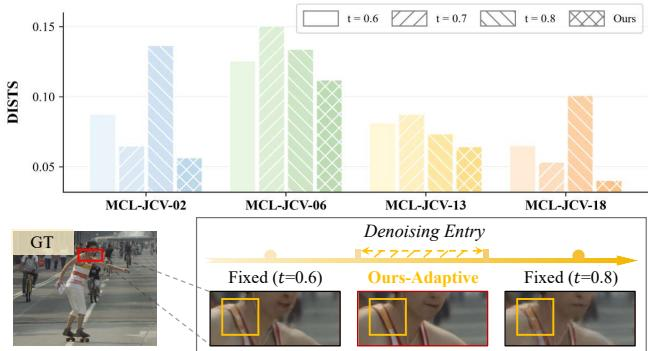
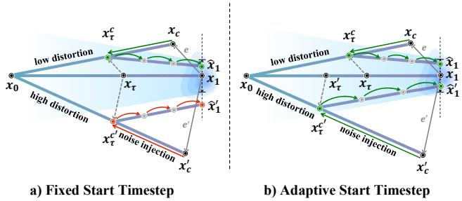
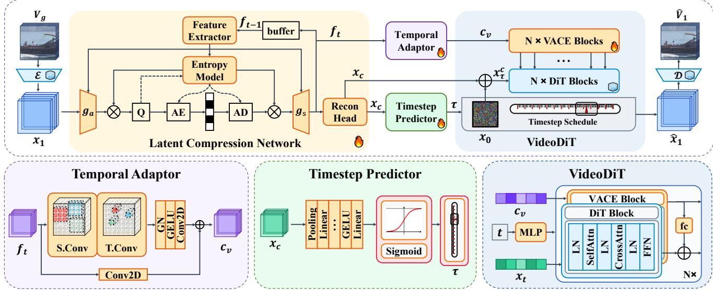
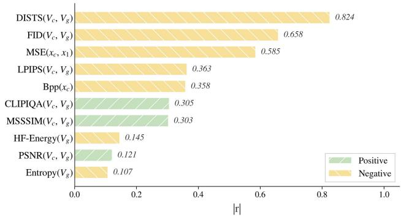
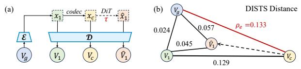
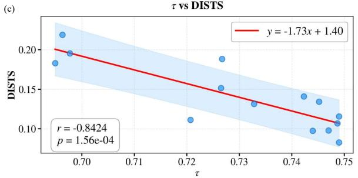
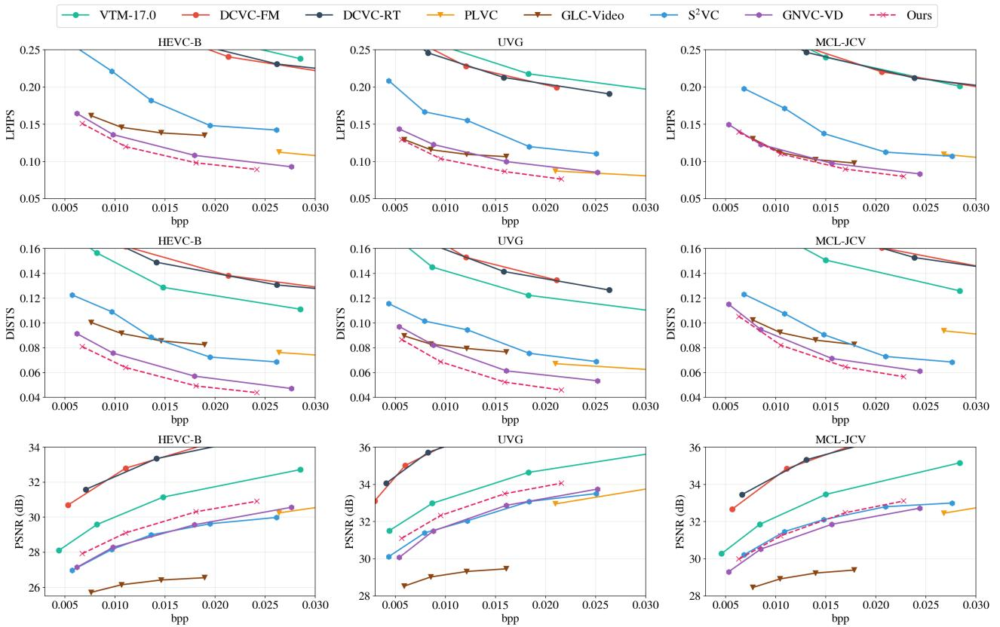
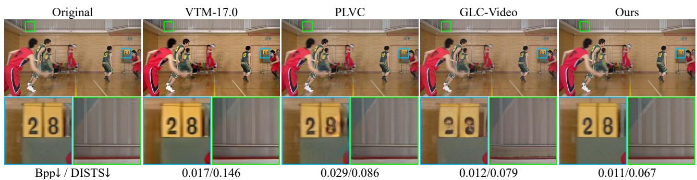
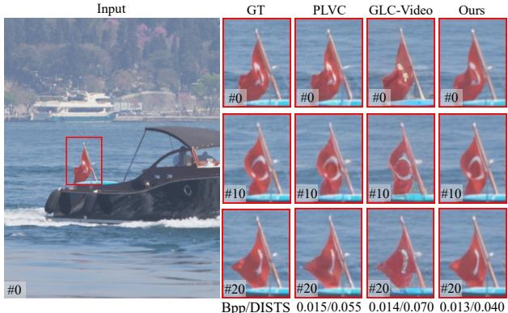

# When to Start Denoising? Adaptive Denoising Entry for Generative Video Compression

Zifu Zhang1,2,3∗, Yuqiao Li1∗, Ding Ding2∗, Shengxi Li1†, Mai Xu1, Daowen Li2, Kai Li2, Ying Chen2† 1Beihang University 2Alibaba Group 3HKUST

## Abstract

Generative video compression offers a promising solution for compressing and reconstructing videos under extremely low bitrate constraints, among which the diffusion-based solutions still achieve the best performance by providing the powerful generative latent prior. However, their effectiveness critically depends on when the compressed latent is introduced into the diffusion process, which directly governs the trade-off between reconstruction fidelity and perceptual realism. To address this limitation, we identify denoising start-timestep selection as a key factor governing this trade-off and formulate it as a geometric optimization problem. Based on this formulation, we propose a novel adaptive diffusion entry method for generative video compression (ADE-GVC), the first timestep-aware generative video compression framework, featuring a lightweight predictor that estimates an adaptive denoising start pointfrom the compressed latent. A temporal adapterfurther extracts compression-aware conditions and injects them into a pretrained video diffusion model, enabling the reconstruction of videos with both high fidelity and realism. More importantly, we observe a strong quantitative relationship between the predicted timesteps and the distortion between the original and compressed latents, providing empirical support for our optimization formulation. Extensive experiments demonstrate that ADE-GVC achieves the stateof-the-art performance on perceptual metrics and substantially improves reconstruction realism over existing generative video compression methods. Notably, our ADE-GVC achieves an average bitrate savings of 40.99% (on DISTS) and 95.24% (on PSNR) compared to the latest open-source baseline GLC-Video.

## 1. Introduction

The rapid growth of video data has made efficient video compression increasingly important. Conventional video coding standards, including H.264/AVC [35], H.265/HEVC [30], and H.266/VVC [2], have achieved remarkable coding efficiency. However, further improvements are becoming increasingly difficult, as these traditional hybrid frameworks rely on hand-crafted modules that are optimized separately. With recent advances in deep learning, learned video codecs such as DCVC series [9, 13–17, 28] have opened new avenues for improving compression performance. They jointly optimize the analysis and synthesis transform, entropy models and temporal context mining, introducing advanced spatio-temporal modeling. However, these methods are still predominantly optimized for objective distortion metrics such as mean squared error (MSE), which often produce over-smoothed and blurry frames that compromise visual quality for human vision. This problem is particularly severe at low bitrates, where overly quantized representations will be unable to support high-frequency details and textures.

  
Figure 1. Illustration of the adaptive denoising entry scheme on MCL-JCV video sequences [33], in which fixed start timestep fails to restore various compression degradations. In contrast, we propose to optimize for adaptive entry timestep that is capable of ad dressing both fidelity and realism for generative video compression.

In recent years, advances in image and video generation [31] have made the generative codec a promising paradigm for perceptual compression especially at low bitrates. A generative codec, due to its ability to leverage the powerful prior knowledge in generative models, can allow for more aggressive coding strategies in rate-distortion optimization.

Video compression approaches based on generative adversarial networks (GANs) [7] and diffusion models [29] have demonstrated remarkable perceptual performance. GANbased compression methods [27, 40] offer relatively low inference complexity but remain limited in compression efficiency due to their insufficient generative capacity, and their adversarial training strategy is often unstable which may introduce temporally inconsistent artifacts. In contrast, diffusion-based methods [11, 23–25, 36] leverage powerful generative priors to substantially improve the perceptual realism of reconstructed videos. However, such improvements often realise at the cost of reconstruction fidelity, as the generated frames may deviate considerably from the original content and even introduce plausible but inaccurate details. Although prior studies [1] have established a fundamental trade-off between distortion and perception, existing generative compression methods remain far from approaching the theoretical distortion-perception bound. Therefore, effectively exploiting generative priors while preserving faithful correspondence to the source video remains a critical challenge in low-bitrate video compression.

To address these limitations, we revisit the distortion–perception trade-off from the perspective of the diffusion denoising entry. Existing methods that leverage pretrained diffusion priors typically start denoising either from pure noise conditioned on the compressed representation [3, 19] or from the compressed latent perturbed with a fixed noise level [20, 25]. However, the injected noise inevitably disrupts source information and merely enables the usage of pretrained denoising priors. We argue that injecting a fixed noise level is suboptimal because it fails to accommodate variations in compression distortion across video sequences. Therefore, this paper formulates denoising entry selection as a geometric optimization problem and derives a closed-form solution under bounded model finetuning capacity. The analysis reveals that the optimal entry timestep decreases monotonically as compression distortion increases, indicating that more severely distorted latents require an earlier entry into the denoising process with a higher level of injected noise. Based on this formulation, we propose a novel Adaptive Diffusion Entry method for Generative Video Compression (ADE-GVC), the first timestep-aware generative video compression framework. It features a lightweight predictor that estimates an adaptive denoising start point from the compressed latent. Interestingly, the predicted timesteps exhibit a strong quantitative relationship with the distortion evaluated by DISTS [4], empirically validating our theoretical solution. Videos with larger compression-induced distortion consistently select earlier denoising entries, even though the predictor receives no explicit supervision on distortion. Finally, a temporal adapter injects compression-aware conditions into the pretrained VACE [10] model, enabling faithful and realistic video reconstruction. As illustrated in Fig. 1, different video sequences favor different discrete denoising entry points. In contrast, our method adaptively selects the optimal entry for each sequence, consistently achieving the best performance across all sequences. Extensive experiments demonstrate that ADE-GVC achieves state-of-the-art performance on perceptual metrics and substantially improves reconstruction realism over existing generative video compression methods. Our contributions are summarized as follows:

• We formulate the distortion–perception trade-off from the perspective of the denoising entry and validate its connection to the widely applied metric empirically.

• We propose the first adaptive diffusion entry method for generative video compression, namely, ADE-GVC, overcoming the limitations of fixed-entry strategies.

• ADE-GVC achieves the state-of-the-art performance, delivering average bitrate savings of 40.99% in terms of DISTS and 95.24% in terms of PSNR over the latest open-source baseline GLC-Video [27].

## 2. Related Works

## 2.1. Learned Video Compression

Neural video compression (NVC) algorithms [13, 22] have advanced rapidly and have in some cases surpassed conventional hybrid codecs in rate-distortion performance. Existing NVC methods are generally categorized based on their mechanism for reducing temporal redundancy, falling into either residual coding or conditional coding paradigms. Residual coding methods [22, 37–40] explicitly encode inter-frame residuals. In contrast, conditional methods [9, 13–16, 28] encode frames conditioned on the temporal context of the reconstructed references. These NVC methods are primarily devoted to optimizing reconstruction fidelity, which leads to excessive blurring of details under low-bitrate conditions.

Generative video compression [8, 27, 44] addresses this limitation by leveraging generative priors and perceptual metrics to produce reconstructions with realistic textures and fine details. Early work [27, 40] employed GANs to improve perceptual quality, while more recent methods [23, 24] have turned to diffusion and flow-matching models for their stronger generative capability. For instance, GNVC-VD [25] has introduced VideoDiT to enhance temporal consistency. Nevertheless, diffusion models require multiple iterative steps, which severely impairs decoding speed. S2VC [36] alleviates this problem by adopting a one-step diffusion model. These methods demonstrate the considerable potential of diffusion models for video compression. However, their use of the fixed timestep schedule for different video sequences may result in insufficient reconstruction fidelity. In contrast, our ADE-GVC adaptively determines the denoising depth of the diffusion model according to the properties of each sequence, thereby achieving better fidelity and realism.

## 2.2. Adaptive Denoising Entry for Low-level Vision

Although fixed denoising entries are common in generative compression, adaptive strategies have been explored in other low-level vision tasks, including superresolution, enhancement, dehazing, and artifact removal $[ 5 ,$ 34, 43]. These methods typically estimate degradation severity or map inputs to explicit noise levels. For example, DMID [18] directly estimates the noise strength during noise-distribution transformation, while SODiff [41] selects the corresponding timestep according to the JPEG quality factor. TADM [32] employs a neural network to estimate the noise level for image rescaling. Similarly, Ultra-VSR [21] combines network-based noise-level estimation with noise scheduling to achieve one-step reconstruction from low-quality to high-quality videos.

However, compression differs fundamentally from other low-level vision tasks. Its degradation is not caused by the external environment but by a compression module, which is an internal distortion source and is jointly optimized within the network. Consequently, compression demands substantially higher reconstruction fidelity, rendering existing adaptive methods inapplicable. Existing generative compression methods [20, 25] typically adopt a fixed denoising entry by injecting a predefined noise level into the compressed representation. Although this design facilitates joint optimization with the compression network, the fixed noise injection may unnecessarily corrupt the retained source information and thereby limit the reconstruction performance of the diffusion model.

## 3. Methodology

## 3.1. Problem Definition

Existing generative approaches to low-level vision tasks commonly build upon pretrained diffusion models. These approaches typically fine-tune the generative prior by incorporating degraded observations as conditioning signals and optimizing the resulting framework in an end-to-end manner, thereby improving reconstruction quality. However, these methods overlook the varying generative capabilities at different timesteps and are trained with a fixed timestep. To demystify this, we first formulate timestep selection as a geometric optimization problem, as illustrated in Fig. 2.

Since training diffusion models directly in the pixel space is computationally expensive, a VAE is generally employed to encode the original visual data into a compact la-

  
Figure 2. Theoretical analysis on our adaptive start timestep scheme against the fixed start timestep scheme, from the geometry perspective. The lightblue regions denote the bounded adaptation capacity of the pretrained model. We illustrate two cases, namely, denoising from the low-distortion latent $\scriptstyle { \mathbf { \mathit { x } } } _ { c }$ and high-distortion latent $\pmb { x } _ { c } ^ { \prime }$ . From the theoretical perspective, we can conclude that a fixed denoising entry cannot accommodate varying distortion levels, whereas our adaptive strategy can.

tent representation:

$$
\begin{array} { r } { \pmb { x } _ { 1 } = \pmb { \mathcal { E } } ( \pmb { V } _ { g } ) , } \end{array}\tag{1}
$$

where $V _ { g }$ denotes the ground-truth video and $\mathcal { E }$ is the pretrained vision encoder. The subscript follows the flowmatching convention, where $t = 0$ represents the noise distribution and $t = 1$ represents the clean data distribution.

For video compression, the compression network (CN) encodes the $\scriptstyle { \pmb x } _ { 1 }$ into a compressed representation $\mathbf { \nabla } _ { \mathbf { x } _ { c } } \mathbf { . }$

$$
\pmb { x } _ { c } = \mathrm { C N } ( \pmb { x _ { 1 } } ) = \pmb { x _ { 1 } } + \pmb { e } ,\tag{2}
$$

where e represents the distortion introduced by compression and quantization. Unlike video generation, where flowmatching models traverse the full probability path from Gaussian noise $\mathbf { \boldsymbol { x } } _ { 0 } \sim \mathcal { N } ( \mathbf { \boldsymbol { 0 } } , I )$ , the compressed latent retains rich texture information and provides a more informative initialization. We therefore start denoising at timestep $\tau ,$ with the corresponding latent $\pmb { x } _ { \tau } ^ { c }$ defined as follows.

$$
\pmb { x } _ { \tau } ^ { c } = \tau \pmb { x } _ { c } + ( 1 - \tau ) \pmb { x } _ { 0 } , \tau \in ( 0 , 1 ) .\tag{3}
$$

Based on (3), the denoising trajectory from the compressed initialization $\pmb { x } _ { \tau } ^ { c }$ to the clean latent $\scriptstyle { \mathbf { \mathscr { x } } } _ { 1 }$ is defined as:

$$
\pmb { x } _ { t } ^ { c } = \frac { t - \tau } { 1 - \tau } \pmb { x _ { 1 } } + \frac { 1 - t } { 1 - \tau } \pmb { x } _ { \tau } ^ { c } , t \in [ \tau , 1 ] .\tag{4}
$$

Differentiating (4) with respect to t and substituting Eqs. (2) and (3) gives the corresponding target velocity field:

$$
{ \pmb v } _ { \tau } = { \pmb x } _ { 1 } - { \pmb x } _ { 0 } - \frac { \tau } { 1 - \tau } { \pmb e } = { \pmb v } _ { \mathrm { p r e } } - { \pmb v } _ { \mathrm { f t } } ,\tag{5}
$$

where $\begin{array} { r } { \pmb { v } _ { \mathrm { f t } } \ = \ \frac { \tau } { 1 - \tau } \pmb { e } } \end{array}$ is the compression-aware correction required during fine-tuning. A smaller $\| \pmb { v } _ { \mathrm { f t } } \|$ reduces the fine-tuning difficulty and generally improves reconstruction fidelity. However, decreasing τ increases the amount of Gaussian noise introduced into the initial state in (3), granting the generative prior greater freedom but potentially damaging the fidelity of the reconstructed video. Therefore, an appropriate τ is required to balance reconstruction fidelity and realism.

  
Figure 3. The overall architecture of ADE-GVC consists of a latent compression network (LCN), temporal adaptor (TA), timestep predicto (TP), and video diffusion model. The input video $V _ { g }$ is encoded into the clean latent $\mathbf { x } _ { 1 } .$ which is compressed by the LCN into $\scriptstyle { \mathbf { \mathit { x } } } _ { c }$ and a compression-aware feature $\pmb { f } _ { t }$ . The TP predicts the denoising entry τ from $\scriptstyle { \mathbf { x } } _ { c } .$ , while the TA converts $\pmb { f } _ { t }$ into the visual context $\pmb { c } _ { v }$ Conditioned on $^ { c _ { v } , }$ the VideoDiT denoises $\pmb { x } _ { \tau } ^ { c } .$ , into $\hat { \mathbf { x } } _ { 1 }$ , which is decoded to reconstruct $\hat { V } _ { 1 }$

We formulate timestep selection as maximizing the starting timestep while penalizing the required fine-tuning correction. We can apply a Lagrangian relaxation method to derive the best timestep $\tau ^ { * }$

$$
\tau ^ { * } = \underset { \tau \in [ 0 , 1 ] } { \arg \operatorname* { m a x } } \left[ \tau - \lambda \frac { \tau } { 1 - \tau } \| e \| \right] = 1 - \sqrt { \lambda \| e \| } ,\tag{6}
$$

where λ controls the trade-off between retaining realism and reducing the fine-tuning difficulty. This result shows that $\tau ^ { * }$ decreases monotonically with the distortion $\lVert e \rVert$ which means more severely distorted inputs require an earlier denoising entry. If the maximum compression-aware correction achievable through fine-tuning is approximated by a constant $\epsilon ,$ the constraint becomes:

$$
\frac { \tau } { 1 - \tau } \lVert e \rVert \leq \epsilon .\tag{7}
$$

The feasible solution for $\tau$ can then be derived in another closed form as:

$$
\tau ^ { * } = \frac { \epsilon } { \epsilon + | | e | | } .\tag{8}
$$

The fine-tuned flow model then denoises the compressed representation into a high-quality latent $\hat { \mathbf { x } } _ { 1 }$ that achieves both high fidelity and realism.

$$
\hat { \pmb { x } } _ { 1 } = \pmb { x } _ { \tau ^ { * } } ^ { c } + \int _ { \tau ^ { * } } ^ { 1 } \pmb { v } _ { \theta } ( \pmb { x } _ { t } ) d t .\tag{9}
$$

## 3.2. Proposed Framework Design

The overall architecture of our network is illustrated in Fig. 3, which mainly consists of a latent compression network (LCN), temporal adaptor (TA), timestep predictor (TP) and video diffusion modules. Based on the pre-trained Wan2.1- VACE generative model [10], our framework utilizes its VAE encoder to derive the clean latent representation $\scriptstyle { \mathbf { \mathscr { x } } } _ { 1 }$ We adapt the DCVC-RT [9] architecture into our LCN tailored for latent-space feature coding. For I-frames, an intraframe compression module composed of depthwise convolutions and residual blocks ensures faithful reconstruction. For P-frames, an implicit temporal modeling scheme extracts temporal context via a streamlined feature extractor. By concatenating this context with the current latent along the channel dimension, the encoder-decoder jointly reduces spatio-temporal redundancy, ultimately yielding the reconstructed latent $\scriptstyle { \mathbf { { \mathit { x } } } } _ { c }$ and the feature $f _ { t }$

$$
[ { \pmb x } _ { c } , { \pmb f } _ { t } ] = \mathrm { L C N } ( { \pmb x } _ { 1 } ) .\tag{10}
$$

To predict the optimal denoising start-timestep, we design a lightweight TP based on the reconstructed latent $\mathbf { \nabla } _ { \mathbf { x } _ { c } . }$ . Specifically, $\mathbf { \delta _ { x } } _ { \mathrm { ~ \normalfont ~ } }$ is first aggregated into a fixed-size feature vector via spatial adaptive pooling, ensuring flexibility across arbitrary input resolutions. The pooled representation is then processed through linear layers followed by a sigmoid activation function $\sigma ( \cdot )$ , which maps the output into the range [0, 1]. The predicted timestep τ is linearly scaled into a predefined search interval $[ \tau _ { \operatorname* { m i n } } , \tau _ { \operatorname* { m a x } } ]$

$$
\tau = \tau _ { \mathrm { m i n } } + ( \tau _ { \mathrm { m a x } } - \tau _ { \mathrm { m i n } } ) \sigma ( \mathrm { T P } ( \pmb { x } _ { c } ) ) .\tag{11}
$$

Subsequently, we obtain the initial denoising state $\pmb { x } _ { \tau } ^ { c }$ based on the predicted timestep τ according to (3).

More importantly, the compression-aware feature $\mathbf { \Delta } f _ { t }$ is processed by a TA, consisting of 2D spatial and 3D temporal convolutional residual blocks, to boost feature capability and extract richer visual context:

$$
\begin{array} { r } { \pmb { c } _ { v } = \mathrm { T A } ( \pmb { f } _ { t } ) . } \end{array}\tag{12}
$$

The extracted visual context $c _ { v }$ is then injected into the DiT through the VACE module as a condition to guide the network in predicting the velocity field ${ \pmb v } _ { \theta }$ at each timestep t:

$$
{ \pmb v } _ { \theta } = \mathrm { D i T } ( { \pmb x } _ { \tau } ^ { c } | \mathrm { V A C E } ( { \pmb c } _ { v } ) , t ) .\tag{13}
$$

Finally, the denoised latent $\hat { \mathbf { x } } _ { 1 }$ is reconstructed based on (9), which is then passed through the pre-trained VAE decoder $\mathcal { D } ( \cdot )$ to yield the final compressed video $\hat { V } _ { 1 }$

$$
\begin{array} { r } { \hat { V } _ { 1 } = \mathcal { D } ( \hat { \pmb x } _ { 1 } ) . } \end{array}\tag{14}
$$

## 3.3. Training Strategies

The compressed distribution is initially far from the pretrained flow manifold, and the predictor can change the denoising trajectory before the refinement model learns a meaningful correction field. We therefore use three progressive stages. We first predefine a fixed denoising start timestep $\tau _ { 0 }$ and jointly train the compression network and VACE module. To align the denoised output with the clean latent and accurately adapt the velocity field of the flow model, we employ the following latent-space loss function in the first stage:

$$
\mathcal { L } _ { l } = R ( \pmb { \hat { y } } ) + \lambda _ { 1 } \| \pmb { \hat { x } } _ { 1 } - \pmb { x } _ { 1 } \| _ { 2 } ^ { 2 } + \mathbb { E } _ { t , \pmb { x } _ { c } ^ { \tau _ { 0 } } } \| \pmb { v } _ { \theta } - \pmb { v } _ { \tau _ { 0 } } \| _ { 2 } ^ { 2 }\tag{15}
$$

where $\hat { \pmb y } = g _ { a } ( { \pmb x } _ { 1 } )$ denotes the quantized representation produced by the compression encoder and is used to estimate the bitrate $R ( \hat { \pmb y } )$ . The target velocity ${ \pmb v } _ { \tau _ { 0 } }$ is computed according to (5) and the coefficient $\lambda _ { 1 }$ balances the rate and reconstruction terms. During training, we gradually decrease $\lambda _ { 1 }$ over successive iterations to prevent an excessively low initial bitrate from destabilizing the denoising network.

Subsequently, we fine-tune the entire framework in the pixel space to further improve its end-to-end reconstruction capability. The pixel-level loss function is defined as

$$
\begin{array} { r l } & { \mathcal { L } _ { p } = R ( \hat { \pmb { y } } ) + \lambda _ { 2 } ( \| \hat { \pmb { x } } _ { 1 } - \pmb { x } _ { 1 } \| _ { 2 } ^ { 2 } + \| \pmb { x } _ { c } - \pmb { x } _ { 1 } \| _ { 2 } ^ { 2 } } \\ & { \qquad + \| \hat { V } _ { 1 } - V _ { g } \| _ { 2 } ^ { 2 } + 0 . 1 \mathcal L _ { \mathrm { L P I P S } } ( \hat { V } _ { 1 } , V _ { g } ) ) , } \end{array}\tag{16}
$$

where the first two distortion terms enforce latent-space consistency for the denoised and compressed representations while the remaining two promote the fidelity and perceptual realism of the reconstructed videos. The coefficient $\lambda _ { 2 }$ controls the trade-off between bitrate and reconstruction quality.

Finally, we introduce the timestep predictor for joint training to obtain the adaptive denoising entry timestep. Its parameters are initialized such that the initial prediction equals the predefined timestep $\tau _ { 0 } ,$ ensuring a smooth transition and stable optimization. The predicted timestep is constrained to the interval $[ \tau _ { \operatorname* { m i n } } , \tau _ { \operatorname* { m a x } } ]$ centered at $\tau _ { 0 }$ . We then continue optimizing the entire framework using (16) to obtain the final timestep-adaptive model.

## 3.4. Denoising Entry Analysis

The trained ADE-GVC acquires the ability to predict the denoising start timestep. According to (8), the optimal $\tau$ decreases monotonically with the latent distortion ∥e∥. To validate this relationship, we measure the distortion between $\mathbf { \delta _ { x } } _ { c }$ and $\scriptstyle { \mathbf { \mathscr { x } } } _ { 1 }$ using latent-space MSE and various quality metrics between the directly decoded video $V _ { c }$ and the ground truth $V _ { g } .$ . These metrics include the pixel-level metrics PSNR, SSIM, and MS-SSIM, the perceptual metrics LPIPS and DISTS, the distribution-level metric FID, and the no-reference metrics NIQE and CLIPIQA. Since $\mathbf { \delta _ { x } } _ { c }$ is derived from $V _ { g } ,$ τ may also be affected by the intrinsic characteristics of the source video. We therefore additionally examine brightness, contrast, entropy, Laplacian variance, color richness, edge density, high-frequency energy, sharpness, and compressed bitrate. These attributes characterize the visual complexity and information content of the source video. We calculate the Pearson correlation coefficient between each factor and the predicted denoising start timestep $\tau .$ The top ten factors with the largest absolute correlation coefficients are reported in Fig. 4.

  
Figure 4. Pearson correlations between the predicted denoising start timestep τ and different distortion or content-related factors. DISTS exhibits the strongest negative correlation with $\tau ,$ whereas intrinsic source-video attributes show substantially weaker correlations.

The results show that DISTS exhibits the strongest correlation with τ, achieving a coefficient of −0.84. We therefore use the decoded-domain DISTS distance $\rho _ { e }$ as an observable proxy for the latent compression distortion ∥e∥:

  
Figure 5. (a) Distortion evolution pipeline through the proposed framework. (b) Distortion triangle in terms of the DISTS metric, which exhibits the strongest correlations with the predicted denoising start timestep. (c) Relationship between the predicted τ and the distortion $\rho _ { e }$ . The strong negative correlation indicates that τ varies inversely with $\rho _ { e }$ , indicating that more severely distorted videos require an earlier denoising start timestep.

$$
\rho _ { e } = \mathrm { D I S T S } ( V _ { g } , { \cal D } ( { \pmb x } _ { c } ) )  \| e \| .\tag{17}
$$

In contrast, intrinsic video attributes and coding parameters exhibit much weaker correlations with τ, indicating that the denoising entry is determined primarily by compressioninduced distortion rather than source-video content.

To further investigate the relationship between $\rho _ { e }$ and the predicted denoising entry, we construct a distortion triangle based on $\rho _ { e } ,$ as illustrated in Fig. 5. Specifically, DISTS is employed to quantify the perceptual distortion introduced at each stage of the framework, including compression and subsequent generative reconstruction. We then visualize the relationship between the compression-induced distortion $\rho _ { e }$ and the predicted timestep τ. From Fig. 5, a strong negative correlation is observed, indicating that videos with larger compression distortion tend to select an earlier denoising entry. Samples satisfying $\tau = \tau _ { \mathrm { m a x } }$ are excluded from the correlation analysis because their predictions are saturated at the upper boundary and therefore do not accurately reflect the underlying distortion-dependent variation in τ . This result empirically supports the relationship derived in (8).

## 4. Experiments

## 4.1. Experimental Settings

Datasets. Following [12], we construct our training dataset from the Pexels dataset. We retain videos with high aesthetic and clarity scores, durations longer than 10 seconds, resulting in approximately 480K high-quality training videos. For evaluation, we conduct all experiments on widely used benchmarks, including HEVC Class B [6], UVG [26], and MCL-JCV [33] datasets.

Baselines and Metrics. We compare ADE-GVC with the conventional codec VTM-17.0 [2], learned neural codecs DCVC-FM [16] and DCVC-RT [9], and generative methods PLVC [40], GLC-Video [27], GNVC-VD [25], and $\mathrm { S ^ { 2 } V C }$ [36]. We evaluate the first 96 frames of each test sequence after conversion to the RGB color space. For closedsource methods such as GNVC-VD and $\mathrm { { \cal S } ^ { 2 } V C } ,$ we digitize the quantitative results from the rate-distortion curves reported in their papers. The bitrate is measured in bits per pixel (Bpp), while distortion is evaluated in terms of both reconstruction fidelity and perceptual quality. Specifically, we use PSNR to measure fidelity and LPIPS [42] and DISTS [4] to assess perceptual quality.

Implementation Details We use Wan2.1 [31] as the pretrained video diffusion backbone and incorporate conditioning adapter blocks following the design of VACE [10]. For training, in the first stage, we set $\tau _ { 0 }$ to 0.7 and initialize $\lambda _ { 1 }$ to 1024, halving it every 10K iterations. We train for 50K iterations with a batch size of 8, where each sample contains 13 frames. In the second stage, we train four bitrate models using $\lambda _ { 2 } \in \{ 0 . 5 , 1 , 2 , 3 \}$ for 100K iterations. The batch size is reduced to 4, each sample contains 25 frames, and the number of sampling steps is set to 5. In the third stage, we train the timestep predictor for 100K iterations and constrain its output to $\tau \in [ 0 . 6 5 , 0 . 7 5 ]$ to ensure stable optimization. During inference, each 96-frame sequence is divided into four groups of {25, 25, 25, 21} frames. All experiments are conducted on NVIDIA H20 GPUs.

## 4.2. Experimental Results

Quantitative Comparisons. We quantitatively evaluated the rate-distortion performance of ADE-GVC on the HEVC Class B [6], UVG [26], and MCL-JCV [33] datasets. As shown in Fig. 6, ADE-GVC consistently outperforms existing methods in both perceptual metrics and also substantially improves PSNR over other generative codecs. Using $\mathsf { S } ^ { 2 } \mathsf { V C }$ [36] as anchor, Table 1 shows that ADE-GVC achieves average BD-rate savings of 62.97% and 51.97% in LPIPS and DISTS, significantly outperforming all competing methods. Compared with the recent open-source GLC-Video [27], it further reduces the BD-rate by 21.54%, 40.99%, and 95.24% in LPIPS, DISTS, and PSNR, demonstrating a favorable balance between perceptual quality and reconstruction fidelity.

Qualitative Comparisons. Fig. 7 presents a visual comparison of the reconstructed frames produced by the proposed method and the competing algorithms, with particular attention paid to textual and textured regions. The reconstruction produced by the conventional codec VTM-17.0 GLC qp3qp34Bpp 0.016622exhibits substantial over-smoothing, resulting in the loss of Bpp 0.011653Lpips 0.11785498455477257 Lpips 0.12216933160865058 fine wall textures and blurred structural boundaries. Al-Dists0.08580813060204188though existing generative video codecs improve perceptual realism, they remain prone to hallucinated or structurally inconsistent details. Specifically, PLVC introduces noticeable artifacts around the text, while GLC-Video severely distorts its global structure and reduces its readability. In contrast, ADE-GVC effectively avoids both the over-smoothing of conventional coding and the structural artifacts of existing generative methods, faithfully recovering delicate wall textures while preserving sharp, complete, and recognizable mbda1 text boundaries. Fig. 8 further demonstrates the tempo-pips 0.10757ists 0.067299 ral stability of ADE-GVC. For objects undergoing complex motion, even at extremely low bitrates, ADE-GVC largely avoids the temporally inconsistent textures and artifacts that are commonly introduced by other generative methods.

Figure 6. Quantitative comparisons with the state-of-the-art methods in terms of perceptual metrics (namely, LPIPS and DISTS) and supervised pixel-level metrics (namely, PSNR) on the HEVC-B, UVG, and MCL-JCV datasets.  
  
Figure 7. Qualitative comparisons on a single frame in terms of representative VVC, PLVC, GLC-Video and our ADE-GVC methods. We also report the Bpp/DISTS metrics to quantify compression efficiency.

<table><tr><td rowspan="2">Method/Metrics</td><td colspan="2">HEVC-B</td><td colspan="2">UVG</td><td colspan="2">MCL-JCV</td></tr><tr><td>LPIPS</td><td>DISTS</td><td>LPIPS</td><td>DISTS</td><td>LPIPS</td><td>DISTS</td></tr><tr><td>VVC</td><td>+248.8</td><td>+195.6</td><td>+442.6</td><td>+390.8</td><td>+348.7</td><td>+364.7</td></tr><tr><td>DCVC-FM</td><td>+248.2</td><td>+542.1</td><td>+371.9</td><td>+804.0</td><td>+375.9</td><td>+688.4</td></tr><tr><td>DCVC-RT</td><td>+277.1</td><td>+568.7</td><td>+392.7</td><td>+801.4</td><td>+409.8</td><td>+740.0</td></tr><tr><td>S2VC</td><td>0.0</td><td>0.0</td><td>0.0</td><td>0.0</td><td>0.0</td><td>0.0</td></tr><tr><td>GLC-Video</td><td>-52.0</td><td>-13.4</td><td>-61.54</td><td>-42.9</td><td>-51.7</td><td>-23.0</td></tr><tr><td>GNVC-VD</td><td>-62.0</td><td>-47.3</td><td>-54.9</td><td>-45.6</td><td>-54.0</td><td>-36.9</td></tr><tr><td>Ours</td><td>-67.3</td><td>-56.4</td><td>-67.4</td><td>-59.2</td><td>-54.2</td><td>-40.3</td></tr></table>

Table 1. BD-Rate (%) comparisons by anchoring $\mathsf { S } ^ { 2 } \mathrm { V C }$ on three datasets. Bold values indicate the best results.

  
Figure 8. Qualitative comparisons for temporal consistency in terms of representative PLVC, GLC-Video and our ADE-GVC methods. We also report the Bpp/DISTS metrics to quantify compression efficiency.

<table><tr><td>Optimization</td><td>Baseline</td><td>+Parallelism</td><td>+Compile</td><td>+DiT-bf16</td></tr><tr><td>Enc. Time(s)</td><td>0.306</td><td>0.078</td><td>0.078</td><td>0.078</td></tr><tr><td>Dec. Time (s)</td><td>4.341</td><td>1.163</td><td>1.133</td><td>0.831</td></tr><tr><td>Speedups</td><td>1x</td><td>3.74×</td><td>3.84×</td><td>5.11×</td></tr></table>

Table 2. Complexity cumulative optimization for 1920x1080 video sequences, with runtime averaged over 96 frames.

## 4.3. Complexity Analysis

Generative models are computationally intensive for highresolution video reconstruction. To improve time efficiency, we progressively apply three optimization strategies, as shown in Table 2. The baseline is evaluated in FP32 on a single NVIDIA H20 GPU. Since the clips are processed independently, we distribute them for parallel inference, reducing the total coding time from 4.647s to 1.241s and achieving a 3.74× speedup. Applying Torch compile function further reduces the decoding time to 1.133s per frame. Finally, BF16 inference for the DiT and VACE modules decreases the decoding time to 0.831s with negligible impact on reconstruction quality. Together, these optimizations achieve an overall speedup of 5.11× at 1080p resolution.

## 4.4. Ablation Studies

We investigate the effects of progressive training and timestep selection in Table 3. Stage I, trained solely in the latent domain using (15), serves as the anchor. Stage II additionally applies the pixel-domain loss function in (16) with a fixed starting timestep of 0.7, substantially improving both fidelity and perceptual quality. Stage III introduces adaptive timestep prediction within the interval defined by (11). With a wide range of [0.60, 0.90] (Stage III-Wide), the predicted τ values concentrate near 0.90, shortening the generative refinement trajectory and yielding limited gains. Restricting the range to [0.65, 0.75] achieves a better balance between latent fidelity and generative refinement. Our final model consistently performs best, achieving BD-rate savings of up to 40.52% on HEVC-B and 44.09% on UVG with DISTS.

<table><tr><td rowspan="2">Method/BD-BR</td><td colspan="3">HEVC-B</td><td colspan="3">UVG</td></tr><tr><td>LPIPS</td><td>DISTS</td><td>PSNR</td><td>LPIPS</td><td>DISTS</td><td>PSNR</td></tr><tr><td>Stage I</td><td>+0.0</td><td>+0.0</td><td>+0.0</td><td>+0.0</td><td>+0.0</td><td>+0.0</td></tr><tr><td>Stage II</td><td>-29.82</td><td>-33.65</td><td>-28.59</td><td>-30.27</td><td>-39.49</td><td>-29.87</td></tr><tr><td>Stage III-Wide</td><td>-31.71</td><td>-33.62</td><td>-30.44</td><td>-39.68</td><td>-40.92</td><td>-29.80</td></tr><tr><td>Stage III-Ours</td><td>-36.53</td><td>-40.52</td><td>-32.86</td><td>-44.48</td><td>-44.09</td><td>-33.89</td></tr></table>

Table 3. Ablation study on the progressive training of our ADE-GVC on two datasets, evaluated by the LPIPS, DISTS, and PSNR metrics. Bold values indicate the best results.

## 5. Conclusion and Future Work

We presented ADE-GVC, a timestep-aware generative video compression framework that adaptively selects the denoising entry from the compressed latent. We formulated denoising entry selection as a geometric optimization problem under bounded fine-tuning capacity and showed that the optimal entry timestep decreases monotonically with the compression distortion. Therefore the fixed entry cannot accommodate the varying distortion levels of different video sequences. By combining a lightweight timestep predictor with compression-aware conditioning, ADE-GVC achieves a favorable balance between reconstruction fidelity and perceptual realism. Experiments demonstrate state-of-the-art performance and validate the relationship between the predicted timestep and DISTS. This work primarily investigates the selection of the denoising entry, while the number of sampling steps remains fixed across video sequences. Future work will jointly adapt the denoising entry and sampling steps to further improve reconstruction quality and inference efficiency. More broadly speaking, we believe that the denoising entry is an important yet overlooked design dimension for diffusion-based method, and that our analysis may also benefit generative image compression and other fidelity-critical low-level vision tasks.

## References

[1] Yochai Blau and Tomer Michaeli. The perception-distortion tradeoff. In 2018 IEEE/CVF Conference on Computer Vision and Pattern Recognition, pages 6228–6237, 2018. 2

[2] B. Bross, Y. Wang, Y. Ye, S. Liu, J. Chen, G. Sullivan, and J. Ohm. Overview of the versatile video coding (VVC) standard and its applications. IEEE Transactions on Circuits and Systems for Video Technology, 31(10):3736–3764, 2021. 1, 6

[3] Ding Ding, Daowen Li, Ying Chen, Yixin Gao, Ruixiao Dong, Kai Li, and Li Li. Controllable generative video compression. arXiv preprint arXiv:2604.06655, 2026. 2

[4] Keyan Ding, Kede Ma, Shiqi Wang, and Eero P. Simoncelli. Image quality assessment: Unifying structure and texture similarity. IEEE Transactions on Pattern Analysis and Machine Intelligence, 44(5):2567–2581, 2022. 2, 6

[5] Jigang Duan, Genwei Ma, Xu Jiang, Wenfeng Xu, Ping Yang, and Xing Zhao. Beyond fixed inference: Quantitative flow matching for adaptive image denoising, 2026. 3

[6] D. Flynn, K. Sharman, and C. Rosewarne. Common test conditions and software reference configurations for hevc range extensions, document jctvc-n1006. Technical report, Joint Collaborative Team Video Coding ITU-T SG, 2014. 6

[7] Ian Goodfellow, Jean Pouget-Abadie, Mehdi Mirza, Bing Xu, David Warde-Farley, Sherjil Ozair, Aaron Courville, and Yoshua Bengio. Generative adversarial networks. Communications ofthe ACM, 63(11):139–144, 2020. 2

[8] Zongyu Guo, Zhaoyang Jia, Jiahao Li, Xiaoyi Zhang, Bin Li, and Yan Lu. Generative latent video compression, 2025. 2

[9] Zhaoyang Jia, Bin Li, Jiahao Li, Wenxuan Xie, Linfeng Qi, Houqiang Li, and Yan Lu. Towards practical real-time neural video compression. In IEEE/CVF Conference on Computer Vision and Pattern Recognition, CVPR 2025, Nashville, TN, USA, June 11-25, 2024, 2025. 1, 2, 4, 6

[10] Zeyinzi Jiang, Zhen Han, Chaojie Mao, Jingfeng Zhang, Yulin Pan, and Yu Liu. Vace: All-in-one video creation and editing. In Proceedings ofthe IEEE/CVF International Conference on Computer Vision, pages 17191–17202, 2025. 2, 4, 6

[11] Daowen Li, Ding Ding, Zifu Zhang, Kai Li, and Ying Chen. Generative video compression based on hierarchical referencing. arXiv preprint arXiv:2608.11618, 2026. 2

[12] Daowen Li, Ruixiao Dong, Ying Chen, Kai Li, Ding Ding, and Li Li. Progvc: Progressive-based generative video compression via auto-regressive context modeling. arXiv preprint arXiv:2603.17546, 2026. 6

[13] Jiahao Li, Bin Li, and Yan Lu. Deep contextual video compression. Advances in Neural Information Processing Systems, 34, 2021. 1, 2

[14] Jiahao Li, Bin Li, and Yan Lu. Hybrid spatial-temporal entropy modelling for neural video compression. In Proceedings of the 30th ACM International Conference on Multimedia, 2022.

[15] Jiahao Li, Bin Li, and Yan Lu. Neural video compression with diverse contexts. In IEEE/CVF Conference on Computer Vision and Pattern Recognition, CVPR 2023, Vancouver, Canada, June 18-22, 2023, 2023.

[16] Jiahao Li, Bin Li, and Yan Lu. Neural video compression with feature modulation. In IEEE/CVF Conference on Com puter Vision and Pattern Recognition, CVPR 2024, Seattle, WA, USA, June 17-21, 2024, 2024. 2, 6

[17] Jiahao Li, Wenxuan Xie, Zhaoyang Jia, Bin Li, Zongyu Guo, Xiaoyi Zhang, and Yan Lu. Ultra-fast neural video compression. In IEEE/CVF Conference on Computer Vision and Pat tern Recognition, CVPR 2026, Denver, CO, USA, June 3-7, 2026, 2026. 1

[18] Tong Li, Hansen Feng, Lizhi Wang, Zhiwei Xiong, and Hua Huang. Stimulating the diffusion model for image denoising via adaptive embedding and ensembling. In IEEE Transactions on Pattern Analysis and Machine Intelligence (TPAMI), pages 8240–8257, 2024. 3

[19] Zhiyuan Li, Yanhui Zhou, Hao Wei, Chenyang Ge, and Jingwen Jiang. Towards extreme image compression with latent feature guidance and diffusion prior. IEEE Transactions on Circuits and Systemsfor Video Technology, 2024. 2

[20] Zhiyuan Li, Yanhui Zhou, Hao Wei, Chenyang Ge, and Aj mal Mian. Rdeic: Accelerating diffusion-based extreme image compression with relay residual diffusion. IEEE Transactions on Circuits and Systemsfor Video Technology, 2025. 2, 3

[21] Yong Liu, Jinshan Pan, Yinchuan Li, Qingji Dong, Chao Zhu, Yu Guo, and Fei Wang. Ultravsr: Achieving ultrarealistic video super-resolution with efficient one-step diffusion space. In Proceedings ofthe 33rd ACM International Conference on Multimedia, page 7785–7794, New York, NY, USA, 2025. Association for Computing Machinery. 3

[22] Guo Lu, Wanli Ouyang, Dong Xu, Xiaoyun Zhang, Chunlei Cai, and Zhiyong Gao. Dvc: An end-to-end deep video compression framework. In 2019 IEEE/CVF Conference on Computer Vision and Pattern Recognition (CVPR), pages 10998–11007, 2019. 2

[23] Wenzhuo Ma and Zhenzhong Chen. Diffusion-based percep tual neural video compression with temporal diffusion information reuse. ACM Trans. Multimedia Comput. Commun. Appl., 21(12), 2025. 2

[24] Wenzhuo Ma and Zhenzhong Chen. Diffvc-osd: One-step diffusion-based perceptual neural video compression framework. In 2025 International Conference on Visual Commu nications and Image Processing (VCIP), pages 1–5, 2025. 2

[25] Qi Mao, Hao Cheng, Tinghan Yang, Libiao Jin, and Siwei Ma. Generative neural video compression via video diffusion prior. In Proceedings of the IEEE/CVF Conference on Computer Vision and Pattern Recognition (CVPR), pages 43239–43248, 2026. 2, 3, 6

[26] Alexandre Mercat, Marko Viitanen, and Jarno Vanne. Uvg dataset: 50/120fps 4k sequences for video codec analysis and development. In Proceedings of the 11th ACM Multimedia Systems Conference, page 297–302, New York, NY, USA, 2020. Association for Computing Machinery. 6

[27] Linfeng Qi, Zhaoyang Jia, Jiahao Li, Bin Li, Houqiang Li, and Yan Lu. Generative latent coding for ultra-low bitrate image and video compression. IEEE Transactions on Circuits and Systems for Video Technology, 35(10):10500– 10515, 2025. 2, 6

[28] Xihua Sheng, Jiahao Li, Bin Li, Li Li, Dong Liu, and Yan Lu. Temporal context mining for learned video compression. IEEE Transactions on Multimedia, 2022. 1, 2

[29] Jiaming Song, Chenlin Meng, and Stefano Ermon. Denoising diffusion implicit models. In International Conference on Learning Representations, 2021. 2

[30] G. Sullivan, J. Ohm, W. Han, and T. Wiegand. Overview of the high efficiency video coding (hevc) standard. IEEE Transactions on Circuits and Systems for Video Technology, 22(12):1649–1668, 2012. 1

[31] Team Wan, Ang Wang, Baole Ai, Bin Wen, Chaojie Mao, Chen-Wei Xie, Di Chen, Feiwu Yu, Haiming Zhao, Jianxiao Yang, Jianyuan Zeng, Jiayu Wang, Jingfeng Zhang, Jingren Zhou, Jinkai Wang, Jixuan Chen, Kai Zhu, Kang Zhao, Keyu Yan, Lianghua Huang, Mengyang Feng, Ningyi Zhang, Pandeng Li, Pingyu Wu, Ruihang Chu, Ruili Feng, Shiwei Zhang, Siyang Sun, Tao Fang, Tianxing Wang, Tianyi Gui, Tingyu Weng, Tong Shen, Wei Lin, Wei Wang, Wei Wang, Wenmeng Zhou, Wente Wang, Wenting Shen, Wenyuan Yu, Xianzhong Shi, Xiaoming Huang, Xin Xu, Yan Kou, Yangyu Lv, Yifei Li, Yijing Liu, Yiming Wang, Yingya Zhang, Yitong Huang, Yong Li, You Wu, Yu Liu, Yulin Pan, Yun Zheng, Yuntao Hong, Yupeng Shi, Yutong Feng, Zeyinzi Jiang, Zhen Han, Zhi-Fan Wu, and Ziyu Liu. Wan: Open and advanced large-scale video generative models. arXiv preprint arXiv:2503.20314, 2025. 1, 6

[32] Ce Wang, Zhenyu Hu, Wanjie Sun, and Zhenzhong Chen. Timestep-aware diffusion model for extreme image rescaling. In Proceedings of the IEEE/CVF International Conference on Computer Vision (ICCV), pages 15594–15603, 2025. 3

[33] Haiqiang Wang, Weihao Gan, Sudeng Hu, Joe Yuchieh Lin, Lina Jin, Longguang Song, Ping Wang, Ioannis Katsavounidis, Anne Aaron, and C.-C. Jay Kuo. Mcl-jcv: A jnd-based h.264/avc video quality assessment dataset. In 2016 IEEE International Conference on Image Processing (ICIP), pages 1509–1513, 2016. 1, 6

[34] Jiangang Wang, Qingnan Fan, Qi Zhang, Haigen Liu, Yuhang Yu, Jinwei Chen, and Wenqi Ren. Hero-sr: One-step diffusion for super-resolution with human perception priors, 2024. 3

[35] Thomas Wiegand, Gary J Sullivan, Gisle Bjontegaard, and Ajay Luthra. Overview of the h. 264/avc video coding standard. IEEE Transactions on Circuits and Systems for Video Technology, 13(7):560–576, 2003. 1

[36] Naifu Xue, Zhaoyang Jia, Jiahao Li, Bin Li, Zihan Zheng, Yuan Zhang, and Yan Lu. Single-step diffusion-based video coding with semantic-temporal guidance. In Proceedings of the IEEE/CVF Conference on Computer Vision and Pattern Recognition (CVPR), pages 9752–9761, 2026. 2, 6

[37] Ren Yang, Fabian Mentzer, Luc Van Gool, and Radu Timofte. Learning for video compression with hierarchical quality and recurrent enhancement. In Proceedings ofthe IEEE/CVF Conference on Computer Vision and Pattern Recognition (CVPR), 2020. 2

[38] Ren Yang, Fabian Mentzer, Luc Van Gool, and Radu Timofte. Learning for video compression with recurrent auto-

encoder and recurrent probability model. IEEE Journal of Selected Topics in Signal Processing, 15(2):388–401, 2021.

[39] Ren Yang, Radu Timofte, and Luc Van Gool. Advancing learned video compression with in-loop frame prediction. IEEE Transactions on Circuits and Systems for Video Tech nology, 2022.

[40] Ren Yang, Radu Timofte, and Luc Van Gool. Perceptual video compression with recurrent conditional gan. In Processings of the International Joint Conference on Artificial Intelligence (IJCAI), 2022. 2, 6

[41] Tingyu Yang, Jue Gong, Jinpei Guo, Wenbo Li, Yong Guo, and Yulun Zhang. Sodiff: Semantic-oriented diffusion model for jpeg compression artifacts removal. Proceedings of the AAAI Conference on Artificial Intelligence, 40:11739– 11747, 2026. 3

[42] Richard Zhang, Phillip Isola, Alexei A. Efros, Eli Shechtman, and Oliver Wang. The unreasonable effectiveness of deep features as a perceptual metric. In 2018 IEEE/CVF Conference on Computer Vision and Pattern Recognition, pages 586–595, 2018. 6

[43] Ruicheng Zhang, Puxin Yan, Zeyu Zhang, Yicheng Chang, Hongyi Chen, and Zhi Jin. Rpd-diff: Region-adaptive physics-guided diffusion model for visibility enhancement under dense and non-uniform haze, 2025. 3

[44] Zihan Zheng, Zhaoyang Jia, Naifu Xue, Jiahao Li, Bin Li, Zongyu Guo, Xiaoyi Zhang, Zhenghao Chen, Houqiang Li, and Yan Lu. Generative video compression with onedimensional latent representation. In Proceedings of the IEEE/CVF Conference on Computer Vision and Pattern Recognition (CVPR), pages 41256–41265, 2026. 2