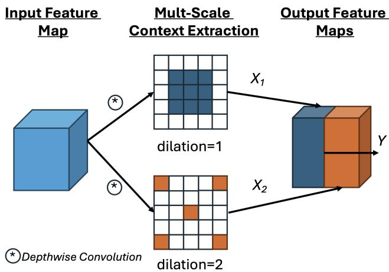
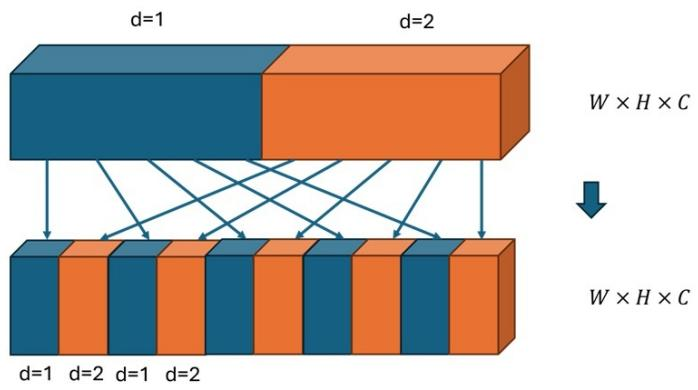
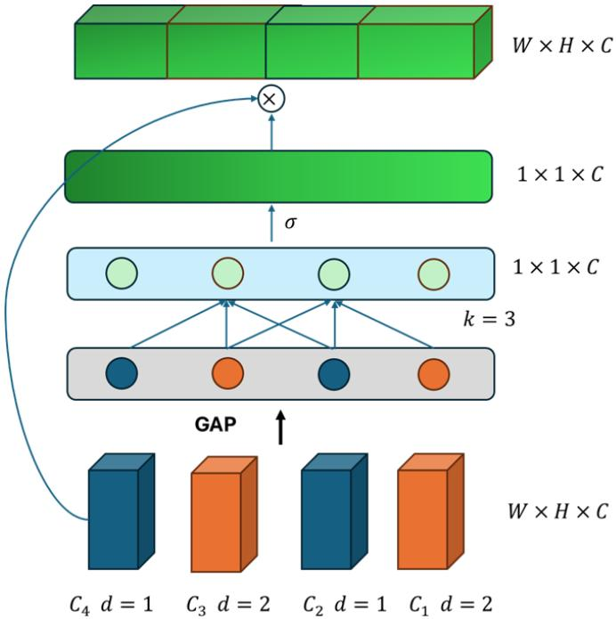
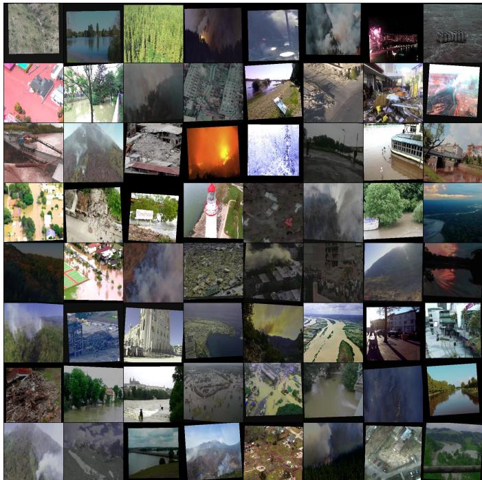

# picoEmergencyNet: Attention-Enhanced Ultra-Small Deep Learning Model for Aerial Image Classification in Emergency Monitoring

Christos Kyrkou

KIOS Research and Innovation Center of Excellence

University of Cyprus

Nicosia, Cyprus

ORCID: 0000-0002-7926-7642

Abstract—Real-time disaster recognition from aerial imagery requires deep learning models that operate under strict memory, compute, and latency constraints. While recent approaches achieve high accuracy, their computational cost limits deployment on resource-constrained UAV platforms. This work introduces picoEmergencyNet, an ultra-lightweight convolutional neural network designed for aerial image disaster classification. The proposed architecture combines depthwise dilated convolutions with efficient channel attention and channel shuffling to enable multi-scale feature extraction at minimal computational cost. picoEmergencyNet has 23k parameters and 7M FLOPs, requiring only 0.1 MB of model storage. Evaluated on the AIDER and AIDERv2 disaster datasets, it achieves up to 96.1% accuracy, matching or exceeding state-of-the-art lightweight models that are orders of magnitude larger. Deployment experiments on the NVIDIA Jetson AGX Orin show that, without hardware-specific optimizations, picoEmergencyNet achieves 258 FPS on GPU and 46 FPS on CPU with a 7× lower activation memory footprint compared to competing models. These results demonstrate that careful architectural specialization, rather than model scaling, enables highly efficient and accurate TinyML-ready disaster recognition for real-time UAV-based emergency monitoring.

Index Terms—Image Classification, UAV (Unmanned Aerial Vehicle), Convolutional Neural Networks, Tiny ML

## I. INTRODUCTION

Advances in technologies such as unmanned aerial vehicles (UAVs) [10], have expanded the capabilities of disaster monitoring and response. UAVs provide quick aerial observations in hard-to-reach areas, which may be dangerous for humans to access, and capture high-resolution images, thus enhancing situational awareness over large areas. At the same time, Computer Vision (CV) algorithms based on deep learning techniques can serve as a crucial component for classifying disaster events by analyzing acquired images in real time, either during or in the aftermath of disasters. Consequently, the integration of UAVs with deep learning techniques for disaster recognition holds great promise for further advancements in the field of emergency management [10].

In recent times, several efforts have been made towards innovative approaches, which led to the establishment of multiple datasets designed for disaster classification [12], [21]. Using these datasets multiple networks have been proposed based on Convolutional Neural Networks (CNNs or ConvNets) and lately Vision Transformers (ViTs). ConvNets and ViTs usually differ in their size and complexity, with standard ViTs often being more resource-intensive than ConvNets.

Significantly, it should be highlighted that while deeper and more complex models tend to be more accurate, they come at additional cost of increased computational requirements, longer inference times, and heavier workloads. Such constraints become particularly critical in scenarios like emergency and disaster response. In scenarios where drone technology is frequently utilized, deploying such deep learning models for disaster response requires them to be compact and built with low-resource constraints in mind. This ensures reduced computational complexity, facilitating rapid inference and allowing real-time image analysis [1].

This work proposes an ultra-small deep learning model suitable for aerial image classification of disasters in emergency monitoring. Specifically, our main contributions are the following:

• A tiny deep learning model that features minimal branching of depthwise dilated convolutions leading to limited activation memory and improved batch-1 latency, without exploiting hardware-specific optimizations.

• An attention-based design to better mix dilated convolutions of multiple branches to allow cross-scale interaction leading to improved accuracy.

These architectural considerations result in a proposed model referred to as picoEmergencyNet that achieves stateof-the-art accuracy while being compact (23k parameters, 7M FLOPs) and consistently outperforming other models on both GPU and CPU during real-world deployment.

## II. RELATED WORKS

UAVs have become an important sensing platform for emergency management because they can be deployed rapidly and capture detailed views of affected areas. Recent work shows that deep-learning–based computer vision can support several UAV disaster applications, including real-time search and rescue operations [10], post-event damage recognition and damage-level classification from UAV imagery [12]. In these types of applications the machine learning and computer vision algorithms underpinning these systems not only need to provide sufficient accuracy but also be able to operate under tight time constraints, which makes efficiency and onboard performance central design goals. Therefore, recent surveys highlight the strong focus on lightweight models, optimization, and practical deployment constraints for real-time aerial vision [5].

Recent methods for disaster recognition systems heavily utilize deep learning methods such as Deep Convolutional Neural Networks [9] and Vision Transformers [3]. Since higher accuracy often comes with increased latency and resource use, disaster-response UAV deployments require lightweight, efficient models to enable fast, real-time inference [1].

Lightweight ConvNet models have become a focal point due to their compatibility with embedded systems, such as UAVs, which typically have limited computational capabilities. Initial methods utilized and repurposed existing models such as [20] that popularized depthwise separable convolutions, [6] that utilized automated network search, [14] that introduced operations more suited for CPU platforms, and [7] that utilized multiple branches and channel reduction for efficient operation.

More specialized models derived from bottom-up have also been developed for the task of disaster recognition. Kyrkou et al. introduced EmergencyNet [12], a small convolutional model based on depthwise convolutions, that demonstrated the applicability of specialized models for aerial disaster recognition. This work was then used as basis to develop TinyEmergencyNet [17] from the initial EmergencyNet model through a pruning strategy that removed up to 60% of the model weights of. [13] presented WATT-EffNet, an innovative approach improving accuracy while maintaining a lightweight architecture, with an F1-score of 0.885 on the AIDER dataset [11]. [18] proposed a 3 MB small model with an F1 score of 0.88 for automatic disaster recognition. [24] optimized their model using OpenVINO, outperforming TensorFlow in framerate inference with minimal drop in accuracy. DiRecNetV2 proposed in [21], is a hybrid CNN–Transformer model for aerial disaster recognition from UAV imagery. The key idea is to combine CNNs (for efficient local feature extraction) with Transformer attention (for global context modeling) while keeping computational cost low enough for real-time deployment on drones. DiRecNetV2 achieves high single-label classification performance (weighted F1=0.964) and reasonable multi-label performance (F1=0.614). The work highlights the trade-off between accuracy, contextual modeling, and realtime constraints in UAV-based disaster response. TakuNet [19] proposes an ultra-lightweight CNN architecture for real-time disaster recognition on embedded UAV platforms. The model uses a mixture of efficiency-oriented design choices (depthwise convolutions) along with platform-specific optimizations (TensorRT and FP16 inference) to minimize computation and energy consumption while maintaining competitive accuracy. Evaluated on aerial emergency datasets and deployed on embedded devices TakuNet achieves high accuracy with extremely high throughput demonstrating the benefits of small specialized models.

Within the domain of specific disaster recognition, [8] effectively utilized ViTs for fire detection, while [4] implemented ViTs for wildfire segmentation. The research community has also explored ways to construct lightweight versions of ViTs. The goal of these efforts is to reduce the computing footprint of ViTs while maintaining their advantages, such as their adaptability and global receptive field. Thus, the following lightweight ViTs are additionally investigated; MobileViT-(s,xs,xss) [16], and MobileViTV2-(050,100) [15].

This study aims to address the accuracy gap observed by small and tiny models and their larger counterparts while maintaining high performance.

## III. picoEMERGENCYNET

This section describes picoEmergencyNet. A small neural network that applies attention across mixed dilated convolution channels to better blend multi-scale information. Furthermore, by making use of depthwise convolutions it leads to reduced parameter count and higher computational efficiency.

The core block of the proposed network is motivated and built upon on ideas from multi-scale context possible via dilated convolutions [2], the multi-path architecture of inception in [22], and depthwise convolutions [20]. The combination of these features and the incorporation of attention results in a block that is tailored for low-resource settings yet highly performant. Specifically, the block extracts multi-scale features that jointly capture fine-grained local details and broader global context, mixing and aggregating features and increasing their dimensionality via concatenation without incurring additional computational cost. Furthermore it leverages dilated convolutions to expand the receptive field by skipping input values, thereby covering a larger spatial area with fewer operations while yielding a richer representation. Depth-wise convolutions are used throughout all dilated stages to maintain computational efficiency.

## A. Multi-Scale Context Extraction

Multi-scale features are extracted by capturing multi-scale context by through parallel branches of dilated convolutions with different rates as shown in Fig. 1. In principle many parallel branches are possible but to reduce computations complexity it is set only to 2. Multi-scale features are extracted to capture both local details and more global context simultaneously. Features are aggregated and dimensionality is increased via simple concatenation which does not incur extra computational cost. Finally, the dilated convolutions are implemented in a depthwise fashion to reduce computational demand leading to independent feature maps operating at effectively different scales. The core operations are as follows:

$$
\mathsf { X _ { 1 } } = D i l a t e d D e p t h C o n v _ { d = 1 } ( \mathsf { X } )\tag{1}
$$

$$
\mathsf { X } _ { 2 } = D i l a t e d D e p t h C o n v _ { d = 2 } ( \mathsf { X } )
$$

$$
\mathsf { Y } = c o n c a t ( [ \mathsf { X } _ { 1 } , \mathsf { X } _ { 2 } ] )\tag{2}
$$

(3)

  
Fig. 1. Multi-Scale Context Extraction through dilated convolution branches.

where $\substack { } D i l a t e d D e p t h C o n v ( \cdot ) _ { d }$ (DDC for short) refers to the dilated convolution operations with dilation rate of $d \ : = \ : 1$ (i.e., a canonical $3 \times 3$ kernel), and with dilation rate of $d = 2 \ ( { \mathrm { i . e . } }$ , effective $5 \times 5$ receptive field with 9 parameters). concat[·, ·] refers to the channel-wise feature aggregation. In this case concatenating features from different dilated convolutions allows diverse representation of the input that can improve discrimination ability. This operation is followed by a normalization operation and activation which in this case are batch normalization and LeakyRelu respectively.

## B. Dilation Shuffling

The channel shuffle operation is used to interleave channels originating from possibly multiple feature maps produced by convolution branches (2 in our case), with different dilation rates (as shown in Fig. 2). After concatenation along the channel dimension, the channels are reshaped into groups corresponding to the different dilation branches and then permuted so that channels $C _ { i }$ from distinct dilation rates are evenly mixed. This reordering breaks the isolation between dilation-specific feature groups and promotes cross-dilation information exchange from different effective scales which is necessary for operating in dynamic and varying environments. This module does not add extra learnable parameters or significant computational overhead.

## C. Efficient Channel Attention for Cross-Dilation Mixing

Following channel shuffling, Efficient Channel Attention (ECA) [23] is applied to facilitate adaptive cross-dilation mixing as shown in Fig. 3. The main idea is to adapt the emphasis of specific channels based on their neighbors stemming from different dilation rates which look at different effective scales. Instead of relying on fully connected layers, ECA employs a lightweight one-dimensional convolution on the globally pooled channel vector to capture local inter-channel dependencies. In the context of multi-rate dilated features, this mechanism allows the network to selectively emphasize or suppress channels originating from different dilation branches based on their contextual relevance. As a result, informative features at appropriate receptive field scales are dynamically weighted, strengthening cross-scale interactions while preserving efficiency by avoiding additional parameters and heavy computation. The introduction of ECA-based dilation channel mixing contributes to $a \ \sim \ \ 1 \%$ improvement enabling to surpass/match state of the art accuracy as it will be shown in Sec. IV-D2.

  
Fig. 2. Channel shuffle to mix channels of different dilation-rate convolutions.

  
Fig. 3. Efficient Channel Attention to fuse Multi-Scale Context of dilated convolution branches.

## D. Overall Architecture

Based on the main operations we instantiate a small picoEmergencyNet architecture by following a typical conventional architecture of utilizing a stem block, followed by a series of stacked main blocks. Batch normalization is utilized throughout, and LeakyRelu is used as the activation function. Detailed description is shown in Table I.

TABLE I  
STAGE-WISE FEATURE MAP EVOLUTION OF THE PROPOSED MODEL (INPUT: 240 × 240).
<table><tr><td rowspan=1 colspan=1>Stage</td><td rowspan=1 colspan=1>Output Size (C×H×W)</td><td rowspan=1 colspan=1>Operations</td></tr><tr><td rowspan=1 colspan=1>Input</td><td rowspan=1 colspan=1>3 × 240 × 240</td><td rowspan=1 colspan=1></td></tr><tr><td rowspan=1 colspan=1>Stem</td><td rowspan=1 colspan=1>120 × 120</td><td rowspan=1 colspan=1>Strided Conv → BN→ LeakyReLU</td></tr><tr><td rowspan=1 colspan=1>Block 1</td><td rowspan=1 colspan=1>6 × 120 × 120</td><td rowspan=1 colspan=1>2×DDC-Conv→ Concat→ Shuffle→ ECA Fusion</td></tr><tr><td rowspan=1 colspan=1>Block 2</td><td rowspan=1 colspan=1>8 × 60 × 60</td><td rowspan=1 colspan=1>2 ×Strided DDC-Conv→ Concat→Shufle→ Fusion</td></tr><tr><td rowspan=1 colspan=1>Block 3</td><td rowspan=1 colspan=1>14 × 60 × 60</td><td rowspan=1 colspan=1>2×DDC-Conv→ Concat→Shuffle→ ECA Fusion</td></tr><tr><td></td><td></td><td rowspan=1 colspan=1>2×Strided DDC-Conv→ Concat→Shuffle→ ECA Fusion</td></tr><tr><td rowspan=1 colspan=1>Block 5</td><td rowspan=1 colspan=1>56 × 15 × 15</td><td rowspan=1 colspan=1>2 ×Strided DDC-Conv→ Concat→Shuffle→ ECA Fusion</td></tr><tr><td rowspan=1 colspan=1>Block 6</td><td rowspan=1 colspan=1>56 × 15 × 15</td><td rowspan=1 colspan=1>2×DDC-Conv→ Concat→Shuffle→ ECA Fusion</td></tr><tr><td rowspan=1 colspan=1>Block 7</td><td rowspan=1 colspan=1>62 × 15 × 15</td><td rowspan=1 colspan=1>2×DDC-Conv→ Concat→Shuffle→ ECA Fusion</td></tr><tr><td rowspan=1 colspan=1>Head</td><td rowspan=1 colspan=1>Nc × 1 × 1</td><td rowspan=1 colspan=1>1×1 Conv→ GAP</td></tr></table>

## IV. EXPERIMENTS AND RESULTS

Various experiments are performed to validate the models performance in terms of accuracy against relevant works found in the literature focusing on smaller tiny and mobile style models. Furthermore, smaller models are compared in real deployment scenarios using an NVIDIA platform suitable for edge AI, robotics, and autonomous machine applications.

## A. Training Regime

Similar to other works [19], [21] the proposed model is trained for 300 epochs. An initial learning rate of 1e−2 is used and goes down to 1e − 5. Cosine decay is applied to gradually reduce the learning rate. AdamW optimizer is selected with default parameters. Standard augmentation practices are also applied like random resizing, brightness, hue, saturation adjustments and minor scaling, and rotation. Further, a batch-size of 256 is used and weight decay of 1e − 5. After 300 epochs the best model weights are selected that produced the higher validation value, effectively implementing an early-stopping criterion. The experiments were carried out on a Linux system using 4 RTX 5000 Ada 24GB Graphics Processing Units, with 200GB system RAM and CUDA version 12.9. PyTorch 2.7.0 is used as the deep learning framework.

## B. Dataset

Two datasets are used for comparisons with related works. AIDERv2 (Aerial Image Dataset for Emergency Response Applications) [21] is an aerial imagery dataset designed for deeplearning-based disaster detection. It contains 16,723 images categorized into four classes, earthquake/collapsed buildings, floods, wildfires, and normal scenes, with predefined train, validation, and test splits. The dataset extends the original AIDER dataset [12] with additional images sourced from other open datasets and frames extracted from YouTube videos. AIDERv2 is intended as a benchmark resource for developing and evaluating models for automated natural disaster recognition in aerial imagery. Example images are shown in Fig. 4 while statistics are shown in Table II. Further the smaller yet relevant AIDER [12] dataset is also used, which contains images of emergency situations such as floods, collapsed buildings, traffic accidents, and fires, as a additional source of comparison.

  
Fig. 4. Sample of images in the AIDERV2 database depicting various images and augmentations applied to the disaster images.

TABLE II  
PROPORTION OF IMAGES IN EACH CLASS WITHIN THE TRAIN,VALIDATION, AND TEST SET.
<table><tr><td></td><td>Earthquakes</td><td>Floods</td><td>Wildfire/Fire</td><td>Normal</td><td>Total</td></tr><tr><td>Train</td><td>1927</td><td>4063</td><td>3509</td><td>3900</td><td>13399</td></tr><tr><td>Validation</td><td>239</td><td>505</td><td>439</td><td>487</td><td>1670</td></tr><tr><td>Test</td><td>239</td><td>502</td><td>436</td><td>477</td><td>1654</td></tr><tr><td>Total</td><td>2405</td><td>5070</td><td>4384</td><td>4864</td><td>16723</td></tr></table>

## C. Evaluation metrics

1) F1 Score: Similarly to [24, 33], to validate the accuracy of the method proposed herein, we use the F1-score metric.

$$
F _ { 1 } = 2 \cdot { \frac { P \cdot R } { P + R } }\tag{4}
$$

$$
P = { \frac { \mathrm { T P } } { \mathrm { T P } + \mathrm { F P } } } \quad ( \mathrm { P r e c i s i o n } )\tag{5}
$$

$$
R = { \frac { \mathrm { T P } } { \mathrm { T P } + \mathrm { F N } } } \quad { \mathrm { ( R e c a l l ) } }\tag{6}
$$

2) Frames-per-second: Overall latency is compute through frames-per-second (FPS) as follows:

$$
\mathrm { F P S } _ { N _ { I } } = \frac { N _ { I } } { t _ { N _ { I } } - t _ { 1 } }\tag{7}
$$

where $N _ { I }$ is the number of images measured. In our case we set it to 1000.

## D. Experimental Results

1) Comparisons: Table III shows results as reported in prior works. Overall, it highlights a clear efficiency-accuracy tradeoff across small models, with several points worth mentioning. DirecNetV2, despite having only 800k parameters, incurs the highest FLOPs (1090M). Its strong accuracy (96.4%) is achieved through computationally intensive operations such as the self-attention which is also memory demanding, constraining its use in energy-constrained deployments. EmergencyNet, TakuNet, and the proposed picoEmergencyNet all achieve ≥95% accuracy with two orders of magnitude fewer parameters than mainstream mobile backbones. This strongly indicates that architectural specialization for emergency scene recognition is more impactful than scaling down generalpurpose CNNs or ViTs. picoEmergencyNet reaches 96.1% accuracy with only 23k parameters, 7M FLOPs, and a 0.1 MB for weight storage. While it is marginally below DirecNetV2 in absolute accuracy (-0.3%), it is ∼ 150× smaller in FLOPs and ∼ 35× smaller in parameters, placing it clearly ahead on any resource-constrained model seting a new state of the art in efficiency with minimal accuracy drop.

TABLE III  
COMPARISON OF SMALL MODELS IN TERMS OF PARAMETERS, FLOPS, MODEL SIZE, AND F1 ACCURACY ON THE AIDERV2 DATASET.
<table><tr><td rowspan=1 colspan=1>Model</td><td rowspan=1 colspan=1>Parameters $( \times 1 0 ^ { 3 } )$ ↓</td><td rowspan=1 colspan=1>FLOPS $( \times 1 0 ^ { 6 } )$ ↓</td><td rowspan=1 colspan=1>Model Size(MB) ↓</td><td rowspan=1 colspan=1>F1(%) ↑</td></tr><tr><td rowspan=1 colspan=1>MobileNetV2 [20]</td><td rowspan=1 colspan=1>2230</td><td rowspan=1 colspan=1>330</td><td rowspan=1 colspan=1>8.92</td><td rowspan=1 colspan=1>89.3</td></tr><tr><td rowspan=1 colspan=1>MobileViT xs [16]</td><td rowspan=1 colspan=1>1930</td><td rowspan=1 colspan=1>710</td><td rowspan=1 colspan=1>7.74</td><td rowspan=1 colspan=1>83.7</td></tr><tr><td rowspan=1 colspan=1>ShuffleNet V2 [14]</td><td rowspan=1 colspan=1>1260</td><td rowspan=1 colspan=1>150</td><td rowspan=1 colspan=1>5.03</td><td rowspan=1 colspan=1>85.2</td></tr><tr><td rowspan=1 colspan=1>MobileViT V2 0.50 [15]</td><td rowspan=1 colspan=1>1110</td><td rowspan=1 colspan=1>360</td><td rowspan=1 colspan=1>4.46</td><td rowspan=1 colspan=1>83.4</td></tr><tr><td rowspan=1 colspan=1>MobileViT xxs [16]</td><td rowspan=1 colspan=1>950</td><td rowspan=1 colspan=1>260</td><td rowspan=1 colspan=1>3.81</td><td rowspan=1 colspan=1>85.9</td></tr><tr><td rowspan=1 colspan=1>MobileNet V3 Small [6]</td><td rowspan=1 colspan=1>930</td><td rowspan=1 colspan=1>60</td><td rowspan=1 colspan=1>3.72</td><td rowspan=1 colspan=1>86.8</td></tr><tr><td rowspan=1 colspan=1>DirecNet V2 [21]</td><td rowspan=1 colspan=1>800</td><td rowspan=1 colspan=1>1090</td><td rowspan=1 colspan=1>3.20</td><td rowspan=1 colspan=1>96.4</td></tr><tr><td rowspan=1 colspan=1>SqueezeNet [7]</td><td rowspan=1 colspan=1>730</td><td rowspan=1 colspan=1>260</td><td rowspan=1 colspan=1>2.90</td><td rowspan=1 colspan=1>84.5</td></tr><tr><td rowspan=1 colspan=1>EmergencyNet [12]</td><td rowspan=1 colspan=1>90</td><td rowspan=1 colspan=1>61</td><td rowspan=1 colspan=1>0.36</td><td rowspan=1 colspan=1>95.2</td></tr><tr><td rowspan=1 colspan=1>TinyEmergencyNet [17]</td><td rowspan=1 colspan=1>40</td><td rowspan=1 colspan=1>31</td><td rowspan=1 colspan=1>0.16</td><td rowspan=1 colspan=1>92.8</td></tr><tr><td rowspan=1 colspan=1>TakuNet [19]</td><td rowspan=1 colspan=1>37</td><td rowspan=1 colspan=1>31</td><td rowspan=1 colspan=1>0.15</td><td rowspan=1 colspan=1>95.8</td></tr><tr><td rowspan=1 colspan=1>picoEmergencyNet (proposed)</td><td rowspan=1 colspan=1>23</td><td rowspan=1 colspan=1>7</td><td rowspan=1 colspan=1>0.1</td><td rowspan=1 colspan=1>96.1</td></tr></table>

TABLE IV

COMPARISON OF SMALL MODELS IN TERMS OF F1 ACCURACY ON THE AIDER DATASET.
<table><tr><td rowspan=1 colspan=1>Model</td><td rowspan=1 colspan=1>Parameters(×103) ↓</td><td rowspan=1 colspan=1>FLOPS(×106) ↓</td><td rowspan=1 colspan=1>Model Size(MB) ↓</td><td rowspan=1 colspan=1>F1(%) ↑</td></tr><tr><td rowspan=1 colspan=1>EmergencyNet [12]</td><td rowspan=1 colspan=1>90</td><td rowspan=1 colspan=1>77</td><td rowspan=1 colspan=1>0.36</td><td rowspan=1 colspan=1>93.6</td></tr><tr><td rowspan=1 colspan=1>TinyEmergencyNet [17]</td><td rowspan=1 colspan=1>40</td><td rowspan=1 colspan=1>36</td><td rowspan=1 colspan=1>0.16</td><td rowspan=1 colspan=1>89.5</td></tr><tr><td rowspan=1 colspan=1>TakuNet [19]</td><td rowspan=1 colspan=1>37</td><td rowspan=1 colspan=1>35</td><td rowspan=1 colspan=1>0.15</td><td rowspan=1 colspan=1>94.3</td></tr><tr><td rowspan=1 colspan=1>picoEmergencyNet (proposed)</td><td rowspan=1 colspan=1>23</td><td rowspan=1 colspan=1>7</td><td rowspan=1 colspan=1>0.1</td><td rowspan=1 colspan=1>95.0</td></tr></table>

Furthermore the results are validated using the AIDER dataset which while smaller in size contains an additional class. Results are shown in Table IV. Compared to results on AIDERv2, all models experience some degradation, which is expected given the reduced data amount and increased class cardinality. However, the magnitude of the drop differs substantially. TinyEmergencyNet suffers the largest decline (to 89.5%), suggesting limited robustness when class boundaries become more complex under data scarcity. EmergencyNet (90k params) does not clearly outperform much smaller architectures indicating that simply increasing capacity might be insufficient. TakuNet and the proposed picoEmergencyNet, both under 40k parameters, outperform EmergencyNet despite being substantially smaller. picoEmergencyNet achieves the highest accuracy (95.0%) while also being the smallest and cheapest model by a wide margin (7M FLOPs). Overall, the results strengthen the claim that picoEmergencyNet is not only efficient but also more sample-efficient and resilient than existing lightweight baselines.

2) Deployment Aspects: Additionally, smaller models namely the proposed one and TakuNet, are evaluated in terms of frames per second (FPS), by deploying them on NVIDIA Jetson Orin AGX device using both the GPU and CPU available on the platform. The FPS are calculated as the mean latency over multiple runs as shown in Eq. 7, with batch size equal to 1 to simulate streaming camera feed, and image size of 240 × 240 pixels, without applying any optimizations such as ONNX, TensorRT conversion, pruning, or quantization. This permits us to assess the effectiveness of the architectural decisions before relying on hardware optimizations for additional gains.

The proposed model achieves 258 FPS on the GPU, substantially outperforming TakuNet at 145 FPS. This ∼ 1.8× speedup is consistent with the gap in FLOPs (7M vs. ∼35M) and confirms that the architectural savings translate almost linearly into real-time throughput on embedded GPUs.

On the ARM-based CPU, the proposed model reaches 46 FPS, vastly outperforming TakuNet at 7.6 FPS (∼ 6× speedup). This result is significant, as it further emphasizes that the architectural choices of dilated depth-wise convolutions, early downsampling, and concatenation-based channel expansion are suitable for CPU inference which is computationally more limited than a GPU. Similarly to the GPU no additional optimizations were performed further indicating that the performance is stemming from the architectural choices.

The proposed model also demonstrates 4.4 MB peak activation memory, compared to 32.48 MB for TakuNet. This $\sim 7 \times$ reduction is significant as it enables deployment on platforms with limited memory but also is well-suited to run alongside other perception modules as it reduces memory demands and is also capable of multi-stream inference.

## V. CONCLUSION

This work presented picoEmergencyNet, an ultra-compact neural network designed for efficient aerial image disaster scene recognition under strict resource constraints. Across two datasets, picoEmergencyNet consistently achieved near or higher state-of-the-art accuracy while using orders of magnitude fewer parameters, FLOPs, and memory than existing lightweight models. Notably, it matched or surpassed the performance of significantly larger architectures that utilize enhanced features such as self-attention. Beyond accuracy metrics, extensive deployment experiments on the NVIDIA Jetson Orin AGX demonstrated that the proposed model’s efficiency translates directly into practical deployment. picoEmergencyNet delivered the highest inference throughput on both GPU and CPU, together with a substantially reduced memory footprint, confirming its suitability for real-time, embedded, and internet-denied aerial emergency response systems. Overall, picoEmergencyNet establishes a new reference point for accuracy-efficiency trade-offs for tinyML in emergency recognition.

## ACKNOWLEDGEMENTS

This work was supported by the European Union’s Horizon Europe research and innovation programme under grant agreement No. 101168067 (GuardAI). Views and opinions expressed are however those of the author(s) only and do not necessarily reflect those of the European Union. Neither the European Union nor the granting authority can be held responsible for them.

## REFERENCES

[1] Abdelmalek Bouguettaya, Ahmed Kechida, and Amine Mohammed TABERKIT. A survey on lightweight cnn-based object detection algorithms for platforms with limited computational resources. International Journal of Informatics and Applied Mathematics, 2(2):28–44, 2019.

[2] Liang-Chieh Chen, George Papandreou, Iasonas Kokkinos, Kevin Murphy, and Alan L Yuille. Deeplab: Semantic image segmentation with deep convolutional nets, atrous convolution, and fully connected crfs. IEEE transactions on pattern analysis and machine intelligence, 40(4):834–848, 2017.

[3] Alexey Dosovitskiy, Lucas Beyer, Alexander Kolesnikov, Dirk Weissenborn, Xiaohua Zhai, Thomas Unterthiner, Mostafa Dehghani, Matthias Minderer, Georg Heigold, Sylvain Gelly, et al. An image is worth 16x16 words: Transformers for image recognition at scale. arXiv preprint arXiv:2010.11929, 2020.

[4] Rafik Ghali, Moulay A Akhloufi, Marwa Jmal, Wided Souidene Mseddi, and Rabah Attia. Wildfire segmentation using deep vision transformers. Remote Sensing, 13(17):3527, 2021.

[5] Nadin Habash, Ahmad Abu Alqumsan, and Tao Zhou. Recent realtime aerial object detection approaches, performance, optimization, and efficient design trends for onboard performance: A survey. Sensors, 25(24):7563, 2025.

[6] Andrew Howard, Mark Sandler, Grace Chu, Liang-Chieh Chen, Bo Chen, Mingxing Tan, Weijun Wang, Yukun Zhu, Ruoming Pang, Vijay Vasudevan, et al. Searching for mobilenetv3. In Proceedings of the IEEE/CVF international conference on computer vision, pages 1314–1324, 2019.

[7] Forrest N Iandola, Song Han, Matthew W Moskewicz, Khalid Ashraf, William J Dally, and Kurt Keutzer. Squeezenet: Alexnet-level accuracy with 50x fewer parameters and¡ 0.5 mb model size. arXiv preprint arXiv:1602.07360, 2016.

[8] Otabek Khudayberdiev, Jiashu Zhang, Ahmed Elkhalil, and Lansana Balde. Fire detection approach based on vision transformer. In International Conference on Adaptive and Intelligent Systems, pages 41– 53. Springer, 2022.

[9] Alex Krizhevsky, Ilya Sutskever, and Geoffrey E Hinton. Imagenet classification with deep convolutional neural networks. Communications of the ACM, 60(6):84–90, 2017.

[10] Christos Kyrkou, Panayiotis Kolios, Theocharis Theocharides, and Marios Polycarpou. Machine learning for emergency management: A survey and future outlook. Proceedings of the IEEE, 111(1):19–41, 2023.

[11] Christos Kyrkou and Theocharis Theocharides. Deep-learning-based aerial image classification for emergency response applications using unmanned aerial vehicles. In 2019 IEEE/CVF Conference on Computer Vision and Pattern Recognition Workshops (CVPRW), pages 517–525, 2019.

[12] Christos Kyrkou and Theocharis Theocharides. Emergencynet: Efficient aerial image classification for drone-based emergency monitoring using atrous convolutional feature fusion. IEEE Journal of Selected Topics in Applied Earth Observations and Remote Sensing, 13:1687–1699, 2020.

[13] Gao Yu Lee, Tanmoy Dam, Md Meftahul Ferdaus, Daniel Puiu Poenar, and Vu N Duong. Watt-effnet: A lightweight and accurate model for classifying aerial disaster images. IEEE Geoscience and Remote Sensing Letters, 2023.

[14] Ningning Ma, Xiangyu Zhang, Hai-Tao Zheng, and Jian Sun. Shufflenet v2: Practical guidelines for efficient cnn architecture design. In Proceedings of the European conference on computer vision (ECCV), pages 116–131, 2018.

[15] S Mehta and M Rastegari. Separable self-attention for mobile vision transformers. arxiv 2022. arXiv preprint arXiv:2206.02680.

[16] Sachin Mehta and Mohammad Rastegari. Mobilevit: light-weight, general-purpose, and mobile-friendly vision transformer. arXiv preprint arXiv:2110.02178, 2021.

[17] Obed M Mogaka, Rami Zewail, Koji Inoue, and Mohammed S Sayed. Tinyemergencynet: a hardware-friendly ultra-lightweight deep learning model for aerial scene image classification. Journal of Real-Time Image Processing, 21(2):51, 2024.

[18] Muhammad Munsif, Hina Afridi, Mohib Ullah, Sultan Daud Khan, Faouzi Alaya Cheikh, and Muhammad Sajjad. A lightweight convolution neural network for automatic disasters recognition. In 2022 10th European Workshop on Visual Information Processing (EUVIP), pages 1–6. IEEE, 2022.

[19] Daniel Rossi, Guido Borghi, and Roberto Vezzani. Takunet: an energyefficient cnn for real-time inference on embedded uav systems in emergency response scenarios. In Proceedings of the Winter Conference on Applications of Computer Vision, pages 376–385, 2025.

[20] Mark Sandler, Andrew Howard, Menglong Zhu, Andrey Zhmoginov, and Liang-Chieh Chen. Mobilenetv2: Inverted residuals and linear bottlenecks. In Proceedings of the IEEE conference on computer vision and pattern recognition, pages 4510–4520, 2018.

[21] Demetris Shianios, Panayiotis S Kolios, and Christos Kyrkou. Direcnetv2: A transformer-enhanced network for aerial disaster recognition. SN Computer Science, 5(6):770, 2024.

[22] Christian Szegedy, Wei Liu, Yangqing Jia, Pierre Sermanet, Scott Reed, Dragomir Anguelov, Dumitru Erhan, Vincent Vanhoucke, and Andrew Rabinovich. Going deeper with convolutions. In Proceedings of the IEEE conference on computer vision and pattern recognition, pages 1– 9, 2015.

[23] Qilong Wang, Banggu Wu, Pengfei Zhu, Peihua Li, Wangmeng Zuo, and Qinghua Hu. Eca-net: Efficient channel attention for deep convolutional neural networks. In Proceedings of the IEEE/CVF conference on computer vision and pattern recognition, pages 11534–11542, 2020.

[24] Nathaniel Tan Sze Yang, Mau-Luen Tham, Sing Yee Chua, Ying Loong Lee, Yasunori Owada, and Suvit Poomrittigul. Efficient device-edge inference for disaster classification. In 2022 Thirteenth International Conference on Ubiquitous and Future Networks (ICUFN), pages 314– 319. IEEE, 2022.