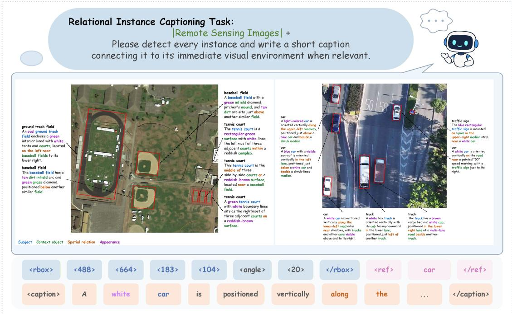
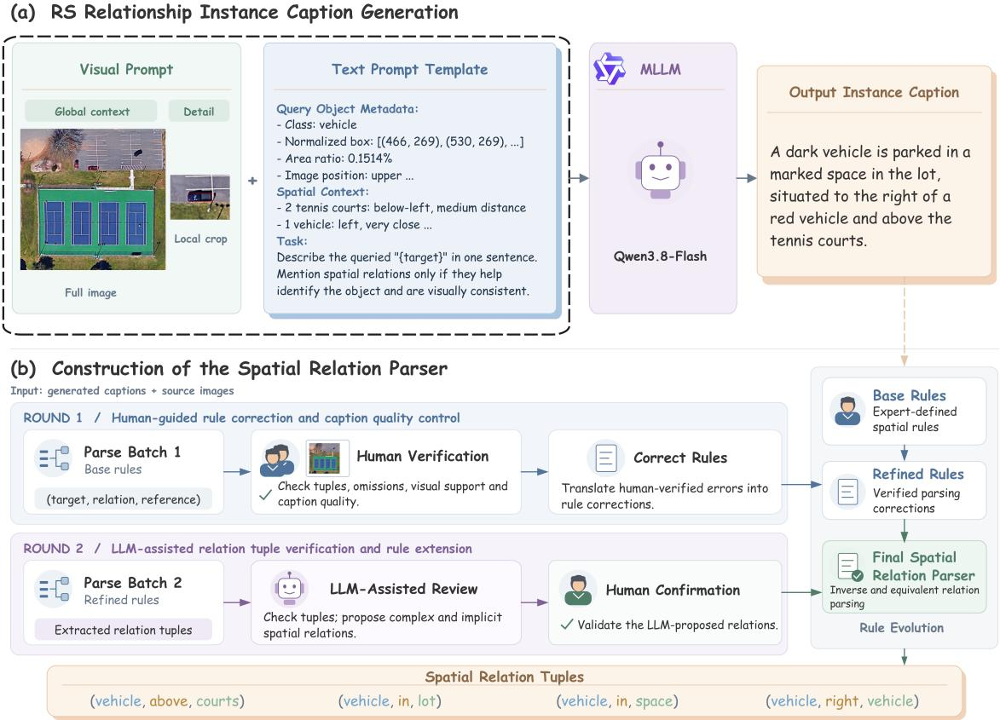
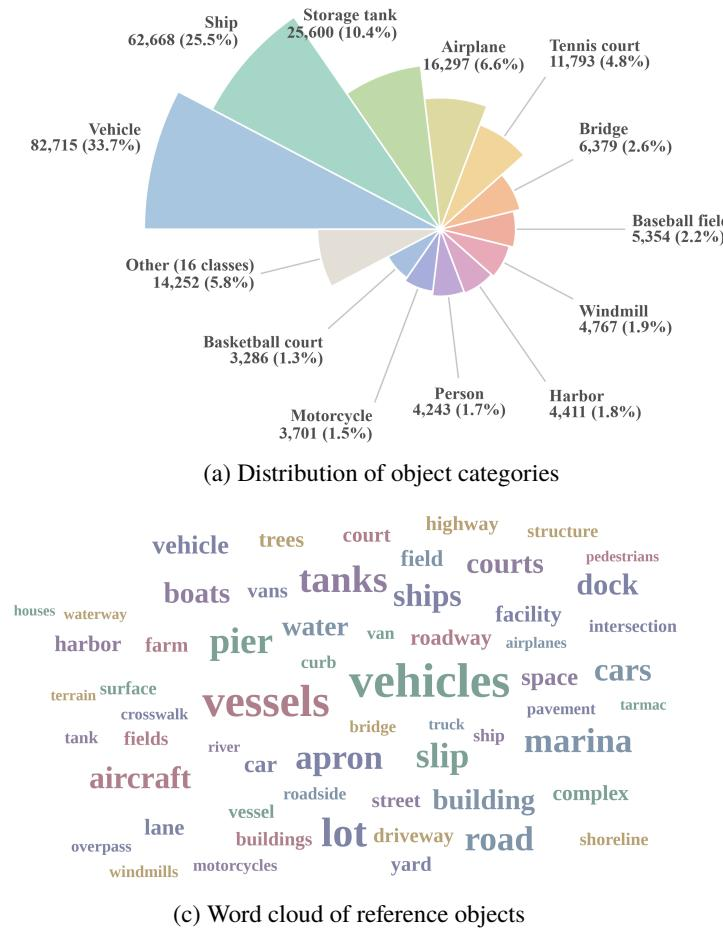
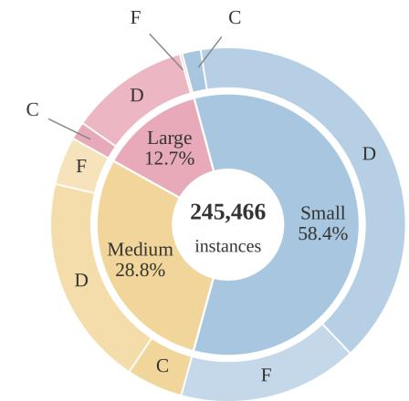
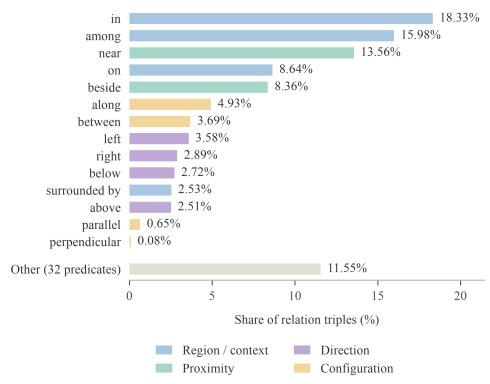
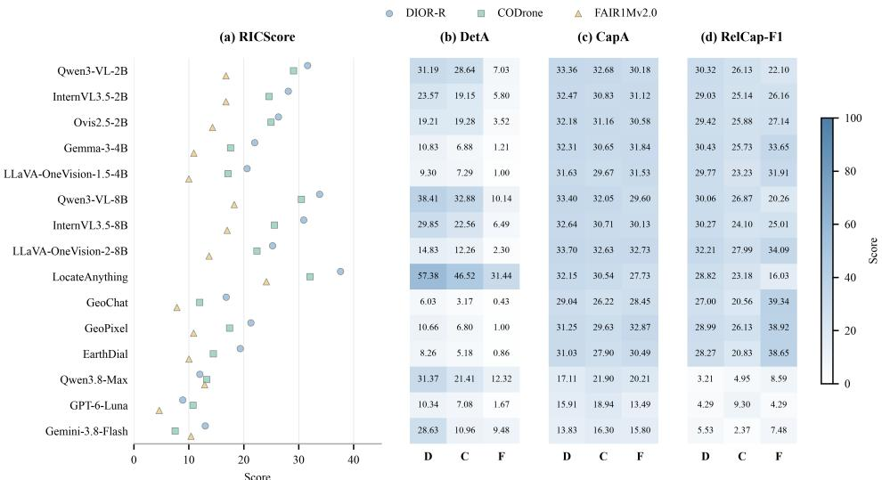

# RICapBench: A Fine-Grained Visual Understanding Benchmark Dataset for Vision-Language Models in Remote Sensing

Xue Wang\*, Yubin Xu\*, Kun Tan\*,†

School of Geospatial Artificial Intelligence,

East China Normal University, Shanghai, China

wx\_ecnu@yeah.net, 51290161018@stu.ecnu.edu.cn, tankuncu@gmail.com

Equal contribution

†Corresponding author

## Abstract

Advances in vision-language models (VLMs) have improved remote sensing image analysis and supported geospatial decision-making. However, fine-grained understanding of remote sensing imagery remains challenging for VLMs. Large variations in object scale, complex geospatial relations among instances, and limited visual detail hinder precise instance localization, visible attribute identification, and spatial relation understanding, potentially leading to descriptions that lack visual grounding. Existing datasets and benchmarks insuficiently assess end-to-end instance localization and captioning without target-specific textual cues. To support this evaluation, we introduce RICapBench, a dataset and benchmark that unifies instance localization and fine-grained captioning in remote sensing. RICapBench contains 245,466 instance-level annotations and 498,005 spatial relation tuples spanning general remote sensing, UAVremote sensing, and dense small-objec scenarios. Each annotationpairs an object’s oriented bounding box with a natural language description ofits visible attributes and spatial relations to surrounding instances and environmental elements. To evaluate the accuracy and completeness of spatial relation captioning, we propose a remote sensing spatial relation parser and the RelCap-F1 metric. We combine RelCap-F1 with instance localization and attribute captioning metrics into a composite metric, RICScore. Our evaluation of15 advanced open-source and closed-source VLMs identifies instance localization as a major bottleneckfor these models LocateAnything achieves the highest RICScore of31.68, but scores lower on spatial relation captioning than other task-fine tuned open-source VLMs. Code and dataset are available at this URL.

## 1 Introduction

Vision-language models (VLMs) have become an important research direction in deep learning and computer vision in recent years [1, 2]. Vision and language underpin human perception of the external world and the expression of knowledge, respectively. Integrating them enables models to understand visual content and interact through natural language, supporting tasks such as visual question answering, image captioning, and object localization [3, 4].

VLMs have also attracted considerable attention in remote sensing. They are increasingly applied to object detection and segmentation, change detection, and damage assessment, supporting urban planning and geospatial analysis [5, 6, 7, 8, 9, 10]. Although VLMs have the potential to reduce manual efort and improve analytical eficiency, they still face multiple challenges in fine-grained understanding of remote sensing imagery. Objects in remote sensing imagery vary greatly in scale, and some scenes contain densely distributed small objects with limited discernible visual detail. These characteristics make instance identification, counting, and precise localization more dificult [11]. Beyond localizing and describing object instances, models must distinguish adjacent objects and use scene context to determine their positions relative to surrounding instances and environmental elements. Image-level captioning capabilities alone do not ensure an accurate understanding of these spatia relations. Furthermore, remote sensing VLMs may hallucinate, generating descriptions of objects, attributes, and spatial relations that contradict image content or lack visual grounding. Such descriptions can undermine the reliability of automated image interpretation [12, 6]. These challenges place greater demands on models’ fine-grained image understanding.

As VLMs have developed in remote sensing, researchers have introduced vision-language datasets and benchmarks such as DIOR-RSVG [15], VRSBench [13], EarthVQA [10], and GEOBench-VLM [14]. These resources support the training and evaluation of both general-purpose and remote sensing VLMs. They cover image captioning, visual question answering, and referring expression grounding, with evaluations designed around typical remote sensing tasks and practical application needs. For example, GEOBench-VLM comprises 31 evaluation tasks across eight categories, assessing multiple aspects of vision-language understanding in remote sensing. Some of these tasks already address fine-grained visual understanding at the instance level. For example, referring expression grounding in DIOR-RSVG, VRSBench, and AerialVG [28] requires models to identify and localize target instances from natural language descriptions. EarthVQA evaluates models’ understanding of spatial relations between geographic objects in remote sensing imagery through visual question answering that involves spatial relation reasoning. These tasks assess fine-grained understanding through aspects such as language–object correspondence and spatial relations between objects. However, tasks such as referring expression grounding typically condition predictions on a given target description. Target references, attributes, or relations in the text provide interpretive cues [43] and direct models’ attention to specific objects. Performance under text-query guidance therefore does not fully reflect models’ ability to autonomously achieve fine-grained understanding of remote sensing imagery without such cues. Previous work has also noted that clearly describing object appearance and location requires substantial manual efort [44]. In practical applications, constructing queries may likewise require users to specify objects of interest or inspect imagery beforehand. The resulting interaction overhead may delay processing in scenarios such as UAV-based disaster inspection and remote sensing emergency monitoring. Meanwhile, image-level captioning summarizes the scene content of an entire remote sensing image and generally does not require each description to be matched to a specific instance location. It therefore cannot fully assess models’ fine grained understanding of instance attributes and spatial relations.

In general vision, previous studies have combined object localization with fine-grained language descriptions. For example, Dense Relational Captioning [24] focuses on describing relations between objects, whereas LVISCap [16] provides fine-grained object-level descriptions. RA-4M [45] further provides annotations of inter-object relations expressed as freetext predicates. These studies inform the joint assessment of object localization, object captioning, and inter-object relation understanding. In remote sensing, FIT-RS [26] explores models’ understanding of fine-grained relations in remote sensing imagery through tasks such as region captioning and scene graph generation. Region captioning is conditioned on a given target region. Whole-image scene graph generation expresses inter-object relations through templated sentences and explicitly annotates object categories, locations, and relation predicates. FineGrip [25] combines foreground instance segmentation, background semantic segmentation, and fine-grained image captioning, but its captions describe entire images. Its evaluation neither directly measures the correspondence between instance locations and captions nor separately assesses the accuracy and completeness of spatial relation captioning. We further investigate whether VLMs can localize target instances in remote sensing imagery without additional cues from target-specific text queries. We also examine whether they can describe the instances’ visible attributes and spatial relations to surrounding instances and environmental elements.

To systematically evaluate fine-grained understanding under this setting, we introduce RICapBench, which unifies instance localization, attribute captioning, and spatial relation captioning within a single evaluation framework. This framework supports the analysis of capability diferences and bottlenecks in general-purpose and remote sensing VLMs, as well as the exploration of potential improvements. Using RICapBench, we systematically evaluate 15 advanced general-purpose and remote sensing VLMs on fine-grained understanding of remote sensing imagery. The task examines whether models can localize target instances based on specific visual evidence and describe their attributes and spatial relations to surrounding geographic features or environmental elements. The results show that existing general-purpose and remote sensing VLMs continue to face challenges in fine-grained understanding of remote sensing instances and their spatial context.

Our main contributions are summarized as follows:

• We construct RICapBench, a dataset and benchmark for fine-grained spatial relation captioning of remote sensing instances. It contains 245,466 instance-level annotations and 498,005 spatial relation tuples spanning general remote sensing, UAV remote sensing, and dense small-object scenarios. Each annotation pairs an object’s oriented bounding box with a natural language description of its visible attributes and spatial relations. These annotations support mode fine-tuning and the evaluation of VLMs’ instance localization and fine-grained understanding of spatial context withou reliance on target-specific text queries.

• We develop a remote sensing spatial relation parser that converts spatial relations in natural language descriptions into structured spatial relation triples. We also propose RelCap-F1 to measure the accuracy and completeness of spatial relation captioning. We define RICScore as the composite metric for this task, calculated as the geometric mean of DetA, CapA, and RelCap-F1. It evaluates models’ fine-grained understanding across three dimensions: instance localization,

attribute captioning, and spatial relation captioning.

• We systematically evaluate 15 advanced VLMs on fine-grained understanding of remote sensing imagery, covering general-purpose open-source, closed-source, and remote sensing models. We analyze their capability diferences and bottlenecks in instance localization, attribute captioning, and spatial relation captioning, providing empirical evidence and research insights to improve VLMs’ fine-grained geospatial understanding.

## 2 Related Work

Table 1 compares RICapBench with related datasets and benchmarks for fine-grained visual understanding in general vision and remote sensing.
<table><tr><td>Dataset / Benchmark</td><td>Year</td><td>Samples</td><td>Localization</td><td>Annotation Type</td><td>Granularity</td><td>Tasks</td></tr><tr><td>General vision</td><td></td><td></td><td></td><td></td><td></td><td></td></tr><tr><td>Dense Relational</td><td>2019</td><td></td><td>HBB</td><td>A</td><td>Instance</td><td>Loc. + RelCap</td></tr><tr><td>Captioning [24] LVISCap [16]</td><td>2025</td><td>1.5M</td><td>HBB, Seg</td><td>A</td><td>Instance</td><td>IS + Cap.</td></tr><tr><td>RA-4M [45]</td><td>2026</td><td>4.3M</td><td></td><td>A</td><td>Instance</td><td>RP</td></tr><tr><td>Remote sensing</td><td></td><td></td><td></td><td></td><td></td><td></td></tr><tr><td>DIOR-RSVG [15]</td><td>2022</td><td>38.3K</td><td>HBB</td><td>A+M</td><td>Instance</td><td>VG</td></tr><tr><td>EarthVQA [10]</td><td>2023</td><td>208.6K</td><td></td><td>A+M</td><td>Image / Instance</td><td>VQA</td></tr><tr><td>FineGrip [25]</td><td>2024</td><td>13.2K</td><td>Seg</td><td>A+M</td><td>Image</td><td>PS + IC</td></tr><tr><td>FIT-RS [26]</td><td>2024</td><td>1.8M</td><td>OBB</td><td>A+M</td><td>Image / Region</td><td>IC, RC, VQA, OD, RR, SGG, ...</td></tr><tr><td>RRSIS-D [27]</td><td>2023</td><td>17.4K</td><td>Seg</td><td>A+M</td><td>Instance Instance</td><td>RIS</td></tr><tr><td>VRSBench [13]</td><td>2024</td><td>205.3K</td><td>HBB / OBB</td><td>A+M</td><td>Image / Instance</td><td>IC, VG, VQA</td></tr><tr><td>AerialVG [28]</td><td>2025</td><td>~50.0K</td><td>HBB</td><td>M</td><td>Instance</td><td>VG</td></tr><tr><td>RSICap / RSIEval [29]</td><td>2023</td><td>3.6K</td><td>一</td><td>M</td><td>Image / Instance</td><td>IC, VQA</td></tr><tr><td>RICapBench (Ours)</td><td>2026</td><td>245.5K</td><td>OBB</td><td>A+M</td><td>Instance</td><td>Loc. + RelCap</td></tr></table>

Table 1. Comparison of RICapBench with related vision–language datasets and benchmarks in general vision and remote sensing. For FIT-RS, the sample count refers to instruction samples, and only selected tasks are listed. Detailed explanations (HBB: Horizontal Bounding Box, OBB: Oriented Bounding Box, Seg: segmentation, Loc.: localization, A: Automatic, M: Manual, IS: instance segmentation, VG: visual grounding, VQA: visual question answering, SGG: scene graph generation, IC: image captioning, RC: region captioning, PS: panoptic segmentation, RIS: referring image segmentation; OD: object detection, RP: relation prediction, RR: relation reasoning, RelCap: relationa captioning)

## 2.1 General VLM Benchmarks

Several datasets and benchmarks focus on fine-grained visual understanding, providing a foundation for evaluating VLMs’ understanding of objects and their context. Fiastre et al. [16] extend LVIS and LV-VIS to create LVISCap and LV-VISCap, respectively, providing fine-grained object-level descriptions for images and videos. These datasets support combining object detection, segmentation, and video object tracking with object captioning. Their descriptions cover object appearance, actions, and interactions with the surrounding environment or other objects. BenSMOT [17] addresses personcentered fine-grained video understanding in everyday scenes. It combines multi-object tracking with instance-level behavior captioning, recognition of interpersonal interactions, and video-level summarization. Benchmarks such as SEED-Bench [18], SEED-Bench-2-Plus [19], and MMStar [20] evaluate fine-grained perception through visual question answering. They cover complex perceptual tasks involving object attribute identification, object localization, relation reasoning, and interactions between instances. However, these studies primarily address understanding in general visual scenes. They neither include geospatial task data nor specifically evaluate spatial relation captioning between geographic feature instances in remote sensing scenes.

## 2.2 Domain-Geospatial Benchmarks

Several remote sensing vision-language datasets and benchmarks are available, including VRSBench [13], LHRS-Bench [41], EarthVQA [10], RSIEval [29], and GeoChat-Instruct [5]. Nevertheless, datasets and benchmarks for fine-grained understanding of remote sensing instances and their spatial context remain insuficient. VRSBench covers image captioning, visual question answering, and visual grounding. RSIEval, introduced in RSGPT, focuses on image captioning and visual question answering. LHRS-Bench uses multiple-choice questions to evaluate object recognition, spatial perception, and reasoning. EarthVQA focuses on relation reasoning between geographic objects and comprehensive scene analysis, primarily for urban and rural planning and governance. GeoChat-Instruct supports image-level and region-level remote sensing dialogue, emphasizing the correspondence between natural language descriptions and object locations. Visual question answering and visual grounding tasks involving spatial understanding typically provide cues about object categories, attributes, or locations through predefined questions or referring expressions. These cues direct models’ attention to specific objects and their spatial relations. Such evaluations use diverse text queries to assess VLMs’ text-guided visual understanding of remote sensing imagery. However, interaction constraints and timeliness requirements may limit users’ ability to continually provide target-related cues in vision-language navigation (VLN), UAV reconnaissance, and disaster-area monitoring. Existing question-answering evaluations do not fully capture models’ end-to-end fine-grained understanding without additiona interaction or target-specific text prompts. This requires models to autonomously localize remote sensing instances and describe their spatial relations to surrounding geographic features and environmental elements in natural language.

To address the limitations of existing evaluations under this task setting, RICapBench spans general remote sensing, UAV remote sensing, and dense small-object scenarios. It enables systematic assessment of the capabilities and limits of VLMs in spatial relation captioning for remote sensing instances.

## 3 RICapBench Dataset

RICapBench contains 26,854 remote sensing images, each measuring 800 × 800 pixels, with 245,466 instance-level annotations and 498,005 spatial relation tuples. The images are sourced from DIOR-R [49], CODrone [50], and FAIR1Mv2.0 [51], representing general remote sensing, UAV remote sensing, and dense small-object scenarios, respectively. The oriented bounding boxes retain the original annotations from each source dataset. Building on these annotations, we generate finegrained natural language descriptions of target instances through a workflow combining semi-automatic annotation with manual verification. Each annotation contains the object’s oriented bounding box, category, and corresponding description. RICapBench integrates remote sensing images from diverse scenarios to support the evaluation of VLMs’ understanding of instances and their spatial relations across imaging perspectives, object scales, and distribution densities.

## 3.1 Annotation Schema

RICapBench normalizes the coordinates and dimensions of oriented bounding boxes and represents them uniformly as $( c _ { x } , c _ { y } , w , h , \theta )$ . Here, $( c _ { x } , c _ { y } )$ denotes the box center coordinates, w and h denote its width and height, respectively, and θ denotes the rotation angle. Annotation examples are shown in the lower part of Figure 1. Each instance-level annotation comprises three fields: <rbox>, <ref>, and <caption>, encoding the oriented bounding box, instance category, and corresponding natural language description, respectively.

Instance descriptions cover the object’s appearance attributes and visible state, its location within the image, and its spatial relations to surrounding environmental elements and other instances. Appearance attributes and visible state capture the object’s own visual characteristics, such as color, size, and discernible state. The image location specifies where the object appears in the current image. Spatial relations describe its position and spatial arrangement relative to environmental elements or other instances. Spatial relation descriptions take the target instance as the subject. Reference objects include other annotated instances in the image and discernible environmental elements without separate instance annotations. All descriptions are grounded in discernible visual information in the image. When no clearly identifiable reference objects surround the target, descriptions focus on its own visible features and location within the image.

## 3.2 Construction and Quality Control

Research and evaluation on fine-grained vision-language tasks rely on high-quality annotated data. Annotation assisted by large language models and VLMs ofers a scalable approach to constructing such datasets. For example, LLaVA-Grounding [21] and GLaMM [22] use large models to assist in constructing annotated data that combine visual grounding with language descriptions. In remote sensing, VRSBench [13] and GeoChat [5] also employ model-assisted annotation workflows to construct vision-language datasets. Following these studies, we construct RICapBench through a workflow that combines model-assisted generation with manual verification. To ensure that instance descriptions cover both the target’s own visible features and its spatial relations to surrounding instances and environmental elements, we guide caption generation using global and local visual prompts together with textual constraints. We then manually verify the visual grounding of the descriptions and the accuracy of the spatial relations.

  
Figure 1. Overview of the remote sensing instance spatial relationship captioning task and the annotation format and examples of RICap Bench.

Prompt Template. We combine visual prompts with textual constraints to generate instance-level captions for RICap Bench using Qwen3.8-Flash [37], a general-purpose large multimodal model. As shown in Figure 2, we highlight the target in the global image using its oriented bounding box from the source dataset. We also provide a magnified local view of the targe region. The global image preserves the spatial context linking the target to surrounding instances and environmental elements The magnified local view helps identify the target’s appearance details and visible state. The text prompts comprise a global system prompt and an instance-level prompt template, specifying the caption content, output format, and visual grounding requirements. These prompts guide Qwen3.8-Flash to integrate global and local information, reduce inferences unsupported by visual evidence, and improve caption accuracy and consistency.

Spatial Relationship Parser. The image captioning metric SPICE [23] uses dependency parsing and rule-based semantic parsing to convert candidate and reference captions into scene graphs containing objects, attributes, and inter-object relations. However, its general-purpose relation parsing outputs may not meet the representation requirements for evaluating spatial relations of remote sensing instances. For example, applying SPICE to the output instance caption in Figure 2(a) yields four subject–predicate–object relation triples: (lot, situate above, court), (lot, situate to, right), (right, of, vehicle), and (space, in, lot). The triples (lot, situate to, right) and (right, of, vehicle) treat the directional term right as a relation endpoint, splitting a complete directional expression into two relations. Consequently, neither triple directly represents the target’s position relative to the reference geographic feature. Relation tuples in general-purpose scene graphs therefore require further processing to preserve complete spatial expressions and ensure the validity of reference objects. To meet the requirements for parsing and evaluating spatial relations of remote sensing instances, we develop a spatial relation parser tailored to these instances.

As shown in Figure 2(b), domain experts first establish a set of initial parsing rules. These include rules for relation triple extraction, spatial phrase matching, and a whitelist of reference objects. The rules are then refined through two rounds of validation. In the first round, the initial rules are applied to a batch of samples. Human reviewers consult the original images to verify the accuracy of spatial relation triples and add relations missed during parsing. They also assess caption quality and visual grounding. Confirmed parsing issues inform revisions and additions to the rules. In the second round, the revised rules are applied to another batch of samples. Qwen3.8-Max [38] assists in checking relation triples and suggests refinements for parsing inverse relations, symmetric relations, and other complex sentence structures. All candidate relations that Qwen3.8- Max proposes to remove or add are reviewed and confirmed by human reviewers. Verified parsing issues and suggestions are then incorporated into rule revisions to produce the final spatial relation parser.

  
Figure 2. Pipelines for (a) generating remote sensing instance captions with spatial relationships and (b) constructing the spatial relation parser.

## 3.3 Dataset Statistics

We analyze the composition of RICapBench in terms of object categories and scales, spatial relation types, and referenceobject expressions. The statistics are shown in Figure 3. RICapBench retains the category annotations from its source datasets, which originally comprise 51 categories. We merge synonymous or closely related labels into 28 categories. This mapping is applied to references to surrounding annotated instances in captions to reduce naming diferences and semantic inconsistencies across data sources. Figure 3a shows the instance counts for the main categories. As shown in Figure 3b, object sizes are categorized according to the MS COCO [47] criteria. Small objects dominate the dataset, accounting for approximately 58.4% of all instances, while the outer ring further shows the data source composition within each size group. The word cloud in Figure 3c shows the main reference-object expressions in instance captions, including instances such as vehicles and ships and environmental elements such as roads, parking lots, and aprons. Figure 3d shows the distribution of predicates in the relation triples extracted by the spatial relation parser. The most frequent predicates are in, among, and near, and the relations span direction, proximity, and spatial layout.

(b) Object sizes composition  
  
(d) Distribution of spatial predicates  
Figure 3. Overview of RICapBench dataset statistics. (a) Instance counts and proportions for the 12 most frequent object categories and the remaining 16 categories grouped as Other. (b) The inner ring shows the proportions of small, medium, and large instances, while the outer ring shows the data source composition within each size group. C, D, and F denote CODrone, DIOR-R, and FAIR1Mv2.0, respectively (c) Word cloud of the 60 reference-object expressions occurring in the largest number of captions; font size increases with the number of captions containing each expression. (d) Proportions of spatial predicates across all relation triplets, with the remaining predicates grouped as Other.

## 4 VLMs Benchmarking

## 4.1 Model Selection

Open-Source Models. We select general-purpose and remote sensing VLMs with diverse visual understanding capabili ties to evaluate their suitability and performance for remote sensing instance captioning and spatial relation understanding. The general-purpose models include Qwen3-VL [30], InternVL3.5 [31], Ovis2.5 [32], Gemma-3 [33], LLaVA-OneVision [34, 35], and Qwen3.8-Max [38]. For selected model families, we evaluate variants with diferent parameter counts to examine the effect of model size on task performance. We also include LocateAnything [36], which focuses on object localization, to analyze diferences between its instance localization and captioning capabilities. The remote sensing models include GeoChat [5], GeoPixel [9], and EarthDial [7]. Open-source models facilitate control over training and inference, supporting experimenta reproducibility, bottleneck analysis in fine-grained instance-level spatial relation understanding, and methodological improvements. Qwen3.8-Max is evaluated through API calls, whereas all other models in this group are evaluated after fine-tuning on the RICapBench training set.

Proprietary Models. In addition to open-source models, we evaluate Gemini-3.8-Flash [40] and GPT-6-Luna [39], two closed-source general-purpose large multimodal models. We examine how their general multimodal capabilities transfer to fine-grained understanding of remote sensing imagery. Although their training data and implementation details lack transparency, their evaluation results provide supplementary reference points. These results help characterize the capabilities and limitations of existing models in remote sensing instance localization, attribute captioning, and spatial relation understanding

## 4.2 Evaluation Metrics

Following prior work on DVOC, we build a composite metric for remote sensing instance spatial relation captioning based on the CHOTA evaluation framework proposed by Zhou et al. [46]. We retain its detection accuracy metric, DetA, and modify the calculation of captioning accuracy, CapA. Specifically, we replace SPICE All in CapA with SPICE-OA, which includes only the object and attribute components. Removing the relation component focuses this metric on the quality of instance and attribute descriptions. We also replace CIDEr with CIDEr-D [48] and divide its score by 10 before including it in the calculation. Together with METEOR [52], these metrics form the modified CapA, calculated as follows:

$$
\mathcal { M } _ { \mathrm { c a p } } = \{ ( p , g ) \in \mathcal { M } : | S _ { g } | > 0 \} .\tag{1}
$$

$$
q _ { p g } = \frac { 1 } { 3 } \left[ \mathrm { M E T E O R } ( \hat { c } _ { p } , S _ { g } ) + \frac { \mathrm { C I D E r - D } ( \hat { c } _ { p } , S _ { g } ) } { 1 0 } + \mathrm { S P I C E - O A } ( \hat { c } _ { p } , S _ { g } ) \right] .\tag{2}
$$

$$
\mathrm { C a p A } = \frac { 1 } { \left| \mathcal { M } _ { \mathrm { c a p } } \right| } \sum _ { ( p , g ) \in \mathcal { M } _ { \mathrm { c a p } } } q _ { p g } .\tag{3}
$$

Here, M is the set of matched predicted and ground-truth instances, and $\hat { c } _ { p }$ is the caption for predicted instance $p .$ The set $S _ { g }$ contains the reference captions for ground-truth instance $g .$ The set $\mathcal { M } _ { \mathrm { c a p } }$ retains only matched pairs with nonempty reference caption sets, and $q _ { p g }$ is the caption quality score for each matched pair.

We further propose RelCap-F1 to measure the accuracy and completeness of spatial relation captioning for target instances, as shown in Equation (4). Following CHOTA’s approach to composite evaluation, we define the Relational Instance Caption Score (RICScore). It jointly measures performance in instance localization, attribute captioning, and spatial relation captioning, as shown in Equation (5).

$$
\mathrm { R e l C a p - F 1 } = \frac { 2 T P _ { \mathrm { r e l } } } { 2 T P _ { \mathrm { r e l } } + F P _ { \mathrm { r e l } } + F N _ { \mathrm { r e l } } } .\tag{4}
$$

$$
{ \mathrm { R I C S c o r e } } = { \sqrt [ { 3 } ] { { \mathrm { D e t A } } \cdot { \mathrm { C a p A } } \cdot { \mathrm { R e l C a p } }  – { \mathrm { F } } { \mathrm { 1 } } } } .\tag{5}
$$

Here, $T P _ { \mathrm { r e l } } , F P _ { \mathrm { r e l } }$ , and $F N _ { \mathrm { r e l } }$ denote the numbers of correctly matched, incorrectly predicted, and missed spatial relation triples, respectively.

## 4.3 Benchmarking Overview

Using RICapBench, we construct an evaluation set for instance localization and fine-grained spatial relation captioning in remote sensing imagery. All evaluation images come from the original validation splits of the three source datasets. We manually inspect a subset of candidate samples and exclude those with low-quality annotations, substantial image overlap, or issues such as blur and ghosting. The final evaluation set contains 1,930 images, 16,605 instance-level annotations, and 35,774 spatial relation triples. Instance captions average approximately 21 words, and the set covers general remote sensing, UAV remote sensing, and dense-object scenarios. The training and evaluation sets are disjoint at the image level.

## 5 Evaluations and Analysis

In this section, we evaluate the selected models on RICapBench and analyze and discuss the results.

## 5.1 Overall Results

Table 2 presents the overall performance of the evaluated VLMs on RICapBench. LocateAnything achieved the highest composite score, with a RICScore of 31.68. The remote sensing models GeoChat, GeoPixel, and EarthDial all scored lower than most task-fine-tuned general-purpose open-source VLMs. LocateAnything’s main advantage lay in instance localization, with a DetA of 44.50%, well above the second-ranked Qwen3-VL-8B-Instruct (24.63%). All other models scored below 25%. Instance localization directly afects whether fine-grained descriptions can be correctly matched to specific objects in an image. Even the remote sensing models achieved DetA scores below 6%, indicating that adaptation to remote sensing does not necessarily confer an instance localization advantage on this task. These results indicate that localizing specific instances remains a major bottleneck for most VLMs in fine-grained understanding. The task-fine-tuned open-source VLMs performed similarly in instance attribute captioning, with CapA scores ranging from 28.35% to 33.26%. Spatial relation captioning requires fine-grained understanding of surrounding instances and environmental elements. LLaVA-OneVision-2-8B achieved the highest RelCap-F1 of 30.76%, but its DetA was only 9.16%. LocateAnything, which performed best in localization, achieved a RelCap-F1 of 23.40%, the lowest among the task-fine-tuned open-source models. This indicates that strong instance localization does not necessarily coincide with accurate spatial relation understanding.

<table><tr><td>Model</td><td>Params Adapt.</td><td></td><td>METEOR</td><td>CIDEr-D/10 SPICE-OA</td><td></td><td>RelCap-F1all</td><td>DetA</td><td>CapA</td><td>RelCap-F1</td><td>RICScore</td></tr><tr><td>Qwen3-VL-Instruct [30]</td><td>2B</td><td>FT</td><td>30.22</td><td>20.58</td><td>47.15</td><td>8.38</td><td>19.7432.65</td><td></td><td>27.51</td><td>26.08</td></tr><tr><td>InternVL3.5 [31]</td><td>2B</td><td>FT</td><td>29.52</td><td>19.73</td><td>46.09</td><td>6.40</td><td>15.4231.78</td><td></td><td>27.19</td><td>23.71</td></tr><tr><td>Ovis2.5 [32]</td><td>2B</td><td>FT</td><td>29.37</td><td>19.60</td><td>46.08</td><td>5.38</td><td>12.4131.69</td><td></td><td>27.84</td><td>22.20</td></tr><tr><td>Gemma-3-it [33]</td><td>4B</td><td>FT</td><td>29.39</td><td>19.91</td><td>46.09</td><td>2.61</td><td>6.02</td><td>31.79</td><td>28.97</td><td>17.70</td></tr><tr><td>LLaVA-OneVision-1.5 -Instruct [34]</td><td>4B</td><td>FT</td><td>28.93</td><td>19.04</td><td>45.25</td><td>2.39</td><td>5.50</td><td>31.07</td><td>27.62</td><td>16.77</td></tr><tr><td>Qwen3-VL-Instruct [30]</td><td>8B</td><td>FT</td><td>30.17</td><td>20.15</td><td>46.70</td><td>10.00</td><td>24.63</td><td>32.34</td><td>27.15</td><td>27.86</td></tr><tr><td>InternVL3.5 [31] LLaVA-OneVision-2</td><td>8B</td><td>FT</td><td>29.68</td><td>19.65</td><td>45.89</td><td>7.91</td><td>18.5731.74</td><td></td><td>27.45</td><td>25.30</td></tr><tr><td>-Instruct [35]</td><td>8B</td><td>FT</td><td>30.37</td><td>21.35</td><td>48.06</td><td>4.44</td><td>9.16</td><td>33.26</td><td>30.76</td><td>21.08</td></tr><tr><td>LocateAnything [36]</td><td>3B</td><td>FT</td><td>28.96</td><td>18.03</td><td>44.58</td><td>14.03</td><td>44.5030.52</td><td></td><td>23.40</td><td>31.68</td></tr><tr><td>GeoChat [5]</td><td>7B</td><td>FT</td><td>26.61</td><td>16.87</td><td>41.59</td><td>1.18</td><td>3.27</td><td>28.35</td><td>25.56</td><td>13.34</td></tr><tr><td>GeoPixel [9]</td><td>7B</td><td>FT</td><td>28.53</td><td>19.14</td><td>45.00</td><td>2.43</td><td>5.91</td><td>30.89</td><td>28.64</td><td>17.36</td></tr><tr><td>EarthDial [7]</td><td>4B</td><td>FT</td><td>28.10</td><td>18.18</td><td>44.12</td><td>1.85</td><td>4.78</td><td>30.13</td><td>26.30</td><td>15.59</td></tr><tr><td>Qwen3.8-Max [38]</td><td>2.4T</td><td>API</td><td>21.00</td><td>7.61</td><td>27.99</td><td>1.81</td><td>21.59</td><td>18.87</td><td>4.97</td><td>12.65</td></tr><tr><td>GPT-6-Luna [39]</td><td></td><td>API</td><td>18.05</td><td>5.78</td><td>26.00</td><td>0.72</td><td>6.58</td><td>16.61</td><td>5.98</td><td>8.68</td></tr><tr><td>Gemini-3.8-Flash [40]</td><td></td><td>API</td><td>14.60</td><td>3.31</td><td>25.86</td><td>1.41</td><td>17.4714.59</td><td></td><td>5.37</td><td>11.10</td></tr></table>

Table 2. Overall results on RICapBench. Adapt.: FT = fine-tuned on the RICapBench training set. RICScore is reported on a 0–100 scale, while all other metrics are expressed as percentages. RelCap-F1 denotes RelCap-F1matched.

GPT-6-Luna, Gemini-3.8-Flash, and Qwen3.8-Max achieved RICScore values of 8.68, 11.10, and 12.65, respectively. Under the current evaluation setting, all three scored below task-fine-tuned open-source VLMs with fewer parameters. Their RelCap-F1 scores were particularly low, at 5.98%, 5.37%, and 4.97%, respectively. These results indicate that leading opensource multimodal models with large parameter counts and closed-source models still face challenges in fine-grained understanding of remote sensing imagery.

## 5.2 Analysis

We further compare model performance across DIOR-R, CODrone, and FAIR1Mv2.0, examining fine-grained understanding in general remote sensing, UAV remote sensing, and dense small-object scenarios, respectively. As shown in Figure 4(a), most VLMs achieved lower composite scores in dense small-object scenarios than in general remote sensing and UAV remote sensing scenarios. Figure 4(b) further shows that all models achieved lower DetA on FAIR1Mv2.0 than on the other two sources. This indicates that instance localization in dense small-object scenarios is a shared challenge across models. In particular, the remote sensing models GeoChat, GeoPixel, and EarthDial achieved DetA scores of only 0.43%, 1.00%, and 0.86%, respectively, below those of most general-purpose models. The task-fine-tuned VLMs achieved similar CapA scores across the three scenarios, indicating relatively small diferences in their ability to understand and describe instances own attributes. Their scores were all higher than those of the closed-source models GPT-6-Luna and Gemini-3.8-Flash, as well as Qwen3.8-Max. For spatial context understanding, RelCap-F1 varied across scenarios diferently from DetA. GeoChat GeoPixel, and EarthDial each achieved higher RelCap-F1 on FAIR1Mv2.0 than in the other two scenarios. They also outperformed the remaining evaluated VLMs on this metric in the same scenario. By contrast, LocateAnything achieved RelCap-F1 scores of 28.82%, 23.18%, and 16.03% across the three scenarios, respectively. Its localization advantage did not extend to spatial relation captioning, with particularly weak performance in dense small-object scenarios. These diferences must be interpreted alongside instance localization performance. RelCap-F1 is calculated only from spatial relation triples associated with successfully matched instances, whereas all three remote sensing VLMs achieved DetA of at most 1% on FAIR1Mv2.0.

  
Figure 4. Performance of diferent models across three data sources. D, C, and F denote DIOR-R, CODrone, and FAIR1Mv2.0, respectively. The heatmaps share a common color scale, with darker colors indicating higher scores.

Their higher relation captioning scores therefore reflect caption quality for matched instances and do not imply stronger overal spatial context understanding. Gemma-3-4B-it and the two LLaVA-OneVision models also combined relatively high RelCap-F1 with low DetA in this scenario. This further indicates that relation captioning quality must be evaluated together with instance localization capabilities.

These results indicate that accurate instance localization remains a major bottleneck in fine-grained understanding of remote sensing imagery. Complex backgrounds, small objects, and dense distributions make object identification and crossmodal alignment more dificult [5, 42]. For the RICap task, improving instance recall is an important foundation for comprehensively describing target instances in an image. This requires VLMs to retain and accurately interpret the fine-grained visual information needed to distinguish adjacent instances. However, image downsampling, visual encoding, and excessive visual token compression may cause the loss of small-object details and local spatial information. Preserving instance details and spatial structure during visual information compression is therefore important for improving fine-grained understanding of remote sensing imagery.

## 6 Conclusion

Referring expression grounding and visual question answering tasks in existing remote sensing vision-language datasets and evaluations typically rely on predefined questions or target referring expressions. They do not adequately assess models’ ability to localize instances and describe their attributes and spatial relations without target-specific textual cues. RICapBench focuses on fine-grained understanding of remote sensing instances and their spatial relations. By combining a spatial relation parser with the composite metric RICScore, it jointly evaluates VLMs’ instance localization, attribute captioning, and spatial relation captioning under this setting. Through a systematic evaluation of 15 advanced VLMs, we examine capability diferences and major bottlenecks across these three dimensions. Our findings provide empirical evidence to support improvements in fine-grained understanding of remote sensing imagery and inform future work.

## References

[1] Jang Hyun Cho et al. PerceptionLM: Open-Access Data and Models for Detailed Visual Understanding. In Advances in Neural Information Processing Systems (NeurIPS), volume 38, pages 26659–26721, 2025.

[2] Long Xing, Qidong Huang, Xiaoyi Dong, Jiajie Lu, Pan Zhang, Yuhang Zang, Yuhang Cao, Conghui He, Jiaqi Wang, Feng Wu, and Dahua Lin. Conical Visual Concentration for Eficient Large Vision-Language Models. In Proceedings of the IEEE/CVF Conference on Computer Vision and Pattern Recognition (CVPR), pages 14593–14603, 2025.

[3] Haotian Liu, Chunyuan Li, Qingyang Wu, and Yong Jae Lee. Visual Instruction Tuning. In Advances in Neural Information Processing Systems (NeurIPS), volume 36, pages 34892–34916, 2023.

[4] Haotian Liu, Chunyuan Li, Yuheng Li, and Yong Jae Lee. Improved Baselines with Visual Instruction Tuning. In Proceedings ofthe IEEE/CVF Conference on Computer Vision and Pattern Recognition (CVPR), pages 26286–26296, 2024.

[5] Kartik Kuckreja, Muhammad Sohail Danish, Muzammal Naseer, Abhijit Das, Salman Khan, and Fahad Shahbaz Khan. GeoChat: Grounded Large Vision-Language Model for Remote Sensing. In Proceedings ofthe IEEE/CVF Conference on Computer Vision and Pattern Recognition (CVPR), pages 27831–27840, 2024.

[6] Chao Pang, Xingxing Weng, Jiang Wu, Jiayu Li, Yi Liu, Jiaxing Sun, Weijia Li, Shuai Wang, Litong Feng, Gui-Song Xia, and Conghui He. VHM: Versatile and Honest Vision Language Model for Remote Sensing Image Analysis. In Proceedings ofthe AAAI Conference on Artificial Intelligence, volume 39, number 6, pages 6381–6388, 2025.

[7] Sagar Soni, Akshay Dudhane, Hiyam Debary, Mustansar Fiaz, Muhammad Akhtar Munir, Muhammad Sohail Danish, Paolo Fraccaro, Campbell D. Watson, Levente J. Klein, Fahad Shahbaz Khan, and Salman Khan. EarthDial: Turning Multi-sensory Earth Observations to Interactive Dialogues. In Proceedings ofthe IEEE/CVF Conference on Computer Vision and Pattern Recognition (CVPR), pages 14303–14313, 2025.

[8] Kaiyu Li, Ruixun Liu, Xiangyong Cao, Xueru Bai, Feng Zhou, Deyu Meng, and Zhi Wang. SegEarth-OV: Towards Training-Free Open-Vocabulary Segmentation for Remote Sensing Images. In Proceedings ofthe IEEE/CVF Conference on Computer Vision and Pattern Recognition (CVPR), pages 10545–10556, 2025.

[9] Akashah Shabbir, Mohammed Zumri, Mohammed Bennamoun, Fahad Shahbaz Khan, and Salman Khan. GeoPixel: Pixel Grounding Large Multimodal Model in Remote Sensing. In Proceedings ofthe 42nd International Conference on Machine Learning (ICML), volume 267 of Proceedings ofMachine Learning Research, pages 54095–54111, 2025.

[10] Junjue Wang, Zhuo Zheng, Zihang Chen, Ailong Ma, and Yanfei Zhong. EarthVQA: Towards Queryable Earth via Relational Reasoning-Based Remote Sensing Visual Question Answering. In Proceedings ofthe AAAI Conference on Artificial Intelligence, volume 38, number 6, pages 5481–5489, 2024

[11] Peirong Zhang, Yidan Zhang, Luxiao Xu, Jinliang Lin, Zonghao Guo, Fengxiang Wang, Xue Yang, Kaiwen Wei, and Lei Wang. GeoViS: Geospatially Rewarded Visual Search for Remote Sensing Visual Grounding. arXiv preprint arXiv:2512.02715, 2025.

[12] Xiao An, Jiaxing Sun, Zihan Gui, and Wei He. CHOICE: Benchmarking the Remote Sensing Capabilities of Large Vision-Language Models. In Advances in Neural Information Processing Systems (NeurIPS), volume 38, Datasets and Benchmarks Track, pages 146328–146367, 2025.

[13] Xiang Li, Jian Ding, and Mohamed Elhoseiny. VRSBench: A Versatile Vision-Language Benchmark Dataset for Remote Sensing Image Understanding. In Advances in Neural Information Processing Systems (NeurIPS), volume 37, Datasets and Benchmarks Track, pages 3229–3242, 2024.

[14] Muhammad Sohail Danish, Muhammad Akhtar Munir, Syed Roshaan Ali Shah, Kartik Kuckreja, Fahad Shahbaz Khan, Paolo Fraccaro, Alexandre Lacoste, and Salman Khan. GEOBench-VLM: Benchmarking Vision-Language Models for Geospatial Tasks. In Proceedings of the IEEE/CVF International Conference on Computer Vision (ICCV), pages 7132–7142, 2025.

[15] Yang Zhan, Zhitong Xiong, and Yuan Yuan. RSVG: Exploring Data and Models for Visual Grounding on Remote Sensing Data. IEEE Transactions on Geoscience and Remote Sensing, 61:1–13, 2023. doi:10.1109/TGRS.2023.3250471.

[16] Gabriel Fiastre, Antoine Yang, and Cordelia Schmid. CaptionFormer: Unified Segmentation, Tracking, and Captioning for Spatio-Temporal Objects. In Proceedings ofthe IEEE/CVF Conference on Computer Vision and Pattern Recognition (CVPR), pages 39518–39528, 2026.

[17] Yunhao Li, Qin Li, Hao Wang, Xue Ma, Jiali Yao, Shaohua Dong, Heng Fan, and Libo Zhang. Beyond MOT: Semantic Multi-Object Tracking. In European Conference on Computer Vision (ECCV), pages 276–293, 2024.

[18] Bohao Li, Rui Wang, Guangzhi Wang, Yuying Ge, Yixiao Ge, and Ying Shan. SEED-Bench: Benchmarking Multimodal LLMs with Generative Comprehension. arXiv preprint arXiv:2307.16125, 2023.

[19] Bohao Li, Yuying Ge, Yi Chen, Yixiao Ge, Ruimao Zhang, and Ying Shan. SEED-Bench-2-Plus: Benchmarking Multimodal Large Language Models with Text-Rich Visual Comprehension. arXiv preprint arXiv:2404.16790, 2024.

[20] Lin Chen, Jinsong Li, Xiaoyi Dong, Pan Zhang, Yuhang Zang, Zehui Chen, Haodong Duan, Jiaqi Wang, Yu Qiao, Dahua Lin, and Feng Zhao. Are We on the Right Way for Evaluating Large Vision-Language Models? In Advances in Neural Information Processing Systems (NeurIPS), volume 37, pages 27056–27087, 2024.

[21] Hao Zhang, Hongyang Li, Feng Li, Tianhe Ren, Xueyan Zou, Shilong Liu, Shijia Huang, Jianfeng Gao, Lei Zhang, Chunyuan Li, and Jianwei Yang. LLaVA-Grounding: Grounded Visual Chat with Large Multimodal Models. In European Conference on Computer Vision (ECCV), pages 19–35, 2024.

[22] Hanoona Rasheed et al. GLaMM: Pixel Grounding Large Multimodal Model. In Proceedings ofthe IEEE/CVF Conference on Computer Vision and Pattern Recognition (CVPR), pages 13009–13018, 2024.

[23] Peter Anderson, Basura Fernando, Mark Johnson, and Stephen Gould. SPICE: Semantic Propositional Image Caption Evaluation. In European Conference on Computer Vision (ECCV), pages 382–398, 2016. doi:10.1007/978-3-319-46454-1\_24.

[24] Dong-Jin Kim, Jinsoo Choi, Tae-Hyun Oh, and In So Kweon. Dense Relational Captioning: Triple-Stream Networks for Relationship-Based Captioning. In Proceedings of the IEEE/CVF Conference on Computer Vision and Pattern Recognition (CVPR), pages 6271–6280, 2019.

[25] Danpei Zhao, Bo Yuan, Ziqiang Chen, Tian Li, Zhuoran Liu, Wentao Li, and Yue Gao. Panoptic Perception: A Novel Task and Fine-Grained Dataset for Universal Remote Sensing Image Interpretation. IEEE Transactions on Geoscience and Remote Sensing, 62:1–14, 2024. doi:10.1109/TGRS.2024.3392778.

[26] Junwei Luo et al. SkySenseGPT: A Fine-Grained Instruction Tuning Dataset and Model for Remote Sensing Vision-Language Understanding. arXiv preprint arXiv:2406.10100, 2024.

[27] Sihan Liu, Yiwei Ma, Xiaoqing Zhang, Haowei Wang, Jiayi Ji, Xiaoshuai Sun, and Rongrong Ji. Rotated Multi-Scale Interaction Network for Referring Remote Sensing Image Segmentation. In Proceedings ofthe IEEE/CVF Conference on Computer Vision and Pattern Recognition (CVPR), pages 26658–26668, 2024.

[28] Junli Liu et al. AerialVG: A Challenging Benchmark for Aerial Visual Grounding by Exploring Positional Relations. In Proceedings of the IEEE/CVF International Conference on Computer Vision (ICCV), pages 5177–5187, 2025.

[29] Yuan Hu, Jianlong Yuan, Congcong Wen, Xiaonan Lu, Yu Liu, and Xiang Li. RSGPT: A Remote Sensing Vision Language Model and Benchmark. ISPRS Journal of Photogrammetry and Remote Sensing, 224:272–286, 2025.

[30] Shuai Bai et al. Qwen3-VL Technical Report. arXiv preprint arXiv:2511.21631, 2025.

[31] Weiyun Wang et al. InternVL3.5: Advancing Open-Source Multimodal Models in Versatility, Reasoning, and Eficiency. arXiv preprint arXiv:2508.18265, 2025.

[32] Shiyin Lu et al. Ovis2.5 Technical Report. arXiv preprint arXiv:2508.11737, 2025.

[33] Gemma Team et al. Gemma 3 Technical Report. arXiv preprint arXiv:2503.19786, 2025.

[34] Xiang An et al. LLaVA-OneVision-1.5: Fully Open Framework for Democratized Multimodal Training. arXiv preprint arXiv:2509.23661, 2025.

[35] Xiang An et al. LLaVA-OneVision-2: Towards Next-Generation Perceptual Intelligence. arXiv preprint arXiv:2605.25979, 2026

[36] Shihao Wang et al. LocateAnything: Fast and High-Quality Vision-Language Grounding with Parallel Box Decoding. arXiv preprint arXiv:2605.27365, 2026.

[37] Alibaba Cloud. Qwen3.8-Flash. Alibaba Cloud Model Studio documentation, 2026. https://www.alibabacloud.com/help/en/model-studio/qwen3-8-flash. Accessed November 4, 2026.

[38] Qwen Team. Qwen3.8-Max: A New Bar for Coding and Cowork. Oficial model release, August 2026. https://qwen.ai/blog?id=qwen3.8. Accessed October 29, 2026.

[39] OpenAI. Introducing GPT-6 Sol and Luna. Oficial model release, 2026. https://openai.com/index/introducing-gpt-6-sol-and-luna/. Accessed October 29, 2026.

[40] Google DeepMind. Gemini 3.8 Flash. Model card, September 2026. https://deepmind.google/models/model-cards/gemini-3-8-flash/. Accessed October 29, 2026.

[41] Dilxat Muhtar, Zhenshi Li, Feng Gu, Xueliang Zhang, and Pengfeng Xiao. LHRS-Bot: Empowering Remote Sensing with VGI-Enhanced Large Multimodal Language Model. In Computer Vision – ECCV 2024, volume 15132 of Lecture Notes in Computer Science, pages 440–457, 2025. doi:10.1007/978-3-031-72904-1\_26.

[42] Ke Li, Di Wang, Ting Wang, Fuyu Dong, Yiming Zhang, Luyao Zhang, Xiangyu Wang, Shaofeng Li, and Quan Wang. RSVG-ZeroOV: Exploring a Training-Free Framework for Zero-Shot Open-Vocabulary Visual Grounding in Remote Sensing Images. In Proceedings ofthe AAAI Conference on Artificial Intelligence, volume 40, number 8, pages 6288–6296, 2026. doi:10.1609/aaai.v40i8.37555.

[43] Xin Lai, Zhuotao Tian, Yukang Chen, Yanwei Li, Yuhui Yuan, Shu Liu, and Jiaya Jia. LISA: Reasoning Segmentation via Large Language Model. In Proceedings ofthe IEEE/CVF Conference on Computer Vision and Pattern Recognition (CVPR), pages 9579–9589, 2024.

[44] Sai Wang, Yutian Lin, and Yu Wu. Omni-Q: Omni-Directional Scene Understanding for Unsupervised Visual Grounding. In Proceedings ofthe IEEE/CVF Conference on Computer Vision and Pattern Recognition (CVPR), pages 14261–14270, 2024.

[45] Maëlic Neau. RelateAnything: Real-Time Open-Vocabulary Relation Prediction From Any Inputs. arXiv preprint arXiv:2609.12552, 2026.

[46] Xingyi Zhou, Anurag Arnab, Chen Sun, and Cordelia Schmid. Dense Video Object Captioning from Disjoint Supervision. In International Conference on Learning Representations (ICLR), 2025.

[47] Tsung-Yi Lin, Michael Maire, Serge Belongie, James Hays, Pietro Perona, Deva Ramanan, Piotr Dollár, and C. Lawrence Zitnick. Microsoft COCO: Common Objects in Context. In European Conference on Computer Vision (ECCV), pages 740–755, 2014. doi:10.1007/978-3-319-10602-1\_48.

[48] Ramakrishna Vedantam, C. Lawrence Zitnick, and Devi Parikh. CIDEr: Consensus-Based Image Description Evaluation. In Proceedings of the IEEE Conference on Computer Vision and Pattern Recognition (CVPR), pages 4566–4575, 2015. doi:10.1109/CVPR.2015.7299087.

[49] Gong Cheng, Jiabao Wang, Ke Li, Xingxing Xie, Chunbo Lang, Yanqing Yao, and Junwei Han. Anchor-Free Oriented Proposal Generator for Object Detection. IEEE Transactions on Geoscience and Remote Sensing, 60:1–11, 2022. doi:10.1109/TGRS.2022.3183022.

[50] Kai Ye, Haidi Tang, Bowen Liu, Pingyang Dai, Liujuan Cao, and Rongrong Ji. More Clear, More Flexible, More Precise: A Comprehensive Oriented Object Detection Benchmark for UAV. arXiv preprint arXiv:2504.20032, 2025.

[51] Xian Sun, Peijin Wang, Zhiyuan Yan, Feng Xu, Ruiping Wang, Wenhui Diao, Jin Chen, Jihao Li, Yingchao Feng, Tao Xu, Martin Weinmann, Stefan Hinz, Cheng Wang, and Kun Fu. FAIR1M: A Benchmark Dataset for Fine-Grained Object Recognition in High-Resolution Remote Sensing Imagery. ISPRS Journal of Photogrammetry and Remote Sensing, 184:116–130, 2022. doi:10.1016/j.isprsjprs.2021.12.004.

[52] Satanjeev Banerjee and Alon Lavie. METEOR: An Automatic Metric for MT Evaluation with Improved Correlation with Human Judgments. In Proceedings ofthe ACL Workshop on Intrinsic and Extrinsic Evaluation Measuresfor Machine Translation and/or Summarization, pages 65–72, 2005. https://aclanthology.org/W05-0909/.