# ReliaGuard: Reconstruction-Aware Watermarking for Source Attribution and Blind Edit Localization

Hailong Wang, Wuzheng Tan, Zixin Zhang, Xujun Fang, and Fengjuan Gong

Abstract—Generative image editing facilitates content creation but complicates source attribution and edit verification. Existing watermarking methods combine copyright protection with tamper localization, yet background reconstruction can weaken spatial evidence even when source identifiers remain recoverable. We propose ReliaGuard, a reconstruction-aware watermarking framework for source attribution and blind edit localization. The writer optimizes keyed feature responses in both the protected image and its variational autoencoder reconstruction under imagedistortion and source-preservation constraints. Using only the received image and a secret key, the reader combines watermark responses with local image context through residual evidence refinement and predicts an edit mask through native-resolutionguided multiscale reading. It is trained on complete editing outputs, locally spliced counterparts, and processed versions of both. On an independent test set of 300 source images and 900 editing cases from three image domains, our method achieves edit-region intersection-over-union scores of 85.61% for complete outputs and 94.90% for locally spliced outputs at a threshold calibrated to a nominal 1% background false-positive rate on complete outputs. The complete-output result exceeds the strongest baseline by 45.02 percentage points, while decoded identifier-bit accuracy reaches 100% in both conditions. Across seven families of image processing, the corresponding localization scores are 81.01% and 86.49%, with identifier-bit accuracies of 92.76% and 92.79%, respectively. These results support source recovery and blind edit localization under background reconstruction and subsequent image processing.

Index Terms—Generative image editing, image reconstruction, image watermarking, source attribution, tamper localization.

## I. INTRODUCTION

Generative image editors can replace objects, modify their appearance, and synthesize missing content while preserving visual coherence [1]. These capabilities facilitate content creation but complicate source attribution and edit verification: an edited image may remain visually similar to its source despite substantial local changes. Robust watermarking can encode source-identifying information that remains recoverable after image processing [2], [3], [4], whereas proactive localization embeds spatial signals to reveal subsequent modifications [5], [6], [7]. Together, these capabilities support copyright protection and content verification by linking a received image to its protected source and identifying where its content has been edited.

Recovering a source identifier and localizing edits without a reference image place diferent demands on the embedded evidence. The identifier should remain recoverable after image processing, whereas localization must distinguish target modifications from changes introduced elsewhere. This distinction becomes dificult in latent difusion editing, where encoding and decoding can also alter the background outside the requested mask [1], [10]. Following the distinction studied in Anchor-aligned Perturbations for Tamper Localization (APT) [10], we use full-output regeneration (FR) to denote the complete editor output and local splicing (SP) to denote the corresponding image obtained by compositing the same generated foreground onto the protected background. The two outputs share the same target content but difer in their backgrounds. A reader that accurately localizes SP edits may interpret reconstruction-induced changes as tampering in FR images. Raising the decision threshold can reduce these false positives but may also increase misses within the target region.

Recent methods jointly address message recovery and spatial localization [5], [7], [8], [9]. APT explicitly addresses fully regenerated images by aligning local feature representations with an anchor direction before editing [10]. Maintaining the written signal is only part of the localization task: the reader must also interpret the responses in the received image. A weak response may reflect either target editing or background reconstruction, motivating the use of image context alongside keyed evidence. Small and irregular targets introduce an additional challenge. For small regions and shapes with a high perimeter-to-area ratio, pixels near the boundary account for a substantial fraction of the target. Consequently, a coarse prediction can have limited overlap with the edited region even when it identifies the correct general location.

To address these challenges, we propose ReliaGuard, a framework that combines reconstruction-aware evidence writing with contextual blind reading. A frozen VINE-R encoder first embeds the source identifier [4]. Reconstruction-stable evidence writing (REW) then aligns raw and neighborhoodpooled feature responses with a secret key direction in both the protected image and its variational autoencoder (VAE) reconstruction. A source-preservation objective and a distortion projection constrain the resulting pixel updates, allowing spatial evidence to be written while retaining the source message.

At reception, evidence-guided blind reading (EBR) combines keyed responses with deep and local image features. Background-contrast evidence refinement (BER) uses the received image and a soft background estimate to predict a residual correction to the base localization map. Native-guided scale reassembly (NSR) subsequently combines native-resolution features with lower-resolution context to predict a pixel-level edit mask. A separate source decoder recovers the identifier from the same received image. Neither branch requires the original image or a stored protected reference at inference.

We evaluate the framework on a benchmark covering three image domains, four target-area levels, and three mask-shape families. Paired FR and SP examples allow background reconstruction to be examined while keeping the generated foreground unchanged. At an operating point calibrated to a nominal background false-positive rate (FPR) of 1%, our method achieves edit-region intersection-over-union (IoU) scores of 85.61% for FR and 94.90% for SP. Further experiments assess robustness to common processing operations applied during image distribution and examine the contributions of spatial evidence writing, residual refinement, and multiscale decoding.

Our main contributions are as follows:

• We present ReliaGuard, a reconstruction-aware watermarking framework for source attribution and blind edit localization. Separate source-recovery and localization paths produce an identifier and an edit map from the received image, with a secret key guiding localization and no reference image required at inference.

• We formulate a spatial evidence-writing objective that jointly optimizes raw and neighborhood-pooled keyed responses in protected and VAE-reconstructed images. Source-preservation and image-distortion constraints retain the attribution message and limit changes to the image.

• We develop a residual contextual refinement path that combines the received image with keyed, deep, and local features. A soft background estimate provides context for refinement, while an identity connection carries the base prediction to the refined output.

• We construct a native-guided multiscale readout that integrates fine spatial features with broader context. Its residual fusion path allows native-resolution information and lower-resolution representations to contribute jointly to pixel-level edit localization.

## II. RELATED WORK

## A. Robust Image Watermarking

Learning-based watermarking typically trains an embedder and a decoder with image distortions applied between them. HiDDeN uses this approach to learn robust message recovery, including diferentiable approximations to Joint Photographic Experts Group (JPEG) compression [2]. StegaStamp extends robust decoding to images that undergo printing and photographic recapture [3]. Subsequent methods address diferent aspects of the fidelity–robustness trade-of. Mini-Batch of Real and Simulated JPEG compression (MBRS) combines real JPEG, simulated JPEG, and distortion-free training layers to improve compression robustness [11], while TrustMark uses spatio-spectral supervision and residual-based resolution scaling to support high-fidelity embedding at arbitrary resolutions [12].

Other approaches change the representation in which the watermark is embedded. Feature-space watermarking optimizes an image using a fixed self-supervised encoder [13], [10]. For difusion models, Stable Signature fine-tunes the VAE decoder [14], whereas Tree-Ring and Gaussian Shading encode watermark information in the initial sampling noise [15], [16]. VINE combines generative priors with surrogate distortions to improve watermark recovery after image editing [4]. These methods primarily target watermark detection and message recovery; neither task alone determines the spatial extent of an edit. Our framework retains the released VINE-R sourcerecovery branch and adds spatial evidence writing under a source-preservation constraint.

## B. Proactive Localization and Unified Protection

Proactive localization embeds a signal before image distribution so that subsequent edits can be identified from changes in that signal. EditGuard combines localizationoriented watermarking with copyright message recovery [5]. OmniGuard extends this approach with blind, degradationaware tamper extraction and a lightweight simulation of generative editing [7]. The Watermark Anything Model (WAM) formulates watermark localization as segmentation, identifying watermarked regions and recovering the messages associated with them [6]. Other methods integrate watermarking with generative representations. StableGuard jointly learns watermark embedding and forensic extraction through an adapted VAE decoder and a mixture-of-experts network [8]. GenPTW combines latent-space watermark embedding with provenance tracing and tamper localization, supporting both generationtime and post-generation embedding [9].

Localization becomes more dificult on fully regenerated outputs because background reconstruction can alter spatial evidence outside the target region. APT addresses this setting by optimizing latent perturbations that align local features with an anchor direction; APT∗ additionally uses a shallow decoder to refine the resulting alignment map [10]. Our method likewise uses feature-space evidence but jointly optimizes raw and neighborhood-pooled responses in protected and VAE-reconstructed images while preserving a separate source message. The localization reader interprets the received responses alongside image-context features and multiscale spatial information.

## C. Forensic Features and Spatial Decoding

Passive image forensics localizes manipulation through traces already present in the received image. Noiseprint suppresses scene content to extract camera-model-related traces [17], while CAT-Net jointly analyzes red, green, and blue (RGB) image features and discrete cosine transform (DCT) features to detect compression inconsistencies [18]. MVSS-Net combines noise and boundary cues through multiview feature learning and multiscale supervision [19]. TruFor integrates image and forensic features while estimating the reliability of localization predictions [20], and IML-ViT adapts transformer representations to high-resolution, multiscale manipulation localization [21]. Unlike these passive approaches, proactive methods can also use signals deliberately embedded before editing.

(d) BER and NSR mechanism details  
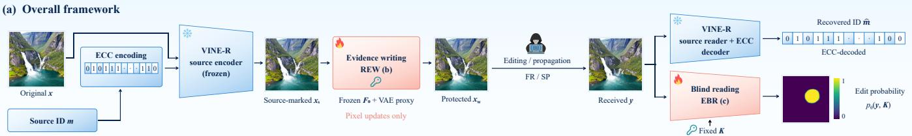

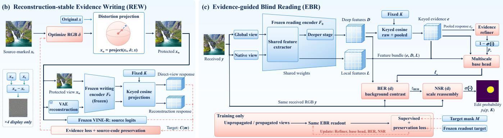

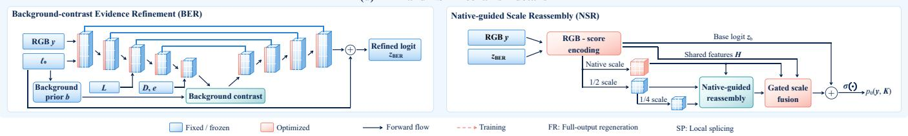  
Fig. 1. Overall framework of ReliaGuard. (a) Source-message encoding and REW produce the protected image; source decoding and localization recover its identifier and estimate the target edit region. (b) REW optimizes keyed responses in protected and VAE-reconstructed views under source-preservation and image-distortion constraints. (c) EBR combines shared dual-scale features with keyed responses and is trained on paired unpropagated and propagated observations. (d) BER refines the base prediction using background context, and NSR fuses native-, half-, and quarter-resolution features. Solid arrows denote forward computation; dashed arrows denote optimization or training supervision. Blue and red blocks indicate fixed and optimized components; reader colors refer to propagation training. Error-correcting coding (ECC) is used for the source message.

Dense-prediction architectures provide complementary ways to combine context with spatial detail. Self-supervised representations ofer dense image features [22]; encoder–decoder skip connections retain information across scales [23]; nonlocal operations aggregate context from distant locations [26]; and content-aware reassembly adapts feature upsampling to the input content [24]. Our reader adapts these components to the interpretation of keyed watermark evidence. BER uses image context to refine a base localization map, and NSR combines native-resolution features with coarser representations to preserve spatial detail during decoding.

## III. METHOD

Our method combines source attribution and blind edit localization through reconstruction-aware watermark writing and evidence-guided reading, as shown in Fig. 1. The writer embeds a source identifier and adds keyed spatial evidence through REW, aligning feature responses with the key in both the protected image and its VAE reconstruction. At reception, a separate source decoder recovers the identifier, while EBR combines watermark responses with image features to estimate the target edit region. BER refines the base prediction using background context, and NSR integrates native- and lowerresolution features to refine its spatial extent.

## A. Problem Formulation

Let $x \in [ 0 , 1 ] ^ { 3 \times H \times W }$ be an original image, $m \in \{ 0 , 1 \} ^ { 1 6 }$ its source identifier, and K a fixed unit-norm evidence key. A frozen VINE-R encoder [4] embeds the coded identifier to obtain $x _ { s } .$ . The error-correcting code $\mathcal { C } ( m )$ contains 96 bits, padded with four fixed zeros to match the encoder’s 100- bit interface. REW then adds spatial evidence to produce the protected image $x _ { w }$

Given an editing prompt t, a binary target mask $M \in$ $\{ 0 , 1 \} ^ { H \times W }$ , and a random seed ξ, we construct

$$
y _ { F } = \mathcal { E } ( x _ { w } , M , t ; \xi ) ,\tag{1}
$$

$$
y _ { S } = M \odot y _ { F } + ( 1 - M ) \odot x _ { w } ,\tag{2}
$$

where $\mathcal { E }$ denotes the generative editor and $\odot$ is elementwise multiplication, with the mask broadcast across color channels. FR retains the complete editor output $y _ { F } .$ , whereas SP combines its generated foreground with the protected background [10]. Both outputs use the requested edit mask M as the localization target. Their foreground pixels are identical within M, allowing us to examine the efect of background reconstruction.

An optional propagation operation A produces the received image y. The source decoder recovers m from the 96 coded-bit logits and returns an acceptance confidence. The localization branch uses $y$ and $K$ to predict $p _ { \Theta } ( y , K )$ , with binary output

$$
\widehat { M } = \mathbf { 1 } [ p _ { \Theta } ( y , K ) \geq \tau ] .\tag{3}
$$

Each reader uses a threshold calibrated on a separate calibration set and held fixed across output types and propagation conditions. Inference requires no original or protected reference image. During training and evaluation, geometric transformations act jointly on the image, target mask, and valid support.

## B. Reconstruction-Stable Evidence Writing

Generative reconstruction can weaken watermark responses in the background as well as in the target region. REW therefore optimizes evidence in both $x _ { w }$ and its VAE reconstruction $R ( x _ { w } )$ . Following reconstruction-based degradation modeling [7], we use the posterior mean of the Stable Difusion 2 (SD2) inpainting VAE:

$$
R ( x _ { w } ) = \mathrm { c l i p } \left( \frac { D _ { \mathrm { V A E } } ( \mu _ { \mathrm { V A E } } ( 2 x _ { w } - 1 ) ) + 1 } { 2 } , 0 , 1 \right) ,\tag{4}
$$

where $\mu _ {  { \mathrm { V A E } } }$ is the encoder’s posterior mean and $D _ { \mathrm { V A E } }$ is the decoder. Directly decoding the posterior mean makes reconstruction deterministic during writing.

A frozen encoder $F _ { 0 }$ maps each resized view to spatial features $f .$ Following feature-space watermarking [13], [10], we measure alignment with K before and after neighborhood pooling:

$$
c _ { r } ( u ) = \langle \nu ( f ( u ) ) , K \rangle ,\tag{5}
$$

$$
c _ { p } ( u ) = \left. \nu \big ( \operatorname { A v g } _ { 3 \times 3 } f ( u ) \big ) , K \right. ,\tag{6}
$$

where ν denotes channel-wise $\ell _ { 2 }$ normalization. Average pooling uses stride one, zero padding, and a divisor of nine. Pooling precedes normalization, so neighboring feature directions and magnitudes both afect $c _ { p }$

For each view, concatenate the two response maps into $\{ c _ { i } \} _ { i = 1 } ^ { N _ { e } }$ and define $a _ { i } = { \mathrm { s o f t p l u s } } [ - \kappa ( c _ { i } - \mu ) ]$ ]. The evidence loss is

$$
\mathcal { L } _ { e } = \frac { 1 } { N _ { e } } \sum _ { i = 1 } ^ { N _ { e } } a _ { i } + \frac { 1 } { \vert \mathcal { H } \vert } \sum _ { i \in \mathcal { H } } a _ { i } ,\tag{7}
$$

where H indexes the largest max $( 1 , \left\lfloor 0 . 1 N _ { e } \right\rfloor )$ losses. The second term places greater weight on weakly aligned responses. The writing objective is

$$
\begin{array} { r l } & { \mathcal { L } _ { w } = \frac { 1 } { 2 } \left[ \mathcal { L } _ { e } ( x _ { w } ) + \mathcal { L } _ { e } ( R ( x _ { w } ) ) \right] } \\ & { \qquad + \mathcal { L } _ { \mathrm { s r c } } ( x _ { w } ) , } \end{array}\tag{8}
$$

where $\mathcal { L } _ { \mathrm { s r c } }$ is binary cross-entropy between the frozen source decoder’s 96 coded-bit logits and $\mathcal { C } ( m )$ , evaluated on the protected view.

Writing optimizes a zero-initialized RGB increment δ, keeping the source model, $F _ { 0 }$ , and VAE fixed. Let $Q _ { 8 }$ denote

nearest-level eight-bit quantization and $\| \cdot \| _ { \mathrm { R M S } }$ the root mean square (RMS) over all color values. At each step,

$$
\begin{array} { r } { u = \mathrm { c l i p } \big ( x _ { s } + \mathrm { c l i p } ( \delta , - 1 6 / 2 5 5 , 1 6 / 2 5 5 ) , 0 , 1 \big ) , } \end{array}\tag{9}
$$

$$
r = 1 0 ^ { - 3 2 / 2 0 } - 1 / ( 2 \cdot 2 5 5 ) ,\tag{10}
$$

$$
\alpha = \operatorname* { m i n } \{ 1 , r / ( \| u - x \| _ { \mathrm { R M S } } + \epsilon ) \} ,\tag{11}
$$

$$
x _ { w } = Q _ { 8 } \big ( x + \alpha ( u - x ) \big ) .\tag{12}
$$

The projection reserves the maximum quantization error, giving $\| x _ { w } - x \| _ { \mathrm { R M S } } \leq r + 1 / ( 2 \cdot 2 5 5 ) = 1 0 ^ { - 3 2 / 2 0 }$ . The resulting peak signal-to-noise ratio (PSNR) is at least 32 dB, up to floating-point rounding. Gradients through $Q _ { 8 }$ are estimated using a straight-through estimator. Each image receives 200 Adam updates at a learning rate of 0.002, with $\mu = 0 . 1$ and $\kappa = 4 0$

## C. Evidence-Guided Blind Reading

EBR interprets keyed responses together with image features. A shared DINOv3 ConvNeXt encoder $F _ { \theta }$ [22], [25] processes a $2 5 6 \times 2 5 6$ global view and the native $5 1 2 \times 5 1 2$ received image. Both paths share the input stem and first feature stage; the global path also uses the second stage. They produce deep features $\bar { D } \in \mathbb { R } ^ { 1 9 2 \times 3 2 \times 3 2 }$ and local features $\mathbf { \bar { \chi } } _ { L } \in \mathbb { R } ^ { 9 6 \times 1 2 8 \times 1 2 8 }$ . Raw and pooled projections of D onto K form the two-channel evidence map $e .$ The reading encoder has separate weights from $F _ { 0 }$

An evidence refiner $R _ { e }$ converts the pooled response to evidence-presence logits, giving the preliminary edit probability

$$
p _ { 0 } = 1 - \sigma ( R _ { e } ( c _ { p } ) ) .\tag{13}
$$

A multiscale base head $H _ { b }$ combines $e , p _ { 0 } , D ,$ and L to produce $\widetilde { \ell } _ { 0 }$ . Before entering $H _ { b }$ , these inputs are cast to 16- ebit floating-point (FP16) precision and then back to 32-bit floating-point (FP32) precision. The base logits used by the subsequent reader are

$$
\ell _ { 0 } = \log \mathrm { i } \Big ( \mathrm { c l i p } ( \sigma ( \widetilde { \ell } _ { 0 } ) , 1 0 ^ { - 6 } , 1 - 1 0 ^ { - 6 } ) \Big ) .\tag{14}
$$

BER refines $\ell _ { 0 }$ using the received image and background context, and NSR combines the refined scores with features at three scales.

## D. Background-Contrast Evidence Refinement

A weak keyed response may result from target editing or background reconstruction. BER uses an estimated background context to distinguish these efects. Its encoder– decoder with skip connections [23] takes $[ 2 y - 1 , \ell _ { 0 } / 8 ]$ as input. Local features enter the $1 2 8 \times 1 2 8$ stage, while deep features and keyed evidence enter the $3 2 \times 3 2$ bottleneck.

The base prediction defines soft background weights on the bottleneck grid:

$$
b = \operatorname* { m a x } \left\{ \operatorname* { P o o l } ( 1 - \sigma ( \mathbf { s g } ( \ell _ { 0 } ) ) ) , 1 0 ^ { - 3 } \right\} ,\tag{15}
$$

where Pool denotes adaptive average pooling and sg stops gradients. Locations assigned lower edit probabilities contribute more strongly to the background context.

Let $h _ { i }$ denote a bottleneck feature and $q _ { i } , k _ { i } ,$ and $v _ { i }$ be projections of its channel-normalized representation. Backgroundweighted non-local aggregation [26] is

$$
A _ { i j } = \frac { \exp ( { q _ { i } ^ { \top } k _ { j } / \sqrt { d } + \log b _ { j } } ) } { \sum _ { l } \exp ( { q _ { i } ^ { \top } k _ { l } / \sqrt { d } + \log b _ { l } } ) } ,\tag{16}
$$

$$
h _ { i } ^ { \prime } = h _ { i } + P \left( \sum _ { j } A _ { i j } v _ { j } - v _ { i } \right) ,\tag{17}
$$

with $d = 3 2$ . The weights combine feature similarity with the background prior over all bottleneck locations. Subtracting $v _ { i }$ makes the update depend on the contrast between local and aggregated context. The decoder predicts a residual correction,

$$
z _ { \mathrm { B E R } } = \ell _ { 0 } + \Delta _ { \mathrm { B E R } } ( y , \ell _ { 0 } , e , D , L ) .\tag{18}
$$

Only the background-prior branch is detached; gradients remain through the BER input and residual connection.

## E. Native-Guided Scale Reassembly

NSR combines broader context with native-resolution detail to refine small targets and complex contours. An RGB-andscore encoder constructs H from the received image, the BER logits, and their spatial derivatives. Let

$$
d _ { x } = \partial _ { x } ( 2 z _ { \mathrm { B E R } } ) , \qquad d _ { y } = \partial _ { y } ( 2 z _ { \mathrm { B E R } } ) ,\tag{19}
$$

and

$$
s = \sqrt { d _ { x } ^ { 2 } + d _ { y } ^ { 2 } + 1 0 ^ { - 6 } } , \qquad n _ { x } = d _ { x } / s , \qquad n _ { y } = d _ { y } / s ,\tag{20}
$$

where $\partial _ { x }$ and $\partial _ { y }$ denote finite diferences. The four derivative channels are

$$
\left[ n _ { x } , n _ { y } , \operatorname { t a n h } ( s / 2 ) , \operatorname { c l i p } \bigl ( 4 ( \partial _ { x } n _ { x } + \partial _ { y } n _ { y } ) , - 1 , 1 \bigr ) \right] .\tag{21}
$$

They are concatenated with $2 y - 1$ and clip(zBER/8, −2, 2);   
unused auxiliary channels are zero.

The three feature paths are

$$
n = P _ { N } ( H ) , \qquad h = P _ { H } ( \operatorname { A v g } _ { 2 } H ) ,\tag{22}
$$

$$
q = P _ { Q } ( \operatorname { A v g } _ { 2 } h ) .\tag{23}
$$

Here, $P _ { N } , P _ { H }$ , and $P _ { Q }$ denote the native-, half-, and quarterresolution encoding blocks. The quarter-resolution features are derived from the encoded half-resolution features before channel projection and reassembly. After projection, each lower-resolution feature map l has 24 channels. Inspired by content-aware reassembly [24], we define

$$
\begin{array} { l } { \displaystyle \mathcal { R } ( l , n ) = { \cal U } _ { \mathrm { b i l i n e a r } } ( l ) } \\ { \displaystyle \qquad + \sum _ { j = 1 } ^ { 9 } \left[ \mathrm { s o f t m a x } _ { j } ( \psi ( l , n ) ) - \frac { 1 } { 9 } \right] { \cal U } _ { \mathrm { n e a r e s t } } ( l _ { j } ) , } \end{array}\tag{24}
$$

where $l _ { j }$ is the jth neighbor in a $3 \times 3$ patch, with replicate padding. The predictor ψ combines channel-compressed native features and bilinearly upsampled lower-resolution features. Its residual coeficients are shared across channels and sum to zero. Separate predictors produce $\widetilde { h }$ and $\widetilde { q } ;$ their final layers e eare initialized to zero so that reassembly initially reduces to bilinear interpolation.

Pixelwise scale weights are

$$
a = \operatorname { s o f t m a x } \big ( G ( H ) + G _ { \Delta } ( [ n , \widetilde { h } , \widetilde { q } ] ) \big ) ,\tag{25}
$$

with softmax applied across scales. A parallel score branch computes

$$
\begin{array} { r l } { z _ { b } = z _ { \mathrm { B E R } } + 2 \eta ( z _ { \mathrm { B E R } } ) \operatorname { t a n h } ( O ( H ) ) } & { { } } \\ { + R _ { b } ( H ) , } \end{array}\tag{26}
$$

where $\eta ( z ) = \mathrm { c l i p } ( 1 - \vert z \vert / 8 , 0 , 1 )$ . The gated correction acts on nonsaturated logits, while $R _ { b } ( H )$ provides a residual across the image. The final output is

$$
\begin{array} { c } { z = z _ { b } + C ( a _ { 1 } n + a _ { 2 } \widetilde { h } + a _ { 3 } \widetilde { q } ) , } \\ { p _ { \Theta } ( y , K ) = \sigma ( z ) , } \end{array}\tag{27}
$$

where $C$ maps the fused features to a logit correction.

## F. Paired Propagation Training

The encoder and readout are first adapted to unpropagated FR and SP pairs and unedited protected images. The encoder is then frozen, and the evidence refiner, base head, BER, and NSR are jointly optimized using paired unpropagated and propagated observations.

Each source contributes two FR, two SP, and one clean observation per epoch, each paired with a propagated view. Here, clean denotes an unedited protected image. Images, masks, and valid support are transformed together; crops with no remaining foreground are treated as negative observations.

For logits z, probabilities $p \ = \ \sigma ( z )$ , target g, and valid support v, let $b _ { i } ~ = ~ \mathrm { s o f t p l u s } ( z _ { i } ) ~ - ~ g _ { i } z _ { i }$ . The region and boundary objective is

$$
\begin{array} { r l r } {  { \mathcal { L } _ { b } = \frac { \sum _ { i } v _ { i } b _ { i } } { \operatorname* { m a x } ( 1 , \sum _ { i } v _ { i } ) } } } \\ & { } & { + \ 0 . 5 ( 1 - \frac { 2 \sum _ { i } v _ { i } p _ { i } g _ { i } + \epsilon } { \sum _ { i } v _ { i } ( p _ { i } + g _ { i } ) + \epsilon } ) + 0 . 1 \mathcal { L } _ { \partial } . } \end{array}\tag{28}
$$

The second term is soft Dice [27]. With stride-one $9 \times 9$ max pooling ${ \mathcal { P } } _ { 9 }$ , the inner and outer boundary supports are

$$
I = g v \mathbf { 1 } [ \mathcal { P } _ { 9 } ( 1 - g ) > 0 ] ,\tag{29}
$$

$$
O = ( 1 - g ) v { \bf 1 } [ \mathcal { P } _ { 9 } ( g ) > 0 ] ,\tag{30}
$$

and

$$
\mathcal { L } _ { \partial } = \textstyle \frac { 1 } { 2 } \left( \frac { \sum _ { i } I _ { i } b _ { i } } { \operatorname* { m a x } ( 1 , \sum _ { i } I _ { i } ) } + \frac { \sum _ { i } O _ { i } b _ { i } } { \operatorname* { m a x } ( 1 , \sum _ { i } O _ { i } ) } \right) .\tag{31}
$$

During paired training, the supervised loss is $1 . 2 5 { \cal L } _ { b }$ for edited observations. For unedited images and crops without foreground, it is 0.5 times the mean cross-entropy over valid pixels.

A frozen copy of the initialized reader supplies preservation targets $q _ { i }$ on unpropagated views. For each class $c ,$ define

$$
\begin{array} { c } { { \mathcal { T } _ { c } = \{ i : g _ { i } = c , ~ \operatorname* { m a x } ( q _ { i } , 1 - q _ { i } ) \geq 0 . 9 , } } \\ { { \qquad \quad \mathbf { 1 } [ q _ { i } \geq 0 . 5 ] = g _ { i } \} . } } \end{array}\tag{32}
$$

Using the Kullback–Leibler (KL) divergence between Bernoulli distributions, the class-balanced preservation loss is

$$
\mathcal { L } _ { \mathrm { k e e p } } = \frac { 1 } { 2 } \sum _ { c \in \{ 0 , 1 \} } \frac { \sum _ { i \in \mathbb { Z } _ { c } } D _ { \mathrm { K L } } \big ( \mathrm { B e r n } ( q _ { i } ) \| \mathrm { B e r n } ( p _ { i } ) \big ) } { \operatorname* { m a x } ( 1 , | \mathbb { Z } _ { c } | ) } .\tag{33}
$$

The complete objective is

$$
\begin{array} { r } { \mathcal { L } = ( 1 - \lambda _ { p } ) \mathcal { L } _ { n } + \lambda _ { p } \mathcal { L } _ { p } + 0 . 0 5 \mathcal { L } _ { \mathrm { k e e p } } , } \end{array}\tag{34}
$$

where ${ \mathcal { L } } _ { n }$ and ${ \mathcal { L } } _ { p }$ supervise unpropagated and propagated views. The propagation weight is 0.25 for epochs 1–5, increases linearly to 0.5 over epochs 6–15, and remains at 0.5 thereafter.

Propagation includes JPEG compression, resizing, blur, noise, color adjustment, geometric transformations, and twostep compositions. Transform severity increases over the first 15 epochs. At inference, both the source decoder and the trained reader operate directly on the received image.

## IV. EXPERIMENTS

We compare our method with existing active and passive approaches across three image domains and examine the contributions of spatial evidence, readout structure, and paired propagation training through ablation studies.

## A. Experimental Setup

We use Common Objects in Context (COCO) [28], ImageNet [29], and generated images, with 606 sources for training, 72 for calibration, and 144 for ablation evaluation. The main comparison uses an independent held-out test set of 300 sources that was not used during method development. It contains 100 sources per domain and 900 editing cases. The masks cover three shape categories and four area ratios: 3%, 8%, 18%, and 35%. Editing uses SD2 inpainting at 512×512, with 30 denoising steps, strength 1.0, and guidance scale 7.5. We evaluate both FR and SP outputs.

We select six representative active protection methods as baselines: WAM [6], StableGuard-C [8], OmniGuard [7], EditGuard [5], GenPTW [9], and APT [10], together with APT’s enhanced reader APT∗. Two passive manipulationlocalization methods, TruFor [20] and IML-ViT [21], are also included. StableGuard-C uses the clean-trained configuration. All baselines use released pretrained weights; active methods retain their original writing procedures and payloads.

Localization is evaluated using IoU, F1, and background FPR, with additional boundary measurements based on the false-negative rate (FNR) and FPR. Source recovery is measured by bit accuracy (BA) and extraction rate (ER). Image fidelity is evaluated using PSNR, the structural similarity index (SSIM) [32], and learned perceptual image patch similarity (LPIPS) [33]. We report fixed-threshold results at 0.5 (0.2 on EditGuard’s raw residual) and results at reader-specific thresholds calibrated to a nominal 1% FR background FPR. Calibrated thresholds remain unchanged across FR, SP, and processing conditions. Scores are averaged by source with equal weighting of the three domains. Robustness tests cover 18 settings in seven processing families, with four stronger conditions evaluated separately. Scores are first averaged within each processing family, and the seven family means are then averaged with equal weights. Paired confidence intervals use 5,000 source-group bootstrap resamples within domains.

The readout is trained for 100 epochs using Adam with decoupled weight decay (AdamW) [30] and an efective batch size of 24 observation pairs. Initial learning rates are $2 \times 1 0 ^ { - 5 }$ for the refiner and base head and $5 \times 1 0 ^ { - 5 }$ for BER and NSR.

## B. Comparison with Existing Methods

1) Localization and Source Recovery: Table I compares performance across the three image domains. Our method achieves the highest FR IoU in every domain, reaching 85.03% on COCO, 85.12% on generated images, and 86.92% on ImageNet. The domain-averaged FR IoU and F1 are 85.69% and 91.84%, respectively. For SP, these scores rise to 94.95% and 97.22%. StableGuard-C obtains higher SP overlap, but its FR performance drops substantially when the reconstructed background is retained. Our method maintains high overlap in both settings, with a smaller reconstruction-related decrease than StableGuard-C.

The passive baselines show a pronounced diference between the two editing conditions. On ImageNet, TruFor and IML-ViT reach 63.09% and 29.90% SP IoU, but only 5.23% and 2.04% FR IoU. Their FR scores remain low in the other two domains as well. This contrast suggests that the forensic cues used by these detectors are less efective at separating the intended edit from a fully reconstructed background.

Decoded identifier-bit accuracy and ER both reach 100% on unpropagated FR and SP outputs. In comparison, WAM’s FR identifier-bit accuracy ranges from 90.12% to 98.58% across domains, with extraction rates of 81.67%–98.33%. The improvement in complete-output localization is therefore accompanied by reliable identifier recovery.

The visual comparisons in Figs. 2 and 3 show where the methods difer. Several baselines respond to large parts of the reconstructed background in FR, whereas our predictions are more concentrated around the intended edit. In the small irregular waterfall example, the IoU reaches 73.07%, compared with 27.09% for APT∗. The piano and temple examples in SP reach 98.69% and 99.25%, respectively. Remaining errors are most apparent along boundaries and in small disconnected regions.

2) Localization at Low Background Error: The advantage on FR persists when background false positives are brought to comparable levels. As shown in Table II, our method achieves 85.61% IoU at 1.07% measured FPR, whereas APT∗ achieves 40.59% at 1.02% FPR. The paired improvement is 45.02 percentage points, with a 95% confidence interval of [43.32, 46.68]. A recall of 92.21% indicates that most target pixels are correctly identified.

Comparing the two operating points reveals diferences that are less apparent from SP results alone. At fixed thresholds, EditGuard and GenPTW obtain 81.78% and 91.20% SP IoU, but their FR FPRs approach 100%. Raising the thresholds to suppress FR background responses also removes much of their SP foreground response. For our method, calibration changes FR IoU only from 85.69% to 85.61% and SP IoU from 94.95% to 94.90%. StableGuard-C retains the highest calibrated SP IoU of 96.47%, while reaching only 0.71% on FR. These results highlight the importance of separating target edits from changes introduced by background reconstruction.

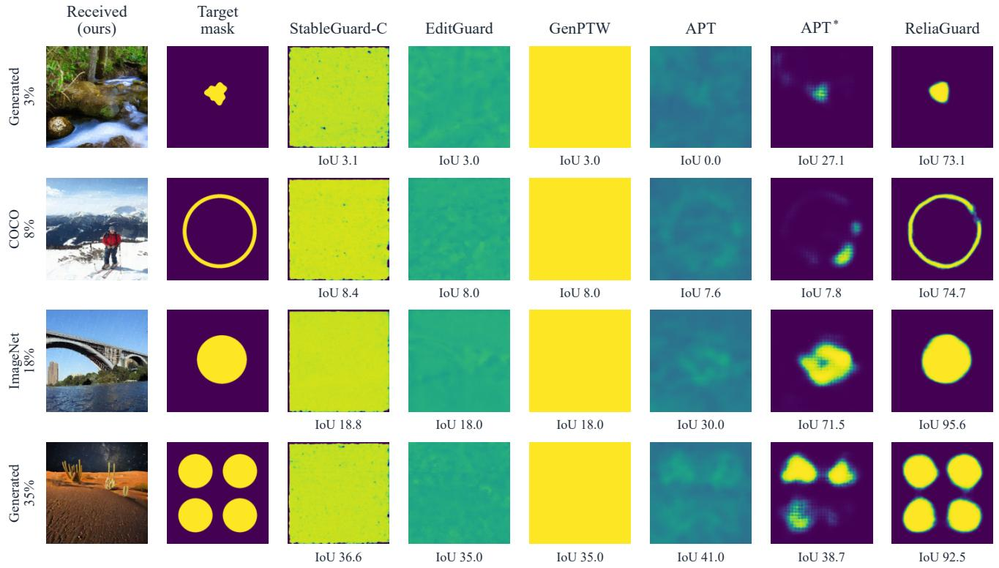

Fig. 2. FR localization examples for active methods across three image domains and four target areas. Each row uses the same source and target mask across methods; each method receives its own protected and edited image. The first column shows our received image. IoUs are evaluated at the fixed thresholds in Table I.  
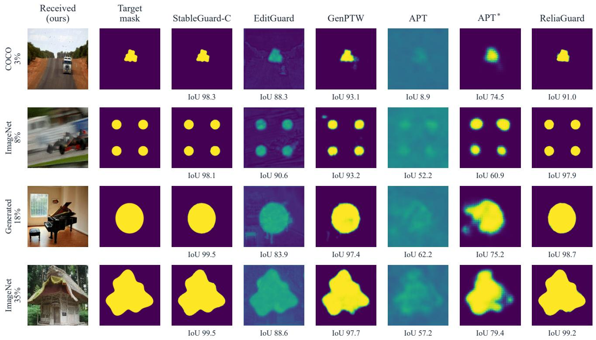  
Fig. 3. SP localization examples for active methods across three image domains and four target areas. These cases difer from those in Fig. 2; IoUs use the same fixed-threshold convention.

TABLE I  
LOCALIZATION AND SOURCE-IDENTIFIER RECOVERY OF ACTIVE AND PASSIVE METHODS ACROSS THREE IMAGE DOMAINS AT FIXED THRESHOLDS.
<table><tr><td rowspan="2">Method</td><td colspan="3">COCO (n = 100)</td><td colspan="3">Generated (n = 100)</td><td colspan="3">ImageNet (n = 100)</td></tr><tr><td>IoU↑</td><td>F1↑</td><td>BAID ↑</td><td>IoU↑</td><td>F1↑</td><td>BAID ↑</td><td>IoU↑</td><td>F1↑</td><td>BAID ↑</td></tr><tr><td colspan="10">Full-output regeneration (FR)</td></tr><tr><td colspan="10">Passive localization</td></tr><tr><td>TruFor</td><td>4.35</td><td>7.20</td><td></td><td>4.89</td><td>8.11</td><td></td><td>5.23</td><td>8.53</td><td></td></tr><tr><td>IML-ViT</td><td>1.39</td><td>2.45</td><td></td><td>1.43</td><td>2.56</td><td></td><td>2.04</td><td>3.54</td><td></td></tr><tr><td colspan="10">Active protection</td></tr><tr><td>WAM</td><td>25.10</td><td>37.08</td><td>98.58†</td><td>18.27</td><td>28.75</td><td>90.12†</td><td>27.24</td><td>39.71</td><td>96.70†</td></tr><tr><td>StableGuard-C</td><td>16.74</td><td>26.72</td><td>50.25</td><td>16.73</td><td>26.70</td><td>49.92</td><td>16.70</td><td>26.66</td><td>50.54</td></tr><tr><td>OmniGuard</td><td>0.41</td><td>0.79</td><td></td><td>0.43</td><td>0.83</td><td></td><td>0.58</td><td>1.12</td><td></td></tr><tr><td>EditGuard</td><td>16.00</td><td>25.75</td><td>53.44</td><td>16.00</td><td>25.75</td><td>54.37</td><td>16.00</td><td>25.75</td><td>54.50</td></tr><tr><td>GenPTW</td><td>16.02</td><td>25.78</td><td>98.60</td><td>16.01</td><td>25.76</td><td>98.52</td><td>16.24</td><td>26.07</td><td>99.25</td></tr><tr><td>APT</td><td>42.87</td><td>56.25</td><td>一</td><td>42.97</td><td>56.73</td><td>一</td><td>39.59</td><td>52.31</td><td>一</td></tr><tr><td>APT*</td><td>53.37</td><td>65.18</td><td></td><td>47.89</td><td>59.73</td><td></td><td>52.89</td><td>65.00</td><td></td></tr><tr><td>ReliaGuard</td><td>85.03</td><td>91.42</td><td>100.00</td><td>85.12</td><td>91.51</td><td>100.00</td><td>86.92</td><td>92.60</td><td>100.00</td></tr><tr><td colspan="10">Local splicing (SP)</td></tr><tr><td colspan="10">Passive localization</td></tr><tr><td>TruFor IML-ViT</td><td>13.01</td><td>18.72</td><td></td><td>7.76</td><td>12.37</td><td></td><td>63.09</td><td>72.01</td><td></td></tr><tr><td></td><td>5.66</td><td>8.34</td><td></td><td>5.04</td><td>8.04</td><td></td><td>29.90</td><td>37.22</td><td></td></tr><tr><td colspan="10">Active protection</td></tr><tr><td>WAM</td><td>77.10</td><td>83.11</td><td>100.00</td><td>77.22</td><td>83.78</td><td>100.00</td><td>78.46</td><td>84.66</td><td>100.00</td></tr><tr><td>StableGuard-C</td><td>98.24</td><td>99.08</td><td>100.00</td><td>98.35</td><td>99.16</td><td>100.00</td><td>97.90</td><td>98.77</td><td>100.00</td></tr><tr><td>OmniGuard</td><td>88.19</td><td>92.26</td><td></td><td>88.35</td><td>92.39</td><td></td><td>81.37</td><td>86.30</td><td></td></tr><tr><td>EditGuard</td><td>80.72</td><td>87.88</td><td>100.00</td><td>82.96</td><td>89.74</td><td>100.00</td><td>81.67</td><td>88.26</td><td>100.00</td></tr><tr><td>GenPTW</td><td>90.73</td><td>92.86</td><td>99.98</td><td>91.32</td><td>93.55</td><td>100.00</td><td>91.55</td><td>93.53</td><td>100.00</td></tr><tr><td>APT</td><td>41.20</td><td>53.24</td><td></td><td>48.13</td><td>60.74</td><td></td><td>41.07</td><td>52.71</td><td></td></tr><tr><td>APT*</td><td>63.02</td><td>73.67</td><td></td><td>59.16</td><td>70.23</td><td></td><td>64.77</td><td>75.60</td><td></td></tr><tr><td>ReliaGuard</td><td>93.86</td><td>96.60</td><td>100.00</td><td>94.17</td><td>96.79</td><td>100.00</td><td>96.81</td><td>98.26</td><td>100.00</td></tr></table>

Scores are percentages. Thresholds are 0.5, except for EditGuard’s raw residual threshold of 0.2. BAID is evaluated on extracted messages. † WAM’s FR extraction rates are 98.33%, 81.67%, and 96.33% for COCO, Generated, and ImageNet, respectively; the other reported message outputs have 100% extraction. – denotes no comparable identifier result.

3) Robustness to Image Processing: After seven families of image processing, our method retains an IoU of 81.01% for FR and 86.49% for SP, compared with 31.04% and 39.46%, respectively, for APT∗ (Table III). Identifier-bit accuracy remains 92.76% for FR and 92.79% for SP, and a message is extracted in every case. WAM achieves higher SP identifier-bit accuracy, at 98.32%, but its localization is much weaker at the transferred FR threshold. Message recovery and spatial localization therefore respond diferently to the same processing operations.

Compression and resizing have a smaller efect than large geometric changes, as shown in Fig. 4. JPEG compression at quality 75 yields an IoU of 83.85% for FR and 88.03% for SP. After half-resolution resizing and restoration, the corresponding scores are 84.47% and 89.47%. Rotation by 90◦ reduces FR IoU to 53.66% and SP IoU to 72.40%. Cropping to 75% of the image area gives 65.80% for FR and 64.24% for SP; retaining only half the area further lowers these scores to 48.77% and 47.51%, respectively. Additional tests on 120 sources with four ordered processing chains absent from training yield an IoU of 83.43% for FR and 86.40% for SP.

4) Protected-Image Quality: Across the 300 sources, the proposed method achieves an average PSNR of 32.70 dB,

SSIM of 0.9046, and LPIPS of 0.1372 (Table IV). The PSNR values remain close across domains, whereas LPIPS ranges from 0.0883 on generated images to 0.2060 on ImageNet. The diference indicates that the perceptual efect of embedding varies with image content, even at a similar pixel-distortion level.

WAM and OmniGuard preserve image fidelity better, while APT and APT∗, which share a writer, yield averages of 27.64 dB, 0.7718, and 0.3038. Our method improves on these APT fidelity measures while also obtaining higher FR localization accuracy. Compared with WAM and OmniGuard, the stronger FR localization is accompanied by greater embedding distortion.

The residual maps in Fig. 5 reveal where embedding alters the image, complementing the aggregate fidelity scores. The protected images retain the main scene structures in these examples, while magnified crops reveal local texture and color changes. The amplified diferences make the spatial distribution of these perturbations visible even where changes are dificult to distinguish at full-image scale.

5) Efects of Target Size and Shape: Small and geometrically complex edits remain the most dificult cases, as shown in Fig. 6. At 3% target area, our method achieves 75.71% FR IoU, compared with 27.73% for $\mathbf { A P T ^ { * } }$ . As the target area increases to 8%, 18%, and 35%, the IoU rises to 84.74%, 90.07%, and 91.91%. The advantage is maintained across compact, irregular connected, and hole/multiple-component masks, with FR IoUs of 92.31%, 85.83%, and 78.68%, respectively. SP shows the same area dependence, with IoU increasing from 88.26% at 3% area to 98.40% at 35%.

TABLE II  
LOCALIZATION AT FIXED THRESHOLDS AND AT THRESHOLDS CALIBRATED TO A NOMINAL 1% FR BACKGROUND FPR
<table><tr><td>Method</td><td colspan="3">FR</td><td colspan="3">SP</td></tr><tr><td></td><td>IoU↑</td><td>F1↑</td><td>FPR↓</td><td>IoU↑</td><td>F1↑</td><td>FPR↓</td></tr><tr><td colspan="7">Fixed decision thresholds</td></tr><tr><td>WAM</td><td>23.54</td><td>35.18</td><td>60.76</td><td>77.60</td><td>83.85</td><td>0.97</td></tr><tr><td>StableGuard-C</td><td>16.73</td><td>26.69</td><td>94.61</td><td>98.16</td><td>99.00</td><td>0.23</td></tr><tr><td>OmniGuard</td><td>0.47</td><td>0.91</td><td>0.31</td><td>85.97</td><td>90.32</td><td>0.36</td></tr><tr><td>EditGuard</td><td>16.00</td><td>25.75</td><td>100.00</td><td>81.78</td><td>88.63</td><td>4.93</td></tr><tr><td>GenPTW</td><td>16.09</td><td>25.87</td><td>99.46</td><td>91.20</td><td>93.31</td><td>0.30</td></tr><tr><td>APT</td><td>41.81</td><td>55.09</td><td>5.35</td><td>43.47</td><td>55.56</td><td>1.09</td></tr><tr><td>APT*</td><td>51.39</td><td>63.30</td><td>3.45</td><td>62.32</td><td>73.17</td><td>3.02</td></tr><tr><td>ReliaGuard</td><td>85.69</td><td>91.84</td><td>1.25</td><td>94.95</td><td>97.22</td><td>0.27</td></tr><tr><td colspan="7">FR-calibrated thresholds (nominal 1% background FPR)</td></tr><tr><td>WAM</td><td>1.50</td><td>2.68</td><td>0.92</td><td>3.61</td><td>6.39</td><td>0.00</td></tr><tr><td>StableGuard-C</td><td>0.71</td><td>1.28</td><td>1.01</td><td>96.47</td><td>98.10</td><td>0.10</td></tr><tr><td>OmniGuard</td><td>1.29</td><td>2.42</td><td>1.07</td><td>86.18</td><td>90.77</td><td>0.50</td></tr><tr><td>EditGuard</td><td>0.97</td><td>1.83</td><td>0.90</td><td>0.62</td><td>1.15</td><td>0.00</td></tr><tr><td>GenPTW</td><td>0.57</td><td>1.11</td><td>1.06</td><td>0.00†</td><td>0.00†</td><td>0.00</td></tr><tr><td>APT</td><td>17.93</td><td>26.47</td><td>0.54</td><td>16.28</td><td>23.93</td><td>0.08</td></tr><tr><td>APT*</td><td>40.59</td><td>51.54</td><td>1.02</td><td>49.78</td><td>60.77</td><td>0.68</td></tr><tr><td>ReliaGuard</td><td>85.61</td><td>91.80</td><td>1.07</td><td>94.90</td><td>97.18</td><td>0.24</td></tr></table>

Each reader retains its FR-calibrated threshold for SP. † GenPTW predicts no edited pixels on SP at its FR-calibrated threshold.

TABLE III  
EDIT LOCALIZATION AND SOURCE-IDENTIFIER RECOVERY UNDER ORDINARY PROPAGATION.
<table><tr><td rowspan="2">Method</td><td colspan="5">FR</td><td colspan="5">SP</td></tr><tr><td>IoU↑</td><td>F1↑</td><td>FPR↓</td><td>BAID ↑</td><td>ER↑</td><td>IoU↑</td><td>F1↑</td><td>FPR↓</td><td>BAID ↑</td><td>ER↑</td></tr><tr><td>WAM</td><td>2.04</td><td>3.59</td><td>1.44</td><td>90.28</td><td>85.80</td><td>2.41</td><td>4.31</td><td>0.00</td><td>98.32</td><td>99.98</td></tr><tr><td>StableGuard-C</td><td>1.88</td><td>3.25</td><td>5.15</td><td>50.26</td><td>100.00</td><td>37.78</td><td>42.07</td><td>13.52</td><td>70.56</td><td>100.00</td></tr><tr><td>OmniGuard</td><td>1.64</td><td>2.99</td><td>1.46</td><td>N/A</td><td>N/A</td><td>28.17</td><td>31.39</td><td>2.98</td><td>N/A</td><td>N/A</td></tr><tr><td>EditGuard</td><td>0.63</td><td>1.20</td><td>0.63</td><td>53.79</td><td>100.00</td><td>0.40</td><td>0.75</td><td>2.91</td><td>75.11</td><td>100.00</td></tr><tr><td>GenPTW</td><td>0.53</td><td>1.02</td><td>0.90</td><td>91.78</td><td>100.00</td><td>0.00</td><td>0.00</td><td>0.00</td><td>92.98</td><td>100.00</td></tr><tr><td>APT</td><td>19.90</td><td>29.54</td><td>5.05</td><td>N/A</td><td>N/A</td><td>19.46</td><td>28.52</td><td>3.17</td><td>N/A</td><td>N/A</td></tr><tr><td>APT*</td><td>31.04</td><td>40.42</td><td>0.90</td><td>N/A</td><td>N/A</td><td>39.46</td><td>49.39</td><td>0.75</td><td>N/A</td><td>N/A</td></tr><tr><td>ReliaGuard</td><td>81.01</td><td>88.45</td><td>1.76</td><td>92.76</td><td>100.00</td><td>86.49</td><td>91.51</td><td>0.80</td><td>92.79</td><td>100.00</td></tr></table>

ER denotes message extraction rate; BAID is computed over extracted messages. N/A denotes no comparable source-message output.

TABLE IV  
PROTECTED-IMAGE FIDELITY ACROSS THREE IMAGE DOMAINS.
<table><tr><td rowspan="2">Method</td><td colspan="3">COCO  $( n = 1 0 0 )$ </td><td colspan="3">Generated  $( n = 1 0 0 )$ </td><td colspan="3">ImageNet  $( n = 1 0 0 )$ </td></tr><tr><td>PSNR (dB)↑</td><td>SSIM↑</td><td>LPIPS↓</td><td>PSNR (dB)↑</td><td>SSIM↑</td><td>LPIPS↓</td><td>PSNR (dB)↑</td><td>SSIM↑</td><td>LPIPS↓</td></tr><tr><td>WAM</td><td>38.32</td><td>0.9768</td><td>0.0348</td><td>37.80</td><td>0.9796</td><td>0.0238</td><td>39.32</td><td>0.9760</td><td>0.0444</td></tr><tr><td>StableGuard-C</td><td>25.87</td><td>0.7328</td><td>0.0733</td><td>31.46</td><td>0.9429</td><td>0.0256</td><td>31.01</td><td>0.8580</td><td>0.0517</td></tr><tr><td>OmniGuard</td><td>46.27</td><td>0.9935</td><td>0.0005</td><td>47.52</td><td>0.9948</td><td>0.0003</td><td>49.53</td><td>0.9951</td><td>0.0005</td></tr><tr><td>EditGuard</td><td>31.91</td><td>0.8370</td><td>0.0474</td><td>31.36</td><td>0.8554</td><td>0.0414</td><td>31.99</td><td>0.8141</td><td>0.0794</td></tr><tr><td>GenPTW</td><td>25.72</td><td>0.7174</td><td>0.0803</td><td>30.21</td><td>0.9147</td><td>0.0354</td><td>30.64</td><td>0.8406</td><td>0.0567</td></tr><tr><td>APT</td><td>25.91</td><td>0.7121</td><td>0.3945</td><td>25.91</td><td>0.7641</td><td>0.3012</td><td>31.09</td><td>0.8392</td><td>0.2156</td></tr><tr><td>ReliaGuard</td><td>32.70</td><td>0.9066</td><td>0.1173</td><td>32.70</td><td>0.9207</td><td>0.0883</td><td>32.70</td><td>0.8867</td><td>0.2060</td></tr></table>

APT and $\mathbf { A P T } ^ { * }$ share a writer. Their scores include the native-resolution conversion.

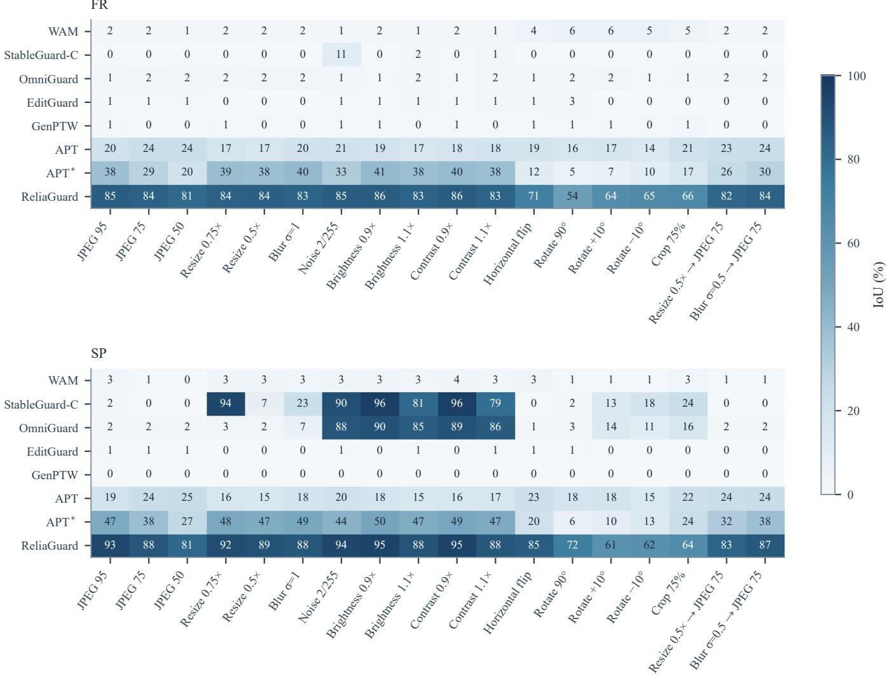  
Fig. 4. FR and SP localization of active methods under 18 image-processing settings, using fixed FR-calibrated thresholds. Heatmap values are IoUs rounded to whole percentages.

The boundary measurements help explain this sensitivity. Averaged across target geometries, inner-band FNR and outerband FPR are 28.22% and 21.74% for FR, compared with 9.21% and 5.81% for SP. A similar boundary displacement afects a larger proportion of a small target, reducing IoU more severely. The lower overlap for masks with holes or multiple components further illustrates the dificulty of preserving fine spatial structure.

6) Joint Source Attribution and Localization: Table V reports how often correct source acceptance is accompanied by an accurate edit map. On unpropagated FR images, error correction raises BA from 90.58% on the coded message to 100% on the identifier, with 99.67% correct acceptance. Joint success at $\mathrm { I o U } \geq 0 . 7 5$ reaches 90.78% for FR and 95.67% for SP. After processing, these values decrease to 74.22% and 78.45%, while correct acceptance falls to 85.43% and 85.71%. This reduction reflects errors in both source decisions and localization.

TABLE V  
SOURCE ATTRIBUTION AND JOINT LOCALIZATION PERFORMANCE.
<table><tr><td rowspan="2">Condition</td><td colspan="2">Source recovery</td><td colspan="2">Joint success</td></tr><tr><td>BAcode ↑</td><td>CA↑</td><td>@0.50↑</td><td>@0.75↑</td></tr><tr><td colspan="5">FR</td></tr><tr><td>Unpropagated</td><td>90.58</td><td>99.67</td><td>96.33</td><td>90.78</td></tr><tr><td>Propagated</td><td>84.57</td><td>85.43</td><td>81.71</td><td>74.22</td></tr><tr><td colspan="5">SP</td></tr><tr><td>Unpropagated</td><td>100.00</td><td>100.00</td><td>99.67</td><td>95.67</td></tr><tr><td>Propagated</td><td>92.87</td><td>85.71</td><td>82.88</td><td>78.45</td></tr></table>

Scores are percentages. CA denotes correct identifier acceptance. Joint@t requires correct acceptance and per-case IoU ≥ t. Propagated results are averaged over the seven processing families

7) Transfer to Another Editing Protocol: Without further training, our method achieves an edit-region IoU of 81.73%

Protected crop

Original crop

Original  
Protected  
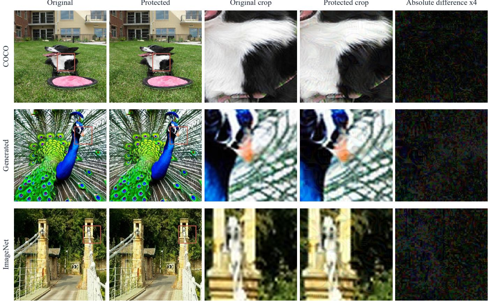  
Fig. 5. Protected images, local crops, and embedding residuals from the three domains. Examples are selected from the lowest-LPIPS quintile in each domain. Original and protected images use the same crop; absolute diferences are amplified fourfold. Table IV reports quality over all 300 sources.

TABLE VI  
LOCALIZATION UNDER THE APT SD1.5 PROTOCOL ON 100 SOURCES, USING A FIXED THRESHOLD OF 0.5.
<table><tr><td rowspan="2">Method</td><td colspan="3">FR</td><td colspan="3">SP</td></tr><tr><td>Edit IoU↑</td><td>Edit F1↑</td><td>Background IoU↑</td><td>Edit IoU↑</td><td>Edit F1↑</td><td>Background IoU↑</td></tr><tr><td>APT</td><td>67.27</td><td>78.49</td><td>89.47</td><td>75.39</td><td>84.63</td><td>94.63</td></tr><tr><td>APT*</td><td>67.42</td><td>77.86</td><td>91.97</td><td>78.45</td><td>86.48</td><td>94.88</td></tr><tr><td>ReliaGuard</td><td>81.73</td><td>89.04</td><td>96.22</td><td>95.38</td><td>97.36</td><td>99.08</td></tr><tr><td>Before propagation training</td><td>83.11</td><td>90.15</td><td>96.59</td><td>95.44</td><td>97.30</td><td>99.12</td></tr></table>

Background scores use the authors’ resized soft masks; edit scores use binary targets. The before-propagation row is excluded from ranking.

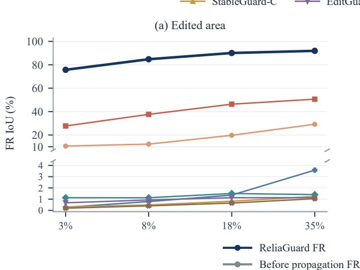

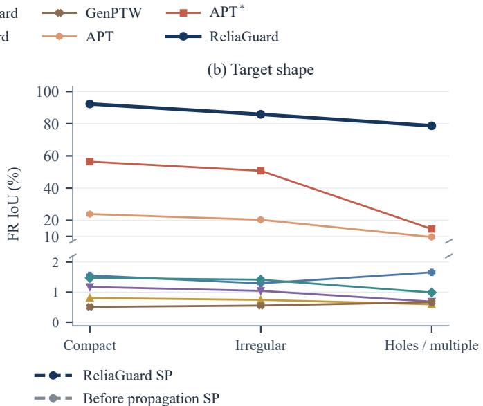

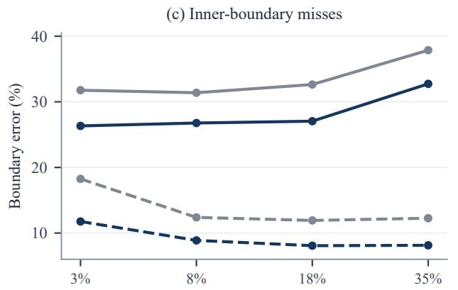

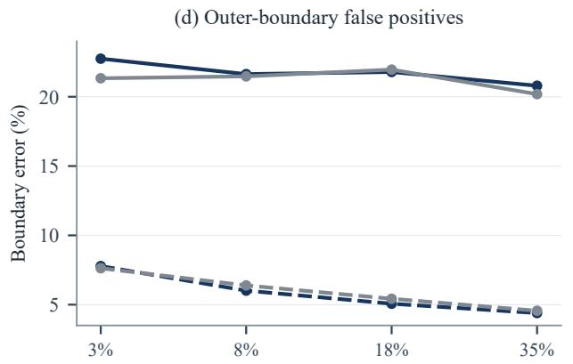  
Fig. 6. Efects of target geometry. (a,b) FR IoU across target areas and shapes. (c,d) Inner-band FNR and outer-band FPR before and after propagation training, evaluated on unpropagated images. Solid and dashed curves denote FR and SP, respectively. Boundary bands are eight pixels wide.

for FR and 95.38% for SP on the APT authors’ 100-source Stable Difusion 1.5 (SD1.5) protocol, exceeding APT∗ by 14.31 and 16.93 percentage points, respectively (Table VI). The background IoUs are 96.22% for FR and 99.08% for SP. Reproduced APT and APT∗ background scores are within 0.63 percentage points of their published results. Evaluation follows the authors’ 256 × 256 grid and fixed threshold of 0.5.

Before propagation training, the same readout obtains an edit-region IoU of 83.11% for FR and 95.44% for SP. The final reader remains stronger than APT∗, although its FR IoU is 1.38 percentage points lower than before propagation training. The improvement on the main propagation benchmark therefore does not extend uniformly to every editing protocol.

## C. Ablation Studies

1) Spatial Evidence and Key Correspondence: Recovering a source message alone is insuficient for localization, as shown in Fig. 7. Complete protection with the correct key achieves 84.74% FR IoU at 1.12% FPR. Removing spatial evidence while retaining the source watermark reduces IoU to 20.82% and raises FPR to 53.46%, even though identifier-bit accuracy remains 100%. The result is close to the 20.60% IoU obtained without protection. Reading fully protected images with alternative keys also reduces IoU to 29.27% and increases FPR to 22.30%. These results support the importance of both the written spatial evidence and its correspondence with the reading key.

2) Residual Evidence Refinement: Table VII compares five architectural variants trained from matched initializations with the same data and training budget. Figure 8 shows their paired IoU diferences.

Removing BER reduces FR IoU from 83.17% to 78.91% and SP IoU from 93.33% to 81.90%. Restoring this path also lowers FR inner-boundary FNR from 41.84% to 31.93%, indicating better recovery of boundary pixels. When only background-context correction is removed, while the encoder– decoder and feature inputs are retained, IoU remains at 83.08% for FR and 93.32% for SP. The complete residual-refinement path accounts for most of the gain in this comparison, while background contrast provides a smaller increment.

3) Multiscale Reading: Removing NSR and directly using the BER output reduces IoU to 82.31% for FR and 91.50% for SP. Restoring the full multiscale path improves FR IoU by 0.86 percentage points and SP IoU by 1.83 percentage points. In contrast, retaining scale encoding and gated fusion while replacing learned reassembly with bilinear interpolation yields an IoU of 83.18% for FR and 93.38% for SP. The gain is associated mainly with the multiscale path; learned and bilinear reassembly yield similar localization accuracy.

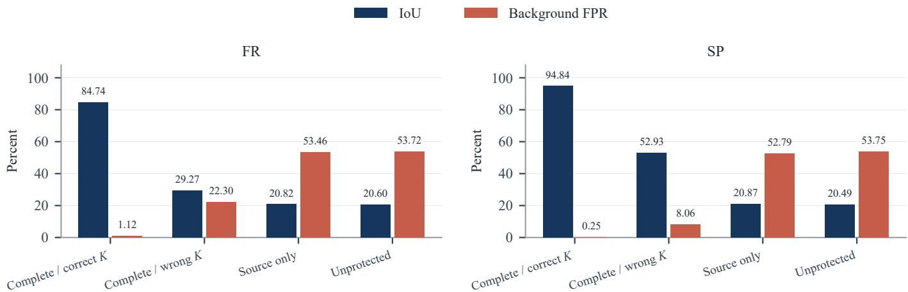  
Fig. 7. Efect of spatial evidence and key correspondence on 60 sources. Reader weights and the decision threshold are fixed. Wrong-key results are averaged over five alternative keys.

TABLE VII  
STRUCTURAL ABLATIONS TRAINED FROM THE SAME LOCALIZATION INITIALIZATION.
<table><tr><td rowspan="2">Variant</td><td colspan="6">FR</td><td colspan="3">SP</td></tr><tr><td>IoU↑</td><td>F1↑</td><td>FPR↓</td><td>Inner FNR↓</td><td>Outer FPR↓</td><td>IoU↑</td><td>F1↑</td><td></td><td>FPR↓</td></tr><tr><td>Full architecture</td><td>83.17</td><td>90.16</td><td>1.15</td><td>31.93</td><td>22.26</td><td>93.33</td><td></td><td>96.30</td><td>0.28</td></tr><tr><td>Without BER</td><td>78.91</td><td>87.30</td><td>1.11</td><td>41.84</td><td></td><td>20.82</td><td>81.90</td><td>89.16</td><td>0.37</td></tr><tr><td>Without background contrast</td><td>83.08</td><td>90.08</td><td>1.15</td><td>31.97</td><td></td><td>22.42</td><td>93.32</td><td>96.29</td><td>0.29</td></tr><tr><td>Without NSR</td><td>82.31</td><td>89.62</td><td>1.18</td><td>33.57</td><td></td><td>22.84</td><td>91.50</td><td>95.21</td><td>0.37</td></tr><tr><td>Bilinear reassembly</td><td>83.18</td><td>90.16</td><td>1.15</td><td>31.88</td><td></td><td>22.28</td><td>93.38</td><td>96.33</td><td>0.28</td></tr></table>

Scores are percentages. Inner FNR and outer FPR refer to the eight-pixel boundary bands. Bold and underlined overlap scores are ranked using unrounded means. All variants use the same initialization, data, and 100-epoch training budget, with evaluation on 144 sources and threshold calibration on 72 separate sources. Paired IoU diferences and confidence intervals are shown in Fig. 8.

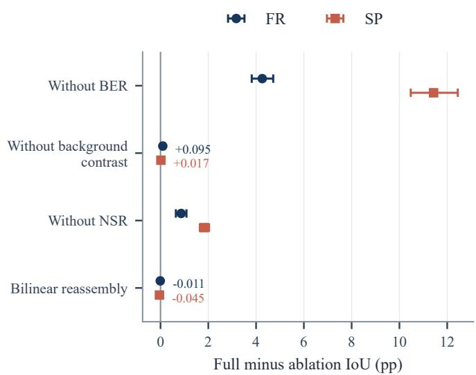  
Fig. 8. Paired IoU diferences between the full architecture and structural ablations. Positive values favor the full architecture. Error bars are 95% confidence intervals from 5,000 source-group bootstrap resamples on the 144- source ablation set, with the trained models fixed.

4) Paired Propagation Training: Compared with the reader before propagation training, the trained model improves the seven-family mean IoU by 5.41 percentage points for FR and

9.58 percentage points for SP. FR recall increases from 86.01% to 90.05% while FPR decreases from 2.76% to 1.76%; SP recall increases from 81.28% to 91.18% while FPR decreases from 1.28% to 0.80%. The gain combines more complete foreground recovery with fewer background false positives. On unpropagated images, the inner-boundary curves in Fig. 6 also improve across all four target areas, although outer-band errors do not decrease consistently.

The benefit persists with matched initialization and training budgets. On 96 sources under seven representative processing conditions, omitting propagated views reduces FR IoU from 80.68% to 77.23% and SP IoU from 85.09% to 78.48%. The preservation loss and progressive augmentation schedule have much smaller efects in this comparison.

## V. CONCLUSION

We presented ReliaGuard for source attribution and blind localization of generative image edits. Reconstruction-aware writing strengthens keyed spatial evidence in protected and reconstructed images while preserving the source message. Contextual refinement and multiscale reading use this evidence to distinguish target edits from background reconstruction. On an independent test set of 300 sources and 900 editing cases from three image domains, our method achieves an IoU of 85.61% for FR and 94.90% for SP at a threshold calibrated to a nominal 1% FR background FPR. Decoded identifierbit accuracy reaches 100% in both unpropagated conditions. After seven families of image processing, the corresponding IoUs remain 81.01% and 86.49%. Ablation studies support the contributions of spatial evidence, residual refinement, multiscale fusion, and propagation training.

Localization remains challenging for small targets and complex contours, as well as after large geometric transformations. Future work will focus on reducing embedding distortion and improving geometric consistency while retaining tolerance to generative reconstruction.

## REFERENCES

[1] R. Rombach, A. Blattmann, D. Lorenz, P. Esser, and B. Ommer, “Highresolution image synthesis with latent difusion models,” in Proc. CVPR, 2022, pp. 10684–10695.

[2] J. Zhu, R. Kaplan, J. Johnson, and L. Fei-Fei, “HiDDeN: Hiding data with deep networks,” in Proc. ECCV, 2018, pp. 657–672.

[3] M. Tancik, B. Mildenhall, and R. Ng, “StegaStamp: Invisible hyperlinks in physical photographs,” in Proc. CVPR, 2020, pp. 2117–2126.

[4] S. Lu, Z. Zhou, J. Lu, Y. Zhu, and A. W.-K. Kong, “Robust watermarking using generative priors against image editing: From benchmarking to advances,” in Proc. ICLR, 2025.

[5] X. Zhang, R. Li, J. Yu, Y. Xu, W. Li, and J. Zhang, “EditGuard: Versatile image watermarking for tamper localization and copyright protection,” in Proc. CVPR, 2024, pp. 11964–11974.

[6] T. Sander, P. Fernandez, A. O. Durmus, T. Furon, and M. Douze, “Watermark Anything with localized messages,” in Proc. ICLR, 2025.

[7] X. Zhang, Z. Tang, Z. Xu, R. Li, Y. Xu, B. Chen, F. Gao, and J. Zhang, “OmniGuard: Hybrid manipulation localization via augmented versatile deep image watermarking,” in Proc. CVPR, 2025, pp. 3008–3018.

[8] H. Yang, B. Liu, X. Xu, C. Xu, Y. Yu, Z. Huang, Y. Wang, and S. He, “StableGuard: Towards unified copyright protection and tamper localization in latent difusion models,” in Advances in Neural Information Processing Systems, vol. 38, 2025, doi: 10.52202/085713-0495.

[9] Z. Gan, C. Liu, Y. Tang, B. Wang, S. Cui, W. Wang, and X. Zhang, “GenPTW: Latent image watermarking for provenance tracing and tamper localization,” in Proc. AAAI, vol. 40, no. 5, 2026, pp. 4085– 4093, doi: 10.1609/aaai.v40i5.37412.

[10] S. Ha, W. J. Kim, J. Jeon, S. Son, and S.-e. Yoon, “APT: Anchor-aligned perturbations for tamper localization in fully regenerated images,” in Proc. ECCV, 2026, pp. 373–389, doi: 10.1007/978-3-032-37242-0\_21.

[11] Z. Jia, H. Fang, and W. Zhang, “MBRS: Enhancing robustness of DNN-based watermarking by mini-batch of real and simulated JPEG compression,” in Proc. ACM Multimedia, 2021, pp. 41–49, doi: 10.1145/3474085.3475324.

[12] T. Bui, S. Agarwal, and J. Collomosse, “TrustMark: Robust watermarking and watermark removal for arbitrary resolution images,” in Proc. ICCV, 2025, pp. 18629–18639.

[13] P. Fernandez, A. Sablayrolles, T. Furon, H. Jégou, and M. Douze, “Watermarking images in self-supervised latent spaces,” in Proc. ICASSP, 2022, pp. 3054–3058.

[14] P. Fernandez, G. Couairon, H. Jégou, M. Douze, and T. Furon, “The Stable Signature: Rooting watermarks in latent difusion models,” in Proc. ICCV, 2023, pp. 22466–22477.

[15] Y. Wen, J. Kirchenbauer, J. Geiping, and T. Goldstein, “Tree-Rings Watermarks: Invisible fingerprints for difusion images,” in Advances in Neural Information Processing Systems, vol. 36, 2023.

[16] Z. Yang, K. Zeng, K. Chen, H. Fang, W. Zhang, and N. Yu, “Gaussian Shading: Provable performance-lossless image watermarking for difusion models,” in Proc. CVPR, 2024, pp. 12162–12171.

[17] D. Cozzolino and L. Verdoliva, “Noiseprint: A CNN-based camera model fingerprint,” IEEE Transactions on Information Forensics and Security, vol. 15, pp. 144–159, 2020, doi: 10.1109/TIFS.2019.2916364.

[18] M.-J. Kwon, I.-J. Yu, S.-H. Nam, and H.-K. Lee, “CAT-Net: Compression artifact tracing network for detection and localization of image splicing,” in Proc. WACV, 2021, pp. 375–384.

[19] X. Chen, C. Dong, J. Ji, J. Cao, and X. Li, “Image manipulation detection by multi-view multi-scale supervision,” in Proc. ICCV, 2021, pp. 14185– 14193.

[20] F. Guillaro, D. Cozzolino, A. Sud, N. Dufour, and L. Verdoliva, “TruFor: Leveraging all-round clues for trustworthy image forgery detection and localization,” in Proc. CVPR, 2023, pp. 20606–20615.

[21] X. Ma, B. Du, Z. Jiang, X. Du, A. Y. Al Hammadi, and J. Zhou, “IML-ViT: Benchmarking image manipulation localization by vision transformer,” arXiv preprint arXiv:2307.14863, 2023.

[22] O. Siméoni et al., “DINOv3,” technical report, arXiv:2508.10104, 2025.

[23] O. Ronneberger, P. Fischer, and T. Brox, “U-Net: Convolutional networks for biomedical image segmentation,” in Proc. MICCAI, 2015, pp. 234– 241.

[24] J. Wang, K. Chen, R. Xu, Z. Liu, C. C. Loy, and D. Lin, “CARAFE: Content-Aware ReAssembly of FEatures,” in Proc. ICCV, 2019, pp. 3007–3016.

[25] Z. Liu, H. Mao, C.-Y. Wu, C. Feichtenhofer, T. Darrell, and S. Xie, “A ConvNet for the 2020s,” in Proc. CVPR, 2022, pp. 11976–11986.

[26] X. Wang, R. Girshick, A. Gupta, and K. He, “Non-local neural networks,” in Proc. CVPR, 2018, pp. 7794–7803.

[27] F. Milletari, N. Navab, and S.-A. Ahmadi, “V-Net: Fully convolutional neural networks for volumetric medical image segmentation,” in Proc. 3DV, 2016, pp. 565–571.

[28] T.-Y. Lin et al., “Microsoft COCO: Common objects in context,” in Proc. ECCV, 2014, pp. 740–755.

[29] O. Russakovsky et al., “ImageNet Large Scale Visual Recognition Challenge,” International Journal of Computer Vision, vol. 115, pp. 211– 252, 2015.

[30] I. Loshchilov and F. Hutter, “Decoupled weight decay regularization,” in Proc. ICLR, 2019.

[31] B. An et al., “WAVES: Benchmarking the robustness of image watermarks,” in Proc. ICML, vol. 235, 2024, pp. 1456–1492.

[32] Z. Wang, A. C. Bovik, H. R. Sheikh, and E. P. Simoncelli, “Image quality assessment: From error visibility to structural similarity,” IEEE Transactions on Image Processing, vol. 13, no. 4, pp. 600–612, 2004.

[33] R. Zhang, P. Isola, A. A. Efros, E. Shechtman, and O. Wang, “The unreasonable efectiveness of deep features as a perceptual metric,” in Proc. CVPR, 2018, pp. 586–595.