# Teach with Blinks: Breaking Linguistic Momentum in On-Policy Distillation for Fine-Grained Multimodal Perception

Tangzheng Lian1 Hang Zhang2 Guanyu Hu3 Renjiu Hu2 Zhensong Zhang5 Jiankang Deng4 Jifei Song5 1King’s College London 2Cornell University 3Aalto University 4Imperial College London 5Huawei Noah’s Ark Lab

## Abstract

On-policy distillation (OPD) has emerged as an effective post-training approach to improving fine-grained perception in multimodal large language models by amortizing costly inference-time zooming operations into a single-pass recipe. However, vanilla OPD is inherently susceptible to linguistic momentum: the teacher can follow the student’s erroneous prefixes, thus weakening corrective supervision. To address this, we propose Blink On-Policy Distillation (BlinkOPD), in which the teacher “blinks” at every token: it reads the same prefix once with its eyes open and once with its eyes closed. A first-glance gain further strengthens the correction on rollouts that conflict with the teacher. By extracting more effective supervision from each on-policy trajectory, BlinkOPD achieves state-of-the-art average performance across six fine-grained benchmarks using only 500 training images (12× less data) than existing OPD methods. Beyond fine-grained perception, BlinkOPD also demonstrates strong zero-shot improvements across ten held-out benchmarks spanning general visual perception, visual hallucination, and multimodal reasoning abilities. Code: https://github.com/Supltz/BlinkOPD

## 1. Introduction

Multimodal large language models (MLLMs) excel at a wide range of visual understanding tasks, yet they still struggle with fine-grained perception when critical visual evidence is small or difficult to discern, such as distant signs or tiny text embedded in complex scenes [32–34, 39]. A prominent line of research, inspired by “thinking with images” [20], addresses this limitation by allocating additional inference-time computation to progressively inspect visual details through multi-turn cropping and zooming operations over regions of the original input image [7, 11, 40, 41].

An alternative line of research seeks to internalize finegrained visual perception capabilities into the MLLM itself during post-training, so that subtle details can be recognized in a single forward pass [2, 4, 5, 12, 23, 26, 27, 30, 33, 36, 37, 42]. Among them, on-policy distillation (OPD) has recently emerged as a simple and effective post-training paradigm for internalizing visual zooming [12, 23, 26, 36, 37, 42]. A straightforward approach is to distill from a teacher with stronger fine-grained visual perception capabilities [26, 42]. However, such a teacher may not always be available, especially for frontier models. This has motivated growing interest in on-policy self-distillation (OPSD), where a copy of the student itself, with access to zoomed crops of the target region as privileged visual inputs, serves as the teacher during training [12, 23, 36, 37].

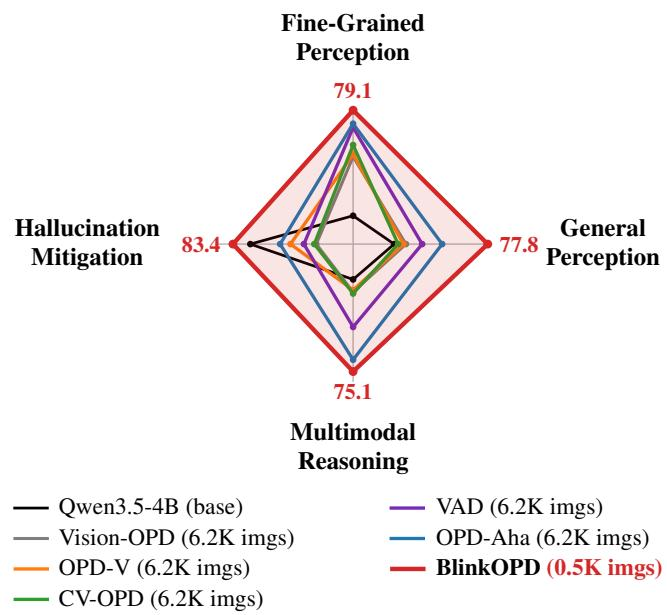  
Figure 1. Comparison of existing OPSD methods on four visual abilities across 16 benchmarks using Qwen3.5-4B as the base model. With 12× fewer training images, BlinkOPD outperforms competing methods on four visual abilities across 16 benchmarks.

A representative example is Vision-OPD [36], which distills privileged visual information from zoomed crops into a full-image student. Despite this visual privilege, its distillation target follows vanilla OPD [1]: the teacher’s tokenlevel predictions conditioned on student-generated prefixes serve directly as supervision targets. However, this vanilla conditioning objective is susceptible to linguistic momentum: erroneous student prefixes can bias the teacher toward the student’s own mistakes, thus weakening corrective supervision [23]. This effect is particularly harmful to OPSD for fine-grained multimodal perception, as linguistic momentum from erroneous student prefixes can progressively override privileged visual evidence (see Sec. 2.2).

To address this, contrastive methods reconstruct the distillation target using two predictions: a positive prediction from the privileged teacher conditioned on the zoomed crop, and a reference prediction obtained under altered or reduced visual input [16, 23, 35, 37]. The key idea is to cancel the linguistic drift shared by both predictions, thereby isolating and amplifying privileged visual evidence to strengthen corrective supervision. Existing approaches construct such references using gray images [23], black images [2, 16], Gaussian-noised images [14], mismatched images [30], and text-only inputs [35]. However, our analysis shows that image-based references, including gray, black, noisy, and mismatched images, fail to fully reproduce the prefix-induced linguistic drift, leaving substantial residual drift that limits their ability to counteract linguistic momentum. They also introduce a false belief that the queried object is absent. The text-only reference largely eliminates the residual drift, but the false belief still remains (see Sec. 2.3).

To overcome these limitations, we propose Blink $O n -$ Policy Distillation (BlinkOPD), which constructs an eyesclosed reference by letting the privileged teacher “blink” at every token. Specifically, the teacher processes each student prefix twice: once with its eyes open on the zoomed crop and once with its eyes closed, where the image-content tokens are removed while preserving the vision markers, chat template, and original positional indices. This design more effectively cancels prefix-induced linguistic drift and introduces less false beliefs. We further introduce a firstglance gain: before training, the teacher takes a first glance at the zoomed crop without any prefix, and rollouts whose answers conflict with this first glance, which are likely to require stronger correction, receive a larger gain.

To summarize, our contributions are as follows:

(1) We present a comprehensive analysis of existing OPSD distillation targets in fine-grained multimodal perception, showing that linguistic momentum overrides the privileged visual evidence, and that existing contrastive references leave residual drift and introduce false beliefs.

(2) We propose BlinkOPD, which constructs an eyesclosed reference by removing image-content tokens while preserving the original multimodal input structure. Combined with a first-glance gain that selectively strengthens correction on potentially erroneous student trajectories, our method provides more effective corrective supervision.

(3) With only 500 training images, BlinkOPD achieves strong performance across six fine-grained perception benchmarks, outperforming existing OPSD methods trained on about 12 times more images. It also demonstrates strong zero-shot transfer across ten held-out perception, hallucination, and multimodal reasoning benchmarks.

## 2. Preliminaries and Analysis

## 2.1. On-Policy Self-Distillation

In vanilla OPSD for multimodal fine-grained perception [36], the student π receives the full image I and question $q ,$ denoted by $x _ { s } = ( I , q )$ , while the teacher is initialized as a copy of the student and receives privileged visual information during training. In our setting, the privileged input is a zoomed crop $I ^ { + }$ of the target region, giving $x _ { T } = ( I ^ { + } , q )$ The student generates on-policy rollouts $y \sim \pi _ { \boldsymbol { \theta } } ( \cdot \vert x _ { s } )$ , and the teacher scores each student-generated prefix $y _ { < t }$ to provide token-level supervision without requiring ground-truth answers. For each prefix, the teacher predicts a next-token distribution over the vocabulary $p _ { t } ^ { + } = p _ { \phi } ( \cdot \mid x _ { T } , y _ { < t } )$ . The student is then trained to match a distillation target distribution $q _ { t }$ , which in vanilla OPSD is the teacher prediction itself, $q _ { t } = p _ { t } ^ { + }$ , by minimizing

$$
\mathcal { L } _ { \mathrm { O P D } } = \mathbb { E } _ { \boldsymbol { y } \sim \pi _ { \boldsymbol { \theta } } ( \cdot | \boldsymbol { x } _ { s } ) } \left[ \frac { 1 } { | \boldsymbol { y } | } \sum _ { t = 1 } ^ { | \boldsymbol { y } | } \mathcal { D } \big ( \pi _ { \boldsymbol { \theta } } ( \cdot \mid \boldsymbol { x } _ { s } , \boldsymbol { y } _ { < t } ) \big | \big | q _ { t } \big ) \right] ,\tag{1}
$$

where $\mathcal { D } ( \cdot \| \cdot )$ denotes a distribution-matching divergence.

## 2.2. Linguistic Momentum in OPSD

We design a controlled experiment to investigate linguistic momentum and privileged evidence survival in OPSD for fine-grained multimodal perception. Specifically, we randomly sample 768 questions from the Vision-OPD [36] training pool and use Qwen3.5-4B to generate four rollouts per question from the full-image input. We truncate each rollout at 0, 25, 50, 75, and 100% of its tokens to observe the teacher at different stages of the student’s rollout. For each truncated prefix, the privileged teacher observes the zoomed crop, and we record its next-token probabilities over the answer options. Using these read-outs, we construct the distillation targets of Vision-OPD [36], VAD [37], CV-OPD [30], OPD-V [2], OPD-Aha [23], and our proposed BlinkOPD to compare their susceptibility to linguistic momentum and privileged evidence survival, as shown in Fig. 2. Full experimental details are provided in Appendix A.

Follow Rate. To measure how often the supervision endorses the student’s own mistake, $i . e .$ ., the strength of linguistic momentum, we define the follow rate. Let $\mathcal { W }$ be the set of student rollouts whose final answer is wrong; for $y \in \mathcal W$ , let $a _ { y }$ be the option chosen by the student. For a method and a truncation point $\tau ,$ let $q _ { y } ^ { \tau }$ denote its distillation target $q _ { t }$ after the first τ of $y ,$ read out over the set $\mathcal { O } _ { y }$ of answer options of the question. The follow rate is

$$
F ( \tau ) = \frac { 1 } { | \mathcal { W } | } \sum _ { y \in \mathcal { W } } \mathbf { 1 } \Big [ \underset { o \in \mathcal { O } _ { y } } { \arg \operatorname* { m a x } } q _ { y } ^ { \tau } ( o ) = a _ { y } \Big ] ,\tag{2}
$$

$$
\begin{array} { r } { \Phi \mathrm { \tiny ~ V i s i o n - O P D + V A D ~ . 0 cdot C V - O P D ~ \textnormal { \rVert ~ O P D - V ~ 4 cdot O P D - A h a } } } \\ { \Phi \mathrm { \tiny ~ B l i n k O P D } } \end{array}
$$

(a) Linguistic Momentum  
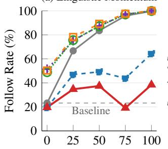  
Student Prefix Read (%)

(b) Privileged Evidence Survival  
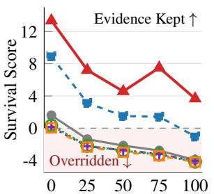  
Student Prefix Read (%)  
Figure 2. Comparison of the distillation targets of Vision-OPD, VAD, CV-OPD, OPD-V, OPD-Aha and our proposed BlinkOPD on linguistic momentum and privileged evidence survival. (a) As the teacher reads more of the wrong prefix1, the follow rate tends to rise: Vision-OPD rises from 23% to 100%, VAD, CV-OPD and OPD-V from about 50% to 100%, and OPD-Aha still ends at 64%, whereas BlinkOPD stays below 40% throughout. (b) As the teacher reads more of the wrong prefix, the survival score tends to decrease: Vision-OPD, VAD, CV-OPD and OPD-V turn negative within the first quarter of the prefix and never recover, and OPD-Aha also falls below zero by the end, whereas BlinkOPD remains positive and outperforms the others throughout.

$i . e . ,$ , the fraction of wrong rollouts on which the distillation target picks the student’s own wrong option. Training the student toward a distillation target with a high follow rate reinforces the student’s error. $\mathbf { A } \mathfrak { t } \tau = 0$ , the teacher has not yet read the student’s answer, so $F ( 0 )$ serves as a baseline: it only counts cases in which the teacher happens to make the same mistake as the student. Any rise of F above $F ( 0 )$ is caused by reading the student’s prefix, and this rise is what measures linguistic momentum.

Survival Score. To measure how much of the privileged visual evidence survives in the distillation target after the teacher reads the student’s wrong prefix, we define the survival score. Let $g _ { y } \in \mathcal { O } _ { y }$ be the correct option of rollout $y ,$ and let $\kappa \subseteq \mathcal W$ be the wrong rollouts on which the teacher picks $g _ { y }$ before reading the prefix. On these rollouts, the crop holds the evidence that the student missed, and at $\tau = 0$ the teacher’s preference for $g _ { y }$ over $a _ { y }$ reflects this privileged visual evidence. The survival score is

$$
S ( \tau ) = \frac { 1 } { | \mathcal { K } | } \sum _ { y \in \mathcal { K } } \log \frac { q _ { y } ^ { \tau } ( g _ { y } ) } { q _ { y } ^ { \tau } ( a _ { y } ) } .\tag{3}
$$

A positive value means that the distillation target still conveys the privileged evidence, and a negative value means

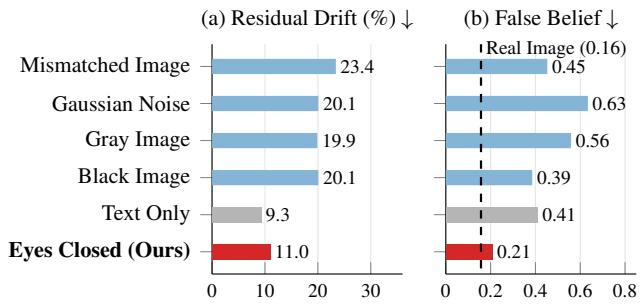  
Figure 3. Comparison of contrastive references on residual drift and false belief. (a) Image-based references leave 20–23% of the drift uncancelled, whereas the text-only and eyes-closed references leave about 10%. (b) All other references raise the probability of “not present” false belief to 0.39–0.63. Only our proposed eyes-closed reference is low on both measures.

that the evidence is overridden by the student’s prefix.

## 2.3. Limitations of Existing Contrastive References

Existing contrastive methods [2, 14, 16, 23, 30, 35, 37] counter linguistic momentum by comparing the privileged teacher with a reference that reads the same student prefix. Given a reference distribution $p _ { t } ^ { \mathrm { r e f } }$ , the distillation target sharpens the teacher as

$$
q _ { t } ^ { \beta } = \mathrm { s o f t m a x } \Bigl ( \log p _ { t } ^ { + } + \beta \underbrace { \left[ \log p _ { t } ^ { + } - \log p _ { t } ^ { \mathrm { r e f } } \right] } _ { r _ { t } } \Bigr ) ,\tag{4}
$$

where $r _ { t }$ compares the teacher with the reference token by token and the gain $\beta \geq 0$ sets how strongly the distillation target is tilted toward tokens with a high $r _ { t }$

Ideally, since both distributions read the same student prefix, the part of the prediction induced by the prefix alone is shared and cancels in $r _ { t }$ , while the part that comes from the privileged crop remains. Whether this happens, however, depends entirely on the reference, which must meet two requirements. First, it must be drifted by the student prefix exactly as much as the teacher, so that no residual $d r i f t$ remains in $r _ { t } .$ . Second, while holding no privileged visual evidence, it must not add a false belief that the queried object is absent which enters the distillation target through $r _ { t }$ . Existing methods [2, 14, 16, 23, 30, 35] build the reference either by replacing the crop with another image (gray, black, noise or a mismatched image) or by removing the image from the conversation. Using the probe of Sec. 2.2, we test whether these references meet these requirements.

Residual Drift. We define the residual drift of a reference to measure how much of the prefix-induced drift it fails to cancel. Let $S _ { + } ( \tau )$ and $S _ { \mathrm { r e f } } ( \tau )$ be the survival scores of the teacher and of the reference, $i . e . ,$ Eq. (3) with $q _ { y } ^ { \tau }$ replaced by their predictions. How far the teacher is drifted by the whole student prefix is then the fall of its survival score, $\Delta _ { + } = S _ { + } ^ { 0 } - S _ { + } ^ { \mathrm { e n d } }$ , where the superscripts 0 and end denote the values before reading the prefix and after reading the whole student prefix, $i . e . , \tau = 0$ and $1 0 0 \% ^ { 2 }$ . The reference reads the same prefix and is dragged by $\Delta _ { \mathrm { r e f } } = S _ { \mathrm { r e f } } ^ { 0 } { - } S _ { \mathrm { r e f } } ^ { \mathrm { e n d } }$ The residual drift is the share of the teacher’s drift that the reference still leaves uncancelled in the contrast $r _ { t } \mathrm { : }$

$$
\delta = \frac { \Delta _ { + } - \Delta _ { \mathrm { r e f } } } { \Delta _ { + } } .\tag{5}
$$

δ is lower the better with $\delta = 0$ meaning that the reference is drifted exactly as much as the teacher and are all cancelled. Proposition 1. δ in Eq. (5) is exactly the residual drift of the contrast $r _ { t }$ in Eq. (4) (see proof in Appendix D).

False Belief. In Fig. 3a, the text-only reference leaves the least residual drift. However, it still introduces a false “not present” belief that the teacher does not have. We take 300 multiple-choice questions from MME-RealWorld-CN [39] whose options include “not present / cannot be determined”. For each reference, the teacher reads only the question, without any student prefix, and we record the probability that it assigns to this option at the first answer token (Fig. 3b). The same procedure with the original real image of each question gives 0.16. A reference with a higher probability than 0.16 therefore introduces a false belief that the queried object is absent. The false belief is itself a form of hallucination: a reference with a high false belief can introduce hallucination into the student (see the experimental results on hallucination benchmarks in Sec. 4.3).

## 3. Blink On-Policy Distillation

## 3.1. Closing the Teacher’s Eyes

As illustrated in Fig. 4c, the eyes-closed reference is the privileged teacher with only image-content tokens removed: the vision markers, the chat template, the question and the prefix are kept, and every remaining token keeps the position it had in the full sequence,

$$
p _ { t } ^ { \mathcal { O } } = p _ { \phi } \big ( \cdot \mid \mathsf { s y s } , \langle \mathsf { v } \rangle , \langle / \mathsf { v } \rangle , q , y _ { < t } ; \mathrm { p o s } \big ) ,\tag{6}
$$

where pos denotes these original positions; see Appendix E for the implementation details of this input in training.

## 3.2. First-Glance Gain

Even with a faithful reference, the contrastive target still depends on the gain $\beta$ in Eq. (4). The reference decides what is amplified while the gain decides how much. We find that a single global gain does not suit all rollouts. On a student-wrong rollout, the teacher is dragged by the prefix, and a large gain recovers the correct option. On a studentcorrect rollout, however, a large gain pushes the distillation target away from the correct answer. Our probe confirms this trade-off (see Appendix F), so the gain should be raised only on rollouts that are likely to be wrong.

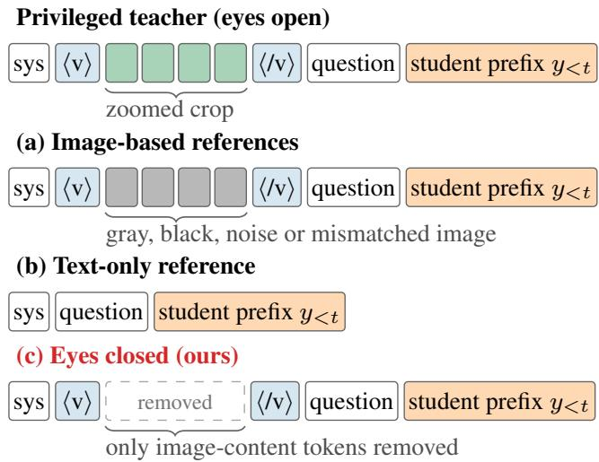  
Figure 4. Contrastive reference construction for OPSD. (a) Imagebased references replace the crop with gray, black, noisy, or mismatched images [2, 14, 16, 23, 30]. (b) The text-only reference removes the image from the conversation [35]. (c) Our eyes-closed reference removes only the image-content tokens while preserving vision markers and original positional indices.

Detecting such rollouts would normally require the correct answer. The frozen teacher, however, offers a label-free signal. Before training, the teacher looks at the crop once (x , no prefix) and records its answer ${ \hat { a } } ^ { \mathrm { g l a n c e } } ( x )$ , its first glance. A rollout $y _ { i }$ conflicts with the glance when its final answer $\hat { a } ( y _ { i } )$ differs from it, and we raise its gain as:

$$
\beta _ { i } = \beta \gamma ^ { 1 \left[ \hat { a } \left( y _ { i } \right) \right. \left. \ne \hat { a } ^ { \mathrm { g l a n c e } } ( x ) \right] } ,\tag{7}
$$

where $\beta$ is the base gain of Eq. (4) and $\gamma > 1$ scales it up on conflicting rollouts. See Appendix G for an experimental comparison of the global gain and the first-glance gain.

## 3.3. Distillation Target and Training

BlinkOPD keeps the OPSD objective of Eq. (1) and replaces only its distillation target $q _ { t }$ . For rollout $y _ { i }$ , it combines the eyes-closed reference of Eq. (6) with the gain of Eq. (7):

$$
q _ { i , t } = \mathrm { s o f t m a x } \left( \log p _ { t } ^ { + } + \beta _ { i } \left[ \log p _ { t } ^ { + } - \log p _ { t } ^ { \infty } \right] \right) .\tag{8}
$$

Fig. 5 provides an overview of BlinkOPD. An algorithm chart for one training step is provided in Appendix H. The entire BlinkOPD training pipeline requires neither assistance from larger models nor ground-truth answers.

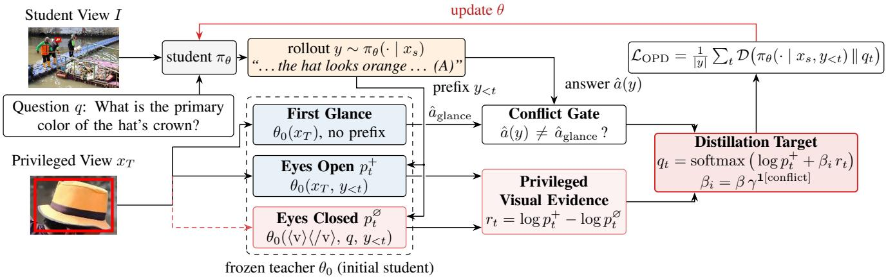  
Figure 5. Overview of BlinkOPD. The student generates rollouts from the full image I and question q, together denoted by $x _ { s }$ . The frozen privileged teacher $\theta _ { 0 }$ reads each student prefix twice: once with its eyes open on the zoomed crop $( p _ { t } ^ { + } )$ , and once with its eyes closed $( p _ { t } ^ { \emptyset }$ , Sec. 3.1). Their log-ratio $r _ { t }$ keeps the privileged visual evidence, while the prefix-induced linguistic drift shared by both cancels. A prefix-free first glance of the same teacher flags rollouts whose answer conflicts with it, and the gain is raised by a factor γ on these rollouts (Sec. 3.2). The student is trained toward the resulting distillation target (Sec. 3.3). At test time, the student runs alone in a single pass.

## 4. Experiments

## 4.1. Experimental Setup

Model and Data. We train Qwen3.5-4B and 9B [24] in non-thinking mode. We use the decontaminated3 Vision-OPD training pool [36] of about 6.2K images with evidence boxes. We report results on random samples at different scales from 250 to the full 6.2K pool (Fig. 6b). All methods follow the Vision-OPD input protocol [36]: the student receives the full image with the evidence box drawn on it and a one-sentence instruction to focus on that region, while the teacher receives a tight crop of the boxed region.

Implementation Details. We train for 38 steps with 96 prompts per step and 8 rollouts per prompt (temperature 1.0, at most 1,024 tokens). We use a constant learning rate of $2 \times 1 0 ^ { - 6 }$ after 5 warm-up steps and set β = 3.4 and γ = 2. We use JSD (α=0.5) for the divergence D in Eq. (1). A 4B run takes under three hours on four B200 GPUs. The 9B run uses the same data, steps and hyperparameters (see Appendix I for more implementation details).

Baselines. To compare methods under one protocol, we reproduce the recent OPSD methods with complete public code: Vision-OPD [36], OPD-V [2], CV-OPD [30], VAD [37] and OPD-Aha [23], each with its official implementation. All OPSD runs share the same student, the teacher crop, the rollout budget per step and the evaluation pipeline. We also evaluate SFT and GRPO [25] under the same setting. For other methods, Tab. 1 lists the numbers reported by their original papers in gray, for reference only. Evaluation. Following the evaluation protocol of Vision-

OPD [36], we report accuracy on $\mathbf { V } ^ { * }$ [34], ZoomBench [33], HR-Bench 4K/8K [32] and MME-RealWorld EN/CN [39]. Decoding is greedy with up to 32K tokens. Answers are extracted by rules and a corrected4 gpt-oss-120B judge.

## 4.2. Main Results for Fine-Grained Perception

As shown in Tab. 1, BlinkOPD reaches 79.1 average accuracy on Qwen3.5-4B with only 0.5K images, outperforming the base model (+9.1) and all reproduced OPSD baselines trained on 12× more images: Vision-OPD (+4.0), OPD-V (+3.8), CV-OPD (+3.0), VAD (+1.5) and OPD-Aha (+1.2). Training on the full 6.2K set further improves the average to 79.6. The same trend holds for 9B: with only 0.5K images, BlinkOPD reaches 79.6, outperforming the base model (+6.1) and all reproduced OPSD baselines trained on 12× more images: OPD-V (+3.1), Vision-OPD (+2.8), CV-OPD (+2.7), VAD (+2.1) and OPD-Aha (+1.2). Training on the full 6.2K set further improves the average to 80.4.

Comparison with larger open-weight and proprietary models. BlinkOPD also outperform larger open-weight models with up to 250× more parameters, including Qwen3.5-397B (77.4), the strongest one in Tab. 1. With only 4B parameters and 0.5K training images, BlinkOPD already matches the leading proprietary models, including Gemini 3.1 Pro (79.3), the best one in Tab. 1. Scaling to 9B parameters and the full 6.2K, BlinkOPD further surpasses all reported and reproduced baselines. These gains are achieved despite training on a decontaminated dataset and evaluating with a corrected judge, both of which can only lower our scores relative to the setup from prior works.

Table 1. Fine-grained perception. Accuracy (%) on six benchmarks. Gray: results reported by the original papers or reproduced by others; listedfor reference only. Agentic models and ZwZ are built on older backbones (‡Qwen2.5-VL-7B, §Qwen3-VL-8B). Bold and underline mark the best and second best within each re-evaluated block. Teacher: Self is a privileged self-teacher (a copy of the student on the zoomed crop); V-Zero instead distills from a Qwen3.5-27B teacher. #Img: unique training images. ∆: gain over the base model.
<table><tr><td rowspan="2">Method</td><td rowspan="2">Size</td><td rowspan="2">Teacher</td><td rowspan="2">#Img</td><td rowspan="2">Fine-Grained V* ZoomBench</td><td rowspan="2">HR-4K</td><td rowspan="2">High-Resolution HR-8K</td><td rowspan="2"></td><td colspan="2">Real-World MME-RW CN</td><td rowspan="2">Avg.</td><td rowspan="2">Δ</td></tr><tr><td>MME-RW EN</td><td></td></tr><tr><td>Proprietary models (reported by [12, 36]; also evaluated in [23, 30, 37])</td><td></td><td></td><td></td><td></td><td></td><td></td><td></td><td></td><td></td><td></td><td></td></tr><tr><td>GPT-5.2 [19]</td><td></td><td></td><td></td><td>79.1</td><td>50.9</td><td>81.1</td><td>78.4</td><td>72.6</td><td>68.8</td><td>71.8</td><td></td></tr><tr><td>GPT-5.4 [21]</td><td></td><td></td><td></td><td>77.0</td><td>52.7</td><td>84.0</td><td>77.9</td><td>74.2</td><td>70.9</td><td>72.8</td><td></td></tr><tr><td>Gemini 3.1 Pro [9]</td><td></td><td></td><td></td><td>88.0</td><td>61.2</td><td>89.6</td><td>86.9</td><td>76.5</td><td>73.3</td><td>79.3</td><td></td></tr><tr><td>Gemini 3.5 Flash [13]</td><td></td><td></td><td></td><td>89.0</td><td>61.4</td><td>89.1</td><td>86.6</td><td>75.3</td><td>74.0</td><td>79.2</td><td></td></tr><tr><td>Large open-weight models (reported by [12, 36]; also evaluated in [23, 30, 37])</td><td></td><td></td><td></td><td></td><td></td><td></td><td></td><td></td><td></td><td></td><td></td></tr><tr><td>GLM-4.6V [8]</td><td>106B</td><td></td><td></td><td>86.9</td><td>50.1</td><td>82.1</td><td>78.9</td><td>65.6</td><td>65.6</td><td>71.5</td><td></td></tr><tr><td>Qwen3-VL-Instruct [3]</td><td>235B</td><td></td><td></td><td>91.1</td><td>56.1</td><td>86.1</td><td>80.4</td><td>71.7</td><td>69.0</td><td>75.8</td><td></td></tr><tr><td>Qwen3.5 [24]</td><td>397B</td><td></td><td></td><td>88.0</td><td>57.2</td><td>89.4</td><td>85.5</td><td>74.8</td><td>69.8</td><td>77.4</td><td></td></tr><tr><td>Kimi-K2.6 [18]</td><td>1T</td><td></td><td></td><td>88.5</td><td>53.1</td><td>81.9</td><td>78.0</td><td>69.2</td><td>66.1</td><td>72.8</td><td></td></tr><tr><td>Thinking-with-images / inference-time methods (reported by [23, 37]; also evaluated in [12, 30, 36])</td><td></td><td></td><td></td><td></td><td></td><td></td><td></td><td></td><td></td><td></td><td></td></tr><tr><td>DeepEyes [41]</td><td>7B‡</td><td></td><td></td><td>82.6</td><td>46.2</td><td>75.5</td><td>70.0</td><td>64.0</td><td>62.4</td><td>66.8</td><td></td></tr><tr><td>Thyme-RL [40]</td><td>7B</td><td></td><td></td><td>78.5</td><td>46.2</td><td>78.9</td><td>70.9</td><td>64.2</td><td>61.4</td><td>66.7</td><td></td></tr><tr><td>DeepEyesV2 [11] SenseNova-MARS [7]</td><td>7B‡</td><td></td><td></td><td>78.0</td><td>46.1</td><td>79.8</td><td>72.6</td><td>64.3</td><td>61.9</td><td>67.1</td><td></td></tr><tr><td></td><td>8B8</td><td></td><td></td><td>88.4</td><td>49.0</td><td>85.0</td><td>77.3</td><td>67.3</td><td>65.7</td><td>72.1</td><td></td></tr><tr><td>Single forward-pass methods (reported by [12, 23, 36]; also evaluated in [30, 37])</td><td></td><td></td><td></td><td></td><td></td><td></td><td></td><td></td><td></td><td></td><td></td></tr><tr><td>V-Zero [26]</td><td>4B</td><td>27B</td><td>6.2K</td><td>78.0</td><td>56.5</td><td>84.8</td><td>80.9</td><td>73.2</td><td>71.1</td><td>74.1</td><td></td></tr><tr><td>EAD [12] EAD [12]</td><td>4B</td><td>Self</td><td>6.2K</td><td>91.6</td><td>60.8</td><td>86.4</td><td>82.9</td><td>72.4</td><td>71.1</td><td></td><td>77.5</td></tr><tr><td>ZwZ[33]</td><td>9B</td><td>Self</td><td>6.2K</td><td>93.2</td><td>62.0</td><td>88.6</td><td>84.6</td><td>72.5</td><td>71.1</td><td></td><td>78.7</td></tr><tr><td></td><td>8B§</td><td></td><td>74K</td><td>88.0</td><td>56.7</td><td>83.6</td><td>81.8</td><td>66.6</td><td>68.1</td><td>74.1</td><td></td></tr><tr><td>Qwen3.5-4B (reproduced by us with the decontaminated training set and the corrected judge protocol)</td><td></td><td></td><td></td><td></td><td></td><td></td><td></td><td></td><td></td><td></td><td></td></tr><tr><td>Base model [24]</td><td>4B</td><td></td><td></td><td>81.7</td><td>48.6</td><td>83.9</td><td>80.6</td><td>62.8</td><td>62.6</td><td>70.0</td><td>1</td></tr><tr><td>SFT</td><td>4B</td><td></td><td>6.2K</td><td>87.0</td><td>54.7</td><td>84.8</td><td>80.0</td><td>71.2</td><td>68.2</td><td>74.3</td><td>+4.3</td></tr><tr><td>GRPO [25]</td><td>4B</td><td></td><td>6.2K</td><td>86.9</td><td>58.9</td><td>83.5</td><td>78.4</td><td>72.5</td><td>68.8</td><td>74.8</td><td>+4.8</td></tr><tr><td>Vision-OPD [36]</td><td>4B</td><td>Self</td><td>6.2K</td><td>89.5</td><td>59.3</td><td>82.5</td><td>79.4</td><td>71.3</td><td>68.6</td><td>75.1</td><td>+5.1</td></tr><tr><td>OPD-V [2]</td><td>4B</td><td>Self</td><td>6.2K</td><td>89.0</td><td>59.9</td><td>84.4</td><td>78.5</td><td>70.6</td><td>69.4</td><td>75.3</td><td>+5.3</td></tr><tr><td>CV-OPD [30] VAD [37]</td><td>4B</td><td>Self</td><td>6.2K</td><td>90.1</td><td>60.4</td><td>83.3</td><td>80.5</td><td>72.3</td><td>70.2</td><td>76.1</td><td>+6.1</td></tr><tr><td>OPD-Aha [23]</td><td>4B</td><td>Self</td><td>6.2K</td><td>94.8</td><td>61.0</td><td>85.3</td><td>81.5</td><td>73.7</td><td>69.4</td><td>77.6</td><td>+7.6</td></tr><tr><td>BlinkOPD (ours)</td><td>4B</td><td>Self</td><td>6.2K</td><td>91.6</td><td>59.3</td><td>87.4</td><td>83.3</td><td>73.9</td><td>72.0</td><td>77.9</td><td>+7.9</td></tr><tr><td>BlinkOPD (ours)</td><td>4B 4B</td><td>Self</td><td>0.5K</td><td>92.7</td><td>61.1</td><td>88.5</td><td>85.6</td><td>74.8</td><td>71.8</td><td>79.1</td><td>+9.1</td></tr><tr><td></td><td></td><td>Self</td><td>6.2K</td><td>93.1</td><td>61.9</td><td>89.1</td><td>86.2</td><td>75.1</td><td>72.4</td><td>79.6</td><td>+9.6</td></tr><tr><td>Qwen3.5-9B (reproduced by us with the decontaminated training set and the corrected judge protocol)</td><td></td><td></td><td></td><td>85.9</td><td>52.8</td><td>84.9</td><td>80.1</td><td>70.3</td><td>67.2</td><td>73.5</td><td></td></tr><tr><td>Base model [24] GRPO [25] SFT</td><td>9B 9B 9B</td></table>

## 4.3. Zero-Shot Transfer to Other Visual Abilities

Post-training for fine-grained perception should not come at the cost of other visual abilities. We therefore evaluate on three important visual abilities without any further training across ten held-out benchmarks (Tab. 2): general perception (MMStar [6], CV-Bench [28], MMVP [29]), hallucination (POPE [15], HallusionBench [10]) and multimodal reasoning (MathVista [17], MathVerse [38], MATH-Vision [31], We-Math [22], DynaMath [43]). All models are evaluated with the official prompt of each benchmark, greedy decoding with thinking disabled and the same scorer (see Appendix K for the detailed experimental settings).

General perception. The BlinkOPD (0.5K) improves general perception the most at both sizes: reaching average scores of 77.8 (+6.5 over the base model) at 4B and 79.9 (+6.9) at 9B, ahead of the runner-up OPD-Aha in both (+3.2 and +1.5). Fine-grained post-training corrects the myopia of the base model, but it can overcorrect the model into the opposite extreme, hyperopia. This is most visible on CV-Bench at 9B, where every baseline falls below the base model (82.8–86.3 vs. 87.0), including the best method in fine-grained benchmarks: BlinkOPD (6.2K). We attribute this to their 6.2K training images, which overfit the model to fine details. In contrast, BlinkOPD (0.5K) is the only method that improves CV-Bench at both sizes (+0.8 at 4B and +1.4 at 9B), while also appearing strong on fine-grained perception in Tab. 1. This suggests that the key for OPSD to strike a balance between myopia and hyperopia is to raise the efficiency of corrective supervision, rather than to simply train the model on ever more fine-grained images.

Table 2. Zero-shot transfer to ten held-out benchmarks. Perc., Hall. and Reas.: average accuracy on general perception, hallucination mitigation and multimodal reasoning. All: average over all 16 benchmarks, including the six fine-grained perception benchmarks of Tab. 1. ∆: change of All relative to the base model. Bold and underline: best and second best within each model size.
<table><tr><td></td><td colspan="2">General Perception</td><td colspan="2">Hallucination</td><td rowspan="2"></td><td colspan="5">Multimodal Reasoning</td><td colspan="4">Average</td><td rowspan="2">Δ</td></tr><tr><td>Method</td><td>MMStar CV-Bench MMVP</td><td></td><td></td><td>POPE HallB.</td><td></td><td>MathVista MathVerse MATH-V We-Math DynaMath</td><td></td><td></td><td></td><td></td><td>Perc. Hall. Reas.</td><td></td><td>All</td></tr><tr><td colspan="10">Qwen3.5-4B</td><td></td><td></td><td></td><td></td><td></td><td></td><td></td></tr><tr><td>Base model [24]</td><td>68.3</td><td>87.0</td><td>58.7</td><td>89.5</td><td>76.1</td><td>82.0</td><td>74.2</td><td>63.9</td><td>58.8</td><td>57.0</td><td></td><td>71.3 82.8 67.2 71.0|</td><td></td><td></td><td></td></tr><tr><td>Vision-OPD [36]</td><td>71.5</td><td>85.6</td><td>59.3</td><td>89.4</td><td>71.7</td><td>81.2</td><td>71.8</td><td>60.9</td><td>63.3</td><td>63.9</td><td>72.1</td><td>80.6</td><td>68.2 73.1</td><td></td><td>+2.1</td></tr><tr><td>OPD-V [2]</td><td>71.4</td><td>85.8</td><td>58.7</td><td>89.5</td><td>73.3</td><td>80.5</td><td>72.3</td><td>61.6</td><td>64.9</td><td>61.1</td><td>72.0</td><td>81.4</td><td>68.173.2</td><td></td><td>+2.2</td></tr><tr><td>CV-OPD [30]</td><td>71.5</td><td>86.6</td><td>56.7</td><td>89.3</td><td>71.8</td><td>81.0</td><td>72.4</td><td>63.5</td><td>67.1</td><td>57.8</td><td>71.6 80.6</td><td></td><td>68.4 73.4</td><td></td><td>+2.4</td></tr><tr><td>VAD [37] OPD-Aha [23]</td><td>73.5</td><td>88.2</td><td>58.0</td><td>89.2 89.0</td><td>72.7 74.5</td><td>83.1</td><td>73.4</td><td>64.5</td><td>69.9</td><td>65.5</td><td>73.2 81.0</td><td></td><td>71.3 75.2</td><td></td><td>+4.2</td></tr><tr><td>BlinkOPD (6.2K)</td><td>75.3</td><td>87.2</td><td>61.3</td><td></td><td></td><td>82.6</td><td>77.1</td><td>69.6</td><td>75.5</td><td>65.6</td><td>74.6</td><td>81.8</td><td>74.176.6</td><td></td><td>+5.6</td></tr><tr><td>BlinkOPD (0.5K)</td><td>74.3 75.6</td><td>87.0 87.8</td><td>60.5 70.0</td><td>89.6 89.5</td><td>77.4 77.2</td><td>84.1 83.9</td><td>79.3 78.8</td><td>71.2</td><td>76.9</td><td>66.3</td><td>73.9</td><td>83.5</td><td>75.6 77.8</td><td></td><td>+6.8</td></tr><tr><td></td><td></td><td></td><td></td><td></td><td></td><td></td><td></td><td>70.8</td><td>76.3</td><td>65.8</td><td>77.8 83.4 75.1 78.1</td><td></td><td></td><td></td><td>+7.1</td></tr><tr><td colspan="10">Qwen3.5-9B</td><td colspan="7"></td></tr><tr><td>Base model [24]</td><td>67.9</td><td>87.0</td><td>64.0</td><td>89.8</td><td>73.3</td><td>83.9</td><td>74.3</td><td>68.1</td><td>67.1</td><td>74.6</td><td>73.081.673.674.5</td><td></td><td></td><td></td><td></td></tr><tr><td>Vision-OPD [36]</td><td>74.7</td><td>82.8</td><td>66.0</td><td>89.9</td><td>73.6</td><td>82.8</td><td>74.1</td><td>68.4</td><td>74.1</td><td>76.2</td><td>74.5</td><td>81.8</td><td>75.1 76.5</td><td></td><td>+2.0</td></tr><tr><td>OPD-V [2]</td><td>75.3</td><td>85.4</td><td>65.3</td><td>89.7</td><td>75.4</td><td>82.4</td><td>73.8</td><td>68.6</td><td>72.7</td><td>76.8</td><td>75.382.6</td><td></td><td>74.976.5</td><td></td><td>+2.0</td></tr><tr><td>CV-OPD [30]</td><td>75.7</td><td>85.5</td><td>66.7</td><td>89.8</td><td>74.0</td><td>82.2</td><td>76.6</td><td>68.5</td><td>72.2</td><td>76.7</td><td>76.081.9</td><td></td><td>75.276.8</td><td></td><td>+2.3</td></tr><tr><td>VAD [37]</td><td>77.0</td><td>84.7</td><td>68.7</td><td>90.2</td><td>76.4</td><td>83.6</td><td>75.0</td><td>69.2</td><td>73.1</td><td>77.0</td><td>76.8</td><td>83.3</td><td>75.677.5</td><td></td><td>+3.0</td></tr><tr><td>OPD-Aha [23]</td><td>77.5</td><td>86.3</td><td>71.3</td><td>90.2</td><td>74.4</td><td>85.1</td><td>77.4</td><td>72.7</td><td>76.8</td><td>78.1</td><td>78.4</td><td>82.3</td><td>78.0 78.8</td><td>+4.3</td><td></td></tr><tr><td>BlinkOPD (0.5K)</td><td>78.6</td><td>88.4</td><td>72.7</td><td>90.1</td><td>75.8</td><td>85.1</td><td>75.0</td><td>73.2</td><td>77.5</td><td>78.0</td><td>79.9</td><td>83.0</td><td>77.8</td><td>79.5</td><td>+5.0</td></tr><tr><td>BlinkOPD (6.2K)</td><td>76.7</td><td>85.5</td><td>70.2</td><td>90.4</td><td>76.5</td><td>85.8</td><td>77.8</td><td>73.6</td><td>78.4</td><td>78.2</td><td>77.5 83.578.879.7</td><td></td><td></td><td>+5.2</td><td></td></tr></table>

Hallucination mitigation. At 4B, hallucination is the only ability for which all baselines underperform the base model (80.6–81.8 vs. 82.8 in the Hall. column), while BlinkOPD (0.5K&6.2K) is the only approach that achieves an improvement (83.4 and 83.5). This can be attributed to the two flaws in existing distillation targets identified in Sec. 2, both of which are themselves forms of hallucination. Linguistic momentum (Sec. 2.2) causes the teacher to follow the student’s prior words rather than the visual evidence, while image references in contrastive targets introduce a false belief (Sec. 2.3). Although these flaws originate in the teacher’s targets, they can propagate to the student through distillation. BlinkOPD removes both at the teacher level, breaking linguistic momentum without adding any false belief, and the student inherits this behavior and hallucinates less.

Multimodal Reasoning. BlinkOPD (6.2K) achieves the best performance across all five reasoning benchmarks at both model sizes, improving the average from 67.2 to 75.6 (+8.4) at 4B and from 73.6 to 78.8 (+5.2) at 9B over the base model. We attribute these gains to its ability to break linguistic momentum. Multimodal reasoning produces long chains of thought. As shown in Fig. 2, the longer the student’s prefix, the more closely the teacher follows it rather than the image. Among existing OPSD methods, BlinkOPD is the most effective at breaking this linguistic momentum. By “blinking” at every token, its target keeps correcting the student even deep into a long chain, and the student learns to keep checking its reasoning against the image.

BlinkOPD achieves the strongest over four visual abilities. Averaged over all 16 benchmarks, the two settings of BlinkOPD rank first and second at both sizes. The 6.2K setting is best on fine-grained perception, hallucination mitigation and multimodal reasoning at both sizes, while the 0.5K setting is best on general perception. Linguistic momentum, the retention of privileged visual evidence and the efficiency of corrective supervision are general problems in OPSD: once they are addressed, the gains generalize to a broad range of visual understanding abilities.

## 4.4. Corrective Supervision and Data Efficiency

To show that BlinkOPD provides the densest corrective supervision, we define the corrective density of a distillation target as the share of student-wrong rollouts of the probe in Sec. 2.2 on which it picks the correct option after a fraction τ of the student’s own prefix has been read,

$$
C ( \tau ) = \frac { 1 } { \vert \mathscr { W } \vert } \sum _ { y \in \mathscr { W } } \mathbf { 1 } \Big [ \underset { o \in \mathscr { O } _ { y } } { \arg \operatorname* { m a x } } q _ { y } ^ { \tau } ( o ) = g _ { y } \Big ] ,\tag{9}
$$

with the notation of Eqs. (2) and (3), where $g _ { y }$ is the correct option of rollout y and $\mathcal { O } _ { y }$ is the set of its answer options.

(a) Corrective Density  
(b) Data Efficiency  
Vision-OPD VAD CV-OPD OPD-V OPD-Aha BlinkOPD  
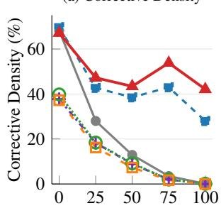

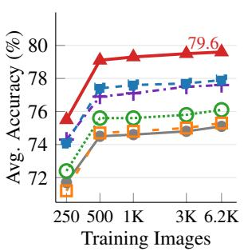  
Student Prefix Read (%)  
Figure 6. Corrective supervision and data efficiency with Qwen3.5-4B. (a) As the teacher reads more of the wrong prefix, the corrective density tends to decrease: Vision-OPD drops from 68% to 0%, VAD, CV-OPD and OPD-V from about 40% to 0%, and OPD-Aha declines to 28%, whereas BlinkOPD stays above 40% throughout. (b) Mean accuracy across the six fine-grained benchmarks at different training scales. BlinkOPD leads at every scale and reaches 79.6% with 6.2K images.

Why a few images can suffice. The higher corrective density of BlinkOPD (Fig. 6a) makes every rollout more useful for training: on a wrong rollout, more of the distillation tokens push the student toward the correct option instead of toward its own or another wrong answer. BlinkOPD also keeps the privileged visual evidence alive and resists linguistic momentum on long prefixes (Fig. 2), so its corrective signal does not fade too much as the student writes more. Although BlinkOPD (0.5K) uses 12× fewer images than the baselines, each image and rollout yields far more useful supervision, so it can outperform the OPSD baselines.

Data efficiency across training scales. Figure 6b compares all six methods trained on 250, 500, 1K, 3K and 6.2K images. BlinkOPD leads at every scale. With only 250 images, it reaches 75.5, 1.2 points above the strongest baseline at the same scale (74.3). With 500 images, it reaches 79.1 and surpasses every baseline trained on the full 6.2K pool by at least 1.2 points, using 12× fewer images. Scaling to 6.2K further improves it to 79.6, 1.7 points above the strongest baseline at the same scale. This shows the benefit of breaking linguistic momentum: by providing denser corrective supervision, BlinkOPD makes better use of the training data at every scale, especially when the data are scarce, since more of its tokens correct the student.

## 4.5. Ablation and Sensitivity Analysis

We run all ablations with BlinkOPD (0.5K) on Qwen3.5- 4B. In Tab. 3, every component of BlinkOPD contributes to its accuracy. Removing the first-glance gain costs 0.6 points, and removing the reference altogether, which recovers plain OPSD, costs 4.0, the largest drop in the table. Replacing the eyes-closed reference reproduces the ranking of Fig. 3. The text-only reference cancels the drift about as well as ours but injects a stronger false belief, and it comes closest (−0.9). The image-based references leave about 20% of the drift uncancelled and also inject false beliefs, and they fall further behind (−1.7 to −3.7). Only the eyesclosed reference is low on both measures, and it performs best. For the OPSD pipeline, JSD and a frozen teacher work best: replacing JSD by forward or reverse KL costs 1.5 and 2.4, and an EMA teacher costs 3.0, which suggests that a frozen privileged teacher provides the most stable target.

Table 3. Ablation&sensitivity analysis of BlinkOPD (0.5K) on 4B.
<table><tr><td>Variant with Qwen3.5-4B as the base model</td><td> $\operatorname { A v g } .$ </td><td> $\Delta$ </td></tr><tr><td>BlinkOPD (0.5K)</td><td>79.1</td><td></td></tr><tr><td>Ablation</td><td></td><td></td></tr><tr><td>w/o first-glance gain (same β for all rollouts)</td><td>78.5</td><td>-0.6</td></tr><tr><td>→ gray-image reference</td><td>77.4</td><td>-1.7</td></tr><tr><td>→ black-image reference</td><td>75.4</td><td>-3.7</td></tr><tr><td>→ Gaussian-noise-image reference → mismatched-image reference</td><td>75.6</td><td>-3.5</td></tr><tr><td>→ text-only reference</td><td>76.4</td><td>-2.7</td></tr><tr><td>w/o reference (plain OPSD,  $q _ { t } = p _ { t } ^ { + } )$ </td><td>78.2</td><td>-0.9</td></tr><tr><td></td><td>75.1</td><td>-4.0</td></tr><tr><td>Sensitivity</td><td></td><td></td></tr><tr><td>JSD → forward KL</td><td>77.6</td><td>-1.5</td></tr><tr><td>JSD → reverse KL</td><td>76.7</td><td>-2.4</td></tr><tr><td>frozen  $\theta _ { 0 }$  teacher → EMA teacher</td><td>76.1</td><td>-3.0</td></tr></table>

## 5. Conclusion

We found that OPSD for fine-grained multimodal perception suffers from linguistic momentum and the privileged visual evidence decays along the response. We further showed that existing contrastive references leave part of this drift uncancelled and inject false beliefs of their own. We therefore proposed BlinkOPD, which lets the teacher “blink” at every token of every rollout, and a first-glance gain strengthens the correction. This simple change to the distillation target keeps the privileged evidence alive along the whole response and raises the corrective density of every rollout. With only 0.5K images, BlinkOPD outperforms all reproduced OPSD baselines trained on 12× more images at both 4B and 9B; its 4B student already matches the strongest proprietary models, and its 9B student surpasses them. Although BlinkOPD is trained only on fine-grained perception data, we show that once these problems of OPSD are resolved in its distillation target, the student learns general habits that transfer well to broader visual abilities, such as general perception, hallucination mitigation and multimodal reasoning, without training on any of these tasks.

Related work and Limitations are discussed in Appendix L & M. Qualitative examples are in Appendix N.

## References

[1] Rishabh Agarwal, Nino Vieillard, Yongchao Zhou, Piotr Stanczyk, Sabela Ramos Garea, Matthieu Geist, and Olivier Bachem. On-policy distillation of language models: Learning from self-generated mistakes. In International Conference on Learning Representations (ICLR), 2024. 1

[2] Aniri, Jinhe Bi, Peng Liao, Zengjie Jin, Volker Tresp, Fei Shen, Yunpu Ma, and Tat-Seng Chua. OPD-V: Visual onpolicy self-distillation with modality balance. arXiv preprint arXiv:2608.05131, 2026. 1, 2, 3, 4, 5, 6, 7, 11, 12, 17

[3] Shuai Bai, Yuxuan Cai, Ruizhe Chen, Keqin Chen, Xionghui Chen, Zesen Cheng, Lianghao Deng, Wei Ding, Chang Gao, Chunjiang Ge, et al. Qwen3-VL technical report. arXiv preprint arXiv:2511.21631, 2025. 6

[4] Wayner Barrios, Andres Villa, Juan C Leon Alcazar, Souy-´ oung Jin, and Bernard Ghanem. MoDA: Modulation adapter for fine-grained visual understanding in instructional MLLMs. In Proceedings of the 43rd International Conference on Machine Learning, pages 6783–6798, 2026. 1, 17

[5] Haoran Chen, Junyan Lin, Xinghao Chen, Yue Fan, Jianfeng Dong, Xin Jin, Hui Su, Jinlan Fu, and Xiaoyu Shen. Multimodal language models see better when they look shallower. In Proceedings ofthe 2025 Conference on Empirical Methods in Natural Language Processing, pages 6677–6695, 2025. 1, 17

[6] Lin Chen, Jinsong Li, Xiaoyi Dong, Pan Zhang, Yuhang Zang, Zehui Chen, Haodong Duan, Jiaqi Wang, Yu Qiao, Dahua Lin, and Feng Zhao. Are we on the right way for evaluating large vision-language models? In Advances in Neural Information Processing Systems (NeurIPS), pages 27056– 27087, 2024. 6

[7] Yong Xien Chng, Tao Hu, Wenwen Tong, Xueheng Li, Jiandong Chen, Haojia Yu, Jiefan Lu, Hewei Guo, Hanming Deng, Chengjun Xie, Gao Huang, and Lewei Lu. SenseSearch: Empowering vision-language models with highresolution agentic search-reasoning via reinforcement learning. In Proceedings of the IEEE/CVF Conference on Computer Vision and Pattern Recognition (CVPR), pages 26508– 26517, 2026. 1, 6, 17

[8] GLM-V Team, Wenyi Hong, Wenmeng Yu, Xiaotao Gu, Guo Wang, Guobing Gan, Haomiao Tang, Jiale Cheng, Ji Qi, Junhui Ji, Lihang Pan, et al. GLM-4.5V and GLM-4.1V-Thinking: Towards versatile multimodal reasoning with scalable reinforcement learning. arXiv preprint arXiv:2507.01006, 2025. 6

[9] Google DeepMind. Gemini 3.1 Pro model card. https: / / deepmind . google / models / model - cards / gemini-3-1-pro/, 2026. February 2026. 6

[10] Tianrui Guan, Fuxiao Liu, Xiyang Wu, Ruiqi Xian, Zongxia Li, Xiaoyu Liu, Xijun Wang, Lichang Chen, Furong Huang, Yaser Yacoob, Dinesh Manocha, and Tianyi Zhou. HallusionBench: An advanced diagnostic suite for entangled language hallucination and visual illusion in large visionlanguage models. In Proceedings of the IEEE/CVF Conference on Computer Vision and Pattern Recognition (CVPR), pages 14375–14385, 2024. 6

[11] Jack Hong, Chenxiao Zhao, ChengLin Zhu, Weiheng Lu, Guohai Xu, and Xing Yu. DeepEyesV2: Toward agentic multimodal model. In International Conference on Learning Representations (ICLR), 2026. 1, 6, 17

[12] Nanxing Hu, Qiwei Yan, Jinchao Zhang, and Guoliang Kang. Evidence-aligned multimodal on-policy selfdistillation for fine-grained visual understanding. arXiv preprint arXiv:2609.34672, 2026. 1, 5, 6, 16, 17

[13] Koray Kavukcuoglu, Jeff Dean, Oriol Vinyals, and Noam Shazeer. Gemini 3.5: Frontier intelligence with action. https://blog.google/innovation-andai / models - and - research / gemini - models / gemini-3-5/, 2026. Blog post, May 19, 2026. 6

[14] Sicong Leng, Hang Zhang, Guanzheng Chen, Xin Li, Shijian Lu, Chunyan Miao, and Lidong Bing. Mitigating object hallucinations in large vision-language models through visual contrastive decoding. In Proceedings of the IEEE/CVF Conference on Computer Vision and Pattern Recognition (CVPR), pages 13872–13882, 2024. 2, 3, 4, 17

[15] Yifan Li, Yifan Du, Kun Zhou, Jinpeng Wang, Wayne Xin Zhao, and Ji-Rong Wen. Evaluating object hallucination in large vision-language models. In Proceedings of the 2023 Conference on Empirical Methods in Natural Language Processing, pages 292–305, 2023. 6

[16] Yijun Liang, Yunjie Tian, Yijiang Li, Yuqi Jia, Kaishen Wang, Tianyi Zhou, and Di Fu. Visual contrastive selfdistillation. arXiv preprint arXiv:2607.21556, 2026. 2, 3, 4, 17

[17] Pan Lu, Hritik Bansal, Tony Xia, Jiacheng Liu, Chunyuan Li, Hannaneh Hajishirzi, Hao Cheng, Kai-Wei Chang, Michel Galley, and Jianfeng Gao. MathVista: Evaluating mathematical reasoning of foundation models in visual contexts. In International Conference on Learning Representations (ICLR), 2024. 6

[18] Moonshot AI. Kimi K2.6: From code to creation, from one to many. https://www.kimi.ai/ai-models/ kimi-k2-6, 2026. Released April 2026. 6

[19] OpenAI. Introducing GPT-5.2. https://openai.com/ index/introducing-gpt-5-2/, 2025. Released December 2025. 6

[20] OpenAI. Thinking with images. https://openai. com/index/thinking-with-images/, 2025. Blog post, April 2025. 1, 17

[21] OpenAI. Introducing GPT-5.4. https://openai.com/ index/introducing-gpt-5-4/, 2026. Released March 2026. 6

[22] Runqi Qiao, Qiuna Tan, Guanting Dong, Minhui Wu, Chong Sun, Xiaoshuai Song, Jiapeng Wang, Zhuoma GongQue, Shanglin Lei, Yifan Zhang, Zhe Wei, Miaoxuan Zhang, Run feng Qiao, Xiao Zong, Yida Xu, Peiqing Yang, Zhimin Bao, Muxi Diao, Chen Li, and Honggang Zhang. We-Math: Does your large multimodal model achieve human-like mathemat ical reasoning? In Proceedings of the 63rd Annual Meeting ofthe Associationfor Computational Linguistics (Volume 1: Long Papers), pages 20023–20070, 2025. 6

[23] Chenhao Qiu, Dawei Li, Yechao Zhang, Lei Gong, and Zhen Tan. OPD-Aha: From linguistic momentum to visual re-

flection in multimodal on-policy distillation. arXiv preprint arXiv:2609.16459, 2026. 1, 2, 3, 4, 5, 6, 7, 11, 12, 17

[24] Qwen Team. Qwen3.5: Towards native multimodal agents. https://qwen.ai/blog?id=qwen3.5, 2026. Blog post, February 2026. 5, 6, 7

[25] Zhihong Shao, Peiyi Wang, Qihao Zhu, Runxin Xu, Junxiao Song, Xiao Bi, Haowei Zhang, Mingchuan Zhang, Y. K. Li, Y. Wu, and Daya Guo. DeepSeekMath: Pushing the limits of mathematical reasoning in open language models. arXiv preprint arXiv:2402.03300, 2024. 5, 6

[26] Haoxiang Sun, Zhihang Yi, Langxuan Deng, Yuhao Zhou, Peiqi Jia, Jian Zhao, Li Yuan, Jiancheng Lv, and Tao Wang. V-Zero: Answer-label-free on-policy distillation with contrastive evidence gating for fine-grained visual reasoning. arXiv preprint arXiv:2606.25319, 2026. 1, 6, 17

[27] Kanghui Tian, Siyuan Liu, Ziang Yan, Sheng Xia, Shuai Dong, and Yi Wang. ViCuR: Visual cues as recoverable privilege for multimodal on-policy distillation. In Proceedings of the 2026 Conference on Empirical Methods in Natural Language Processing, pages 7488–7513, 2026. 1, 17

[28] Shengbang Tong, Ellis Brown, Penghao Wu, Sanghyun Woo, Manoj Middepogu, Sai Charitha Akula, Jihan Yang, Shusheng Yang, Adithya Iyer, Xichen Pan, Austin Wang, Rob Fergus, Yann LeCun, and Saining Xie. Cambrian-1: A fully open, vision-centric exploration of multimodal LLMs. In Advances in Neural Information Processing Systems (NeurIPS), pages 87310–87356, 2024. 6

[29] Shengbang Tong, Zhuang Liu, Yuexiang Zhai, Yi Ma, Yann LeCun, and Saining Xie. Eyes wide shut? Exploring the visual shortcomings of multimodal LLMs. In Proceedings of the IEEE/CVF Conference on Computer Vision and Pattern Recognition (CVPR), pages 9568–9578, 2024. 6

[30] Haowei Wang, Hao Lin, Qi Zhu, Jiayi Ji, Deyi Ji, Liujuan Cao, and Rongrong Ji. CV-OPD: Contrastive vision onpolicy distillation. arXiv preprint arXiv:2610.13264, 2026. 1, 2, 3, 4, 5, 6, 7, 11, 12, 17

[31] Ke Wang, Junting Pan, Weikang Shi, Zimu Lu, Houxing Ren, Aojun Zhou, Mingjie Zhan, and Hongsheng Li. Measuring multimodal mathematical reasoning with MATH-Vision dataset. In Advances in Neural Information Processing Systems, pages 95095–95169, 2024. 6

[32] Wenbin Wang, Liang Ding, Minyan Zeng, Xiabin Zhou, Li Shen, Yong Luo, Wei Yu, and Dacheng Tao. Divide, conquer and combine: A training-free framework for high-resolution image perception in multimodal large language models. In Proceedings of the AAAI Conference on Artificial Intelligence, pages 7907–7915, 2025. 1, 5

[33] Lai Wei, Liangbo He, Jun Lan, Lingzhong Dong, Yutong Cai, Siyuan Li, Huijia Zhu, Weiqiang Wang, Linghe Kong, Yue Wang, Zhuosheng Zhang, and Weiran Huang. Zooming without zooming: Region-to-image distillation for fine-grained multimodal perception. In Proceedings of the 43rd International Conference on Machine Learning, pages 133660–133688, 2026. 1, 5, 6, 17

[34] Penghao Wu and Saining Xie. V∗: Guided visual search as a core mechanism in multimodal LLMs. In Proceedings of the IEEE/CVF Conference on Computer Vision and Pattern Recognition (CVPR), pages 13084–13094, 2024. 1, 5

[35] Hee Suk Yoon, Eunseop Yoon, Jaehyun Jang, Soohwan Eom, Ji Woo Hong, Mark A. Hasegawa-Johnson, Qi Dai, Chong Luo, and Chang D. Yoo. Decomposed on-policy distillation for vision-language reasoning: Steering gradients for visual grounding. In Proceedings of the 43rd International Conference on Machine Learning, pages 149714–149737, 2026. 2, 3, 4, 17

[36] Qianhao Yuan, Jie Lou, Xing Yu, Hongyu Lin, Le Sun, Xianpei Han, and Yaojie Lu. Vision-OPD: Learning to see fine details for multimodal LLMs via on-policy selfdistillation. In Advances in Neural Information Processing Systems (NeurIPS), 2026. Accepted; to be published. 1, 2, 5, 6, 7, 11, 12, 17

[37] Kangning Zhang, Yixing Li, Shuai Shao, Qingyao Li, Zhengxi Lu, Zhiyuan Yao, Jianghao Lin, Wenxiang Jiao, Yuan Lu, Weiwen Liu, Weinan Zhang, and Yong Yu. VAD: Attributing visual evidence for target reconstruction in multimodal on-policy distillation. arXiv preprint arXiv:2607.28590, 2026. 1, 2, 3, 5, 6, 7, 11, 12, 17

[38] Renrui Zhang, Dongzhi Jiang, Yichi Zhang, Haokun Lin, Ziyu Guo, Pengshuo Qiu, Aojun Zhou, Pan Lu, Kai-Wei Chang, Yu Qiao, Peng Gao, and Hongsheng Li. MathVerse: Does your multi-modal LLM truly see the diagrams in visual math problems? In European Conference on Computer Vision (ECCV), pages 169–186, 2024. 6

[39] Yi-Fan Zhang, Huanyu Zhang, Haochen Tian, Chaoyou Fu, Shuangqing Zhang, Junfei Wu, Feng Li, Kun Wang, Qingsong Wen, Zhang Zhang, Liang Wang, Rong Jin, and Tieniu Tan. MME-RealWorld: Could your multimodal LLM challenge high-resolution real-world scenarios that are difficult for humans? In International Conference on Learning Rep resentations (ICLR), 2025. 1, 4, 5

[40] Yi-Fan Zhang, Xingyu Lu, Shukang Yin, Chaoyou Fu, Wei Chen, Xiao Hu, Bin Wen, Kaiyu Jiang, Changyi Liu, Tianke Zhang, et al. Thyme: Think beyond images. In International Conference on Learning Representations (ICLR), 2026. 1, 6, 17

[41] Ziwei Zheng, Minghao Yang, Jack Hong, Chenxiao Zhao, Guohai Xu, Le Yang, Chao Shen, and Xing Yu. Deep Eyes: Incentivizing “Thinking with Images” via reinforce ment learning. In International Conference on Learning Representations (ICLR), 2026. 1, 6, 17

[42] Qihui Zhu, Yuchen Wang, Zijian Wen, Tao Zhang, Mengjie Zhang, Yang Liu, Shuangwu Chen, Siying Wu, Jian Yang, and Xiaofeng Jiang. RP-OPSD: Resolution-privileged onpolicy self-distillation for multimodal large language models. arXiv preprint arXiv:2607.24447, 2026. 1, 17

[43] Chengke Zou, Xingang Guo, Rui Yang, Junyu Zhang, Bin Hu, and Huan Zhang. DynaMath: A dynamic visual bench mark for evaluating mathematical reasoning robustness of vision language models. In International Conference on Learning Representations (ICLR), 2025. 6

# Teach with Blinks: Breaking Linguistic Momentum in On-Policy Distillation for Fine-Grained Multimodal Perception

# Supplementary Material

## Overview

1. Appendix A: Experimental details of the analysis in Secs. 2.2 and 2.3.

2. Appendix B: Control experiment: the content of the prefix drives linguistic momentum.

3. Appendix C: Residual drift when only part of the prefix is read.

4. Appendix D: Proof of Proposition 1: δ measures the residual drift in the contrast $r _ { t } .$

5. Appendix E: Implementing the eyes-closed reference in training.

6. Appendix F: The trade-off of a global gain.

7. Appendix G: Global gain versus first-glance gain.

8. Appendix H: Training algorithm of BlinkOPD.

9. Appendix I: Training details.

10. Appendix J: The corrected answer judge.

11. Appendix K: Zero-shot transfer protocol.

12. Appendix L: Related work.

13. Appendix M: Limitations.

14. Appendix N: Qualitative examples.

## A. Experimental details of the analysis

Probe set. We randomly sample 768 questions from the decontaminated Vision-OPD training pool [36] of 6,220 questions (see Footnote 3 of the main paper). For each question, $\theta _ { 0 }$ generates 4 student rollouts from the full image (temperature 1, at most 1,024 tokens), giving 3,072 rollouts, of which 1,732 are wrong and 1,340 are correct. Each rollout is truncated at 0, 25, 50, 75 and 100% of its tokens. After each truncated prefix we append the answer cue Answer: ( and read the nexttoken probabilities over the option letters, normalized over the options, for the teacher (zoomed crop), for every reference and for every distillation target. From these read-outs, we construct the distillation targets of Vision-OPD [36], VAD [37], CV-OPD [30], OPD-V [2] and OPD-Aha [23] following the default setting of each original paper. Note that this analysis uses the ground-truth answers to separate wrong from correct rollouts and to compute the follow rate and the survival score, whereas OPSD methods themselves require no ground-truth answers.

Linguistic momentum (Fig. 2). Panel (a) reports the follow rate $F ( \tau )$ of Eq. (2), where W contains the 1,732 student-wrong rollouts of the probe set. Tab. 4 lists the values corresponding to Fig. 2a.

Table 4. Follow rate F(τ) (%) on the 1,732 student-wrong rollouts, corresponding to Fig. 2a.
<table><tr><td>Method</td><td> $\tau = 0$ </td><td>25%</td><td>50%</td><td>75%</td><td>100%</td></tr><tr><td>Vision-OPD [36]</td><td>23.2</td><td>66.7</td><td>83.5</td><td>95.8</td><td>99.8</td></tr><tr><td>VAD [37]</td><td>51.4</td><td>75.2</td><td>87.5</td><td>97.1</td><td>100.0</td></tr><tr><td>CV-OPD [30]</td><td>48.9</td><td>75.6</td><td>87.2</td><td>97.1</td><td>99.9</td></tr><tr><td>OPD-V [2]</td><td>50.3</td><td>78.2</td><td>89.2</td><td>97.6</td><td>100.0</td></tr><tr><td>OPD-Aha [23]</td><td>19.4</td><td>46.9</td><td>49.2</td><td>43.8</td><td>64.3</td></tr><tr><td>BlinkOPD (ours)</td><td>19.6</td><td>34.7</td><td>37.4</td><td>19.1</td><td>38.4</td></tr></table>

Panel (b) reports the survival score $S ( \tau )$ of Eq. (3), where $\kappa \subseteq \mathcal W$ contains the 1,181 student-wrong rollouts on which the teacher picks the correct option before reading the prefix, i.e., the rollouts on which the zoomed crop holds the evidence that the student missed. Tab. 5 lists the values corresponding to Fig. 2b.

Table 5. Survival score $S ( \tau )$ on the 1,181 rollouts of K, corresponding to Fig. 2b.
<table><tr><td>Method</td><td> $\tau = 0$ </td><td>25%</td><td>50%</td><td>75%</td><td>100%</td></tr><tr><td>Vision-OPD [36]</td><td>1.60</td><td>-1.36</td><td>-2.16</td><td>-2.77</td><td>-3.95</td></tr><tr><td>VAD [37]</td><td>0.15</td><td>-2.25</td><td>-2.73</td><td>-3.21</td><td>-4.07</td></tr><tr><td>CV-OPD [30]</td><td>0.35</td><td>-2.17</td><td>-2.78</td><td>-3.30</td><td>-4.18</td></tr><tr><td>OPD-V [2]</td><td>0.05</td><td>-2.34</td><td>-2.97</td><td>-3.42</td><td>-4.18</td></tr><tr><td>OPD-Aha [23]</td><td>8.92</td><td>3.14</td><td>1.51</td><td>1.43</td><td>-1.03</td></tr><tr><td>BlinkOPD (ours)</td><td>13.35</td><td>7.21</td><td>4.57</td><td>7.50</td><td>3.67</td></tr></table>

Residual drift (Fig. 3a). The gray, black and Gaussian-noise references replace the zoomed crop with an image of the same size filled with the mean color of the crop, with zeros, or with Gaussian noise. The mismatched-image reference replaces it with the zoomed crop of another random probe question whose source image is different, resized to the same size, so that it contains real but unrelated visual content. The residual drift δ (Eq. (5)) is computed on the 1,181 rollouts of K after the whole prefix.

## B. Control: the content of the prefix drives linguistic momentum

To check that linguistic momentum comes from the content of the prefix rather than its length, we repeat the probe of Fig. 2a on the same 1,732 student-wrong rollouts with the same teacher, but replace the student’s prefix with a rollout of another question, taken from a different source image and truncated to the same number of tokens. With its own prefix, the follow rate of the raw teacher (Vision-OPD) rises from 23.2% to 99.8%; with the swapped prefix, it stays between 22.9% and 25.5% (Fig. 7), i.e., at the level before reading any prefix.

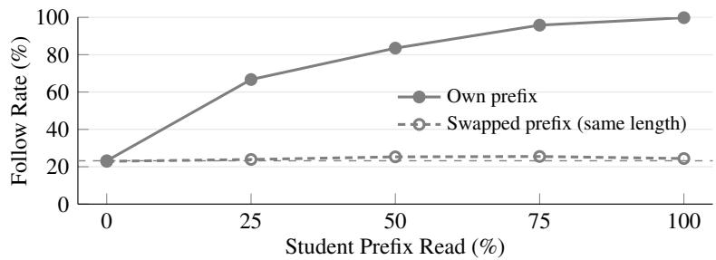  
Figure 7. Follow rate of the raw teacher (Vision-OPD) on the 1,732 student-wrong rollouts when it reads the student’s own prefix or a prefix of another question with the same length. The thin gray line marks the follow rate before reading any prefix (23.2%).

## C. Residual drift when only part of the prefix is read

In Fig. 3a, the residual drift δ (Eq. (5)) is measured between $\tau = 0$ and the end of the whole prefix. Fig. 8 shows δ when this end point is moved to $\tau = 5 0 \%$ and 75%, i.e., with $S ^ { \mathrm { e n d } }$ replaced by $S ^ { \tau }$ for both the teacher and the reference.

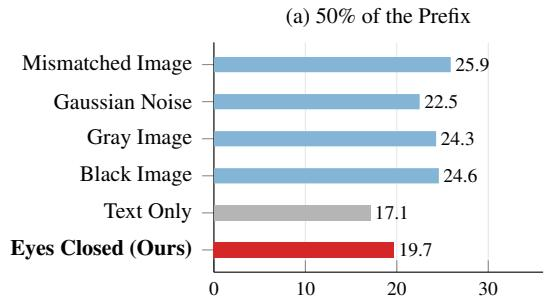

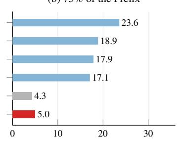

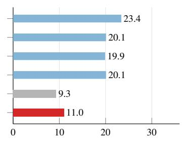  
Figure 8. Residual drift δ (%, Eq. (5)) when the teacher and the reference read (a) 50%, (b) 75% or (c) all of the student prefix (Fig. 3a).

## D. Proof of Proposition 1

Here we show that the residual drift δ in Eq. (5), although defined through the survival scores of the teacher and of the reference, directly measures how much of the prefix-induced drift remains in the contrast term $r _ { t }$ of Eq. (4).

Notation. Fix a rollout $y \in \kappa$ and a truncation point τ. After reading the first τ of y, the teacher and the reference each assign a probability to every answer option $o \in \mathcal { O } _ { y } ;$ we write them $p _ { + , y } ^ { \tau } ( o )$ and $p _ { \mathrm { r e f } , y } ^ { \tau } ( o )$ . These are $p _ { t } ^ { + }$ and $p _ { t } ^ { \mathrm { r e f } }$ of Eq. (4) at the token position t where the answer is read out, restricted to the answer options. At this position, the contrast term $r _ { t }$ of Eq. (4) is therefore a score for each option,

$$
r _ { y } ^ { \tau } ( o ) = \log p _ { + , y } ^ { \tau } ( o ) - \log p _ { \mathrm { r e f } , y } ^ { \tau } ( o ) , \qquad o \in \mathcal { O } _ { y } ,\tag{10}
$$

which is high for options that the teacher prefers more than the reference does. $( \boldsymbol { r } _ { t }$ in Eq. (4) carries no τ because it is defined at every token position t; here t is the read-out position after the first τ of the prefix.) As in Eqs. (2) and $( 3 ) , g _ { y }$ is the correct option of y and $a _ { y }$ is the wrong option chosen by the student.

Proof of Proposition 1. Step 1. The survival scores of the teacher and of the reference are Eq. (3) with $q _ { y } ^ { \tau }$ replaced by $p _ { + , y } ^ { \tau }$ and $p _ { \mathrm { r e f } , y } ^ { \tau }$ . Subtracting them and regrouping the four log-probabilities by option gives, with Eq. (10),

$$
\begin{array} { l } { S _ { + } ( \tau ) - S _ { \mathrm { r e f } } ( \tau ) = \displaystyle \frac { 1 } { | K | } \sum _ { y \in K } \Big [ \log \frac { p _ { + , y } ^ { \tau } ( g _ { y } ) } { p _ { + , y } ^ { \tau } ( a _ { y } ) } - \log \frac { p _ { \mathrm { r e f } , y } ^ { \tau } ( g _ { y } ) } { p _ { \mathrm { r e f } , y } ^ { \tau } ( a _ { y } ) } \Big ] } \\ { \displaystyle = \frac { 1 } { | K | } \sum _ { y \in K } \Big [ \underbrace { \big ( \log p _ { + , y } ^ { \tau } ( g _ { y } ) - \log p _ { \mathrm { r e f } , y } ^ { \tau } ( g _ { y } ) \big ) } _ { r _ { y } ^ { \tau } ( g _ { y } ) } - \underbrace { \big ( \log p _ { + , y } ^ { \tau } ( a _ { y } ) - \log p _ { \mathrm { r e f } , y } ^ { \tau } ( a _ { y } ) \big ) } _ { r _ { y } ^ { \tau } ( a _ { y } ) } \Big ] } \\ { \displaystyle \qquad = \frac { 1 } { | K | } \sum _ { y \in K } \big [ r _ { y } ^ { \tau } ( g _ { y } ) - r _ { y } ^ { \tau } ( a _ { y } ) \big ] \equiv S _ { r } ( \tau ) . } \end{array}\tag{11}
$$

$S _ { r } ( \tau )$ measures how strongly, on average over $\kappa ,$ the contrast term prefers the correct option to the student’s option after the first τ of the prefix.

Step 2. Regrouping the four terms of $\Delta _ { + } - \Delta _ { \mathrm { r e f } }$ by end point and applying Eq. (11) at $\tau = 0$ and at the end of the prefix,

$$
\Delta _ { + } - \Delta _ { \mathrm { r e f } } = \left( S _ { + } ^ { 0 } - S _ { + } ^ { \mathrm { e n d } } \right) - \left( S _ { \mathrm { r e f } } ^ { 0 } - S _ { \mathrm { r e f } } ^ { \mathrm { e n d } } \right) = \left( S _ { + } ^ { 0 } - S _ { \mathrm { r e f } } ^ { 0 } \right) - \left( S _ { + } ^ { \mathrm { e n d } } - S _ { \mathrm { r e f } } ^ { \mathrm { e n d } } \right) = S _ { r } ^ { 0 } - S _ { r } ^ { \mathrm { e n d } } \equiv \Delta _ { r } .\tag{12}
$$

$\Delta _ { r }$ is how much reading the student prefix lowers the preference of $r _ { t }$ for the correct option, i.e., the drift that remains in $r _ { t }$ Step 3. Dividing by $\Delta _ { + }$ and using Eq. (5),

$$
\delta = \frac { \Delta _ { + } - \Delta _ { \mathrm { r e f } } } { \Delta _ { + } } = \frac { \Delta _ { r } } { \Delta _ { + } } .\tag{13}
$$

Hence $\delta$ is the drift that remains in $r _ { t } ,$ , as a share of the teacher’s own drift: $\delta = 0$ means that the student prefix does not move $r _ { t }$ at all, and any $\delta > 0$ is drift that $r _ { t }$ still carries and that the gain $\beta$ in Eq. (4) amplifies.

## E. Implementing the eyes-closed reference in training

For efficiency, our trainer (verl [49]) does not pad sequences of different lengths to a common length; it packs several sequences end to end into one long row and marks where each sequence starts. This appendix describes how we build the eyes-closed input in this packed format, and two details that matter for Qwen3.5.

Building the eyes-closed input. For every sample, the trainer stores the token ids, the attention mask, a four-row position tensor (one text row used for packing and causal masking, and the three M-RoPE rows $t , h , w [ 5 1 ]$ ), and the index where the response begins. To build the eyes-closed input, we

1. drop every visual-content token (the image-pad tokens) but keep the vision start/end markers;

2. keep the three M-RoPE rows of all remaining tokens at their full-input values;

3. renumber the text row contiguously, since it only marks where each sequence starts and which tokens may attend to which;

4. shift the response start by the number of removed tokens; and

5. pass no pixel values, so the vision encoder is skipped.

On average, 414 tokens are removed per training row.

Deleting rather than masking. We delete the image-content tokens instead of masking them in attention. In decoders that also mix tokens through recurrent states or convolutions, such as the gated delta-rule layers [52] of Qwen3.5, masking attention alone would leave these paths from the image open; deleting the tokens removes every path from the image to the remaining tokens. Keeping the original positions leaves the relative positions among the remaining tokens, and hence al position-dependent attention logits among them, unchanged.

Resetting the linear-attention state. The gated delta-rule layers carry a recurrent state from token to token, so in a packed row the state of one sequence would leak into the next; it must be reset at each sequence boundary. Without the reset, the KL between the trainer’s and the rollout engine’s token distributions has a median of 0.12, whereas with the reset it drops to 0.005. We apply the reset to every forward pass of student, teacher and reference.

## F. The trade-off of a global gain

Sec. 3.2 states that a single global gain does not suit all rollouts: a large gain recovers the correct option on student-wrong rollouts but pushes the distillation target away from it on student-correct ones. Here we formulate this trade-off and then run an experiment on the probe of Sec. 2.2 to show that it exists.

Formulation. A global gain gives the same gain $\beta$ to every rollout, $i . e . ,$ it is the gain of Eq. (7) with $\gamma = 1$ . On each rollout y of the probe, the teacher and the eyes-closed reference read a fraction τ of the prefix, and we form the distillation target $q _ { y } ^ { \tau }$ of Eq. (8) with this gain. On a student-wrong rollout, the target should recover the correct option $g _ { y } ;$ we measure this on the student-wrong rollouts W by the corrective density $C ( \tau )$ of Eq. (9). On a student-correct rollout, the target should keep $g _ { y } ;$ we measure this on the student-correct rollouts $\overline { { \mathcal W } }$ by the retention

$$
R ( \tau ) = \frac { 1 } { \vert \overline { { \mathcal { W } } } \vert } \sum _ { y \in \overline { { \mathcal { W } } } } \mathbf { 1 } \Big [ \underset { o \in \mathcal { O } _ { y } } { \arg \operatorname* { m a x } } \ q _ { y } ^ { \tau } ( o ) = g _ { y } \Big ] ,\tag{14}
$$

$i . e . ,$ the share of student-correct rollouts on which the target still picks the correct option. Let $C ( \beta )$ and $R ( \beta )$ denote the two measures under the global gain $\beta ,$ averaged over the read-out points τ ; a good gain needs both a high $C ( \beta )$ and a high $R ( \beta )$ The two are in trade-off when $C ( \beta )$ increases and $R ( \beta )$ decreases as $\beta$ grows: then no single $\beta$ maximizes both, and every gain that corrects more student-wrong rollouts keeps fewer student-correct ones.

Setup. The probe contains 768 training questions with four $\theta _ { 0 }$ rollouts each, i.e., 1,732 student-wrong rollouts W and 1,340 student-correct rollouts $\overline { { \mathcal { W } } }$ (Appendix A). We sweep the global gain $\beta$ from 0, where the target is the teacher alone, to 12 in steps of 1, and for each $\beta$ average $C ( \tau )$ and $R ( \tau )$ over $\tau \in$ {25, 50, 75, 100}%.

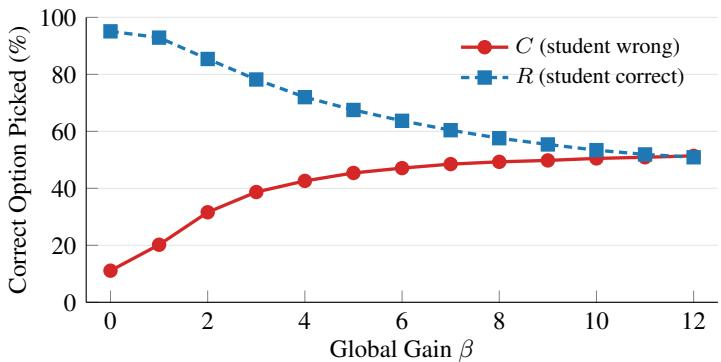  
Figure 9. Trade-off of a global gain on the probe of Sec. 2.2. Each point is the share of rollouts on which the target picks the correct option, averaged over the read-out points $\tau = 2 5 , 5 0 , 7 5$ and 100%. Raising the global gain $\beta$ raises the corrective density $C$ on student-wrong rollouts but lowers the retention R on student-correct ones.

The trade-off exists. As $\beta$ grows, the corrective density rises and the retention falls at every gain we test (Fig. 9). No global gain therefore gives both a high corrective density and a high retention: a gain that is large enough to correct the student wrong rollouts damages the student-correct ones. The gain should thus be raised only on rollouts that are likely to be wrong, which is what the first-glance gain of Sec. 3.2 does (Appendix G).

## G. Global gain versus first-glance gain

Experimental setup. We compare the global gain with the first-glance gain on the probe of Appendix F, using the corrective density C and retention R defined there. We fix $\gamma = 2 .$ , the factor used in training, and sweep the base gain $\beta$ from 0.1 to 12 in steps of 0.1, comparing with the global gain of the same $\beta .$ As in training, the first glance is the teacher’s top option on the crop before it reads any of the prefix $( \tau = 0 )$ . The glance needs no label: it only compares the student’s answer with the teacher’s own answer on the crop, which the frozen teacher computes once per question before training.

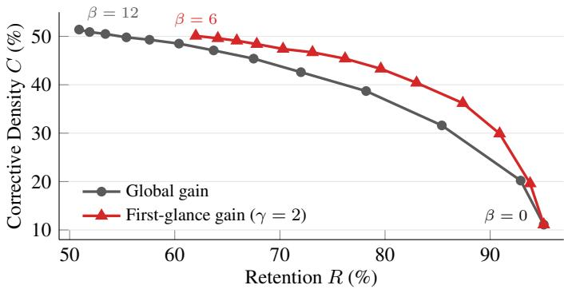  
Figure 10. First-glance gain $( \gamma = 2 )$ against the global gain on the probe of Sec. 2.2: C against $R ,$ each averaged over the four read-out points, as β is swept from 0 to 12 for the global gain and from 0 to 6 for the first-glance gain, so that both reach a largest gain of 12. The first-glance gain lies above the global gain.

The first-glance gain dominates the global gain. Fig. 10 compares the two gains over the corrective-density–retention trade-off of Appendix F. At the same retention, the first-glance gain corrects more student-wrong rollouts than the global gain; at the same corrective density, it keeps more student-correct rollouts. In summary, over the whole range covered by both curves, the curve of the first-glance gain lies above and to the right of that of the global gain, i.e., the first-glance gain dominates the global gain on both measures. This agrees with the ablation in Tab. 3, where using a global gain instead lowers the average accuracy on the six fine-grained benchmarks by 0.6 points.

## H. Training algorithm of BlinkOPD

Algorithm 1 summarizes one training step of BlinkOPD, combining the eyes-closed reference (Sec. 3.1), the first-glance gain (Sec. 3.2) and the distillation target (Sec. 3.3). The corresponding framework is shown in Fig. 5 of the main paper.

Algorithm 1 One training step of BlinkOPD   
Require: student $\pi _ { \boldsymbol { \theta } } ;$ teacher (a copy of the student) $\theta _ { 0 } ;$ base gain $\beta ;$ factor $\gamma ;$ first glances ${ \hat { a } } ^ { \mathrm { g l a n c e } } ( x )$ precomputed with $\theta _ { 0 }$   
on $x _ { T }$   
1: for each prompt $x = ( I , I ^ { + } , q )$ in the batch do   
2: sample rollouts $y _ { 1 } , . . . , y _ { n } \sim \pi _ { \theta } ( \cdot \mid x _ { s } )$   
3: for each rollout $y _ { i }$ do   
4: $\beta _ { i }  \beta \gamma ^ { \mathrm { { 1 } } [ \hat { a } ( y _ { i } ) \neq \hat { a } ^ { \mathrm { g l a n c e } } ( x ) ] }$ ▷ Eq. (7)   
5: $p _ { t _ { . . . } } ^ { + }  p _ { \theta _ { 0 } } ( \cdot \mid x _ { T } , y _ { i , < t } )$ for all t ▷ eyes open   
6: $p _ { t } ^ { \emptyset }  p _ { \theta _ { 0 } } ( \cdot \mid \langle \mathbf { v } \rangle \langle / \mathbf { v } \rangle , q , y _ { i , < t } )$ ▷ eyes closed   
7: $\stackrel { \cdot \cdot } { q _ { i , t } }  \mathrm { s o f t m a x } ( \log p _ { t } ^ { + } + \beta _ { i } [ \log p _ { t } ^ { + } - \log p _ { t } ^ { \infty } ] )$   
8: end for   
9: end for   
10: update θ by minimizing Eq. (1) with $q _ { t } = q _ { i , t }$

## I. Training details

Table 6. Hyperparameters of BlinkOPD (Qwen3.5-4B; 9B identical).
<table><tr><td>Item</td><td>Value</td></tr><tr><td>Training pool</td><td>Vision-OPD, decontaminated (6.2K)</td></tr><tr><td>Unique images K</td><td>500 (random)</td></tr><tr><td>Student input</td><td>full image + box + focus instruction</td></tr><tr><td>Teacher input</td><td>tight crop around the box</td></tr><tr><td>Teacher</td><td>frozen θ0</td></tr><tr><td>Batch / rollouts per prompt</td><td>96 prompts / 8</td></tr><tr><td>Rollout temperature, top-p</td><td>1.0, 1.0</td></tr><tr><td>Max prompt / response length</td><td>8,192 / 1,024 tokens</td></tr><tr><td>Optimizer</td><td>AdamW,  $\mathrm { l r ~ 2 \times 1 0 ^ { - 6 } }$  , 5 warm-up steps, constant</td></tr><tr><td>Steps</td><td>38</td></tr><tr><td>Divergence</td><td>JSD, α = 0.5, student top-100 + tail</td></tr><tr><td>Gain</td><td> $\beta = 3 . 4 , \gamma = 2$  42</td></tr><tr><td>Seed</td><td></td></tr><tr><td>Hardware</td><td>4–8 NVIDIA B200</td></tr></table>

## J. The corrected answer judge

The answer judge shared by prior work has an issue: it marks a response as correct when the first option-like letter in it matches the ground truth, even if the final answer is a different option. For example, for a response ending in “. . . so the sign is blue. Answer: (C)” with ground truth A, the judge takes the “A” of the word “Answer” as the chosen option and counts the response as correct. Almost all such false positives have ground truth A and occur on MME-RealWorld, and they inflate average scores by 0.3–2.1 points. EAD [12] also identified this issue and switched to a Qwen3.5-122B judge. For a fair comparison with Vision-OPD and the baselines reproduced from it, we keep their judge, gpt-oss-120B, and only fix this rule: the corrected judge uses only the parsed final answer. We re-score all models with it, including the reproduced baselines, and report the corrected numbers. We do not compare with EAD, since its code had not been released when we submitted this paper, so it could neither be reproduced under our protocol nor re-scored with the corrected judge.

## K. Zero-shot transfer protocol

Data and prompts. All ten benchmarks are taken from the official releases at pinned revisions: MMStar (1,500), CV-Bench (2,638), MMVP (300), POPE (COCO random/popular/adversarial), HallusionBench, MathVista testmini (1,000), MathVerse testmini (3,940, five versions), MATH-Vision test (3,040), We-Math testmini (1,740) and DynaMath (5,010 = 501 seeds × 10 variants). Each question uses the verbatim prompt of the benchmark’s official evaluation code or paper. We keep the official MMVP ground truth, which contains two swapped pairs that later versions correct. Decoding is greedy with thinking disabled, as in the fine-grained evaluation. CV-Bench is reported as 0.5 × (ADE20K + COCO)/2 + Omni3D.

Scoring. CV-Bench, MMStar and MMVP: we strip markdown and extract the option from the answer marker (“Answer:”, “the answer is”, \boxed{}, or a leading option); if no option can be extracted, GPT-OSS-120B matches the response to an option with the official VLMEvalKit prompt, and unmatched responses count as wrong. MathVista and MathVerse: official rules, with the judge used only to extract answers that the rules miss (MathVista) or with the official two-step extract-andcompare prompt for free-form answers (MathVerse). MATH-Vision, We-Math and DynaMath: official rule-based scorers. POPE and HallusionBench: rule-based yes/no extraction. The judge runs at temperature 0 with a shared cache, so every model is scored by the same verdicts. It is called for about 38% of MathVerse responses, as intended by its official protocol, and for 0–12% elsewhere; re-scoring the same responses changes averages by at most about 0.15.

Reported metrics. We report the strict score on We-Math, the average accuracy over all ten variants on DynaMath, and question accuracy on HallusionBench; MATH-Vision is evaluated on its full test set.

## L. Related work

From thinking with images to a single-pass recipe for fine-grained multimodal perception. Inspired by “thinking with images” [20], a growing body of work improves fine-grained perception by progressively inspecting visual details through cropping and zooming at inference time. These approaches range from training-free visual search [48, 53] to reinforcemen learning-based methods that learn to invoke visual tools [7, 11, 40, 41, 47, 50]. However, these methods often incur substantia computational overhead and latency during inference, limiting their applicability in real-time applications. A complementary line therefore seeks to amortize these capabilities into the model itself during post-training, enabling fine-grained visual details to be recognized in a single forward pass. Representative approaches include enhancing visual representations [4, 5], region-to-image distillation [33], and OPD [12, 23, 26, 27, 36, 37, 42]. We follow this single-pass line: BlinkOPD changes only the training target and leaves inference untouched.

OPSD for fine-grained multimodal perception. OPD can improve fine-grained perception by distilling knowledge from a stronger teacher [26]. However, stronger teachers are not always available, particularly for frontier models. OPSD instead leverages privileged visual information to enable self-distillation. Representative methods equip the teacher with zoomed crops [36], higher-resolution images [42], or recoverable visual cues [27]. Following the line of OPSD methods that use zoomed crops as privileged visual inputs, BlinkOPD focuses on reconstructing distillation targets to counteract linguistic momentum and strengthen corrective supervision.

Linguistic momentum and contrastive targets in multimodal OPSD. In OPD, conditioning the teacher on studentgenerated prefixes can bias its predictions toward the student’s own mistakes, weakening corrective supervision [44–46]. In multimodal OPSD, OPD-Aha [23] further demonstrates that such linguistic momentum can override privileged visua evidence. To mitigate this issue, contrastive methods reconstruct the distillation target by contrasting the privileged teacher’s prediction with a reference prediction conditioned on the same student prefix but with altered or removed visual input. Existing references include gray images [23], black images [2, 16], Gaussian-noised images [14], mismatched images [30], and text-only inputs [35]. However, these references can leave residual linguistic drift and introduce false visual beliefs. In contrast, BlinkOPD removes visual-content tokens while preserving the original multimodal input structure, enabling more effective cancellation of linguistic momentum and stronger corrective supervision.

Tab. 7 compares BlinkOPD with the five OPSD methods that we reproduce in Sec. 4.1. All of them distill a privileged teacher on the zoomed crop into a student on the full image, and all of them run the student alone in a single pass at test time.

Table 7. Comparison with the reproduced OPSD baselines. Granularity: the level at which the strength of the reference varies. Labels: whether ground-truth answers are used during training (∗CV-OPD skips the questions on which no rollout is correct).
<table><tr><td>Method</td><td></td><td>Teacher Reference</td><td>Role of the reference</td><td>Gain</td><td>Granularity Labels</td><td></td></tr><tr><td>Vision-OPD [36]</td><td>EMA</td><td>none</td><td></td><td></td><td></td><td>no</td></tr><tr><td>OPD-V [2]</td><td>EMA</td><td>crop with a random black patch</td><td>on/off weight on each token&#x27;s loss</td><td></td><td>per token</td><td>no</td></tr><tr><td>CV-OPD [30]</td><td>EMA</td><td>another region of the same hinge term that keeps the image</td><td>student closer to the teacher</td><td>fixed weight</td><td>per token</td><td>yes*</td></tr><tr><td>VAD [37]</td><td>EMA</td><td>pixelated crop</td><td>projects the teacher-student shift onto the evidence</td><td>capped shift</td><td>per token</td><td>no</td></tr><tr><td>OPD-Aha [23]</td><td>frozen</td><td>gray (mean-color) image</td><td>direction contrast inside the distillation target</td><td>fixed β</td><td>global</td><td>no</td></tr><tr><td>BlinkOPD (ours) frozen</td><td></td><td>eyes closed: image-content tokens removed, frame kept</td><td>contrast inside the distillation target</td><td>raised on first-glance conflicts</td><td>per rollout</td><td>no</td></tr></table>

## M. Limitations

BlinkOPD is general and can be applied to any multimodal model family. However, owing to limited compute, our experiments cover only the Qwen3.5 family at 4B and 9B, the model familiy and sizes on which the OPSD methods we compare with are mainly evaluated. We leave the validation on other model families to future work.

Although the eyes-closed reference is the only reference that is low on both residual drift and false belief (Fig. 3), part of the drift is still left uncancelled, and the probability of the false belief remains slightly above that obtained with the rea image. Likewise, once the teacher reads the student prefix, BlinkOPD has the lowest follow rate and the highest corrective density of all distillation targets (Figs. 2 and 6), yet its target still follows the wrong prefix on some rollouts, and its corrective density stays below the level reached before any prefix is read. Linguistic momentum is therefore reduced but not fully removed, and we leave references and targets that close this remaining gap to future work.

## N. Qualitative examples

We show qualitative examples for the four abilities evaluated in Tabs. 1 and 2: fine-grained perception (Fig. 11), general perception (Fig. 12), hallucination (Fig. 13) and multimodal reasoning (Fig. 14).

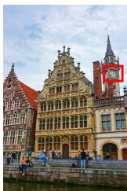

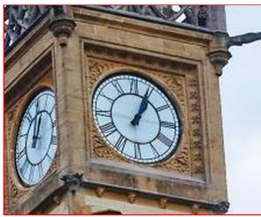

(a) ZoomBench. What time is displayed on the clock   
face on the right side of the tower?   
A. 12:45 B. 1:20 C. 12:58 D. 1:04   
Ground truth: D. 1:04   
(b) HR-Bench 8K. Tell me the shape of the signboard   
attached to the building?   
A. Oval B. Rectangular   
C. Triangular D. Circular   
Ground truth: B. Rectangular   
(c) HR-Bench 8K. What is the direction indicated on   
the sign pointing towards Alocen?´   
A. Straight B. Left C. Right D. Downward   
Ground truth: B. Left   
(d) HR-Bench 4K. What direction arrows are shown on   
the black sign?   
A. Two right arrows B. No arrows   
C. Two left arrows D. Both left and right arrows   
Ground truth: C. Two left arrows   
(a) MMVP. Is the duck’s entire beak visible in the picture?   
(a) Yes (b) No   
Ground truth: (a) Yes   
(b) MMVP. Are the wheels of the school bus visible in the image?   
(a) Yes (b) No   
Ground truth: (a) Yes   
(c) CV-Bench. How many street lights are in the image?   
A. 2 B. 3 C. 0 D. 1   
Ground truth: D. 1   
(d) MMVP. From the camera’s perspective, are the words “SCHOOL BUS”   
in the picture facing straight or oriented at an angle?   
(a) Directly towards the camera   
(b) At an angle   
Ground truth: (a) Directly towards the camera

<table><tr><td>Model</td><td>Base</td><td>Vision-OPD</td><td>OPD-V</td><td>CV-OPD</td><td>VAD</td><td>OPD-Aha</td><td>BlinkOPD (ours)</td></tr><tr><td>Answer</td><td>BX</td><td>BX</td><td>BX</td><td>BX</td><td>BX</td><td>CX</td><td>D√</td></tr></table>

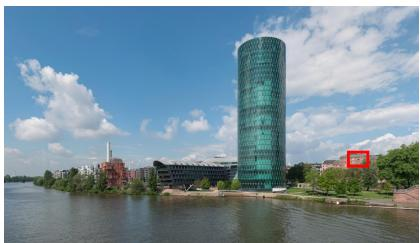

<table><tr><td>Model</td><td>Base</td><td>Vision-OPD</td><td>OPD-V</td><td>CV-OPD</td><td>VAD</td><td>OPD-Aha</td><td>BlinkOPD (ours)</td></tr><tr><td>Answer</td><td>CX</td><td>AX</td><td>DX</td><td>CX</td><td>DX</td><td>DX</td><td>B√</td></tr></table>

<table><tr><td>Model</td><td>Base</td><td>Vision-OPD</td><td>OPD-V</td><td>CV-OPD</td><td>VAD</td><td>OPD-Aha</td><td>BlinkOPD (ours)</td></tr><tr><td>Answer</td><td>AX</td><td>CX</td><td>CX</td><td>CX</td><td>CX</td><td>CX</td><td>B√</td></tr></table>

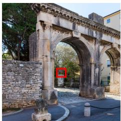

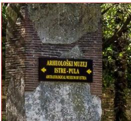

<table><tr><td>Model</td><td>Base</td><td>Vision-OPD</td><td>OPD-V</td><td>CV-OPD</td><td>VAD</td><td>OPD-Aha</td><td>BlinkOPD (ours)</td></tr><tr><td>Answer</td><td>DX</td><td>DX</td><td>DX</td><td>DX</td><td>DX</td><td>DX</td><td>C√</td></tr></table>

Figure 11. Qualitative examples of fine-grained perception. Left: the test image; the red box marks the region that the question refers to and is drawn only for this figure, since all models see the original image. Middle: the boxed region, enlarged. Right: the question, its options and the ground truth. Bottom: the answer of each model (✓ correct, ✗ wrong).

<table><tr><td>Model</td><td>Base</td><td>Vision-OPD</td><td>OPD-V</td><td>CV-OPD</td><td>VAD</td><td>OPD-Aha</td><td>BlinkOPD (ours)</td></tr><tr><td>Answer</td><td>(b) x</td><td>(b) x</td><td>(b) x</td><td>(b) x</td><td>(b) x</td><td>(b) x</td><td>(a)√</td></tr></table>

<table><tr><td>Model</td><td>Base</td><td>Vision-OPD</td><td>OPD-V</td><td>CV-OPD</td><td>VAD</td><td>OPD-Aha</td><td>BlinkOPD (ours)</td></tr><tr><td>Answer</td><td>(b) x</td><td>(b) x</td><td>(b) ×</td><td>(b) x</td><td>(b) x</td><td>(b) ×x</td><td>(a)√</td></tr></table>

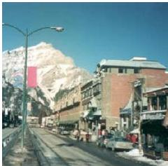

<table><tr><td>Model</td><td>Base</td><td>Vision-OPD</td><td>OPD-V</td><td>CV-OPD</td><td>VAD</td><td>OPD-Aha</td><td>BlinkOPD (ours)</td></tr><tr><td>Answer</td><td>AX</td><td>AX</td><td>AX</td><td>AX</td><td>AX</td><td>AX</td><td>D√</td></tr></table>

<table><tr><td>Model</td><td>Base</td><td>Vision-OPD</td><td>OPD-V</td><td>CV-OPD</td><td>VAD</td><td>OPD-Aha</td><td>BlinkOPD (ours)</td></tr><tr><td>Answer</td><td>(b) x</td><td>(b) x</td><td>(b) x</td><td>(b) x</td><td>(b) x</td><td>(b) x</td><td>(a)√</td></tr></table>

Figure 12. Qualitative examples of general perception. Left: the test image. Right: the question, its options and the ground truth. Bottom: the answer of each model (✓ correct, ✗ wrong).

<table><tr><td colspan="10">(a) HallusionBench. The image shows a color illusion. Are two circles in the image different color?  Ground truth: Yes</td></tr><tr><td>Model Answer</td><td>Base</td><td colspan="2">Vision-OPD No X</td><td>OPD-V</td><td>CV-OPD</td><td>VAD</td><td>OPD-Aha</td><td>BlinkOPD (ours)</td><td></td></tr><tr><td colspan="2"></td><td colspan="2">No X</td><td>No x</td><td>No X</td><td>No X</td><td></td><td>No X</td><td>Yes √</td></tr><tr><td colspan="2">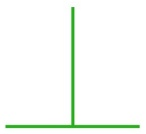</td><td colspan="8">(b) HallusionBench. Are the lengths of the vertical line and the horizontal line the same? Ground truth: Yes</td></tr><tr><td>Model Answer</td><td colspan="2">Base No X</td><td colspan="2">Vision-OPD No X</td><td>OPD-V No X</td><td>CV-OPD No x</td><td>VAD No X</td><td>OPD-Aha No X</td><td>BlinkOPD (ours)</td></tr><tr><td colspan="2"></td><td colspan="2"></td><td></td><td></td><td></td><td></td><td></td><td>Yes √</td></tr><tr><td></td><td colspan="3">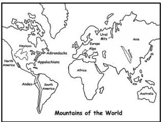</td><td colspan="8">(c) HallusionBench. Based on the map, are the Rocky Mountains located in North America? Ground truth: No</td></tr><tr><td>Model Answer</td><td></td><td>Base Yes X</td><td colspan="2">Vision-OPD Yes X</td><td>OPD-V Yes X</td><td>CV-OPD Yes X</td><td>VAD No√</td><td>OPD-Aha Yes X</td><td></td><td>BlinkOPD (ours) No √</td></tr><tr><td></td><td></td><td></td><td colspan="2"></td><td></td><td></td><td></td><td></td><td></td><td></td></tr><tr><td colspan="10">(d) HallusionBench. Is there a Snoopy in this figure?  Ground truth: No</td></tr><tr><td>Model</td><td></td><td>Base</td><td>Vision-OPD</td><td></td><td>OPD-V</td><td>CV-OPD</td><td>VAD</td><td></td><td>OPD-Aha</td><td>BlinkOPD (ours)</td></tr><tr><td>Answer</td><td>No√</td><td></td><td>Yes X</td><td>Yes X</td><td>Yes X</td><td></td><td>Yes X</td><td>Yes X</td><td></td><td>No √</td></tr></table>

Figure 13. Qualitative examples of hallucination. The layout is the same as in Fig. 12.

<table><tr><td></td><td></td><td>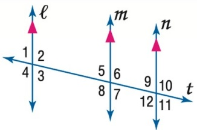</td><td></td><td>of angle 6. A.75 B.85 Ground truth: D. 105</td><td>C.95 D.105</td><td></td><td>(a) MathVista. In the figure, the measure of angle 9 is 75°. Find the measure</td><td></td></tr><tr><td>Model</td><td>Base</td><td>Vision-OPD</td><td></td><td>OPD-V AX</td><td>CV-OPD AX</td><td>VAD</td><td>OPD-Aha</td><td>BlinkOPD (ours)</td></tr><tr><td>Answer</td><td>AX</td><td></td><td>AX</td><td></td><td></td><td>AX</td><td>AX</td><td>D√</td></tr><tr><td>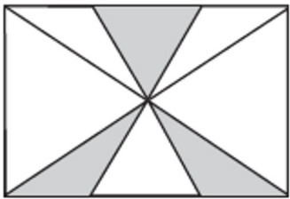</td><td></td><td></td><td></td><td>Ground truth: B. 1/4</td><td>A.3/8 B.1/4 C.1/8 D.1/10 E.1/16</td><td></td><td>(b) MathVerse. What fraction of the area of the figure is shaded?</td><td></td></tr><tr><td>Model Answer AX</td><td>Base</td><td>Vision-OPD</td><td></td><td>OPD-V AX</td><td>CV-OPD AX</td><td>VAD AX</td><td>OPD-Aha</td><td>BlinkOPD (ours)</td></tr><tr><td></td><td></td><td></td><td>AX</td><td></td><td></td><td></td><td>AX</td><td>B√</td></tr><tr><td colspan="7">(c) MATH-Vision. The higher someone stands on the podium, the better the ranking. Which number got third place? 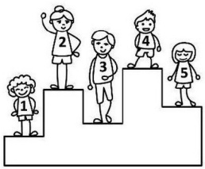 Ground truth: 5</td><td></td><td></td></tr><tr><td>Answer</td><td>Base 4X</td><td>3X</td><td>Vision-OPD</td><td>OPD-V 3X</td><td>CV-OPD 3X</td><td>VAD 3X</td><td>OPD-Aha 3X</td><td>BlinkOPD (ours) 5√</td></tr><tr><td></td><td></td><td></td><td></td><td></td><td></td><td></td><td></td><td>(d) We-Math. As shown in the diagram, Xiaoxue used a set of triangular</td></tr><tr><td></td><td>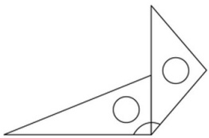</td><td></td><td></td><td>A.105° C.  $1 2 0 ^ { \circ }$  Ground truth: B. 135°</td><td>B.135° D. No correct answer</td><td></td><td></td><td></td></tr><tr><td>Model</td><td>Base Vision-OPD</td><td></td><td>OPD-V</td><td></td><td>CV-OPD</td><td>VAD</td><td>OPD-Aha</td><td>BlinkOPD (ours)</td></tr><tr><td>Answer</td><td>AX</td><td>AX</td><td>AX</td><td></td><td>AX</td><td>AX</td><td>AX</td><td>B√</td></tr></table>

Figure 14. Qualitative examples of multimodal reasoning. The layout is the same as in Fig. 12.

## References

[44] Mohammad Sadegh Akhondzadeh, Vijay Lingam, Atula Tejaswi, Chanakya Ekbote, Sujay Sanghavi, and Aleksandar Bojchevski. Reward-gated on-policy distillation. In Workshop on Efficient Reasoning at the Conference on Language Modeling (COLM), 2026. 17

[45] Siyuan Gan, Yuhan Li, Xiran Wang, Linjian Meng, Boyan Wang, Zhen Zhao, Jing Huo, and Yang Gao. When teacher guidance misleads: Reward-aligned on-policy distillation. arXiv preprint arXiv:2608.27960, 2026.

[46] Langlin Huang, Hao Liu, Mononito Goswami, Xinyu Li, Prithwish Jana, Nikos Kanakaris, Patrick Blobaum, and Purak Jain. On the¨ off-policy teacher in on-policy distillation. arXiv preprint arXiv:2609.38360, 2026. 17

[47] Xin Lai, Junyi Li, Wei Li, Tao Liu, Tianjian Li, and Hengshuang Zhao. Mini-o3: Scaling up reasoning patterns and interaction turns for visual search. In International Conference on Learning Representations (ICLR), 2026. 17

[48] Haozhan Shen, Kangjia Zhao, Tiancheng Zhao, Ruochen Xu, Zilun Zhang, Mingwei Zhu, and Jianwei Yin. ZoomEye: Enhancing multimodal LLMs with human-like zooming capabilities through tree-based image exploration. In Proceedings of the 2025 Conference on Empirical Methods in Natural Language Processing, pages 6602–6618, 2025. 17

[49] Guangming Sheng, Chi Zhang, Zilingfeng Ye, Xibin Wu, Wang Zhang, Ru Zhang, Yanghua Peng, Haibin Lin, and Chuan Wu. HybridFlow: A flexible and efficient RLHF framework. In Proceedings ofthe Twentieth European Conference on Computer Systems, pages 1279–1297, 2025. 13

[50] Alex Su, Haozhe Wang, Weiming Ren, Fangzhen Lin, and Wenhu Chen. Pixel Reasoner: Incentivizing pixel space reasoning via curiosity-driven reinforcement learning. In Advances in Neural Information Processing Systems, pages 8222–8251, 2025. 17

[51] Peng Wang, Shuai Bai, Sinan Tan, Shijie Wang, Zhihao Fan, Jinze Bai, Keqin Chen, Xuejing Liu, Jialin Wang, Wenbin Ge, et al. Qwen2-VL: Enhancing vision-language model’s perception of the world at any resolution. arXiv preprint arXiv:2409.12191, 2024. 13

[52] Songlin Yang, Jan Kautz, and Ali Hatamizadeh. Gated delta networks: Improving Mamba2 with delta rule. In International Conference on Learning Representations (ICLR), 2025. 14

[53] Jiarui Zhang, Mahyar Khayatkhoei, Prateek Chhikara, and Filip Ilievski. MLLMs know where to look: Training-free perception of small visual details with multimodal LLMs. In International Conference on Learning Representations (ICLR), 2025. 17