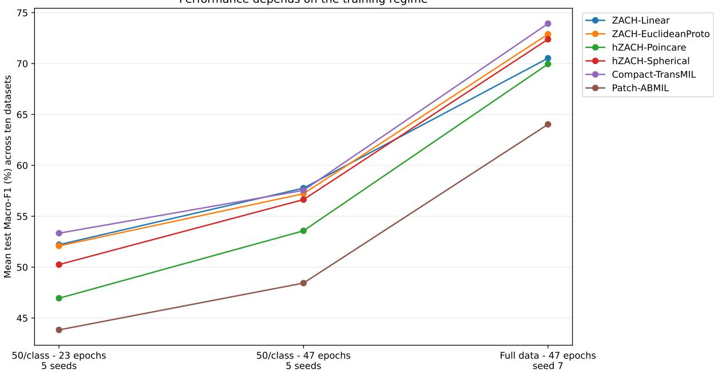
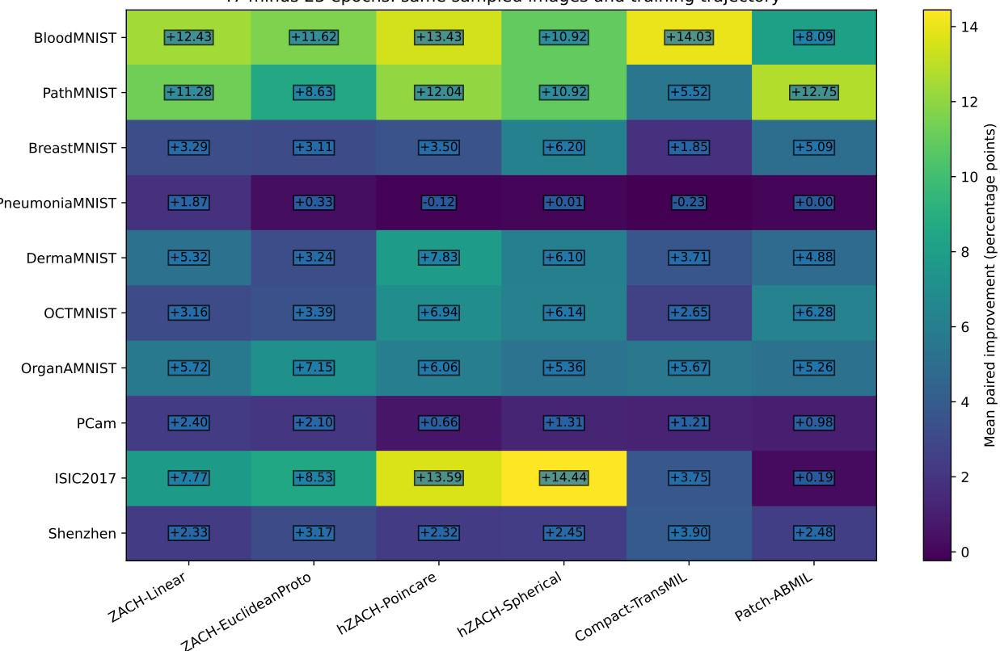
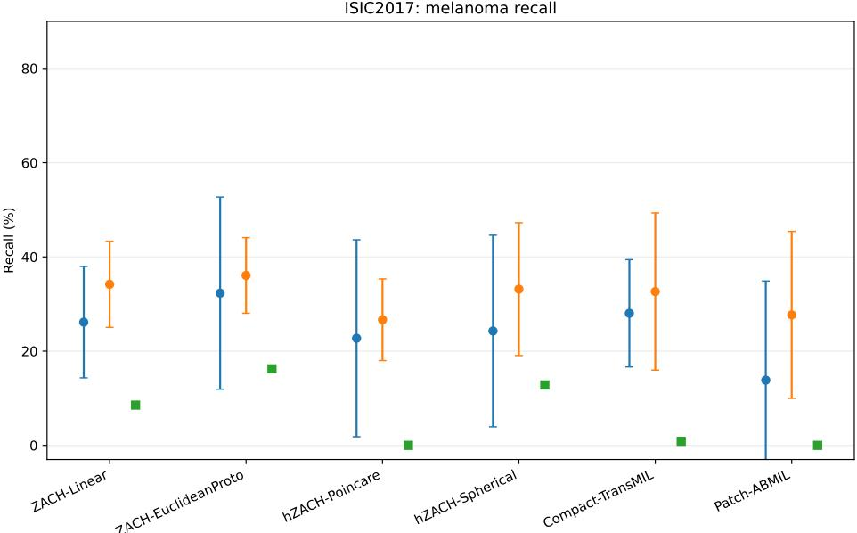
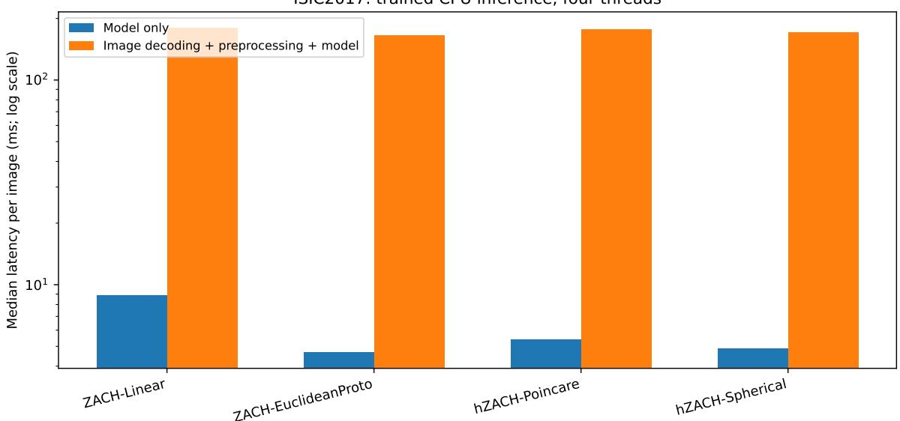

# Towards Democratising Low-Data Medical Image Classification: CPU-Trainable ZACH-ViT and Its Geometric Variants

Athanasios Angelakis

BioML Lab, Research Institute CODE, UniBw, Munich, Germany Amsterdam UMC, University of Amsterdam, Amsterdam, Netherlands athanasios.angelakis@unibw.de

12 November 2026

## Abstract

The translation of medical image analysis into resource-constrained environments is frequently bottlenecked by scarce annotated data and limited computational hardware. While large pretrained backbones dominate when suficient labels and accelerators are available, they obscure a more fundamental question: what can be learned from scratch under strict data and compute budgets? Building on the ZACH-ViT architecture and its geometric prototype heads, we investigate whether a family of compact, scratch-trained models remains competitive beyond the MedMNIST suite, and we explicitly quantify the overhead of CPU-only execution. We evaluate four ZACH variants alongside two compact multiple-instance-learning baselines across seven 224-resolution MedMNIST+ datasets and three external benchmarks: PatchCamelyon (PCam), ISIC2017, and Shenzhen tuberculosis chest radiographs. All six configurations are constrained to fewer than 260,000 instantiated trainable parameters (maximum 259,467). Our balanced low-data protocol allocates 50 training images per class, utilises five fixed random seeds, and selects validation-based checkpoints within 23- and 47-epoch budgets; a separate 47-epoch full-data reference relies on a single seed. At the 23-epoch few-shot budget, Compact-TransMIL achieves the highest ten-dataset mean test Macro-F1 (53.34%). Extending the budget to 47 epochs sees ZACH-Linear narrowly take the lead (57.76% versus 57.54%), though Compact-TransMIL dominates the single-seed full-data reference (73.93%). Increasing the few-shot training budget improves test Macro-F1 in 239 of 300 paired model-dataset-seed comparisons. On ISIC2017, hZACH-Spherical leads the 47-epoch few-shot comparison (44.09% ± 4.09%), whereas ZACH-EuclideanProto leads the full-data reference (51.27%). In a dedicated CPU-only study, the four ZACH heads complete 40 matched five-seed training runs on ISIC2017 and Shenzhen using four CPU threads. Trained single-image, model-only inference requires approximately 4-9 ms, though image decoding and preprocessing substantially inflate end-to-end latency. These results provide controlled evidence for low-data competitiveness and practical CPU execution, while demonstrating that architecture, training budget, class balance, and preprocessing collectively dictate the accessibility-accuracy trade-of.

Keywords: ZACH-ViT; compact vision transformers; low-data medical imaging; CPU-only training;   
Edge AI; geometric prototype heads; model eficiency; reproducibility.

## 1 Introduction

Medical image analysis is fundamentally constrained by two distinct resources: labelled examples and computational capacity. Large pretrained visual backbones can be highly efective when appropriate weights and hardware accelerators are available, but they do not address the more foundational question of what can be learned from scratch using few annotated cases and a minimal computational footprint. Earlier work on compact transformers established data and parameter eficiency as explicit architectural objectives [Hassani et al., 2021]. However, the term accessible AI is only meaningful if tied to measurable properties: the number of labels used for training, instantiated model parameters, training time, memory footprint, inference latency, and the often-overlooked cost of image preprocessing.

ZACH-ViT was previously introduced as a compact vision transformer that eschews learned positional embeddings and dedicated class tokens, relying instead on global averaging over patch tokens and adaptive residual projections [Angelakis, 2026c]. Its geometric extensions replace the standard final classifier with Euclidean or curved prototype heads [Angelakis, 2026a]. Subsequent investigations have explored clean-versus-adversarial behaviour, corruption sensitivity, geometric boundary efects, and quantized deployment [Angelakis and Gomez-Barrero, 2026d,c, Angelakis, 2026b]. These prior studies establish the architecture and its boundaries; the present paper does not claim to introduce ZACH-ViT or its geometric heads anew.

The original clean-performance evaluation focused exclusively on seven MedMNIST datasets under a fixed 50-per-class protocol. A critical remaining question is how these compact architectures perform across diverse medical imaging benchmarks, under extended training budgets, and when trained entirely without GPU acceleration. To address this, we study ten datasets, incorporating three additional classification benchmarks with distinct image sources: PCam histopathology patches, ISIC2017 dermoscopy images, and Shenzhen radiographs. Rather than comparing against unrestricted pretrained systems, we constrain all evaluated models to a strict sub-0.26-millionparameter regime. This is a deliberately narrow, resource-conditioned comparison, not a claim of unrestricted state-of-the-art performance.

We structure our contributions around four main axes:

(i) Beyond-MedMNIST evaluation. A ten-dataset, 224×224 benchmark comprising four canonical ZACH classifier heads and two compact MIL-inspired baselines, all trained from scratch under an identical parameter ceiling.

(ii) Low-data budget analysis. Five seed-matched 50-per-class training subsets per dataset, yielding 23- and 47-epoch validation-selected checkpoints from a single 47-epoch trajectory, alongside separately reported exact-epoch controls.

(iii) Explicit regime and failure analysis. A single-seed full-training-data reference, per-class recall checks, known dataset-integrity flags, and transparent accounting for unequal training updates and class balance.

(iv) Measured CPU feasibility. Forty additional CPU-only real-data training runs of the four ZACH heads, combined with six-model synthetic resource profiles and trained-model inference timings that explicitly separate model execution from input decoding.

The central finding of this work is regime dependence, not universal dominance. The ZACH family remains competitive across the new tasks, exhibiting head-dependent gains on specific datasets, while one compact comparator leads the full-data aggregate. Furthermore, our CPU measurements reveal that minimising network weights does not eliminate the cost of decoding high-resolution images or the baseline memory footprint of the Python/PyTorch runtime.

## 2 Position relative to preceding work

The original ZACH-ViT paper introduced a position-free backbone without a dedicated class token, arguing that inductive bias must be evaluated within specific data regimes [Angelakis, 2026c]. The subsequent hZACH study introduced Poincaré, Klein, and spherical prototypes, revealing curvature- and task-dependent behaviours [Angelakis, 2026a]. A CVPR workshop study on robustness reported clean, corruption, and adversarial comparisons specifically on MedMNIST [Angelakis and Gomez-Barrero, 2026d].

Accepted work at NeurReps demonstrated that, at a fixed curvature of c = 1, apparent hyperbolic robustness can coincide with boundary saturation and degraded clean Macro-F1; altering the curvature materially shifts these outcomes [Angelakis and Gomez-Barrero, 2026c]. Consequently, we interpret the present fixed-c results as observations specific to this implementation, rather than a definitive proof regarding all hyperbolic representations.

The qZACH study explored quantization-aware optimisation and executable mixed-precision ONNX inference [Angelakis, 2026b]. While it provides prior evidence for an eficient deployment pathway, the CPU measurements in the current study utilise standard FP32 models, not the qZACH quantized graphs. Related compact-model research focusing on iris presentation attack detection and ECG-derived images extends this research programme to sensing and biometric recognition [Angelakis and Gomez-Barrero, 2026b,a]; however, those applications fall outside the scope of the ten medical-image classification datasets analysed here.

The two compact comparator implementations, Compact-TransMIL and Patch-ABMIL, are parameter-constrained variants motivated by correlated MIL and attention-based MIL, respectively [Shao et al., 2021, Ilse et al., 2018]. They should not be interpreted as identical parameterizations of the unrestricted original architectures, nor as external state-of-the-art reference results. All six implementations are evaluated under a unified image-classification protocol.

## 2.1 Connection to low-label learning and compact representations

The term few-shot encompasses several distinct learning paradigms. Matching Networks, Prototypical Networks, and model-agnostic meta-learning were primarily developed to adapt to tasks or classes with minimal examples [Vinyals et al., 2016, Snell et al., 2017, Finn et al., 2017]. More controlled evaluations have shown that simpler supervised baselines can remain highly competitive, emphasising that backbone and evaluation choices heavily influence outcomes [Chen et al., 2019]. Our protocol diverges from episodic novel-class adaptation: every model is trained from scratch on a fixed set of classes, utilising exactly 50 labelled training images per class. Thus, the comparison tests low-label within-task classification rather than meta-learned transfer to unseen classes, and it does not claim to outperform episodic few-shot methods under their native evaluation protocols.

Transformer self-attention was originally formulated as an alternative to recurrent sequence processing [Vaswani et al., 2017], with ViT subsequently adapting it for image patches [Dosovitskiy et al., 2021]. Compact Convolutional Transformers proved that significantly smaller transformer systems can perform efectively when data and compute are restricted [Hassani et al., 2021]. In parallel, Deep Sets and Set Transformer formalized permutation-invariant designs for instance collections [Zaheer et al., 2017, Lee et al., 2019]. These foundations motivate our examination of compact, position-free patch processing, though we do not claim that removing positional embeddings is universally beneficial, nor that our architecture is a direct implementation of either set-learning framework.

Prototype heads introduce an additional representational choice. Prototypical Networks ofer a foundational metric-learning formulation [Snell et al., 2017], while Poincaré embeddings and hyperbolic neural networks provide established non-Euclidean alternatives [Nickel and Kiela, 2017, Ganea et al., 2018]. Hyperbolic image embeddings further justify geometric representations for visual tasks [Khrulkov et al., 2020]. The fixed-c results reported here reflect observations about the implemented heads, not a comprehensive test of all hyperbolic optimisation methods. The preceding NeurReps curvature analysis provides a vital control for interpreting these observations [Angelakis and Gomez-Barrero, 2026c].

Resource-limited learning also intersects with a broader systems literature. MobileNetV3 was engineered around mobile-device runtime constraints [Howard et al., 2019]; MCUNet jointly optimizes architecture and runtime memory for microcontroller targets [Lin et al., 2020]; and MLPerf Tiny emphasises reproducible measurements of accuracy, latency, and energy [Banbury et al., 2021]. Quantization-aware integer inference ofers another eficient deployment route [Jacob et al., 2018].

We cite these as deployment context, not as models or hardware configurations evaluated in our experiments. Specifically, our study measures FP32 CPU execution on a documented high-memory workstation and does not measure device power or microcontroller feasibility.

## 3 Materials and methods

## 3.1 Datasets and split definitions

Table 1 details the ten datasets evaluated in this study. Seven utilise the oficial 224-resolution MedMNIST+ resources, rather than the original 28 × 28 archives resized at load time [Yang et al., 2023, MedMNIST Team, 2024]. The external tasks comprise PCam histopathology patch classification [Veeling et al., 2018], ISIC2017 three-class skin lesion classification [Codella et al., 2017], and the Shenzhen tuberculosis chest-radiograph set [Jaeger et al., 2014]. All inputs supplied to the networks are RGB tensors of spatial size $2 2 4 \times 2 2 4 .$ , scaled to [0, 1]. For images not originally 224 × 224, resizing employs bilinear interpolation. No ImageNet feature normalisation or image augmentation is introduced in this fixed protocol.

Table 1: Summary of the ten datasets, including split sizes and efective sample counts. Oficial partitions are retained, with the exception of the stated ISIC2017 duplicate exclusions. The low-label training subset consists of 50 images per class.
<table><tr><td>Dataset</td><td>Classes</td><td>Train</td><td>Val.</td><td>Test</td><td>50/class</td></tr><tr><td>BloodMNIST</td><td>8</td><td>11,959</td><td>1,712</td><td>3,421</td><td>400</td></tr><tr><td>PathMNIST</td><td>9</td><td>89,996</td><td>10,004</td><td>7,180</td><td>450</td></tr><tr><td>BreastMNIST</td><td>2</td><td>546</td><td>78</td><td>156</td><td>100</td></tr><tr><td>PneumoniaMNIST</td><td>2</td><td>4,708</td><td>524</td><td>624</td><td>100</td></tr><tr><td>DermaMNIST</td><td>7</td><td>7,007</td><td>1,003</td><td>2,005</td><td>350</td></tr><tr><td>OCTMNIST</td><td>4</td><td>97,477</td><td>10,832</td><td>1,000</td><td>200</td></tr><tr><td>OrganAMNIST</td><td>11</td><td>34,561</td><td>6,491</td><td>17,778</td><td>550</td></tr><tr><td>PCam</td><td>2</td><td>262,144</td><td>32,768</td><td>32,768</td><td>100</td></tr><tr><td>ISIC2017</td><td>3</td><td>1,997</td><td>149</td><td>600</td><td>150</td></tr><tr><td>Shenzhen</td><td>2</td><td>422</td><td>107</td><td>133</td><td>100</td></tr></table>

We retain PCam’s oficial HDF5 train/validation/test partitions. Shenzhen utilises the fixed default split from the original Idiap bob.med.tb protocol rather than a newly generated partition. For ISIC2017, comparison of decoded images revealed identical instances across nominal partitions. We excluded the overlapping training and validation images while preserving the original test set, yielding 1,997 training and 149 validation images. Duplicate images also occur within the test set, meaning its observations are not fully independent. BreastMNIST contains a pixel-identical train-test pair with conflicting labels; we retain the published partitions and explicitly acknowledge this data-quality limitation.

## 3.2 Model family and compact baselines

Following Angelakis [2026c], each ZACH backbone converts a 224 × 224 × 3 image into 196 nonoverlapping 16 × 16 RGB patch vectors. A shared embedding layer projects each patch into 128 dimensions. Two self-attention/residual blocks use eight heads and transformer-unit widths of 128 and 64; global average pooling yields an order-invariant patch-set summary before a small MLP and the final classifier. Unlike a standard ViT [Dosovitskiy et al., 2021], the model lacks both a positional embedding and a dedicated class token. Adaptive residual projections are initialized with Glorot-uniform weights and zero biases.

The four shared-feature models difer solely in their classifier head:

• ZACH-Linear: an ordinary learned linear classifier;

• ZACH-EuclideanProto: a Euclidean prototype classifier with a learned positive distance scale;

• hZACH-Poincare: a Poincaré-ball prototype classifier using fixed $c = 1$ and the specified exponential-style map, equipped with boundary safeguards;

• hZACH-Spherical: a spherical prototype classifier using fixed $c = 1$ and normalised spherical coordinates.

For a pooled representation z and class prototypes $p _ { k }$ , the prototype logits are formulated schematically as:

$$
\ell _ { k } = - \operatorname* { m a x } ( s , 1 0 ^ { - 3 } ) d _ { \mathcal { M } } ( \phi _ { \mathcal { M } } ( z ) , \phi _ { \mathcal { M } } ( p _ { k } ) ) ,\tag{1}
$$

where M identifies the Euclidean, Poincaré, or spherical head, and $\phi _ { { \mathcal { M } } }$ is the corresponding headspecific map. The Euclidean implementation uses an unsquared $\ell _ { 2 }$ distance; for binary classification, the two prototype logits are diferenced to form a single sigmoid logit. The geometric scale and safeguards are not reoptimised in this benchmark. As in the NeurReps study, the four ZACH heads share the same seed-specific feature initialization and selected training subset.

Table 2: Instantiated trainable parameters across all evaluated class counts. The maxima refer to the 11-class configuration; all models remain below 260,000 parameters. Some prototype wrappers retain a non-executed legacy output layer, meaning active-forward parameter counts can be lower than the instantiated counts.
<table><tr><td>Model</td><td>Minimum</td><td>Maximum</td></tr><tr><td>ZACH-Linear</td><td>248,257</td><td>248,907</td></tr><tr><td>ZACH-EuclideanProto</td><td>248,386</td><td>249,612</td></tr><tr><td>hZACH-Poincare</td><td>248,386</td><td>249,612</td></tr><tr><td>hZACH-Spherical</td><td>248,386</td><td>249,612</td></tr><tr><td>Compact-TransMIL</td><td>258,306</td><td>259,467</td></tr><tr><td>Patch-ABMIL</td><td>92,290</td><td>93,451</td></tr></table>

## 3.3 Few-shot and full-data optimisation

For each dataset and seed $r \in \{ 3 , 5 , 7 , 1 1 , 1 3 \}$ , the low-label sampler operates exclusively on the training rows. It uses np.random.RandomState(r), draws 50 samples without replacement from each class in ascending class order, concatenates the selected indices, and shufles the concatenation. All six models observe identical chosen rows and row orders for a given dataset-seed pair. The remaining validation and test samples retain their specified partitions.

Every low-label run trains for 47 epochs using Adam (learning rate $1 0 ^ { - 4 } , \epsilon = 1 0 ^ { - 8 }$ , zero weight decay), a batch size of 16, no learning-rate scheduler, and the canonical unweighted binary BCE or multiclass cross-entropy loss. Training utilises neither pretrained weights nor teacher supervision. At both budget boundaries $B \in \{ 2 3 , 4 7 \}$ , we record (a) the actual model state at epoch $B ,$ and (b) the best checkpoint selected from epochs $1 , \ldots , B$ by validation Macro-F1; ties within $1 0 ^ { - 1 2 }$ are broken by lower unweighted validation loss. The test set is evaluated only after the checkpoint is frozen.

The primary 50-per-class comparisons use the budget-specific validation-selected checkpoint; exactepoch results are reported separately. Five seeds yield

$$
1 0 ~ { \mathrm { d a t a s e t s } } \times 6 ~ { \mathrm { m o d e l s } } \times 5 ~ { \mathrm { s e e d s } } = 3 0 0
$$

training trajectories, not 600. The full-data condition contains an additional 60 runs (10 datasets $\times \ 6$ models × one seed, seed 7), also trained for 47 epochs with the same optimiser and validation selection. Full-data comparisons serve as descriptive single-seed references: increasing the sample count alters class proportions, the number of minibatches per epoch, and the total optimiser updates.

## 3.4 Outcomes and analysis

The primary outcome is test macro-averaged F1:

$$
\mathrm { M a c r o F 1 } = \frac { 1 } { K } \sum _ { k = 1 } ^ { K } \frac { 2 P _ { k } R _ { k } } { P _ { k } + R _ { k } } ,\tag{2}
$$

with zero contribution when precision and recall are undefined. Few-shot results are reported as mean ± sample standard deviation across the five subset/model seeds. For across-dataset summaries, each dataset contributes equal weight after seed averaging. Average ranks are computed at full numerical precision within each dataset. The highest test score is used solely to describe dataset winners among already validation-selected checkpoints; it is not a training-time selection criterion.

Secondary metrics include balanced accuracy, class-specific recall, continuous-score AUROC, and a separately labelled legacy AUROC computed from hard decisions at threshold 0.5 for binary tasks. The latter coincides with binary balanced accuracy when both classes are present and must not be confused with probability-based discrimination. We do not claim inferential significance for small numerical diferences between models.

## 3.5 CPU-only study

A separate resource study uses the same model implementations and ISIC2017/Shenzhen data partitions. The six implementations are profiled on synthetic tensors at batch sizes 1 and 16, across diferent class counts and 1/4/8 CPU threads. The real-data CPU-training experiment comprises the four ZACH heads, two datasets, and five seeds (40 fits), again using 50 images per class and 47 epochs. It preserves the 23- and 47-epoch evaluations while logging cumulative train-plus-validation time, process high-water memory, stored weight size, and trained-model inference latency. Both tensor-only inference and image decoding/resizing plus inference are timed, under ordinary operating-system caching.

Workers run in FP32 eager PyTorch [Paszke et al., 2019] with CUDA hidden and uninitialized. On the observed host—a Linux system with an Intel Xeon Gold 6248R 3.00 GHz processor, 56 physical cores visible, and approximately 503.9 GiB installed RAM—actual CPU training was constrained to four intra-operation threads. This is not a consumer laptop study and does not measure energy. CPU weight files are small, but process RSS includes interpreter/runtime allocations, preprocessing, and intermediate activations. The CPU study is analysed separately from the primary benchmark rather than pooled as additional random-seed replicates.

## 4 Results

## 4.1 Aggregate behaviour depends on training regime

As summarized in Table 3 and Figure 1, the ten-dataset comparison reveals high sensitivity to the training regime. At the 23-epoch few-shot budget, Compact-TransMIL leads the descriptive average (53.34% Macro-F1; mean rank 2.20). After 47 few-shot epochs, ZACH-Linear leads by a marginal 0.22 percentage points (57.76% versus 57.54%; mean ranks 2.50 versus 2.90). This margin is narrow, and the seed-level advantage changes sign in three of the five seeds. Notably, the literal epoch-47 endpoint, as opposed to validation selection, favours Compact-TransMIL (57.28% versus 56.14%). The full-data seed-7 reference is led by Compact-TransMIL (73.93%; mean rank 1.80). These observations reject the notion of a universal winner while supporting the competitive low-data performance of the ZACH family.

Table 3: Mean test Macro-F1 (%) across the ten datasets. Few-shot conditions report the average over five seeds per dataset, whereas the full-data condition uses seed 7 exclusively. Within-dataset ranks are indicated in parentheses. All reported checkpoints were selected based on validation Macro-F1 within the specified epoch budget.
<table><tr><td>Model</td><td>50/class, 23</td><td>50/class, 47</td><td>Full, 47</td></tr><tr><td>ZACH-Linear</td><td>52.21 (2.80)</td><td>57.76 (2.50)</td><td>70.53 (4.00)</td></tr><tr><td>ZACH-EuclideanProto</td><td>52.09 (2.90)</td><td>57.21 (3.00)</td><td>72.88 (3.10)</td></tr><tr><td>hZACH-Poincare</td><td>46.95 (5.00)</td><td>53.57 (4.50)</td><td>69.95 (4.05)</td></tr><tr><td>hZACH-Spherical</td><td>50.25 (4.00)</td><td>56.64 (3.50)</td><td>72.39 (3.35)</td></tr><tr><td>Compact-TransMIL</td><td>53.34 (2.20)</td><td>57.54 (2.90)</td><td>73.93 (1.80)</td></tr><tr><td>Patch-ABMIL</td><td>43.84 (4.10)</td><td>48.44 (4.60)</td><td>64.03 (4.70)</td></tr></table>

Performance depends on the training regime  
  
Validation-selected checkpoints. Full data has one seed; five-seed few-shot means are descriptive comparators.  
Figure 1: Mean test Macro-F1 across ten datasets under two five-seed low-label training budgets and one single-seed full-data condition. Connecting lines summarize distinct experimental conditions, not continuous learning curves; no between-seed variability is available for the full data.

## 4.2 Additional benchmarks beyond MedMNIST

Table 4 highlights performance on the three additional datasets. In the 47-epoch few-shot setting, ZACH-Linear and Compact-TransMIL are virtually tied on PCam (71.14% versus 71.13%); hZACH-Spherical achieves the highest ISIC2017 mean $( 4 4 . 0 9 \% \pm 4 . 0 9 \% )$ ; and ZACH-EuclideanProto closely matches Compact-TransMIL on Shenzhen (79.71% versus 79.74%). The PCam and Shenzhen margins are each below 0.04 percentage points, rendering categorical superiority claims unjustified. Under full-data training, Patch-ABMIL leads PCam (81.68%), ZACH-EuclideanProto leads ISIC2017 (51.27%), and Compact-TransMIL leads Shenzhen (85.71%). In this sense, the ZACH family extends competitively beyond MedMNIST, but no single head dominates across all regimes or data sources.

Table 4: Observed dataset-level winners and test Macro-F1 (%) on the three additional medical-image benchmarks. Few-shot winners are based on five-seed means; full-data winners on seed 7. These are descriptive rankings, not claims of statistical superiority.
<table><tr><td>Dataset</td><td>Regime and observed winner</td><td>Score</td></tr><tr><td rowspan="2">PCam</td><td>50/class 23: Patch-ABMIL</td><td>69.96</td></tr><tr><td>50/class 47: ZACH-Linear Full 47: Patch-ABMIL</td><td>71.14 81.68</td></tr><tr><td rowspan="3">ISIC2017</td><td>50/class 23: Compact-TransMIL</td><td>34.34</td></tr><tr><td>50/class 47: hZACH-Spherical</td><td>44.09</td></tr><tr><td>Full 47: ZACH-EuclideanProto</td><td>51.27</td></tr><tr><td rowspan="2">Shenzhen</td><td>50/class 23: hZACH-Spherical</td><td>76.58</td></tr><tr><td>50/class 47: Compact-TransMIL Full 47: Compact-TransMIL</td><td>79.74 85.71</td></tr></table>

## 4.3 Longer few-shot budgets and checkpoint selection

Extending the few-shot budget from 23 to 47 epochs increases test Macro-F1 in 239 of 300 matched model-dataset-seed evaluations, ties in 38, and decreases in 23; the mean increase is 5.42 percentage points. Fifty-seven of the 60 dataset-model five-seed means improve. Budget-specific best checkpoints fall after epoch 23 in 263 of 300 runs. At the model level, mean increases range from 4.21 points for Compact-TransMIL to 6.62 points for hZACH-Poincare (Figure 2). Improvement under validation checkpoint selection is not guaranteed on test data; the 23 negative cases remain part of the evaluation.

The original ZACH-ViT manuscript established a multiclass dificulty ordering of BloodMNIST > PathMNIST > OrganAMNIST > DermaMNIST > OCTMNIST. The same ordering is observed for ZACH-Linear at both current few-shot budgets (Spearman $\rho = 1 . 0 0$ for five tasks), whereas full-data training moves OrganAMNIST ahead of PathMNIST and OCTMNIST ahead of DermaMNIST $( \rho = 0 . 8 0 )$ . This represents pattern consistency, not an exact numerical replication: the earlier study used a TensorFlow implementation, and its stated resource/preprocessing setup is not identical to the present native-224 PyTorch protocol.

## 4.4 Class-level failures are not explained by average F1 alone

In the few-shot study, no validation-selected model-dataset-seed evaluation predicts only one class $( 0 / 6 0 0$ evaluations across the two budget conditions). However, zero recall for at least one class occurs in 49/300 evaluations at the 23-epoch budget and 9/300 at 47 epochs. At full-data scale, hZACH-Poincare collapses to predicting only the majority nevus class on the ISIC2017 test partition, despite a nontrivial probability AUROC. This case illustrates why probability discrimination and threshold-dependent class recall must be reported separately.

47 minus 23 epochs: same sampled images and training trajectory  
  
Figure 2: Within-trajectory 47-minus-23-epoch test Macro-F1 diferences across paired five-seed few-shot runs. The same sampled images and initial model seeds are used at both budgets.

On ISIC2017, melanoma recall at the 47-epoch few-shot budget is nonzero for all six models and all five seeds. The mean recall for ZACH-Linear is 34.19% versus 8.55% in its full-data seed-7 run; the corresponding values for ZACH-EuclideanProto are 36.07% versus 16.24%. This contrast is compatible with the balanced few-shot sampling regime mitigating a majority-class bias; however, it does not isolate the influence of balance from optimiser update counts, sample size, or other regime changes. The absolute recalls remain too low for clinical utility.

BreastMNIST ofers another cautionary example: every selected 47-epoch few-shot model predicts both classes, but ZACH-Linear malignant recall decreases from 56.19% to 48.10% as its Macro-F1 improves from 56.49% to 59.78%. Class-specific sensitivity should therefore accompany general performance claims.

## 4.5 Measured CPU-only training

Table 5 details the 40 CPU-only real-data runs. Each uses five independent training/subset seeds; ZACH-EuclideanProto achieves the highest observed 47-epoch CPU mean Macro-F1 on both ISIC2017 (42.04%) and Shenzhen (79.15%). From 23 to 47 epochs, 34 of the 40 matched model-dataset-seed evaluations improve, two tie, and four decline. The CPU-only results are reported separately from the main benchmark because execution conditions difer; the repeated use of the same five seeds does not provide additional independent replicates.

The 40 runs accumulated 25.86 hours of training plus validation (sum across separate jobs), excluding checkpoint saving and final frozen test evaluation. Among runs executed from epoch 1, median total wall time was approximately 69.0 minutes for ISIC2017 and 29.9 minutes for Shenzhen. Median cumulative train-plus-validation time was approximately 51.0 and 27.3 minutes per run, respectively. This distinction reflects checkpoint writing and final evaluation overhead.

These measurements establish that CPU-only training can complete on the reported system, but

  
Error bars: five-seed sample SD. Data reference flags retained; these are benchmark results, not clinical validation.  
Figure 3: Melanoma recall on ISIC2017 across training conditions. The figure highlights clinically relevant class-specific behaviour that can be obscured by Macro-F1; full-data estimates use only seed 7.

not that every low-power or consumer CPU would finish within a practical budget.

Table 5: CPU-only real-data training: test Macro-F1 (%), mean ± sample SD over five seeds, with four CPU threads. All four ZACH variants train from scratch using 50 images per class.
<table><tr><td></td><td colspan="2">ISIC2017</td><td colspan="2">Shenzhen</td></tr><tr><td>Model</td><td>23 epochs</td><td>47 epochs</td><td>23 epochs</td><td>47 epochs</td></tr><tr><td>ZACH-Linear</td><td> $3 5 . 5 9 \pm 3 . 2 0$ </td><td> $4 1 . 0 9 \pm 2 . 7 9$ </td><td> $7 3 . 7 4 \pm 4 . 1 5$ </td><td> $7 7 . 0 1 \pm 2 . 2 4$ </td></tr><tr><td>ZACH-EuclideanProto</td><td> $3 2 . 8 4 \pm 8 . 1 9$ </td><td> $4 2 . 0 4 \pm 3 . 8 2$ </td><td> $7 4 . 2 0 \pm 6 . 0 3$ </td><td> $7 9 . 1 5 \pm 2 . 6 6$ </td></tr><tr><td>hZACH-Poincare</td><td> $3 2 . 5 7 \pm 3 . 3 6$ </td><td> $3 6 . 8 8 \pm 7 . 0 0$ </td><td> $7 4 . 1 6 \pm 4 . 5 3$ </td><td> $7 8 . 6 3 \pm 6 . 2 7$ </td></tr><tr><td>hZACH-Spherical</td><td> $3 6 . 0 8 \pm 5 . 7 5$ </td><td> $4 1 . 6 6 \pm 4 . 4 2$ </td><td> $7 3 . 9 4 \pm 6 . 3 5$ </td><td> $7 7 . 4 9 \pm 6 . 1 7$ </td></tr></table>

## 4.6 CPU inference, storage and process-memory accounting

Table 6 reports trained-checkpoint batch-one inference with four threads. Model-only predictions typically require a few milliseconds, whereas repeated decoding/resizing and inference on original high-resolution ISIC2017/Shenzhen images takes approximately 165-220 ms. These experiments reused validation images under normal operating-system caching; they are not cold-disk service latency measurements.

Serialized FP32 ZACH-family state dictionaries occupy approximately 1 MB, whereas processmemory measurements were around 1.1-1.2 GiB across the monitored CPU jobs. These measurements reflect the Python/PyTorch runtime, intermediate allocations, and input processing, rather than the network weights alone. Synthetic architecture profiles were completed for Compact-TransMIL and Patch-ABMIL, but the present real-data CPU training experiment does not include them. Consequently, CPU-trained ZACH accuracy and wall time cannot be claimed to outperform CPU-trained baselines here.

Table 6: Trained ZACH-family CPU inference, median milliseconds per single image (batch 1; four threads). The second time column for each dataset includes image loading, decoding, and preprocessing, under repeated cached-file access.
<table><tr><td></td><td colspan="2">ISIC2017</td><td colspan="2">Shenzhen</td></tr><tr><td>Model</td><td>Model</td><td>End-to-end</td><td>Model</td><td>End-to-end</td></tr><tr><td>ZACH-Linear</td><td>8.87</td><td>179.36</td><td>4.36</td><td>188.52</td></tr><tr><td>ZACH-EuclideanProto</td><td>4.68</td><td>165.02</td><td>5.09</td><td>220.22</td></tr><tr><td>hZACH-Poincare</td><td>5.40</td><td>177.46</td><td>5.67</td><td>196.11</td></tr><tr><td>hZACH-Spherical</td><td>4.89</td><td>170.87</td><td>4.78</td><td>215.10</td></tr></table>

ISIC2017: trained CPU inference, four threads  
  
Figure 4: Trained-checkpoint inference on ISIC2017: model-only latency versus image loading, preprocessing, and inference. The gap emphasises that a small network is only one component of the medical-imaging execution pipeline.

## 5 Discussion

## 5.1 A resource-conditioned rather than unrestricted performance claim

By design, this study operates under strict resource constraints: fewer than 260,000 trainable parameters, scratch training, only 50 labels per class in the primary analysis, and no reliance on generic pretrained weights. Within those conditions, the ZACH family remains competitive on additional benchmarks beyond MedMNIST. The central inference is access to a useful model class under measured resource constraints, not superiority over large pretrained medical foundation models. The descriptive win on ISIC2017 in the few-shot regime and the prototype-head result with full data illustrate the value of treating representation geometry as a design choice, while PCam and Shenzhen demonstrate that appropriate compact alternatives can equal or exceed ZACH performance.

Simultaneously, the fixed-head comparison should be interpreted through the lens of earlier geometry analyses [Angelakis, 2026a, Angelakis and Gomez-Barrero, 2026c]. In particular, poor Poincaré clean performance at $c = 1$ does not rule out improvement at other curvature settings. We deliberately did not tune c per dataset here, because doing so would alter both the comparison scope and the fixed optimisation protocol.

## 5.2 Training budget is a scientific variable, not a reporting detail

The same few-shot images and initialization evaluated after 23 and 47 epochs yield diferent rankings. The selected-checkpoint rule also matters: the overall 47-epoch selected-checkpoint lead of ZACH-Linear does not survive when using literal epoch-47 weights. These results argue for reporting both the duration available to the optimiser and the validation-based state-selection rule. A test-dataset win table can summarize results descriptively, but it should not be used to select checkpoints or retrospectively design hyperparameters.

## 5.3 The whole pipeline defines practical accessibility

The approximately 1 MB weight files and measured millisecond-level CPU model latency are meaningful, but neither guarantees low-RAM training or point-of-care deployment. Hardwareconscious inference studies distinguish serialized parameters from activation bufers, runtime memory, and power [Lin et al., 2020, Banbury et al., 2021]. Measured process memory includes PyTorch and Python runtime allocations, while loading and resizing original high-resolution images account for much of the observed end-to-end single-image latency. Furthermore, the CPU hardware used here was a large Xeon system with extensive installed memory, even though we restricted intra-operation training to four threads. These observations support CPU-only feasibility on the tested platform and a path toward Edge AI experimentation, not energy savings, microcontroller readiness, or universal CPU compatibility. The qZACH work separately examined executable INT8 deployment [Angelakis, 2026b]; those results should not be silently attributed to the FP32 models here.

## 5.4 Operationalizing accessibility and democratisation

The intended contribution to democratising medical AI is practical rather than rhetorical. The study isolates three barriers to small-team experimentation: annotated training data (50 samples per class), model capacity (at most 259,467 instantiated parameters), and access to accelerators (demonstrated FP32 CPU-only training on a documented host). Reporting these quantities alongside model-only and end-to-end latency allows future work to evaluate which parts of the workflow are truly accessible. The large observed diference between network latency and input preparation, together with the process-memory overhead of the software stack, warns against claiming that parameter compression alone democratizes an entire clinical workflow. A broader hardware study on ordinary desktops, laptops, and low-power devices would be needed to substantiate claims about a range of real-world users. The present contribution is a resource-conditioned benchmark for further studies.

## 5.5 Relation to dataset structure and sample imbalance

The historical multiclass dificulty ranking reappears in the new few-shot experiment, suggesting a repeatable task-level pattern under the low-data regime. In full-data conditions, tasks such as OCTMNIST and OrganAMNIST improve strongly; more images also mean far more optimisation updates. On ISIC2017, balanced 50-per-class sampling improves minority-class recall relative to some full-data runs, yet absolute melanoma recall remains low. Neither aggregate Macro-F1 nor AUROC alone establishes safety or utility for skin cancer or tuberculosis screening. Source-data duplicates and known label anomalies further limit patient-level interpretations.

## 5.6 Limitations

The study has several nontrivial limitations.

(1) The full-data reference uses one seed per model-dataset combination and cannot quantify between-seed variability or support precise inference about full-data superiority.

(2) Few-shot versus full-data contrasts are not a pure data-volume intervention: class proportions, minibatch counts, and optimiser updates also change.

(3) The two compact baselines are parameter-constrained implementations, not unrestricted or necessarily best-tuned versions of the original TransMIL and ABMIL architectures.

(4) Only a fixed c = 1 Poincaré/spherical setting is tested here; prior work shows curvature sensitivity. The reported geometric rankings do not identify a generally optimal manifold.

(5) All models use 224 × 224 inputs and no augmentation or pretraining. This common protocol deliberately excludes potentially stronger task-specific pipelines.

(6) ISIC2017 contains exact-pixel duplicates across partitions; overlapping training and validation images were excluded, but the original test set retains within-test duplicates. BreastMNIST contains a conflicting pixel-identical train-test pair.

(7) The CPU study covers two datasets and only four ZACH heads for real-data CPU training; it uses a high-memory Xeon host rather than a consumer laptop or embedded board. Energy, battery life, cold-storage inference, and deployment integration remain unmeasured.

## 6 Conclusion

A strict sub-0.26M-parameter family can support meaningful scratch-trained medical-image classification under a low-data constraint, with competitive results extending to PCam, ISIC2017, and Shenzhen. The outcome is task- and training-regime-dependent: Compact-TransMIL leads the short-budget and single-seed full-data aggregates, while ZACH-Linear narrowly leads the validationselected 47-epoch few-shot aggregate; the prototype geometry is useful on particular tasks rather than uniformly better. The separate CPU experiment demonstrates completed multi-seed, 47-epoch training and millisecond-scale model-only inference, while revealing much larger image-preprocessing and process-memory costs. Together, these findings supply measurable evidence toward more accessible medical-imaging research without equating model compactness with clinical readiness or universal Edge AI deployment.

## Reproducibility and data availability

The experiments use publicly available datasets with documented partitions, preprocessing, random seeds, and evaluation procedures. The original ZACH-ViT implementation is available at https: //github.com/Bluesman79/ZACH-ViT. The code for the experiments presented in this study will be made publicly available shortly after publication of this article.

## References

Athanasios Angelakis. hZACH-ViT: Curved latent geometry for compact vision transformers in low-data medical imaging, 2026a. URL https://arxiv.org/abs/2606.00906.

Athanasios Angelakis. qZACH-ViT: Quantization-aware intrinsic explanations with recursive attribution-stabilized optimization, 2026b. URL https://arxiv.org/abs/2607.15421.

Athanasios Angelakis. ZACH-ViT: Regime-dependent inductive bias in compact vision transformers for medica imaging, 2026c. URL https://arxiv.org/abs/2602.17929.

Athanasios Angelakis and Marta Gomez-Barrero. From ECG signals to representative-morphology heatmaps for biometric recognition, 2026a. URL https://arxiv.org/abs/2609.28183.

Athanasios Angelakis and Marta Gomez-Barrero. Compact vision models for iris presentation attack detection under presentation attack instrument shift and environmental degradation, 2026b. URL https://arxiv.org/abs/2609. 20386. Accepted at BIOSIG 2026.

Athanasios Angelakis and Marta Gomez-Barrero. Curvature under attack in hZACH-ViT: Gauge symmetry, boundary saturation, and adversarial failure, 2026c. URL https://arxiv.org/abs/2610.00680. Accepted at NeurReps 2026 workshop.

Athanasios Angelakis and Marta Gomez-Barrero. Extending ZACH-ViT to robust medical imaging: Corruption and adversarial stress testing in low-data regimes, 2026d. URL https://arxiv.org/abs/2604.06099.

Colby Banbury, Vijay Janapa Reddi, Peter Torelli, Jeremy Holleman, Nat Jefries, Csaba Kiraly, Pietro Montino, David Kanter, Pete Warden, Danilo Pau, et al. MLPerf Tiny benchmark. In Advances in Neural Information Processing Systems, Datasets and Benchmarks Track, 2021. URL https://datasets-benchmarks-proceedings. neurips.cc/paper\_files/paper/2021/hash/da4fb5c6e93e74d3df8527599fa62642-Abstract-round1.html.

Wei-Yu Chen, Yen-Cheng Liu, Zsolt Kira, Yu-Chiang Frank Wang, and Jia-Bin Huang. A closer look at few-shot classification. In International Conference on Learning Representations, 2019. URL https://arxiv.org/abs/ 1904.04232.

Noel Codella, David Gutman, M. Emre Celebi, Brian Helba, Michael Marchetti, Stephen Dusza, Aadi Kalloo, Konstantinos Liopyris, Nabin Mishra, Harald Kittler, and Allan Halpern. Skin lesion analysis toward melanoma detection: A challenge at the 2017 international symposium on biomedical imaging (ISBI), hosted by the international skin imaging collaboration (ISIC), 2017. URL https://arxiv.org/abs/1710.05006.

Alexey Dosovitskiy, Lucas Beyer, Alexander Kolesnikov, Dirk Weissenborn, Xiaohua Zhai, Thomas Unterthiner, et al. An image is worth 16x16 words: Transformers for image recognition at scale. In International Conference on Learning Representations, 2021. URL https://arxiv.org/abs/2010.11929.

Chelsea Finn, Pieter Abbeel, and Sergey Levine. Model-agnostic meta-learning for fast adaptation of deep networks. In Proceedings of the 34th International Conference on Machine Learning, volume 70 of Proceedings of Machine Learning Research, page 1126-1135, 2017. URL https://proceedings.mlr.press/v70/finn17a.html.

Octavian Ganea, Gary Becigneul, and Thomas Hofmann. Hyperbolic neural networks. In Advances in Neural Information Processing Systems, volume 31, 2018. URL https://papers.nips.cc/paper\_files/paper/2018/ hash/dbab2adc8f9d078009ee3fa810bea142-Abstract.html.

Ali Hassani, Steven Walton, Nikhil Shah, Abulikemu Abuduweili, Jiachen Li, and Humphrey Shi. Escaping the big data paradigm with compact transformers, 2021. URL https://arxiv.org/abs/2104.05704.

Andrew Howard, Mark Sandler, Grace Chu, Liang-Chieh Chen, Bo Chen, Mingxing Tan, Weijun Wang, Yukun Zhu, Ruoming Pang, Vijay Vasudevan, Quoc V. Le, and Hartwig Adam. Searching for MobileNetV3. In Proceedings of the IEEE/CVF International Conference on Computer Vision, page 1314-1324, 2019. URL https://openaccess. thecvf.com/content\_ICCV\_2019/html/Howard\_Searching\_for\_MobileNetV3\_ICCV\_2019\_paper.html.

Maximilian Ilse, Jakub M. Tomczak, and Max Welling. Attention-based deep multiple instance learning. In Proceedings of the 35th International Conference on Machine Learning, volume 80 of Proceedings of Machine Learning Research, page 2127-2136, 2018. URL https://proceedings.mlr.press/v80/ilse18a.html.

Benoit Jacob, Skirmantas Kligys, Bo Chen, Menglong Zhu, Matthew Tang, Andrew Howard, Hartwig Adam, and Dmitry Kalenichenko. Quantization and training of neural networks for eficient integer-arithmetic-only inference. In Proceedings of the IEEE Conference on Computer Vision and Pattern Recognition, page 2704-2713, 2018. doi: 10.1109/CVPR.2018.00286. URL https://openaccess.thecvf.com/content\_cvpr\_2018/html/Jacob\_ Quantization\_and\_Training\_CVPR\_2018\_paper.html.

Stefan Jaeger, Sema Candemir, Sameer Antani, Yì-Xiáng J. Wáng, Pu-Xuan Lu, and George Thoma. Two public chest X-ray datasets for computer-aided screening of pulmonary diseases. Quantitative Imaging in Medicine and Surgery, 4(6):475-477, 2014. doi: 10.3978/j.issn.2223-4292.2014.11.20.

Valentin Khrulkov, Leyla Mirvakhabova, Evgeniya Ustinova, Ivan Oseledets, and Victor Lempitsky. Hyperbolic image embeddings. In Proceedings of the IEEE/CVF Conference on Computer Vision and Pattern Recognition, page 6418-6428, 2020. URL https://openaccess.thecvf.com/content\_CVPR\_2020/html/Khrulkov\_Hyperbolic\_ Image\_Embeddings\_CVPR\_2020\_paper.html.

Juho Lee, Yoonho Lee, Jungtaek Kim, Adam Kosiorek, Seungjin Choi, and Yee Whye Teh. Set transformer: A framework for attention-based permutation-invariant neural networks. In Proceedings of the 36th International Conference on Machine Learning, volume 97 of Proceedings of Machine Learning Research, page 3744-3753, 2019. URL https://proceedings.mlr.press/v97/lee19d.html.

Ji Lin, Wei-Ming Chen, Yujun Lin, John Cohn, Chuang Gan, and Song Han. MCUNet: Tiny deep learning on IoT devices. In Advances in Neural Information Processing Systems, volume 33, 2020. URL https://proceedings. nips.cc/paper\_files/paper/2020/hash/86c51678350f656dcc7f490a43946ee5-Abstract.html.

MedMNIST Team. MedMNIST+: Standardized 64-, 128-, and 224-resolution biomedical image classification resources. MedMNIST project data release, 2024. URL https://github.com/MedMNIST/MedMNIST. Accessed 11 November 2026.

Maximilian Nickel and Douwe Kiela. Poincaré embeddings for learning hierarchical representations. In Advances in Neural Information Processing Systems, volume 30, 2017. URL https://papers.nips.cc/paper\_files/paper/ 2017/hash/59dfa2df42d9e3d41f5b02bfc32229dd-Abstract.html.

Adam Paszke, Sam Gross, Francisco Massa, Adam Lerer, James Bradbury, Gregory Chanan, et al. PyTorch: An imperative style, high-performance deep learning library. In Advances in Neural Information Processing Systems, volume 32, 2019.

Zhuchen Shao, Hao Bian, Yang Chen, Yifeng Wang, Jian Zhang, Xiangyang Ji, and Yongbing Zhang. TransMIL: Transformer based correlated multiple instance learning for whole slide image classification. In Advances in Neural Information Processing Systems, volume 34, 2021. URL https://proceedings.neurips.cc/paper/2021/hash/ 10c272d06794d3e5785d5e7c5356e9ff-Abstract.html.

Jake Snell, Kevin Swersky, and Richard S. Zemel. Prototypical networks for few-shot learning. In Advances in Neural Information Processing Systems, volume 30, 2017. URL https://papers.nips.cc/paper\_files/paper/ 2017/hash/cb8da6767461f2812ae4290eac7cbc42-Abstract.html.

Ashish Vaswani, Noam Shazeer, Niki Parmar, Jakob Uszkoreit, Llion Jones, Aidan N. Gomez, Lukasz Kaiser, and Illia Polosukhin. Attention is all you need. In Advances in Neural Information Processing Systems, volume 30, 2017. URL https://papers.nips.cc/paper/7181-attention-is-all-you-need.

Bastiaan S. Veeling, Jasper Linmans, Jim Winkens, Taco Cohen, and Max Welling. Rotation equivariant CNNs for digital pathology. In Medical Image Computing and Computer Assisted Intervention - MICCAI 2018, page 210-218, 2018. doi: 10.1007/978-3-030-00934-2\_24.

Oriol Vinyals, Charles Blundell, Timothy Lillicrap, Koray Kavukcuoglu, and Daan Wierstra. Matching networks for one shot learning. In Advances in Neural Information Processing Systems, volume 29, 2016. URL https: //papers.nips.cc/paper\_files/paper/2016/hash/90e1357833654983612fb05e3ec9148c-Abstract.html.

Jiancheng Yang, Rui Shi, Donglai Wei, Zequan Liu, Lin Zhao, Bilian Ke, Hanspeter Pfister, and Bingbing Ni. MedMNIST v2: A large-scale lightweight benchmark for 2D and 3D biomedical image classification. Scientific Data, 10:41, 2023. doi: 10.1038/s41597-022-01721-8.

Manzil Zaheer, Satwik Kottur, Siamak Ravanbakhsh, Barnabas Poczos, Ruslan Salakhutdinov, and Alexander J. Smola. Deep sets. In Advances in Neural Information Processing Systems, volume 30, 2017. URL https: //papers.nips.cc/paper\_files/paper/2017/hash/f22e4747da1aa27e363d86d40ff442fe-Abstract.html.

## A Complete benchmark tables

The following tables reproduce the full descriptive accuracy evidence under the primary validationselection rule. Five-seed few-shot entries give test Macro-F1 in percent, mean ± sample standard deviation; full-data entries are seed-7 test Macro-F1. No significance is implied by ranking numbers that difer only in the second decimal place.

Table 7: Complete 50-per-class comparison at the 23-epoch budget.
<table><tr><td>Dataset</td><td></td><td>ZACH-Linear ZACH-EuclideanProto hZACH-Poincare hZACH-Spherical Compact-TransMIL Patch-ABMIL</td><td></td><td></td><td></td><td></td></tr><tr><td>BloodMNIST</td><td> $6 7 . 9 5 \pm 3 . 9 4$ </td><td> $6 6 . 7 8 \pm 2 . 0 3$ </td><td> $5 3 . 9 4 \pm 9 . 1 3$ </td><td> $6 4 . 4 6 \pm 3 . 6 7$ </td><td> $6 5 . 9 4 \pm 3 . 9 1$ </td><td> $3 1 . 5 5 \pm 4 . 9 4$ </td></tr><tr><td>PathMNIST</td><td> $4 9 . 4 2 \pm 7 . 9 9$ </td><td> $4 8 . 6 9 \pm 5 . 3 5$ </td><td> $3 4 . 1 3 \pm 9 . 5 7$ </td><td> $4 5 . 2 8 \pm 4 . 4 8$ </td><td> $5 4 . 8 2 \pm 2 . 2 6$ </td><td> $2 9 . 0 4 \pm 5 . 2 0$ </td></tr><tr><td>BreastMNIST</td><td> $5 6 . 4 9 \pm 1 . 9 2$ </td><td> $5 7 . 5 2 \pm 3 . 5 3$ </td><td> $5 5 . 9 7 \pm 1 . 8 7$ </td><td> $5 3 . 3 6 \pm 3 . 0 2$ </td><td> $5 7 . 1 0 \pm 1 . 5 1$ </td><td> $5 8 . 7 9 \pm 1 1 . 6 5$ </td></tr><tr><td>PneumoniaMNIST</td><td> $7 1 . 9 1 \pm 1 . 0 2$ </td><td> $7 1 . 7 0 \pm 1 . 3 6$ </td><td> $7 0 . 9 0 \pm 1 . 8 0$ </td><td> $7 0 . 4 8 \pm 0 . 9 1$ </td><td> $7 1 . 4 0 \pm 1 . 1 9$ </td><td> $7 5 . 3 8 \pm 0 . 6 9$ </td></tr><tr><td>DermaMNIST</td><td> $3 1 . 5 5 \pm 0 . 8 1$ </td><td> $2 9 . 7 3 \pm 1 . 9 2$ </td><td> $2 4 . 5 1 \pm 4 . 4 5$ </td><td> $2 7 . 5 9 \pm 3 . 8 5$ </td><td> $3 1 . 4 3 \pm 2 . 3 4$ </td><td> $2 1 . 2 0 \pm 1 . 0 2$ </td></tr><tr><td>OCTMNIST</td><td> $2 3 . 1 9 \pm 1 . 4 4$ </td><td> $2 5 . 3 8 \pm 4 . 3 2$ </td><td> $2 2 . 5 5 \pm 4 . 2 3$ </td><td> $2 3 . 3 9 \pm 4 . 3 7$ </td><td> $2 5 . 1 5 \pm 4 . 1 9$ </td><td> $2 0 . 4 1 \pm 4 . 8 4$ </td></tr><tr><td>OrganAMNIST</td><td> $4 4 . 0 3 \pm 2 . 4 8$ </td><td> $4 3 . 1 3 \pm 2 . 0 4$ </td><td> $3 5 . 3 8 \pm 4 . 4 9$ </td><td> $4 2 . 5 4 \pm 4 . 4 0$ </td><td> $4 7 . 4 2 \pm 2 . 4 8$ </td><td> $2 4 . 9 4 \pm 2 . 0 3$ </td></tr><tr><td>PCam</td><td> $6 8 . 7 4 \pm 2 . 2 7$ </td><td> $6 8 . 4 4 \pm 3 . 3 0$ </td><td> $6 9 . 1 0 \pm 3 . 1 7$ </td><td> $6 9 . 2 0 \pm 2 . 5 7$ </td><td> $6 9 . 9 2 \pm 2 . 8 5$ </td><td> $6 9 . 9 6 \pm 1 . 8 1$ </td></tr><tr><td>ISIC2017</td><td> $3 3 . 8 5 \pm 8 . 4 5$ </td><td> $3 2 . 9 6 \pm 9 . 9 2$ </td><td> $2 8 . 3 1 \pm 6 . 2 3$ </td><td> $2 9 . 6 4 \pm 9 . 8 9$ </td><td> $3 4 . 3 4 \pm 7 . 3 1$ </td><td> $3 4 . 3 3 \pm 6 . 6 7$ </td></tr><tr><td>Shenzhen</td><td> $7 4 . 9 2 \pm 4 . 2 2$ </td><td> $7 6 . 5 4 \pm 3 . 6 5$ </td><td> $7 4 . 6 7 \pm 3 . 7 6$ </td><td> $7 6 . 5 8 \pm 3 . 5 6$ </td><td> $7 5 . 8 4 \pm 2 . 1 5$ </td><td> $7 2 . 7 7 \pm 4 . 8 7$ </td></tr></table>

Few-shot results: mean ± sample SD over seeds $\overline { { \{ 3 , 5 , 7 , 1 1 , 1 3 \} } }$ . All entries are test Macro-F1 percentages after validation-based checkpoint selection. Diferences of a few hundredths of a point are descriptive only.

Table 8: Complete 50-per-class comparison at the 47-epoch budget.
<table><tr><td>Dataset</td><td></td><td>ZACH-Linear ZACH-EuclideanProto hZACH-Poincare hZACH-Spherical Compact-TransMIL Patch-ABMIL</td><td></td><td></td><td></td><td></td></tr><tr><td>BloodMNIST</td><td> $8 0 . 3 8 \pm 1 . 9 1$ </td><td> $7 8 . 4 0 \pm 3 . 3 4$ </td><td> $6 7 . 3 7 \pm 7 . 9 0$ </td><td> $7 5 . 3 8 \pm 2 . 2 8$ </td><td> $7 9 . 9 7 \pm 2 . 8 2$ </td><td> $3 9 . 6 3 \pm 5 . 2 1$ </td></tr><tr><td>PathMNIST</td><td> $6 0 . 7 0 \pm 5 . 2 4$ </td><td> $5 7 . 3 1 \pm 3 . 8 2$ </td><td> $4 6 . 1 7 \pm 1 7 . 9 4$ </td><td> $5 6 . 2 0 \pm 5 . 2 0$ </td><td> $6 0 . 3 5 \pm 3 . 4 1$ </td><td> $4 1 . 7 9 \pm 5 . 2 4$ </td></tr><tr><td>BreastMNIST</td><td> $5 9 . 7 8 \pm 2 . 6 9$ </td><td> $6 0 . 6 4 \pm 1 . 8 8$ </td><td> $5 9 . 4 7 \pm 4 . 3 3$ </td><td> $5 9 . 5 6 \pm 2 . 6 3$ </td><td> $5 8 . 9 5 \pm 3 . 2 8$ </td><td> $6 3 . 8 8 \pm 7 . 3 9$ </td></tr><tr><td>PneumoniaMNIST</td><td> $7 3 . 7 9 \pm 1 . 1 6$ </td><td> $7 2 . 0 2 \pm 1 . 7 5$ </td><td> $7 0 . 7 9 \pm 1 . 8 9$ </td><td> $7 0 . 4 9 \pm 0 . 9 1$ </td><td> $7 1 . 1 7 \pm 0 . 7 1$ </td><td> $7 5 . 3 8 \pm 0 . 6 9$ </td></tr><tr><td>DermaMNIST</td><td> $3 6 . 8 7 \pm 1 . 7 4$ </td><td> $3 2 . 9 7 \pm 1 . 1 1$ </td><td> $3 2 . 3 4 \pm 1 . 8 0$ </td><td> $3 3 . 7 0 \pm 1 . 0 3$ </td><td> $3 5 . 1 4 \pm 0 . 9 8$ </td><td> $2 6 . 0 8 \pm 2 . 0 3$ </td></tr><tr><td>OCTMNIST</td><td> $2 6 . 3 4 \pm 4 . 6 4$ </td><td> $2 8 . 7 7 \pm 2 . 0 8$ </td><td> $2 9 . 4 9 \pm 4 . 0 1$ </td><td> $2 9 . 5 3 \pm 5 . 1 1$ </td><td> $2 7 . 8 0 \pm 5 . 3 2$ </td><td> $2 6 . 6 9 \pm 6 . 3 9$ </td></tr><tr><td>OrganAMNIST</td><td> $4 9 . 7 5 \pm 3 . 1 0$ </td><td> $5 0 . 2 8 \pm 3 . 8 8$ </td><td> $4 1 . 4 4 \pm 5 . 6 8$ </td><td> $4 7 . 9 0 \pm 4 . 1 2$ </td><td> $5 3 . 0 9 \pm 3 . 5 3$ </td><td> $3 0 . 2 0 \pm 1 . 4 1$ </td></tr><tr><td>PCam</td><td> $7 1 . 1 4 \pm 1 . 3 7$ </td><td> $7 0 . 5 4 \pm 3 . 3 7$ </td><td> $6 9 . 7 6 \pm 2 . 4 5$ </td><td> $7 0 . 5 1 \pm 3 . 2 0$ </td><td> $7 1 . 1 3 \pm 3 . 4 3$ </td><td> $7 0 . 9 4 \pm 1 . 1 7$ </td></tr><tr><td>ISIC2017</td><td> $4 1 . 6 3 \pm 5 . 4 8$ </td><td> $4 1 . 4 9 \pm 7 . 5 2$ </td><td> $4 1 . 9 0 \pm 3 . 2 1$ </td><td> $4 4 . 0 9 \pm 4 . 0 9$ </td><td> $3 8 . 0 9 \pm 3 . 9 8$ </td><td> $3 4 . 5 2 \pm 7 . 9 6$ </td></tr><tr><td>Shenzhen</td><td> $7 7 . 2 6 \pm 3 . 9 4$ </td><td> $7 9 . 7 1 \pm 3 . 6 8$ </td><td> $7 6 . 9 8 \pm 4 . 4 7$ </td><td> $7 9 . 0 3 \pm 1 . 7 3$ </td><td> $7 9 . 7 4 \pm 4 . 8 7$ </td><td> $7 5 . 2 5 \pm 3 . 5 2$ </td></tr></table>

Few-shot results: mean ± sample SD over seeds $\overline { { \{ 3 , 5 , 7 , 1 1 , 1 3 \} } }$ . All entries are test Macro-F1 percentages after validation-based checkpoint selection. Diferences of a few hundredths of a point are descriptive only.

Table 9: Complete full-training-data reference at 47 epochs.
<table><tr><td>Dataset</td><td>ZACH-Linear</td><td>ZACH-EuclideanProto</td><td>hZACH-Poincare</td><td>hZACH-Spherical</td><td>Compact-TransMIL</td><td>Patch-ABMIL</td></tr><tr><td>BloodMNIST</td><td>95.92</td><td>96.16</td><td>95.43</td><td>95.37</td><td>96.25</td><td>83.62</td></tr><tr><td>PathMNIST</td><td>83.88</td><td>85.09</td><td>83.33</td><td>85.25</td><td>86.65</td><td>76.04</td></tr><tr><td>BreastMNIST</td><td>56.75</td><td>60.80</td><td>59.99</td><td>59.76</td><td>62.53</td><td>59.76</td></tr><tr><td>PneumoniaMNIST</td><td>73.36</td><td>68.26</td><td>70.95</td><td>73.37</td><td>75.55</td><td>80.75</td></tr><tr><td>DermaMNIST</td><td>47.57</td><td>50.54</td><td>48.89</td><td>41.92</td><td>51.51</td><td>15.01</td></tr><tr><td>OCTMNIST</td><td>72.23</td><td>69.25</td><td>68.14</td><td>72.69</td><td>75.02</td><td>61.88</td></tr><tr><td>OrganAMNIST</td><td>86.27</td><td>85.38</td><td>86.11</td><td>86.19</td><td>85.67</td><td>71.47</td></tr><tr><td>PCam</td><td>72.89</td><td>77.15</td><td>77.62</td><td>76.89</td><td>79.69</td><td>81.68</td></tr><tr><td>ISIC2017</td><td>41.35</td><td>51.27</td><td>26.38</td><td>49.74</td><td>40.72</td><td>31.96</td></tr><tr><td>Shenzhen</td><td>75.05</td><td>84.95</td><td>82.69</td><td>82.69</td><td>85.71</td><td>78.12</td></tr></table>

Full-data results: one run per dataset-model combination (seed 7). All entries are test Macro-F1 percentages after validation-based checkpoint selection. Diferences of a few hundredths of a point are descriptive only.

## B CPU resource profiles and training-budget accounting

Table 10 provides a standardised synthetic-tensor measurement for 3-class initial-weight models using four CPU threads. These results describe the implemented computation, not the CPU-trained medical-image accuracy or trained-checkpoint latency. The trained-checkpoint timing in Table 6 is the relevant model-state-specific inference evidence.

Table 10: Initial-weight synthetic CPU timing for three classes and four threads. Latency is median milliseconds per batch. The full network serialization includes bufers and stored parameters; times are hardware- and execution-setting-dependent.
<table><tr><td>Model</td><td>Inference b=1</td><td>Inference b=16</td><td>Adam step b=16</td></tr><tr><td>ZACH-Linear</td><td>8.60</td><td>123.41</td><td>427.04</td></tr><tr><td>ZACH-EuclideanProto</td><td>4.88</td><td>98.73</td><td>403.71</td></tr><tr><td>hZACH-Poincare</td><td>9.36</td><td>139.01</td><td>369.56</td></tr><tr><td>hZACH-Spherical</td><td>5.42</td><td>86.36</td><td>406.70</td></tr><tr><td>Compact-TransMIL</td><td>5.46</td><td>72.04</td><td>330.25</td></tr><tr><td>Patch-ABMIL</td><td>0.96</td><td>37.66</td><td>38.75</td></tr></table>

The 47-epoch few-shot budget entails 1,175 optimiser updates for BloodMNIST, 1,363 for PathM-NIST, 329 for both binary 50/class cases, 1,034 for DermaMNIST, 611 for OCTMNIST, 1,645 for OrganAMNIST, 470 for ISIC2017, and 329 for Shenzhen. In contrast, PCam full-data training executes 770,048 optimiser updates over 47 epochs. Hence, the full versus few-shot reference is a comparison of achieved performance under substantially diferent update counts, not a controlled fixed-compute sample-size ablation.

## C Exact-epoch controls

The primary comparisons select checkpoints using validation Macro-F1 within each epoch budget. Table 11 instead reports test results from the literal epoch-23 and epoch-47 model states, without validation-based selection. These controls distinguish additional training from the efect of checkpoint selection.

Table 11: Ten-dataset mean test Macro-F1 (%) evaluated at the literal final epoch of each low-label budget. Each dataset contributes equally after averaging the five seeds. These values are distinct from the validation-selected results in Table 3.
<table><tr><td>Model</td><td>Exact epoch 23</td><td>Exact epoch 47</td></tr><tr><td>ZACH-Linear</td><td>49.99</td><td>56.14</td></tr><tr><td>ZACH-EuclideanProto</td><td>51.05</td><td>55.36</td></tr><tr><td>hZACH-Poincare</td><td>42.38</td><td>51.08</td></tr><tr><td>hZACH-Spherical</td><td>48.13</td><td>54.37</td></tr><tr><td>Compact-TransMIL</td><td>51.54</td><td>57.28</td></tr><tr><td>Patch-ABMIL</td><td>39.31</td><td>44.60</td></tr></table>