MMVP

MMBench

# UniSpark: Exploring Hybrid Attention for Multimodal Understanding and Generation

Jiancheng Pan∗, Yuzheng Liu∗, Hengyuan Cao∗, Qiyuan Zhang∗, Yangyan Li, Biao Gong†, Zheng Zhang, Ka Leong Cheng, Xinyang Wang, Yujun Shen

∗Equal Contribution †Project Lead

## Abstract

We present UniSpark-9B, a unified multimodal model that investigates hybrid attention for visual understanding and generation. Built on a Mixture-of-Transformer-Experts backbone with approximately 9B parameters in each branch, UniSpark combines full attention for explicit token interactions with GatedDeltaNet linear attention for compact context propagation. Autoregressive text prediction and visual flow matching jointly support visual question answering, text-to-image generation, instruction-guided editing, and interleaved text–image prediction. In interleaved generation, noisy visual targets are isolated from subsequent predictions, while clean visual representations provide context for later outputs. A blockwise protocol enforces this distinction through attention masks in full-attention layers and recurrent-state retention rules in linear-attention layers. The selected training sources contain 159.7M generation samples, 213.4M understanding samples, and 624.8K interleaved sequences. A four-stage curriculum jointly trains multimodal understanding and visual generation, refining answer accuracy and instruction following while extending image synthesis to 2K. UniSpark scores 2470.3 on MME-S and 0.83 on GenEval. Qualitative examples further illustrate its capabilities in interleaved image generation, video synthesis, and video editing. Together, these results demonstrate that hybrid attention provides an effective backbone for unified multimodal understanding and generation.

Project Page https://lucaria-academy.github.io/UniSpark/

Multimodal Understanding  
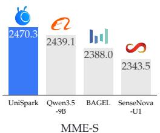  
Image Generation

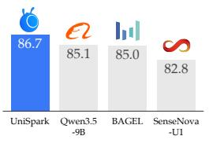

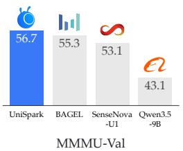

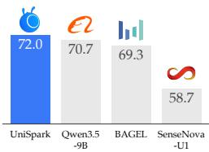  
Image Editing

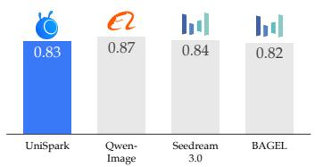  
GenEval

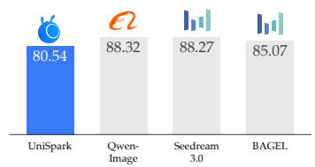  
DPG-Bench

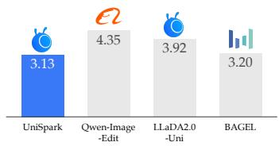  
ImgEdit  
Figure 1: Multimodal understanding, generation, and editing performance.

  
Figure 2: Text-to-image generation.

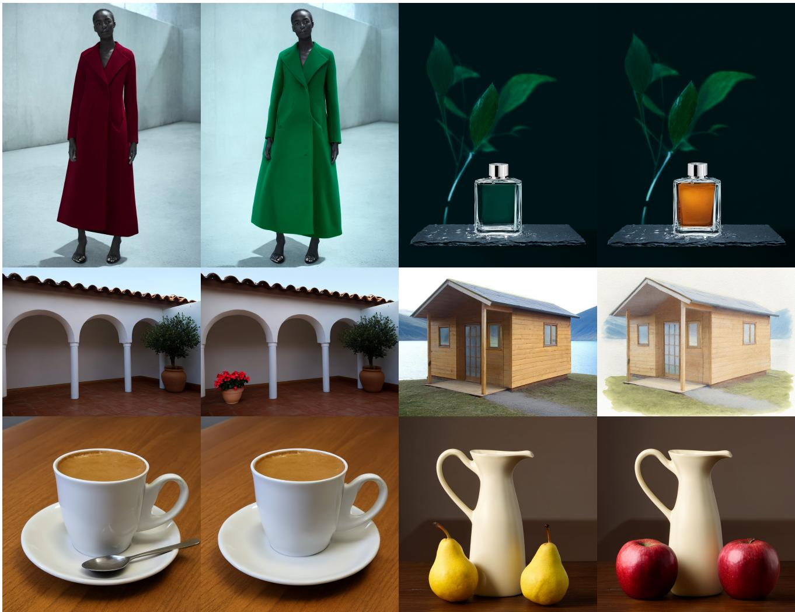  
Ocean waves wash against dark coastal rocks beneath a pale overcast sky. Fixed camera; preserve the rocky shoreline and horizon. Waves and white sea foam continue moving around the same rocks.

A pink rose bud on a green stem against a softly blurred garden. Fixed camera and consistent background. The petals gradually unfurl into a full bloom.

A green parrot with a red forehead perches on a wooden branch against a warm gray background. Fixed camera, soft light, same bird and perch. Raise the folded wings, stretch them outward, then fold them back.

A fixed-camera close photograph of a white ceramic cup filled with hot tea on a dark wooden table. Soft side light, plain dark background; preserve the cup and table. Wisps of steam curl upward from the hot tea. Continue the steam rising above the same cup.

A campfire inside a stone ring on bare ground. Fixed camera; keep the stones, logs and   
surroundings consistent.   
Small flames grow brighter, settle, and leave ash and embers.

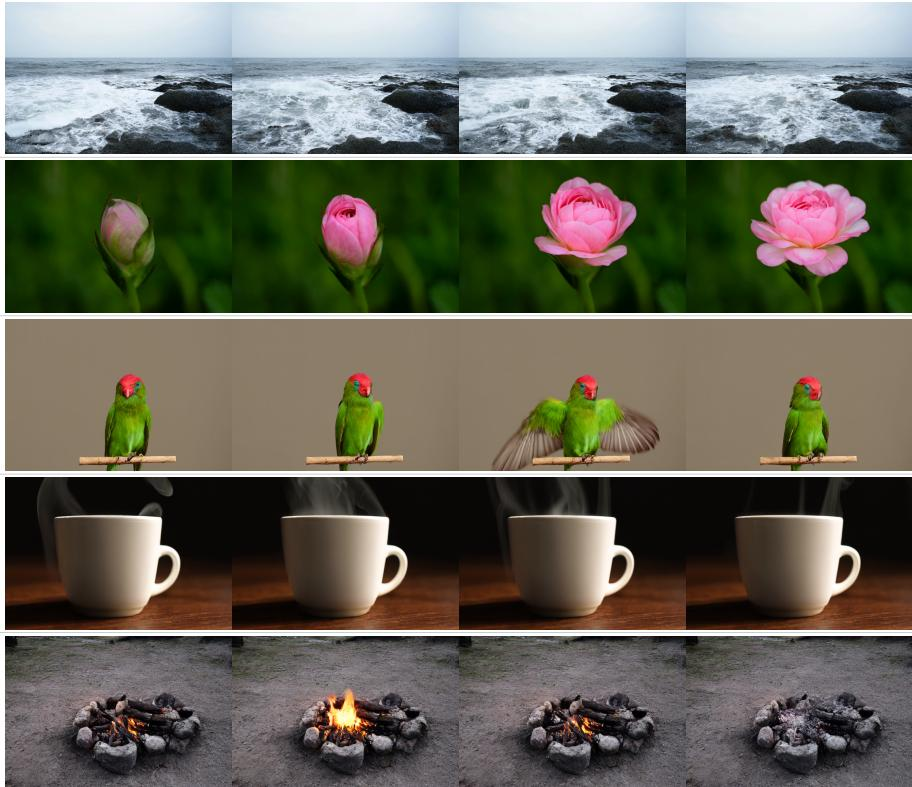  
Figure 3: Image editing and interleaved generation. Editing pairs: source (left), result (right).

## Contents

Introduction 5   
2 Related Work 6   
2.1 Unified Multimodal Understanding and Generation . 6   
2.2 Efficient and Hybrid Attention Mechanisms . 6   
3 Model Design 7   
3.1 Unified Multimodal Representations . 7   
3.2 Hybrid MoT Architecture 7   
3.3 Joint Understanding and Generation Objectives 9   
3.4 Interleaved Generation with Persistent Context . 9   
4 Data Preparation 10   
4.1 Multimodal Understanding 12   
4.2 Image Generation 13   
4.3 Image Editing 13   
4.4 Interleaved Data 13   
4.5 Text-Only Data 14   
4.6 Video Data . 14   
4.7 Multimodal Sequence Packing 14   
5 Training Strategy 16   
5.1 Joint Multimodal Foundation 16   
5.2 Progressive Resolution Scaling 17   
5.3 High-Resolution Refinement . 17   
5.4 Supervised Capability Refinement 17   
5.5 Optimization . 18   
5.6 Adaptation to Video Generation and Editing 18   
5.7 Training Infrastructure and Efficiency 18   
6 Experiments 19   
6.1 Evaluation Setup and Baselines 19   
6.2 Multimodal Understanding 19   
6.3 Text-to-Image Generation 20   
6.4 Instruction-Based Image Editing 21   
6.5 Interleaved Generation and Sequence Editing . 21   
6.6 Extension to Video Generation and Editing 21   
6.7 Inference Efficiency and Scaling . 22   
7 Conclusion 26

## 1 Introduction

Multimodal understanding and visual generation place complementary demands on a model. Understanding requires interpreting visual inputs, whereas generation requires synthesizing visual content from text or visual conditions. Combining autoregressive language modeling with continuous visual prediction has become a central approach to unification, as demonstrated by Transfusion and Show-o2 (Zhou et al., 2024; Xie et al., 2025). BAGEL brings understanding, generation, and editing into a shared multimodal sequence and backbone through modality-specific transformer parameters (Deng et al., 2025), while SenseNova-U1 further explores native unified representations and interleaved vision-language generation (Diao et al., 2026). In interleaved sequences, completed visual outputs can in turn serve as context for subsequent text and image predictions, linking understanding and generation across successive outputs.

UniAR (Peng et al., 2026) enables such context reuse through a shared discrete visual tokenizer, allowing generated tokens to become context without re-encoding the image. In continuous visual generation, however, context reuse must account for the iterative denoising process. Consider a model that generates an image, explains it, and then edits it in response to a new instruction. During denoising, the image is represented by a noisy target; once generated, its clean representation becomes context for subsequent predictions. Retaining intermediate denoising states would expose later predictions to transient noise, whereas discarding visual history would remove the reference needed for consistent editing. Unified modeling therefore requires separating noisy prediction targets from reusable clean visual context.

High-resolution images and multi-image sequences increase the visual-token workload of unified multimodal models. Hybrid attention combines full attention for explicit token interactions (Vaswani et al., 2017) with recurrent linear attention that propagates context through a persistent state at a cost linear in sequence length (Katharopoulos et al., 2020; Yang et al., 2025b). Kimi Linear and Olmo Hybrid explore layer-wise combinations of these operators in language modeling (Kimi Team et al., 2025b; Merrill et al., 2026), and Qwen3.5 provides a backbone combining full attention with GatedDeltaNet layers (Qwen Team, 2026). We investigate how full and linear attention interact across layers to support causal text prediction and iterative visual denoising within a unified model, and characterize its multimodal capabilities and computational trade-offs.

We present UniSpark, a unified model for multimodal understanding and visual generation. The UniSpark-9B configuration has approximately 9B parameters in each of its understanding and generation branches. Building on the Mixture-of-Transformer-Experts formulation (Liang et al., 2025; Deng et al., 2025) and the Qwen3.5 hybrid-attention backbone (Qwen Team, 2026), UniSpark combines expert routing and hybrid attention in a Hybrid MoT Architecture. Text and semantic visual features use the understanding expert, whereas VAE latents use the generation expert. Within each multimodal sequence, the experts exchange information through full attention and shared recurrent states. Autoregressive text prediction and visual flow matching (Lipman et al., 2023) jointly support multimodal understanding, text-to-image generation, reference-conditioned image editing, and interleaved prediction within the same model.

The information-flow design separates private prediction targets from public context. A noisy visual block reads its public prefix but is hidden from later blocks. Full-attention layers implement this rule with block visibility masks. Linear-attention layers process the block recurrently, but discard its private state and convolution-history updates after local computation on a noisy block. Clean visual representations instead update the public context. During training, this context is obtained from ground-truth images using teacher forcing (Williams & Zipser, 1989); at inference, it is built by encoding completed model outputs.

The training data span visual understanding, image generation and editing, interleaved sequences, and text-only language modeling. Understanding data cover captioning, visual question answering, OCR, GUI tasks, and grounding. Task-specific adapters map each data type to a common sequence plan. Online packing combines samples within token budgets while preserving sample boundaries, within-sample block structure, and supervision locations. Full-attention masks prevent cross-sample visibility, while linear-attention layers reset their recurrent state and convolution history at sample boundaries. The selected sources contain 159.7M generation samples and 213.4M understanding samples, including 10.0M OCR and 4.5M grounding samples, as well as 624.8K interleaved sequences. The data extend beyond image–caption pairs to support general semantic learning, specialized visual tasks, and the modeling of state changes over time.

Training proceeds through four main stages. The Joint Multimodal Foundation stage trains the model on text prediction, visual understanding, and low-resolution image generation. The Progressive Resolution Scaling and High-Resolution Refinement stages extend image generation to 2K while retaining understanding supervision. Supervised Capability Refinement (SFT) then improves understanding accuracy, instruction adherence, image-generation quality, and editing consistency. Following these four stages, we further adapt the model to video generation and editing using a mixture of image and video data.

Our main contributions are:

• Hybrid MoT Architecture. We combine token-type expert routing with full attention and GatedDeltaNet linear attention in a shared backbone. This hybrid design combines explicit multimodal interactions with efficient context propagation across long visual sequences.

• Context handling for interleaved prediction. We introduce a blockwise information-flow protocol that keeps noisy visual targets private while allowing clean visual content to condition later text and visual outputs under both attention operators.

• Unified data interface and progressive training. We map understanding, generation, editing, interleaved, and text-only data to task-specific sequence plans, then pack them through a shared interface. A four-stage training curriculum yields a single model for visual understanding, 2K image generation, editing, and interleaved prediction.

## 2 Related Work

## 2.1 Unified Multimodal Understanding and Generation

Unified multimodal models use a shared model to understand and generate visual content. Transfusion combines autoregressive text prediction with image diffusion (Zhou et al., 2024). Mixture-of-Transformers uses separate parameters for each modality while sharing attention across them (Liang et al., 2025). BAGEL builds on this approach and trains a unified model on interleaved multimodal data (Deng et al., 2025). These works form the basis of our shared architecture and joint text and visual training objectives.

Other approaches explore alternative visual representations and broader task coverage. Tuna-2 uses direct pixel-patch embeddings in place of separate visual encoders (Liu et al., 2026). SenseNova-U1 supports understanding, image generation, and interleaved vision-language generation with dense and MoE backbones (Diao et al., 2026). SenseNova-Vision handles different vision tasks through text, image, or mixed outputs without separate prediction heads (Han et al., 2026). UniSpark uses semantic visual features and VAE latents, and studies how hybrid attention lets these representations share context.

Sharing visual context also allows one output to guide the next. UniAR uses a shared discrete visual tokenizer, allowing generated visual tokens to be reused directly as context without re-encoding the image (Peng et al., 2026). Context Unrolling studies reasoning through text, images, video, and geometry before making predictions (Yang et al., 2026). UniSpark addresses context reuse in continuous visual generation by separating noisy targets from clean context through attention masks and recurrent-state retention rules.

A model that supports both tasks does not necessarily improve one task by learning the other. VGAU-Diag tests when generated visual aids help understanding and finds cases where models fail to use even correct visual aids (Zhu et al., 2026). Wu et al. examine how understanding and generation help each other at the representation, task, and system levels, and identify task specialization and shared knowledge as important factors (Wu et al., 2026). These studies highlight the distinction between joint task support and cross-task synergy.

## 2.2 Efficient and Hybrid Attention Mechanisms

Recurrent attention stores past information in a state that is updated as tokens are processed. Gated DeltaNet uses adaptive forgetting and delta-rule updates (Yang et al., 2025b). Kimi Linear adds finer gating through Kimi Delta Attention and combines it with Multi-Head Latent Attention across layers (Kimi Team et al., 2025b). Gated DeltaNet-2 uses separate erase and write gates for each memory channel (Hatamizadeh et al., 2026). These methods control how memory is updated. These methods govern token-level memory updates; UniSpark additionally enforces block-level retention rules to prevent noisy-target updates from entering public context.

Hybrid backbones combine recurrent layers with full attention. UniSpark starts from Qwen3.5, which combines GatedDeltaNet and full-attention layers (Qwen Team, 2026). Olmo Hybrid studies this combination through theory and controlled language-modeling experiments (Merrill et al., 2026). In vision, SoLA-Vision studies how to arrange linear and softmax attention across layers (Li et al., 2026). SANA-Video 2.0 combines gated linear attention, periodic softmax layers, and attention residuals for video diffusion (Chen et al., 2026).

Our work explores hybrid attention in a model trained jointly for multimodal understanding and generation.

Attention types can also be combined within a layer. HydraHead assigns full and linear attention to different heads, keeps full attention for heads important to retrieval, and normalizes their outputs before combining them (Tan et al., 2026). UniSpark combines the two attention types across layers. Reusing context also requires careful state handling: HARTS studies shared prefixes in branching agent rollouts, including state transfers and activation recomputation (Meng et al., 2026). Although HARTS focuses on agent reinforcement learning, it illustrates the need to coordinate recurrent states when computation branches or context is reused.

## 3 Model Design

UniSpark uses a Hybrid MoT Architecture for multimodal understanding and generation. Building on the multimodal Mixture-of-Transformer-Experts (MoT) formulation of BAGEL (Deng et al., 2025) and the hybrid attention backbone of Qwen3.5 (Qwen Team, 2026), the architecture combines specialized understanding and generation experts with a layer-wise mixture of full attention and recurrent linear attention in one shared backbone. UniSpark-9B uses approximately 9B parameters per branch, with the 9B designation referring to the per-branch backbone size rather than the total model size.

Causal language prediction and iterative visual generation impose different requirements on information flow: text predicts the next token from its prefix, visual generation refines a block of noisy latent tokens, and subsequent outputs must condition on completed visual content without inheriting intermediate noise states. The experts exchange context through full and recurrent linear attention, with explicit rules governing context reuse across visual outputs. Fig. 4 summarizes this organization.

## 3.1 Unified Multimodal Representations

A multimodal example is represented as an ordered sequence of text and visual blocks, together with conversation roles, media boundaries, and supervision indicators. Text is mapped through the language embedding layer. Images and video frames used for understanding are encoded by the Qwen3.5 vision encoder, whose output features are mapped into the language model’s hidden space. Images and videos used as generation targets or clean context are both encoded by the Wan2.2 VAE (Wan Team, 2025); the resulting latents are patchified and mapped to the backbone hidden space through a latent adapter. Semantic features provide an understanding-oriented representation, while VAE latents provide the continuous representation used for visual prediction. Predicting in a learned visual latent space follows the latent generative modeling approach of Rombach et al. (Rombach et al., 2022).

Let $\mathbf { z } _ { 0 }$ denote a sequence of clean visual latent patches and $\mathbf { z } _ { t }$ its noisy counterpart at noise level t. The generation-side input takes the form

$$
\mathbf { h } _ { t } ^ { \mathrm { v i s } } = A _ { \mathrm { i n } } ( \mathbf { z } _ { t } ) + E _ { \mathrm { t i m e } } ( t ) + E _ { \mathrm { p o s } } ( \mathbf { p } ) ,\tag{1}
$$

where $A _ { \mathrm { i n } }$ projects latent patches to the backbone width, $E _ { \mathrm { t i m e } }$ embeds the noise level $t ,$ and $E _ { \mathrm { p o s } } ( \mathbf { p } )$ encodes the spatial or spatiotemporal coordinates p. In addition to this additive position embedding, full-attention layers use multimodal rotary position embeddings to organize text and visual tokens within the sequence. Clean context latents are assigned $t = 0$ , while noisy target latents use $t > 0$ and receive flow-matching supervision.

## 3.2 Hybrid MoT Architecture

The architecture combines token-type expert routing with a layer-wise mixture of full attention and Gated DeltaNet linear attention.

Expert specialization. Text and semantic visual tokens use the understanding expert, while VAE latent tokens use the generation expert. Each decoder layer contains expert-specific normalization, attention projections, and feed-forward parameters. The experts exchange information through the context permitted by each attention operator.

Hybrid attention. Full-attention layers compute explicit query–key interactions over the permitted context. GatedDeltaNet layers (Yang et al., 2025b) summarize preceding context in a recurrent matrix state, with computation that scales linearly with sequence length. A simplified single-head update is

$$
\begin{array} { r l } & { \overline { { \mathbf { S } } } _ { i } = \alpha _ { i } \mathbf { S } _ { i - 1 } , } \\ & { \mathbf { S } _ { i } = \overline { { \mathbf { S } } } _ { i } + \beta _ { i } \mathbf { k } _ { i } \big ( \mathbf { v } _ { i } - \overline { { \mathbf { S } } } _ { i } ^ { \top } \mathbf { k } _ { i } \big ) ^ { \top } , } \\ & { \mathbf { o } _ { i } = \mathbf { S } _ { i } ^ { \top } \mathbf { q } _ { i } , } \end{array}\tag{2}
$$

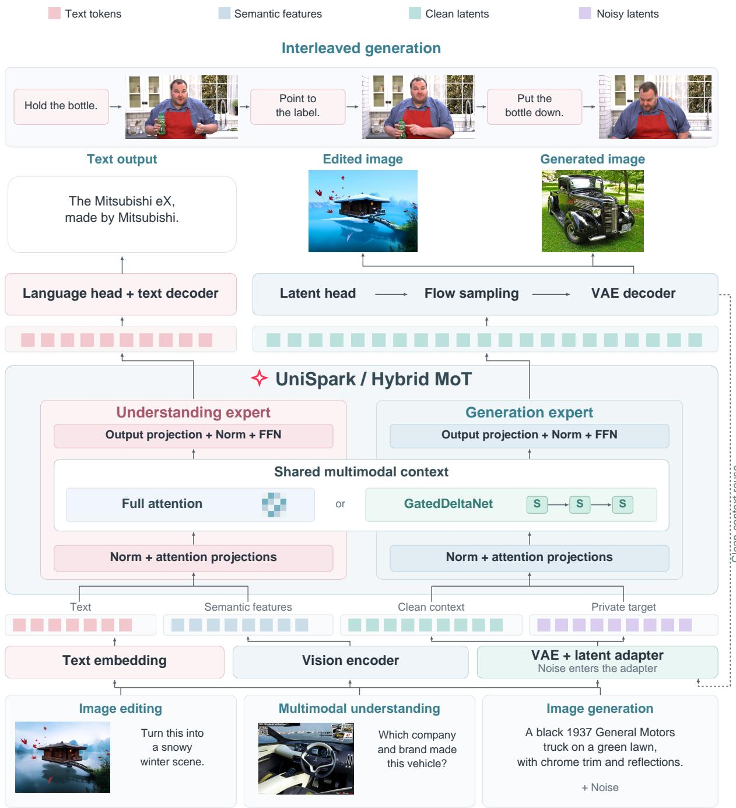  
Figure 4: Hybrid MoT Architecture of UniSpark. Token-type routing selects understanding or generation parameters, while full-attention and recurrent linear-attention layers exchange shared multimodal context for text prediction, image generation, editing, and interleaved outputs.

where i indexes tokens, $\alpha _ { i }$ controls state decay, and $\beta _ { i }$ controls the delta update. Understanding and generation tokens use their respective parameters to compute these quantities but share the recurrent state and short convolution history along the permitted multimodal history. Switching experts therefore does not reset the accumulated context.

Public context and private targets. Fig. 5 illustrates which information later predictions can access and how recurrent states are retained or discarded. For the sequence $\left[ T _ { 1 } , N _ { 1 } , C _ { 1 } , T _ { 2 } , N _ { 2 } ^ { \bullet } \right]$ , T denotes text, N a noisy visual target, and $C$ clean visual context. $T _ { 2 }$ and $N _ { 2 }$ can use $C _ { 1 }$ but not $N _ { 1 }$ , while $N _ { 1 }$ cannot access its later

clean counterpart $C _ { 1 }$

In full-attention layers, each block can attend to preceding text and clean visual blocks, which form the public context. Noisy targets remain private: they can read this context, but no other block can attend to them. Within each block, text uses causal attention, while clean visual blocks and noisy targets use bidirectional attention.

Linear-attention layers implement this separation by controlling which state updates are retained. Text and clean visual blocks update the state passed to subsequent blocks. A noisy target starts from the preceding public state and performs local updates to produce its outputs, but those updates are discarded afterward. Recurrence remains causal within every block. Let $\mathbf { S } _ { b } ^ { \mathrm { p u b } }$ denote the public state before block $B _ { b } ,$ , and let $\mathcal { R } ( B _ { b } , \mathbf { S } _ { b } ^ { \mathrm { p u b } } )$ denote the state obtained after processing that block. The public state is updated as

$$
\mathbf { S } _ { b + 1 } ^ { \mathrm { p u b } } = \left\{ \begin{array} { l l } { \mathcal { R } ( B _ { b } , \mathbf { S } _ { b } ^ { \mathrm { p u b } } ) , } & { B _ { b } \mathrm { ~ i s ~ p u b l i c } , } \\ { \mathbf { S } _ { b } ^ { \mathrm { p u b } } , } & { B _ { b } \mathrm { ~ i s ~ p r i v a t e } . } \end{array} \right.\tag{3}
$$

## 3.3 Joint Understanding and Generation Objectives

The backbone is trained jointly with autoregressive text prediction and visual flow matching. For supervised assistant-text positions T, the language objective is

$$
\mathcal { L } _ { \mathrm { t e x t } } = - \mathbb { E } \left[ \frac { 1 } { \left| \mathbb { T } \right| } \sum _ { i \in \mathbb { T } } \log p _ { \theta } ( w _ { i } \mid \mathcal { C } _ { < i } ) \right] ,\tag{4}
$$

where ${ \mathcal { C } } _ { < i }$ is the multimodal context visible to position i under the information-flow rules described above. Visual generation uses flow matching (Lipman et al., 2023). Given clean latents $\mathbf { z } _ { 0 } ,$ , noise $\epsilon \sim \mathcal { N } ( \mathbf { 0 } , \mathbf { I } )$ , and a sampled noise level $t \in ( 0 , 1 )$ , we construct

$$
\begin{array} { r } { \mathbf { z } _ { t } = ( 1 - t ) \mathbf { z } _ { 0 } + t \boldsymbol { \epsilon } , \qquad \mathbf { u } _ { t } = \boldsymbol { \epsilon } - \mathbf { z } _ { 0 } . } \end{array}\tag{5}
$$

The output adapter predicts the velocity from target-token hidden states, with the objective

$$
\begin{array} { r } { \mathcal { L } _ { \mathrm { v i s } } = \mathbb { E } _ { \mathbf { z } _ { 0 } , \epsilon , t } \left[ \| \widehat { \mathbf { u } } _ { \boldsymbol { \theta } } ( \mathbf { z } _ { t } , t ; \mathcal { C } ) - \mathbf { u } _ { t } \| _ { 2 } ^ { 2 } \right] , } \end{array}\tag{6}
$$

where C contains the public context preceding the target. The joint objective is

$$
\mathcal { L } = \lambda _ { \mathrm { t e x t } } \mathcal { L } _ { \mathrm { t e x t } } + \lambda _ { \mathrm { v i s } } \mathcal { L } _ { \mathrm { v i s } }\tag{7}
$$

At inference, sampling integrates the predicted velocity field from t = 1 (noise) to t = 0 (data).

## 3.4 Interleaved Generation with Persistent Context

Interleaved generation models text and image outputs as an ordered sequence of blocks $B _ { 1 } , \ldots , B _ { K } \colon$

$$
p _ { \theta } ( B _ { 1 } , \ldots , B _ { K } ) = \prod _ { k = 1 } ^ { K } p _ { \theta } ( B _ { k } \mid B _ { < k } ) ,\tag{8}
$$

Text blocks are predicted autoregressively, while visual blocks use conditional flow matching.

During interleaved training, an image that conditions subsequent outputs appears in two roles: a private noisy target for visual supervision and clean public context for later predictions. A two-image training sequence takes the form

$$
\left[ T _ { 1 } , \ N _ { 1 } ( t _ { 1 } ) , \ C _ { 1 } , \ T _ { 2 } , \ N _ { 2 } ( t _ { 2 } ) \right] ,\tag{9}
$$

where $T _ { k }$ denotes text, $N _ { k } ( t _ { k } )$ a noisy visual target, and $C _ { 1 }$ the clean representation of the image targeted by $N _ { 1 }$ . Information flow follows the block rules in Sec. 3.2. The clean context $C _ { 1 }$ is encoded from the observed image through teacher forcing. Visual supervision applies only to the noisy targets; the clean context carries no denoising loss.

At inference, clean context comes from completed model outputs. The public prefix remains fixed throughout the sampling of each image, and intermediate denoising updates are discarded. Once sampling finishes, the completed image is encoded into clean visual representations and appended to the public context. Full-attention layers cache the resulting public keys and values, while linear-attention layers retain the recurrent state and convolution history updated by these clean representations. The inference interface accepts interleaved text–image conditions and produces one image per call, optionally preceded by generated text. For multi-image decoding, a controller repeatedly samples images, inserts their clean representations into context, and determines when to stop.

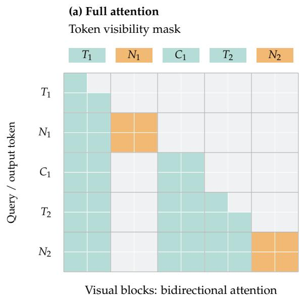

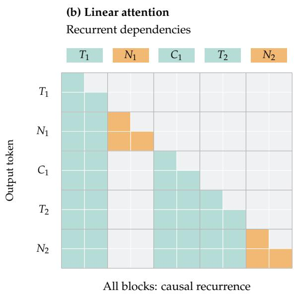

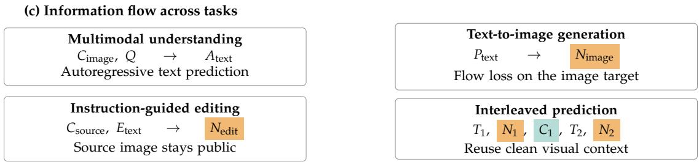

(d) State updates for noisy targets and clean context  
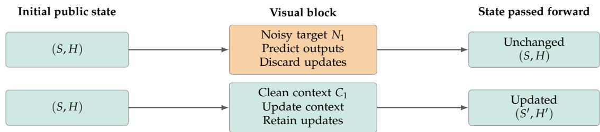  
S: recurrent state; H: short convolution history.  
Figure 5: Information flow under hybrid attention. Visibility masks and recurrent-state rules preserve the same public/private boundary, allowing clean context reuse without propagating noisy targets.

## 4 Data Preparation

UniSpark combines data for multimodal understanding, image generation, image editing, text-only learning, and interleaved prediction during its main training phase. We organize these sources by their supervision structure, while adjusting resolution and sampling separately across training stages. The curriculum comprises Joint Multimodal Foundation, Progressive Resolution Scaling, High-Resolution Refinement, and Supervised Capability Refinement (SFT). The first three stages establish joint modeling and extend visual generation to resolutions up to 2K. SFT targets more accurate understanding, better instruction following, and improved visual generation and editing. Separately, we collect video generation and editing data to further fine-tune the model, as an exploratory post-SFT effort to develop video capabilities.

  
159.66M records

## Image generation

  
99.98M records

## Image captioning

  
97.90M records

## Visual knowledge QA

  
Vehicle knowledge  
Image + question to factual answer

## OCR / documents

9.99M records

Read and transcribe visible text

## Visual grounding

4.51M records

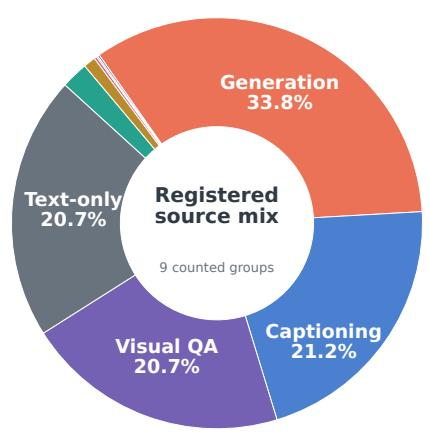  
Small sectors: OCR, grounding, GUI, editing, and interleaved sequences.

## GUI understanding

## Text-only reasoning

97.90M records

Prompt summary: Write a function to check whether the sum of three integers is even or odd.

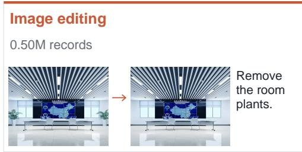  
624.8K sequences  
Figure 6: Training-data composition and task examples. Source counts and examples summarize the task coverage of joint training, from multimodal understanding to image generation, editing, and interleaved prediction.

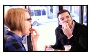  
Frame 0

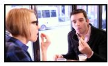  
Frame 1

  
Frame 2

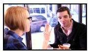  
Frame 3

Data scale and coverage. The selected data sources for main training contain 159.66M generation samples and 213.39M understanding samples. The latter comprise 99.98M captioning samples, 97.90M visual knowledge QA samples, 9.99M OCR samples, 4.51M grounding samples, and 1.00M GUI samples. These sources also include 97.90M text-only samples, 0.50M editing examples and 624.8K interleaved sequences. This coverage supports supervision for both general semantics and specialized visual skills, while interleaved examples retain transitions between images. The total understanding count sums the five listed task groups; it is not an independently deduplicated image count. Cross-group overlap and actual use during training must be counted separately. The video construction source list in Sec. 4.4 is an upstream source pool and is not added to these listed training-source counts.

Fig. 6 pairs source dataset sizes with training examples from all nine task groups. Image generation, captioning, and visual knowledge QA account for the largest counted source pools. Editing examples preserve source–target relations, while interleaved examples retain an ordered sequence of frames.

Beyond these main-training sources, the data for training video capabilities comprise 24.24M generation samples and 3.29M editing samples. Fig. 7 summarizes their composition and shows representative examples.

(a) Video generation  
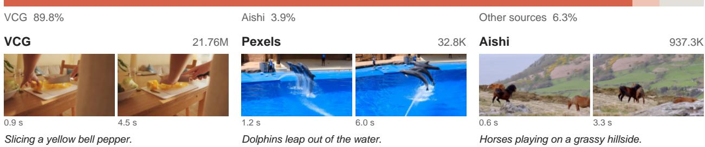  
Other sources include Pexels 32.8K, Koala 52.1K, Zhuote 40.2K, Panda6M 21.8K, and Panda1M 10.0K.

## (b) Video editing

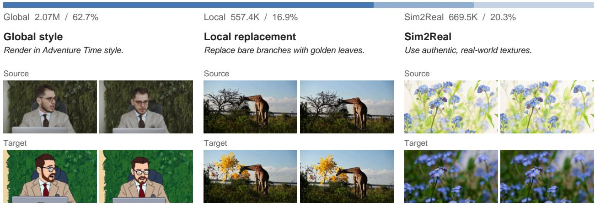  
Actual dataset frames. Captions and instructions are abridged; source and target use matched timestamps.  
Counts refer to indexed samples; byte-identical Ditto shards are counted once.

Figure 7: Video-data composition and examples. Generation sources (a) and aligned editing pairs (b) provide 24.24M and 3.29M samples, respectively, for post-SFT video adaptation. Counts refer to indexed samples; byte-identical Ditto shards are counted once.

VCG accounts for 89.8% of the video generation samples, complemented by Aishi and other sources. The video editing data cover global edits (2.07M), local edits (557.4K), and simulation-to-real (Sim2Real) transformations (669.5K), with temporally aligned source–target clips. These data support exploratory post-SFT fine-tuning; their collection and filtering are described in Sec. 4.6.

## 4.1 Multimodal Understanding

The understanding mixture comprises image captioning, knowledge-oriented visual question answering, OCR, GUI understanding, and visual grounding. These correspond to separate sampling groups, allowing broad semantic supervision and specialized visual tasks to be balanced independently. Captioning supplies descriptions of image content, while visual questions connect image evidence to a requested answer. The specialized groups cover complementary aspects of visual understanding:

• OCR and document content. Image-conditioned text supervision emphasizes reading visible text and relating it to the surrounding visual context.

• GUI understanding. Interface images and associated instructions connect language to visual elements in structured screens.

• Visual grounding. Localization-oriented examples connect referring expressions to spatially specified visual content.

• Visual knowledge and question answering. Image-grounded questions and responses broaden semantic coverage beyond captioning.

Images are processed by the understanding frontend with aspect-ratio-aware resizing, patch/merge alignment, and a pixel budget. The lower-resolution mixtures use a target long-edge setting of 384; expanded mixtures use a target setting of 980, aligned to 960 by the spatial factor of 32. These transforms are independent of the generation resolution. Conversation roles and supervision masks identify the assistant text to predict, while the image remains an input condition.

## 4.2 Image Generation

The generation stream provides images and associated text conditions through a dedicated image-data reader. Each example is converted into conditioning text and a target VAE latent sequence. The target receives flow-matching supervision, while text provides its semantic condition. Generation is sampled separately from understanding and editing, enabling the mixture to control their relative training exposure.

Generation data follow the resolution curriculum rather than a single fixed-size preprocessing rule. The foundation setting uses 256-scale images; resolution scaling introduces a 512-scale setting; high-resolution refinement extends the range through 1024-scale settings and up to 2K. Images retain their aspect-ratio structure subject to resize, stride, and pixel-budget constraints, so image dimensions vary within each scale. Semantic image inputs retain their own understanding-side transform.

## 4.3 Image Editing

The editing stream contains an instruction, a source image, and a target image. The source is retained as public visual context through semantic features and, where configured, clean VAE latents. The target is represented as a private noisy latent block carrying the visual loss. The sequence plan keeps the source and target roles explicit, preserving the direction of the transformation. Generation-side resize settings apply to editing images, while semantic reference features use the understanding transform.

## 4.4 Interleaved Data

Sources and sequence construction. The interleaved stream builds related text–image sequences from seven listed visual-sequence collections. Its adapters support alternating text–image examples and chained image edits. The interleave-enabled joint mixtures use the chained-edit format, retaining transition text and target captions. Each chain begins with an opening prompt and source image, then specifies successive transitions and visual targets:

$$
\begin{array} { r } { ( P , I _ { 0 } ) \longrightarrow [ \Delta _ { 1 } , D _ { 1 } , I _ { 1 } , \Delta _ { 2 } , D _ { 2 } , I _ { 2 } , . . . ] , } \end{array}\tag{10}
$$

where $\Delta _ { k }$ is a transition instruction, $D _ { k }$ is the target caption, and $I _ { k }$ is the corresponding target image.   
Reasoning fields used during data construction are omitted from the training response.

Video sources and annotation settings. Our video annotation effort draws on existing text-to-video, egocentric, and interaction-rich video collections. The batch annotation source list contains 24.24M source samples (Tab. 1).

Event-driven keyframes and transition annotation. The construction protocol asks a video-language model to select three to five timestamps marking meaningful visual changes, such as contact, grasping, release, object movement, or a camera-view change. Timestamps must be strictly increasing; the first is normally zero unless the opening frames are invalid. The batch configuration samples video observations at 1 FPS. This sampling rate controls the annotation input, whereas the selected keyframes follow event boundaries rather than a fixed output interval. The annotation model supplies descriptions and transition instructions for the selected frames.

<table><tr><td rowspan=1 colspan=4>Source identifier Source samples</td></tr><tr><td rowspan=2 colspan=4>Panda1M                 10.02 KPanda6M</td></tr><tr><td rowspan=1 colspan=2>21.82 K</td></tr><tr><td rowspan=1 colspan=2>Koala</td><td rowspan=2 colspan=2>clips                52.08 K</td></tr><tr><td rowspan=1 colspan=2>Editing</td><td rowspan=1 colspan=1>1.38 M</td></tr><tr><td rowspan=1 colspan=3>VCG</td><td rowspan=1 colspan=1></td></tr><tr><td rowspan=2 colspan=4>32.79 KAishi                     937.31 KZhuote                    40.19 K</td></tr><tr><td rowspan=1 colspan=3>Aishi</td></tr><tr><td rowspan=1 colspan=4>Total                      24.24M</td></tr></table>

Table 1: Video annotation sources. Source samples before filtering and annotation acceptance.

The first instruction describes the initial static scene. Subsequent instructions combine a target-state description $D _ { k }$ with a transition $\Delta _ { k }$ from the preceding keyframe. The protocol emphasizes subject pose, object position and orientation, contact relations, and changes in scene or camera viewpoint, including contact changes, object motion, and final placement. Annotation must remain grounded in visible evidence rather than inferred intentions or unobserved outcomes. Timestamp references are resolved to extracted frames, producing alternating user-text and assistant-image messages. This yields Eq. (10) after adaptation to the chained-edit format. The visual targets are observed video frames; the annotation model supplies their descriptions and transition instructions.

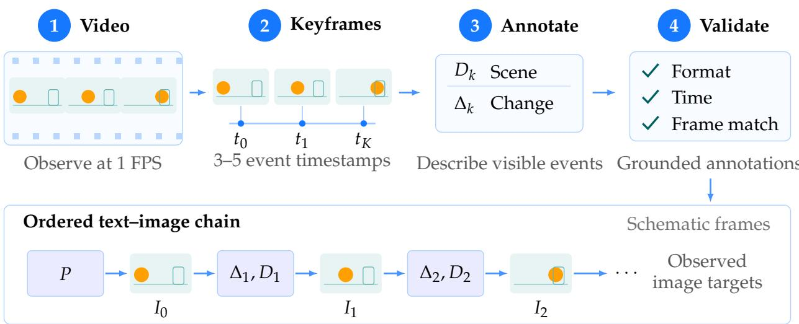  
Figure 8: Video-based interleaved data construction. Event-selected video frames are paired with scene descriptions and transition instructions to form grounded text–image training sequences.

Quality screening and annotation validation. The planned screening uses resolution, duration, clarity, exposure, aesthetics, motion, shot boundaries, and overlays to identify unsuitable clips and split clips longer than 30 seconds.

Before use, annotations must be checked for correct format and timing: valid role alternation, one target image per assistant turn, valid media references, strictly increasing in-range timestamps, and consistency between transition text and the adjacent frames. The image-target protocol keeps visual-state descriptions and transition instructions tied to the extracted frames.

Annotation pipeline. Video decoding, quality screening, and annotation are separate steps, allowing source-specific filtering while keeping a common output format.

Structural filtering. Samples must be parsed successfully and checked for suitability for interleaved training. The adapter also verifies the message structure and requires each successive source image reference to match the preceding target reference. Non-final target images are followed by clean representations of the observed image, making completed visual content available to later text and image prediction.

## 4.5 Text-Only Data

The text-only group contains 97.90M samples across 100 source entries covering mathematics, programming, knowledge, reasoning, general instructions, conversation, tool use, and long-context tasks. It supplies direct language supervision alongside visual learning. Reasoning examples belong to this text mixture; they are distinct from the reasoning used to construct interleaved editing samples, which is removed before training. During capability refinement, the intended role of text data is to maintain response quality and instruction-following coverage while understanding and generation are refined jointly.

## 4.6 Video Data

The video data comprise separate groups for video generation and source-conditioned video editing, used in the exploratory post-SFT fine-tuning described above. Video generation data are collected from VCG, Koala, Aishi, Pexels, Panda, and internal sources, while video editing data are drawn from Ditto (Bai et al., 2026). We exclude videos longer than eight seconds and those with excessively low or high original frame rates. We further filter the data using VLM-based assessments of visible text, aesthetics, and visual quality. Retained videos are resampled to 16 FPS; for editing, source and target clips share the same temporal sampling plan.

## 4.7 Multimodal Sequence Packing

Fig. 9 illustrates how task-specific samples become a packed sequence while retaining the boundaries needed by hybrid attention and the two prediction objectives.

Unified sequence assembly. The task adapters convert samples from different tasks into a common sequence plan containing text roles, media identities, attention-block types, and supervision locations.

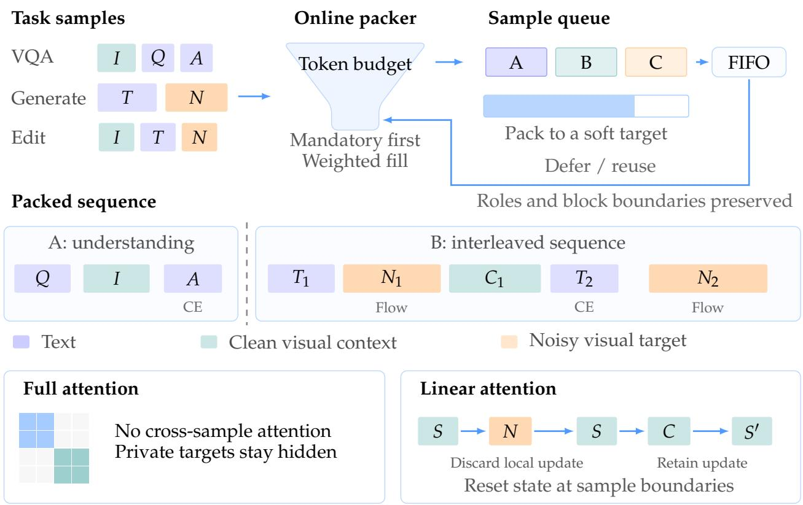  
Figure 9: Multimodal sequence packing. Online packing combines task-specific samples within a token budget while preserving sample isolation and the public/private boundaries required by hybrid attention.

Packing concatenates multiple examples while retaining their individual sequence boundaries and withinexample block structure. Text labels and visual targets are gathered through separate loss indices, so conditioning content can share the input sequence without receiving a prediction loss. For interleaved samples, the complete sequence of transitions and images remains within the same example; packing does not turn successive editing steps into unrelated image–text pairs.

Online token-budget packing. The loader starts each pack by inserting eligible examples from mandatory task groups. It then selects additional examples according to normalized group weights, using modalityaware token estimates to account for text and visual content. A soft token target determines when a pack is normally produced, while a per-example threshold rejects oversized samples and a separate packed-token budget guides additional insertions. Examples that do not fit can be stored in a fixed-size buffer for later use. The loader reuses buffered examples in first-in, first-out order when the current pack is below a configured occupancy threshold. This online policy accommodates the changing token costs of image resolution, aspect ratio, and interleaved sequence length without requiring a fixed number of images per batch. The final accepted example or mandatory insertion can exceed the nominal token budget. Reference budgets are listed in Tab. 3.

Sample isolation and hybrid-attention metadata. Packed sample lengths prevent attention or recurrent state from crossing between independent examples. Within an example, block lengths and attention modes preserve the conditioning relationships described in Sec. 3.2. In particular, a noisy visual target remains private, whereas an observed clean image may contribute public context for subsequent prediction. The same sequence layout supplies visibility metadata to full-attention layers and state-retention boundaries to linear-attention layers. These layers retain their respective attention behavior. Variable-length execution can avoid padding every example to a common text–visual sequence length; visual tensor padding and backend-specific alignment can still be required.

Data mixture statistics. Group weights govern sampling decisions, rather than final sample, token, or compute percentages. Mandatory insertion and buffering further affect the actual mixture. We therefore distinguish configured weights from consumed examples and tokens when describing data allocation across stages. SFT uses the same packing interfaces, with task selection and weighting focused on capability refinement.

Configured task sampling weights
<table><tr><td>Image generation</td><td>1</td><td>1*</td><td>1*</td><td rowspan="8">10⁰ E Ra g g gg le 10-2 10-4</td></tr><tr><td>Image editing</td><td>5e-06 *</td><td>5e-06</td><td>5e-06</td></tr><tr><td>Image captioning</td><td>0.5 *</td><td>0.5 *</td><td>0.5 *</td></tr><tr><td>Visual knowledge QA</td><td>0.5</td><td>0.5</td><td>0.5</td></tr><tr><td>OCR</td><td>0.05</td><td>0.05</td><td>0.05</td></tr><tr><td>GUI understanding</td><td>0.005</td><td>0.005</td><td>0.005</td></tr><tr><td>Visual grounding</td><td>0.025</td><td>0.025</td><td>0.025</td></tr><tr><td>Text-only</td><td>0.25</td><td>0.25</td><td>0.25</td></tr><tr><td>Interleaved sequences</td><td>0.001</td><td>0.005</td><td>Inactive</td></tr><tr><td></td><td>Foundation</td><td>Resolution scaling</td><td>High-resolution</td></tr></table>

Figure 10: Data sampling across training stages. Representative task weights are shown for three pre-SFT stages; asterisks mark mandatory groups. These weights do not represent observed sample or token proportions.
<table><tr><td>Stage</td><td>Name</td><td>Generation scale</td><td>Primary objective</td></tr><tr><td>I</td><td>Joint Multimodal Foundation256-scale</td><td></td><td>Establish joint text, visual understanding, and latent- generation modeling.</td></tr><tr><td>Ⅱ</td><td>Progressive Resolution Scaling 512-scale</td><td></td><td>Expand spatial detail while continuing multimodal supervision.</td></tr><tr><td>III</td><td>High-Resolution Refinement</td><td>1024-scale to 2K</td><td>Extend visual generation to longer target sequences and finer detail.</td></tr><tr><td>IV</td><td>Supervised Capability Refine- Task-dependent ment (SFT)</td><td></td><td>Refine understanding accuracy, instruction following, generation quality, and editing consistency.</td></tr></table>

Table 2: Four-stage training curriculum. Resolution labels describe training scales rather than fixed square image sizes.

Fig. 10 compares sampling weights across three training stages. Required task groups are included in each pack regardless of their sampling weight. These weights do not directly determine the sample or token proportions used during training. Colors encode weights on a logarithmic scale; asterisks identify required groups and gray cells identify inactive groups. The high-resolution example uses a 1024-scale configuration.

## 5 Training Strategy

We organize the UniSpark curriculum by its modeling objectives: Joint Multimodal Foundation, Progressive Resolution Scaling, High-Resolution Refinement, and Supervised Capability Refinement (SFT). This organization separates learning a shared multimodal backbone, increasing spatial detail, extending high-resolution generation, and refining task performance. Tab. 2 summarizes the four stages. The backbone retains the joint text and visual objectives in Sec. 3.3 throughout this design.

## 5.1 Joint Multimodal Foundation

The foundation stage trains the hybrid MoT backbone with a low visual token budget. Text and semantic visual tokens use the understanding expert, while VAE latent tokens use the generation expert. Language modeling and visual flow matching provide direct supervision for the two output types.

<table><tr><td>Parameter</td><td>Foundation</td><td>Resolution scaling</td><td>High-resolutionª</td><td> $\mathbf { S F T } ^ { b }$ </td></tr><tr><td>Learning rate</td><td> $1 0 ^ { - 4 }$ </td><td> $1 0 ^ { - 4 }$ </td><td> $1 0 ^ { - 4 }$ </td><td> $1 0 ^ { - 4 }$ </td></tr><tr><td>LR schedule</td><td>Constant</td><td>Constant</td><td>Constant</td><td>Constant</td></tr><tr><td>Warmup updates</td><td>2,500</td><td>2,500</td><td>2,500</td><td>500</td></tr><tr><td>EMA decay</td><td>0.9999</td><td>0.9999</td><td>0.9999</td><td>0.995</td></tr><tr><td>Timestep shift</td><td>1.0</td><td>1.0</td><td>1.0</td><td>4.0</td></tr><tr><td>Text / visual loss weights</td><td>1/1</td><td>1/1</td><td>0.25 / 1</td><td>0.25 / 1</td></tr><tr><td>Packed-token target</td><td>16,384</td><td>10,240</td><td>16,384</td><td>10,240</td></tr><tr><td>Per-sample token limit</td><td>26,384</td><td>16,384</td><td>26,384</td><td>16,384</td></tr><tr><td>Packed-token limit</td><td>46,864</td><td>36,864</td><td>46,864</td><td>36,864</td></tr></table>

Table 3: Reference optimization settings by training stage. The packed-token target applies to one packed sequence, not a global batch. aHigh-resolution values refer to the 1024-scale setting. bSFT settings are preliminary. All learning-rate schedules are constant after warmup.

The 256-scale setting keeps visual targets relatively short while establishing interactions between the two experts. The language backbone, vision encoder, and expert branches and adapters are trained jointly, while the VAE remains frozen. The stage’s purpose is to establish the shared prediction interface before increasing the spatial sequence length.

## 5.2 Progressive Resolution Scaling

The resolution-scaling stage increases generation to a 512-scale setting while retaining the same token roles and loss definitions. More latent patches represent each image, allowing training to cover finer spatial detail. Understanding inputs have an independent resolution budget, so higher-resolution generation does not require every semantic condition to expand at the same rate.

Interleaved sequences can continue to contribute text and visual targets in this stage. Clean representations of earlier images remain public context, while noisy prediction blocks remain private. This exposes hybrid attention to both longer visual blocks and dependencies across multiple outputs.

## 5.3 High-Resolution Refinement

High-resolution refinement extends generation through 1024-scale settings and up to 2K. The objective remains conditional flow matching, with understanding and language supervision retained in the joint training design. The increased latent-token count makes memory use and packed sequence composition more sensitive to aspect ratio and the number of visual targets per example.

The 1024-scale reference setting assigns coefficients of 0.25 and 1.0 to the text and visual losses, respectively. These are loss multipliers, not a text-to-image data ratio. It also omits the interleaved data group, whereas a preceding resolution-scaling configuration includes that group. High-resolution refinement thus need not preserve every task at the same sampling rate.

## 5.4 Supervised Capability Refinement

Tab. 3 gives preliminary SFT settings. SFT is the final capability-oriented stage of the main multimodal training curriculum. Its goal is to improve understanding and generation together through task-focused supervision, using the data categories in Sec. 4. The refinement design has four priorities:

• Understanding accuracy: answer visual questions, recognize text, and ground responses in the supplied image.

• Generation fidelity: follow the requested subjects, attributes, spatial relations, and text in the image.

• Editing consistency: perform the instructed change while retaining unrelated reference content.

• Interleaved coherence: use preceding visual outputs and text consistently when predicting subsequent content.

The same text cross-entropy and visual flow-matching objectives support these tasks. SFT changes the emphasis of data selection and sampling; it does not require a separate understanding model or visual generator.

## 5.5 Optimization

Optimizer and precision. Training uses AdamW (Loshchilov & Hutter, 2019) with coefficients $\left( \beta _ { 1 } , \beta _ { 2 } \right) =$ (0.9, 0.95), numerical stability constant $1 0 ^ { - 1 5 }$ , zero weight decay, and gradient-norm clipping at 1.0. Forward computation uses bfloat16 mixed precision. The joint-training reference settings use learning rate $1 0 ^ { - 4 }$ with a constant schedule after 2,500 warmup updates and EMA decay 0.9999. Tab. 3 summarizes the reference settings for all four stages.

Noise-time sampling. The visual objective samples a time through a sigmoid transform and then applies the configured shift s:

$$
t ^ { \prime } = \frac { s t } { 1 + ( s - 1 ) t } .\tag{11}
$$

The joint configurations set $s = 1 .$ , while the SFT reference uses $s = 4 .$ . The latter gives larger noise times for intermediate t under the convention of Eq. (5). This parameter changes the training time distribution, not the number of denoising steps used at inference.

## 5.6 Adaptation to Video Generation and Editing

Following SFT, we further fine-tune the model on video generation and editing data as an exploratory extension of its visual capabilities. The fine-tuning mixture also retains image generation and editing data. Video generation, video editing, image generation, and image editing are sampled at a ratio of $5 : 1 : 1 : 0 . 1$ . For video generation and editing, the longer side of each frame is set to 1280 and 768 pixels, respectively, while image generation and editing retain 2K resolution. Video clips are sampled at 16 FPS and span 3–5.2 seconds.

The understanding branch is frozen during this adaptation. Tab. 4 summarizes the fine-tuning settings.

<table><tr><td>Parameter</td><td>Value</td></tr><tr><td>Learning rate</td><td> $5 \times 1 0 ^ { - 5 }$ </td></tr><tr><td>LR schedule</td><td>Constant</td></tr><tr><td>Warmup updates</td><td>1,000</td></tr><tr><td>EMA decay Timestep shift</td><td>0.999</td></tr><tr><td>Text conditioning dropout</td><td>1.0</td></tr><tr><td>VAE / ViT conditioning dropout</td><td>0.1</td></tr><tr><td></td><td>0.3 / 0.3</td></tr><tr><td>Packed-token target</td><td>16,384</td></tr><tr><td>Per-sample token limit</td><td>40,960</td></tr><tr><td>Packed-token limit</td><td>40,960</td></tr></table>

Table 4: Optimization settings for video adaptation stage. The understanding branch is frozen.

## 5.7 Training Infrastructure and Efficiency

Hybrid sharding and activation memory. Training uses FSDP (Zhao et al., 2023) hybrid sharding to distribute parameters, gradients, and optimizer states across GPUs. Decoder-layer and vision-encoder activation checkpointing reduce memory use through recomputation (Chen et al., 2016). These methods support training with longer visual sequences.

Attention execution for packed multimodal sequences. Variable-length attention backends directly use the packing metadata in Sec. 4.7. The full-attention implementation supports block-mask execution, caches derived block-sparse metadata, and provides a native grouped-query path that avoids explicitly repeating key/value heads. Backend selection depends on the head configuration, requested execution path, and installed kernels. The linear-attention MoT implementation provides optimized execution paths alongside a scalar reference implementation. Expert-specific projections and convolution weights operate with shared public recurrent state and convolution history. Private target blocks read this context but do not retain their local updates in public context. Optimizing these operations must preserve both sample isolation and the public/private state rules; full-attention visibility and linear-attention recurrence are not interchangeable.

Data delivery and visual encoding. The input pipeline prefetches samples and assembles packed batches. A frozen VAE encodes visual targets and conditions before the backbone forward pass, reducing the memory required for visual encoding.

Workload-aware monitoring. The implementation supports text and visual loss monitoring by task group, records token throughput, and estimates utilization with an architecture-aware FLOP model that distinguishes full-attention and linear-attention layers and accounts for visual computation. Executed-compute estimates also consider activation recomputation. Token throughput, peak memory, and packed sequence lengths provide complementary workload measurements.

## 6 Experiments

We evaluate UniSpark on multimodal understanding, text-to-image generation, and instruction-based image editing, and measure inference latency and memory across image resolutions. The comparisons include both task-specific models and unified multimodal models. Fig. 1 summarizes selected benchmarks, while the following tables provide per-benchmark and per-category results.

## 6.1 Evaluation Setup and Baselines

UniSpark-9B uses approximately 9B parameters in each of its understanding and generation branches.   
Model-size conventions and inference settings are specified in the corresponding comparisons.

For multimodal understanding, we use MME (Fu et al., 2023) for perception and cognition, MMBench (Liu et al., 2024) and MM-Vet (Yu et al., 2024) for visual question answering and integrated multimodal capabilities, MMMU (Yue et al., 2024) for subject-level reasoning, MathVista (Lu et al., 2023) for visual mathematics, and MMVP (Tong et al., 2024b) for fine-grained visual discrimination.

For text-to-image generation, we evaluate compositional alignment with GenEval (Ghosh et al., 2023) and detailed prompt following with DPG-Bench (Hu et al., 2024). For instruction-based image editing, ImgEdit (Ye et al., 2025) measures whether the model makes the requested changes while preserving unrelated content. The following subsections specify evaluation protocols and analyze the corresponding results.

We compare understanding-only models, including InternVL2/2.5 (OpenGVLab, 2024; Chen et al., 2024) and Qwen2/2.5-VL (Wang et al., 2024b; Bai et al., 2025) families, Kimi-VL (Kimi Team et al., 2025a), and DeepSeek-VL2 (Wu et al., 2024c), with unified models such as Janus-Pro (Chen et al., 2025), MetaQuery-XL (Pan et al., 2025), BAGEL (Deng et al., 2025), and SenseNova-U1 (Diao et al., 2026). Qwen3.5-4B and Qwen3.5-9B (Qwen Team, 2026) provide additional understanding references. This grouping compares UniSpark with both specialized vision-language models and models that also generate images.

The GenEval and DPG-Bench comparisons include specialized generators such as FLUX.1 [Dev] (Black Forest Labs, 2024), Seedream 3.0 (Gao et al., 2025), Qwen-Image (Wu et al., 2025a), Emu3-Gen (Wang et al., 2024c), and Lumina-mGPT 2.0 (Xin et al., 2025b). Unified baselines include BAGEL, OmniGen2 (Wu et al., 2025b), InternVL-U (Tian et al., 2026), Lumina-DiMOO (Xin et al., 2025a), and LLaDA2.0-Uni (Inclusion AI et al., 2026). The tables distinguish autoregressive, continuous-diffusion, and discrete-diffusion architectures.

ImgEdit compares four specialized editors (FLUX.1 Kontext (Black Forest Labs et al., 2025), Step1X-Edit (Liu et al., 2025), Qwen-Image-Edit (Qwen Team, 2025), and Z-Image-Edit (Z-Image Team et al., 2025)) with five unified models: BAGEL, OmniGen2, InternVL-U, Lumina-DiMOO, and LLaDA2.0-Uni. For inference efficiency, BAGEL and SenseNova-U1 serve as references under matched hardware and workload settings.

Understanding baseline scores come from BAGEL’s comparison and additional Qwen3.5 and SenseNova-U1 evaluations. Generation and editing baselines follow LLaDA2.0-Uni (Inclusion AI et al., 2026). Published scores retain their source evaluation settings; UniSpark scores and the inference-efficiency measurements are reported separately. Dashes indicate unreported results.

## 6.2 Multimodal Understanding

We report MME perception (MME-P) and combined perception-plus-cognition (MME-S), MMBench v1.0- dev-en circular accuracy, MMMU validation accuracy without CoT, and MMVP paired accuracy. Protocol differences among the reported models are documented in Tab. 5.

In Tab. 5, UniSpark records the highest listed MME-P (1766.0), MME-S (2470.3), MMBench (86.7), and MMVP (72.0) scores, with the MMBench protocol differences noted in the caption. Compared with BAGEL (7B MoT), it scores higher across all six benchmark families, including gains of 6.2 points on MM-Vet and 4.1 points on MathVista. These results indicate broad understanding capability spanning perception, visual question answering, and visual mathematics.

The remaining gaps are concentrated in specific reasoning benchmarks. On MMMU-Val, UniSpark scores 56.7, below MetaQuery-XL’s 58.6. Qwen3.5-9B also scores higher on MM-Vet and MathVista by 6.2 and 2.4 points, respectively. Thus, the strong perception results do not imply uniformly better reasoning. Differences in model size, training data, and evaluation protocols also prevent attributing these comparisons solely to hybrid attention.

<table><tr><td rowspan="2">Type Model</td><td rowspan="2"></td><td rowspan="2">#LLM Params</td><td rowspan="2"></td><td rowspan="2"></td><td rowspan="2">MME-P↑ MME-S↑ MMBench↑ MMMU↑ MM-Vet↑ MathVista↑ MMVP↑</td><td rowspan="2"></td><td rowspan="2"></td><td rowspan="2"></td><td rowspan="2"></td></tr><tr><td></td></tr><tr><td rowspan="18">nu uh</td><td>InternVL2 (2024)</td><td>1.8B</td><td>1440.0</td><td>1877.0</td><td>73.2</td><td>34.3</td><td>44.6</td><td>46.4</td><td>35.3</td></tr><tr><td>InternVL2.5 (2024)</td><td>1.8B</td><td></td><td>2138.0</td><td>74.7</td><td>43.6</td><td>60.8</td><td>51.3</td><td></td></tr><tr><td>Qwen2-VL (2024b)</td><td>1.5B</td><td></td><td>1872.0</td><td>74.9</td><td>41.1</td><td>49.5</td><td>43.0</td><td>一</td></tr><tr><td>BLIP-3 (2024)</td><td>4B</td><td></td><td></td><td>76.8</td><td>41.1</td><td>一</td><td>39.6</td><td>一</td></tr><tr><td>LLaVA-OV (2024)</td><td>7B</td><td>1580.0</td><td></td><td>80.8</td><td>48.8</td><td>57.5</td><td>63.2</td><td></td></tr><tr><td>InternVL2 (2024)</td><td>7B</td><td>1648.0</td><td>2210.0</td><td>81.7</td><td>49.3</td><td>54.2</td><td>58.3</td><td>51.3</td></tr><tr><td>InternVL2.5 (2024)</td><td>7B</td><td></td><td>2344.0</td><td>84.6</td><td>56.0</td><td>62.8</td><td>64.4</td><td></td></tr><tr><td>Qwen2-VL (2024b)</td><td>7B</td><td></td><td>2327.0</td><td>83.0</td><td>54.1</td><td>62.0</td><td>58.2</td><td></td></tr><tr><td>Emu3-Chat** (2024c)</td><td>8B</td><td>1244.0</td><td></td><td>58.5</td><td>31.6</td><td>37.2</td><td></td><td>36.6</td></tr><tr><td>DeepSeek-VL2 (2024c)</td><td>4.1B/28B</td><td></td><td></td><td></td><td>51.1</td><td>60.0</td><td>62.8</td><td>一</td></tr><tr><td>Qwen2.5-VL (2025)</td><td>3B</td><td></td><td>2157.0</td><td>79.1</td><td>53.1</td><td>61.8</td><td>62.3</td><td>一</td></tr><tr><td>Qwen2.5-VL (2025)</td><td>7B</td><td></td><td>2347.0</td><td>83.5</td><td>58.6</td><td>67.1</td><td>68.2</td><td>一</td></tr><tr><td>Kimi-VL (2025a)</td><td>2.8B/16B</td><td></td><td></td><td></td><td>57.0</td><td>66.7</td><td>68.7</td><td></td></tr><tr><td>Qwen3.5-4B (2026) Qwen3.5-9B (2026)</td><td>4B 9B</td><td>1686.5 1748.7</td><td>2348.3 2439.1</td><td>81.4 85.1</td><td>29.2 43.1</td><td>76.5 79.6</td><td>80.7 79.6</td><td>64.7</td></tr><tr><td></td><td>1.3B</td><td></td><td></td><td></td><td></td><td>26.7</td><td></td><td></td><td>70.7</td></tr><tr><td rowspan="14">unuified</td><td>Show-0512 (2024a) Janus (2024a)</td><td></td><td>1097.0 1338.0</td><td></td><td>一 69.4</td><td>30.5</td><td>一 34.3</td><td></td><td>一</td></tr><tr><td>ILLUME (2024a)</td><td>1.5B</td><td></td><td></td><td></td><td></td><td></td><td></td><td></td></tr><tr><td>6(2024b)</td><td>7B</td><td>1445.0</td><td></td><td>75.1</td><td>38.2</td><td>37.0</td><td></td><td>一</td></tr><tr><td>VILA-U*56 256 Chameleon** (2024)</td><td>7B</td><td>1336.0</td><td></td><td>66.6</td><td>32.2</td><td>27.7</td><td></td><td>22.0</td></tr><tr><td></td><td>7B</td><td></td><td></td><td>35.7</td><td>28.4</td><td>8.3</td><td></td><td>0.0</td></tr><tr><td>LlamaFusion** (2024)</td><td>8B</td><td>1604.0</td><td></td><td>72.1</td><td>41.7</td><td>一</td><td></td><td></td></tr><tr><td>MetaMorph (2024a)</td><td>8B</td><td></td><td></td><td>75.2</td><td>41.8</td><td></td><td></td><td>48.3</td></tr><tr><td>SEED-X (2024)</td><td>13B</td><td>1457.0</td><td></td><td>70.1</td><td>35.6</td><td>43.0</td><td></td><td></td></tr><tr><td>TokenFlow-XL (2024)</td><td>13B</td><td>1546.0</td><td></td><td>68.9</td><td>38.7</td><td>40.7</td><td></td><td>一</td></tr><tr><td>MUSE-VL (2024b)</td><td>32B</td><td></td><td></td><td>81.8</td><td>50.1</td><td></td><td>55.9</td><td>一</td></tr><tr><td>Janus-Pro (2025)</td><td>1.5B</td><td>1444.0</td><td></td><td>75.5</td><td>36.3</td><td>39.8</td><td>一</td><td>一</td></tr><tr><td>BAGEL (2025)</td><td>1.5B MoT</td><td>1610.0</td><td>2183.0</td><td>79.2</td><td>43.2</td><td>48.2</td><td>63.4</td><td>54.7</td></tr><tr><td>Janus-Pro (2025)</td><td>7B</td><td>1567.0</td><td></td><td>79.2</td><td>41.0</td><td>50.0</td><td></td><td></td></tr><tr><td>MetaQuery-XL† (2025)</td><td>7B</td><td>1685.0</td><td></td><td>83.5</td><td>58.6</td><td>66.6</td><td></td><td>一</td></tr><tr><td>BAGEL (2025)</td><td>7B MoT</td><td>1687.0</td><td>2388.0</td><td>85.0</td><td>55.3</td><td>67.2</td><td></td><td>73.1 69.3</td></tr><tr><td>SenseNova-U1 (2026)</td><td>8B MoT</td><td>1683.5</td><td>2343.5</td><td>82.8</td><td>53.1</td><td>63.0</td><td>71.5</td><td>58.7</td></tr><tr><td>UniSpark</td><td>9B MoT</td><td>1766.0</td><td>2470.3</td><td>86.7</td><td>56.7</td><td>73.4</td><td>77.2</td><td>72.0</td></tr></table>

Table 5: Bold and underlining indicate the best and second-best scores. MoT parameters are per branch; MoE parameters are active/total. MMBench answer extraction differs: UniSpark uses rules only, while Qwen3.5 and SenseNova-U1 use a Qwen fallback. †: frozen Qwen2.5-VL backbone. ∗∗: scores taken from MetaMorph or MetaQuery in the source comparison. Dashes indicate unreported scores.

## 6.3 Text-to-Image Generation

We report overall and category-level GenEval and DPG-Bench scores.

Baseline scores in Tab. 6 and Tab. 7 follow LLaDA2.0-Uni (Inclusion AI et al., 2026). We report UniSpark results after unified supervised fine-tuning (SFT). We label Lumina-mGPT 2.0 as autoregressive (AR), following its architecture (Xin et al., 2025b); this corrects the diffusion label in the DPG-Bench source table.

After unified SFT, UniSpark achieves an overall GenEval score of 0.83 (Tab. 6), close to BAGEL’s directgeneration score of 0.82. Its scores are highest on single objects (0.99), colors (0.94), and two objects (0.93), while counting (0.68), position (0.67), and attribute binding (0.73) remain more difficult. This pattern shows stronger object and color fidelity than precise composition. LLaDA2.0-Uni and Lumina-DiMOO reach higher overall scores of 0.89 and 0.88, leaving room to improve compositional control. The BAGEL comparison uses direct generation, keeping results with external prompt rewriting separate.

Tab. 7 reports a DPG-Bench overall score of 80.54 for UniSpark, below BAGEL (85.07) and LLaDA2.0-Uni (87.76). Within its category results, Entity is strongest at 82.62, whereas Attribute (77.07), Relation (76.71), and Other (73.50) are lower. Together with GenEval, this pattern points to attribute and relational control as priorities for improving prompt adherence.

<table><tr><td>Type Model</td><td></td><td>Architecture</td><td>Single object</td><td>Two objects</td><td>Counting</td><td></td><td>Colors Position</td><td>Attribute binding</td><td>Overall↑</td></tr><tr><td rowspan="7">Genn nly</td><td>FLUX.1 [Dev] (2024)</td><td>CD</td><td>0.98</td><td>0.81</td><td>0.74</td><td>0.79</td><td>0.22</td><td>0.45</td><td>0.66</td></tr><tr><td>Emu3-Gen (2024c)</td><td>AR</td><td>0.98</td><td>0.71</td><td>0.34</td><td>0.81</td><td>0.17</td><td>0.21</td><td>0.54</td></tr><tr><td>Lumina-mGPT 2.0 (2025b)</td><td>AR</td><td>0.99</td><td>0.87</td><td>0.44</td><td>0.85</td><td>0.44</td><td>0.54</td><td>0.69</td></tr><tr><td>Seedream 3.0 (2025)</td><td>CD</td><td>0.99</td><td>0.96</td><td>0.91</td><td>0.93</td><td>0.47</td><td>0.80</td><td>0.84</td></tr><tr><td>Qwen-Image (2025a)</td><td>CD</td><td>0.99</td><td>0.92</td><td>0.89</td><td>0.88</td><td>0.76</td><td>0.77</td><td>0.87</td></tr><tr><td>LongCat-Image (2025)</td><td>CD</td><td>0.99</td><td>0.98</td><td>0.86</td><td>0.86</td><td>0.75</td><td>0.73</td><td>0.87</td></tr><tr><td>Z-Image-Turbo (2025)</td><td>CD</td><td>1.00</td><td>0.95</td><td>0.77</td><td>0.89</td><td>0.65</td><td>0.68</td><td>0.82</td></tr><tr><td rowspan="14">ufied</td><td>Janus-Pro (2025)</td><td>AR</td><td>0.99</td><td>0.89</td><td>0.59</td><td>0.90</td><td>0.79</td><td>0.66</td><td>0.80</td></tr><tr><td>BAGEL (2025)</td><td>AR + CD</td><td>0.99</td><td>0.94</td><td>0.81</td><td>0.88</td><td>0.64</td><td>0.63</td><td>0.82</td></tr><tr><td>OmniGen2 (2025b)</td><td>AR + CD</td><td>1.00</td><td>0.95</td><td>0.64</td><td>0.88</td><td>0.55</td><td>0.76</td><td>0.80</td></tr><tr><td>HunyuanImage-3.0 (2025)</td><td>AR + CD</td><td>1.00</td><td>0.92</td><td>0.48</td><td>0.82</td><td>0.42</td><td>0.63</td><td>0.72</td></tr><tr><td>MMaDA (2025a)</td><td>DD</td><td>0.99</td><td>0.76</td><td>0.61</td><td>0.84</td><td>0.20</td><td>0.37</td><td>0.63</td></tr><tr><td>Lumina-DiMOO (2025a)</td><td>DD</td><td>1.00</td><td>0.94</td><td>0.85</td><td>0.89</td><td>0.85</td><td>0.76</td><td>0.88</td></tr><tr><td>NextFlow (2026)</td><td>AR + CD</td><td>0.98</td><td>0.92</td><td>0.73</td><td>0.90</td><td>0.77</td><td>0.69</td><td>0.83</td></tr><tr><td>InternVL-U (2026)</td><td>AR + CD</td><td>0.99</td><td>0.94</td><td>0.74</td><td>0.91</td><td>0.77</td><td>0.74</td><td>0.85</td></tr><tr><td>LLaDA-o (2026)</td><td>DD + CD</td><td>0.99</td><td>0.98</td><td>0.73</td><td>0.96</td><td>0.69</td><td>0.83</td><td>0.86</td></tr><tr><td>LLaDA2.0-Uni (2026)</td><td>DD + CD</td><td>1.00</td><td>0.98</td><td>0.73</td><td>0.92</td><td>0.90</td><td>0.84</td><td>0.89</td></tr><tr><td>UniSpark</td><td>AR + CD</td><td>0.99</td><td>0.93</td><td>0.68</td><td>0.94</td><td>0.67</td><td>0.73</td><td>0.83</td></tr></table>

Table 6: Text-to-image generation on GenEval. Scores range from 0 to 1; higher is better. The blue row reports UniSpark after unified SFT. AR, CD, and DD denote autoregressive, continuous diffusion, and discrete diffusion models, respectively; “+” indicates combined architectures.

## 6.4 Instruction-Based Image Editing

We evaluate UniSpark on all 737 ImgEdit samples using Qwen3-VL-235B-A22B-Thinking as the judge. Tab. 8 reports nine editing categories and the overall score. Baseline scores follow LLaDA2.0-Uni (Inclusion AI et al., 2026). Because the judges differ, our scores are reference results and are not directly comparable to those baselines.

In Tab. 8, UniSpark obtains an overall reference score of 3.13. Style editing is its strongest category (4.05), followed by object addition (3.72). Extraction (1.68) and hybrid editing (1.62) receive the lowest scores, identifying these operations as the main weaknesses under the current evaluator. This variation shows why the overall score alone is insufficient to characterize editing ability. Because our Qwen3-VL judge differs from the judge used for the published baselines, these scores support analysis across our editing categories but do not establish a direct ranking against other models.

## 6.5 Interleaved Generation and Sequence Editing

Text-only generation jointly produces F1–F4. Sequence editing takes the same F1 as input and jointly generates F2–F4.

Fig. 11 shows local changes in ribbon curvature, jellyfish tentacles, and flame shape with recognizable subjects and backgrounds. Flame direction and bell contraction remain imperfect. Selected from 12 paired runs, these cases illustrate visual continuity, not reliable execution of every requested stage.

## 6.6 Extension to Video Generation and Editing

Following the exploratory post-SFT adaptation described in Sec. 5.6, we examine the model’s video generation and editing capabilities through qualitative examples.

Fig. 12 presents text-conditioned video generation examples spanning camera movement around a building, waves along a shoreline, and subtle human motion. Each example includes its text prompt and five frames sampled from the generated clip, illustrating scene appearance and its evolution over time.

Fig. 13 presents source-conditioned video editing examples covering object replacement and global stylization. The first replaces a black plate with a terracotta dish, while the second transforms the video into a pencilsketch style. Source and edited frames are shown at corresponding timestamps to illustrate the requested changes alongside the preservation of scene content and action across frames.

<table><tr><td>Type Model</td><td></td><td>Architecture</td><td>Global</td><td>Entity</td><td>Attribute Relation</td><td></td><td>Other</td><td>Overall↑</td></tr><tr><td rowspan="11">Gen only uuifed</td><td>FLUX.1 [Dev] (2024)</td><td>CD</td><td>74.35</td><td>90.00</td><td>88.96</td><td>90.87</td><td>88.33</td><td>83.84</td></tr><tr><td>Emu3-Gen (2024c)</td><td>AR</td><td>85.21</td><td>86.68</td><td>86.84</td><td>90.22</td><td>83.15</td><td>80.60</td></tr><tr><td>Lumina-mGPT 2.0 (2025b)</td><td>AR</td><td>86.63</td><td>91.97</td><td>90.20</td><td>94.85</td><td>84.80</td><td>87.20</td></tr><tr><td>Seedream 3.0 (2025)</td><td>CD</td><td>94.31</td><td>92.65</td><td>91.36</td><td>92.78</td><td>88.24</td><td>88.27</td></tr><tr><td>Qwen-Image (2025a)</td><td>CD</td><td>91.32</td><td>91.56</td><td>92.02</td><td>94.31</td><td>92.73</td><td>88.32</td></tr><tr><td>LongCat-Image (2025)</td><td>CD</td><td>89.10</td><td>92.54</td><td>92.00</td><td>93.28</td><td>87.50</td><td>86.80</td></tr><tr><td>Z-Image-Turbo (2025) Janus-Pro (2025)</td><td>CD</td><td>91.29</td><td>89.59</td><td>90.14</td><td>92.16</td><td>88.68</td><td>84.86</td></tr><tr><td rowspan="12"></td><td>AR</td><td></td><td>86.90</td><td>88.90</td><td>89.40</td><td>89.32</td><td>89.48</td><td>84.19</td></tr><tr><td>BAGEL (2025)</td><td>AR + CD</td><td>88.94</td><td>90.37</td><td>91.29</td><td>90.82</td><td>88.67</td><td>85.07</td></tr><tr><td>OmniGen2 (2025b)</td><td>AR + CD</td><td>88.81</td><td>88.83</td><td>90.18</td><td>89.37</td><td>90.27</td><td>83.57</td></tr><tr><td>HunyuanImage-3.0 (2025)</td><td>AR + CD</td><td>92.12</td><td>92.53</td><td>89.13</td><td>92.13</td><td>91.92</td><td>86.10</td></tr><tr><td>MMaDA (2025a)</td><td>DD</td><td>77.81</td><td>78.48</td><td>81.74</td><td>84.79</td><td>63.20</td><td>69.97</td></tr><tr><td>Lumina-DiMOO (2025a)</td><td>DD</td><td>81.46</td><td>92.08</td><td>88.98</td><td>94.31</td><td>82.00</td><td>86.04</td></tr><tr><td>NextFlow (2026)</td><td>AR + CD</td><td>92.40</td><td>90.05</td><td>90.51</td><td>92.72</td><td>91.14</td><td>86.00</td></tr><tr><td>InternVL-U (2026)</td><td>AR + CD</td><td>90.39</td><td>90.78</td><td>90.68</td><td>90.29</td><td>88.77</td><td>85.18</td></tr><tr><td>LLaDA-o (2026)</td><td>DD + CD</td><td>92.91</td><td>93.30</td><td>90.40</td><td>91.75</td><td>92.79</td><td>87.04</td></tr><tr><td>LLaDA2.0-Uni (2026)</td><td>DD + CD</td><td>91.14</td><td>93.55</td><td>91.98</td><td>92.17</td><td>93.18</td><td>87.76</td></tr><tr><td>UniSpark</td><td>AR + CD</td><td>79.33</td><td>82.62</td><td>77.07</td><td>76.71</td><td>73.50</td><td>80.54</td></tr></table>

Table 7: Text-to-image generation on DPG-Bench. Higher is better. The blue row reports UniSpark after unified SFT. AR, CD, and DD denote autoregressive, continuous diffusion, and discrete diffusion models, respectively; “+” indicates combined architectures.

## 6.7 Inference Efficiency and Scaling

We compare UniSpark with BAGEL (Deng et al., 2025) and SenseNova-U1 (Diao et al., 2026) on image generation and visual understanding. Generation is evaluated at matched output resolutions; understanding is evaluated at matched visual-token budgets with a fixed text output length. Each model runs on a dedicated H20-3e GPU in BF16 at batch size 1, with all model components GPU-resident. Each setting uses five warm ups and four input cases repeated three times. We report median latency and throughput, descriptive P95 generation latency, and the maximum allocated GPU memory across the 12 measured runs. Model loading and disk I/O are excluded. Parameter counts in Tables 9 and 10 follow the per-branch MoT convention used in Tab. 5.

For image generation, all models use the same prompts, 49 sampling updates, and 79 denoising forwards. Text CFG is set to 4 over the noise-level interval (0.4, 1.0], with time shift 1 and CFG normalization disabled. The interval is mapped to each model’s native time coordinate. Timing covers text prefill, denoising, VAE decoding where applicable, and CPU image conversion. Image-token throughput is the final spatial token count divided by end-to-end latency; repeated denoising forwards do not count as newly emitted tokens.

Tab. 9 shows that UniSpark reduces median generation latency relative to BAGEL from 11.76 to 7.27 seconds at 5122 and from 45.80 to 14.16 seconds at 10242, giving 1.62× and 3.23× speedups. SenseNova-U1 is faster at these two resolutions, but UniSpark is faster at 20482 (51.48 versus 58.34 seconds). This advantage comes with higher peak allocated memory: 62.74 GB versus 37.39 GB at 20482. The results therefore show a resolution-dependent latency benefit with a memory cost.

Image-token throughput also depends on the representation size. At 10242, BAGEL uses 4,096 image tokens, compared with 1,024 for UniSpark and SenseNova-U1, so its higher tokens/s does not imply faster image generation. At 20482, the latter two models both use 4,096 tokens, and UniSpark reaches 79.56 versus 70.20 tokens/s. SenseNova-U1’s two smaller settings are outside its recommended trained resolution buckets, so these measurements characterize fixed workloads rather than matched image quality.

For visual understanding, we use the same four image–question pairs with 256 or 1,024 visual tokens per image, checked at the language-model input. To match these budgets, BAGEL receives 224 × 224 or 448 × 448 images, while UniSpark and SenseNova-U1 receive 512 × 512 or 1024 × 1024 images. Each run makes exactly 128 greedy token predictions, ignoring early termination. Native tokenizers and chat templates are retained; any reasoning text produced by SenseNova-U1 counts toward this fixed budget.

Images are loaded and resized before timing. Total latency includes native preprocessing, vision encoding, multimodal prefill, and text decoding. Decoding throughput is $1 2 7 / \left( t _ { 1 2 8 } - t _ { 1 } \right)$ , where $t _ { i }$ is a CUDA event recorded after the output projection for prediction i. First-logit latency measures request start to $t _ { 1 , }$ , before token selection; it is not user-visible time to first token.

(c) Candle flame in a breeze  
Prompt summary: Red silk ribbon on a wooden dowel, pale blue background. Lift, form a wave, then relax.  
(a) Silk ribbon in a breeze  
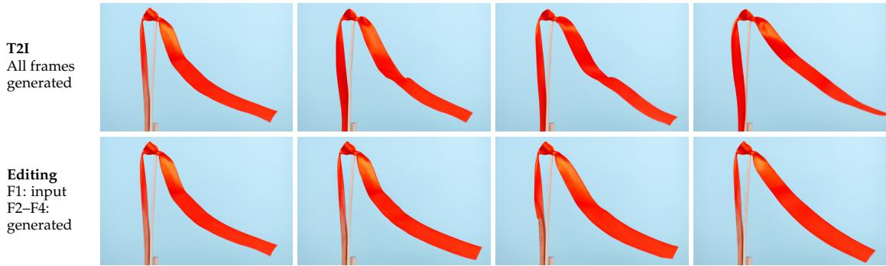  
(b) A pulsing jellyfish

Prompt summary: One pale pink jellyfish in a dark blue aquarium. Contract, expand, then contract again.  
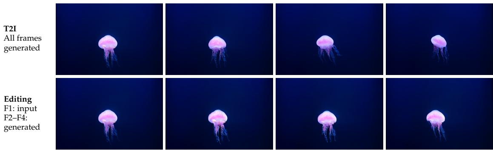  
Prompt summary: Ivory candle in a brass holder on a dark table. Flame upright, left, right, then upright.

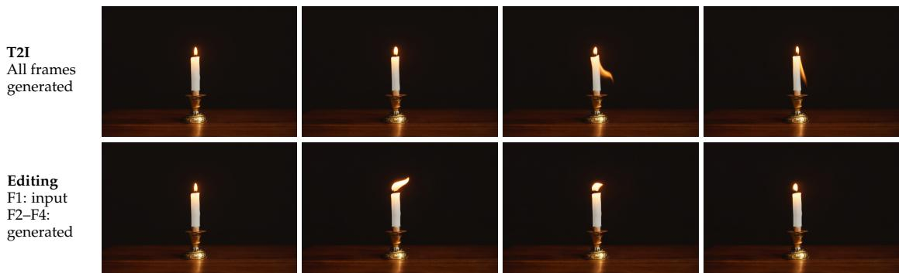  
Figure 11: Text-only generation (top) and first-frame-conditioned editing (bottom). Generation predicts F1–F4 jointly, whereas editing conditions on F1 to predict F2–F4, illustrating visual continuity under two conditioning settings.

Tab. 10 places UniSpark between BAGEL and SenseNova-U1 in decoding throughput and total latency at both visual-token budgets. At 1,024 tokens, it decodes at 22.19 tokens/s and finishes in 6.02 seconds, compared with 36.60 tokens/s and 3.76 seconds for BAGEL, and 18.09 tokens/s and 7.32 seconds for SenseNova-U1. Increasing the visual budget from 256 to 1,024 tokens changes its total latency only from 5.94 to 6.02 seconds, although first-logit latency rises from 0.143 to 0.292 seconds. For these fixed 128-token outputs, decoding therefore accounts for most of the request time. Peak allocated memory is slightly higher than SenseNova-U1 and remains above BAGEL at both budgets. These measurements describe computational cost rather than answer quality.

<table><tr><td>Type Model</td><td></td><td></td><td>Add Adjust</td><td>Extract</td><td>Replace</td><td>Remove</td><td>Back.</td><td>Style Hybrid</td><td></td><td>Action</td><td>Overall↑</td></tr><tr><td></td><td>FLUX.1 Kontext (2025)</td><td>4.25</td><td>4.15</td><td>2.35</td><td>4.56</td><td>3.57</td><td>4.26</td><td>4.57</td><td>3.68</td><td>4.63</td><td>4.00</td></tr><tr><td></td><td>Step1X-Edit (2025)</td><td>3.88</td><td>3.14</td><td>1.76</td><td>3.40</td><td>2.41</td><td>3.16</td><td>4.63</td><td>2.64</td><td>2.52</td><td>3.06</td></tr><tr><td>Ge. nly</td><td>Qwen-Image-Edit (2025)</td><td>4.32</td><td>4.36</td><td>4.04</td><td>4.64</td><td>4.52</td><td>4.37</td><td>4.84</td><td>3.39</td><td>4.71</td><td>4.35</td></tr><tr><td></td><td>Z-Image-Edit (2025)</td><td>4.40</td><td>4.14</td><td>4.30</td><td>4.57</td><td>4.13</td><td>4.14</td><td>4.85</td><td>3.63</td><td>4.50</td><td>4.30</td></tr><tr><td rowspan="6">unuified</td><td>BAGEL (2025)</td><td>3.56</td><td>3.31</td><td>1.70</td><td>3.30</td><td>2.62</td><td>3.24</td><td>4.49</td><td>2.38</td><td>4.17</td><td>3.20</td></tr><tr><td>OmniGen2 (2025b)</td><td>3.57</td><td>3.06</td><td>1.77</td><td>3.74</td><td>3.20</td><td>3.57</td><td>4.81</td><td>2.52</td><td>4.68</td><td>3.44</td></tr><tr><td>Lumina-DiMOO (2025a)</td><td>3.41</td><td>2.38</td><td>1.90</td><td>3.26</td><td>2.21</td><td>2.11</td><td>4.19</td><td>2.26</td><td>3.17</td><td>2.77</td></tr><tr><td>InternVL-U (2026)</td><td>4.13</td><td>3.40</td><td>2.27</td><td>4.13</td><td>3.39</td><td>3.84</td><td>4.77</td><td>3.03</td><td>4.05</td><td>3.67</td></tr><tr><td>LLaDA2.0-Uni (2026)</td><td>3.76</td><td>4.16</td><td>2.40</td><td>4.04</td><td>3.82</td><td>4.07</td><td>4.60</td><td>3.97</td><td>4.42</td><td>3.92</td></tr><tr><td>UniSpark†</td><td>3.72</td><td>2.54</td><td>1.68</td><td>3.51</td><td>3.52</td><td>3.47</td><td>4.05</td><td>1.62</td><td>3.44</td><td>3.13</td></tr></table>

Table 8: Instruction-based image editing on ImgEdit. Back.: background editing; †: Qwen3-VL reference scores (different judge).

## (a) A monastery on a lake island

Prompt: A weathered stone monastery stands on a small island in a deep blue lake, surrounded by cypress trees. From an elevated front-left view, a drone follows a smooth clockwise arc around the main building at moderate speed, ending at a distinctly different side view. a square bell tower shifts prominently across the facade as the camera reveals a secluded inner courtyard and the island's small boat landing. Clear morning daylight reveals fine surface textures with soft natural shadows. A single continuous real-time shot with sustained smooth physical camera movement from beginning to end, a level horizon, coherent rigid geometry, and a clearly different final composition. No cuts, no digital zoom, no speed ramp and no abrupt whip pan.

## (b) Waves along a forested shore

Prompt: A forested headland curves around a narrow beach at the foot of rugged mountains. A drone glides slowly along the shoreline, keeping the trees, cliff face, and beach in view. Successive waves advance toward shore, break into white foam, and recede across dark wet sand. Natural real-time motion without cuts.  
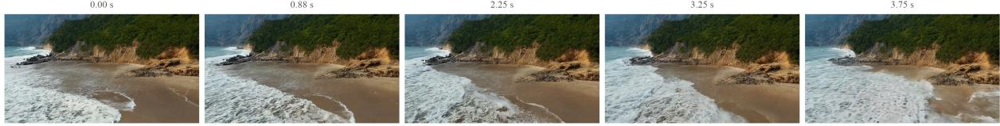

## (c) A woman in a garden

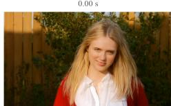

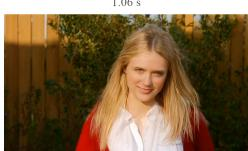

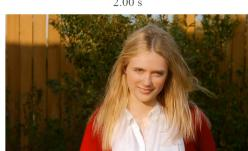

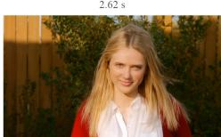

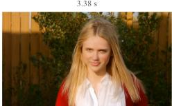  
Figure 12: Qualitative examples of video generation. Chronological frames illustrate text-conditioned scene evolution, including camera movement, waves, and subtle human motion.

The two tables distinguish generation speed from autoregressive decoding speed: UniSpark reduces generation latency relative to BAGEL at the shared resolutions, whereas BAGEL remains faster and uses less allocated memory for understanding. Matched workloads control sequence lengths, but model sizes, native tokenization, vision encoders, and implementations still differ. These system-level measurements do not isolate the effect of hybrid attention.

(a) Replacing a plate with a terracotta dish  
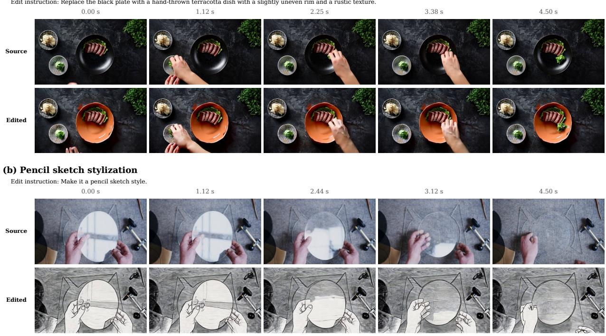

Figure 13: Qualitative examples of video editing. Temporally aligned source and edited frames illustrate object replacement and global stylization.
<table><tr><td>Resolution</td><td>Model</td><td>#LLM Params</td><td>Image tokens/s↑</td><td>Median latency (s)↓</td><td>P95 latency (s)↓</td><td>Peak allocated memory (GB)↓</td></tr><tr><td rowspan="3">512 ×512</td><td>BAGEL (2025)</td><td>7B MoT</td><td>87.09</td><td>11.76</td><td>11.77</td><td>30.47</td></tr><tr><td>SenseNova-U1 (2026)</td><td>8B MoT</td><td>39.80</td><td>6.43</td><td>6.52</td><td>35.49</td></tr><tr><td>UniSpark</td><td>9B MoT</td><td>35.19</td><td>7.27</td><td>7.36</td><td>37.39</td></tr><tr><td rowspan="3">1024× 1024</td><td>BAGEL (2025)</td><td>7B MoT</td><td>89.44</td><td>45.80</td><td>45.81</td><td>33.29</td></tr><tr><td>SenseNova-U1 (2026)</td><td>8B MoT</td><td>73.90</td><td>13.86</td><td>13.91</td><td>35.84</td></tr><tr><td>UniSpark</td><td>9B MoT</td><td>72.33</td><td>14.16</td><td>14.21</td><td>42.47</td></tr><tr><td rowspan="3">2048×2048</td><td>BAGEL (2025)</td><td>7BMoT</td><td></td><td></td><td></td><td></td></tr><tr><td>SenseNova-U1 (2026)</td><td>8B MoT</td><td>70.20</td><td>58.34</td><td>58.36</td><td>37.39</td></tr><tr><td>UniSpark</td><td>9B MoT</td><td>79.56</td><td>51.48</td><td>51.51</td><td>62.74</td></tr></table>

Table 9: Image generation efficiency across output resolutions.

<table><tr><td>Visual tokens</td><td>Model</td><td>#LLM Params</td><td>Input</td><td>Text decode tokens/s↑</td><td>First logits (s)↓</td><td>Median latency (s)↓</td><td>Peak allocated memory (GB)↓</td></tr><tr><td rowspan="3">256</td><td>BAGEL (2025)</td><td>7B MoT</td><td>224× 224</td><td>36.09</td><td>0.176</td><td>3.70</td><td>29.58</td></tr><tr><td>SenseNova-U1 (2026)</td><td>8B MoT</td><td>512 × 512</td><td>17.92</td><td>0.165</td><td>7.26</td><td>35.32</td></tr><tr><td>UniSpark</td><td>9B MoT</td><td>512×512</td><td>21.91</td><td>0.143</td><td>5.94</td><td>35.73</td></tr><tr><td rowspan="3">1,024</td><td>BAGEL (2025)</td><td>7B MoT</td><td>448× 448</td><td>36.60</td><td>0.263</td><td>3.76</td><td>29.77</td></tr><tr><td>SenseNova-U1 (2026)</td><td>8B MoT</td><td>1024 × 1024</td><td>18.09</td><td>0.289</td><td>7.32</td><td>35.85</td></tr><tr><td>UniSpark</td><td>9B MoT</td><td>1024×1024</td><td>22.19</td><td>0.292</td><td>6.02</td><td>36.03</td></tr></table>

Table 10: Visual understanding efficiency at matched visual-token budgets.

## 7 Conclusion

In this work, we present UniSpark, a unified multimodal model built on a Hybrid MoT Architecture. Specialized understanding and generation experts share multimodal context through full-attention and recurrent linear-attention layers. This architecture combines explicit visual interactions with compact recurrent context in the same backbone. Joint language modeling and visual flow matching connect image understanding, generation, and instruction-based editing, while clean visual context links successive outputs in interleaved sequences. Diverse multimodal supervision and progressive resolution training extend this framework to a broad range of tasks and image resolutions up to 2K. Experiments demonstrate strong multimodal understanding, and visual examples illustrate generation, editing, and interleaved prediction within the unified framework. Our results provide empirical evidence that hybrid attention can support both multimodal understanding and visual generation within a unified model. The context-handling design, training recipe, and evaluation results offer a practical reference for further studies of hybrid architectures for unified multimodal modeling.

## References

Qingyan Bai, Qiuyu Wang, Hao Ouyang, Yue Yu, Hanlin Wang, Wen Wang, Ka Leong Cheng, Shuailei Ma, Yanhong Zeng, Zichen Liu, Yinghao Xu, Yujun Shen, and Qifeng Chen. Scaling instruction-based video editing with a high-quality synthetic dataset. In Proceedings of the IEEE/CVF Conference on Computer Vision and Pattern Recognition, 2026.

Shuai Bai, Keqin Chen, Xuejing Liu, Jialin Wang, Wenbin Ge, Sibo Song, et al. Qwen2.5-VL technical report. arXiv preprint arXiv:2502.13923, 2025. doi: 10.48550/arXiv.2502.13923. URL https://arxiv.org/abs/2502. 13923.

Black Forest Labs. FLUX.1 [dev] Model Card. https://huggingface.co/black-forest-labs/FLUX.1-dev, 2024.

Black Forest Labs, Stephen Batifol, Andreas Blattmann, Frederic Boesel, Saksham Consul, Cyril Diagne, Tim Dockhorn, Jack English, Zion English, Patrick Esser, et al. FLUX.1 Kontext: Flow Matching for In-Context Image Generation and Editing in Latent Space. arXiv preprint arXiv:2506.15742, 2025. URL https://arxiv.org/abs/2506.15742.

Chameleon Team. Chameleon: Mixed-Modal Early-Fusion Foundation Models. arXiv preprint arXiv:2405.09818, 2024. URL https://arxiv.org/abs/2405.09818.

Junsong Chen, Jincheng Yu, Yitong Li, Shuchen Xue, Haozhe Liu, Jingyu Xin, Yuyang Zhao, Tian Ye, Zhangjie Wu, Zian Wang, Daquan Zhou, Ping Luo, Song Han, and Enze Xie. SANA-Video 2.0: Hybrid linear attention with attention residuals for efficient video generation. arXiv preprint arXiv:2607.21553, 2026. doi: 10.48550/arXiv.2607.21553. URL https://arxiv.org/abs/2607.21553.

Tianqi Chen, Bing Xu, Chiyuan Zhang, and Carlos Guestrin. Training deep nets with sublinear memory cost. arXiv preprint arXiv:1604.06174, 2016. URL https://arxiv.org/abs/1604.06174.

Xiaokang Chen, Zhiyu Wu, Xingchao Liu, Zizheng Pan, Wen Liu, Zhenda Xie, Xingkai Yu, and Chong Ruan. Janus-Pro: Unified Multimodal Understanding and Generation with Data and Model Scaling. arXiv preprint arXiv:2501.17811, 2025. URL https://arxiv.org/abs/2501.17811.

Zhe Chen, Weiyun Wang, Yue Cao, Yangzhou Liu, Zhangwei Gao, Erfei Cui, Jinguo Zhu, Shenglong Ye, Hao Tian, Zhaoyang Liu, et al. Expanding Performance Boundaries of Open-Source Multimodal Models with Model, Data, and Test-Time Scaling. arXiv preprint arXiv:2412.05271, 2024. URL https: //arxiv.org/abs/2412.05271.

Chaorui Deng, Deyao Zhu, Kunchang Li, Chenhui Gou, Feng Li, Zeyu Wang, Shu Zhong, Weihao Yu, Xiaonan Nie, Ziang Song, et al. Emerging properties in unified multimodal pretraining. arXiv preprint arXiv:2505.14683, 2025. doi: 10.48550/arXiv.2505.14683. URL https://arxiv.org/abs/2505.14683.

Haiwen Diao, Penghao Wu, Hanming Deng, Jiahao Wang, Shihao Bai, Silei Wu, Weichen Fan, Wenjie Ye, Wenwen Tong, Xiangyu Fan, Yan Li, Yubo Wang, Zhijie Cao, Zhiqian Lin, Zhitao Yang, Zhongang Cai, Yuwei Niu, Yue Zhu, Bo Liu, Chengguang Lv, Haojia Yu, Haozhe Xie, Hongli Wang, Jianan Fan, Jiaqi Li, Jiefan Lu, Jingcheng Ni, Junxiang Xu, Kaihuan Liang, Lianqiang Shi, Linjun Dai, Linyan Wang, Oscar Qian, Peng Gao, Pengfei Liu, Qingping Sun, Rui Shen, Ruisi Wang, Shengnan Ma, Shuang Yang, Siyi Xie, Siying Li, Tianbo Zhong, Xiangli Kong, Xuanke Shi, Yang Gao, Yongqiang Yao, Yves Wang, Zhengqi Bai, Zhengyu

Lin, Zixin Yin, Wenxiu Sun, Ruihao Gong, Quan Wang, Lewei Lu, Lei Yang, Ziwei Liu, and Dahua Lin. SenseNova-U1: Unifying Multimodal Understanding and Generation with NEO-unify Architecture. arXiv preprint arXiv:2605.12500, 2026. doi: 10.48550/arXiv.2605.12500. URL https://arxiv.org/abs/2605.12500.

Chaoyou Fu, Peixian Chen, Yunhang Shen, Yulei Qin, Mengdan Zhang, Xu Lin, Zhenyu Qiu, Wei Lin, Jinrui Yang, Xiawu Zheng, Ke Li, Xing Sun, and Rongrong Ji. MME: A Comprehensive Evaluation Benchmark for Multimodal Large Language Models. arXiv preprint arXiv:2306.13394, 2023. doi: 10.48550/arXiv.2306.13394. URL https://arxiv.org/abs/2306.13394v1.

Yu Gao, Lixue Gong, Qiushan Guo, Xiaoxia Hou, Zhichao Lai, Fanshi Li, Liang Li, Xiaochen Lian, Chao Liao, Liyang Liu, et al. Seedream 3.0 Technical Report. arXiv preprint arXiv:2504.11346, 2025. URL https://arxiv.org/abs/2504.11346.

Yuying Ge, Sijie Zhao, Jinguo Zhu, Yixiao Ge, Kun Yi, Lin Song, Chen Li, Xiaohan Ding, and Ying Shan. SEED-X: Multimodal Models with Unified Multi-granularity Comprehension and Generation. arXiv preprint arXiv:2404.14396, 2024. URL https://arxiv.org/abs/2404.14396.

Dhruba Ghosh, Hanna Hajishirzi, and Ludwig Schmidt. GenEval: An Object-Focused Framework for Evaluating Text-to-Image Alignment. arXiv preprint arXiv:2310.11513, 2023. URL https://arxiv.org/abs/ 2310.11513.

Xiaoyang Han, Jianhua Li, Kewang Deng, Zukai Chen, Xuanke Shi, Sihan Wang, Boxuan Li, Linyan Wang, Siyi Xie, Xin You, Jinsheng Quan, Zhongang Cai, Haiwen Diao, Ziwei Liu, Lei Yang, Dahua Lin, and Quan Wang. Vision as Unified Multimodal Generation. arXiv preprint arXiv:2607.06560, 2026. doi: 10.48550/arXiv.2607.06560. URL https://arxiv.org/abs/2607.06560.

Ali Hatamizadeh, Yejin Choi, and Jan Kautz. Gated DeltaNet-2: Decoupling Erase and Write in Linear Attention. arXiv preprint arXiv:2605.22791, 2026. doi: 10.48550/arXiv.2605.22791. URL https://arxiv.org/ abs/2605.22791.

Xiwei Hu, Rui Wang, Yixiao Fang, Bin Fu, Pei Cheng, and Gang Yu. ELLA: Equip Diffusion Models with LLM for Enhanced Semantic Alignment. arXiv preprint arXiv:2403.05135, 2024. URL https://arxiv.org/ abs/2403.05135.

Inclusion AI, Tiwei Bie, Haoxing Chen, Tieyuan Chen, Zhenglin Cheng, Long Cui, Kai Gan, Zhicheng Huang, Zhenzhong Lan, Haoquan Li, et al. LLaDA2.0-Uni: Unifying Multimodal Understanding and Generation with Diffusion Large Language Model. arXiv preprint arXiv:2604.20796, 2026. URL https: //arxiv.org/abs/2604.20796.

Angelos Katharopoulos, Apoorv Vyas, Nikolaos Pappas, and Franc¸ois Fleuret. Transformers are RNNs: Fast autoregressive transformers with linear attention. In Proceedings of the 37th International Conference on Machine Learning, volume 119, pp. 5156–5165, 2020. URL https://proceedings.mlr.press/v119/ katharopoulos20a.html.

Kimi Team, Angang Du, Bohong Yin, Bowei Xing, Bowen Qu, Bowen Wang, Cheng Chen, Chenlin Zhang, Chenzhuang Du, Chu Wei, et al. Kimi-VL Technical Report. arXiv preprint arXiv:2504.07491, 2025a. URL https://arxiv.org/abs/2504.07491.

Kimi Team, Yu Zhang, Zongyu Lin, Xingcheng Yao, Jiaxi Hu, Fanqing Meng, Chengyin Liu, Xin Men, Songlin Yang, Zhiyuan Li, Wentao Li, Enzhe Lu, Weizhou Liu, Yanru Chen, Weixin Xu, Longhui Yu, Yejie Wang, Yu Fan, Longguang Zhong, Enming Yuan, Dehao Zhang, Yizhi Zhang, T. Y. Liu, Haiming Wang, Shengjun Fang, Weiran He, Shaowei Liu, Yiwei Li, Jianlin Su, Jiezhong Qiu, Bo Pang, Junjie Yan, Zhejun Jiang, Weixiao Huang, Bohong Yin, Jiacheng You, Chu Wei, Zhengtao Wang, Chao Hong, Yutian Chen, Guanduo Chen, Yucheng Wang, Huabin Zheng, Feng Wang, Yibo Liu, Mengnan Dong, Zheng Zhang, Siyuan Pan, Wenhao Wu, Yuhao Wu, Longyu Guan, Jiawen Tao, Guohong Fu, Xinran Xu, Yuzhi Wang, Guokun Lai, Yuxin Wu, Xinyu Zhou, Zhilin Yang, and Yulun Du. Kimi Linear: An Expressive, Efficient Attention Architecture. arXiv preprint arXiv:2510.26692, 2025b. doi: 10.48550/arXiv.2510.26692. URL https://arxiv.org/abs/2510.26692.

Bo Li, Yuanhan Zhang, Dong Guo, Renrui Zhang, Feng Li, Hao Zhang, Kaichen Zhang, Peiyuan Zhang, Yanwei Li, Ziwei Liu, et al. LLaVA-OneVision: Easy Visual Task Transfer. arXiv preprint arXiv:2408.03326, 2024. URL https://arxiv.org/abs/2408.03326.

Ruibang Li, Guan Luo, Yiwei Zhang, Jin Gao, Bing Li, and Weiming Hu. SoLA-Vision: Fine-grained layerwise linear softmax hybrid attention. arXiv preprint arXiv:2601.11164, 2026. doi: 10.48550/arXiv.2601.11164. URL https://arxiv.org/abs/2601.11164.

Weixin Liang, Lili Yu, Liang Luo, Srinivasan Iyer, Ning Dong, Chunting Zhou, Gargi Ghosh, Mike Lewis, Wen-tau Yih, Luke Zettlemoyer, and Xi Victoria Lin. Mixture-of-transformers: A sparse and scalable architecture for multi-modal foundation models. Transactions on Machine Learning Research, 2025. doi: 10.48550/arXiv.2411.04996. URL https://arxiv.org/abs/2411.04996.

Yaron Lipman, Ricky T. Q. Chen, Heli Ben-Hamu, Maximilian Nickel, and Matt Le. Flow matching for generative modeling. In International Conference on Learning Representations, 2023. URL https://arxiv.org/ abs/2210.02747.

Shiyu Liu, Yucheng Han, Peng Xing, Fukun Yin, Rui Wang, Wei Cheng, Jiaqi Liao, Yingming Wang, Honghao Fu, Chunrui Han, et al. Step1X-Edit: A Practical Framework for General Image Editing. arXiv preprint arXiv:2504.17761, 2025. URL https://arxiv.org/abs/2504.17761.

Yuan Liu, Haodong Duan, Yuanhan Zhang, Bo Li, Songyang Zhang, Wangbo Zhao, Yike Yuan, Jiaqi Wang, Conghui He, Ziwei Liu, et al. MMBench: Is Your Multi-Modal Model an All-around Player? In Proceedings ofthe European Conference on Computer Vision (ECCV), 2024. URL https://arxiv.org/abs/2307.06281.

Zhiheng Liu, Weiming Ren, Xiaoke Huang, Shoufa Chen, Tianhong Li, Mengzhao Chen, Yatai Ji, Sen He, Jonas Schult, Belinda Zeng, Tao Xiang, Wenhu Chen, Ping Luo, Luke Zettlemoyer, and Yuren Cong. Tuna-2: Pixel Embeddings Beat Vision Encoders for Multimodal Understanding and Generation. arXiv preprint arXiv:2604.24763, 2026. doi: 10.48550/arXiv.2604.24763. URL https://arxiv.org/abs/2604.24763.

Ilya Loshchilov and Frank Hutter. Decoupled weight decay regularization. In International Conference on Learning Representations, 2019. URL https://arxiv.org/abs/1711.05101.

Pan Lu, Hritik Bansal, Tony Xia, Jiacheng Liu, Chunyuan Li, Hannaneh Hajishirzi, Hao Cheng, Kai-Wei Chang, Michel Galley, and Jianfeng Gao. MathVista: Evaluating Mathematical Reasoning of Foundation Models in Visual Contexts. arXiv preprint arXiv:2310.02255, 2023. URL https://arxiv.org/abs/2310.02255.

Meituan LongCat Team, Hanghang Ma, Haoxian Tan, Jiale Huang, Junqiang Wu, Jun-Yan He, Lishuai Gao, Songlin Xiao, Xiaoming Wei, Xiaoqi Ma, et al. LongCat-Image Technical Report. arXiv preprint arXiv:2512.07584, 2025. URL https://arxiv.org/abs/2512.07584.

Boyuan Meng, Peihua Bao, Hong Liu, Xiaowei Zhu, Chao Wang, Gen Li, and Zhenxuan Pan. HARTS: Efficient Agentic Reinforcement Learning for Hybrid-Attention Models over Arbitrary Rollout Trees. arXiv preprint arXiv:2608.28158, 2026. doi: 10.48550/arXiv.2608.28158. URL https://arxiv.org/abs/2608.28158.

William Merrill, Yanhong Li, Tyler Romero, Anej Svete, Caia Costello, Pradeep Dasigi, Dirk Groeneveld, David Heineman, Bailey Kuehl, Nathan Lambert, Chuan Li, Kyle Lo, Saumya Malik, DJ Matusz, Benjamin Minixhofer, Jacob Morrison, Luca Soldaini, Finbarr Timbers, Pete Walsh, Noah A. Smith, Hannaneh Hajishirzi, and Ashish Sabharwal. Olmo Hybrid: From Theory to Practice and Back. arXiv preprint arXiv:2604.03444, 2026. doi: 10.48550/arXiv.2604.03444. URL https://arxiv.org/abs/2604.03444.

OpenGVLab. InternVL2 Model Card. https://huggingface.co/OpenGVLab/InternVL2-8B, 2024.

Xichen Pan, Satya Narayan Shukla, Aashu Singh, Zhuokai Zhao, Shlok Kumar Mishra, Jialiang Wang, Zhiyang Xu, Jiuhai Chen, Kunpeng Li, Felix Juefei-Xu, et al. Transfer between Modalities with MetaQueries. arXiv preprint arXiv:2504.06256, 2025. URL https://arxiv.org/abs/2504.06256.

Wujian Peng, Lingchen Meng, Yuxuan Cai, Xianwei Zhuang, Yuhuan Yang, Rongyao Fang, Chenfei Wu, Junyang Lin, Zuxuan Wu, and Shuai Bai. Unified Multimodal Autoregressive Modeling with Shared Context-Visual Tokenizer is Key to Unification. arXiv preprint arXiv:2606.18249, 2026. doi: 10.48550/arXiv. 2606.18249. URL https://arxiv.org/abs/2606.18249.

Liao Qu, Huichao Zhang, Yiheng Liu, Xu Wang, Yi Jiang, Yiming Gao, Hu Ye, Daniel K. Du, Zehuan Yuan, and Xinglong Wu. TokenFlow: Unified Image Tokenizer for Multimodal Understanding and Generation. arXiv preprint arXiv:2412.03069, 2024. URL https://arxiv.org/abs/2412.03069.

Qwen Team. Qwen-Image-Edit Model Card. https://huggingface.co/Qwen/Qwen-Image-Edit, 2025.

Qwen Team. Qwen3.5-9B model card. Hugging Face, 2026. URL https://huggingface.co/Qwen/Qwen3.5-9B. Accessed September 6, 2026.

Robin Rombach, Andreas Blattmann, Dominik Lorenz, Patrick Esser, and Bjorn Ommer. High-resolution¨ image synthesis with latent diffusion models. In Proceedings of the IEEE/CVF Conference on Computer Vision and Pattern Recognition, 2022. URL https://arxiv.org/abs/2112.10752.

Weijia Shi, Xiaochuang Han, Chunting Zhou, Weixin Liang, Xi Victoria Lin, Luke Zettlemoyer, and Lili Yu. LM-Fusion: Adapting Pretrained Language Models for Multimodal Generation. arXiv preprint arXiv:2412.15188, 2024. URL https://arxiv.org/abs/2412.15188.

Zhentao Tan, Wei Chen, Jingyi Shen, Yao Liu, Xu Shen, Yue Wu, and Jieping Ye. HydraHead: From Head-Level Functional Heterogeneity to Specialized Attention Hybridization. arXiv preprint arXiv:2606.20097, 2026. doi: 10.48550/arXiv.2606.20097. URL https://arxiv.org/abs/2606.20097.

Tencent Hunyuan Foundation Model Team. HunyuanImage 3.0 Technical Report. arXiv preprint arXiv:2509.23951, 2025. URL https://arxiv.org/abs/2509.23951.

Changyao Tian, Danni Yang, Guanzhou Chen, Erfei Cui, Zhaokai Wang, Yuchen Duan, Penghao Yin, Sitao Chen, Ganlin Yang, Mingxin Liu, et al. InternVL-U: Democratizing Unified Multimodal Models for Understanding, Reasoning, Generation and Editing. arXiv preprint arXiv:2603.09877, 2026. URL https://arxiv.org/abs/2603.09877.

Shengbang Tong, David Fan, Jiachen Zhu, Yunyang Xiong, Xinlei Chen, Koustuv Sinha, Michael Rabbat, Yann LeCun, Saining Xie, and Zhuang Liu. MetaMorph: Multimodal Understanding and Generation via Instruction Tuning. arXiv preprint arXiv:2412.14164, 2024a. URL https://arxiv.org/abs/2412.14164.

Shengbang Tong, Zhuang Liu, Yuexiang Zhai, Yi Ma, Yann LeCun, and Saining Xie. Eyes Wide Shut? Exploring the Visual Shortcomings of Multimodal LLMs. arXiv preprint arXiv:2401.06209, 2024b. doi: 10.48550/arXiv.2401.06209. URL https://arxiv.org/abs/2401.06209.

Ashish Vaswani, Noam Shazeer, Niki Parmar, Jakob Uszkoreit, Llion Jones, Aidan N. Gomez, Lukasz Kaiser, and Illia Polosukhin. Attention is all you need. In Advances in Neural Information Processing Systems, 2017. URL https://arxiv.org/abs/1706.03762.

Wan Team. Wan2.2: Open and Advanced Large-Scale Video Generative Models. https://github.com/ Wan-Video/Wan2.2, 2025.

Chunwei Wang, Guansong Lu, Junwei Yang, Runhui Huang, Jianhua Han, Lu Hou, Wei Zhang, and Hang Xu. ILLUME: Illuminating Your LLMs to See, Draw, and Self-Enhance. arXiv preprint arXiv:2412.06673, 2024a. URL https://arxiv.org/abs/2412.06673.

Peng Wang, Shuai Bai, Sinan Tan, Shijie Wang, Zhihao Fan, Jinze Bai, Keqin Chen, Xuejing Liu, Jialin Wang, Wenbin Ge, et al. Qwen2-VL: Enhancing Vision-Language Model’s Perception of the World at Any Resolution. arXiv preprint arXiv:2409.12191, 2024b. URL https://arxiv.org/abs/2409.12191.

Xinlong Wang, Xiaosong Zhang, Zhengxiong Luo, Quan Sun, Yufeng Cui, Jinsheng Wang, Fan Zhang, Yueze Wang, Zhen Li, Qiying Yu, et al. Emu3: Next-Token Prediction Is All You Need. arXiv preprint arXiv:2409.18869, 2024c. URL https://arxiv.org/abs/2409.18869.

Ronald J. Williams and David Zipser. A learning algorithm for continually running fully recurrent neural networks. Neural Computation, 1(2):270–280, 1989. doi: 10.1162/neco.1989.1.2.270.

Chenfei Wu, Jiahao Li, Jingren Zhou, Junyang Lin, Kaiyuan Gao, Kun Yan, Sheng-ming Yin, Shuai Bai, Xiao Xu, Yilei Chen, et al. Qwen-Image Technical Report. arXiv preprint arXiv:2508.02324, 2025a. URL https://arxiv.org/abs/2508.02324.

Chengyue Wu, Xiaokang Chen, Zhiyu Wu, Yiyang Ma, Xingchao Liu, Zizheng Pan, Wen Liu, Zhenda Xie, Xingkai Yu, Chong Ruan, et al. Janus: Decoupling Visual Encoding for Unified Multimodal Understanding and Generation. arXiv preprint arXiv:2410.13848, 2024a. URL https://arxiv.org/abs/2410.13848.

Chenyuan Wu, Pengfei Zheng, Ruiran Yan, Shitao Xiao, Xin Luo, Yueze Wang, Wanli Li, Xiyan Jiang, Yexin Liu, Junjie Zhou, et al. OmniGen2: Towards Instruction-Aligned Multimodal Generation. arXiv preprint arXiv:2506.18871, 2025b. URL https://arxiv.org/abs/2506.18871.

Penghao Wu, Haiwen Diao, Weichen Fan, Lewei Lu, Dahua Lin, and Ziwei Liu. Uncovering Understanding-Generation Synergy in Native Unified Multimodal Models: From Representation, Task to System. arXiv preprint arXiv:2609.01607, 2026. doi: 10.48550/arXiv.2609.01607. URL https://arxiv.org/abs/2609.01607.

Yecheng Wu, Zhuoyang Zhang, Junyu Chen, Haotian Tang, Dacheng Li, Yunhao Fang, Ligeng Zhu, Enze Xie, Hongxu Yin, Li Yi, et al. VILA-U: a Unified Foundation Model Integrating Visual Understanding and Generation. arXiv preprint arXiv:2409.04429, 2024b. URL https://arxiv.org/abs/2409.04429.

Zhiyu Wu, Xiaokang Chen, Zizheng Pan, Xingchao Liu, Wen Liu, Damai Dai, Huazuo Gao, Yiyang Ma, Chengyue Wu, Bingxuan Wang, et al. DeepSeek-VL2: Mixture-of-Experts Vision-Language Models for Advanced Multimodal Understanding. arXiv preprint arXiv:2412.10302, 2024c. URL https://arxiv.org/ abs/2412.10302.

Jinheng Xie, Weijia Mao, Zechen Bai, David Junhao Zhang, Weihao Wang, Kevin Qinghong Lin, Yuchao Gu, Zhijie Chen, Zhenheng Yang, and Mike Zheng Shou. Show-o: One single transformer to unify multimodal understanding and generation. arXiv preprint arXiv:2408.12528, 2024a. doi: 10.48550/arXiv.2408.12528. URL https://arxiv.org/abs/2408.12528.

Jinheng Xie, Zhenheng Yang, and Mike Zheng Shou. Show-o2: Improved native unified multimodal models. arXiv preprint arXiv:2506.15564, 2025. doi: 10.48550/arXiv.2506.15564. URL https://arxiv.org/abs/2506. 15564.

Rongchang Xie, Chen Du, Ping Song, and Chang Liu. MUSE-VL: Modeling Unified VLM through Semantic Discrete Encoding. arXiv preprint arXiv:2411.17762, 2024b. URL https://arxiv.org/abs/2411.17762.

Yi Xin, Qi Qin, Siqi Luo, Kaiwen Zhu, Juncheng Yan, Yan Tai, Jiayi Lei, Yuewen Cao, Keqi Wang, Yibin Wang, et al. Lumina-DiMOO: An Omni Diffusion Large Language Model for Multi-Modal Generation and Understanding. arXiv preprint arXiv:2510.06308, 2025a. URL https://arxiv.org/abs/2510.06308.

Yi Xin, Juncheng Yan, Qi Qin, Zhen Li, Dongyang Liu, Shicheng Li, Victor Shea-Jay Huang, Yupeng Zhou, Renrui Zhang, Le Zhuo, et al. Lumina-mGPT 2.0: Stand-Alone AutoRegressive Image Modeling. arXiv preprint arXiv:2507.17801, 2025b. URL https://arxiv.org/abs/2507.17801.

Le Xue, Manli Shu, Anas Awadalla, Jun Wang, An Yan, Senthil Purushwalkam, Honglu Zhou, Viraj Prabhu, Yutong Dai, Michael S Ryoo, et al. xGen-MM (BLIP-3): A Family of Open Large Multimodal Models. arXiv preprint arXiv:2408.08872, 2024. URL https://arxiv.org/abs/2408.08872.

Ceyuan Yang, Zhijie Lin, Yang Zhao, Fei Xiao, Hao He, Qi Zhao, Chaorui Deng, Kunchang Li, Zihan Ding, Yuwei Guo, Fuyun Wang, Fangqi Zhu, Xiaonan Nie, Shenhan Zhu, Shanchuan Lin, Hongsheng Li, Weilin Huang, Guang Shi, and Haoqi Fan. Context Unrolling in Omni Models. arXiv preprint arXiv:2604.21921, 2026. doi: 10.48550/arXiv.2604.21921. URL https://arxiv.org/abs/2604.21921.

Ling Yang, Ye Tian, Bowen Li, Xinchen Zhang, Ke Shen, Yunhai Tong, and Mengdi Wang. MMaDA: Multimodal Large Diffusion Language Models. arXiv preprint arXiv:2505.15809, 2025a. URL https: //arxiv.org/abs/2505.15809.

Songlin Yang, Jan Kautz, and Ali Hatamizadeh. Gated delta networks: Improving Mamba2 with delta rule. In International Conference on Learning Representations, 2025b. doi: 10.48550/arXiv.2412.06464. URL https://arxiv.org/abs/2412.06464.

Yang Ye, Xianyi He, Zongjian Li, Bin Lin, Shenghai Yuan, Zhiyuan Yan, Bohan Hou, and Li Yuan. ImgEdit: A Unified Image Editing Dataset and Benchmark. arXiv preprint arXiv:2505.20275, 2025. doi: 10.48550/arXiv. 2505.20275. URL https://arxiv.org/abs/2505.20275.

Zebin You, Xiaolu Zhang, Jun Zhou, Chongxuan Li, and Ji-Rong Wen. LLaDA-o: An Effective and Length-Adaptive Omni Diffusion Model. arXiv preprint arXiv:2603.01068, 2026. URL https://arxiv.org/abs/ 2603.01068.

Weihao Yu, Zhengyuan Yang, Linjie Li, Jianfeng Wang, Kevin Lin, Zicheng Liu, Xinchao Wang, and Lijuan Wang. MM-Vet: Evaluating Large Multimodal Models for Integrated Capabilities. In Proceedings of the 41st International Conference on Machine Learning, volume 235 of Proceedings of Machine Learning Research, pp. 57730–57754. PMLR, 2024. URL https://proceedings.mlr.press/v235/yu24o.html.

Xiang Yue, Yuansheng Ni, Kai Zhang, Tianyu Zheng, et al. MMMU: A Massive Multi-Discipline Multimodal Understanding and Reasoning Benchmark for Expert AGI. In Proceedings of the IEEE/CVF Conference on Computer Vision and Pattern Recognition (CVPR), 2024. URL https://openaccess.thecvf.com/content/CVPR2024/html/Yue MMMU A Massive Multi-discipline Multimodal Understanding and Reasoning Benchmark for CVPR 2024 paper.html.

Z-Image Team, Huanqia Cai, Sihan Cao, Ruoyi Du, Peng Gao, Steven Hoi, Zhaohui Hou, Shijie Huang, Dengyang Jiang, Xin Jin, Liangchen Li, et al. Z-Image: An Efficient Image Generation Foundation Model with Single-Stream Diffusion Transformer. arXiv preprint arXiv:2511.22699, 2025. URL https: //arxiv.org/abs/2511.22699.

Huichao Zhang, Liao Qu, Yiheng Liu, Hang Chen, Yangyang Song, Yongsheng Dong, Shikun Sun, Xian Li, Xu Wang, Yi Jiang, et al. NextFlow: Unified Sequential Modeling Activates Multimodal Understanding and Generation. arXiv preprint arXiv:2601.02204, 2026. URL https://arxiv.org/abs/2601.02204.

Yanli Zhao, Andrew Gu, Rohan Varma, Liang Luo, Chien-Chin Huang, Min Xu, Less Wright, Hamid Shojanazeri, Myle Ott, Sam Shleifer, et al. PyTorch FSDP: Experiences on Scaling Fully Sharded Data Parallel. arXiv preprint arXiv:2304.11277, 2023. URL https://arxiv.org/abs/2304.11277.

Chunting Zhou, Lili Yu, Arun Babu, Kushal Tirumala, Michihiro Yasunaga, Leonid Shamis, Jacob Kahn, Xuezhe Ma, Luke Zettlemoyer, and Omer Levy. Transfusion: Predict the next token and diffuse images with one multi-modal model. arXiv preprint arXiv:2408.11039, 2024. doi: 10.48550/arXiv.2408.11039. URL https://arxiv.org/abs/2408.11039.

Yubo Zhu, Zhehan Kan, Jingyi Yang, Miaolin Chen, Jinbo Xing, Kai Zhu, Zijian Wang, Sheng Zhong, and Wei Tong. When Does Visual Generation Help Visual Understanding in Unified Multimodal Models? arXiv preprint arXiv:2608.22174, 2026. doi: 10.48550/arXiv.2608.22174. URL https://arxiv.org/abs/2608.22174.