# VBot Exo2Ego Policy Lightweight Data Collection and Exocentric-to-Egocentric Video Generation

Tong Rao\* Zhihao Zhang\* Yuntian Wang\* Siyu Zhou† Hailong Qin† Yinan Yu†

Vbot Physical AI Lab Shanghai, China

tong.rao@vbot.cn siyu.zhou@vbot.cn

zhihao.zhang@vbot.cn hailong.qin@vbot.cn

26120249@bjtu.edu.cn yinan.yu@vbot.cn

Equal contribution. †Corresponding authors.

## Abstract

We present VBot Exo2Ego Policy, a video generation model that turns third-person videos into first-person observations of a selected actor, ofering a practical way to expand first-person operation data from abundant real-world footage. To support this goal, we introduce a lightweight data collection pipeline and mobile app that support first-person recording, third-person recording, and synchronized capture of both views. This setup combines accessible single-view collection with paired RGB and camera geometry for learning cross-view correspondence. Building on a pretrained video difusion transformer, our model incorporates geometric guidance and auxiliary supervision from semantic masks and hand keypoints to facilitate optimization and improve the fidelity of hand–object interactions. Camera geometry is injected stochastically during training and gradually removed, allowing inference without target-camera calibration. To accommodate the diversity of Internet videos, we combine source-video perception and reasoning, optional actor references, and multi-shot adaptation to identify the intended actor and follow an operation across camera cuts. The collection system and generation model provide a foundation for expanding first-person operation data across tasks, scenes, and participants.

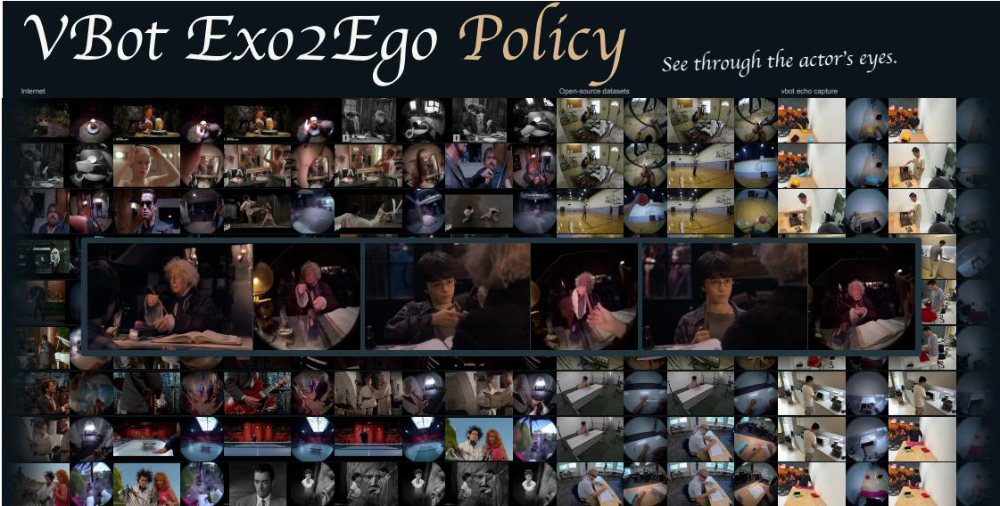  
Figure 1. From observed operations to first-person video. Selected EXO inputs and generated EGO frames.

## 1 Introduction

First-person video exposes the acting hands, manipulated objects, and local workspace in a common visual context. It is useful for learning operations, but collecting diverse first-person recordings is constrained by capture equipment and participant efort. Third-person video ofers broader coverage, provided that view conversion preserves the actor, interaction, and event sequence.

We address two connected problems. The first is a lightweight data collection standard that accommodates both accurate paired supervision and accessible single-view capture. Synchronized LiDAR-equipped iPhones provide real EGO/EXO pairs, camera poses, and near-field geometry. Crowdsourced participants can instead record either viewpoint with one camera. Real EGO recordings support manipulation pretraining directly; real EXO recordings provide inputs for generating EGO counterparts.

The second is an EXO-to-EGO model that preserves operation content across viewpoints. VBot Exo2Ego Policy builds on a pretrained video difusion transformer and combines camera conditioning with auxiliary supervision of hands and manipulated objects. Geometry guides camera-relative structure during training. Semantic masks couple interaction regions with RGB generation, while ACE features and 2D joint targets encourage hand structure that can be recovered by downstream perception. Actor-reference images and synchronized multi-view shot construction address multiple people and camera changes in real videos.

Our contributions are:

1. A lightweight collection and preprocessing standard. Precise paired capture and diverse single-view crowdsourcing share view-aware processing, cross-view identity association, and data selection suited to each supervision stage.

2. A model for operation-preserving view conversion. Stochastic camera conditioning, semantic HOI supervision, and ACE/GT hand supervision complement source perception, actor selection, and multi-shot training. We evaluate RGB fidelity and the hand/object observations extracted from generated videos.

Section 3 presents collection and preprocessing. Sections 4 and 5 describe the generator and interaction supervision. Section 6 evaluates RGB fidelity and recoverable hand–object structure.

## 2 Related Work

Novel view synthesis and dynamic representations. Novel view synthesis (NVS) has advanced through improvements in scene representation, optimization eficiency, and generalizable reconstruction. NeRF [1] represents a static scene as a continuous field of volume density and view-dependent radiance, learned from posed images through diferentiable volume rendering. NeuS [2] introduces a signed distance function and a volume-rendering formulation that reduces geometric bias in surface reconstruction, improving the recovery of scene surfaces. Instant-NGP [3] combines multiresolution hash encoding, compact neural networks, and eficient GPU kernels to substantially accelerate optimization and rendering. 3D Gaussian Splatting (3DGS) [4] uses explicit anisotropic Gaussians, adaptive density control, and diferentiable splatting to support high-quality, real-time novel-view rendering.

Recent feed-forward approaches predict renderable Gaussian representations directly from images. Apple’s SHARP [5] regresses a metric 3D Gaussian representation from a single photograph in one network pass, supporting real-time rendering of nearby viewpoints. AnySplat [6] jointly predicts 3D Gaussians and camera intrinsics and extrinsics from uncalibrated multi-view images, extending feed-forward reconstruction to unconstrained image collections.

Operation videos additionally require representations of temporal change. 4D Gaussian Splatting (4D-GS) [7] augments a shared set of 3D Gaussians with a time-conditioned deformation model. A decomposed 4D neural voxel encoding captures spatial and temporal features, and a lightweight decoder predicts Gaussian deformations at queried timestamps. This formulation models scene structure and motion across time while retaining eficient Gaussian rasterization, enabling real-time rendering of dynamic scenes from novel viewpoints. For EXO-to-EGO conversion, these advances motivate preserving scene motion together with camera-relative geometry when changing viewpoints.

Feed-forward geometry and dynamic reconstruction. DUSt3R [8] learns pairwise point-map reconstruction; VGGT [9] jointly predicts cameras, depth, point maps, and tracks. Depth Anything 3 (DA3) [10] unifies geometry prediction through depth and camera rays, while $\pi ^ { 3 }$ (Pi3) [11] removes the fixed reference-view choice with a permutation-equivariant architecture. These models provide camera and scene estimates for constructing view-aligned geometric conditions. Recent dynamic models extend this foundation: D4RT [12] jointly recovers geometry, cameras, and spatiotemporal correspondence; 4RC [13] encodes a video once and queries geometry and motion across timestamps; Any4D [14] predicts dense metric geometry and scene flow, optionally using additional sensors. These advances improve the temporal geometric support available to video generation. First-person synthesis additionally requires appearance in newly exposed regions, fine hand articulation, and hand–object contact that may be weakly observed in EXO footage.

Video reshooting and camera control. Video reshooting preserves the content and dynamics of an input video while changing its camera trajectory. Geometric proxies and learned video conditions provide complementary support for generating the new views. TrajectoryCrafter [15] combines point-cloud renders and source video in a dual-stream difusion model. For world-consistent camera-controlled generation, GEN3C [16] renders a persistent 3D cache to guide newly generated frames. EX-4D [17] uses a depth watertight mesh to address occlusion and boundary artifacts under extreme viewpoint changes. A complementary approach, ReCamMaster [18], learns source-video and camera conditioning from synchronized synthetic multiview videos to reproduce the input dynamics along a new camera trajectory.

Vista4D [19] grounds the source video and target cameras in a 4D point cloud, combining persistent static content with reconstructed scene dynamics. Training on reconstructed multiview dynamic videos improves robustness to real-world depth and point-cloud artifacts while source-video conditioning preserves appearance. Manifold4D [20] further studies conflicts between point-cloud renders and source-video conditions. It injects the target-view render into the initial flow-matching noise, using it once at initialization while retaining source video as the visual condition during denoising. The render remains required to initialize inference. Projected geometric conditions provide viewpoint cues but can contain holes, occlusion errors, or distorted surfaces. Reshooting therefore requires spatial alignment, temporal consistency, and generative completion to preserve the observed event while filling content newly exposed by camera changes.

Exocentric-to-egocentric video generation. EgoX [21] specializes video difusion for single-video EXOto-EGO conversion through LoRA adaptation, rendered EGO priors, and geometry-guided self-attention. The rendered prior provides target viewpoint cues, while source-video conditioning carries appearance and action evidence. Large EXO/EGO viewpoint changes can expose regions missing from that prior, making completion of the acting hands and local workspace particularly important. Grounded-Exo2Ego [22] combines geometric anchoring with an object-level semantic grounding branch to restore content under unreliable projections. Its camera re-localization improves alignment between reconstructed geometry and paired EGO targets, and its synthetic data engine supplies additional aligned supervision. These works establish geometry, semantics, and training alignment as complementary ingredients of first-person generation. Our model learns camera guidance through stochastic ray conditioning that is annealed away across training updates. Joint semantic-mask prediction and ACE/GT hand supervision connect RGB generation with interaction regions and extractable joint structure, while inference uses EXO video, text, and an optional actor reference.

Paired data and interaction supervision. Ego-Exo4D [23] supplies synchronized first- and third-person observations. Our collection standard combines paired phone RGB-D capture with single-view crowdsourcing. ACE-Ego-Hand features [24] and hand annotations from HOT3D [25], ARCTIC [26], and Re:InterHand [27] support interaction-aware supervision and hand readouts.

## 3 Data Collection and Preprocessing

We develop a data collection pipeline and a mobile capture app supporting EGO, EXO, and synchronized paired recording. The pipeline connects reliable paired capture with scalable first-person data expansion: real EGO/EXO pairs provide cross-view training targets and geometric observations, real EGO recordings directly support manipulation pretraining, and captured or Internet EXO videos provide inputs to VBot Exo2Ego Policy for EGO generation. The app, capture protocol, and data standard connect these sources to the overall model workflow. Table 1 summarizes their inputs and uses; recorded and generated views retain distinct provenance.

## 3.1 Capture App and Acquisition Routes

Table 1. Data sources and uses. Recorded and generated views have distinct provenance.
<table><tr><td>Route</td><td>Recorded input</td><td>Use / derived product</td></tr><tr><td>Precise paired capture</td><td>LiDAR-equipped iPhone Pro devices; and held-out evaluation. depth, pose, and timing metadata</td><td>EGO and EXO RGB from paired Real paired supervision for EXO-to-EGO training</td></tr><tr><td>EGO capture</td><td>A real first-person video</td><td>Real EGO data for manipulation pretraining; a paired EXO view is not required.</td></tr><tr><td>EXO capture / Internet</td><td>A real third-person video from con- tributors or the Internet</td><td>Input to EXO-to-EGO generation; a real EXO / gen- erated EGO pair after QC.</td></tr></table>

Synchronized paired RGB-D capture. Two LiDAR-equipped iPhone Pro devices record the same operation from EGO and EXO viewpoints, associating the same actor, manipulated objects, and continuous action timeline. Temporal synchronization pairs frames at the same point in the operation. ARKit supplies camera trajectories, while LiDAR supplies near-field depth observations; the geometric pairing procedure in Section 3.2 relates the two views in a common metric coordinate frame.

The app provides the recording interface, and a standard operating procedure (SOP) specifies camera placement, mounting, imaging settings, and visibility of the hands, objects, and key events. The EGO mount permits natural head motion; after the common-start setup described below, the EXO phone remains fixed during the operation. Before capture, the operator rehearses the action and checks that its key stages remain recognizable at the model’s input resolution. Each recording retains RGB, timestamps, camera intrinsics, ARKit trajectories and tracking states, and available depth with registration, validity, and confidence information. Frame selection, cropping, and resizing preserve mappings to the source frames and the corresponding camera parameters.

Single-view collection and Internet EXO ingestion. Participants can contribute EGO or EXO video to broaden task, object, scene, and viewpoint coverage. The same ingestion route accommodates large-scale Internet EXO footage, expanding the source pool beyond newly commissioned capture. After manipulation-clip selection and target-actor association, EXO footage is supplied to the generator to produce the corresponding first-person view. This reduces dedicated EGO capture efort when expanding manipulation data, without requiring depth or camera calibration for each EXO input. Actor references and multi-shot adaptation address multi-person scenes and camera cuts (Section 4.4). Quality selection and generated data review are described in the following subsections.

## 3.2 Geometric Pairing and Cross-View Correspondence

Wide-baseline estimation. During manipulation, EGO and EXO cameras often have a wide spatial baseline, limited visual overlap, hand–object occlusions, and substantial diferences in scale and appearance. Relevant estimation approaches include feed-forward geometry models such as VGGT [9], Pi3 [11], DA3 [10], and DUSt3R [8], as well as learned matching and reconstruction methods such as MASt3R [28], SuperPoint+LightGlue [29], LoFTR [30], and RoMa [31]. In our low-overlap capture setting, direct recovery from widely separated operational views can be unstable or fail, motivating a capture protocol that supplies a visual connection between the streams.

Common-start SOP and joint reconstruction. At the start of synchronized capture, the two cameras record a shared visible region from nearby scene locations before moving to their operational viewpoints. We retain these common-start observations and jointly reconstruct them with keyframes from both EGO and EXO streams. This creates a visual connection between sequences whose operational views may have little overlap. In our experience, Pi3 and DA3 work well under this capture arrangement. The common start supports cross-sequence association; joint reconstruction and a metric reference then establish the spatial pairing. The devices’ independent ARKit coordinate systems are not assumed to coincide.

ARKit-referenced validation and metric alignment. We associate the jointly predicted EGO camera trajectory with the ARKit EGO trajectory at matching timestamps and estimate a single Sim(3) alignment for scale, rotation, and translation. The aligned trajectory shape and residuals provide a consistency check on predicted motion. For accepted reconstructions, the same global transform is applied to both camera trajectories, and its scale factor is applied consistently to predicted depths. For a predicted camera center �ˆ and depth $\hat { D } .$ , this gives $c = s R \hat { c } + t$ and $D ^ { \mathrm { m e t r i c } } = s \hat { D }$ . Relative EGO–EXO poses follow from the two camera poses in the shared metric frame. ARKit trajectory agreement is considered alongside geometric consistency in jointly observed regions; a successful similarity fit alone does not establish the correctness of the EXO pose. Temporal pairing, metric depth, and the shared camera frame together support frame-level geometric correspondence in mutually visible regions.

LiDAR depth validation and preprocessing. iPhone LiDAR depth also provides a near-field metric reference for checking predicted depth and scale. ARKit scene depth is a processed, low-resolution estimate with spatially varying reliability. In our capture practice, reliability decreases substantially near or beyond approximately five meters, so those measurements are not used as primary validation anchors. This operating boundary varies with the device, materials, lighting, and scene. Low resolution, finite projected spot and sampling footprints, and interpolation can produce mixed foreground/background estimates and merged fine structures at distant objects or depth boundaries. Before validation, preprocessing aligns RGB and depth timestamps, intrinsics, and image transforms, excludes invalid, low-confidence, and out-of-range samples, and handles depth discontinuities and outliers. Validation primarily uses valid near-field observations while retaining their confidence and validity information.

After temporal and geometric alignment, we select video clips and auxiliary targets according to their visual quality and intended training role.

## 3.3 Quality Assessment and Training-Stage Selection

The VLM assigns sampled frames clarity scores from 1 to 5, ranging from severe degradation to sharp detail. Newly scored 141-frame clips use eight uniformly spaced samples, including the endpoints. The clip rating is the rounded arithmetic mean:

$$
\bar { s } = \frac { 1 } { N } \sum _ { i = 1 } ^ { N } s _ { i } , \qquad s _ { \mathrm { c l i p } } = \left\lfloor \bar { s } + \frac { 1 } { 2 } \right\rfloor .
$$

The mean, minimum, and low-score count remain available for selection. Normal fisheye distortion and optical black corners are part of the camera model. View review additionally records wearer identity, EXO head/orientation cues, and incidental EGO occlusion. Task hands and objects entering the near field are treated as interaction content.

Low light and rapid motion reduce visible detail but contribute to real-world diversity. We therefore select data according to its training role (Table 2). RGB supervision uses broad coverage after anomaly rejection. Hand and semantic supervision exclude insuficiently lit or excessively fast-motion samples to improve target reliability.

Table 2. Data selection by supervision stage.
<table><tr><td>Supervision</td><td>Selection</td><td>Purpose</td></tr><tr><td>RGB</td><td>Broad data coverage after hard anomaly rejec- Retain real-world lighting, motion, and ap- tion.</td><td>pearance diversity.</td></tr><tr><td>Hand</td><td>Exclude insufficient illumination or exces- Improve feature and keypoint target reliability. sively rapid motion.</td><td></td></tr><tr><td>Semantic</td><td>Exclude insufficient illumination or exces- Improve region and boundary target reliability. sively rapid motion.</td><td></td></tr></table>

Hard-anomaly review covers the complete training clip. A single frame with mosaics, anomalous blurring of essential content, a blackout, or corrupt imagery rejects the sample; neither an average clarity score nor trimming overrides that decision. Sampled clarity assessment and complete-clip anomaly review have separate roles.

Task localization and supervision validation. Video semantics, hand/object observations, motion, and masks localize the continuous operation interval. Manipulation phases follow approach, execution, and release, with task boundaries linked to the source frames. Derived hand targets and masks are checked for valid observations, missing or incorrect regions, boundary quality, and temporal consistency. Each sample records RGB, geometry, hand, and semantic availability so that usable RGB can contribute even when an auxiliary target is unreliable.

## 3.4 First-Person Data Expansion and Provenance

Recorded EGO directly supports manipulation pretraining. For EXO-only sources, the trained generator produces an EGO counterpart using source perception, text, and an optional actor reference. Review checks action and object consistency, event order, and temporal coherence.

Each item retains its source interval, recorded/generated view identity, model, prompt, and generation settings. Source-aware splits group all derivatives of a recording together. Ingestion and any required privacy processing preserve the actor and interaction evidence needed by the intended training stage. Alignment and packaging are summarized in Appendix B.

## 4 VBot Exo2Ego Policy

The VBot Exo2Ego Policy generates a first-person video of an operation from an exocentric (EXO) recording. The task presents two challenges: EXO footage varies in viewpoint, may contain multiple people, and can switch cameras mid-action, while the generated egocentric (EGO) video must faithfully depict the operation from the intended actor’s viewpoint. To handle this diversity, we use source-video reasoning and an optional actor reference image to identify whose view to generate, and train on clips that switch between synchronized EXO views so the model can follow the same action across cuts. To improve EGO fidelity, we use camera conditioning to guide learning of the target viewpoint and auxiliary semantic and hand supervision to preserve how the actor’s hands interact with objects.

## 4.1 Source Conditioning and RGB Generation

We use Qwen3.8-VL to describe the operation shown in an EXO clip �. Qwen receives frames $F _ { X } ^ { \mathrm { Q w e n } }$ from the clip and a structured perception record $S _ { X }$ containing actor identities, hand and object regions, and interaction events. It produces a text description � of the intended actor’s actions and their temporal order.

$$
c = \mathrm { Q w e n 3 . 8 – V L } \big ( F _ { X } ^ { \mathrm { Q w e n } } , S _ { X } \big ) .\tag{1}
$$

We adapt MiniMax-H3 Ref2VA for EXO-to-EGO video generation by training an RGB LoRA while keeping the base model frozen. Let $G _ { \theta }$ denote the adapted generator, with � denoting the RGB LoRA parameters. The generator takes the EXO clip �, the Qwen-generated description $c$ from Equation (1), and an optional EXO screenshot $I _ { a }$ identifying the actor whose first-person view is to be generated. We write $I _ { a } = \varnothing$ when no screenshot is provided. Starting from initial latent noise $\epsilon _ { \mathrm { i n i t } }$ , the generator produces the EGO RGB video $\hat { Y } \colon$

$$
\hat { Y } = G _ { \theta } ( X , c , I _ { a } ; \epsilon _ { \mathrm { i n i t } } ) .\tag{2}
$$

Within H3, we use the frozen video VAE to encode � as a visual reference. The frozen H3 context encoder embeds source frames $F _ { X } ^ { \mathrm { H 3 } }$ together with � and $I _ { a }$ , when the reference image is provided. We denote the resulting source conditions by $C = \left( E _ { \mathrm { V A E } } ( X ) , E _ { \mathrm { c t x } } ( F _ { X } ^ { \mathrm { H 3 } } , c , I _ { a } ) \right)$

For RGB training, let � be the paired EGO target and $z _ { 0 } = E _ { \mathrm { V A E } } ( Y )$ its clean latent. At timestep �, we construct a noisy latent $z _ { t }$ by interpolating between $z _ { 0 }$ and training noise � at noise level $\sigma _ { t }$ . The H3 denoiser takes $z _ { t } , t ,$ , and $c$ as inputs and predicts the velocity $\bar { \nu } _ { \theta } ( z _ { t } , t ; C )$ . We train this prediction with the weighted flow-matching objective

$$
\begin{array} { r } { z _ { t } = ( 1 - \sigma _ { t } ) z _ { 0 } + \sigma _ { t } \epsilon , \phantom { x x x x x x x x x x x x x x x x x x x x x x x x x x x x x x x x x x x x x x x x x x } } \\ { \mathcal { L } _ { \mathrm { R G B } } = \mathbb { E } _ { t , \epsilon } \left[ w ( t ) \left. \bar { \nu } _ { \theta } ( z _ { t } , t ; C ) - ( \epsilon - z _ { 0 } ) \right. _ { 2 } ^ { 2 } \right] , } \end{array}\tag{3}
$$

where $w ( t )$ is the scheduler weight and $\bar { \nu } _ { \theta }$ is the efective velocity prediction. We freeze the base H3 model and train the RGB LoRA to learn the EXO-to-EGO mapping.

Architecture. Figure 2 shows reference and context encoding, RGB generation, and auxiliary supervision. Rays enter target tokens during training. The semantic branch reads RGB features and returns semantic gradients to the generator; hand supervision acts on clean latent predictions or intermediate EGO features.

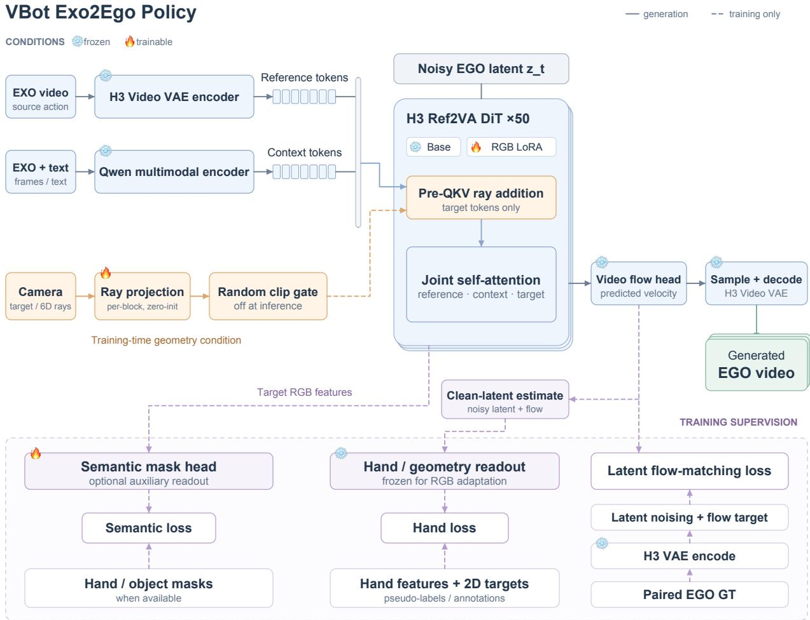  
Figure 2. VBot Exo2Ego Policy architecture. Solid paths generate EGO RGB; dashed paths introduce geometric, semantic, and hand supervision during training.

## 4.2 Stochastic Camera Conditioning

To incorporate calibrated camera geometry into viewpoint learning while preserving the pretrained generator’s behavior at initialization, we introduce stochastic camera conditioning. We sample a Bernoulli gate for each training clip to control whether calibrated target-camera rays are injected through zero-initialized projections. We anneal the probability of ray injection to zero before the end of training, so the final training phase uses the same conditioning inputs as inference: the EXO clip, its text description, and an optional actor reference image.

Calibrated rays and token injection. We represent the target camera geometry with Plücker rays. For a calibrated fisheye camera, we use the camera model to compute a viewing ray for each target EGO token. Let � be the camera center and � the unit viewing direction, both expressed in the selected EXO coordinate frame. We write each ray as

$$
r = [ o \times d , d ] .\tag{4}
$$

We collect these rays in � in the same order as the EGO tokens.

During training, each DiT block ℓ uses a zero-initialized linear projection $W _ { \ell }$ to map the rays to token embeddings. Before the QKV projection, we add each ray embedding to its corresponding EGO token,

controlled by a binary gate $b .$

$$
u ^ { \prime } \ell , \mathtt { E G O } = u _ { \ell , \mathtt { E G O } } + b W _ { \ell } R , \qquad b \in \{ 0 , 1 \} .\tag{5}
$$

Here, $u _ { \ell , \mathrm { E G O } }$ and $u ^ { \prime } \ell , \mathrm { E G O }$ are the EGO tokens before and after ray injection. We sample one gate � per clip and share it across all frames, token positions, and DiT blocks.

Condition dropout and annealing. The ray probability follows training progress �:

$$
b \sim { \mathrm { B e r n o u l l i } } ( p ( q ) ) , \qquad p ( q ) = { \left\{ \begin{array} { l l } { 0 . 5 , } & { 0 \leq q < 0 . 7 , } \\ { 0 . 5 \ { \frac { 0 . 8 - q } { 0 . 1 } } , } & { 0 . 7 \leq q < 0 . 8 , } \\ { 0 , } & { 0 . 8 \leq q \leq 1 . } \end{array} \right. }\tag{6}
$$

The first 70% of training exposes the model to both conditioned and unconditioned clips. Probability decreases linearly over 70–80%, and the final 20% is ray-free. Subsequent ray-free continuation retains the learned RGB adaptation. Deployment bypasses the ray branch.

## 4.3 Source Perception and Reasoning

An EXO clip can show several people interacting with diferent objects. To specify which operation the EGO video should depict, we construct a text condition � that describes the intended actor’s hand actions, the objects involved, and the order of events. We use the same procedure to prepare this text for training and inference.

Structured hand/object evidence. For an EXO clip �, we organize the source observations into a structured record $S _ { X }$ . The record identifies actors and objects and stores hand roles, keyframe indices, two-dimensional regions, and hand–object relations. Person tracks link observations across frames to the same actor. We provide $S _ { X }$ and the EXO frames $F _ { X } ^ { \mathrm { Q w e n } }$ to Qwen3.8-VL as in Equation (1).

Reasoning text and keyframe ROIs. In the detailed text format, we include keyframe evidence alongside the natural-language description. The regions of interest (ROIs) are bounding boxes in normalized EXO image coordinates. The interaction relation identifies the actor, the hand, the action, and the object. The example below describes a right-hand grasp at frame 70.

EXO frame 70   
actor=2; right\_hand.box=(0.42,0.38,0.63,0.72)   
cup.box=(0.52,0.40,0.68,0.63)   
relation=(actor\_2,right\_hand,grasps,cup)   
Description. The actor in the blue shirt grasps the cup with the right hand, lifts it, and places it on the table.

Qwen3.8-VL uses the source frames and the structured evidence to generate the description. The H3 context encoder then embeds the resulting text � together with the source visual inputs, as described in Section 4.1.

Concise task text. The same operation can also be expressed as a short task description, such as “Grasp the cup, lift it, and place it on the table.” Both formats preserve the task and the event order. The detailed format also specifies where the hands and objects appear at keyframes and how they interact. The source associations and, when provided, the actor reference image identify whose first-person view H3 should generate.

## 4.4 Actor Reference and Multi-Shot Adaptation

Internet EXO footage can show several people interacting in the same workspace and can switch cameras while an operation is still in progress. In a multi-person scene, the same clip can support several first-person viewpoints. At a camera cut, the framing and viewing angle can change abruptly even though the underlying action continues. We use an optional actor reference to specify whose view to generate and train on synchronized camera switches to maintain continuity across source shots.

Actor reference. We use an EXO screenshot as the optional reference image $I _ { a }$ in Equation (2). The screenshot can retain the wider scene or be cropped around the intended actor. The reference image identifies the person whose viewpoint the generator should follow, while the EXO clip supplies the motion and timing of the operation.

During training, the reference image depicts the wearer of the paired EGO camera. We align the reference image, the source perception record $S _ { X }$ , and the text description � with that same person. This association links the visual reference to the hands, objects, and actions described in the text.

Synchronized multi-view shot construction. We construct multi-shot training inputs from EXO cameras that record the same operation in sync. At selected points in the source timeline, we switch from one EXO camera to another while keeping a continuous EGO target from the same wearer. Each source frame therefore remains aligned in time with its corresponding EGO frame across the cut. These pairs teach the generator to follow a single operation as the source viewpoint changes.

Inference. We provide the EXO clip and its source-grounded text to the adapted generator. In scenes with multiple people, the user can also provide a screenshot to specify the intended actor. The generator produces a continuous EGO RGB sequence for that actor across the source shots. The joint RGB–semantic model can also output the corresponding semantic masks.

## 5 Auxiliary Supervision for Hand–Object Interaction

A generated EGO video can match the overall appearance of an operation while misplacing a hand or object or distorting the motion of individual joints. To improve hand and object localization, we supplement the RGB objective with semantic masks that specify the regions occupied by the wearer’s hands and the manipulated objects. To preserve hand articulation and motion, we use ACE features and annotated 2D keypoints as additional supervision. Both objectives shape the RGB representation, and we evaluate their efects on RGB fidelity and on the hand and object observations recovered from the generated videos.

## 5.1 Joint RGB and Semantic-Mask Supervision for HOI

We use semantic masks that are spatially and temporally aligned with the EGO RGB video. Each mask labels pixels as background, manipulated objects, or the camera wearer’s hands, arms, and sleeves. The RGB and mask branches share a frozen backbone, with a separate LoRA adapter for each branch. The mask branch uses features from the RGB branch to localize the labeled regions and track their motion over time. During joint training, gradients from the mask loss flow through these features to the RGB LoRA, so region-level supervision directly shapes the representation used for RGB generation.

Mask supervision.. Let � be the ground-truth semantic-mask video. We encode it with the same frozen video VAE used for RGB to obtain the clean mask latent $m _ { 0 } = E _ { \mathrm { V A E } } ( M )$ . The mask branch predicts its velocity from the noisy RGB latent $z _ { t }$ and the target RGB features described above. We use the same noise � that forms $z _ { t }$ to construct the mask velocity target $\epsilon - m _ { 0 }$

Let $\nu _ { m } ^ { + }$ and $\nu _ { m } ^ { - }$ denote the mask velocities from the positive- and negative-text forward passes, respectively.   
We use the same inverse-CFG rule and scheduler weight �(�) as in Equation (3).

$$
\begin{array} { c } { { \bar { \nu } _ { m } = \displaystyle \frac { \nu _ { m } ^ { + } + \left( g - 1 \right) \mathrm { s g } ( \nu _ { m } ^ { - } ) } { g } , \qquad g = 4 , } } \\ { { \mathcal { L } _ { m } = \mathbb { E } _ { t , \epsilon } \left[ w ( t ) \| \bar { \nu } _ { m } - ( \epsilon - m _ { 0 } ) \| _ { 2 } ^ { 2 } \right] . } } \end{array}\tag{7}
$$

Mask warm-up and joint fine-tuning.. Let $\theta _ { r }$ and $\theta _ { m }$ denote the RGB and mask LoRA parameters, respectively, with $\theta _ { r }$ corresponding to $\theta$ in Section 4.1. During mask warm-up, we keep the trained RGB adapter $\theta _ { r } ^ { ( 0 ) }$ fixed and update the mask adapter using ${ \mathcal { L } } _ { m }$ . We then initialize joint fine-tuning with the trained RGB adapter and the warmed-up mask adapter, and update both using the combined loss.

$$
\begin{array} { r l } { \mathrm { M a s k ~ w a r m - u p } } & { \underset { \theta _ { m } } { \mathrm { m i n } } \ \mathcal { L } _ { m } ( \theta _ { r } ^ { ( 0 ) } , \theta _ { m } ) , } \\ { \mathrm { J o i n t ~ f i n e - t u n i n g } } & { \underset { \theta _ { r } , \theta _ { m } } { \mathrm { m i n } } \ \mathcal { L } _ { \mathrm { j o i n t } } ( \theta _ { r } , \theta _ { m } ) , } \\ { \mathcal { L } _ { \mathrm { j o i n t } } ( \theta _ { r } , \theta _ { m } ) = \mathcal { L } _ { \mathrm { R G B } } ( \theta _ { r } ) + 0 . 1 \ \mathcal { L } _ { m } ( \theta _ { r } , \theta _ { m } ) . } \end{array}\tag{8}
$$

During joint fine-tuning, the target RGB keys and values from the positive-text forward pass remain in the computation graph. The mask loss therefore sends gradients to the RGB adapter through the same attention connection that provides RGB features to the mask branch. The two adapters receive the following gradients:

$$
\begin{array} { r l } & { \nabla _ { \theta _ { r } } \mathcal { L } _ { \mathrm { j o i n t } } = \nabla _ { \theta _ { r } } \mathcal { L } _ { \mathrm { R G B } } + 0 . 1 \nabla _ { \theta _ { r } } \mathcal { L } _ { m } , } \\ & { \nabla _ { \theta _ { m } } \mathcal { L } _ { \mathrm { j o i n t } } = 0 . 1 \nabla _ { \theta _ { m } } \mathcal { L } _ { m } . } \end{array}\tag{9}
$$

## 5.2 ACE Features and Ground-Truth Keypoint Supervision

Downstream operation pipelines often consume 2D hand keypoints extracted from video, so generated hands should support consistent joint localization and motion recovery. After comparing candidate methods, we found ACE-Ego-Hand [24] to be a suitable approach for directly obtaining 2D hand keypoints from a single egocentric RGB video. We also use its intermediate hand features as a representation-level supervision signal.

Our hand supervision combines real annotated data with ACE-derived pseudo-labels and features. Groundtruth annotations anchor joint localization and refine the hand reader, while ACE pseudo-labels extend supervision to recorded EGO clips without manual keypoint annotations. Intermediate-feature alignment complements coordinate-level targets by transferring the extractor’s hand representation to the generator.

The experiments in Section 6.3 report stronger ACE-based keypoint agreement and maintained or improved RGB fidelity for the evaluated hand-supervised training recipes. These results support the efectiveness of combining GT-refined hand readouts with ACE pseudo-labels and intermediate-feature supervision.

Features and joint targets. For recorded EGO video �, frozen ACE-Ego-Hand supplies intermediate features $F ^ { * }$ and decoded pseudo-labels: joint heatmaps $H ^ { * }$ , 2D coordinates $J ^ { * }$ , and hand presence $s ^ { * }$ . Features capture hand appearance and structure, while the decoded pseudo-labels explicitly constrain localization and detection. For predicted features $\widehat F$ and their ACE decoding, we use

$$
\begin{array} { r l } & { \mathcal { L } _ { \mathrm { h a n d } } = \mathcal { L } _ { \mathrm { f e a t } } ( \widehat { F } , F ^ { * } ) + \lambda _ { H } \mathcal { L } _ { \mathrm { K L } } ( \widehat { H } , H ^ { * } ) } \\ & { \qquad + \lambda _ { J } \mathcal { L } _ { \mathrm { H u b e r } } ( \widehat { J } , J ^ { * } ) + \lambda _ { s } \mathcal { L } _ { \mathrm { B C E } } ( \widehat { s } , s ^ { * } ) . } \end{array}\tag{10}
$$

Feature matching emphasizes hand regions, heatmaps retain spatial uncertainty, coordinates anchor joint locations, and presence targets penalize missing or spurious hands.

A projector $P _ { \psi }$ maps H3 EGO latents to ACE features, which the fixed ACE decoder � converts to hand observations:

$$
\widetilde { F } = P _ { \psi } ( z _ { 0 } ) , \qquad ( \widetilde { H } , \widetilde { J } , \widetilde { s } ) = D ( \widetilde { F } ) .\tag{11}
$$

The projector is aligned to ACE features and refined using hand annotations from HOT3D [25], ARCTIC [26], and Re:InterHand [27]. Calibrated annotations supply 2D targets and heatmaps:

$$
\mathcal { L } _ { \mathrm { G T } } = \mathcal { L } _ { \mathrm { K L } } ( \widetilde { H } , H ^ { \mathrm { G T } } ) + \beta _ { J } \mathcal { L } _ { \mathrm { H u b e r } } ( \widetilde { J } , J ^ { \mathrm { G T } } ) .\tag{12}
$$

ACE-derived pseudo-targets and dataset GT are distinct supervision sources. Annotated EGO-only clips refine the reader; paired EGO–EXO clips train the view-conversion generator.

Supervision of the predicted video. ACEaux applies the prepared reader to the predicted clean latent

$$
\widehat { z } _ { 0 } = z _ { t } - \sigma _ { t } \bar { \nu } _ { \theta } ( z _ { t } , t ; C ) , \qquad \widehat { F } = P _ { \psi ^ { * } } ( \widehat { z } _ { 0 } ) .\tag{13}
$$

RGB LoRA is trained with

$$
\begin{array} { r } { \mathcal { L } _ { \mathrm { A C E a u x } } = \mathcal { L } _ { \mathrm { R G B } } + \lambda _ { h } \mathcal { L } _ { \mathrm { h a n d } } . } \end{array}\tag{14}
$$

The reader and ACE decoder are fixed, while gradients pass through them to RGB LoRA. This supervises the structure and motion of the video currently predicted by the generator.

Supervision of intermediate features. MultiLayer reads hands from several generator depths, combining spatial evidence with broader action context. Normalized EGO features are projected, fused with learned weights, and aligned to the ACE grid:

$$
\widehat { F } = A _ { \phi } \left( \sum _ { \ell \in S } \alpha _ { \ell } W _ { \ell } \mathbf { L } \mathbf { N } ( h _ { \ell } ) \right) , \qquad \sum _ { \ell } \alpha _ { \ell } = 1 .\tag{15}
$$

We first learn the readout with RGB fixed, then jointly adapt it and RGB LoRA using RGB and hand losses. The hand gradient acts directly on the selected EGO features. Both routes leave the inference inputs unchanged, and their hand readers can be removed for RGB generation.

## 6 Experiments

We evaluate RGB fidelity together with hand and object observations recoverable from generated video. The experiments compare EgoX baselines and examine semantic joint training, hand-supervision strategies, and camera conditioning.

## 6.1 Evaluation Protocol

Following the seen-/unseen-setting evaluation protocol of EgoX [21], we assess generalization using our own training and validation splits. Seen and unseen refer to physical scene settings represented in or held out from our task-adaptation training split, respectively. The fixed development-validation panel contains 546 clips spanning 86 captures: 475 seen-setting clips and 71 unseen-setting clips. All models in each comparison are scored on the same clips. All RGB scores use 448 × 448 frames at 30 fps without temporal resampling. PSNR, SSIM, LPIPS, and CLIP-I average frames within each clip and then weight clips equally; FVD uses the same I3D implementation on each complete subset. Our auxiliary-supervision comparisons use the same frozen EXO/text conditions, 141 output frames, 50 sampling steps, inference CFG 1, and seed 42.

Table 3 compares VBot Exo2Ego Policy with released EgoX [21] and an in-house H3 adaptation, EgoX/H3. Both EgoX baselines use target-view geometric priors; VBot Exo2Ego Policy uses EXO video and text without a geometric prior at inference. EgoX takes 49 EXO frames, while EgoX/H3 and our model take 141; the shorter evaluation of our model uses the first 49 frames of the same generated video. Our model is the Joint v1 checkpoint after 3,000 updates, and EgoX/H3 is evaluated at step 3,000. The comparison therefore evaluates the complete systems under their respective conditioning and training recipes.

Table 3. VBot Exo2Ego Policy compared with EgoX for first-person video generation. EgoX is the released model; EgoX/H3 is our H3-based adaptation. VBot Exo2Ego Policy achieves better reconstruction, perceptual similarity, and video-distribution quality across both clip lengths and all subsets.
<table><tr><td>Subset</td><td>Model</td><td>PSNR↑</td><td>SSIM↑</td><td>LPIPS↓</td><td>CLIP-I↑</td><td>FVD↓</td></tr><tr><td colspan="7">49-frame clips</td></tr><tr><td>All (546)</td><td>EgoX</td><td>12.630</td><td>0.4087</td><td>0.5942</td><td>0.8427</td><td>306.90</td></tr><tr><td></td><td>VBot Exo2Ego Policy</td><td>15.856</td><td>0.4894</td><td>0.4955</td><td>0.8708</td><td>191.55</td></tr><tr><td>Seen (475)</td><td>EgoX</td><td>12.735</td><td>0.4186</td><td>0.5903</td><td>0.8440</td><td>322.06</td></tr><tr><td></td><td>VBot Exo2Ego Policy</td><td>15.897</td><td>0.4943</td><td>0.4923</td><td>0.8724</td><td>199.79</td></tr><tr><td>Unseen (71)</td><td>EgoX</td><td>11.927</td><td>0.3422</td><td>0.6209</td><td>0.8338</td><td>1146.71</td></tr><tr><td></td><td>VBot Exo2Ego Policy</td><td>15.584</td><td>0.4568</td><td>0.5174</td><td>0.8600</td><td>908.01</td></tr><tr><td colspan="7">141-frame clips</td></tr><tr><td>All (545)</td><td>EgoX/H3</td><td>12.579</td><td>0.3832</td><td>0.5971</td><td>0.8373</td><td>284.49</td></tr><tr><td></td><td>VBot Exo2Ego Policy</td><td>15.826</td><td>0.4891</td><td>0.4954</td><td>0.8714</td><td>171.21</td></tr><tr><td>Seen (474)</td><td>EgoX/H3</td><td>12.598</td><td>0.3885</td><td>0.5973</td><td>0.8378</td><td>297.36</td></tr><tr><td></td><td>VBot Exo2Ego Policy</td><td>15.871</td><td>0.4942</td><td>0.4922</td><td>0.8729</td><td>170.46</td></tr><tr><td>Unseen (71)</td><td>EgoX/H3</td><td>12.449</td><td>0.3477</td><td>0.5955</td><td>0.8338</td><td>974.04</td></tr><tr><td></td><td>VBot Exo2Ego Policy</td><td>15.525</td><td>0.4551</td><td>0.5168</td><td>0.8613</td><td>782.86</td></tr></table>

Each pair of rows uses the same clips and ground truth. The 141-frame group excludes one EgoX/H3 prior failure from both models; the following auxiliary-supervision tables retain all 546 clips.

VBot Exo2Ego Policy improves all five metrics in every subset. Relative to released EgoX, it gains 3.23 dB in PSNR and reduces FVD by 37.6%; relative to EgoX/H3, the gains are 3.25 dB and 39.8%.

Native ACE independently processes generated and real EGO RGB under the same per-clip calibration and anatomical left/right identities. PCK thresholds are 5% and 10% of image width; missing predictions count as failures. EPE and joint-motion error are reported with coverage. SAM3 object masks are evaluated against oficial sparse annotations (91 clips, 170 object frames) and a real-RGB SAM reference (247 positive clips, 1,449 frames). These readouts evaluate generated RGB, separately from auxiliary-head accuracy.

The auxiliary-supervision tables compare training recipes with diferent optimization budgets. ACE joints are pseudo-references, while dataset GT trains and validates the hand reader. This development panel has been used for checkpoint selection. Full scoring and training details are in Appendix A.

## 6.2 Semantic Supervision

Independent hand and object readouts show improved localization with semantic joint training (Table 4). $\mathrm { P C K } _ { . 0 5 }$ increases by 5.019 percentage points and oficial object IoU by 2.299 points. Joint coverage changes from 92.433% to 90.805%; the gain concerns localization rather than uniform improvement across every hand metric.

Table 4. Hand and object readouts from generated RGB (%).
<table><tr><td>Model</td><td> $\mathbf { P C K } _ { . 0 5 }$  个</td><td> $\mathbf { P C K } _ { . 1 0 } \uparrow$ </td><td>Coverage↑</td><td>Official IoU↑</td><td>SAM IoU↑</td></tr><tr><td>RGB-only</td><td>11.519</td><td>39.773</td><td>92.433</td><td>5.471</td><td>7.015</td></tr><tr><td>RGB + Semantic</td><td>16.538</td><td>48.346</td><td>90.805</td><td>7.770</td><td>8.584</td></tr></table>

## 6.3 Hand Supervision

Table 5. RGB quality under diferent hand-supervision strategies.
<table><tr><td>Model</td><td>PSNR ↑</td><td>SSIM ↑</td><td>LPIPS ↓</td><td>CLIP-I↑</td><td>FVD↓</td></tr><tr><td>Seen: 475 clips, 79 captures</td><td></td><td></td><td></td><td></td><td></td></tr><tr><td>RGB-only</td><td>15.363</td><td>0.4823</td><td>0.5173</td><td>0.8657</td><td>202.06</td></tr><tr><td>ACEaux</td><td>15.943</td><td>0.5015</td><td>0.4930</td><td>0.8668</td><td>180.95</td></tr><tr><td>MultiLayer</td><td>15.977</td><td>0.5003</td><td>0.4925</td><td>0.8680</td><td>171.73</td></tr><tr><td>Unseen: 71 clips, 7 captures</td><td></td><td></td><td></td><td></td><td></td></tr><tr><td>RGB-only</td><td>14.939</td><td>0.4442</td><td>0.5429</td><td>0.8546</td><td>845.76</td></tr><tr><td>ACEaux</td><td>15.529</td><td>0.4632</td><td>0.5192</td><td>0.8525</td><td>840.49</td></tr><tr><td>MultiLayer</td><td>15.647</td><td>0.4623</td><td>0.5198</td><td>0.8590</td><td>805.11</td></tr><tr><td>Total: 546 clips, 86 captures</td><td></td><td></td><td></td><td></td><td></td></tr><tr><td>RGB-only</td><td>15.308</td><td>0.4774</td><td>0.5206</td><td>0.8643</td><td>204.38</td></tr><tr><td>ACEaux</td><td>15.890</td><td>0.4965</td><td>0.4964</td><td>0.8649</td><td>187.37</td></tr><tr><td>MultiLayer</td><td>15.934</td><td>0.4954</td><td>0.4961</td><td>0.8668</td><td>173.28</td></tr></table>

Table 6. Hand structure and motion extracted from generated RGB.
<table><tr><td>Model</td><td>PCK@5% ↑</td><td>PCK@10% ↑</td><td>EPE (px) ↓</td><td>Joint cov. (%) ↑</td><td>Motion err. (px/fr) ↓</td><td>Motion cov. (%) ↑</td></tr><tr><td>Seen: 475 clips, 79 captures</td><td></td><td></td><td></td><td></td><td></td><td></td></tr><tr><td>RGB-only</td><td>12.47</td><td>41.87</td><td>55.86</td><td>91.72</td><td>4.447</td><td>91.37</td></tr><tr><td>ACEaux</td><td>21.44</td><td>56.51</td><td>46.51</td><td>94.62</td><td>4.214</td><td>94.40</td></tr><tr><td>MultiLayer</td><td>18.26</td><td>51.14</td><td>47.36</td><td>88.71</td><td>4.206</td><td>88.31</td></tr><tr><td>Unseen: 71 clips, 7 captures</td><td></td><td></td><td></td><td></td><td></td><td></td></tr><tr><td>RGB-only</td><td>5.24</td><td>25.92</td><td>65.13</td><td>97.12</td><td>3.452</td><td>97.01</td></tr><tr><td>ACEaux</td><td>10.64</td><td>42.45</td><td>53.41</td><td>98.92</td><td>3.184</td><td>98.87</td></tr><tr><td>MultiLayer</td><td>10.33</td><td>39.54</td><td>55.68</td><td>96.36</td><td>3.475</td><td>96.27</td></tr><tr><td>Total: 546 clips, 86 captures</td><td></td><td></td><td></td><td></td><td></td><td></td></tr><tr><td>RGB-only</td><td>11.52</td><td>39.77</td><td>57.09</td><td>92.43</td><td>4.316</td><td>92.12</td></tr><tr><td>ACEaux</td><td>20.02</td><td>54.66</td><td>47.42</td><td>95.18</td><td>4.078</td><td>94.99</td></tr><tr><td>MultiLayer</td><td>17.21</td><td>49.61</td><td>48.46</td><td>89.72</td><td>4.108</td><td>89.36</td></tr></table>

Native ACE is run independently on generated RGB and recorded EGO to measure recoverable hand structure (Table 6). ACEaux gives the strongest extraction agreement: PCK@5% increases from 11.52% to 20.02%, PCK@10% from 39.77% to 54.66%, and joint coverage from 92.43% to 95.18%. EPE decreases from 57.09

to 47.42 pixels. MultiLayer gives the strongest aggregate image metrics, with higher PCK but lower hand coverage than the RGB-only reference.

## 6.4 Camera-Conditioning Optimization

At native 256P, stochastic ray conditioning followed by ray-free continuation yields lower logged flow-MSE than the historical RGB reference (Table 7). During updates 3001–5000, mean loss is 0.12557 versus 0.13638, a 7.93% reduction. These are optimization measurements under the recorded recipes; the loss curves and settings appear in Appendix A.

Table 7. Weighted training flow-MSE at native 256P. Values average the original per-update losses.
<table><tr><td>Updates</td><td>Historical RGB</td><td>Stochastic rays</td><td>Relative change</td></tr><tr><td>1-3000</td><td>0.14070</td><td>0.13051</td><td>-7.24%</td></tr><tr><td>3001-5000</td><td>0.13638</td><td>0.12557</td><td>-7.93%</td></tr><tr><td>4501-5000</td><td>0.13712</td><td>0.12383</td><td>-9.69%</td></tr><tr><td>4901-5000</td><td>0.14002</td><td>0.12436</td><td>-11.19%</td></tr><tr><td>1-5000</td><td>0.13897</td><td>0.12853</td><td>-7.51%</td></tr></table>

## 6.5 Qualitative Results

Figure 3 shows interaction masks and hand observations from generated EGO. The hand panels compare direct H3 readout with independent ACE extraction on the same generated frames. Internet examples retain horizontal EXO/EGO pairs (Figure 4). Multi-keyframe semantic results and GT/ACE/projector comparisons on recorded EGO are collected in Appendix C.

Interaction-aware first-person generation  
EXO input  
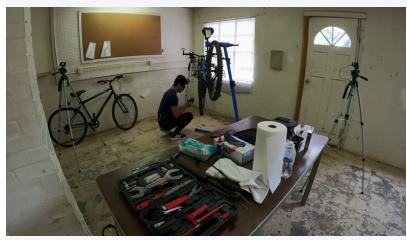

Generated EGO  
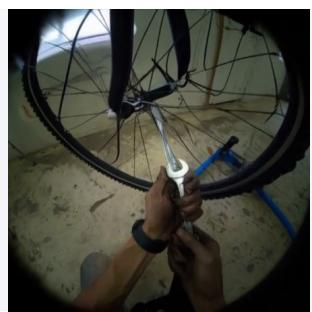  
EGO + semantic mask

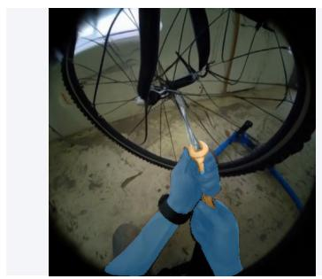  
Bicycle repair | frame 70

EXO input  
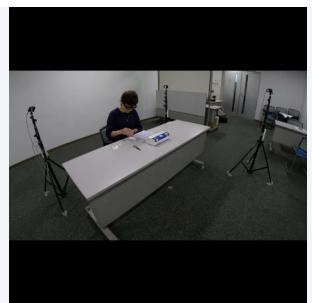

EGO + H3 hand readout  
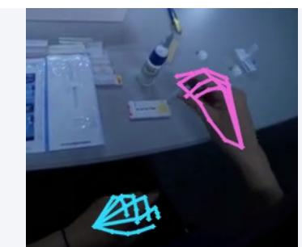  
EGO + ACE extraction

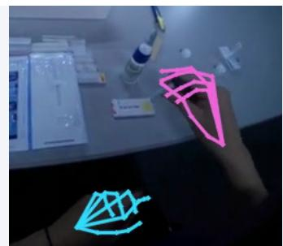  
Same generated EGO, common hand-region crop | frame 70

Figure 3. Semantic masks and hand readouts from generated EGO.  
Raiders of the Lost Ark  
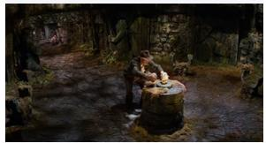

Generated EGO  
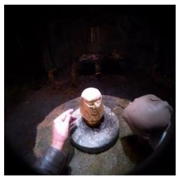  
The Gold Rush (Chaplin)  
EXO input

Generated EGO (grayscale)  
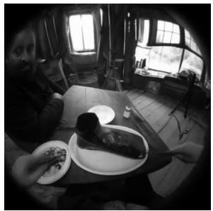  
frame 55  
frame 55

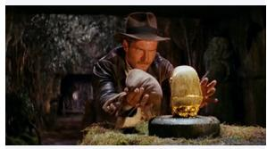  
frame 125

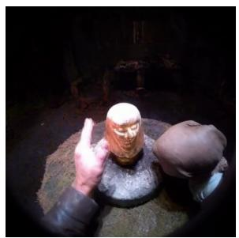  
Figure 4. Internet EXO-to-EGO examples.

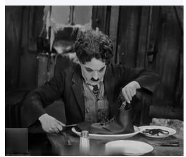  
frame 85

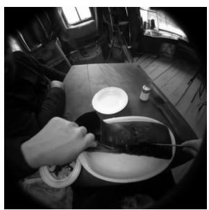

## 7 Conclusion and Limitations

VBot Exo2Ego Policy connects lightweight data collection with first-person video generation. Precise paired capture supplies camera and appearance correspondence, while single-view crowdsourcing expands real-world coverage. Stochastic camera conditioning supports viewpoint learning; semantic HOI and ACE/GT hand objectives connect RGB generation to interaction regions and extractable joint structure. The evaluated auxiliary-training recipes improve these interaction readouts alongside reported RGB fidelity. Source reasoning, actor selection, and multi-shot training extend the same model interface to diverse real videos.

Limitations. EXO footage can hide hand articulation, object surfaces, and head motion, leaving several plausible EGO observations. Auxiliary supervision inherits uncertainty from its labels and extractors, and performance may vary across devices, tasks, and viewpoints. Synchronized camera switches cover a continuous event; arbitrary time skips and actor changes require broader edited-video training.

## References

[1] Ben Mildenhall et al. NeRF: Representing Scenes as Neural Radiance Fields for View Synthesis. ECCV, 2020. https://arxiv.org/abs/2003.08934.

[2] Peng Wang et al. NeuS: Learning Neural Implicit Surfaces by Volume Rendering for Multi-view Reconstruction. NeurIPS, 2021. https://arxiv.org/abs/2106.10689.

[3] Thomas Müller, Alex Evans, Christoph Schied, and Alexander Keller. Instant Neural Graphics Primitives with a Multiresolution Hash Encoding. ACM Transactions on Graphics, 2022. https://arxiv.org/abs/2201.05989.

[4] Bernhard Kerbl et al. 3D Gaussian Splatting for Real-Time Radiance Field Rendering. ACM Transactions on Graphics, 2023. https://arxiv.org/abs/2308.04079.

[5] Lars Mescheder et al. Sharp Monocular View Synthesis in Less Than a Second. arXiv:2512.10685, 2025. https://arxiv.org/abs/2512.10685.

[6] Lihan Jiang et al. AnySplat: Feed-forward 3D Gaussian Splatting from Unconstrained Views. ACM Transactions on Graphics, 2025. https://arxiv.org/abs/2505.23716.

[7] Guanjun Wu et al. 4D Gaussian Splatting for Real-Time Dynamic Scene Rendering. CVPR, 2024. https://arxiv.org/abs/2310.08528.

[8] Shuzhe Wang et al. DUSt3R: Geometric 3D Vision Made Easy. CVPR, 2024. https://arxiv.org/abs/2312.14132.

[9] Jianyuan Wang et al. VGGT: Visual Geometry Grounded Transformer. CVPR, 2025. https://arxiv.org/abs/2503.11651.

[10] Haotong Lin et al. Depth Anything 3: Recovering the Visual Space from Any Views. arXiv:2511.10647, 2025. https://arxiv.org/abs/2511.10647.

[11] Yifan Wang et al. �3: Permutation-Equivariant Visual Geometry Learning. ICLR, 2026. https://arxiv.org/abs/2507.13347.

[12] Chuhan Zhang et al. Eficiently Reconstructing Dynamic Scenes One D4RT at a Time. arXiv:2512.08924, 2025. https://arxiv.org/abs/2512.08924.

[13] Yihang Luo et al. 4RC: 4D Reconstruction via Conditional Querying Anytime and Anywhere. arXiv:2602.10094, 2026. https://arxiv.org/abs/2602.10094.

[14] Jay Karhade et al. Any4D: Unified Feed-Forward Metric 4D Reconstruction. arXiv:2512.10935, 2025. https://arxiv.org/abs/2512.10935.

[15] Mark Yu et al. TrajectoryCrafter: Redirecting Camera Trajectory for Monocular Videos via Difusion Models. ICCV, 2025. https://arxiv.org/abs/2503.05638.

[16] Xuanchi Ren et al. GEN3C: 3D-Informed World-Consistent Video Generation with Precise Camera Control. arXiv:2503.03751, 2025. https://arxiv.org/abs/2503.03751.

[17] Tao Hu et al. EX-4D: EXtreme Viewpoint 4D Video Synthesis via Depth Watertight Mesh. arXiv:2506.05554, 2025. https://arxiv.org/abs/2506.05554.

[18] Jianhong Bai et al. ReCamMaster: Camera-Controlled Generative Rendering from a Single Video. ICCV, 2025. https://arxiv.org/abs/2503.11647.

[19] Kuan Heng Lin et al. Vista4D: Video Reshooting with 4D Point Clouds. CVPR, 2026. https://arxiv.org/abs/2604.21915.

[20] Yongqi Mao et al. Manifold4D: Denoising on Point Cloud Rendered Manifolds for Video Re-shooting. arXiv:2608.28174, 2026. https://arxiv.org/abs/2608.28174.

[21] Taewoong Kang et al. EgoX: Egocentric Video Generation from a Single Exocentric Video. arXiv:2512.08269, 2025. https://arxiv.org/abs/2512.08269.

[22] Shengze Wang et al. Grounded-Exo2Ego: Structured Semantic Grounding for Robust Exocentric-to-Egocentric Video Generation. arXiv:2608.20534, 2026. https://arxiv.org/abs/2608.20534.

[23] Kristen Grauman et al. Ego-Exo4D: Understanding Skilled Human Activity from First- and Third-Person Perspectives. CVPR, 2024. https://ego-exo4d-data.org/.

[24] Yufei Liu et al. ACE-Ego-Hand: Repurposing Video Difusion Models for Occlusion-Robust Egocentric 3D Hand Motion Recovery. arXiv:2608.20308, 2026. https://arxiv.org/abs/2608.20308.

[25] Prithviraj Banerjee et al. HOT3D: Hand and Object Tracking in 3D from Egocentric Multi-View Videos. CVPR, 2025. https://arxiv.org/abs/2411.19167.

[26] Zicong Fan et al. ARCTIC: A Dataset for Dexterous Bimanual Hand-Object Manipulation. CVPR, 2023. https://arxiv.org/abs/2204.13662.

[27] Gyeongsik Moon et al. A Dataset of Relighted 3D Interacting Hands. NeurIPS Datasets and Benchmarks, 2023. https://arxiv.org/abs/2310.17768.

[28] Vincent Leroy et al. Grounding Image Matching in 3D with MASt3R. ECCV, 2024. https://arxiv.org/abs/2406.09756.

[29] Philipp Lindenberger et al. LightGlue: Local Feature Matching at Light Speed. ICCV, 2023. https://arxiv.org/abs/2306.13643.

[30] Jiaming Sun et al. LoFTR: Detector-Free Local Feature Matching with Transformers. CVPR, 2021. https://arxiv.org/abs/2104.00680.

[31] Johan Edstedt et al. RoMa: Robust Dense Feature Matching. CVPR, 2024. https://arxiv.org/abs/2305.15404.

## A Training and Evaluation Details

## A.1 Shared Flow Convention

The efective velocity uses the base model’s inverse-CFG convention,

$$
\bar { \nu } = \frac { \nu ^ { + } + ( g - 1 ) \mathrm { s g } ( \nu ^ { - } ) } { g } , \qquad g = 4 ,
$$

with positive and negative text predictions sharing the noisy target and source references. The negative prediction is stop-gradient. Inference CFG is 1. Each training recipe retains its scheduler weight and latent/time alignment.

## A.2 Geometric Conditioning

The reported ray experiment uses 33,056 clips at native 256P, batch size 8, learning rate $1 0 ^ { - 4 }$ , and AdamW weight decay 0.01. The initial 3,000-update schedule is followed by 2,000 ray-free updates. The historical RGB reference uses a diferent data pool and learning-rate schedule, so its loss comparison is descriptive. A separate cosine schedule produced a transient late loss burst; the reported linear schedule and ray-free continuation remained finite.

## A.3 Semantic Joint Training

Starting from pretrained MiniMax-H3 Ref2VA, the preceding paired RGB task-adaptive stage configures 210,261 cache entries from Lance v3/v4 and v5 (35,927 and 174,334, respectively). These are configured paired entries, not distinct EGO targets or a claim that every entry has been visited by the selected checkpoint. Targets have 141 frames at $4 4 8 \times 4 4 8$ . The base remains frozen while rank-32 RGB LoRA is trained at learning rate $2 \times 1 0 ^ { - 5 }$ with global batch size 8. The RGB-only reference is selected at update 14,000 of this continuation; this local counter is not the cumulative update count of all preceding training.

The semantic subset contains 13,188 distinct EGO temporal windows and 49,012 candidate EXO pairings. Each epoch samples EGO windows and chooses one available EXO view per window. Semantic videos retain the EGO RGB time and pixel coordinates. Their fixed palette uses black for background, orange for manipulated objects, and blue for wearer hands/arms/sleeves. They are encoded with the same frozen native VAE.

Mask warm-up holds RGB LoRA fixed and trains rank-32 mask LoRA for 4,000 updates at learning rate $1 0 ^ { - 4 } .$ optimizing only the mask velocity term with unit coeficient. Joint fine-tuning starts from the trained RGB-only adapter and the warmed-up mask adapter. Both adapters are updated with a fresh AdamW optimizer, 25 updates of linear learning-rate warm-up followed by a constant learning rate of $1 0 ^ { - 5 }$ , global batch size 8, zero weight decay, and gradient-norm clipping at 1. The base and VAE remain frozen. Both branch predictions use the shared inverse-CFG convention $( g = 4 )$ , with the negative forward pass evaluated without gradients. The mask coeficient is 0.1; clean-latent reconstruction and audio losses have zero weight. The quantitative checkpoint is Joint v1 after 3,000 joint updates; mask warm-up and joint training have separate counters.

Hand and image statistics use equal clip weights. Hand evaluation has 539 clips with eligible ACE reference points. Manipulated-object IoU is evaluated separately on oficial annotations and the real-RGB SAM pseudoreference, with positive-reference failures retained in the denominator. Paired capture-cluster bootstrap uses 10,000 resamples. The $\mathrm { P C K } _ { . 0 5 }$ and oficial-IoU gain intervals are [3.758, 6.096] and [1.027, 3.592] percentage points, respectively. These 95% intervals condition on the selected training run and inference seed; they do not estimate training-seed variation. Oficial unseen-object support is limited to 10 clips from four captures. Continuing the same joint run to 4,900 updates gives FVD 216.336, illustrating checkpoint sensitivity rather than a guarantee of better generation with longer training.

The qualitative figures use a separate 5,020-update joint checkpoint, 50 sampling steps, and seed 85, including one Echo EXO-only source and two Ego-Exo4D training clips. They are not examples from the Joint v1/3000 quantitative panel. The RGB-only scores in the auxiliary-supervision tables use the measured 14,000-update reference.

## A.4 Hand Supervision

Both hand-supervised variants adapt RGB for one epoch on 45,524 paired clips. ACEaux gradually introduces hand loss to weight 0.03. MultiLayer fuses EGO features from blocks {6, 12, 18, 25}, prepares the readout for three epochs, then jointly adapts it with RGB for one epoch. The shared hand-loss weights are $\lambda _ { H } = 0 . 1$ $\lambda _ { J } = 0 . 5$ , and $\lambda _ { s } = 0 . 0 1$

The hand table’s RGB-only continuation difers in budget and learning-rate recipe. Against the shared initial generator, ACEaux and MultiLayer improve PSNR by 0.111 and 0.155 dB and reduce LPIPS by 0.0060 and 0.0064. Relative to the listed RGB-only reference, ACEaux’s unseen CLIP-I is slightly lower; MultiLayer’s joint coverage is lower. Motion error measures agreement with reference displacement. Reader illustrations compare annotation-projected GT, native ACE (K-given), and the H3 projector on matched crops with presence threshold 0.5.

The generated-EGO hand illustration in Figure 3 uses the 5,020-update RGB/mask model with 50 sampling steps and seed 42. H3 and native ACE read the same generated sequence; both displayed EGO panels use the same hand-region crop. Their agreement is a readout comparison rather than an error against annotated GT.

## A.5 Scoring and Comparison Notes

ACE readouts use the original 448-pixel fisheye canvas, with PCK thresholds of 22.4 and 44.8 pixels. There are 539 clips with eligible real-RGB reference joints. Positive-reference object frames with missing predictions receive zero overlap; empty references do not count as successful negatives. Oficial and SAM-reference object IoU use diferent annotated subsets.

The semantic motion-residual interval includes zero. Oficial unseen-object support covers 10 clips from four captures and disagrees in direction with the SAM-reference readout, so no unseen-object gain is established.

## A.6 Camera-Conditioning Loss Curves

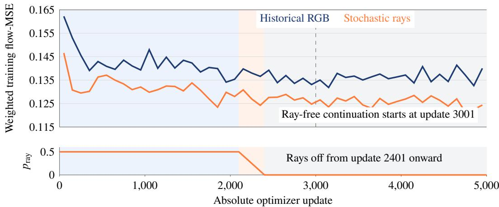  
Figure 5. Training loss and ray availability. The curves average consecutive 100-update blocks; conditioning probability follows the original schedule during ray-free continuation.

## B Data Alignment and Packaging

Paired capture timestamps are mapped to a common time base. The nearest EGO frame to each EXO reference is selected within the recorded 20 ms acceptance window. Camera calibration and image transforms remain aligned to the decoded frames. Dataset records bind source clips, view provenance, text, optional camera rays, and auxiliary targets to their corresponding temporal windows.

The model uses 141-frame clips. Capture timestamps and playback rate are recorded separately, including the 30 fps dataset and 24 fps H3 playback convention. Training and evaluation splits group source recordings with all derived clips and generated views. Release metadata identifies the model, preprocessing, annotation, and configuration versions used to produce each record.

Table 8. Inputs and supervision.
<table><tr><td>Information</td><td>Training role</td><td>Inference role</td></tr><tr><td>EXO video and source text</td><td>Visual and task conditions</td><td>Same conditions</td></tr><tr><td>Actor-reference image</td><td>Optional actor selection</td><td>Optional actor selection</td></tr><tr><td>Target-camera rays</td><td>Stochastic camera condition</td><td>Annealed away</td></tr><tr><td>Recorded EGO RGB</td><td>Video-generation target</td><td>Generated output</td></tr><tr><td>EGO semantic masks</td><td>Hand/object region supervision</td><td>Optional joint output</td></tr><tr><td>ACE features and observations</td><td>Hand-structure supervision</td><td>Training only</td></tr><tr><td>Annotated hand keypoints</td><td>Calibrate hand supervision</td><td>Training only</td></tr></table>

## C Additional Qualitative Results

Joint RGB/mask examples use the separate 5,020-update checkpoint and seed 85. The recorded-EGO reader comparisons use annotation-projected GT, native ACE, and the final H3 projector. All EXO/EGO pairs use matched frame indices.

Echo self-capture: cloth manipulation

frame 13

Generated EGO

Generated EGO + mask  
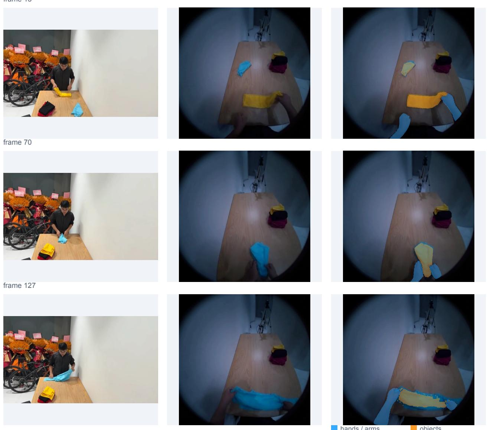  
Figure 6. Joint RGB/mask generation on Echo self-collected data.  
hands / arms  
objects

Bicycle repair: hand and tool observations  
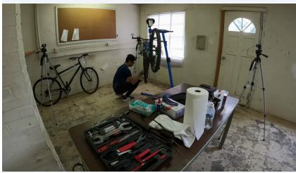

Generated EGO  
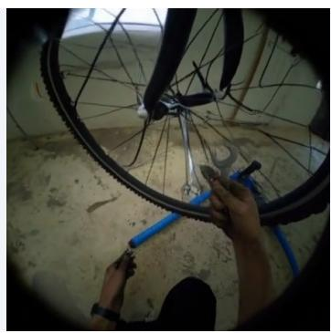

Generated EGO + mask  
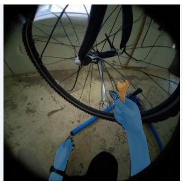

frame 70  
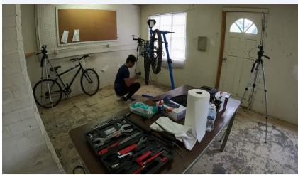

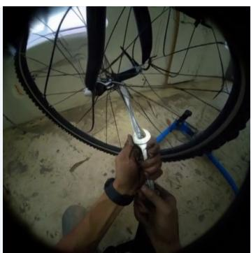

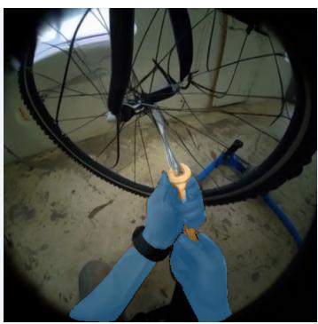  
frame 127

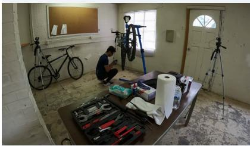

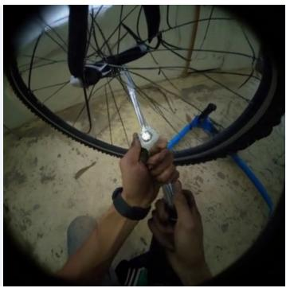

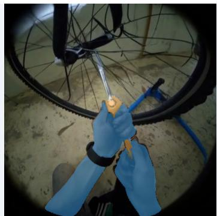  
hands / arms  
objects

Figure 7. Joint RGB/mask generation for bicycle repair.

Generated EGO

hands / arms

Basketball: distant ball, reach, and hold  
Generated EGO + mask  
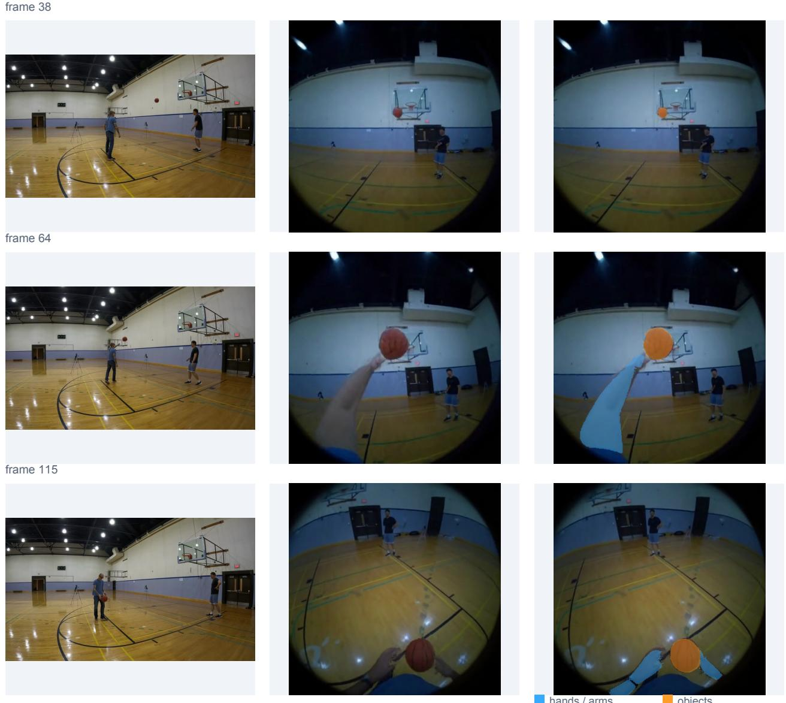  
Figure 8. Joint RGB/mask generation for basketball.

HOT3D  
GT Keyboard A | frame 32  
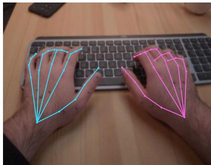

ACE-Ego-Hands  
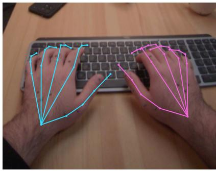  
H3 projector hands

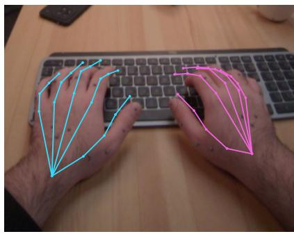

Keyboard B | frame 25  
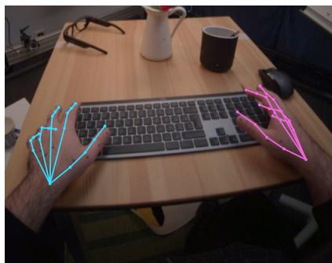

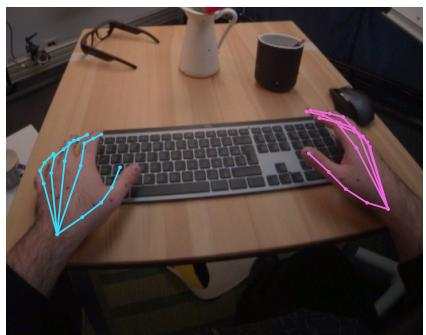  
Interaction | frame 119

  
Left hand: cyan Right hand: magenta

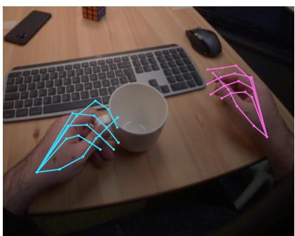

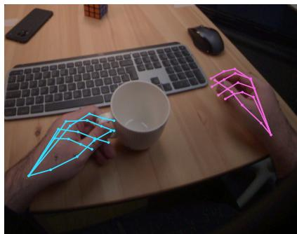  
Figure 9. Hand observations on HOT3D.

H3 projector hands

GT Phone | frame 31

## ARCTIC

ACE-Ego-Hands  
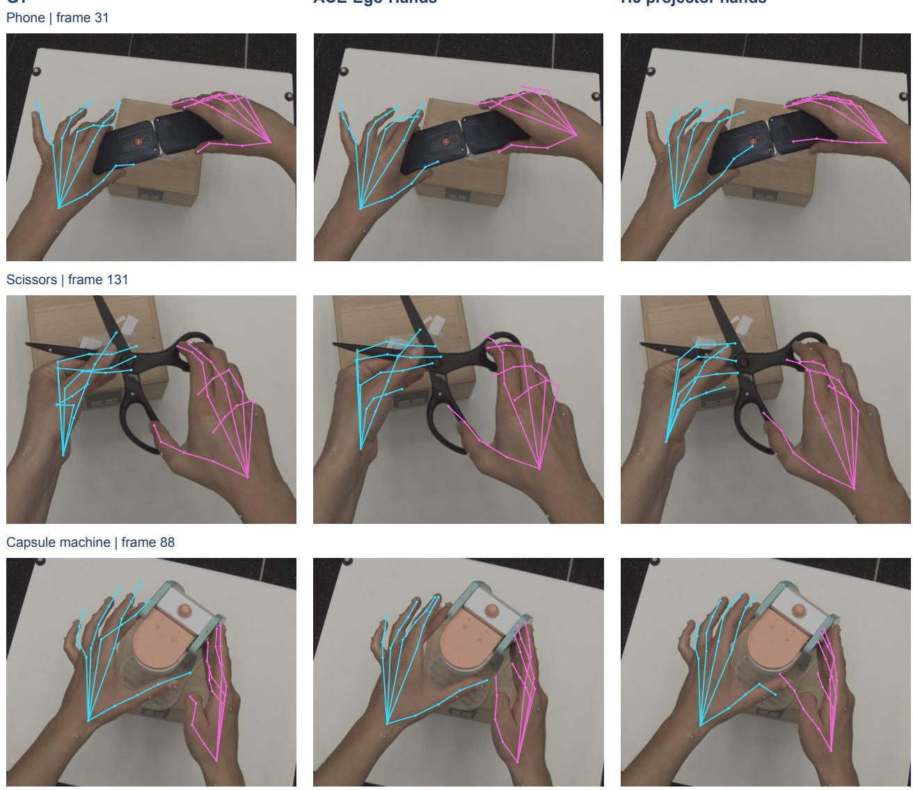  
Left hand: cyan Right hand: magenta

Figure 10. Hand observations on ARCTIC.

frame 15  
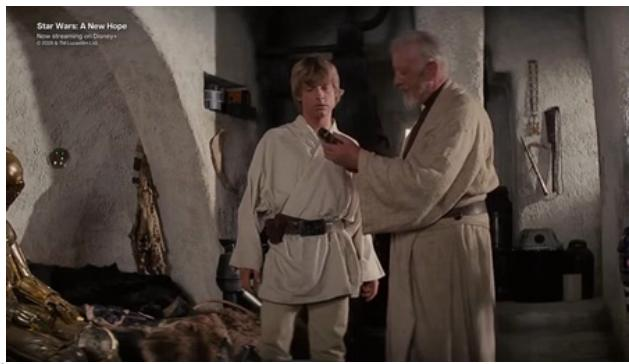

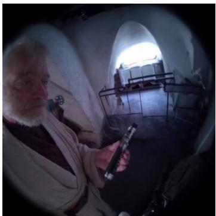  
frame 75

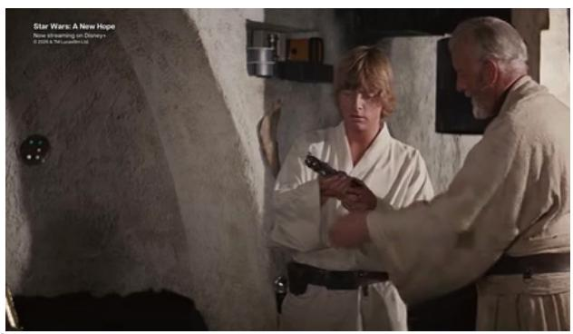

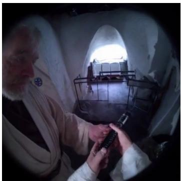  
frame 105

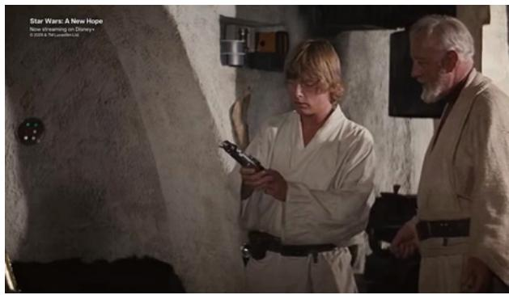  
Figure 11. EXO-to-EGO generation: Star Wars: A New Hope.

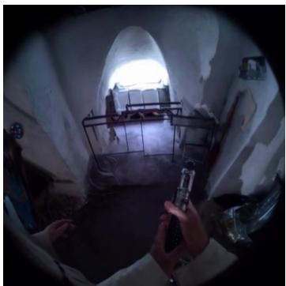