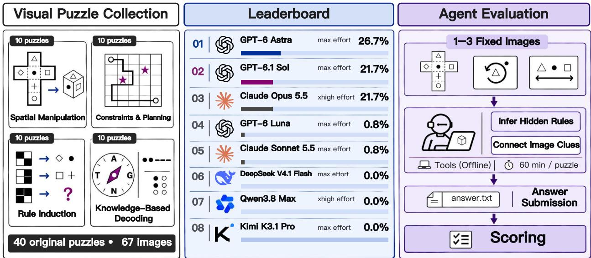
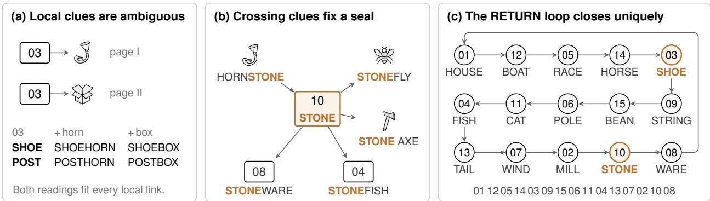
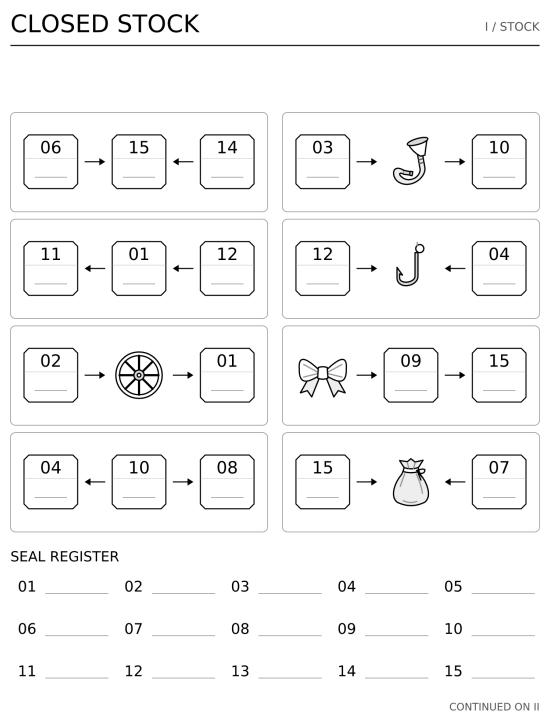
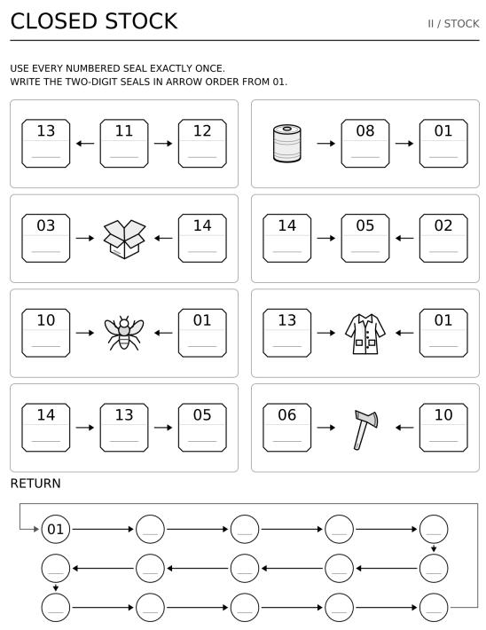

# Visual Cipher Bench: Benchmarking LLM Agents on Long-Horizon Visual Reasoning

Deyao Hong∗,†, Jiayi Jiang∗, Yuchun Chen∗, Yixuan Shi, Wenyi Li, Zheng Jiang, Chengxing Xie, Mingyu Su, Qingle Liu, Mingju Gao, Yizhe Chi, Youjie Zheng, Calvin Xiao‡, Kaisen Yang‡, Huan-ang Gao‡

Navers Lab, Einsia.AI, Tsinghua University

∗Equal Contribution †Project Lead ‡Corresponding Authors

While language-model agents excel at long-horizon coding and terminal tasks, this success relies on two conditions: explicit text specifications and immediate execution feedback. However, neither condition holds in real-world problems where critical information exists only in images, leaving it unclear whether long-horizon capability transfers from text to visual reasoning. In such visual settings, because rules and clues resist text transcription and lack test-case feedback, agents must repeatedly inspect images, simulate spatial transformations, and autonomously cross-check clues. Despite this challenge, existing evaluations fail to capture such capability: visual reasoning benchmarks largely reduce tasks to single-turn, short-chain question answering, whereas agent benchmarks focus on text-based environments or interactive states that permit trial-and-error. To bridge this gap, we introduce Visual Cipher Bench, a collection of 40 original visual puzzles across four categories: spatial manipulation and simulation, logical constraints and planning, rule induction, and knowledge-based decoding. Each puzzle provides only one to three black-and-white line drawings and a minimal submission instruction, requiring agents to discover the underlying solving mechanism entirely from the images. Across 29 reasoning-efort configurations of eight frontier models, even the strongest model, GPT-6 Astra (max), achieves only 26.7% accuracy, while five of the eight models score below 1%. Yet on a ten-task subset, providing a single non-spoiler mechanism hint boosts accuracy from 7.8% to 55.6%. This sharp contrast shows that the primary bottleneck of current agents lies not in executing multi-step plans, but in autonomously discovering rules from visual evidence. Visual Cipher Bench thus provides a rigorous benchmark for measuring long-horizon visual reasoning in agents.

Date: November 12, 2026   
Homepage: https://lab.einsia.ai/visual-cipher-bench   
Correspondence: nana@einsia.ai

## 1 Introduction

  
Figure 1 Overview of Visual Cipher Bench. Left: 40 original visual puzzles (67 images in total), divided by primary dificulty into spatial manipulation and simulation, logical constraints and planning, rule induction, and knowledgebased decoding, with 10 puzzles each. Middle: mean accuracy of each model’s best reasoning-efort configuration over three runs. Right: the evaluation pipeline.

few decoded letters resemble a word. Consequently, long-horizon visual reasoning cannot be reduced to a single pass; it requires agents to iteratively cycle between visual inspection and hypothesis testing—proposing rules, verifying them against global visual constraints, and discarding false assumptions until converging on a unique solution.

Existing evaluations fail to capture this capability. Standard visual reasoning benchmarks reduce problem solving to single-turn question answering with explicitly defined tasks [14–18]. Even when benchmarks incorporate abstract reasoning or spatial simulation, their fixed task formats already telegraph where the underlying rule lies [19–21]. Meanwhile, agent benchmarks focus predominantly on text and code environments [22–24]. When these benchmarks do involve vision, images either serve merely as targets for GUI localization or appear in interactive environments that return a new state after every action, allowing agents to rely on trial-and-error rather than pure visual deduction [25–28]. Consequently, the field lacks a dedicated benchmark for evaluating long-horizon reasoning over static visual evidence.

To bridge this gap, we introduce Visual Cipher Bench (Figure 1). Visual puzzles are an ideal testbed for long-horizon visual reasoning: with all rules and clues concealed in the graphics, solvers must uncover the mechanism themselves, as each discovery dictates what to inspect and deduce next [29, 30]. The benchmark comprises 40 original, expert-verified puzzles across four categories: spatial manipulation and simulation, logical constraints and planning, rule induction, and knowledge-based decoding. Each puzzle provides only one to three black-and-white line drawings and a minimal submission instruction. Agents have 60 minutes in an ofline coding sandbox to solve each puzzle and are graded strictly by exact match on the final answer, while hidden walkthroughs and reference solvers ensure solvability and enable process auditing.

We systematically evaluate 29 reasoning-efort configurations across eight frontier models [31–33], conducting three independent runs per configuration. Even the strongest configuration, GPT-6 Astra (max), achieves only 26.7% accuracy, while five of the eight models score below 1% in their best configurations. Moreover, performance is heavily skewed across categories: pooled accuracy reaches 22.8% on spatial manipulation and simulation, where transformation rules are visually explicit, but drops to just 0.6% on rule induction. Yet on a ten-task subset spanning all four categories, providing a single non-spoiler mechanism hint boosts accuracy from 7.8% to 55.6% and cuts timeouts from 51 to 18 under the same time limit. This sharp contrast demonstrates that the primary bottleneck of current agents lies not in executing multi-step plans, but in autonomously inducing rules from visual evidence.

Our contributions are threefold:

• We introduce Visual Cipher Bench, a long-horizon visual reasoning benchmark of 40 original puzzles that embeds all rules and clues exclusively within static images and provides no intermediate feedback during solving.

• We benchmark 29 reasoning-efort configurations across eight frontier models, exposing a stark capability ceiling: even the top-performing agent solves barely a quarter of the tasks, while most frontier models fail almost completely.

• We pinpoint the core bottleneck of visual agents through mechanism-hint ablations and trajectory audits, demonstrating that agents fail primarily at inducing rules and constraints from visual evidence rather than executing multi-step plans.

## 2 Visual Cipher Bench

## 2.1 Task Formulation and Evaluation

Each task is denoted ${ \boldsymbol { \tau } } = ( I , q , a ^ { \star } )$ , where $I = ( I _ { 1 } , \ldots , I _ { k } )$ contains $k \in \{ 1 , 2 , 3 \}$ puzzle images, q is the submission instruction shared by all tasks (Appendix A), and $a ^ { \star }$ is the unique reference answer. The agent observes only I and q. The instruction only asks the agent to inspect the images and submit a single final answer, without hinting at any solution method: the agent must infer from the images which mechanism to use, which graphics are examples and which are inputs to process, and whether the answer should be a word or a symbol sequence.

Solving is a long-horizon interactive process. The agent works in a network-disabled sandbox; at each step it may inspect the images, write and run code, and decide what to do next based on the execution results, submitting a final answer aˆ within a fixed time limit. No correctness feedback is provided during solving, so hypotheses can be checked only against other clues in the images. The runtime harness, time limit, and compute resources are listed in Appendix A.

Grading considers only the final answer. Let $N ( \cdot )$ be an answer-normalization function fixed before evaluation (e.g., removing whitespace and unifying letter case). The score of a single attempt is

$$
s _ { \tau } = { \bf 1 } [ N ( \widehat { a } ) = N ( a ^ { \star } ) ] ,\tag{1}
$$

and timeouts and invalid submissions also score 0. Grading is deterministic and runs in a separate container, so the agent cannot read or modify the reference answer [34], and no LLM judge is involved [35]. Each model–efort configuration is run independently three times on all 40 tasks. Letting $s _ { i r } \in \{ 0 , 1 \}$ denote the score on task i in run r, we report mean accuracy

$$
\operatorname { A c c } = { \frac { 1 } { 1 2 0 } } \sum _ { i = 1 } ^ { 4 0 } \sum _ { r = 1 } ^ { 3 } s _ { i r } ;\tag{2}
$$

category accuracy is computed in the same way over the $1 0 \times 3 = 3 0$ attempts in each category.

## 2.2 Benchmark Design and Composition

Design principles. We surveyed hundreds of public puzzle resources, including past puzzle-competition problems, solver write-ups, and authoring guides [29, 30], and designed the puzzles according to two principles. The first is solvability: every key inference is supported by evidence on the puzzle page, the clues sufice to determine a unique answer, and solvers need neither guesswork nor hints from outside the puzzle. The second is long-horizon reasoning: the answer cannot be read of in a single step; solvers must first discover the mechanism, then work through multiple interdependent steps and check earlier inferences against later clues, and the answer cannot be guessed from local clues or thematic association alone. The former ensures puzzle quality; the latter ensures dificulty.

Originality and review. All 40 puzzles are original to this benchmark. Each puzzle was designed together with a complete solution, consisting of a step-by-step walkthrough and a reference solver: the former records the visual evidence behind each key step, and the latter reproduces the reference answer using only the puzzle images. Every puzzle was reviewed by human experts, who confirmed that the solution path is sound, the visual evidence is suficient, and the answer is unique. Neither material is provided to evaluated agents.

Puzzle categories. We categorize puzzles along two dimensions: whether the main dificulty lies in executing an identified mechanism or in discovering which mechanism to use, and whether solving relies mainly on rule-constrained reasoning or on visual imagination and knowledge association. Combining the two dimensions yields four primary categories; each puzzle belongs to one category, and each category contains 10 puzzles (Figure 1):

• P1 Spatial manipulation and simulation: simulate the state after operations such as folding, rotation, and projection;

• P2 Logical constraints and planning: carry out derivations under grid, path, or state constraints;

• P3 Rule induction: induce a puzzle-specific rule or cipher from examples within the puzzle;

• P4 Knowledge-based decoding: recognize the external convention indicated by the visual clues, such as Morse code, Braille, or wordplay, and decode accordingly.

Dataset composition. The 40 tasks contain 67 images, all drawn as black-and-white line art in a consistent style: 19 single-image tasks, 15 two-image tasks, and six three-image tasks. Reference answers range from 4 to 30 characters. Twenty-eight are English words or phrases; the other 12 include digit strings, letter codes, and related sequences for which the exact characters and their order must be preserved.

## 3 Experiments

## 3.1 Experimental Setup

We evaluate eight models: Claude Opus 5.5 [36], Claude Sonnet 5.5 [37], GPT-6.1 Sol [38], GPT-6 Astra [39], GPT-6 Luna [40], DeepSeek V4.1 Flash [41], Qwen 3.8 Max [42], and Kimi K3.1 Pro [43]. Depending on the interfaces available for each model, we evaluate one or more reasoning-efort levels, yielding 29 model–efort configurations. Every configuration is run independently three times on all 40 tasks, for 87 complete benchmark runs and 3,480 task-level attempts.

The evaluation protocol follows Section 2.1; the runtime harness, time limit, and compute resources are listed in Appendix A. We report two metrics:

1. Mean accuracy: accuracy over the 120 attempts of a configuration across three runs (Eq. (2)); Table 1 also reports the corresponding mean number of tasks solved per run (Mean /40).

2. Category accuracy: computed in the same way for each of the four categories (spatial manipulation and simulation, logical constraints and planning, rule induction, and knowledge-based decoding) over the 30 attempts per category.

## 3.2 Overall Performance

Table 1 lists all 29 configurations, with models ordered by their best configuration; below we compare models by their best configurations. GPT-6 Astra (max) performs best, solving 10.7 of 40 tasks per run on average, an accuracy of 26.7%; GPT-6.1 Sol (max) and Claude Opus 5.5 (xhigh) tie for second at 8.7/40 (21.7%). No configuration reaches 30%: even the best configuration leaves about three quarters of the tasks unsolved on average. In terms of category accuracy, the leading configurations score almost entirely on spatial manipulation and simulation: GPT-6 Astra (max) reaches 80.0% there, whereas no configuration exceeds 13.3% on any of the other three categories.

Table 1 Results of all 29 configurations on Visual Cipher Bench, with models ordered by their best configuration. P1–P4 give the category accuracy over the 30 attempts in each category, Acc. gives the mean accuracy over all 120 attempts, and Mean gives the corresponding number of tasks solved per run (out of 40). All values average three runs; the best value in each column is in bold. Each model’s best configuration is shaded.
<table><tr><td colspan="2"></td><td colspan="4">Category accuracy (%) ↑</td><td colspan="2">Overall ↑</td></tr><tr><td>Model</td><td>Effort</td><td>P1 Spatial</td><td>P2 Logic</td><td>P3 Rule</td><td>P4 Knowledge</td><td>Mean/40</td><td>Acc. (%)</td></tr><tr><td>S GPT-6 Astra</td><td>max</td><td>80.0</td><td>13.3</td><td>0.0</td><td>13.3</td><td>10.7</td><td>26.7</td></tr><tr><td>S GPT-6 Astra</td><td>xhigh</td><td>66.7</td><td>6.7</td><td>3.3</td><td>13.3</td><td>9.0</td><td>22.5</td></tr><tr><td>S GPT-6 Astra</td><td>high</td><td>63.3</td><td>10.0</td><td>3.3</td><td>10.0</td><td>8.7</td><td>21.7</td></tr><tr><td>S GPT-6 Astra</td><td>medium</td><td>30.0</td><td>6.7</td><td>3.3</td><td>6.7</td><td>4.7</td><td>11.7</td></tr><tr><td>S GPT-6 Astra</td><td>low</td><td>20.0</td><td>0.0</td><td>0.0</td><td>0.0</td><td>2.0</td><td>5.0</td></tr><tr><td>S GPT-6.1 Sol</td><td>max</td><td>60.0</td><td>10.0</td><td>3.3</td><td>13.3</td><td>8.7</td><td>21.7</td></tr><tr><td>S GPT-6.1 Sol</td><td>xhigh</td><td>53.3</td><td>6.7</td><td>0.0</td><td>3.3</td><td>6.3</td><td>15.8</td></tr><tr><td>S GPT-6.1 Sol</td><td>high</td><td>36.7</td><td>3.3</td><td>0.0</td><td>6.7</td><td>4.7</td><td>11.7</td></tr><tr><td>S GPT-6.1 Sol</td><td>medium</td><td>26.7</td><td>0.0</td><td>0.0</td><td>6.7</td><td>3.3</td><td>8.3</td></tr><tr><td>S GPT-6.1 Sol</td><td>low</td><td>16.7</td><td>0.0</td><td>0.0</td><td>3.3</td><td>2.0</td><td>5.0</td></tr><tr><td> Claude Opus 5.5</td><td>max</td><td>56.7</td><td>6.7</td><td>0.0</td><td>6.7</td><td>7.0</td><td>17.5</td></tr><tr><td> Claude Opus 5.5</td><td>xhigh</td><td>70.0</td><td>6.7</td><td>0.0</td><td>10.0</td><td>8.7</td><td>21.7</td></tr><tr><td>米 Claude Opus 5.5</td><td>high</td><td>40.0</td><td>0.0</td><td>0.0</td><td>3.3</td><td>4.3</td><td>10.8</td></tr><tr><td>米 Claude Opus 5.5</td><td>medium</td><td>33.3</td><td>0.0</td><td>0.0</td><td>0.0</td><td>3.3</td><td>8.3</td></tr><tr><td>米 Claude Opus 5.5</td><td>low</td><td>0.0</td><td>0.0</td><td>0.0</td><td>0.0</td><td>0.0</td><td>0.0</td></tr><tr><td>S GPT-6 Luna</td><td>max</td><td>3.3</td><td>0.0</td><td>0.0</td><td>0.0</td><td>0.3</td><td>0.8</td></tr><tr><td>S GPT-6 Luna</td><td>xhigh</td><td>0.0</td><td>0.0</td><td>0.0</td><td>0.0</td><td>0.0</td><td>0.0</td></tr><tr><td>S GPT-6 Luna</td><td>high</td><td>0.0</td><td>0.0</td><td>0.0</td><td>0.0</td><td>0.0</td><td>0.0</td></tr><tr><td>S GPT-6 Luna</td><td>medium</td><td>0.0</td><td>0.0</td><td>0.0</td><td>0.0</td><td>0.0</td><td>0.0</td></tr><tr><td>S GPT-6 Luna</td><td>low</td><td>0.0</td><td>0.0</td><td>0.0</td><td>0.0</td><td>0.0</td><td>0.0</td></tr><tr><td>S GPT-6 Luna</td><td>none</td><td>0.0</td><td>0.0</td><td>0.0</td><td>0.0</td><td>0.0</td><td>0.0</td></tr><tr><td> Claude Sonnet 5.5</td><td>max</td><td>3.3</td><td>0.0</td><td>0.0</td><td>0.0</td><td>0.3</td><td>0.8</td></tr><tr><td> Claude Sonnet 5.5</td><td>xhigh</td><td>0.0</td><td>0.0</td><td>0.0</td><td>0.0</td><td>0.0</td><td>0.0</td></tr><tr><td>米 Claude Sonnet 5.5</td><td>high</td><td>0.0</td><td>0.0</td><td>0.0</td><td>0.0</td><td>0.0</td><td>0.0</td></tr><tr><td>米 Claude Sonnet 5.5</td><td>medium</td><td>0.0</td><td>0.0</td><td>0.0</td><td>0.0</td><td>0.0</td><td>0.0</td></tr><tr><td>米 Claude Sonnet 5.5</td><td>low</td><td>0.0</td><td>0.0</td><td>3.3</td><td>0.0</td><td>0.3</td><td>0.8</td></tr><tr><td>Q DeepSeek V4.1 Flash</td><td>max</td><td>0.0</td><td>0.0</td><td>0.0</td><td>0.0</td><td>0.0</td><td>0.0</td></tr><tr><td>六 Qwen 3.8 Max</td><td>xhigh</td><td>0.0</td><td>0.0</td><td>0.0</td><td>0.0</td><td>0.0</td><td>0.0</td></tr><tr><td>K Kimi K3.1 Pro</td><td>max</td><td>0.0</td><td>0.0</td><td>0.0</td><td>0.0</td><td>0.0</td><td>0.0</td></tr></table>

The remaining five models lag far behind. GPT-6 Luna and Claude Sonnet 5.5 solve only 0.3 of 40 tasks per run in their best configurations, that is, a single correct answer across three runs, while DeepSeek V4.1 Flash, Qwen 3.8 Max, and Kimi K3.1 Pro solve no task in any of their three runs. The models therefore split sharply: the best configurations of the top three models solve 8.7 to 10.7 tasks per run, the other five solve almost none, and nothing lies in between. Visual Cipher Bench is thus far from saturated and clearly separates frontier models.

Table 2 Mechanism-hint ablation: accuracy (%) on the ten selected tasks. The upper block reports each model; the lower block pools the three models by category. Each model runs each task three times.
<table><tr><td></td><td>No hint</td><td>Mechanism hint</td><td>Gain</td></tr><tr><td>GPT-6 Astra (max)</td><td>13.3</td><td>76.7</td><td>+63.3</td></tr><tr><td>GPT-6.1 Sol (max)</td><td>10.0</td><td>73.3</td><td>+63.3</td></tr><tr><td>GPT-6 Luna (max)</td><td>0.0</td><td>16.7</td><td>+16.7</td></tr><tr><td>P1 Spatial</td><td>27.8</td><td>66.7</td><td>+38.9</td></tr><tr><td>P2 Logic</td><td>0.0</td><td>40.7</td><td>+40.7</td></tr><tr><td>P3 Rule</td><td>3.7</td><td>81.5</td><td>+77.8</td></tr><tr><td>P4 Knowledge</td><td>5.6</td><td>27.8</td><td>+22.2</td></tr><tr><td>Overall</td><td>7.8</td><td>55.6</td><td>+47.8</td></tr></table>

## 3.3 Analysis of Agent Performance

## 3.3.1 Rule Discovery Is the Main Bottleneck

Pooling the 3,480 attempts of all 29 configurations by category, spatial manipulation and simulation reaches 22.8% accuracy, whereas knowledge-based decoding, logical constraints and planning, and rule induction reach only 3.3%, 2.4%, and 0.6%; the three leading models share the same profile (Table 1). In spatial tasks, the operations are usually given in the images, and the dificulty lies in executing a multi-step transformation correctly; rule-induction tasks instead require discovering a task-specific rule from a few examples. The latter are almost never solved: only 5 of 870 attempts are correct, and some of these trajectories show that the model never recovered the rule and guessed the answer only because its letters formed a theme-related word. Logic tasks are also low because they require large searches under constraints; Section 3.3.2 shows that agents on these tasks often replace pruning with exhaustive enumeration.

Category diferences, however, are only correlational: the four categories difer in many ways beyond whether the rule is visible. To test directly whether rule discovery is the bottleneck, we run a mechanism-hint ablation. We randomly select ten tasks across the four categories and give each a one-sentence mechanism hint that names the intended state representation and core update mechanism without revealing intermediate states or the final answer. GPT-6 Astra (max), GPT-6.1 Sol (max), and GPT-6 Luna (max) each run every task three times, and we compare them with unhinted runs of the same configurations.

Table 2 reports the results. Mechanism hints raise overall accuracy from 7.8% to 55.6%, and both leading models rise from about 10% to about 75%. The largest gain is in rule induction (3.7%→81.5%), the hardest category without hints. Under the same time limit, timeouts also fall from 51 to 18. Once the rule is known, the leading models can largely carry out the remaining multi-step reasoning; the bottleneck is discovering the rule from visual evidence. The weaker GPT-6 Luna improves only from 0 to 16.7%, indicating that for weaker models execution itself remains an obstacle.

## 3.3.2 Failure Modes

Unsolved attempts end in one of two main ways: the agent submits a wrong answer, or it does not finish within the 60-minute limit. We manually audit representative wrong-answer and timeout trajectories and analyse their causes against the puzzle, the walkthrough, and the reference solver.

Wrong answers: insufficient verification. Most wrong answers are not computational slips: the agent does not test its hypothesis against evidence already on the page. Most often, once it finds a rule that explains some of the examples, it answers without checking the rule against the remaining examples or the global constraints. When the rule stays unresolved, agents also tend to abandon induction and submit an answer that fits the puzzle’s theme but is not supported by the examples, sometimes even while acknowledging that the answer is incomplete. By contrast, trajectories that find the correct mechanism but err in transcription or execution are less common. Successful trajectories do the opposite: they write several candidate rules, turn every example into an assertion to filter them, and only then work out the targets. The examples in a puzzle are themselves test cases, and agents that answer wrongly rarely make full use of them.

  
Figure 2 Solving Closed Stock (knowledge-based decoding). (a) Seal 03 points to a horn on page I and to a box on page II; both SHOE and POST satisfy these two local clues. (b) Seal 10 takes part in five compounds, and only STONE satisfies all of them, fixing seals 10, 04, and 08. (c) RETURN requires the 15 words to form a closed loop of compounds; only one such loop exists, and it also rules out POST. Reading the seal numbers from 01 gives the answer. Icons are taken from the puzzle; the full puzzle is shown in Appendix B.

Timeouts: enumeration in place of constraints. Trajectories that time out do not lack tool use; the problem is that they spend their compute on enumeration. Some search broadly through generic rule families such as cellular automata and morphological operators, or keep switching among interpretations; these candidates do not come from cues in the images, and the agents write no test that quickly rules them out, so the search space never contracts. Others find the correct mechanism but try every combination of unknown states instead of pruning with the puzzle’s constraints, and cannot finish in time. The hint ablation confirms this from the other side: once a hint narrows the hypothesis space, timeouts fall sharply under the same time limit. Most timeouts therefore reflect not a lack of time but a hypothesis space that the visual evidence never narrowed.

Both failure modes thus point to the same deficiency: agents rarely use visual evidence to constrain their hypotheses. Wrong answers use only part of the evidence; timeouts rely on enumeration rather than evidence to narrow the search.

## 3.4 Benchmark Validation

## 3.4.1 Reliability and Solvability

Grading in Visual Cipher Bench is deterministic exact matching: the same submission always receives the same score, so randomness in the evaluation comes only from the agent’s solving process. We therefore run each model–efort configuration independently three times on all 40 tasks and report the mean accuracy over the three runs, in line with recommendations to account for sampling variability in model evaluations [44].

Every task comes with a step-by-step walkthrough and a reference solver. The walkthrough records the visual evidence, rule, and disambiguation behind each key step, and the reference solver reproduces the reference answer from the puzzle images alone. An oracle agent that runs the reference solver passes the grader on all 40 tasks. In addition, two human experts reviewed every task and its walkthrough, confirming that the visual evidence sufices to derive the answer, that every step of the walkthrough is sound, and that the answer is unique; all 40 tasks passed the review.

## 3.4.2 Case Study: Closed Stock

We use Closed Stock, a knowledge-based decoding task (Figure 2; full puzzle in Appendix B), to show how a puzzle satisfies both design principles, solvability and long-horizon reasoning; this category reaches only 3.3% accuracy across all configurations. The puzzle is a two-page register in which 15 numbered seals and several pictured objects are linked by arrows. The same seal number appears repeatedly across both pages, yet the register gives each number a single blank, so each number must take one word; at the bottom, a RETURN chain of 15 empty circles winds through three rows and back to 01. The solver must infer the mechanism unaided: two items joined by an arrow form a common English compound, and the 15 words must also chain into a closed loop.

Solving proceeds through three layers of constraints. First, local clues are ambiguous (Figure 2a): seal 03 points to a horn on page I and to a box on page II, and both SHOE (SHOEHORN, SHOEBOX) and POST (POSTHORN, POSTBOX) satisfy the two clues. Second, crossing clues fix some seals (Figure 2b): seal 10 is linked to the horn, a fly, an axe, and seals 04 and 08, and only STONE satisfies all five compounds HORNSTONE, STONEFLY, STONE AXE, STONEFISH, and STONEWARE, which fixes seals 10, 04, and 08 as STONE, FISH, and WARE; the constraints then propagate across pages, for instance WAREHOUSE fixes seal 01 as HOUSE. Finally, the global loop yields a unique answer (Figure 2c): several seals still admit multiple candidates at this point (seal 02 may be MILL or WATER, seal 07 WIND, AIR, or MAIL, and seal 03 is still SHOE or POST), but only one loop links all 15 words end to end, HOUSE–BOAT–RACE– HORSE–SHOE–STRING–BEAN–POLE–CAT–FISH–TAIL–WIND–MILL–STONE–WARE, and its links HORSESHOE and SHOESTRING settle seal 03 as SHOE. Reading the seal numbers from 01 gives the answer 011205140309150611041307021008.

The puzzle embodies both design principles. It is solvable: every inference is supported by the puzzle page, less common compounds such as HORNSTONE and MILLRACE are each cross-confirmed by several familiar ones, and the final answer is unique. It also requires long-horizon reasoning: no single clue reveals the answer, and the solver must propagate constraints across two pages, hold ambiguities open, and finally check every choice against the global loop. Agent behaviour bears this out. The successful Claude Opus 5.5 trajectory keeps local ambiguities open and uses the complete loop to fix the order, matching the reference solution.

## 4 Related Work

Visual reasoning benchmarks. Most visual reasoning benchmarks evaluate image understanding through a given question. MMMU [14] and MMMU-Pro [16] require models to interpret charts and diagrams in exam questions using subject knowledge, while MathVista [15] and MathVerse [17] test whether models can extract quantitative and geometric relations from images to answer mathematical questions. Perception probes show that multimodal models still err on judgments that humans make at a glance [11–13]. For spatial simulation, mental-rotation experiments show that humans mentally simulate transformations of figures [45], and STARE [21] evaluates multi-step visual simulation in tasks such as folding cube nets. Rule induction forms another line: Raven’s Progressive Matrices [46] and their procedurally generated counterpart RAVEN [19] ask solvers to complete a pattern matrix, while ARC [47] and ARC-AGI-2 [20] require inferring grid transformations from a few input–output examples. Models can propose natural-language hypotheses and implement them as programs for testing [48], yet high accuracy does not imply that the intended abstraction has been acquired [49], and part of the dificulty on visual inputs stems from perception rather than induction [50]. In these benchmarks, the question or task format specifies the task, and the reasoning chains are short. Visual Cipher Bench provides no such framing: the agent must determine from the images which graphics are examples and which mechanism to apply.

Long-horizon agent benchmarks. As reasoning, acting, and tool use have improved [51–55], language-model agents have become increasingly capable of long-horizon problem solving. The corresponding evaluations focus mainly on text and code tasks: SWE-bench [24] and SWE-Bench Pro [1] require resolving issues in real code repositories, Terminal-Bench [2] requires completing complex command-line tasks, and MLE-bench [3], WebArena [22], and GAIA [23] cover machine-learning engineering, web navigation, and general assistant tasks, respectively; meanwhile, the length of tasks that agents can complete autonomously is growing rapidly [4]. Work on the visual side, by contrast, rarely probes long-horizon reasoning. Visual programming, Visual Sketchpad, and “thinking with images” approaches allow models to crop, annotate, or transform images while reasoning [8–10, 56, 57], but they are mainly validated on single-turn visual question answering and yield limited gains over direct reasoning [58]. In graphical-interface tasks such as OSWorld [25], images mainly serve localization and operation. Interactive games such as BALROG, LongPuzzleBench, and ARC-AGI-3 require many actions, but the environment returns a new state after every action, so agents can obtain feedback by trial and error rather than reasoning solely from evidence in fixed images [26–28]. Long-horizon reasoning over fixed visual evidence therefore still lacks a dedicated benchmark.

Puzzles and cipher solving. Puzzles have long been used to study human problem solving: cognitive science has found that breakthroughs often come from restructuring the problem representation rather than from searching harder within it [59–61]. Puzzles are now also used to evaluate language models: cryptic crosswords [62], rebuses [63, 64], and visual riddles [65] require combining wordplay, graphical layout, and commonsense; shift-cipher experiments show that decoding accuracy varies with how common a shift is in the training data [66]; and multimodal puzzle collections cover abstract figures, algorithmic puzzles, and IQ-test-style problems [67–72]. EnigmaEval [73] and PuzzleWorld [74] further use puzzle-competition problems to evaluate open-ended reasoning. However, their puzzles are drawn from existing human puzzle events and mix textual and visual clues, and as models have improved, most of these problems have already been solved. In contrast, all puzzles in Visual Cipher Bench are original, and their rules, examples, and clues exist only in images. Each puzzle is designed under the principles of solvability and long-horizon reasoning and reviewed by human experts to ensure both quality and dificulty; the best configuration currently solves only about a quarter of the puzzles.

## 5 Conclusion

We presented Visual Cipher Bench: 40 original visual puzzles whose rules, examples, and clues all reside in one to three black-and-white line drawings, which agents must solve over an extended period with tools in an ofline sandbox and which are scored only by exact match on the final answer. Across 29 reasoning-efort configurations of eight frontier models, the best configuration, GPT-6 Astra (max), solves only 10.7 of 40 tasks on average (26.7%), and five of the eight models solve fewer than one task on average in their best configurations; accuracy reaches 22.8% on spatial manipulation and simulation but only 0.6% on rule induction. On a ten-task subset covering all four categories, a single mechanism hint that does not reveal the answer raises accuracy from 7.8% to 55.6%, indicating that the main weakness of current agents lies not in executing multi-step plans but in discovering the rules from visual evidence on their own. Improving long-horizon visual reasoning therefore hinges on teaching agents to discover rules from images and keep checking them; Visual Cipher Bench provides a reliable benchmark for measuring this capability.

## References

[1] Xiang Deng, Jef Da, et al. SWE-Bench Pro: Can AI Agents Solve Long-Horizon Software Engineering Tasks? arXiv preprint arXiv:2509.16941, 2025. URL https://arxiv.org/abs/2509.16941.

[2] Mike A. Merrill, Alexander G. Shaw, Nicholas Carlini, Boxuan Li, Harsh Raj, Ivan Bercovich, Lin Shi, Jeong Yeon Shin, Thomas Walshe, E. Kelly Buchanan, Junhong Shen, Guanghao Ye, Haowei Lin, Jason Poulos, Maoyu Wang, Marianna Nezhurina, Jenia Jitsev, Di Lu, Orfeas Menis Mastromichalakis, Zhiwei Xu, Zizhao Chen, Yue Liu, Robert Zhang, Leon Liangyu Chen, Anurag Kashyap, Jan-Lucas Uslu, Jefrey Li, Jianbo Wu, Minghao Yan, Song Bian, Vedang Sharma, Ke Sun, Steven Dillmann, Akshay Anand, Andrew Lanpouthakoun, Bardia Koopah, Changran Hu, Etash Guha, Gabriel H. S. Dreiman, Jiacheng Zhu, Karl Krauth, Li Zhong, Niklas Muennighof, Robert Amanfu, Shangyin Tan, Shreyas Pimpalgaonkar, Tushar Aggarwal, Xiangning Lin, Xin Lan, Xuandong Zhao, Yiqing Liang, Yuanli Wang, Zilong Wang, Changzhi Zhou, David Heineman, Hange Liu, Harsh Trivedi, John Yang, Junhong Lin, Manish Shetty, Michael Yang, Nabil Omi, Negin Raoof, Shanda Li, Terry Yue Zhuo, Wuwei Lin, Yiwei Dai, Yuxin Wang, Wenhao Chai, Shang Zhou, Dariush Wahdany, Ziyu She, Jiaming Hu, Zhikang Dong, Yuxuan Zhu, Sasha Cui, Ahson Saiyed, Arinbjörn Kolbeinsson, Jesse Hu, Christopher Michael Rytting, Ryan Marten, Yixin Wang, Alex Dimakis, Andy Konwinski, and Ludwig Schmidt. Terminal Bench: Benchmarking Agents on Hard, Realistic Tasks in Command Line Interfaces. arXiv preprint arXiv:2601.11868, 2026. URL https://arxiv.org/abs/2601.11868.

[3] Jun Shern Chan, Neil Chowdhury, Oliver Jafe, James Aung, Dane Sherburn, Evan Mays, Giulio Starace, Kevin Liu, Leon Maksin, Tejal Patwardhan, Lilian Weng, and Aleksander Mądry. MLE-bench: Evaluating Machine Learning Agents on Machine Learning Engineering. In International Conference on Learning Representations (ICLR), 2025. URL https://arxiv.org/abs/2410.07095.

[4] Thomas Kwa, Ben West, Joel Becker, Amy Deng, Katharyn Garcia, Max Hasin, Sami Jawhar, Megan Kinniment, Nate Rush, Sydney Von Arx, Ryan Bloom, Thomas Broadley, et al. Measuring AI Ability to Complete Long Software Tasks. In Advances in Neural Information Processing Systems (NeurIPS), 2025. URL https://arxiv.org/abs/2503.14499.

[5] OpenAI. GPT-4 Technical Report. arXiv preprint arXiv:2303.08774, 2023. URL https://arxiv.org/abs/2303.08774.

[6] Gheorghe Comanici, Eric Bieber, Mike Schaekermann, Ice Pasupat, Noveen Sachdeva, Inderjit Dhillon, Marcel Blistein, Ori Ram, Dan Zhang, Evan Rosen, Luke Marris, Sam Petulla, et al. Gemini 2.5: Pushing the Frontier with Advanced Reasoning, Multimodality, Long Context, and Next Generation Agentic Capabilities. arXiv preprint arXiv:2507.06261, 2025. URL https://arxiv.org/abs/2507.06261.

[7] Shuai Bai, Yuxuan Cai, Ruizhe Chen, Keqin Chen, Xionghui Chen, Zesen Cheng, Lianghao Deng, Wei Ding, Chang Gao, Chunjiang Ge, Wenbin Ge, Zhifang Guo, et al. Qwen3-VL Technical Report. arXiv preprint arXiv:2511.21631, 2025. URL https://arxiv.org/abs/2511.21631.

[8] Tanmay Gupta and Aniruddha Kembhavi. Visual Programming: Compositional visual reasoning without training. In Proceedings of the IEEE/CVF Conference on Computer Vision and Pattern Recognition (CVPR), pages 14953–14962, 2023 URL https://arxiv.org/abs/2211.11559.

[9] Yushi Hu, Weijia Shi, Xingyu Fu, Dan Roth, Mari Ostendorf, Luke Zettlemoyer, Noah A. Smith, and Ranjay Krishna. Visual Sketchpad: Sketching as a Visual Chain of Thought for Multimodal Language Models. In Advances in Neural Information Processing Systems, volume 37, pages 139348–139379. Curran Associates, Inc., 2024. doi: 10.52202/079017-4423. URL https://papers.neurips.cc/paper\_files/paper/2024/hash/fb82011040977c7712409fbdb5456647-Abstract-Conference.html.

[10] Ziwei Zheng, Michael Yang, Jack Hong, Chenxiao Zhao, Guohai Xu, Le Yang, Chao Shen, and Xing Yu. DeepEyes: Incentivizing “Thinking with Images” via Reinforcement Learning. In International Conference on Learning Representations (ICLR), 2026. URL https://arxiv.org/abs/2505.14362.

[11] Xingyu Fu, Yushi Hu, Bangzheng Li, Yu Feng, Haoyu Wang, Xudong Lin, Dan Roth, Noah A. Smith, Wei-Chiu Ma, and Ranjay Krishna. BLINK: Multimodal Large Language Models Can See but Not Perceive. In European Conference on Computer Vision (ECCV), 2024. URL https://arxiv.org/abs/2404.12390.

[12] Shengbang Tong, Zhuang Liu, Yuexiang Zhai, Yi Ma, Yann LeCun, and Saining Xie. Eyes Wide Shut? Exploring the Visual Shortcomings of Multimodal LLMs. In Proceedings of the IEEE/CVF Conference on Computer Vision and Pattern Recognition (CVPR), pages 9568–9578, 2024. URL https://arxiv.org/abs/2401.06209.

[13] Pooyan Rahmanzadehgervi, Logan Bolton, Mohammad Reza Taesiri, and Anh Totti Nguyen. Vision Language Models are blind. In Asian Conference on Computer Vision (ACCV), pages 293–309, 2024. URL https://arxiv.org/abs/2407.06581.

[14] Xiang Yue, Yuansheng Ni, Kai Zhang, Tianyu Zheng, Ruoqi Liu, Ge Zhang, Samuel Stevens, Dongfu Jiang, Weiming Ren, Yuxuan Sun, Cong Wei, Botao Yu, Ruibin Yuan, Renliang Sun, Ming Yin, Boyuan Zheng, Zhenzhu Yang, Yibo Liu, Wenhao Huang, Huan Sun, Yu Su, and Wenhu Chen. MMMU: A Massive Multi-discipline Multimodal Understanding and Reasoning Benchmark for Expert AGI. In Proceedings of the IEEE/CVF Conference on Computer Vision and Pattern Recognition (CVPR), pages 9556–9567, 2024. URL https://arxiv.org/abs/2311.16502.

[15] Pan Lu, Hritik Bansal, Tony Xia, Jiacheng Liu, Chunyuan Li, Hannaneh Hajishirzi, Hao Cheng, Kai-Wei Chang, Michel Galley, and Jianfeng Gao. MathVista: Evaluating Mathematical Reasoning of Foundation Models in Visual Contexts. In International Conference on Learning Representations (ICLR), 2024. URL https://arxiv.org/abs/2310.02255.

[16] Xiang Yue, Tianyu Zheng, Yuansheng Ni, Yubo Wang, Kai Zhang, Shengbang Tong, Yuxuan Sun, Botao Yu, Ge Zhang, Huan Sun, Yu Su, Wenhu Chen, et al. MMMU-Pro: A More Robust Multi-discipline Multimodal Understanding Benchmark. In Proceedings of the Annual Meeting of the Association for Computational Linguistics (ACL), pages 15134–15186, 2025. URL https://arxiv.org/abs/2409.02813.

[17] Renrui Zhang, Dongzhi Jiang, Yichi Zhang, Haokun Lin, Ziyu Guo, Pengshuo Qiu, Aojun Zhou, Pan Lu, Kai-Wei Chang, Peng Gao, and Hongsheng Li. MathVerse: Does Your Multi-modal LLM Truly See the Diagrams in Visual Math Problems? In European Conference on Computer Vision (ECCV), pages 169–186, 2024. URL https://arxiv.org/abs/2403.14624.

[18] Wenyi Li, Renkai Luo, Yue Yu, Huan-ang Gao, Mingju Gao, Li Yuan, Chaoyou Fu, and Hao Zhao. Benchmarking phd-level coding in 3d geometric computer vision. arXiv preprint arXiv:2603.30038, 2026.

[19] Chi Zhang, Feng Gao, Baoxiong Jia, Yixin Zhu, and Song-Chun Zhu. RAVEN: A Dataset for Relational and Analogical Visual rEasoNing. In Proceedings of the IEEE/CVF Conference on Computer Vision and Pattern Recognition (CVPR), pages 5312–5322, 2019. URL https://arxiv.org/abs/1903.02741.

[20] François Chollet, Mike Knoop, Gregory Kamradt, Bryan Landers, and Henry Pinkard. ARC-AGI-2: A New Challenge for Frontier AI Reasoning Systems. arXiv preprint arXiv:2505.11831, 2025. URL https://arxiv.org/abs/2505.11831.

[21] Linjie Li, Mahtab Bigverdi, Jiawei Gu, Zixian Ma, Yinuo Yang, Ziang Li, Yejin Choi, and Ranjay Krishna. Unfolding spatial cognition: Evaluating multimodal models on visual simulations. In International Conference on Learning Representations (ICLR), 2026. URL https://proceedings.iclr.cc/paper\_files/paper/2026/hash/ 96810b6d4752abe7bfb91f234c51e9e6-Abstract-Conference.html.

[22] Shuyan Zhou, Frank F. Xu, Hao Zhu, Xuhui Zhou, Robert Lo, Abishek Sridhar, Xianyi Cheng, Tianyue Ou, Yonatan Bisk, Daniel Fried, Uri Alon, and Graham Neubig. WebArena: A Realistic Web Environment for Building Autonomous Agents. In International Conference on Learning Representations (ICLR), 2024. URL https://arxiv.org/abs/2307.13854.

[23] Grégoire Mialon, Clémentine Fourrier, Craig Swift, Thomas Wolf, Yann LeCun, and Thomas Scialom. GAIA: a benchmark for General AI Assistants. In International Conference on Learning Representations (ICLR), 2024. URL https://arxiv.org/ abs/2311.12983.

[24] Carlos E Jimenez, John Yang, Alexander Wettig, Shunyu Yao, Kexin Pei, Ofir Press, and Karthik Narasimhan. SWE-bench: Can Language Models Resolve Real-world Github Issues? In International Conference on Learning Representations (ICLR), 2024. URL https://proceedings.iclr.cc/paper\_files/paper/2024/hash/ edac78c3e300629acfe6cbe9ca88fb84-Abstract-Conference.html.

[25] Tianbao Xie, Danyang Zhang, Jixuan Chen, Xiaochuan Li, Siheng Zhao, Ruisheng Cao, Toh Jing Hua, Zhoujun Cheng,

Dongchan Shin, Fangyu Lei, Yitao Liu, Yiheng Xu, et al. OSWorld: Benchmarking Multimodal Agents for Open-Ended Tasks in Real Computer Environments. In Advances in Neural Information Processing Systems (NeurIPS), pages 52040–52094, 2024. URL https://arxiv.org/abs/2404.07972.

[26] Davide Paglieri, Bartłomiej Cupiał, Samuel Coward, Ulyana Piterbarg, Maciej Wolczyk, Akbir Khan, Eduardo Pignatelli, Łukasz Kuciński, Lerrel Pinto, Rob Fergus, Jakob Nicolaus Foerster, Jack Parker-Holder, et al. BALROG: Benchmarking Agentic LLM and VLM Reasoning On Games. In International Conference on Learning Representations (ICLR), 2025. URL https://arxiv.org/abs/2411.13543.

[27] Bingo Zhang, Haochuan Lu, Zongjie Li, Genjian Li, Ari Yu Zhang, and Chaozheng Wang. LongPuzzleBench: Evaluating GUI Agents on Long-Horizon Visual Puzzles. arXiv preprint arXiv:2609.34769, 2026. URL https://arxiv.org/abs/2609.34769.

[28] ARC Prize Foundation. ARC-AGI-3: A New Challenge for Frontier Agentic Intelligence. arXiv preprint arXiv:2603.24621, 2026. URL https://arxiv.org/abs/2603.24621.

[29] CJ Q. Two hundred puzzles, fifty hours later. MIT Admissions, 2020. URL https://mitadmissions.org/blogs/entry/ two-hundred-puzzles/.

[30] Puzzled Pint. Introduction to puzzled pint authoring, n.d. URL https://puzzledpint.org/volunteering/write-puzzles/.

[31] OpenAI. OpenAI o1 System Card. arXiv preprint arXiv:2412.16720, 2024. URL https://arxiv.org/abs/2412.16720.

[32] Daya Guo, Dejian Yang, Haowei Zhang, Junxiao Song, Peiyi Wang, Qihao Zhu, Runxin Xu, Ruoyu Zhang, Shirong Ma, Xiao Bi, Xiaokang Zhang, Xingkai Yu, et al. DeepSeek-R1 incentivizes reasoning in LLMs through reinforcement learning. Nature, 645(8081):633–638, 2025. doi: 10.1038/s41586-025-09422-z. URL https://arxiv.org/abs/2501.12948.

[33] Charlie Snell, Jaehoon Lee, Kelvin Xu, and Aviral Kumar. Scaling LLM Test-Time Compute Optimally Can be More Efective than Scaling Parameters for Reasoning. In International Conference on Learning Representations (ICLR), 2025. URL https://arxiv.org/abs/2408.03314.

[34] Hao Wang, Hanchen Li, Qiuyang Mang, Alvin Cheung, Koushik Sen, and Dawn Song. Do Androids Dream of Breaking the Game? Systematically Auditing AI Agent Benchmarks with BenchJack. arXiv preprint arXiv:2605.12673, 2026. URL https://arxiv.org/abs/2605.12673.

[35] Lianmin Zheng, Wei-Lin Chiang, Ying Sheng, Siyuan Zhuang, Zhanghao Wu, Yonghao Zhuang, Zi Lin, Zhuohan Li, Dacheng Li, Eric P. Xing, Hao Zhang, Joseph E. Gonzalez, et al. Judging LLM-as-a-Judge with MT-Bench and Chatbot Arena. In Advances in Neural Information Processing Systems (NeurIPS), pages 46595–46623, 2023. URL https://arxiv.org/abs/ 2306.05685.

[36] Anthropic. Introducing Claude Opus 5.5, 2026. URL https://www.anthropic.com/claude-opus-5-5. Accessed: 2026-11-12.

[37] Anthropic. Introducing Claude Sonnet 5.5, 2026. URL https://www.anthropic.com/claude-sonnet-5-5. Accessed: 2026-11-12.

[38] OpenAI. GPT-6.1 Sol Model. OpenAI API documentation, . URL https://developers.openai.com/api/docs/models/gpt-6. 1-sol. Accessed: 2026-11-12.

[39] OpenAI. GPT-6 Astra Model. OpenAI API documentation, . URL https://developers.openai.com/api/docs/models/ gpt-6-astra. Accessed: 2026-11-12.

[40] OpenAI. GPT-6 Luna Model. OpenAI API documentation, . URL https://developers.openai.com/api/docs/models/ gpt-6-luna. Accessed: 2026-11-12.

[41] DeepSeek-AI. DeepSeek-V4.1-Flash: Pushing the Limits of KV Cache Compression. arXiv preprint arXiv:2609.19969, 2026. URL https://arxiv.org/abs/2609.19969.

[42] Qwen Team. Qwen3.8-Max: A New Bar for Coding and Cowork, August 2026. URL https://qwen.ai/blog?id=qwen3.8. Accessed: 2026-11-12.

[43] Moonshot AI. Kimi K3.1 Pro Tech Blog: Advancing Open Intelligence, 2026. URL https://www.kimi.ai/blog/kimi-k3-1-pro. Accessed: 2026-11-12.

[44] Evan Miller. Adding Error Bars to Evals: A Statistical Approach to Language Model Evaluations. arXiv preprint arXiv:2411.00640, 2024. URL https://arxiv.org/abs/2411.00640.

[45] Roger N. Shepard and Jacqueline Metzler. Mental Rotation of Three-Dimensional Objects. Science, 171(3972):701–703, 1971. doi: 10.1126/science.171.3972.701. URL https://doi.org/10.1126/science.171.3972.701.

[46] Patricia A. Carpenter, Marcel A. Just, and Peter Shell. What one intelligence test measures: A theoretical account of the processing in the Raven Progressive Matrices Test. Psychological Review, 97(3):404–431, 1990. doi: 10.1037/0033-295X.97.3. 404. URL https://doi.org/10.1037/0033-295X.97.3.404.

[47] François Chollet. On the Measure of Intelligence. arXiv preprint arXiv:1911.01547, 2019. URL https://arxiv.org/abs/1911. 01547.

[48] Ruocheng Wang, Eric Zelikman, Gabriel Poesia, Yewen Pu, Nick Haber, and Noah D. Goodman. Hypothesis Search: Inductive Reasoning with Language Models. In International Conference on Learning Representations (ICLR), 2024. URL https://arxiv.org/abs/2309.05660.

[49] Claas Beger, Ryan Yi, Shuhao Fu, Kaleda Denton, Arseny Moskvichev, Sarah W. Tsai, Sivasankaran Rajamanickam, and Melanie Mitchell. Distinguishing Performance From Competence in Evaluations of Humanlike Abstract Reasoning. In Advances in Neural Information Processing Systems, 2026. URL https://arxiv.org/abs/2510.02125. Accepted to the NeurIPS 2026 Track on Evaluations and Datasets; to appear.

[50] Xinhe Wang, Jin Huang, Xingjian Zhang, Tianhao Wang, and Jiaqi W. Ma. Your Reasoning Benchmark May Not Test Reasoning: Revealing Perception Bottleneck in Abstract Reasoning Benchmarks. In Proceedings of the Annual Meeting of the Association for Computational Linguistics (ACL), pages 18113–18124, 2026. URL https://arxiv.org/abs/2512.21329.

[51] Jason Wei, Xuezhi Wang, Dale Schuurmans, Maarten Bosma, Brian Ichter, Fei Xia, Ed Chi, Quoc Le, and Denny Zhou.

Chain-of-Thought Prompting Elicits Reasoning in Large Language Models. In Advances in Neural Information Processing Systems (NeurIPS), 2022. URL https://arxiv.org/abs/2201.11903.

[52] Shunyu Yao, Jefrey Zhao, Dian Yu, Nan Du, Izhak Shafran, Karthik Narasimhan, and Yuan Cao. ReAct: Synergizing Reasoning and Acting in Language Models. In International Conference on Learning Representations (ICLR), 2023. URL https://arxiv.org/abs/2210.03629.

[53] Timo Schick, Jane Dwivedi-Yu, Roberto Dessì, Roberta Raileanu, Maria Lomeli, Luke Zettlemoyer, Nicola Cancedda, and Thomas Scialom. Toolformer: Language Models Can Teach Themselves to Use Tools. In Advances in Neural Information Processing Systems (NeurIPS), pages 68539–68551, 2023. URL https://arxiv.org/abs/2302.04761.

[54] Xingyao Wang, Yangyi Chen, Lifan Yuan, Yizhe Zhang, Yunzhu Li, Hao Peng, and Heng Ji. Executable Code Actions Elicit Better LLM Agents. In International Conference on Machine Learning (ICML), 2024. URL https://arxiv.org/abs/2402. 01030.

[55] Noah Shinn, Federico Cassano, Edward Berman, Ashwin Gopinath, Karthik Narasimhan, and Shunyu Yao. Reflexion: Language Agents with Verbal Reinforcement Learning. In Advances in Neural Information Processing Systems (NeurIPS), 2023. URL https://arxiv.org/abs/2303.11366.

[56] Dídac Surís, Sachit Menon, and Carl Vondrick. ViperGPT: Visual Inference via Python Execution for Reasoning. In Proceedings of the IEEE/CVF International Conference on Computer Vision (ICCV), pages 11854–11864, 2023. URL https://arxiv.org/abs/2303.08128.

[57] Zhaochen Su, Peng Xia, Hangyu Guo, Zhenhua Liu, Yan Ma, Xiaoye Qu, Jiaqi Liu, Yanshu Li, Kaide Zeng, Zhengyuan Yang, Linjie Li, Yu Cheng, et al. Thinking with Images for Multimodal Reasoning: Foundations, Methods, and Future Frontiers. arXiv preprint arXiv:2506.23918, 2025. URL https://arxiv.org/abs/2506.23918.

[58] Zhiheng Wang, Bo Peng, Lai Wei, and Chaochao Lu. The Illusion of Visual Tool-Use: A Causal Audit of Thinking with Images. In Findings of the Association for Computational Linguistics: EMNLP 2026, pages 15298–15318. Association for Computational Linguistics, 2026. doi: 10.18653/2026.findings-emnlp.728. URL https://aclanthology.org/2026.findings-emnlp.728/.

[59] Karl Duncker. On problem-solving. Psychological Monographs, 58(5):i–113, 1945. doi: 10.1037/h0093599. URL https: //doi.org/10.1037/h0093599.

[60] Allen Newell and Herbert A. Simon. Human Problem Solving. Prentice-Hall, Englewood Clifs, NJ, 1972.

[61] Craig A. Kaplan and Herbert A. Simon. In search of insight. Cognitive Psychology, 22(3):374–419, 1990. doi: 10.1016/ 0010-0285(90)90008-R. URL https://doi.org/10.1016/0010-0285(90)90008-R.

[62] Josh Rozner, Christopher Potts, and Kyle Mahowald. Decrypting Cryptic Crosswords: Semantically Complex Wordplay Puzzles as a Target for NLP. In Advances in Neural Information Processing Systems (NeurIPS), 2021. URL https: //arxiv.org/abs/2104.08620.

[63] Andrew Gritsevskiy, Arjun Panickssery, Aaron Kirtland, Derik Kaufman, Hans Gundlach, Irina Gritsevskaya, Joe Cavanagh, Jonathan Chiang, Lydia La Roux, and Michelle Hung. REBUS: A Robust Evaluation Benchmark of Understanding Symbols. arXiv preprint arXiv:2401.05604, 2024. URL https://arxiv.org/abs/2401.05604.

[64] Heekyung Lee, Jiaxin Ge, Tsung-Han Wu, Minwoo Kang, Trevor Darrell, and David M. Chan. Puzzled by Puzzles: When Vision-Language Models Can’t Take a Hint. In Proceedings of the Conference on Empirical Methods in Natural Language Processing (EMNLP), pages 21735–21748, 2025. URL https://arxiv.org/abs/2505.23759.

[65] Nitzan Bitton-Guetta, Aviv Slobodkin, Aviya Maimon, Eliya Habba, Royi Rassin, Yonatan Bitton, Idan Szpektor, Amir Globerson, and Yuval Elovici. Visual Riddles: a Commonsense and World Knowledge Challenge for Large Vision and Language Models. In Advances in Neural Information Processing Systems (NeurIPS), pages 139561–139588, 2024. URL https://arxiv.org/abs/2407.19474.

[66] R. Thomas McCoy, Shunyu Yao, Dan Friedman, Matthew Hardy, and Thomas L. Grifiths. Embers of autoregression show how large language models are shaped by the problem they are trained to solve. Proceedings of the National Academy of Sciences, 121(41):e2322420121, 2024. doi: 10.1073/pnas.2322420121. URL https://arxiv.org/abs/2309.13638.

[67] Yew Ken Chia, Vernon Toh Yan Han, Deepanway Ghosal, Lidong Bing, and Soujanya Poria. PuzzleVQA: Diagnosing Multimodal Reasoning Challenges of Language Models with Abstract Visual Patterns. In Findings of the Association for Computational Linguistics: ACL 2024, pages 16259–16273, 2024. URL https://arxiv.org/abs/2403.13315.

[68] Deepanway Ghosal, Vernon Toh, Yew Ken Chia, and Soujanya Poria. AlgoPuzzleVQA: Diagnosing Multimodal Reasoning Challenges of Language Models with Algorithmic Multimodal Puzzles. In Proceedings of the 2025 Conference of the Nations of the Americas Chapter of the Association for Computational Linguistics: Human Language Technologies (Volume 1: Long Papers), pages 9615–9632. Association for Computational Linguistics, 2025. doi: 10.18653/v1/2025.naacl-long.486. URL https://aclanthology.org/2025.naacl-long.486/.

[69] Huanqia Cai, Yijun Yang, and Winston Hu. MM-IQ: Benchmarking Human-Like Abstraction and Reasoning in Multimodal Models. arXiv preprint arXiv:2502.00698, 2025. URL https://arxiv.org/abs/2502.00698.

[70] Yueqi Song, Tianyue Ou, Yibo Kong, Zecheng Li, Graham Neubig, and Xiang Yue. VisualPuzzles: Decoupling Multimodal Reasoning Evaluation from Domain Knowledge. In Proceedings of the 43rd International Conference on Machine Learning, volume 306 of Proceedings of Machine Learning Research, pages 114860–114932. PMLR, 2026. URL https://proceedings. mlr.press/v306/song26s.html.

[71] Maria Lymperaiou, Vasileios Karampinis, Giorgos Filandrianos, Angelos Vlachos, Chrysoula Zerva, and Athanasios Voulodimos. Reasoning or Pattern Matching? Probing Large Vision-Language Models with Visual Puzzles. arXiv preprint arXiv:2601.13705, 2026. URL https://arxiv.org/abs/2601.13705.

[72] Jiayi Kuang, Yinghui Li, Chen Wang, Haohao Luo, Ying Shen, and Wenhao Jiang. Express What You See: Can Multimodal

LLMs Decode Visual Ciphers with Intuitive Semiosis Comprehension? In Findings of the Association for Computational Linguistics: ACL 2025, pages 12743–12774, 2025. URL https://aclanthology.org/2025.findings-acl.660/.

[73] Clinton J. Wang, Dean Lee, Cristina Menghini, Johannes Mols, Jack Doughty, Adam Khoja, Jayson Lynch, Sean Hendryx, Summer Yue, and Dan Hendrycks. EnigmaEval: A Benchmark of Long Multimodal Reasoning Challenges. arXiv preprint arXiv:2502.08859, 2025. URL https://arxiv.org/abs/2502.08859.

[74] Hengzhi Li, Justin Zhang, Brendon Jiang, Alexander Naehu, Regan Song, Megan Tjandrasuwita, Chanakya Ekbote, Steven Shine Chen, Adithya Balachandran, Wei Dai, Rebecca Chang, and Paul Liang. PuzzleWorld: A Benchmark for Multimodal, Open-Ended Reasoning in Puzzlehunts. In International Conference on Learning Representations (ICLR), 2026. URL https://proceedings.iclr.cc/paper\_files/paper/2026/hash/1403ccd14eeecb2477ba0eabfa882fd5-Abstract-Conference.html.

[75] Lin Shi, Haowei Lin, Zixuan Zhu, Xiaoyue Zhou, Xiang Li, Xiangning Lin, Yaxuan Deng, Han Xu, Yuangang Li, Shanda Li, Zizhao Chen, Hanwen Xing, et al. Harbor Adapters and Harbor-Index: Infrastructure and a Curated Meta-Dataset for Large-Scale Agentic Evaluation. arXiv preprint arXiv:2609.04298, 2026. URL https://arxiv.org/abs/2609.04298.

## A Evaluation Setup

This appendix details the evaluation described in Section 2.1: the submission instruction shared by all tasks is shown below, and the runtime environment and grading details are listed in Table 3.

## Submission instruction (shared by all 40 tasks)

Solve this visual reasoning puzzle: examine all images in /app/images/ and write the single final answer to /work/answer.txt. Write only the answer itself, with no quotes, punctuation, or explanation.

Table 3 Runtime environment and grading settings.
<table><tr><td>Item</td><td>Setting</td></tr><tr><td>Harness</td><td>Harbor v0.24.0 [75]</td></tr><tr><td>Agent runner</td><td>Codex CLI v0.163.0 for GPT-family models; Claude Code CLI v2.1.296 for all other models</td></tr><tr><td>Time limit</td><td>60 minutes per run</td></tr><tr><td>Compute</td><td>2 CPUs, 4 GB memory, no GPU</td></tr><tr><td>Environment</td><td>Network-disabled container with Python 3.12, NumPy, and Pillow; puzzle images are read-only</td></tr><tr><td>Runs</td><td>40 tasks × 3 runs = 120 attempts per model-effort configuration</td></tr><tr><td>Answer normalization</td><td>Unicode NFKC normalization, whitespace removal, and uppercasing; for alphanumeric answers, commas, hyphens, or arrows may separate elements (e.g., 5,4,2 and 542 are equivalent)</td></tr><tr><td>Invalid submissions</td><td>A missing answer, a symbolic link at the answer path, or a file larger than 4 KB scores 0</td></tr></table>

## B Case-Study Puzzle

This appendix shows the complete Closed Stock puzzle analysed in Section 3.4.2, i.e., the two original images given to the evaluated agents.

  
Figure 3 The complete Closed Stock puzzle.

