# WHEN CHEKHOV’S GUN FIRES ANYWAY: OVER-REALIZATION IN TEXT-TO-IMAGE MODELS

Jiahao Huang1, Kon Woo Kim2, Song-Duo Ma3, Yuka Kitamura1, Felix Wagner4, Yunshan Huang1, Sunisth Kumar1, Xanh Ho2, Yun-Ang Wu2, Zhijie Chen5, Yunjia Xu6, Junfeng Jiang2, Zefan Yu1, Fei Cheng7, Akiko Aizawa2,†

1The University of Tokyo 2National Institute of Informatics 3National Taiwan University 4Technische Universität Braunschweig 5University of Illinois Urbana-Champaign 6Independent researcher 7Kyoto University

jiahao-huang@g.ecc.u-tokyo.ac.jp †Corresponding author: aizawa@nii.ac.jp

## ABSTRACT

In text-to-image generation, a target that the prompt mentions often appears in the generated image in a way the prompt does not call for. We call this failure over-realization. Mental-spaces theory points to the situations where it can happen: under a negation, inside what a character believes or imagines, as the vehicle of a figurative comparison, or behind a viewpoint that hides the target. Prior work has studied only negation in depth, and the conventional alignment and preference metrics do not penalize the failure. We build OverReal to measure it: OverReal-Gen, 698 prompts covering the four situations, on which we measure each generator’s over-realization rate; and OverReal-Det, 2,841 generated images human-labeled for whether and how the target is over-realized, on which we verify the automatic judge that produces this rate. Our evaluation of eight text-to-image systems reveals that all of them over-realize, and that conventional metrics such as CLIPScore reward the failure rather than penalize it. Prompt expansion only partly mitigates the failure. Inside the generator, the diffusion backbone attends to a mentioned target almost as much as to a requested one. The cue words that should hold the target back receive less attention than ordinary words.

  
(a) “Tom is reading a letter behind the desk. The letter isfrom his mom, which says: I miss you.”

  
(b) “The coach is asfierce as a tiger.”  
Figure 1: Two over-realizations, both generated by Gemini, with the prompt under each image. In (a) the model turns the page to face the camera: the words cannot reach the reader, so the scene contradicts itself. In (b) the model puts a tiger on the team’s emblem and banner, which is not what the comparison meant, but the image still holds together.

## 1 INTRODUCTION

Ifin thefirst act you have hung a pistol on the wall, then in thefollowing one it should befired.

—Anton Chekhov

Chekhov’s principle says that a planted gun is meant to fire, and to fire at the right moment. We borrow it in the reverse direction: generative models have learned to fire every gun a prompt mentions, whether or not the prompt meant it to appear in the scene. We study this failure in text-to-image generation, and Figure 1 shows two examples. In Figure 1(a) the prompt mentions a letter that says “I miss you”: to render the words legibly, the model turns the page toward the camera instead of its reader, and the scene contradicts itself. In Figure 1(b) the prompt calls the coach as fierce as a tiger: the model renders the tiger onto the team’s emblem and banner, which is not what the comparison meant. In both cases the model fired a gun it should have fired differently or left hanging. We call this failure over-realization: a mentioned target appears in the generated image in a way the prompt does not call for.

Mental-spaces theory (Fauconnier, 1994) suggests where over-realization can happen: some expressions in a prompt open a space alongside the scene to be drawn, and a target placed in that space is not part of the scene itself. Such a space can be opened by a negation, by what a character believes or imagines, by afigurative comparison, or by a viewpoint that hides the target. A model can then over-realize in two ways: the target disrupts the image, as in Figure 1(a), or settles silently into the scene in a way the prompt did not call for, as in Figure 1(b).

Of the four situations above, only negation has been studied in depth (Alhamoud et al., 2025; Park et al., 2025; Cai et al., 2025); the figurative and the perspectival case have each been studied within a narrow scope, as idioms (Sun et al., 2025) and as occlusion (Wang et al., 2026). Each is treated as a separate defect, and no prior work gives a systematic account of when a model may over-realize. Nor does current evaluation target the failure: it rests on two requirements, “a mentioned target should appear in the image” (Huang et al., 2023; Lin et al., 2024) and “an unmentioned target should not appear” (Lim et al., 2025), and neither covers the case where “a mentioned target does not necessarily appear”, so an over-realized image is scored as correct.

We hypothesize that these situations share one failure mode: the model attends to the mentioned target almost as it would to a requested one, and renders it. To measure over-realization across the four situations and to examine this hypothesis, we build OverReal. OverReal-Gen is a prompt set covering the four situations, in which the target is prone to over-realization; a system’s over-realization rate on it is our measurement. OverReal-Det is a set of generated images human-labeled for whether and how the target is over-realized; it verifies the automatic judge that produces this rate.

All eight systems we evaluate over-realize, on 41% to 73% of the images of OverReal-Gen. The proprietary systems have largely solved the templated negation prompts, but every system overrealizes at least 32% of the images in the other three situations, and the form of the failure follows the situation. The conventional alignment and preference metrics do not penalize the failure and in fact reward it. Prompt expansion helps mostly because the rewriter drops the target; whenever the generator sees the target word, it tends to put the target in the image.

Our contributions are (1) a taxonomy of over-realization, motivated by mental-spaces theory, covering four situations and two forms of the failure; (2) OverReal, a prompt set for measuring over-realization and a human-labeled image set for verifying automatic judges; and (3) an evaluation of eight text-to image systems, with an analysis of how conventional metrics, prompt expansion and the diffusion backbone relate to over-realization. We release OverReal, the images and the labels.

## 2 RELATED WORK

Text-to-image generation and its evaluation Current text-to-image systems consist of a text encoder and a diffusion transformer trained by flow matching (Esser et al., 2024; Black Forest Labs, 2024; Qwen Team, 2025; Wu et al., 2025), and the deployed proprietary systems (OpenAI, 2025b; Google DeepMind, 2025; Ideogram, 2025) expand the user’s prompt before generation (Betker et al., 2023; Hao et al., 2023). Faithfulness to the prompt is the central criterion of text-to-image evaluation, and it has been understood as getting mentioned content into the image: T2I-CompBench (Huang et al., 2023), TIFA (Hu et al., 2023), Davidsonian Scene Graph (Cho et al., 2024) and VQAScore (Lin et al., 2024) decompose the prompt into elements or questions and reward an image for each one it contains, and methods that improve faithfulness pursue the same goal on the generation side (Chefer et al., 2023). Every mention is an obligation in these protocols, so an image that shows something the prompt mentions but does not call for scores as correct, or better. Hallucination benchmarks (Qin et al., 2024; Lim et al., 2025; Kasaei & Rohban, 2025) measure content the prompt never mentions. However, the opposite failure, content that is mentioned and should stay out, has not been well-studied.

Negation and semantic leakage Among the cases in which a mentioned element should stay out of the image, negation is the one that has been studied most. Vision-language models largely ignore it (Alhamoud et al., 2025; Conwell et al., 2024), and negation-aware training data improves CLIP (Park et al., 2025; Cai et al., 2025); we build our existence-canceling items on such prompts. Semantic leakage has been studied in generation within a narrower scope: a property of one requested entity appears on another (Ventura et al., 2026). Reasoning benchmarks touch two further cases in passing, idioms rendered literally (Sun et al., 2025) and objects that should be occluded (Wang et al., 2026). No prior work gives a systematic account and analysis of where and how over-realization can happen.

## 3 PRELIMINARIES

A generative model over-realizes when a target word or concept that a prompt mentions appears in the generated image in a way the prompt does not call for. Other ways an image can fail to match its prompt, unrelated to the target, fall outside the definition of over-realization. We now describe where over-realization can happen, and how a model over-realizes in these situations; Appendix A.1 gives an example of each combination in Table 2.

## 3.1 WHERE OVER-REALIZATION CAN HAPPEN

To locate where over-realization occurs, we use mental-spaces theory from cognitive linguistics (Fauconnier, 1994). In its terms, a prompt describes not one but several spaces: the scene to be generated (the base space), and alongside it the user’s own assumptions, beliefs, memories and comparisons (the non-base spaces). A text-to-image model should render only the base space, but it sometimes fails to do so. Over-realization is content from a non-base space leaking into the base space in a way the prompt does not call for. We group these situations into the following families:

Family 1: existence-canceling The target is mentioned under an operator that cancels its existence in the described scene. Typical explicit cues include no, without and never. It is well studied (Alhamoud et al., 2025; Park et al., 2025; Cai et al., 2025) and included for completeness; the target should not appear in the image.

Family 2: mental-state The target is mentioned inside the mental state of a person in the scene, so that it exists only in what that person believes, remembers or imagines. Typical explicit cues include believes, thinks, remembers and dreams. Unlike family 1, the target may legitimately be depicted, for instance inside a thought bubble or a hazy vignette, but it must not be shown as though it were physically present in the scene.

Family 3: figurative The target is mentioned as the vehicle of a figurative comparison: it characterizes something else in the scene rather than belonging to the scene itself. Typical cues include like, as . . . as, resembles and the suffix -like. The target should not appear in a photorealistic image, but where the image itself is stylized it may legitimately appear, for instance as a faded shape in the background of a poster.

Family 4: perspectival The target is mentioned as something that may not be visible from the viewpoint of the image: it lies behind a barrier, or on a surface turned away from the camera. Typical explicit cues include hidden, inside, closed and facing away. The target may be brought into view by a camera angle that does not contradict the scene, introduced through a quote box, or shown only in part or not at all.

  
(a) Disruptive  
over-realization ✗

  
(b) Silent  
over-realization ✗

  
(c) Integrated  
realization ✓

  
(d) Withheld  
realization ✓  
Figure 2: Four possible outcomes for the prompt “The coach is as fierce as a tiger.” The target word tiger is mentioned only as the vehicle of a figurative comparison, so it is not strictly requested in the scene. (b) is the outcome the model actually produced. (a) and (b) are over-realization; (c) and (d) are correct.

## 3.2 HOW MODELS OVER-REALIZE

In these situations a model may over-realize the target or handle it correctly. We divide over-realization into two kinds according to whether the picture still holds together as a rendering of the requested scene:

Disruptive over-realization The target appears, and its appearance stops the picture from making sense: the scene contradicts itself or the prompt, or no longer reads as the requested scene from an ordinary view. In Figure 2(a) the coach is given the tiger’s head: the vehicle of the comparison has displaced the person it described.

Silent over-realization The target slips in while the picture holds together, typically in the background or in a detail. In Figure 2(b) the tiger appears on the team’s emblem and banner. Nothing in the picture is wrong on its own, but the emblem shows a tiger because the prompt mentioned one, not because the scene called for one. This is the warning level: the model has put the target in the scene in a way the prompt did not call for, and the scene happened to offer a harmless place for it. None of the evaluation methods we study detects this defect. Disruptive over-realization is an error; silent over-realization is a warning. We report the two shares separately throughout (Figure 3, Table 7), so a reader who does not count the silent cases can read the disruptive share alone.

A generation is correct when it does not over-realize the target and the picture matches the scene the prompt describes. We divide correct generations by whether the target appears.

Integrated realization The target appears, depicted coherently and consistently with the prompt. Figure 2(c) is a poster: the tiger looms behind the coach in a composition no one reads as a photograph, so it is taken as an attribute of the man. This is correct behavior wherever the target may legitimately be shown. However, in most of our cases the target must not appear in the scene as a physical entity (§3.1), which makes integrated realization hard to produce.

Withheld realization The target is left out and the picture is coherent without it. An image that is severely corrupted or contradicts the prompt is not withheld but other, and is excluded from the rates (Appendix E.1). A mention does not oblige the model to depict, so this is as correct as an integrated depiction. In Figure 2(d) no tiger appears and nothing is lost: the coach’s face and stance carry the fierceness. Prior work treats a missing mention as a defect (Chefer et al., 2023; Hu et al., 2023; Huang et al., 2023); here it is correct behavior wherever the target should not be shown.

Note that our definition covers only targets that appear because they were mentioned. A target can also belong to the scene, as a plane belongs to an airport, or come in by coincidence, as the tiger in Figure 2(b) would if the team were named after tigers. Such appearances are not over-realization; §5.3 measures how often the target appears when it is not mentioned, to discount them.

## 4 OVERREAL BENCHMARK

## 4.1 OVERREAL-GEN: THE GENERATION BENCHMARK

Data format Every entry of OverReal-Gen pairs a prompt with a target: the prompt describes a scene in which the target is prone to over-realization. Following Section 3.1, we classify these situations into four main prompt families: existence-canceling, mental-state, figurative, and perspectival. Table 2 in Appendix A.1 provides several examples.

Prompt collection Existence-canceling is well studied and its construction is direct, so we synthesize these prompts from templates following prior negation benchmarks (Alhamoud et al., 2025; Conwell et al., 2024). The mental-state, figurative, and perspectival prompts are all written by hand. Annotators write in natural language about everyday scenes, so that the prompts resemble those of a user; each annotator writes a prompt and names its target, Gemini generates three images, and the pair is kept if the annotator judges at least one image to over-realize the target and a second review confirms it. In total, 698 pairs enter OverReal-Gen (Table 3, Appendix B). OverReal-Gen is therefore a challenge set: the three hand-written families (not the templated existence-canceling one) are enriched for prompts on which a generator fails, so its rates measure how the systems handle prompts that are prone to over-realization. As a comparison free of this selection, §6.1 also evaluates an in-the-wild set drawn from DiffusionDB (Wang et al., 2023) and Pick-a-Pic (Kirstain et al., 2023) by wording alone.

Prompt expansion Expanding the prompt with an LLM before generation is now a common part of the text-to-image pipeline. To control this stage, we collect prompts expanded from OverReal-Gen with the Qwen-Image rewriter (Qwen Team, 2025) and Ideogram Magic Prompt (Ideogram, 2024). These 1,396 derived prompts form the expanded split (Table 3), which we use to analyze the effect of expansion on over-realization (§6.2).

## 4.2 OVERREAL-DET: THE DETECTION BENCHMARK

Data format Every entry of OverReal-Det is a triple of a prompt, its target, and one generated image, and carries two independent annotations, each a set of labels from {disruptive, silent, integrated, withheld, other}, as defined in §3.2.

Image collection The images come from two sources: (1) the pilot images produced during prompt collection (§4.1), and (2) images generated from the OverReal-Gen prompts with the models listed in §5.

Annotation and splits Each image is labeled independently by two annotators following the guide in Appendix E.2, who use two labels only for borderline images. An image whose two label sets intersect enters the gold split with the intersection as its label (a third annotator decides the three images left with two labels); an image whose sets are disjoint enters the ambiguous split, released with both label sets; images that both annotators mark other are discarded. This yields 2,253 gold and 588 ambiguous images, with an overall κ agreement of 0.68 (Table 3). Appendix B.2 analyzes the ambiguous split.

## 5 EXPERIMENTAL SETUP

We run eight generators, three proprietary and five open-weight (§5.1), on every prompt of OverReal-Gen (§4.1), and evaluate the generated images both with conventional metrics (§5.2) and from the perspective of over-realization (§5.3).

## 5.1 TEXT-TO-IMAGE GENERATORS

We evaluate eight text-to-image generators. The proprietary generators are GPT-Image-1.5 (OpenAI, 2025b), Ideogram v3 (Ideogram, 2025), and Nano Banana (gemini-2.5-flash-image) (Google Deep-Mind, 2025), while the open-weight models are the diffusion models FLUX.1-dev (Black Forest Labs,

2024), Qwen-Image (Qwen Team, 2025), SD3.5-Medium and SD3.5-Large (Esser et al., 2024), and the unified understanding-and-generation model OmniGen2 (Wu et al., 2025). An open-weight model receives the exact prompt; a proprietary generator rewrites it internally before generation, so the text that conditions its image is not under our control. Ideogram returns its rewritten prompt, which we record and reuse as a rewriter in §6.2; GPT-Image and Nano Banana do not expose theirs. All images are generated at 1024 × 1024, the default resolution of most generators, and every open-weight model produces two images per prompt under fixed seeds.

## 5.2 CONVENTIONAL EVALUATION

For each generator, family and prompt condition we score a fixed random sample of up to 100 images (7,050 in total) with five conventional text-to-image metrics. For text–image alignment we use CLIPScore (Hessel et al., 2021) and the VQA-based VQAScore (Lin et al., 2024); for learned human preference, PickScore (Kirstain et al., 2023) and HPSv2 (Wu et al., 2023); and as an LLM judge, a VIEScore-style semantic-consistency rating (Ku et al., 2024) produced by GPT-5.2 (OpenAI, 2025a) and Claude Opus 5 (Anthropic, 2026); we report the Opus rating in the main text, since Opus shares no vendor with the evaluated generators, and the GPT-5.2 rating in Appendix D.1 for reference. The scores of every generator are given in Table 6.

## 5.3 OVER-REALIZATION EVALUATION

Automatic labeling Evaluating 698 prompts on eight generators, under up to three prompt conditions and two seeds, yields tens of thousands of images, so exhaustive manual annotation is infeasible. We therefore label the images with a third-party model, Claude Opus 5 (Anthropic, 2026). The model substantially agrees with human annotators (κ = 0.70) on whether a generator over-realizes or not over the test split of OverReal-Det. Details are given in Appendix C. All rates below are over the images that received one of the four labels; the 15 images (0.5%) labeled other are excluded.

Unprompted appearance rate A target can appear in a scene for reasons unrelated to its mention. To discount such coincidences from the over-realization rates, we also report the unprompted appearance rate u of the target: we replace the target in the prompt with a blank (“\_\_\_”), generate images from the edited prompt with the same settings, and count how often the target still appears. Ideally u is close to zero.

## 6 RESULTS AND ANALYSIS

## 6.1 MAIN RESULTS

Figure 3 shows the over-realization rate of three proprietary and five open generators (§5.1) on the raw prompts of OverReal-Gen and on a set of in-the-wild prompts; the full outcome shares are in Table 7 (Appendix D). Conclusions are given as follows.

All generators over-realize, and the rate depends on the prompt family. We first read the over-realization rate, the sum of the DO and SO shares; its prompt-level bootstrap 95% interval is within ±0.13 in every cell (Appendix D.2). Over all prompts, weighting the four families by their prompt counts, each generator over-realizes 41% to 73% of the images. The proprietary generators rarely over-realize the templated existence-canceling prompts (at most 12% of the images), while the open models still do so on 34% to 64%. Every model fails on mental-state and perspectival prompts, over-realizing about half or more of the images; on perspectival prompts the proprietary generators are no better than the open ones, and Nano Banana over-realizes 95% of the images. Figurative prompts sit in between, at 32% to 62%. Counting only disruptive over-realization, every generator still over-realizes at least 29% of the mental-state and 54% of the perspectival images, while the figurative rates fall to 7% to 28% (Table 7).

The form of the failure depends on the family. The two forms of over-realization are not distributed alike. On perspectival prompts the failures are mostly disruptive: the hidden object or content is exposed, contradictory with the prompt or common sense. On figurative prompts, by contrast, silent over-realization accounts for 25% to 40% of the images and exceeds the disruptive form for all eight generators: the vehicle of the comparison is drawn into the scene as a harmless detail.

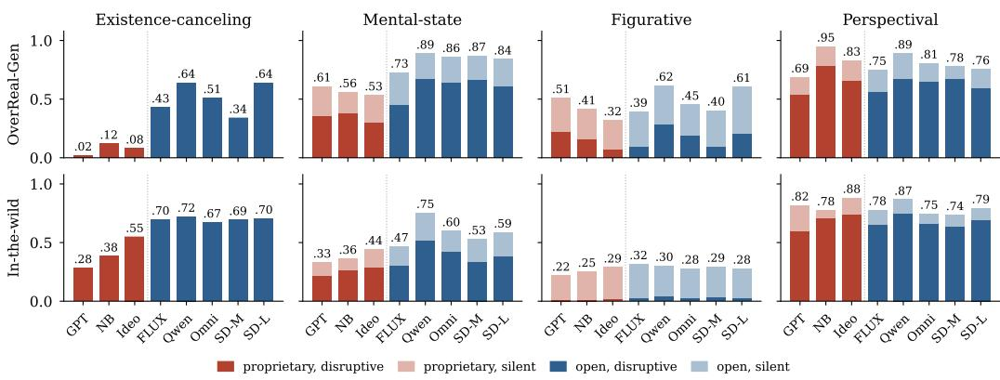

Figure 3: Main results: over-realization rate of each generator by prompt family, on the raw prompts of OverReal-Gen (top) and on the in-the-wild prompts (bottom). Bar height is the over-realization rate; the dark part is disruptive (DO) and the light part silent (SO) over-realization; red bars are the proprietary generators, blue bars the open models. The full outcome shares, including integrated (I) and withheld (W) realization and the unprompted appearance rate u, are in Table 7 (Appendix D).
<table><tr><td></td><td colspan="5">Existence-canceling</td><td colspan="5">Mental-state</td><td colspan="5">Figurative</td><td colspan="5">Perspectival</td></tr><tr><td></td><td>CS↑ VQ↑</td><td></td><td>PS↑</td><td></td><td>HP↑ LJ↑</td><td></td><td>CS↑ VQ↑</td><td>PS↑</td><td>HP↑</td><td>LJ↑</td><td></td><td>CS↑ VQ↑</td><td>PS↑</td><td>HP↑</td><td>LJ↑</td><td>CS↑</td><td></td><td>VQ↑ PS↑ HP↑ LJ↑</td><td></td><td></td></tr><tr><td>DO</td><td>.72</td><td>.32</td><td>22.9</td><td>.30</td><td>3.0</td><td>.73</td><td>.71</td><td>21.8</td><td>.32</td><td>6.4</td><td>.69</td><td>.74</td><td>22.0</td><td>.30</td><td>4.8</td><td>.74</td><td>.74</td><td>22.5</td><td>.30</td><td>3.6</td></tr><tr><td>SO</td><td></td><td></td><td></td><td></td><td></td><td>.73</td><td>.69</td><td>21.8</td><td>.30</td><td>6.7</td><td>.63</td><td>.74</td><td>21.5</td><td>.29</td><td>6.0</td><td>.74</td><td>.72</td><td>22.3</td><td>.29</td><td>3.5</td></tr><tr><td>I</td><td></td><td></td><td></td><td></td><td></td><td>.74</td><td>.81</td><td>21.7</td><td>.31</td><td>8.3</td><td>.69</td><td>.86</td><td>21.9</td><td>.29</td><td>6.9</td><td>.76</td><td>.85</td><td>22.2</td><td>.30</td><td>4.3</td></tr><tr><td>W</td><td>.66</td><td>.85</td><td>22.9</td><td>.30</td><td>8.8</td><td>.67</td><td>.59</td><td>21.3</td><td>.29</td><td>6.6</td><td>.60</td><td>.75</td><td>21.2</td><td>.27</td><td>6.8</td><td>.67</td><td>.59</td><td>21.9</td><td>.28</td><td>4.5</td></tr></table>

Table 1: Mean score of the conventional metrics over the images with each label, pooled over generators; cells with fewer than 10 images are left blank.

Unprompted appearance does not explain the rates. The unprompted appearance rate u (Table 7) stays at or below 9% in every cell, and below 5% for the open models, far below the over-realization rates. The rates of Figure 3 are therefore not explained by the target belonging to the scene, and coincidental appearances inflate them only marginally.

Silent over-realization is a precursor of disruptive over-realization, except in the figurative family. Silent over-realization does not disrupt the image, but it is a warning sign of disruptive over-realization rather than a lucky form of correct realization: an image labeled silent is over-realized again on the second seed 90% of the time (disruptive 33%, silent 57%) and correct only 10% of the time (Appendix D.3). The pattern holds for every open model and is strongest on perspectival and mental-state prompts; on figurative prompts a silent image is followed by another silent one 76% of the time and rarely turns disruptive, since the scene can usually hold the vehicle of the comparison.

Non-LLM conventional metrics reward over-realization and penalize withholding. Table 1 reports the mean score of each metric over the images with each label. A metric sensitive to overrealization would score the two correct outcomes (I, W) above the two over-realizations (DO, SO). The alignment (CS, VQ) and preference (PS, HP) metrics credit integrated images but give withheld images the lowest score in most cases: they reward the presence of the target, not its correct handling. Only the LLM judge scores withheld images above over-realized ones, in three of the four families. Within matched pairs of images from the same prompt and generator whose two seeds differ in outcome, CLIPScore, PickScore and HPSv2 score the over-realized image higher in 64% to 66% of the pairs (Appendix D.4): the conventional metrics reward over-realization even with prompt and generator held fixed.

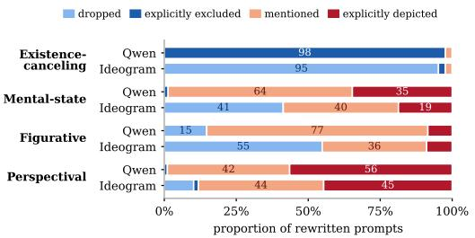  
(a)

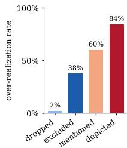  
(b)  
Figure 4: What the rewriters do with the target. (a) Proportion of rewritten prompts in which the target is dropped, explicitly excluded, mentioned, or explicitly to be depicted. (b) Over-realization rate of the images generated from those prompts, by the four categories, pooled over rewriters and open generators. Full numbers in Tables 16 and 17.

The conclusions hold on in-the-wild prompts. For comparison with the curated OverReal-Gen (§4.1), we take 397 prompts of the four families from DiffusionDB (Wang et al., 2023) and Pick-a-Pic (Kirstain et al., 2023), real user prompts selected by their wording alone (Appendix D.6). The bottom row of Figure 3 shows that every generator still over-realizes in every family: pooled over generators, the rate is 60%, 51%, 28% and 80% on existence-canceling, mental-state, figurative and perspectival prompts, with the same family patterns as on the curated prompts, which run 0.1 to 0.3 higher on mental-state and figurative prompts and lower on existence-canceling ones. A human check of the automatic labels on 202 of the wild images gives κ = 0.70 over the four labels, so these rates rest on labels as reliable as those on OverReal-Det (Appendix D.6).

## 6.2 THE EFFECT OF PROMPT EXPANSION

The proprietary generators expand the prompt to include more details before generating, so their advantage could come from either the prompt expansion or the generator. This section asks whether prompt expansion reduces over-realization. We compare five open models, with their own expansion disabled, on the raw prompts and on the prompts rewritten by the Qwen-Image official rewriter and by Ideogram Magic Prompt (Table 13, Appendix D.5).

Expansion lowers the rate but does not remove the failure. On existence-canceling, mental-state and figurative prompts, a rewrite lowers the over-realization rate in 29 of the 30 generator–rewriter pairs; the largest gains are on existence-canceling prompts, where the Ideogram rewrite brings the rate to 11% or below. The Ideogram rewrite is the more reliable of the two: it improves every cell of the three families and roughly halves the rates in the mental-state and figurative families, eliminating 58% of the over-realizations against 21% for the Qwen rewrite, which on existence-canceling prompts even raises the rate of its own generator, Qwen-Image, from 64% to 81%. Perspectival prompts are the exception: the Qwen rewrite raises the rate for all five generators, to 84% to 91%, and the Ideogram rewrite leaves it within a few points of the raw prompt. And even with the Ideogram rewrite, the open generators still over-realize about 48% of the mental-state prompts, 21% of the figurative ones and 79% of the perspectival ones.

The gain comes from dropping the target. We classified every rewritten prompt by its treatment of the target: dropped (no longer mentioned), explicitly excluded (stated to be absent), mentioned (named, but nothing calls for it to be shown), or explicitly depicted (stated to be shown); Figure 4 summarizes the distribution and Appendix D.7 gives it in full. When a target is not meant to appear, Ideogram drops it whereas Qwen explicitly excludes it, and Figure 4(b) shows that only dropping substantially suppresses over-realization; Ideogram also recognizes more often that the target should not appear, dropping it in 41% of the mental-state and 55% of the figurative prompts, against 0% and 15% for Qwen. Neither rewriter reasons correctly about perspectival prompts: both keep the target in nearly every rewrite and describe it as visible in about half. The three treatments other than dropping still yield over-realization in 38% to 84% of the images, so the generator over-realizes on its own, and Section 6.3 turns to its side.

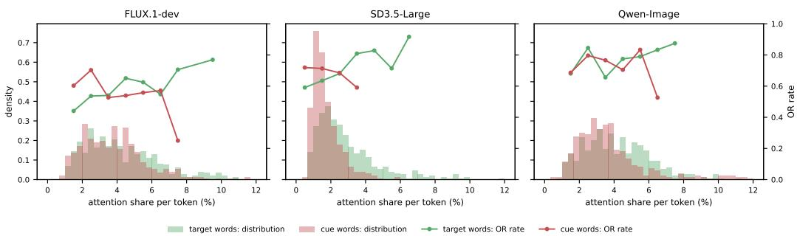  
Figure 5: Histograms: the distribution over the attention of the target words (green) and of the cue words (red). Lines: the over-realization rate (OR rate) within each interval of the share; intervals with fewer than 12 images are not drawn.

## 6.3 ATTENTION TO THE TARGET AND THE CUE WORDS

An open text-to-image model has two stages, a text encoder and a diffusion backbone that reads the encoder’s output while denoising the image. Here we read the attention inside the backbones of FLUX.1-dev, SD3.5-Large and Qwen-Image under the setting of §5; the encoder is examined in Appendix D.8. To compare a target the prompt does not call for with a requested one, we write a plain-mention control for each prompt by hand, replacing the cue words of each family (no, imagines, like, hidden) by words that put the target into the scene, and generate it under the same seed: $^ { * } H i s$ vest is as green as a cucumber” becomes “His vest is green, and he holds a cucumber” (more in Table 20). Table 21 in Appendix D.9 reports the share of attention on the target words, the cue words and the other words, per family and averaged. Three observations follow.

A mentioned target receives almost as much attention as a requested one. Under the original prompt, one token of the target words receives 2.8% to 4.4% of the image-to-text attention $\left( a _ { \mathrm { t } } \right)$ , while under the control the same words receive 3.0% to 5.0% $( a _ { \mathrm { t } } ^ { \prime } )$ . The ratio $\rho _ { \mathrm { t } }$ , 0.83 to 0.90, means that the target receives almost the same attention under the original prompt as under the control, although the control requests the target and the original only mentions it. Therefore, the backbone’s attention barely distinguishes a mentioned target from a requested one. Figure 10 (top row, first two columns) shows the map for the cucumber of Table 2: under both prompts the attention sits where the cucumber is drawn, on the man’s head under the original prompt and in his hand under the control.

The cue words receive less attention than ordinary words. The cue words (no, imagines, like, hidden) receive 1.7% to 3.8% per token $( a _ { \mathrm { c } } )$ , less than an ordinary word $( \gamma = 0 . 6 0 \mathrm { t o } \ 0 . 7 6 )$ , and also less than the replacing words (with, holding, next to, open; $\rho _ { \mathrm { c } } = 0 . 8 4 \mathrm { t o } 0 . 9 7 )$ ). The backbone’s attention, then, does not reflect what the cue words say: that the target need not appear in the image, and if it does, only in a form the prompt allows, such as a thought bubble, a stylized shape, a reflection or a viewpoint that brings it into sight.

Over-realization rate increases with more attention on the target words and less attention on the cue words. Figure 5 relates the attention share of target words and cue words to the over-realization. From the lowest to the highest interval of the figure, the over-realization rate rises with the share of the target words (0.44 → 0.77, 0.59 → 0.92 and 0.68 → 0.88 for FLUX.1-dev, SD3.5-Large and Qwen-Image) and falls with the share of the cue words (0.60 → 0.25, 0.72 → 0.59 and 0.69 → 0.53), the fall being steepest where the cue words receive an unusually large share. The over-realization rate thus tracks both attention shares, rising with the share of the target words and falling with the share of the cue words on all three backbones.

## 7 CONCLUSION

We introduced over-realization, the appearance of a mentioned target in a generated image in a way the prompt does not call for, and drew on mental-spaces theory to organize the four situations where it can happen. OverReal measures it with a prompt set prone to over-realization and a human-labeled image set. All eight text-to-image systems over-realize outside negation, on the benchmark and on real user prompts; the form of the failure follows the family, and conventional metrics reward over-realization. Prompt expansion helps mainly when the rewriter drops the target; when the target word reaches the generator, its backbone attends to it almost as to a requested one and to the cue words less than to ordinary words. Faithful generation therefore requires a model that can decide on its own which mentioned target to leave out (Appendices A.3 and D.11), and evaluation that credits it for withholding.

## LIMITATIONS

Modality. Over-realization is not specific to text-to-image generation: a language model can realize a mentioned target in text, and a video generator in its own medium. This paper covers images, where the failure produces a visible contradiction and generation and evaluation are affordable; extending the taxonomy and the benchmark to other modalities is left for future work.

Subjectivity of the outcome labels. The four outcome labels are defined by the effect that the target’s appearance has on the image, and this effect is a matter of degree, in particular between disruptive, silent and integrated. The annotators did not always agree; Appendix A.2 gives borderline examples and Appendix B.2 counts the disagreements.

## ETHICS STATEMENT

The prompts are written by the authors or synthesized from templates, and the images are generated by the evaluated models; no personal data is involved. The work studies a faithfulness failure of text-to-image generation and provides no means of attack.

## REPRODUCIBILITY STATEMENT

OverReal-Gen and OverReal-Det are released with the annotations, the plain-mention controls and the expanded prompts. All generator settings are provided in §5.1. The judges and the automatic annotator are identified by model version in §5.2 and §5.3, and the exact question text of the annotation protocol and the human annotation guide are given in Appendix E. All code for generation, annotation, probing and attention recording is released with the data.

## AI USE STATEMENT

Large language models are part of the evaluated pipeline and of the evaluation itself: Claude Opus 5 and GPT-5.2 serve as the LLM judge (§5.2) and Claude Opus 5 as the automatic annotator (§5.3); the Qwen-Image rewriter and Ideogram Magic Prompt produce the expanded prompts (§6.2). The authors used Claude Code as a coding and writing assistant; all analyses, claims and text were checked by the authors, who take full responsibility for the content.

## REFERENCES

Kumail Alhamoud, Shaden Alshammari, Yonglong Tian, Guohao Li, Philip H. S. Torr, Yoon Kim, and Marzyeh Ghassemi. Vision-language models do not understand negation. In Proceedings of the IEEE/CVF Conference on Computer Vision and Pattern Recognition (CVPR), 2025.

Anthropic. Claude Opus 5. https://docs.anthropic.com/en/docs/about-claude/models, 2026. Model version claude-opus-5, accessed September 2026.

Shuai Bai, Keqin Chen, Xuejing Liu, et al. Qwen2.5-VL technical report. arXiv preprint arXiv:2502.13923, 2025.

James Betker, Gabriel Goh, Li Jing, Tim Brooks, Jianfeng Wang, Linjie Li, Long Ouyang, Juntang Zhuang, Joyce Lee, Yufei Guo, Wesam Manassra, Prafulla Dhariwal, Casey Chu, Yunxin Jiao,

and Aditya Ramesh. Improving image generation with better captions. Technical report, OpenAI, 2023.

Black Forest Labs. Flux.1. https://github.com/black-forest-labs/flux, 2024.

Yuliang Cai, Jesse Thomason, and Mohammad Rostami. TNG-CLIP: Training-time negation data generation for negation awareness of CLIP. arXiv preprint arXiv:2505.18434, 2025.

Hila Chefer, Yuval Alaluf, Yael Vinker, Lior Wolf, and Daniel Cohen-Or. Attend-and-excite: Attention-based semantic guidance for text-to-image diffusion models. ACM Transactions on Graphics, 42(4), 2023. doi: 10.1145/3592116.

Jaemin Cho, Yushi Hu, Roopal Garg, Peter Anderson, Ranjay Krishna, Jason Baldridge, Mohit Bansal, Jordi Pont-Tuset, and Su Wang. Davidsonian scene graph: Improving reliability in fine-grained evaluation for text-to-image generation. In International Conference on Learning Representations (ICLR), 2024.

Colin Conwell, Rupert Tawiah-Quashie, and Tomer Ullman. Relations, negations, and numbers: Looking for logic in generative text-to-image models. arXiv preprint arXiv:2411.17066, 2024.

Patrick Esser, Sumith Kulal, Andreas Blattmann, Rahim Entezari, Jonas Müller, Harry Saini, Yam Levi, Dominik Lorenz, Axel Sauer, Frederic Boesel, et al. Scaling rectified flow transformers for high-resolution image synthesis. In International Conference on Machine Learning, 2024.

Gilles Fauconnier. Mental Spaces: Aspects ofMeaning Construction in Natural Language. Cambridge University Press, 1994.

Google DeepMind. Gemini 2.5 flash image. https://developers.googleblog.com/en/ introducing-gemini-2-5-flash-image/, 2025.

Yaru Hao, Zewen Chi, Li Dong, and Furu Wei. Optimizing prompts for text-to-image generation. In Advances in Neural Information Processing Systems, 2023.

Jack Hessel, Ari Holtzman, Maxwell Forbes, Ronan Le Bras, and Yejin Choi. CLIPScore: A reference-free evaluation metric for image captioning. In Proceedings of EMNLP, 2021.

Yushi Hu, Benlin Liu, Jungo Kasai, Yizhong Wang, Mari Ostendorf, Ranjay Krishna, and Noah A. Smith. TIFA: Accurate and interpretable text-to-image faithfulness evaluation with question answering. In Proceedings of the IEEE/CVF International Conference on Computer Vision (ICCV), 2023.

Kaiyi Huang, Kaiyue Sun, Enze Xie, Zhenguo Li, and Xihui Liu. T2I-CompBench: A comprehensive benchmark for open-world compositional text-to-image generation. In Advances in Neural Information Processing Systems (NeurIPS) Datasets and Benchmarks Track, 2023.

Ideogram. Magic prompt. https://docs.ideogram.ai/using-ideogram/ generation-settings/magic-prompt, 2024.

Ideogram. Ideogram 3.0. https://about.ideogram.ai/3.0, 2025.

Seyed Amir Kasaei and Mohammad Hossein Rohban. Hallucination as an upper bound: A new perspective on text-to-image evaluation. arXiv preprint arXiv:2509.21257, 2025. NeurIPS 2025 Workshop on Generative and Protective AI for Content Creation.

Yuval Kirstain, Adam Polyak, Uriel Singer, Shahbuland Matiana, Joe Penna, and Omer Levy. Picka-pic: An open dataset of user preferences for text-to-image generation. In Advances in Neural Information Processing Systems, 2023.

Max Ku, Dongfu Jiang, Cong Wei, Xiang Yue, and Wenhu Chen. VIEScore: Towards explainable metrics for conditional image synthesis evaluation. In Proceedings ofACL, 2024.

Youngsun Lim, Hojun Choi, and Hyunjung Shim. Evaluating image hallucination in text-to-image generation with question-answering. In Proceedings ofthe AAAI Conference on Artificial Intelligence (AAAI), 2025.

Zhiqiu Lin, Deepak Pathak, Baiqi Li, Jiayao Li, Xide Xia, Graham Neubig, Pengchuan Zhang, and Deva Ramanan. Evaluating text-to-visual generation with image-to-text generation. In European Conference on Computer Vision, 2024.

OpenAI. GPT-5.2. https://platform.openai.com/docs/models/gpt-5.2, 2025a. Model version gpt-5.2-2025-12-11.

OpenAI. GPT image in the API. https://platform.openai.com/docs/models/gpt-image-1.5, 2025b.

Junsung Park, Jungbeom Lee, Jongyoon Song, Sangwon Yu, Dahuin Jung, and Sungroh Yoon. Know “no” better: A data-driven approach for enhancing negation awareness in CLIP. In Proceedings of the IEEE/CVF International Conference on Computer Vision (ICCV), pp. 2825–2835, 2025.

Ziyuan Qin, Dongjie Cheng, Haoyu Wang, Huahui Yi, Yuting Shao, Zhiyuan Fan, Kang Li, and Qicheng Lao. Evaluating hallucination in text-to-image diffusion models with scene-graph based question-answering agent. arXiv preprint arXiv:2412.05722, 2024.

Qwen Team. Qwen-image technical report. arXiv preprint arXiv:2508.02324, 2025.

Alec Radford, Jong Wook Kim, Chris Hallacy, Aditya Ramesh, Gabriel Goh, Sandhini Agarwal, Girish Sastry, Amanda Askell, Pamela Mishkin, Jack Clark, Gretchen Krueger, and Ilya Sutskever. Learning transferable visual models from natural language supervision. In Proceedings ofthe 38th International Conference on Machine Learning (ICML), 2021.

Colin Raffel, Noam Shazeer, Adam Roberts, Katherine Lee, Sharan Narang, Michael Matena, Yanqi Zhou, Wei Li, and Peter J. Liu. Exploring the limits of transfer learning with a unified text-to-text transformer. Journal of Machine Learning Research, 21(140):1–67, 2020.

Kaiyue Sun, Rongyao Fang, Chengqi Duan, Xian Liu, and Xihui Liu. T2I-ReasonBench: Benchmarking reasoning-informed text-to-image generation. arXiv preprint arXiv:2508.17472, 2025.

Mor Ventura, Michael Toker, Or Patashnik, Yonatan Belinkov, and Roi Reichart. DeLeaker: Dynamic inference-time reweighting for semantic leakage mitigation in text-to-image models. In International Conference on Learning Representations (ICLR), 2026.

Zengbin Wang, Xuecai Hu, Yong Wang, Feng Xiong, Man Zhang, and Xiangxiang Chu. Everything in its place: Benchmarking spatial intelligence of text-to-image models. In International Conference on Learning Representations (ICLR), 2026.

Zijie J. Wang, Evan Montoya, David Munechika, Haoyang Yang, Benjamin Hoover, and Duen Horng Chau. DiffusionDB: A large-scale prompt gallery dataset for text-to-image generative models. In Proceedings of the 61st Annual Meeting of the Association for Computational Linguistics, 2023.

Chenyuan Wu, Pengfei Zheng, Ruiran Yan, Shitao Xiao, et al. OmniGen2: Exploration to advanced multimodal generation. arXiv preprint arXiv:2506.18871, 2025.

Xiaoshi Wu, Yiming Hao, Keqiang Sun, Yixiong Chen, Feng Zhu, Rui Zhao, and Hongsheng Li. Human preference score v2: A solid benchmark for evaluating human preferences of text-to-image synthesis. arXiv preprint arXiv:2306.09341, 2023.

## A EXAMPLE OF GENERATED IMAGES

## A.1 TAXONOMY

Table 2 shows more examples of over-realization with different labels in each category. All images are produced by the generators of §5.1 with prompts from OverReal-Gen and labels annotated by two human experts. Existence-canceling prompts have no silent or integrated example, since a target whose existence is cancelled should not appear in any status.

<table><tr><td>Family</td><td>Disruptive over-realization</td><td>Silent over-realization</td><td>Integrated realization</td><td>Withheld realization</td></tr><tr><td>1. Existence- canceling</td><td>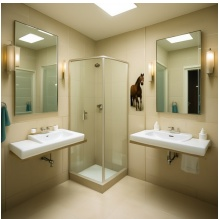 prompt: a bath room with sinks and mirrors, no horse anywhere in the scene</td><td></td><td></td><td>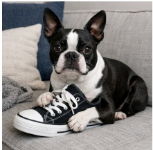 prompt: boston Terrier sitting on a couch with a shoe, and not a single sandwich</td></tr><tr><td rowspan="2">2. Mental-state</td><td>target: horse model: OmniGen2 </td><td>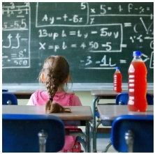</td><td>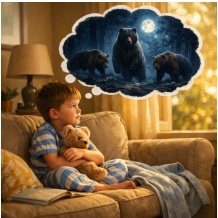</td><td>target: sandwich model: GPT-Image-1.5 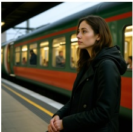</td></tr><tr><td>prompt: Maya at the ridge, believing that there is a fierce tiger at the ridge and being super afraid. target: tiger model: SD3.5-Large</td><td>prompt: Sitting in math class, prompt: Sitting on the sofa the thirsty girl stares at the whiteboard, wondering if she can buy a bottle of apple juice as soon as class ends. target: apple juice model: SD3.5-Large</td><td>one warm morning, the kid thought that there were bears outside at night, although he had never seen them. target: bears model: GPT-Image-1.5</td><td>prompt: A woman waits at a train station, imagining her deceased friend arriving on the next train. target: friend model: OmniGen2</td></tr><tr><td>3. Figurative</td><td>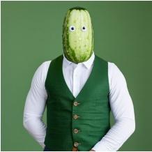 prompt: His vest is as green as a cucumber. target: cucumber model: SD3.5-Large</td><td> prompt: The unexplained expense was a red flag during an otherwise routine audit</td><td>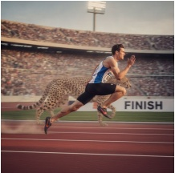 prompt: The runner is as fast as a cheetah as he races toward the finish line.</td><td>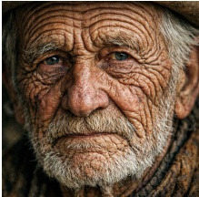 prompt: His wrinkles were as layered as tree rings. target: tree rings</td></tr><tr><td></td><td>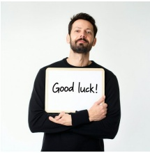</td><td>meeting. target: red flag model: Nano Banana 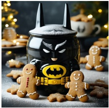</td><td>target: cheetah model: Nano Banana 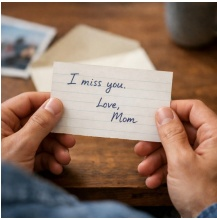</td><td>model: GPT-Image-1.5 </td></tr><tr><td>4. Perspectival</td><td>prompt: A man holds a whiteboard against his chest with &quot;Good luck!&quot;written on the hidden side target: Good luck model: SD3.5-Large</td><td>prompt: A closed batman cookie jar contains a gingerbread men target: gingerbread men model: SD3.5-Large</td><td>prompt: Tom is reading a letter. The letter is from his mom, which says: I miss you. with a mug, pretending it target: I miss you model: GPT-Image-1.5</td><td>prompt: The student covered the grade on his exam sheet wasn&#x27;t a bad score. target: score model: Ideogram v3</td></tr></table>

Table 2: Taxonomy examples.

## A.2 BORDERLINE CASES

The outcome labels are defined by the effect that the target’s appearance has on the image, and for some images this effect is a matter of degree. Figure 6 shows three pilot images on which the two annotators disagreed, one for each pair of labels that is hard to separate.

Disruptive or silent. The two labels differ on whether the target’s appearance fits the scene. In Figure 6(a), the sponge, the vehicle of the comparison, is drawn into the office: one annotator read it as an object an office may plausibly hold, the other as something that does not belong there.

Disruptive or integrated. The two labels differ on whether an exaggerated rendering is read as a stylized expression or as a scene that breaks common sense. In Figure 6(b) a bowling ball rolls through the department: one annotator took it as a stylization of the comparison, the other as an object that a real office cannot contain.

Integrated or silent. The two labels differ on whether a depiction of the target inside the scene is a form the prompt allows or the target slipping in. In Figure 6(c) the cat appears as a framed photograph on the counter: one annotator read the photograph as a fitting way to show an absent cat, the other as a cat that was not supposed to appear at all.

  
prompt: The new employee absorbed every instruction like a sponge soaking up water. target: sponge labels: disruptive / silent

  
prompt: The tiny disagreement rolled through the department like a bowling ball knocking down everything in its path. target: bowling ball labels: disruptive / integrated

  
prompt: The woman is making her breakfast wondering what her cat is doing, since it is living with her parents right now. target: cat labels: silent / integrated

Figure 6: Borderline cases: (a) disruptive or silent, (b) disruptive or integrated, (c) integrated or silent.   
The two labels under each image are the two annotators’ labels.

## A.3 UNEXPECTED OVER-REALIZED TARGETS

An annotator writes a prompt with one target in mind, but the generator may over-realize another mention, and even another family. Figure 7 shows two example images which over-realize both the vehicle of the comparison and the viewpoint. In (a) the leaves drift past the window (silent), and the student, who should face the lecturer, is turned toward the camera so that his face is visible (disruptive). In (b) a pot bubbles on the stove (silent), and the screen that carries the results faces the camera rather than the woman who is reading it (disruptive).

In practical use, a generator is not told which mention to withhold, and a single prompt can overrealize several of them. Perspectival over-realization in particular can arise in any prompt that places a person or a text-bearing object in a scene, without a cue word. Methods that suppress a given word, such as a negative prompt or a reweighting of the attention on that word, must first be told which word to suppress, and a user does not say.

## B DATASET DETAILS

## B.1 STATISTICS

Table 3 gives the size of the raw and expanded splits of OverReal-Gen, the size of the gold and ambiguous splits of OverReal-Det, the label distribution of the gold split, and the agreement between the two annotators. When writing the three hand-written families, the annotators were asked not to reuse one template, so that the prompts cover diverse failures.

  
prompt: The student’s attention drifted like a leaf in the wind during the long afternoon lecture. targets: leaf (figurative), the student (perspectival) labels: silent / disruptive

  
prompt: Her excitement bubbled over like a pot on the stove when the results came in. targets: pot (figurative), the results (perspectival) labels: silent / disruptive

Figure 7: Two pilot images (Gemini) that over-realize two targets each: the vehicle of the comparison, silently, and the viewpoint of the person, disruptively. (a) The student faces the camera instead of the lecturer. (b) The screen faces the camera instead of the woman reading it.
<table><tr><td rowspan="3">Family</td><td colspan="4">OverReal-Gen</td><td colspan="8">OverReal-Det</td></tr><tr><td colspan="2">Raw</td><td colspan="2">Expanded</td><td rowspan="2">Gold size</td><td colspan="4">Label distribution (%)</td><td rowspan="2">Amb. size</td><td rowspan="2"></td><td rowspan="2">Overall agreement (κ)</td></tr><tr><td>Size</td><td>Avg. tokens</td><td>Size</td><td>Avg. tokens</td><td>DO</td><td>SO</td><td>I</td><td>W</td></tr><tr><td>Existence-canceling</td><td>200</td><td>16.9</td><td>400</td><td>112.1</td><td>204</td><td>32.4</td><td>0.5</td><td>0.0</td><td></td><td>67.2</td><td>23</td><td>0.73</td></tr><tr><td>Mental-state</td><td>75</td><td>23.5</td><td>150</td><td>124.0</td><td>239</td><td>53.6</td><td></td><td>18.0</td><td>11.3</td><td>17.2</td><td>112</td><td>0.51</td></tr><tr><td>Figurative</td><td>237</td><td>16.4</td><td>474</td><td>116.4</td><td>932</td><td>36.6</td><td>28.1</td><td></td><td>2.9</td><td>32.4</td><td>299</td><td>0.65</td></tr><tr><td>Perspectival</td><td>186</td><td>23.1</td><td>372</td><td>118.7</td><td>878</td><td>70.5</td><td>10.3</td><td></td><td>7.3</td><td>12.0</td><td>154</td><td>0.72</td></tr><tr><td>Overall</td><td>698</td><td>19.1</td><td>1,396</td><td>117.8</td><td>2,253</td><td>51.2</td><td></td><td>17.6</td><td>5.2</td><td>26.0</td><td>588</td><td>0.68</td></tr></table>

Table 3: OverReal statistics. Label distribution: share of the gold split labeled disruptive overrealization (DO), silent over-realization (SO), integrated realization (I) and withheld realization (W).

## B.2 THE AMBIGUOUS SPLIT

An image enters the ambiguous split when the label sets of its two annotators are disjoint (§4.2). Table 4 sorts the 588 such images, 20.7% of the 2,841 annotated images, by what the two annotators disagree on. In 245 of them, the annotators agree on whether the target is over-realized; in 266 of them, one annotator read the image as over-realized and the other as correct; the remaining 77 involve the label other.

<table><tr><td></td><td>Existence-canceling</td><td>Mental-state</td><td>Figurative</td><td>Perspectival</td><td>All</td></tr><tr><td>Form of the outcome only</td><td>6</td><td>52</td><td>125</td><td>62</td><td>245</td></tr><tr><td>Over-realized against correct</td><td>13</td><td>43</td><td>141</td><td>69</td><td>266</td></tr><tr><td>One label is other</td><td>4</td><td>17</td><td>33</td><td>23</td><td>77</td></tr></table>

Table 4: The ambiguous split of OverReal-Det by the kind of disagreement.

Stability of the rates under the ambiguous images. The headline rates (Figure 3, Table 7) come from the automatic annotator, so the ambiguous images do not enter them directly. To see how much they could matter, we recompute the over-realization rate on OverReal-Det with the ambiguous images included, taking each annotator’s labels in turn instead of the gold labels. The rate per family moves by at most 0.04 (existence-canceling 0.33 to 0.36 and 0.37, mental-state 0.71 to 0.73 and 0.72, figurative 0.65 to 0.65 and 0.64, perspectival 0.81 to 0.79 and 0.79), and the generator rankings stay almost unchanged (Spearman $\rho \geq 0 . 7 7$ in every family).

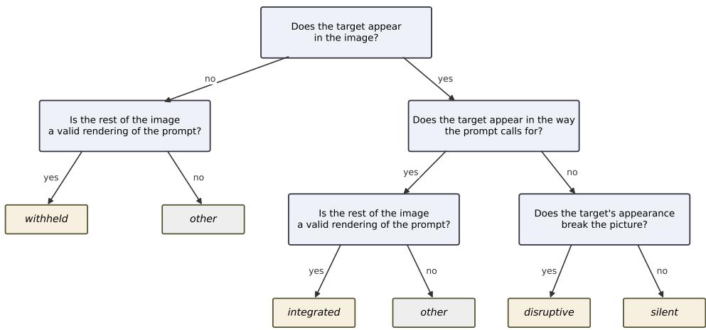  
Figure 8: The annotation cascade as a decision tree. Each decision node (blue) is one yes/no question put to the annotator in a separate call, with the image and the prompt; the leaves (italic) are the labels. The family-specific wording of the questions is given in Appendix E.1.

## C AUTOMATIC ANNOTATOR

## C.1 CASCADE DESIGN

Rather than asking for one of four labels at once, the annotator follows the decision tree of Figure 8, one yes/no question per call. The first question is whether the target appears in the image. If it does not, the image is withheld when the rest of the image is a valid rendering of the prompt, and other when it is not. If it does, the next question is whether the target appears in the way the prompt calls for. If so, the same validity question decides between integrated and other; if not, the image is disruptive when the target’s appearance breaks the picture, and silent when it does not. The questions that instantiate these decisions differ by family for higher precision. The full question set per family is given in Appendix E.1.

## C.2 SELF-EVOLUTION OF THE AI ANNOTATOR

The AI annotator is adapted to the task without updating any model weights, by a form of selfevolution: the model annotates a development set with its current questions, revises the questions from the mistakes it made, and repeats until its agreement with the human labels stops improving. We build it on the human labels of OverReal-Det, split evenly, stratified by family and generator, into a development split and a test split; the development split alone drives the self-evolution, and the frozen annotator is then evaluated once on the test set. In each round the model scores the development split, receives the images on which its label disagrees with the human one, traces each disagreement to the question that produced it, and proposes a rewrite of that question; we accept the rewrite and score the revised questions again. The best wording is selected per family.

## C.3 AGREEMENT WITH THE HUMAN LABELS

The annotator uses Claude Opus 5 (Anthropic, 2026) as the base model. Table 5 reports the AI-human agreement and human-human agreement in Cohen’s κ. Conclusions are given as follows.

Self-evolution improves the cascade annotator. Asking the model for one of the four labels outright is unreliable: a multiple-choice prompt over the four labels reached only κ = 0.46 against the human labels. Self-evolution of the cascade questions then raised the agreement with the human labels on the development split from $\kappa = 0 . 6 1$ to 0.68 over the four labels, and from 0.65 to 0.76 on the split between over-realization and correct output.

The annotator agrees with the human labels nearly as well as the humans agree with each other. Over the four labels, κ is 0.58 overall against 0.70 between the humans; on the split between over-realization and correct output, which the rates of Table 7 rest on, it is 0.70 against 0.75, a substantial agreement. The automatic labels are therefore reliable enough for the rates we report, if not for a fine reading of every image.

The agreement holds on prompts the annotator never saw during development. The development and test splits of OverReal-Det were drawn over images, so 87% of the 1,118 test images share a prompt with a development image. On the 148 test images whose prompt never appears in the development split, κ is 0.54 over the four labels and 0.66 on the split between over-realization and correct output, against 0.58 and 0.70 on the full test split.

Part of the gap to the humans is the ambiguity of the task. The κ values in Table 5 are not uniformly high, but they come close to the agreement between the humans on this task. Deciding whether the target appears is easy for both the annotator and the humans (κ = 0.83 against 0.86). Deciding what its appearance amounts to is harder for both, because the outcome labels are defined by the effect that the target’s appearance has on the image, and this effect is a matter of degree, as described in the limitations; on mental-state prompts the annotator is close to the humans (0.42 against 0.47). On perspectival prompts it falls short of them (0.41 against 0.75), so there the gap is the model’s. The label with the least sharp boundary is integrated (Appendix A.2): on whether an image is integrated, the two humans reach κ = 0.52.

<table><tr><td colspan="2">Decision</td><td>Existence-canceling</td><td>Mental-state</td><td></td><td>Figurative Perspectival</td><td>Overall</td></tr><tr><td rowspan="2">Four labels</td><td>AI-human</td><td>1.00</td><td>0.42</td><td>0.60</td><td>0.41</td><td>0.58</td></tr><tr><td>humans</td><td>0.83</td><td>0.47</td><td>0.67</td><td>0.75</td><td>0.70</td></tr><tr><td rowspan="2">Target appears</td><td>AI-human</td><td>1.00</td><td>0.74</td><td>0.82</td><td>0.71</td><td>0.83</td></tr><tr><td>humans</td><td>0.88</td><td>0.84</td><td>0.83</td><td>0.87</td><td>0.86</td></tr><tr><td rowspan="2">Over-realized vs. correct</td><td>AI-human</td><td>1.00</td><td>0.53</td><td>0.69</td><td>0.60</td><td>0.70</td></tr><tr><td>humans</td><td>0.88</td><td>0.49</td><td>0.74</td><td>0.79</td><td>0.75</td></tr></table>

Table 5: Cohen’s κ of the automatic annotator (Claude Opus 5) against the human gold labels on the held-out test split of OverReal-Det (1,118 images), and of the two human annotators against each other on the 2,688 doubly annotated images with one label each, for the four-outcome label, for whether the target appears, and for the collapse to over-realized against correct.

## D RESULTS

## D.1 CONVENTIONAL EVALUATION: LLM JUDGE DETAILS

Both judges score the same images with the verbatim VIEScore text-to-image semantic-consistency template: Claude Opus 5 (claude-opus-5, accessed 2026-09) and GPT-5.2 (gpt-5.2-2025-12-11). Table 6 reports the Opus rating; Table 8 gives the GPT-5.2 rating for the same cells and Table 9 the agreement of the two judges.

## D.2 INTERVALS FOR THE OVER-REALIZATION RATES

Table 10 gives the over-realization rate of Table 7, the sum of the DO and SO columns, with half the width of a 95% bootstrap interval.

## D.3 OUTCOMES ACROSS THE TWO SEEDS

For the raw prompts of OverReal-Gen, each model generates two images per prompt under different seeds. Table 11 conditions on the label of one image and gives the distribution of the label of the other, over the labeled sample of §5.3 (172 silent, 428 correct and 588 disruptive conditioning images). Existence-canceling prompts have no silent images.

<table><tr><td></td><td colspan="5">Existence-canceling</td><td colspan="5">Mental-state</td><td colspan="5">Figurative</td><td colspan="5">Perspectival</td></tr><tr><td></td><td>CS↑ VQ↑ PS↑ HP↑ LJ↑</td><td></td><td></td><td></td><td></td><td></td><td></td><td>CS↑ VQ↑ PS↑ HP↑ LJ↑</td><td></td><td></td><td>CS↑ VQ↑ PS↑ HP↑ LJ↑</td><td></td><td></td><td></td><td></td><td></td><td>CS↑ VQ↑ PS↑ HP↑ LJ↑</td><td></td><td></td><td></td></tr><tr><td>GPT-Image</td><td>.67</td><td>.87</td><td>23.3</td><td>.31</td><td>9.4</td><td>.75</td><td>.78</td><td>22.1</td><td>.33</td><td>8.2</td><td>.69</td><td>.84</td><td>22.1</td><td>.31</td><td>7.5</td><td>.74</td><td>.66</td><td>22.4.29</td><td></td><td>5.6</td></tr><tr><td>Nano Banana</td><td>.64</td><td>.82</td><td>22.9</td><td>.28</td><td>8.7</td><td>.71</td><td>.78</td><td>21.8</td><td>.30</td><td>7.8</td><td>.63</td><td>.83</td><td>21.6</td><td>.28</td><td>7.5</td><td>.71</td><td>.76</td><td>22.3.28</td><td></td><td>4.5</td></tr><tr><td>Ideogram</td><td>.61</td><td>.82</td><td>22.7</td><td>.29</td><td>8.3</td><td>.66</td><td>.62</td><td>21.2</td><td>.29</td><td>6.9</td><td>.57</td><td>.73</td><td>21.1</td><td>.27</td><td>6.9</td><td>.70</td><td>.70</td><td>22.4.30</td><td></td><td>3.6</td></tr><tr><td>FLUX.1-dev</td><td>.66</td><td>.59</td><td>22.9</td><td>.30</td><td>5.8</td><td>.73</td><td>.66</td><td>21.7.30</td><td></td><td>6.2</td><td>.62</td><td>.70</td><td>21.4 .29</td><td></td><td>5.5</td><td>.73</td><td>.69</td><td>22.6.30</td><td></td><td>3.2</td></tr><tr><td>Qwen-Image</td><td>.73</td><td>.51</td><td>23.2</td><td>.31</td><td>5.2</td><td>.75</td><td>.75</td><td>22.0</td><td>.32</td><td>6.7</td><td>.66</td><td>.79</td><td>21.7</td><td>.30</td><td>6.3</td><td>.77</td><td>.77</td><td>22.8 .31 3.3</td><td></td><td></td></tr><tr><td>OmniGen2</td><td>.70</td><td>.58</td><td>22.9</td><td>.30</td><td>5.6</td><td>.71</td><td>.64</td><td>21.5</td><td>.32</td><td>5.8</td><td>.63</td><td>.71</td><td>21.2</td><td>.28</td><td>5.3</td><td>.75</td><td>.72</td><td>22.3.30</td><td></td><td>3.0</td></tr><tr><td>SD3.5-Medium</td><td>.69</td><td>.69</td><td>22.5 .28</td><td></td><td>6.5</td><td>.72</td><td>.65</td><td>21.4 .29</td><td></td><td>6.0</td><td>.62</td><td>.69</td><td>21.1 .26</td><td></td><td>5.5</td><td>.76</td><td>.69</td><td>21.9.28 3.2</td><td></td><td></td></tr><tr><td>SD3.5-Large</td><td>.71</td><td>.50 22.9 .30 5.0</td><td></td><td></td><td></td><td>.73</td><td></td><td>.67 21.8 .31 6.3</td><td></td><td></td><td>.66</td><td>.71</td><td>21.6 .29 5.4</td><td></td><td></td><td>.75</td><td>.71</td><td>22.5 .30 3.6</td><td></td><td></td></tr></table>

Table 6: Conventional evaluation of the eight systems on the raw prompts of OverReal-Gen: mean CLIPScore (CS), VQAScore (VQ), PickScore (PS), HPSv2 (HP) and LLM judge (LJ) per family.

<table><tr><td></td><td colspan="4">Existence-canceling</td><td colspan="4">Mental-state</td><td colspan="4">Figurative</td><td colspan="4">Perspectival</td></tr><tr><td>Generator</td><td colspan="4">DO↓ SO↓ I↑ W↑ u↓</td><td colspan="4">DO↓ SO↓ I↑ W↑ u↓</td><td colspan="4">DO↓ SO↓ I↑ W↑ u↓</td><td colspan="4">DO↓ SO↓ I↑ W↑ u↓</td></tr><tr><td></td><td></td><td></td><td></td><td></td><td></td><td></td><td></td><td></td><td></td><td></td><td></td><td></td><td></td><td></td><td></td><td></td><td></td></tr><tr><td>(a) OverReal-Gen</td><td></td><td></td><td></td><td></td><td></td><td></td><td></td><td></td><td></td><td></td><td></td><td></td><td></td><td></td><td></td><td></td><td></td></tr><tr><td>GPT-Image</td><td>.02</td><td>.00 .00 .98 .02</td><td></td><td></td><td>.35</td><td></td><td></td><td>.26.28 .11 .08</td><td>.22</td><td></td><td></td><td>.29 .16.33 .05</td><td></td><td></td><td></td><td>.54 .15 .03 .28 .05</td><td></td></tr><tr><td>Nano Banana Ideogram</td><td>.12 .08</td><td>.00 .00</td><td>.00.88.03 .00.92.02</td><td></td><td>.37 .29</td><td></td><td></td><td>.19.37 .07 .09</td><td>.15 .07</td><td>.25</td><td></td><td>.26.15 .43 .09 .03.65.04</td><td></td><td>.78 .65</td><td></td><td>.17 .02 .03 .07 .18 .00 .17 .02</td><td></td></tr><tr><td></td><td></td><td></td><td></td><td></td><td></td><td></td><td></td><td>.24 .03 .44 .02</td><td></td><td></td><td></td><td></td><td></td><td></td><td></td><td></td><td></td></tr><tr><td>FLUX.1-dev</td><td>.43</td><td>.00</td><td>.00.57.02</td><td></td><td>.44</td><td></td><td></td><td>.28.03 .24 .02</td><td>.09</td><td></td><td></td><td>.30.14.46 .02</td><td>.56</td><td></td><td></td><td>.19.01.24 .03</td><td></td></tr><tr><td>Qwen-Image</td><td>.64</td><td>.00</td><td>.00.36.01</td><td></td><td>.67</td><td>.22</td><td></td><td>.01.10.03</td><td>.28</td><td>.33</td><td></td><td>3.07 .31 .02</td><td>.67</td><td>.22</td><td></td><td>2.01.10.04</td><td></td></tr><tr><td>OmniGen2</td><td>.51</td><td>.00</td><td>.00.49.01</td><td></td><td>.64</td><td></td><td></td><td>.22 .03 .11 .02</td><td>.19</td><td></td><td></td><td>.27 .08.46.03</td><td>.64</td><td></td><td></td><td>.16 .01 .18 .03</td><td></td></tr><tr><td>SD3.5-Medium</td><td>.34</td><td>.00</td><td></td><td>.00.66.00</td><td>.66</td><td></td><td></td><td>.21 .01 .12 .02</td><td>.09</td><td></td><td></td><td>.31 .06.54 .02</td><td>.67</td><td></td><td></td><td>.11 .00 .22 .02</td><td></td></tr><tr><td>SD3.5-Large</td><td>.64</td><td>.00</td><td></td><td>.00.36.01</td><td>.61</td><td>.23</td><td></td><td>3.03 .13 .02</td><td>.20</td><td></td><td></td><td>.40.11 .28 .02</td><td>.59</td><td></td><td></td><td>.16 .02 .22 .03</td><td></td></tr><tr><td>(b) In-the-wild prompts</td><td></td><td></td><td></td><td></td><td></td><td></td><td></td><td></td><td></td><td></td><td></td><td></td><td></td><td></td><td></td><td></td><td></td></tr><tr><td>GPT-Image Nano Banana</td><td>.28</td><td>.00</td><td>0.00.72</td><td></td><td>.21</td><td></td><td>.12.64 .03</td><td></td><td>.01</td><td></td><td>.21.47.31</td><td></td><td>.59</td><td></td><td></td><td>.23.00.18</td><td></td></tr><tr><td>Ideogram</td><td>.38 .55</td><td>.00 .00</td><td>.00.62 .00.45</td><td></td><td>.26 .28</td><td></td><td>.10.58 .06 .16.14 .41</td><td></td><td>.01 .02</td><td></td><td>.24.35 .40 .27.26.45</td><td></td><td>.70 .74</td><td></td><td></td><td>.07.01 .21</td><td></td></tr><tr><td></td><td></td><td></td><td></td><td></td><td></td><td></td><td></td><td></td><td></td><td></td><td></td><td></td><td></td><td>.15</td><td></td><td>5.00.12</td><td></td></tr><tr><td>FLUX.1-dev</td><td>.70</td><td></td><td>.00.00.30</td><td></td><td>.30</td><td></td><td>.17.04 .49</td><td></td><td>.02</td><td></td><td>.29.14 .54</td><td></td><td></td><td>.65</td><td></td><td>.13.00.22</td><td></td></tr><tr><td>Qwen-Image OmniGen2</td><td>.72</td><td></td><td>.00.00.28 .00.00.33</td><td></td><td>.51</td><td></td><td></td><td>.24.06.19</td><td>.04</td><td></td><td>.26.36.34</td><td></td><td></td><td>.75</td><td></td><td>.12.00.13</td><td></td></tr><tr><td></td><td>.67</td><td></td><td>.00.00.31</td><td></td><td>.42 .33</td><td></td><td></td><td>.18.04 .36 一</td><td>.02 .03</td><td></td><td>.26.26.46 .26.23.47</td><td></td><td></td><td>.66</td><td></td><td>.09.00.25</td><td></td></tr><tr><td>SD3.5-Medium</td><td>.69</td><td></td><td></td><td></td><td></td><td></td><td></td><td>.20.03.44 一</td><td>.02</td><td></td><td></td><td></td><td></td><td>.63</td><td></td><td>.10.00.26</td><td></td></tr><tr><td>SD3.5-Large</td><td>.70</td><td></td><td>.00.00.30</td><td>一</td><td>.38</td><td></td><td></td><td>.21 .03 .38 一</td><td></td><td></td><td></td><td>.26.29.43</td><td></td><td>.69</td><td></td><td>.10.01.19</td><td></td></tr></table>

Table 7: Main results: proportion of images under each outcome label (definition in §3.2), namely disruptive over-realization (DO), silent over-realization (SO), integrated realization (I) and withheld realization (W), and the mean unprompted appearance rate (u, definition in §5.3). (a) On the curated prompts of OverReal-Gen. (b) On the 397 in-the-wild prompts of §6.1, one image per prompt and system; u was not measured there.

## D.4 CONVENTIONAL METRICS ON MATCHED PAIRS

For the raw prompts of OverReal-Gen, each model generates two images per prompt under different seeds. Over the labeled sample of §5.3, we take the pairs whose two images differ in outcome, one over-realized and one correct, and ask which of the two each conventional metric scores higher. Table 12 gives this winning rate of the over-realized image, by kind of over-realization and per family.

The conventional metrics reward over-realization or are indifferent to it. CLIPScore, PickScore and HPSv2 score the over-realized image higher in 64% to 66% of the pairs. VQAScore is split: on existence-canceling prompts it scores the correct image higher in 95% of the pairs, but on mental-state and figurative prompts it scores the over-realized image higher in 67% and 75%, and on perspectival prompts it scores either image higher equally often (50%). The LLM judge scores the correct image higher in 88%. The preference of the three metrics is strongest on the disruptive images (69% to 72%); on the pairs whose over-realized image is silent they score either image higher about equally often (44% to 50%), so they do not penalize the silent target either. A metric that credited correct realization would score the correct image higher in both cases; the conventional metrics reward the disruptive over-realization and are indifferent to the silent one.

<table><tr><td></td><td>Existence-canceling</td><td>Mental-state</td><td>Figurative</td><td>Perspectival</td></tr><tr><td>GPT-Image</td><td>9.5</td><td>8.8</td><td>9.2</td><td>6.3</td></tr><tr><td>Nano Banana</td><td>9.1</td><td>8.8</td><td>9.0</td><td>6.2</td></tr><tr><td>Ideogram</td><td>9.0</td><td>7.8</td><td>8.2</td><td>5.2</td></tr><tr><td>FLUX.1-dev</td><td>6.2</td><td>7.7</td><td>7.9</td><td>4.9</td></tr><tr><td>Qwen-Image</td><td>5.0</td><td>8.3</td><td>8.7</td><td>5.3</td></tr><tr><td>OmniGen2</td><td>6.0</td><td>7.6</td><td>8.0</td><td>5.0</td></tr><tr><td>SD3.5-Medium</td><td>7.1</td><td>7.4</td><td>7.4</td><td>5.0</td></tr><tr><td>SD3.5-Large</td><td>4.9</td><td>7.6</td><td>8.1</td><td>5.0</td></tr></table>

Table 8: LLM judge (LJ) ratings by GPT-5.2, the same cells as the LJ column of Table 6.
<table><tr><td>Family</td><td>Opus mean</td><td>GPT mean</td><td>Pearson r</td><td>Mean  $| \Delta |$ </td><td>n</td></tr><tr><td>Existence-canceling</td><td> $6 . 8 6 \pm 2 . 8 3$ </td><td> $7 . 3 7 \pm 3 . 2 7$ </td><td>0.90</td><td>1.02</td><td>1700</td></tr><tr><td>Mental-state</td><td> $6 . 7 8 \pm 1 . 5 2$ </td><td> $7 . 9 7 \pm 1 . 3 0$ </td><td>0.62</td><td>1.32</td><td>1750</td></tr><tr><td>Figurative</td><td> $6 . 7 1 \pm 1 . 9 5$ </td><td> $8 . 2 9 \pm 1 . 3 9$ </td><td>0.57</td><td>1.69</td><td>1800</td></tr><tr><td>Perspectival</td><td> $3 . 6 3 \pm 1 . 8 1$ </td><td> $5 . 2 7 \pm 2 . 3 8$ </td><td>0.56</td><td>1.98</td><td>1800</td></tr><tr><td>Overall</td><td> $5 . 9 8 \pm 2 . 4 9$ </td><td> $7 . 2 2 \pm 2 . 5 2$ </td><td>0.78</td><td>1.51</td><td>7050</td></tr></table>

Table 9: Between-judge statistics: mean rating ± standard deviation per judge, correlation, and mean absolute rating difference.

## D.5 PROMPT EXPANSION: FULL RESULTS

Table 13 gives the outcome distribution of the five open generators on the raw prompts and on the prompts rewritten by the Qwen-Image rewriter and by Ideogram Magic Prompt, per family, with the change from the raw prompt in parentheses. §6.2 discusses the over-realization rates; Appendix D.7 classifies what each rewrite does with the target.

## D.6 EXPERIMENT ON THE IN-THE-WILD SET

The curated prompts of OverReal-Gen are written or synthesized for the benchmark, and the handwritten families are admitted only after a pilot model over-realized them (§4.1). We also evaluate the systems on an in-the-wild set of prompts that users wrote for their own purposes, selected on the wording of the prompt alone.

Sources and sampling We pool the prompts of DiffusionDB (Wang et al., 2023) and Pick-a-Pic (Kirstain et al., 2023), collapse whitespace, drop duplicates, drop DiffusionDB prompts whose text or image carries an NSFW score of 0.5 or more, keep prompts of 3 to 120 words that are at least 90% ASCII, and draw 7,000 DiffusionDB and 3,000 Pick-a-Pic prompts at random.

Classification Each of the 10,000 prompts is classified into one of the four families of §3.1 or none, based on the cue words of each family. Of the 10,000 prompts, 202 (2.0%) qualify: 62 existence-canceling, 3 mental-state, 129 figurative and 8 perspectival. To obtain enough prompts of the two rare families, we add another 135 mental-state and 60 perspectival prompts from the rest of the datasets, also based on cue words.

Experiments The 397 prompts are generated under the settings of §5, one image per prompt and system, and the images are labeled by the automatic annotator of §5.3. Table 7(b) gives the results, and the conclusions of §6.1 carry over. First, every system over-realizes in every family: pooled over all systems, the over-realization rate is 0.60 on existence-canceling prompts, 0.28 on figurative, 0.51 on mental-state and 0.80 on perspectival. Second, the form of the failure follows the family: perspectival targets break the scene (mostly DO), figurative targets slip in silently (almost entirely SO), and mental-state targets sit between; the proprietary systems handle mental-state prompts largely by integrated depiction (I of 0.58 to 0.64), which the open models rarely manage. Third, the curated prompts run 0.1 to 0.3 higher than the in-the-wild prompts in the mental-state and figurative families.

<table><tr><td></td><td>Existence-canceling</td><td>Mental-state Figurative Perspectival All families</td><td></td><td></td><td></td></tr><tr><td>GPT-Image</td><td> $. 0 2 \pm . 0 3$ </td><td> $. 6 1 \pm . 1 2$ </td><td> $. 5 1 \pm . 1 1$ </td><td> $. 6 9 \pm . 1 0$ </td><td> $. 4 3 \pm . 0 5$ </td></tr><tr><td>Nano Banana</td><td> $. 1 2 \pm . 0 9$ </td><td> $. 5 6 \pm . 1 1$ </td><td> $. 4 1 \pm . 1 0$ </td><td> $. 9 5 \pm . 0 4$ </td><td> $. 4 9 \pm . 0 5$ </td></tr><tr><td>Ideogram</td><td> $. 0 8 \pm . 0 7$ </td><td> $. 5 3 \pm . 1 1$ </td><td> $. 3 2 \pm . 0 9$ </td><td> $. 8 3 \pm . 0 8$ </td><td> $. 4 1 \pm . 0 4$ </td></tr><tr><td>FLUX.1-dev</td><td> $. 4 3 \pm . 1 3$ </td><td> $. 7 3 \pm . 1 1$ </td><td> $. 3 9 \pm . 1 0$ </td><td> $. 7 5 \pm . 1 0$ </td><td> $. 5 3 \pm . 0 6$ </td></tr><tr><td>Qwen-Image</td><td> $. 6 4 \pm . 1 3$ </td><td> $. 8 9 \pm . 0 7$ </td><td> $. 6 2 \pm . 1 0$ </td><td> $. 8 9 \pm . 0 6$ </td><td> $. 7 3 \pm . 0 5$ </td></tr><tr><td>OmniGen2</td><td> $. 5 1 \pm . 1 1$ </td><td> $. 8 6 \pm . 0 8$ </td><td> $. 4 5 \pm . 1 1$ </td><td> $. 8 1 \pm . 0 8$ </td><td> $. 6 1 \pm . 0 5$ </td></tr><tr><td>SD3.5-Medium</td><td> $. 3 4 \pm . 1 1$ </td><td> $. 8 7 \pm . 0 7$ </td><td> $. 4 0 \pm . 1 0$ </td><td> $. 7 8 \pm . 0 9$ </td><td> $. 5 4 \pm . 0 5$ </td></tr><tr><td>SD3.5-Large</td><td> $. 6 4 \pm . 1 2$ </td><td> $. 8 4 \pm . 0 8$ </td><td> $. 6 1 \pm . 1 0$ </td><td> $. 7 6 \pm . 1 0$ </td><td> $. 6 8 \pm . 0 6$ </td></tr></table>

Table 10: Over-realization rate of each system per family and over all families, weighting the families by their prompt counts in OverReal-Gen, ± half the width of a 95% bootstrap interval over prompts.

<table><tr><td></td><td>Existence-canceling</td><td>Mental-state 1</td><td></td><td>Figurative Perspectival All</td><td></td></tr><tr><td> $P ( \mathrm { D O } _ { 1 } \mid \mathrm { D O } _ { 0 } )$ </td><td>.84</td><td>.77</td><td>.65</td><td>.71</td><td>.79</td></tr><tr><td> $P ( \mathrm { S O _ { 1 } } \mid \mathrm { D O _ { 0 } } )$ </td><td>.00</td><td>.17</td><td>.10</td><td>.20</td><td>.10</td></tr><tr><td> $P ( \mathrm { C } _ { 1 } \mid \mathrm { D O } _ { 0 } )$ </td><td>.16</td><td>.06</td><td>.26</td><td>.09</td><td>.12</td></tr><tr><td> $P ( \mathrm { D O } _ { 1 } \mid \mathrm { S O } _ { 0 } )$ </td><td>一</td><td>.44</td><td>.05</td><td>.64</td><td>.33</td></tr><tr><td> $P ( \mathrm { S O _ { 1 } } | \mathrm { \bar { S } O _ { 0 } } )$ </td><td>一</td><td>.50</td><td>.76</td><td>.32</td><td>.57</td></tr><tr><td> $P ( \mathrm { C } _ { 1 } \mid \mathrm { S O } _ { 0 } )$ </td><td></td><td>.06</td><td>.19</td><td>.04</td><td>.10</td></tr><tr><td> $P ( \mathrm { D O } _ { 1 } \mid \mathrm { C } _ { 0 } )$ </td><td>.16</td><td>.23</td><td>.09</td><td>.19</td><td>.16</td></tr><tr><td> $P ( \mathrm { S O } _ { 1 } \mid \mathrm { C } _ { 0 } )$ </td><td>.00</td><td>.09</td><td>.13</td><td>.03</td><td>.04</td></tr><tr><td> $P ( \mathrm { C } _ { 1 } \mid \mathrm { \dot { C } } _ { 0 } )$ </td><td>.84</td><td>.68</td><td>.78</td><td>.78</td><td>.80</td></tr></table>

Table 11: Label of the other seed’s image given the label of one image of the same prompt and open model, on the raw prompts of OverReal-Gen. $P ( y _ { 1 } \mid y _ { 0 } )$ is the share of images with label y0 whose other-seed image has label $y _ { 1 } ;$ DO disruptive, SO silent, C correct (integrated or withheld). Existence-canceling prompts have no silent images.

Existence-canceling goes the other way: negations in the wild mostly cancel an attribute of the subject (no nose,faceless, without laces) rather than an object in the scene, and every system, the proprietary ones included, over-realizes at least 28% of them, far above its rate on the templated prompts of §4.1.

Model rankings on the two sets Ranking the eight systems by their over-realization rate, the Spearman correlation between the two sets is 0.90 on existence-canceling and 0.83 on mental-state prompts, so the rankings there are stable. On figurative and perspectival prompts it is near zero (−0.26 and 0.05), but there the systems lie close together on either set: in the wild, all eight fall between 22% and 32% on figurative and between 74% and 88% on perspectival prompts, so the ranking itself carries little information. The form of the failure also agrees: Table 14 gives the disruptive share of over-realization, pooled over systems, and the two sets agree within five points except in the figurative family. That gap has two causes. (1) By a keyword rule checked by hand, about 90% of the wild figurative prompts compare appearance or shape (a cloud shaped like a snake) and 10% compare a quality or behavior (as stubborn as a mule); on OverReal-Gen the split is about 15% against 85%. In an appearance comparison the target’s look is part of the request, so rendering it rarely breaks the scene; in a quality comparison the target has no place in the scene, so rendering it does. (2) The annotators of OverReal-Gen were asked not to reuse one template, so that the prompts cover diverse failures, whereas the wild figurative prompts are dominated by “X shaped like $\mathbf { Y } ^ { \prime \prime }$ art prompts.

Nano Banana and the screening Since the hand-written prompts were screened with Gemini (§4.1), we check whether the screening sets Nano Banana apart from the other systems. Ranked by over-realization rate from highest to lowest, Nano Banana is 6th, 7th, 5th and 1st on OverReal-Gen (existence-canceling, mental-state, figurative, perspectival) and 7th, 7th, 7th and 6th in the wild. The screening changes its rank only on perspectival prompts; on the other three families its rank is the same on the two sets.

<table><tr><td rowspan="2">Metric</td><td rowspan="2">Winning rate</td><td colspan="2">by kind of over-realization</td><td colspan="4">by family</td></tr><tr><td>Disruptive</td><td>Silent</td><td>Existence-canceling Mental-state Figurative Perspectival</td><td></td><td></td><td></td></tr><tr><td>CLIPScore</td><td> $. 6 4 \pm . 1 0$ </td><td>.69</td><td>.44</td><td>.75</td><td>.56</td><td>.60</td><td>.38</td></tr><tr><td>VQAScore</td><td> $. 3 3 \pm . 1 3$ </td><td>.25</td><td>.80</td><td>.05</td><td>.67</td><td>.75</td><td>.50</td></tr><tr><td>PickScore</td><td> $. 6 6 \pm . 1 0$ </td><td>.72</td><td>.44</td><td>.72</td><td>.67</td><td>.60</td><td>.50</td></tr><tr><td>HPSv2</td><td> $. 6 5 \pm . 1 1$ </td><td>.69</td><td>.50</td><td>.65</td><td>.72</td><td>.70</td><td>.38</td></tr><tr><td>LLM judge</td><td> $. 1 2 \pm . 0 8$ </td><td>.06</td><td>.50</td><td>.00</td><td>.27</td><td>.33</td><td>.17</td></tr></table>

Table 12: Winning rate: share of matched pairs (same prompt, same open model, two seeds; one image over-realized, one correct) in which the metric scores the over-realized image higher, ± half the width of a 95% bootstrap interval over prompts.
<table><tr><td rowspan="2">Generator + rewriter</td><td colspan="4">Existence-canceling</td><td colspan="4">Mental-state</td><td colspan="4">Figurative</td><td colspan="4">Perspectival</td></tr><tr><td>DO↓</td><td>SO↓</td><td>I↑</td><td>W↑</td><td>DO↓</td><td>SO↓</td><td>I↑</td><td>W↑</td><td>DO↓</td><td>SO↓</td><td>I↑</td><td>W↑</td><td>DO↓</td><td>SO↓</td><td>I↑</td><td>W↑</td></tr><tr><td>FLUX.1-dev (raw)</td><td>.43</td><td>.00</td><td>.00</td><td>.57</td><td>.44</td><td>.28</td><td>.03</td><td>.24</td><td>.09</td><td>.30</td><td>.14</td><td>.46</td><td>.56</td><td>.19</td><td>.01</td><td>.24</td></tr><tr><td>+ Qwen rewriter</td><td>.33 (−.10)</td><td>.00 (0)</td><td>.00 (0)</td><td>.67 (+.10)</td><td>.41 (−.03)</td><td>.25 (−.03)</td><td>.05 (+.02)</td><td>.29 (+.05)</td><td>.05 (−.04)</td><td>.21 (−.09)</td><td>.09 (−.05)</td><td>.65 (+.19)</td><td>.65 (+.09)</td><td>.20 (+.01)</td><td>.01 (0)</td><td>.14 (−.10)</td></tr><tr><td>+ Ideogram Magic</td><td>.11 (−.32)</td><td>.00 (0)</td><td>.00 (0)</td><td>.89 (+.32)</td><td>.15 (−.29)</td><td>.32 (+.04)</td><td>.04 (+.01)</td><td>.49 (+.25)</td><td>.00 (−.09)</td><td>.20 (−.10)</td><td>.04 (−.10)</td><td>.76 (+.30)</td><td>.62 (+.06)</td><td>.15 (−.04)</td><td>.01 (0)</td><td>.22 (−.02)</td></tr><tr><td>Qwen-Image (raw)</td><td>.64</td><td>.00</td><td>.00</td><td>.36</td><td>.66</td><td>.22</td><td>.01</td><td>.10</td><td>.28</td><td>.33</td><td>.07</td><td>.31</td><td>.67</td><td>.22</td><td>.01</td><td>.10</td></tr><tr><td>+ Qwen rewriter</td><td>.81 (+.17)</td><td>.00 (0)</td><td>.00(0)</td><td>.19 (−.17)</td><td>.50 (−.16)</td><td>.35 (+.13)</td><td>.10 (+.09)</td><td>.05 (−.05)</td><td>.14 (−.14)</td><td>.28 (−.05)</td><td>.12 (+.05)</td><td>.46 (+.15)</td><td>.72 (+.05)</td><td>.20 (−.02)</td><td>.00 (−.01)</td><td>.08 (−.02)</td></tr><tr><td>+ Ideogram Magic</td><td>.08 (−.56)</td><td>.00 (0)</td><td>.00 (0)</td><td>.92 (+.56)</td><td>.26 (−.40)</td><td>.22(0)</td><td>.06 (+.05)</td><td>.46 (+.36)</td><td>.04 (−.24)</td><td>.22 (−.11)</td><td>.07 (0)</td><td>.67 (+.36)</td><td>.64 (−.03)</td><td>.19 (−.03)</td><td>.01 (0)</td><td>.16 (+.06)</td></tr><tr><td>OmniGen2 (raw)</td><td>.51</td><td>.00</td><td>.00</td><td>.49</td><td>.64</td><td>.22</td><td>.03</td><td>.11</td><td>.18</td><td>.26</td><td>.08</td><td>.45</td><td>.63</td><td>.16</td><td>.01</td><td>.18</td></tr><tr><td>+ Qwen rewriter</td><td>.20 (−.31)</td><td>.00 (0)</td><td>.00 (0)</td><td>.80 (+.31)</td><td>.40 (−.24)</td><td>.31 (+.09)</td><td>.08 (+.05)</td><td>.21 (+.10)</td><td>.09 (−.09)</td><td>.18 (−.08)</td><td>.06 (−.02)</td><td>.67 (+.22)</td><td>.66 (+.03)</td><td>.18 (+.02)</td><td>.00 (−.01)</td><td>.16 (−.02)</td></tr><tr><td>+ Ideogram Magic</td><td>.09 (−.42)</td><td>.00(0)</td><td>.00 (0)</td><td>.91 (+.42)</td><td>.16 (−.48)</td><td>.27 (+.05)</td><td>.07 (+.04)</td><td>.50 (+.39)</td><td>.02 (−.16)</td><td>.14 (−.12)</td><td>.07 (−.01)</td><td>.76 (+.31)</td><td>.63(0)</td><td>.14 (−.02)</td><td>.00 (−.01)</td><td>.23 (+.05)</td></tr><tr><td>SD3.5-Medium (raw)</td><td>.34</td><td>.00</td><td>.00</td><td>.66</td><td>.66</td><td>.21</td><td>.01</td><td>.12</td><td>.09</td><td>.31</td><td>.06</td><td>.53</td><td>.66</td><td>.11</td><td>.00</td><td>.22</td></tr><tr><td>+ Qwen rewriter</td><td>.27 (−.07)</td><td>.00 (0)</td><td>.00 (0)</td><td>.73 (+.07)</td><td>.47 (−.19)</td><td>.22 (+.01)</td><td>.05 (+.04)</td><td>.26 (+.14)</td><td>.09 (0)</td><td>.23 (−.08)</td><td>.12 (+.06)</td><td>.55 (+.02)</td><td>.68 (+.02)</td><td>.18 (+.07)</td><td>.01 (+.01)</td><td>.11 (−.11)</td></tr><tr><td>+ Ideogram Magic</td><td>.07 (−.27)</td><td>.00 (0)</td><td>.00 (0)</td><td>.93 (+.27)</td><td>.23 (−.43)</td><td>.28 (+.07)</td><td>.00 (−.01)</td><td>.48 (+.36)</td><td>.02 (−.07)</td><td>.19 (−.12)</td><td>.04 (−.02)</td><td>.75 (+.22)</td><td>.62 (−.04)</td><td>.11(0)</td><td>.00 (0)</td><td>.27 (+.05)</td></tr><tr><td>SD3.5-Large (raw)</td><td>.64</td><td>.00</td><td>.00</td><td>.36</td><td>.61</td><td>.23</td><td>.03</td><td>.13</td><td>.20</td><td>.40</td><td>.11</td><td>.28</td><td>.58</td><td>.16</td><td>.02</td><td>.22</td></tr><tr><td>+ Qwen rewriter</td><td>.34 (−.30)</td><td>.00(0)</td><td>.00 (0)</td><td>.66 (+.30)</td><td>.43 (−.18)</td><td>.30 (+.07)</td><td>.04 (+.01)</td><td>.23 (+.10)</td><td>.07 (−.13)</td><td>.30 (−.10)</td><td>.09 (−.02)</td><td>.54 (+.26)</td><td>.67 (+.09)</td><td>.22 (+.06)</td><td>.00 (−.02)</td><td>.09 (−.13)</td></tr><tr><td>+ Ideogram Magic</td><td>.11 (−.53)</td><td>.00 (0)</td><td>.00 (0)</td><td>.89 (+.53)</td><td>.27 (−.34)</td><td>.24 (+.01)</td><td>.02 (−.01)</td><td>.47 (+.34)</td><td>.03 (−.17)</td><td>.17 (−.23)</td><td>.03 (−.08)</td><td>.77 (+.49)</td><td>.69 (+.11)</td><td>.15 (−.01)</td><td>.01 (−.01)</td><td>.15 (−.07)</td></tr></table>

Table 13: Performance of prompt expansion.
<table><tr><td></td><td>OverReal-Gen</td><td>In the wild</td></tr><tr><td>Existence-canceling</td><td>1.00</td><td>1.00</td></tr><tr><td>Mental-state</td><td>.69</td><td>.66</td></tr><tr><td>Figurative</td><td>.35</td><td>.08</td></tr><tr><td>Perspectival</td><td>.79</td><td>.84</td></tr></table>

Table 14: Disruptive share of over-realization, DO/(DO+SO), pooled over the eight systems, on the raw prompts of OverReal-Gen and on the in-the-wild prompts.

Human check of the automatic labels The in-the-wild rates rest on the automatic annotator alone, whose agreement with the humans was measured on the curated images of OverReal-Det (Table 5). To check its labels on the wild images, we drew a stratified sample of 202 of them, stratified by family and automatic label with the perspectival family oversampled (100 images, and 34 from each other family), and one of the authors relabeled them by hand, blind to the automatic label. Table 15 gives Cohen’s κ between the two, with the values on OverReal-Det for reference, and the over-realization rate after reweighting: each automatic label is replaced by the distribution of human labels observed for it in the sample. The automatic labels hold up. Over the four labels, the agreement is 0.70 in the wild, the same as the two human annotators’ agreement with each other on OverReal-Det, and 0.65 on the perspectival images, close to the human-human value of 0.75. The annotator over-calls over-realization slightly: the reweighted rate is below the automatic one in every family, by 2 to 12 points, but the pattern across families is unchanged, and perspectival prompts remain far above the others at 68%.

Conclusions First, apart from existence-canceling, the systems behave on the prompts that users wrote much as they do on the prompts we wrote: the pattern across families and systems is the same, and the rates differ by at most 0.3. The curated prompts are harder, as intended, but they do not produce a failure that natural prompts lack, so the results of §6 are not an artifact of the curation. Second, the four situations account for about 2% of the prompts in current text-to-image datasets, so existing benchmarks under-represent them and have not evaluated them. Mental-state and perspectival prompts are the rarest, under 0.1% each. We keep them in OverReal nonetheless: the same situations arise whenever a prompt describes what a character thinks or what a viewpoint hides, which is routine in narrative prompts and in video generation. A model that cannot keep such a target out of a single image will not keep it out of a video either.

<table><tr><td></td><td></td><td colspan="3">κ, four labels</td><td>κ, OR vs. correct</td><td colspan="2">OR rate in the wild</td></tr><tr><td>Family</td><td>n</td><td>wild</td><td>Det, AI-human</td><td>Det, humans</td><td>wild</td><td></td><td>automatic reweighted</td></tr><tr><td>Existence-canceling</td><td>34</td><td>.82</td><td>1.00</td><td>.83</td><td>.82</td><td>.60</td><td>.51</td></tr><tr><td>Mental-state</td><td>34 .76</td><td></td><td>.42</td><td>.47</td><td>.76</td><td>.51</td><td>.42</td></tr><tr><td>Figurative</td><td>34</td><td>.53</td><td>.60</td><td>.67</td><td>.53</td><td>.28</td><td>.26</td></tr><tr><td>Perspectival</td><td>100</td><td>.65</td><td>.41</td><td>.75</td><td>.69</td><td>.80</td><td>.68</td></tr><tr><td>All</td><td>202 .70</td><td></td><td>.58</td><td>.70</td><td>.72</td><td></td><td></td></tr></table>

Table 15: Human check of the automatic labels in the wild. Cohen’s κ between the automatic annotator and a human annotator on a stratified sample of n wild images, over the four labels and over the collapse to over-realized (OR) against correct, with the AI-human and human-human values on OverReal-Det (Table 5) for reference; and the over-realization rate in the wild from the automatic labels and after reweighting them by the human labels.

## D.7 HOW THE REWRITERS TREAT THE TARGET

For the analysis of §6.2 we read every rewritten prompt and recorded what became of the target. Each rewrite falls into one of four categories:

• dropped: the target is no longer mentioned, under any name;

• explicitly excluded: the rewrite states that the target is absent or must not appear (“no keyboard is present”, “the letter p is obscured by shadow”);

• mentioned: the target is named but nothing in the rewrite asks for it to be shown, whether it keeps the status the original prompt gave it (“remembering the trumpet”, “as fierce as a tiger”, “inside the closed box is a teapot”) or not;

• explicitly depicted: the rewrite describes the target as something to render in view (“a tiger stands in the corner”, “visible through a gap in the lid”, “the hidden side reveals a red tower”).

A first pass assigned the categories by rule, matching the target’s words against the rewrite and looking for negation and visibility phrases near them; every rewrite that the rules flagged, every rewrite marked as dropped that still produced an over-realized image, and a random sample of the rest were then read and corrected by hand. Eight existence-canceling items whose target is a normal part of the scene, such as a keyboard beside a laptop, are left out of this analysis. Table 16 gives the distribution per family and rewriter, and Table 17 the over-realization rate of the corresponding images by category.

<table><tr><td>Family</td><td>Rewriter</td><td>Dropped</td><td>Excluded</td><td>Mentioned</td><td>Depicted</td></tr><tr><td rowspan="2">Existence-canceling</td><td>Qwen</td><td>0</td><td>98</td><td>2</td><td>0</td></tr><tr><td>Ideogram</td><td>95</td><td>2</td><td>2</td><td>0</td></tr><tr><td rowspan="2">Mental-state</td><td>Qwen</td><td>0</td><td>1</td><td>64</td><td>35</td></tr><tr><td>Ideogram</td><td>41</td><td>0</td><td>40</td><td>19</td></tr><tr><td rowspan="2">Figurative</td><td>Qwen</td><td>15</td><td>0</td><td>77</td><td>8</td></tr><tr><td>Ideogram</td><td>55</td><td>0</td><td>36</td><td>9</td></tr><tr><td rowspan="2">Perspectival</td><td>Qwen</td><td>0</td><td>1</td><td>42</td><td>56</td></tr><tr><td>Ideogram</td><td>10</td><td>2</td><td>44</td><td>45</td></tr></table>

Table 16: How the rewriters treat the target, as a percentage of the rewritten prompts of each family: the target is dropped, explicitly excluded (“no keyboard is present”), mentioned, or explicitly to be depicted (“visible through a gap”).

<table><tr><td>Family</td><td>Dropped</td><td>Excluded</td><td>Mentioned</td><td>Depicted</td></tr><tr><td>Existence-canceling</td><td>0</td><td>35</td><td>5</td><td></td></tr><tr><td>Mental-state</td><td>4</td><td>一</td><td>71</td><td>82</td></tr><tr><td>Figurative</td><td>4</td><td></td><td>33</td><td>75</td></tr><tr><td>Perspectival</td><td>2</td><td>100</td><td>86</td><td>87</td></tr><tr><td>Overall</td><td>2</td><td>38</td><td>60</td><td>84</td></tr></table>

Table 17: Over-realization rate (percent) of the images generated from rewritten prompts, by how the rewrite treats the target, pooled over both rewriters and the five open generators. Cells with fewer than 10 images are left blank.

<table><tr><td>Encoder</td><td>Existence-canceling Mental-state Figurative Perspectival</td><td></td><td></td><td></td><td>All</td></tr><tr><td>CLIP-L/14</td><td>.95 ± .04</td><td> $. 8 1 \pm . 0 6$ </td><td> $. 8 7 \pm . 0 3$ </td><td> $. 5 3 \pm . 0 2$ </td><td> $. 7 9 \pm . 0 2$ </td></tr><tr><td>CLIP-bigG/14</td><td>.96 ± .03</td><td> $. 8 7 \pm . 0 5$ </td><td> $. 8 7 \pm . 0 3$ </td><td> $. 6 0 \pm . 0 3$ </td><td> $. 8 2 \pm . 0 2$ </td></tr><tr><td>T5-XXL</td><td> $. 9 5 \pm . 0 4$ </td><td>.89 ± .04</td><td> $. 9 4 \pm . 0 2$ </td><td> $. 6 2 \pm . 0 3$ </td><td> $. 8 5 \pm . 0 2$ </td></tr><tr><td> $_ { \mathrm { Q w e n } 2 . 5 - \mathrm { V L } - 7 \mathrm { B } }$ </td><td> $1 . 0 0 \pm . 0 0$ </td><td> $. 9 2 \pm . 0 4$ </td><td> $. 9 1 \pm . 0 2$ </td><td> $. 6 0 \pm . 0 3$ </td><td> $. 8 6 \pm . 0 1$ </td></tr></table>

Table 18: Accuracy of a linear probe that tells an original prompt from its plain-mention control, from the contextual vector of the target word at the layer each pipeline feeds to the backbone, ± half the width of the bootstrap 95% interval. Chance is 50%.

## D.8 TEXT ENCODER

The backbone never sees the prompt, only the encoder’s output, so we ask whether that output still distinguishes the original prompt from one that calls for the target. Both experiments below use the plain-mention controls of §6.3: in a control, the words that keep the target out of the scene are replaced by words that put it in, and the target word is kept, so that “The coach is as fierce as a $t i g e r ^ { , \dag }$ becomes “The coach is standing next to a tiger” (one example per family in Table 20).

Over-realization is not due to a lack of information in the encoder output, except on perspectival prompts. A linear probe is trained to tell the two prompts apart from the contextual vector of the target word, at the layer the pipeline feeds to the backbone, for the four encoders of the open models: CLIP-L and CLIP-bigG (Radford et al., 2021) (SD3.5), T5-XXL (Raffel et al., 2020) (SD3.5 and FLUX) and Qwen2.5-VL-7B (Bai et al., 2025) (Qwen-Image). It is trained on all four families together and tested with cross-validation grouped by target word. On existence-canceling, mental-state and figurative prompts the probe separates the two prompts at 81% to 100%, while on perspectival prompts it stays close to chance, at 53% to 62%, at every layer (Table 18, Figure 9). Furthermore, within each of the three families, the Spearman correlation between an item’s probe margin and its over-realization rate lies between −0.28 and 0.28, with no consistent sign across encoders. Thus, for existence-canceling, mental-state and figurative prompts, over-realization is not explained by the encoding process; on perspectival prompts the probe finds no linear evidence in the encoder output that the target is out of view.

Qwen-Image’s encoder knows the target should not be visible, and the generator shows it anyway. Qwen-Image’s encoder is also an instruction model, so we ask it directly: “If this prompt were rendered as an image exactly as described, would a ⟨target⟩ be visible in the image? Answer yes $o r n o . ^ { \prime \prime }$ , expecting no for the original prompt and yes for its control. It answers correctly on 100%, 75% and 84% of the existence-canceling, mental-state and figurative prompts and on 56% of the perspectival ones (Table 19); the same weights then condition images in which the target appears in more than half of the cases (Table 7). This is another piece of evidence that the information survives the encoding process for existence-canceling, mental-state and figurative prompts; for the perspectival family we find no evidence that it does.

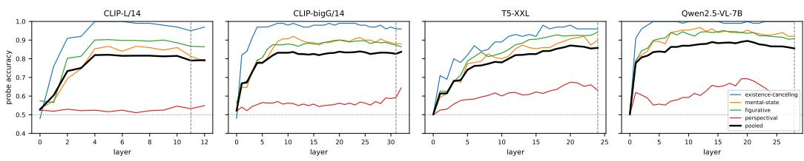

Figure 9: Accuracy of the target-word probe of Table 18 at every layer of each encoder, per family and pooled. Layer 0 is the embedding output; the dashed line marks the layer the pipeline feeds to the backbone. The perspectival family stays near chance at every layer of every encoder.
<table><tr><td>Family</td><td>Original prompt (no)</td><td>Plain-mention control (yes)</td><td>Both</td></tr><tr><td>Existence-canceling</td><td>1.00</td><td>.76</td><td>.88</td></tr><tr><td>Mental-state</td><td>.75</td><td>1.00</td><td>.87</td></tr><tr><td>Figurative</td><td>.84</td><td>.93</td><td>.89</td></tr><tr><td>Perspectival</td><td>.56</td><td>.85</td><td>.70</td></tr></table>

Table 19: Accuracy of Qwen2.5-VL-7B, the text encoder of Qwen-Image, when asked directly whether the target would be visible.

## D.9 BACKBONE ATTENTION: PER FAMILY

Table 21 gives the attention shares of §6.3 per family. Pairs per family: 100, 150, 472 and 368 for existence-canceling, mental-state, figurative and perspectival prompts; every value pools the two seeds.

The cue words lower the target’s attention only slightly, and not at all on perspectival prompts. On existence-canceling, mental-state and figurative prompts the target receives less attention under the original prompt than under the control in every model $( \rho _ { \mathrm { t } }$ 0.74 to 0.92). On perspectival prompts $\rho _ { \mathrm { t } }$ is 0.97 to 0.99: the cue words make almost no difference, consistent with Appendix D.8, where the perspectival information is already lost in the encoder.

## D.10 BACKBONE ATTENTION UNDER PROMPT EXPANSION

Expanded prompts are about five times longer than the original ones, so for them we report the relative attention r: each token’s share divided by the prompt’s average share. Table 22 gives the target’s r under the original prompt and under the two expansions of §6.2, over the expanded prompts in which the target survives verbatim (both seeds).

Expansion does not lower the target’s attention. Under the expanded prompts in which the rewriter kept the target, the target receives at least as much attention as an average word in every model and for both rewriters (r = 1.04 to 1.45). The one exception is Qwen-Image on existencecanceling prompts under the Qwen rewriter (0.58): the rewriter restates the cancellation as a clause of its own, such as No toilet is visible in theframe, and inside that clause Qwen-Image gives the target about half the attention of an ordinary word, while FLUX.1-dev and SD3.5-Large read it like any other word (1.05 and 0.99). Figure 10 shows two items under the original prompt, the control and the two rewrites.

## D.11 EXPLICIT CONSTRAINT IN THE PROMPT

This experiment tests whether a generator withholds the target when the prompt says so explicitly. We append the sentence “No {target} should appear in the image.” to all 75 mental-state prompts and to a random half (118) of the figurative prompts of OverReal-Gen, and generate one image per prompt (seed 0) with GPT-Image-1.5 and the five open-weight generators. The automatic annotator labels these images against the original prompt, so the labels keep their usual meaning. As the baseline we take the images of the same prompts in the labeled sample of §5.3 (raw prompts, both seeds).

<table><tr><td>Family</td><td>Original prompt</td><td>Plain-mention control</td></tr><tr><td>Existence-canceling</td><td>a cat sitting on a couch with a dog on the floor, with no book in sight</td><td>a cat sitting on a couch with a dog on the floor, with a book in sight</td></tr><tr><td>Mental-state</td><td>Tim sits alone at a classroom desk, remem-</td><td>Tim sits alone at a classroom desk, hold-</td></tr><tr><td>Figurative</td><td>bering the toy robot he lost years ago. The coach is as fierce as a tiger.</td><td>ing the toy robot he got years ago. The coach is standing next to a tiger.</td></tr><tr><td>Perspectival</td><td>A desk drawer is completely closed. In- side is a green frog toy.</td><td>A desk drawer is pulled open. Inside is a green frog toy.</td></tr></table>

Table 20: Plain-mention controls: one example per family. The target word is kept; the words that keep it out of the scene are replaced by words that put it in.
<table><tr><td></td><td></td><td colspan="3">Original prompt</td><td colspan="3">Plain-mention control</td><td colspan="3">Ratios</td></tr><tr><td>Model</td><td>Family</td><td>target at</td><td>cue ac</td><td>other ao</td><td>target a&#x27;t</td><td>t replacing a&#x27;′ other</td><td> $a _ { \mathrm { o } } ^ { \prime }$ </td><td> $\rho _ { \mathrm { t } } = a _ { \mathrm { t } } / a _ { \mathrm { t } } ^ { \prime }$ </td><td> $\rho _ { \mathrm { c } } = a _ { \mathrm { c } } / a _ { \mathrm { r } } ^ { \prime }$ </td><td> $\gamma = { a _ { \mathrm { c } } } / { a _ { \mathrm { o } } }$ </td></tr><tr><td>FLUX.1-dev</td><td>Existence-canceling</td><td>4.0</td><td>4.0</td><td>5.6</td><td>5.1</td><td>3.8</td><td>5.4</td><td>.79</td><td>1.15</td><td>.71</td></tr><tr><td></td><td>Mental-state</td><td>3.8</td><td>3.0</td><td>4.2</td><td>4.8</td><td>3.5</td><td>4.2</td><td>.74</td><td>.87</td><td>.73</td></tr><tr><td></td><td>Figurative</td><td>5.6</td><td>4.7</td><td>6.1</td><td>6.5</td><td>5.6</td><td>5.7</td><td>.83</td><td>.80</td><td>.77</td></tr><tr><td></td><td>Perspectival</td><td>3.6</td><td>3.7</td><td>4.4</td><td>3.7</td><td>3.6</td><td>4.5</td><td>.98</td><td>1.04</td><td>.83</td></tr><tr><td></td><td>All families</td><td>4.2</td><td>3.8</td><td>5.1</td><td>5.0</td><td>4.1</td><td>4.9</td><td>.83</td><td>.97</td><td>.76</td></tr><tr><td>SD3.5-Large</td><td>Existence-canceling</td><td>2.4</td><td>1.4</td><td>3.1</td><td>2.8</td><td>1.8</td><td>3.0</td><td>.85</td><td>.82</td><td>.46</td></tr><tr><td></td><td>Mental-state</td><td>2.4</td><td>1.3</td><td>2.3</td><td>2.6</td><td>1.6</td><td>2.3</td><td>.85</td><td>.79</td><td>.54</td></tr><tr><td></td><td>Figurative</td><td>4.2</td><td>2.1</td><td>3.3</td><td>4.4</td><td>2.6</td><td>3.1</td><td>.92</td><td>.80</td><td>.63</td></tr><tr><td></td><td>Perspectival</td><td>2.1</td><td>1.9</td><td>2.4</td><td>2.1</td><td>2.0</td><td>2.4</td><td>.99</td><td>.97</td><td>.81</td></tr><tr><td></td><td>All families</td><td>2.8</td><td>1.7</td><td>2.8</td><td>3.0</td><td>2.0</td><td>2.7</td><td>.90</td><td>.84</td><td>.60</td></tr><tr><td>Qwen-Image</td><td>Existence-canceling</td><td>5.2</td><td>4.6</td><td>6.3</td><td>6.3</td><td>6.2</td><td>6.3</td><td>.80</td><td>.84</td><td>.73</td></tr><tr><td></td><td>Mental-state</td><td>3.7</td><td>2.7</td><td>5.1</td><td>4.0</td><td>3.3</td><td>5.0</td><td>.90</td><td>.83</td><td>.54</td></tr><tr><td></td><td>Figurative</td><td>5.1</td><td>4.2</td><td>7.8</td><td>5.4</td><td>4.8</td><td>7.7</td><td>.92</td><td>.86</td><td>.54</td></tr><tr><td></td><td>Perspectival</td><td>3.6</td><td>3.4</td><td>5.2</td><td>3.6</td><td>3.5</td><td>5.2</td><td>.97</td><td>1.03</td><td>.66</td></tr><tr><td></td><td>All families</td><td>4.4</td><td>3.8</td><td>6.1</td><td>4.8</td><td>4.4</td><td>6.0</td><td>.90</td><td>.89</td><td>.62</td></tr></table>

Table 21: Attention in the backbone, per family and averaged over the four families. a: percentage of the image-to-text attention per token of the target words (t), the cue words (c) and the other words (o) under the original prompt; $a ^ { \prime } \colon$ the same under the plain-mention control, where the cue words are replaced (r). The ratios pair the original prompt and its control under the same seed.

GPT-Image declined eight of the constrained prompts (five mental-state, three figurative), which are left out. Table 23 gives the outcome distribution per generator, and pooled over the five open-weight generators.

GPT-Image follows the constraint; the open-weight generators do not. With the constraint, the target almost disappears from GPT-Image’s output: it appears in 14% of the mental-state images instead of 89%, and in 8% of the figurative images instead of 57%. For the five open-weight generators the target appears as often as before in the mental-state family (85% against 86%) and more often in the figurative family (66% against 54%). This matches their rates on the existence-canceling prompts, which are explicit negations by construction: the open-weight generators over-realize 34% to 64% of them (Table 7). So GPT-Image is able to exclude the target when told to. On the original prompt it tends to treat the mentioned target almost as a requested one and renders it, unless the prompt rules it out explicitly.

An explicit constraint is not a general fix. A prompt contains several mentions, any of which the model may over-realize (Appendix A.3), and in practice a user does not say which mention to withhold. The fix should come from a model that infers which mentions belong in the scene, not from a prompt that spells it out.

## E FULL PROMPTS AND ANNOTATION GUIDELINES

## E.1 AUTOMATIC ANNOTATION PROTOCOL

Each image is scored by a cascade of yes/no questions, one API call per question, with the image, the question and, from the second question on, the original prompt. T stands for the target; the article is adjusted to the target. Every family starts with the same screening question, “Is this image severely corrupted, or unrelated to the scene the prompt describes?”, whose yes-answer gives other.

<table><tr><td></td><td></td><td></td><td colspan="3">FLUX.1-dev</td><td colspan="3">SD3.5-Large</td><td colspan="3">Qwen-Image</td></tr><tr><td>Family</td><td>n Qwen</td><td>n Ideo.</td><td>orig.</td><td>Qwen</td><td>Ideo.</td><td>orig.</td><td>Qwen</td><td>Ideo.</td><td>orig.</td><td>Qwen</td><td>Ideo.</td></tr><tr><td>Existence-canceling</td><td>100</td><td>2</td><td>.77</td><td>1.05</td><td></td><td>.85</td><td>.99</td><td></td><td>.82</td><td>.58</td><td></td></tr><tr><td>Mental-state</td><td>136</td><td>76</td><td>.96</td><td>1.60</td><td>1.85</td><td>1.13</td><td>1.05</td><td>1.42</td><td>.81</td><td>1.32</td><td>1.05</td></tr><tr><td>Figurative</td><td>398</td><td>196</td><td>1.00</td><td>1.37</td><td>1.35</td><td>1.40</td><td>1.09</td><td>1.14</td><td>.78</td><td>1.43</td><td>1.17</td></tr><tr><td>Perspectival</td><td>282</td><td>232</td><td>.87</td><td>1.30</td><td>1.15</td><td>.94</td><td>1.00</td><td>1.06</td><td>.74</td><td>1.14</td><td>1.01</td></tr><tr><td>All families</td><td>916</td><td>506</td><td>.90</td><td>1.33</td><td>1.45</td><td>1.08</td><td>1.04</td><td>1.21</td><td>.79</td><td>1.12</td><td>1.08</td></tr></table>

Table 22: Relative attention r of the target words under the original prompt (orig.) and under the expanded prompts of the Qwen rewriter and of Ideogram Magic Prompt (Ideo.), per family and over all families; n is the number of expanded images per family and rewriter. Ideogram Magic Prompt keeps the target in only two existence-canceling prompts, so that cell is left out and the Ideogram mean excludes the family.
<table><tr><td></td><td colspan="6">Mental-state</td><td colspan="6">Figurative</td></tr><tr><td>Generator + prompt</td><td>n</td><td>Target</td><td>DO</td><td>SO</td><td>I</td><td>W</td><td>n</td><td>Target</td><td>DO</td><td>SO</td><td>I</td><td>W</td></tr><tr><td>GPT-Image-1.5 (raw)</td><td>100</td><td>.89</td><td>.35</td><td>.26</td><td>.28</td><td>.11</td><td>42</td><td>.57</td><td>.14</td><td>.26</td><td>.17</td><td>.43</td></tr><tr><td>+ constraint</td><td>70</td><td>.14</td><td>.01</td><td>.03</td><td>.10</td><td>.86</td><td>115</td><td>.08</td><td>.00</td><td>.05</td><td>.03</td><td>.92</td></tr><tr><td>FLUX.1-dev (raw)</td><td>99</td><td>.76</td><td>.44</td><td>.28</td><td>.03</td><td>.24</td><td>47</td><td>.47</td><td>.09</td><td>.23</td><td>.15</td><td>.53</td></tr><tr><td>+ constraint</td><td>74</td><td>.77</td><td>.50</td><td>.23</td><td>.04</td><td>.23</td><td>116</td><td>.59</td><td>.15</td><td>.37</td><td>.07</td><td>.41</td></tr><tr><td>Qwen-Image (raw)</td><td>99</td><td>.90</td><td>.67</td><td>.22</td><td>.01</td><td>.10</td><td>45</td><td>.69</td><td>.27</td><td>.38</td><td>.04</td><td>.31</td></tr><tr><td>+ constraint</td><td>75</td><td>.91</td><td>.72</td><td>.19</td><td>.00</td><td>.09</td><td>118</td><td>.76</td><td>.26</td><td>.43</td><td>.07</td><td>.24</td></tr><tr><td>OmniGen2 (raw)</td><td>100</td><td>.89</td><td>.64</td><td>.22</td><td>.03</td><td>.11</td><td>51</td><td>.51</td><td>.12</td><td>.31</td><td>.08</td><td>.49</td></tr><tr><td>+ constraint</td><td>75</td><td>.83</td><td>.60</td><td>.20</td><td>.03</td><td>.17</td><td>114</td><td>.61</td><td>.22</td><td>.32</td><td>.07</td><td>.39</td></tr><tr><td>SD3.5-Medium (raw)</td><td>100</td><td>.88</td><td>.66</td><td>.21</td><td>.01</td><td>.12</td><td>60</td><td>.40</td><td>.08</td><td>.25</td><td>.07</td><td>.60</td></tr><tr><td>+ constraint</td><td>75</td><td>.87</td><td>.44</td><td>.43</td><td>.00</td><td>.13</td><td>116</td><td>.59</td><td>.17</td><td>.35</td><td>.06</td><td>.41</td></tr><tr><td>SD3.5-Large (raw)</td><td>100</td><td>.87</td><td>.61</td><td>.23</td><td>.03</td><td>.13</td><td>53</td><td>.68</td><td>.17</td><td>.38</td><td>.13</td><td>.32</td></tr><tr><td>+ constraint</td><td>75</td><td>.87</td><td>.68</td><td>.19</td><td>.00</td><td>.13</td><td>117</td><td>.74</td><td>.25</td><td>.39</td><td>.10</td><td>.26</td></tr><tr><td>Open-weight, pooled (raw)</td><td>498</td><td>.86</td><td>.60</td><td>.23</td><td>.02</td><td>.14</td><td>256</td><td>.54</td><td>.14</td><td>.31</td><td>.09</td><td>.46</td></tr><tr><td>+ constraint</td><td>374</td><td>.85</td><td>.59</td><td>.25</td><td>.01</td><td>.15</td><td>581</td><td>.66</td><td>.21</td><td>.37</td><td>.07</td><td>.34</td></tr></table>

Table 23: Outcome distribution on the raw prompts and on the same prompts with the explicit constraint “No {target} should appear in the image.” appended, for the mental-state prompts and a random half of the figurative prompts of OverReal-Gen. Target is the share of images in which the target appears (DO + SO + I); DO disruptive, SO silent, I integrated, W withheld. The raw rows are over the labeled sample of §5.3 (both seeds), the constraint rows over one image per prompt (seed 0).

Existence-canceling Q1: Is there a T anywhere in this image? (yes: disruptive; no: withheld)

Mental-state Q1: Is there a T anywhere in this image? (no: withheld) Q2: In this image, is a T physically present in the scene, as an actual thing that is there with the person? (no: Q3) Q2b: In this image, is the T right beside the person and prominent in the picture, as opposed to distant, small or in the background? (yes: disruptive; no: silent) Q3: In this image, is a T shown as something the person imagines, remembers or believes, for example inside a thought bubble, a dream haze, a separate inset or a ghostly overlay? (yes: integrated; no: silent)

Figurative Q1: Is there a T anywhere in this image? (no: withheld) Q2: In this image, does the presence of a T make the scene absurd, impossible or nonsensical as a picture of what the prompt describes? (yes: disruptive) Q3: In this image, is a T merged with the person or thing it describes, as a deliberate visual metaphor in a stylized or poster-like composition? (yes: integrated; no: silent)

Perspectival, hidden object Q1: Is there a T anywhere in this image, in any form, including as a print, picture, sticker, logo or drawing? (no: withheld) Q2: According to the prompt, the T should be hidden from the viewer: inside, behind, underneath, or on the far side of something. In this image, is the T nevertheless exposed to the viewer at that very spot, for example because the container, door, curtain, barrier or surface is shown open, transparent, removed, or turned the wrong way? (yes: disruptive) Q3: In this image, is the T shown only indirectly, through a reflection, an inset, a thought bubble, or a picture taken from the in-scene person’s own point of view? (yes: integrated; no: silent)

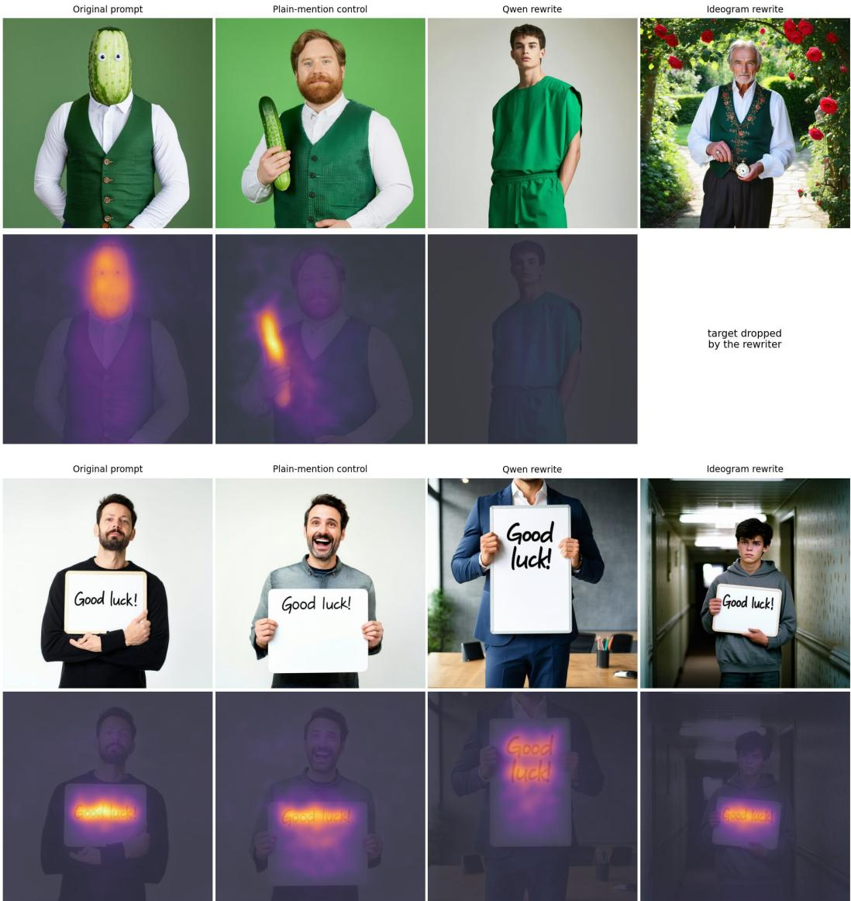  
Figure 10: Two items of Table 2 under four prompts, SD3.5-Large: the original prompt, its plainmention control, the Qwen rewrite and the Ideogram Magic Prompt rewrite (top row: the image; bottom row: attention from the image tokens to the target words in the first denoising steps). Top: the cucumber. The Qwen rewrite keeps cucumber only as a color (“the deep, fresh hue of a ripe cucumber”); the backbone draws no cucumber and the map stays flat. The Ideogram rewrite drops the word, so there is no map. Bottom: the whiteboard whose “Good luck!” faces away from the camera. Both rewriters keep the words, both images show them, and under all four prompts the attention sits on the writing.

Perspectival, hidden text Q1: In this image, is the written side of the item that carries “T” (the letter, note, page, screen, card or sign the prompt describes) turned toward the viewer, so that its writing can be seen, whether or not it is legible? (no: withheld) Q2: In this image, is the writing “T” shown to the viewer only through a reflection, an inset, a thought bubble, or a picture taken from the in-scene person’s own point of view? (yes: integrated) Q3: According to the prompt, the writing “T” should be out of the viewer’s sight. In this image, is it nevertheless in plain view, on the very item the prompt describes? (yes: disruptive; no: silent)

## E.2 ANNOTATION GUIDE

Annotators labeled through a web interface that showed the image, the prompt, and the target, together with the guide below (reproduced verbatim); each person could pick one or two of the five labels per image.

• disruptive: the target appears, and its appearance causes at least one of: (1) the image breaks common sense or logic, e.g. a reader facing the back of the letter they are reading, a screen facing the camera instead of its user, a tiger on a sports field; (2) the image contradicts the prompt, e.g. the prompt says the target is absent, or sealed inside an opaque box, yet it is visible.

• silent: the target appears; unexpected, but not disruptive, typically as background or a small detail. E.g. “her face is like a red apple” shown as a red-faced child eating an apple; “the roof is like a banana” with banana trees in the background.

• integrated: the target appears, but in a natural way, within what a normal viewer would accept. E.g. “the roof is like a banana” as a banana-shaped roof and no banana trees; a thought bubble depicting what a character imagines; contents shown inside a closed drawer as such; a poster style that merges a person with their attribute.

• withheld: the target does not appear, and the image does not contradict the prompt. E.g. something in a closed bag shown only as the closed bag; “her face is like a red apple” as just a red-faced child.

• other: the image is severely corrupted, or does not match the prompt at all.

You may select two labels, but please prefer a single label; pick two only when the case is genuinely ambiguous.