# WorldDraft: If Code Builds the World, Can Video Models Just Render It?

Zhiyu Hou1∗, Wen-Jie Shu2∗, Harold H. Chen3∗†, Weilin Ruan4, Chenfei Liao5, Liuzhou Zhang3, Disen Lan6, Xiaogang Xu7, Qi Chen2, Ser-Nam Lim8

1SUSTech, 2ZODA, 3HKUST, 4CUHK, 5HKUST(GZ), 6FDU, 7ZJU, 8UCF ∗Equal Contribution, †Project Lead

Multimodal coding agents decouple 4D world construction from visual generation, repurposing video models from world generators toward generative renderers. This division of labor raises a fundamental question: if code builds the world, can video models just render it? A reliable generative renderer hinges on two complementary criteria: (i) world preservation, retaining prescribed 4D kinematics and camera paths; and (ii) visual realization, persistently binding text-specified target attributes over time. To evaluate this capability, we introduce WorldDraft, a benchmark of 432 strictly paired test cases across 48 executable 4D world families spanning six dynamic challenge categories. Under $\textsf { a } 3 \times 3$ factorial design, WorldDraft orthogonally crosses draft granularity (abstract proxy to previs) and appearance alignment (neutral to conflicting) under identical dynamics. Extensive evaluations across 12 representative models reveal that: (I) world preservation and visual realization remain in stark operational tension; (II) richer draft scaffolding anchors structure but paradoxically impairs appearance fidelity; and (III) conflicting source cues trigger severe source leakage (up to 64%), exposing fragile cross-modal disentanglement. To mitigate these bottlenecks, we propose WorldDraft-Primer, a plug-and-play visual prompting strategy that consistently improves both objectives across frozen video renderers. Together, WorldDraft and WorldDraft-Primer lay a foundation for bridging programmatic 4D simulation with video generation, advancing physically grounded generative rendering.

Project: https://haroldchen19.github.io/WorldDraft-site/ § Github: https://github.com/KevinHuge/WorldDraft

WorldDraft Overall  
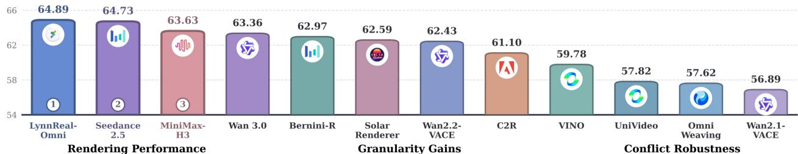

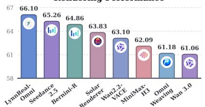

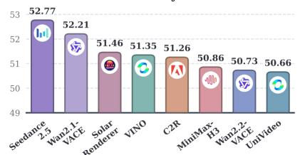  
Figure 1 Performance overview of 12 video models on WorldDraft across 3 dimensions.

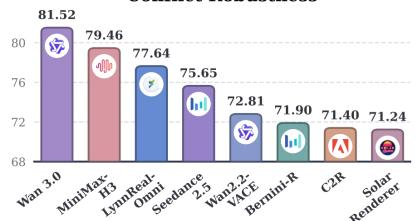

## 1 Introduction

Video generation has achieved remarkable progress in visual realism and temporal coherence, yet generating complex, controllable dynamic scenes remains challenging (Wan et al., 2025; Agarwal et al., 2025; Li et al., 2026a; HaCohen et al., 2024). Since end-to-end models must implicitly infer 4D world evolution from brief text while simultaneously generating pixels, high visual quality often comes at the expense of physical and spatiotemporal reliability. Recently, advances in multimodal coding agents have enabled an alternative paradigm that decouples world construction from visual generation (Li et al., 2026b; Wang et al., 2026a; Liang et al., 2026; Zhang et al., 2026). By programmatically controlling engines such as Blender (Blender Online Community, 2026) or MuJoCo (Todorov et al., 2012), coding agents can explicitly specify scene layouts, object trajectories, and physical interactions as executable simulation drafts, leaving video generation models to transform these low-fidelity drafts into photorealistic videos.

This emerging division of labor explores repurposing video models from world generators toward generative renderers, raising a fundamental question: if code builds the world, can video models just render it? We thus argue that a reliable generative renderer hinges on fulfilling two complementary objectives: ❶ world preservation, which demands faithfully retaining the scene geometry, object dynamics, event timing, and camera motion prescribed by the draft without rewriting the underlying world; and ❷ visual realization, which requires accurately generating text-specified target attributes (e.g., color, material) while persistently binding them to the corresponding 4D entities across motion, occlusion, and viewpoint changes.

Formally, generative rendering operates as a conditional video-to-video (V2V) transformation guided by a structural draft and a target text prompt, yet existing benchmarks only partially address its requirements. Early V2V benchmarks (Li et al., 2025; Liu et al., 2026) focus on editing real-world videos that already possess rich source textures, whereas recent programmable-world evaluation (Huang et al., 2026) primarily examines whether generated videos follow program-logged states and interaction events. Crucially, achieving world preservation does not guarantee faithful visual realization: models frequently retain coarse draft dynamics while failing to generate or temporally bind target appearance, or conversely fulfill appearance prompts at the cost of altering the underlying 4D world. This gap motivates the need for a new benchmark that jointly evaluates both objectives to systematically characterize the capability boundaries of generative renderers.

In this work, we propose WorldDraft, a systematic benchmark designed to evaluate video models as draft-tovideo generative renderers through three progressive questions (Figure 2). First, ➀ can video models render target appearances without corrupting complex 4D worlds? To test this foundational capability, we curate 48 executable 4D world families spanning ♣ six challenge categories: multi-entity orchestration, multi-stage dynamics, occlusion and reappearance, camera motion, non-rigid deformation, and hybrid interactions. Grounded in explicit simulator references, WorldDraft jointly measures how faithfully a model preserves the prescribed 4D structure and how accurately it realizes and persistently binds target visual attributes over time. Building upon these base worlds, we further probe the capability boundaries of generative renderers along two complementary axes: ➁ how much information must a draft provide to support reliable rendering? We then instantiate each world across ♦ three draft granularity levels (ranging from abstract proxies to detailed previews) to quantify minimal input requirements and the gains from richer structural and visual cues; and ➂ can models disentangle the world structure to preserve from the source appearance to overwrite? We further pair each draft with ♠ three appearance alignment levels (neutral, aligned, and conflicting) under a shared target prompt to evaluate selective adherence to structural versus textual conditions. Crossing both axes across all 48 world families yields a unified 3 × 3 factorial design of 432 strictly paired test cases.

Through extensive evaluation on WorldDraft, we observe that existing video models struggle to jointly preserve underlying 4D worlds and realize persistent target appearances, especially under coarse draft granularity or conflicting source-target cues (see Figure 1). Motivated by these findings, we further propose WorldDraft-Primer, a plug-and-play visual prompting strategy designed to enhance frozen video renderers. Unlike existing adaptation pipelines that rely on costly retraining or privileged simulator access (Li et al., 2026b; Gomez-Nogales et al., 2026), WorldDraft-Primer operates solely on the input draft and target prompt. Specifically, it injects subtle visual cues into the first draft frame via two complementary strategies: (i) object emphasis, which highlights key or easily overlooked entities to reinforce world preservation; and (ii) attribute cueing, which encodes target colors, textures, and shading cues around entities and supporting surfaces to guide visual realization. Experiments show that WorldDraft-Primer consistently boosts performance across diverse models, serving as both an analytical companion to WorldDraft and a practical solution for improving draft-to-video generative rendering.

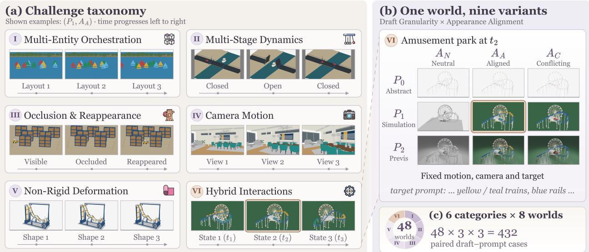  
Figure 2 Overview of WorldDraft. (a) Six challenge categories across 48 executable 4D worlds (shown at P1, AA). (b) 3 × 3 factorial grid crossing draft granularity (P0 → P2) and appearance alignment (AN, AA, AC). (c) Full benchmark totaling 48 × 3 × 3 = 432 cases.

To summarize, this work contributes threefold:

• We propose WorldDraft, a systematic benchmark for draft-to-video generative rendering comprising 432 strictly paired test cases across 48 executable 4D world families, organized across six challenge categories and a 3 × 3 factorial grid of draft granularity and appearance alignment levels.

• Through extensive experiments across 12 representative video models, our findings highlight that: (i) world preservation and visual realization remain in stark operational tension; (ii) finer draft granularity anchors structure but paradoxically impairs appearance fidelity; and (iii) conflicting source cues cause severe source leakage, exposing fragile source-target disentanglement.

• We further introduce WorldDraft-Primer, a simple yet efective plug-and-play visual prompting strategy that injects object emphasis and attribute cues into the first draft frame, consistently boosting both world preservation and visual realization across frozen video renderers.

## 2 Related Work

Code-for-Vision. Emerging works explore executable code as an intermediate representation for 3D reconstruction and scene synthesis (Yin et al., 2026; Wang et al., 2026b; Huang et al., 2024a), driving graphics engines to explicitly control geometry, camera parameters, and lighting. Extending this paradigm to dy namic environments, frameworks such as GS-Agent (Zhang et al., 2026) and Code as Worlds (Wang et al., 2026a) describe 4D physical evolution in code, relying on simulators to govern deterministic trajectories and interaction rules. This approach establishes a modular division of labor: systems like VideoCoCo (Li et al., 2026b) and Code Video Model (Liang et al., 2026) also employ coding agents to construct simulation drafts, leaving video generation models to synthesize photorealistic outputs. While prior research primarily targets upstream world construction, WorldDraft focuses on the downstream rendering stage, evaluating whether video models can faithfully realize target appearances without corrupting the underlying executable world.

Evaluation of Video-to-Video. V2V evaluation has traditionally focused on text-guided editing, measuring instruction adherence, temporal consistency, and background preservation on natural videos (Chen et al., 2025;

Li et al., 2025; Liu et al., 2026; Gao et al., 2026). With the rise of programmatic generation, recent benchmarks such as PROWBench (Huang et al., 2026) check behavioral fidelity and event timelines against engine-logged states while evaluating visual quality through holistic metrics such as CLIP. However, such holistic evaluations overlook whether models can faithfully realize fine-grained target attributes and persistently bind them across dynamic 4D processes. In this work, WorldDraft goes a step further by investigating how varying input conditions govern the interplay between world preservation and appearance realization.

## 3 WorldDraft

## 3.1 Task Formulation

Generative Rendering. Programmatic video generation decouples physical reasoning from visual generation: upstream engines explicitly govern scene kinematics, leaving downstream video models to act as renderers. Formally, an upstream simulator executes an underlying 4D world W to yield a draft video $\mathcal { D } = \{ \mathbf { I } _ { t } ^ { \mathrm { s r c } } \} _ { t = 1 } ^ { T } \in$ $\mathbb { R } ^ { T \times H \times \dot { W } \times 3 }$ . Given D and a target prompt p, a generative renderer $\mathcal { G }$ synthesizes the target video:

$$
\begin{array} { r } { \hat { \mathcal { V } } = \mathcal { G } ( \mathcal { D } , { \bf p } ) , } \end{array}\tag{1}
$$

where D provides the 4D spatiotemporal scafold (e.g., geometry, kinematics, camera), and p dictates target visual attributes (e.g., color, material, lighting). At inference, $\mathcal { G }$ strictly accesses $( \mathcal { D } , \mathbf { p } )$ , with W reserved solely for draft generation and ground-truth evaluation references.

Dual Criteria. To determine whether G faithfully executes this conditional transformation, the correctness of generative rendering hinges on two criteria:

❏ World Preservation, requiring $\hat { \mathcal { V } }$ to faithfully preserve the prescribed 4D kinematics, entity identities, event timelines, and camera motion in D without prompt-countermanded structural hallucinations.

❏ Visual Realization, requiring $\hat { \mathcal { V } }$ to accurately instantiate target attributes from p and persistently bind them to corresponding entities across dynamic motion, occlusions, and viewpoint changes.

Generative rendering thus demands that G disentangle the world structure to preserve from the source appearance to overwrite: a capability fundamentally governed by the draft’s input condition.

## 3.2 Executable World Families

Challenge Taxonomy. To evaluate renderers beyond trivial rigid motions, candidate worlds should enforce deterministic physical constraints for world preservation while imposing dynamic stressors for visual realization. Guided by these principles, we first establish 48 executable world families across six primary categories (Figure 2):

World Coverage

I. Multi-Entity Orchestration: Preserving multi-entity spatial arrangements and coordination, challenging the renderer to bind distinct target attributes without identity cross-contamination.

II. Multi-Stage Dynamics: Retaining causal event ordering and phase transitions, challenging attribute persistence across state-changing boundaries.

III. Occlusion $\&$ Reappearance: Maintaining physical occlusion orders and reappearance trajectories, challenging the renderer to re-identify and restore the exact target appearance post-emergence.

IV. Camera Motion: Retaining 6-DoF camera trajectories and parallax geometry, demanding strict multi-view appearance consistency under perspective shifts.

V. Non-Rigid Deformation: Retaining continuous mesh topology and soft-body kinematics, requiring surface textures and materials to deform realistically without visual slipping or artifacts.

VI. Hybrid Interactions: Retaining dynamic physical coupling across disparate mechanisms $( e . g . ,$ collisions and force transfer), challenging identity and material retention under violent multi-body contact.

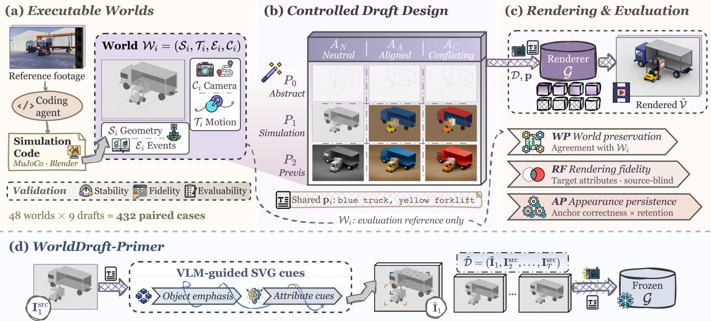  
Figure 3 Overview of our proposed (Top) WorldDraft benchmark and (Bottom) WorldDraft-Primer strategy.

These categories serve as primary stressors rather than disjoint splits; each family is classified by its dominant challenge while incorporating secondary dynamics. In particular, multi-entity orchestration focuses on cooperative spatial topology, whereas hybrid interactions stresses dynamic physical coupling between contact processes.

Construction and Validation. For each challenge, we first collect diverse real-world videos as dynamic blueprints, and employ multimodal coding agents (i.e., GPT-6-Astra (Singh et al., 2025)) to translate their underlying physical interactions and camera paths into executable MuJoCo (Todorov et al., 2012) or Blender (Blender Online Community, 2026) scripts. Crucially, the footage serves as world reference rather than a target for pixel-level reconstruction. Execution produces deterministic 4D rollouts while programmatically logging the ground-truth state tuple:

$$
\mathcal { W } _ { i } = ( S _ { i } , \mathcal { T } _ { i } , \mathcal { E } _ { i } , \mathcal { C } _ { i } ) ,\tag{2}
$$

with 3D geometry $s _ { i } ,$ dense trajectories $\textstyle { \mathcal { T } } _ { i } ,$ event timestamps $\mathcal { E } _ { i } ,$ and camera poses $\mathcal { C } _ { i }$ . Each world passes a three-tiered admission audit: ➀ numerical stability without divergence, ➁ fidelity to the reference interaction, and ➂ evaluative viability with unambiguous 4D binding stressors, freezing 48 standardized families, as shown in Figure 3.

## 3.3 Controlled Draft Design

To further isolate whether rendering failures stem from insuficient structural support or deceptive appearance cues, we then freeze the 4D kinematics and prompt $\mathbf { p } _ { i }$ for each $\mathcal { W } _ { i } .$ , and further orthogonally vary drafts across two axes: draft granularity and appearance alignment.

Prompt Suite. A unified prompt pi per family specifies 2 ∼ 4 verifiable attributes (e.g., color, material, lighting). To guarantee unbiased evaluation, pi enforces: ➀ observable verification via unambiguous visual criteria; ➁ alignment-invariant references that index entities via spatial/semantic roles (e.g., “leading cube”) rather than volatile appearance tags; and ➂ structural neutrality, strictly omitting trajectories or camera paths so text cannot compensate for draft sparsity. More examples are in Section A.

Draft Granularity (P). To investigate minimal input requirements, we instantiate each world across three monotonic information levels $P \in \{ P _ { 0 } , P _ { 1 } , P _ { 2 } \}$ :

❶ Abstract (P0): Primitive geometries and flat shading; retains basic semantics and kinematics to test low-scafold completion.

❷ Simulation $( P _ { 1 } )$ : Standard physical meshes and basic lighting; serves as the canonical draft-to-video rendering operating point.

❸ Previs $( P _ { 2 } )$ : Dense meshes, full context, and realistic shadows; quantifies headroom while retaining a synthetic-to-real gap.

This axis establishes an information ladder of structural completeness rather than cosmetic image filtering.

Appearance Alignment (A). Rich visual cues can either guide rendering or trigger severe source leakage. Therefore, to evaluate adherence to text over deceptive source cues, each granularity $P$ is paired with three appearance alignment states $A \in \{ A _ { N } , A _ { A } , A _ { C } \}$ :

❶ Neutral $\left( A _ { N } \right)$ : Uninformative placeholder shaders $( e . g . , \mathrm { g r a y ~ c l a y } )$ , relying solely on text for appearance.

❷ Aligned $( A _ { A } ) { \mathrm { : } }$ : Source appearances match pi within the precision of the respective granularity level.

❸ Conflicting $( A _ { C } )$ : Contradictory source cues $( e . g .$ , blue metal vs. target red plastic) to probe source leakage.

Variations afect strictly surface appearance without altering geometry $\boldsymbol { S } _ { i }$ , kinematics $\textstyle { \mathcal { T } } _ { i } ,$ or camera $\mathcal { C } _ { i }$

Crossing both axes yields a unified $3 \times 3$ grid of 9 paired inputs $\mathcal { D } _ { i } ^ { ( j , k ) }$ for each world, totaling $4 8 \times 3 \times 3 = 4 3 2$ strictly paired test cases. Fixing alignment isolates the marginal gain of draft information $( \Delta _ { 0 1 } , \Delta _ { 1 2 } )$ , while fixing granularity isolates conflict sensitivity and source leakage.

## 3.4 Evaluation Suite

Standard video metrics (e.g., FVD (Unterthiner et al., 2018)) fail to accurately evaluate both world preservation and visual realization directly. We thus establish an analytical suite across three disentangled dimensions: ➀ world preservation (WP), ➁ rendering fidelity (RF), and ➂ appearance persistence (AP). We report these dimensions separately to preserve diagnostic interpretability, with an additional composite score for overall comparison.

World Preservation (WP). Grounded in $\mathcal { W } _ { i } = ( S _ { i } , T _ { i } , \mathcal { E } _ { i } , \mathcal { C } _ { i } )$ , WP independently benchmarks: ➀ Entity & Layout $( S _ { i } )$ , using Count Accuracy and trajectory-matched BBox IoU; ➁ Kinematics & Events $( \mathcal { T } _ { i } , \mathcal { E } _ { i } )$ , via Matched Track Coverage, Interaction Success Rate (ISR), and Event Timing Coverage; and ➂ Camera $( \mathcal { C } _ { i } )$ via relative rotation and scale-normalized translation errors against the canonical draft. Metrics evaluate intended topology, ensuring $P _ { 0 }$ is not penalized for lacking fine details only introduced in $P _ { 2 }$ . Details in Section B.1.

Rendering Fidelity (RF). Adherence to $\mathbf { p } _ { i }$ is evaluated via attribute-level binary QA (Yes/No) across target colors, materials, and lighting, incorporating balanced afirmative/negated probes. Critically, QA judges receive only the target text and generated video, remaining strictly isolated from source drafts to prevent bias. Standard perceptual scores $( e . g .$ , Image Quality, Aesthetic) are reported separately as non-gated references VQ.

Appearance Persistence (AP). Since maintaining an incorrect appearance over time is not always consistency, we therefore establish a correctness-gated persistence metric:

$$
\mathrm { A P } = \frac { 1 0 0 } { | \mathcal { Q } _ { \mathrm { A P } } | } \sum _ { q \in \mathcal { Q } _ { \mathrm { A P } } } c _ { q } \cdot s _ { q } ,\tag{3}
$$

where $c _ { q } \in \{ 0 , 1 \}$ verifies target attribute realization at an anchor frame, and $s _ { q } \in \{ 0 , 1 \}$ checks whether the identical entity retains that attribute across subsequent timestamps. Credit is awarded if and only if both pass $( c _ { q } \cdot s _ { q } = 1 )$

Grid Diagnostics and Aggregation. On the full $3 \times 3$ grid, we designate $( P _ { 1 } , A _ { N } )$ as the canonical operating point and derive two diagnostic quantities: (i) Conflict Penalty, $\mathrm { C P } = \mathrm { R F } ( A _ { A } ) - \mathrm { R F } ( A _ { C } )$ , measuring performance drop under conflicting cues, and (ii) Source Leakage, $\mathrm { S L } = N _ { \mathrm { s o u r c e \_ l e a k e d } } / N _ { \mathrm { c o n f i c t } }$ , quantifying the erroneous persistence of conflicting source attributes.

## 4 WorldDraft-Primer

The dual correctness criteria of WorldDraft expose an inherent operational dilemma in generative rendering: how to reliably anchor target attributes without corrupting prescribed kinematics. While prompt engineering might seem intuitive, text prompts are inherently spatially agnostic, frequently inducing attribute crosscontamination across multiple entities. Conversely, modifying all draft frames risks destroying the deterministic kinematics and inducing temporal flickering. Leveraging the fact that video difusion models naturally propagate initial appearances via spatiotemporal attention (Fang et al., 2025; Qi et al., 2026), we propose WorldDraft-Primer, a plug-and-play visual prompting strategy. WorldDraft-Primer intervenes strictly on the initial frame $\mathbf { I } _ { 1 } ^ { \mathrm { s r c } }$ , producing a cued frame $\tilde { \mathbf { I } } _ { 1 } \mathrm { : }$

$$
\tilde { \boldsymbol { \mathcal { D } } } = \big ( \tilde { \mathbf { I } } _ { 1 } , \mathbf { I } _ { 2 } ^ { \mathrm { s r c } } , \dots , \mathbf { I } _ { T } ^ { \mathrm { s r c } } \big ) , \qquad \hat { \boldsymbol { \mathcal { V } } } = \boldsymbol { \mathcal { G } } ( \tilde { \boldsymbol { \mathcal { D } } } , \mathbf { p } ) ,\tag{4}
$$

leaving the remaining $T - 1$ draft frames untouched to preserve the exact physical evolution.

Object Emphasis for World Preservation. To prevent renderers from dropping small or low-contrast entities, object emphasis introduces sparse, non-intrusive bounding cues. Guided by the prompt p, an open-source VLM (i.e., Qwen3.5 (Yang et al., 2025)) identifies K critical entities, while an open-vocabulary grounding model predicts their 2D bounding boxes $B = \{ \mathbf { b } _ { k } \} _ { k = 1 } ^ { K }$ . For each box $\mathbf { b } _ { k } ,$ , we generate a binary mask $\mathbf { M } _ { k } ^ { \mathrm { { c o r n e r } } } \in \{ \bar { 0 } , 1 \} ^ { H \times W }$ outlining minimalist corner brackets strictly around the entity periphery. The structural emphasis signal is formulated as:

$$
\Delta { \bf I } _ { \mathrm { O E } } = \sum _ { k = 1 } ^ { K } { \bf M } _ { k } ^ { \mathrm { c o r n e r } } \odot { \bf C } _ { \mathrm { m o n o } } ,\tag{5}
$$

where $\mathbf { C } _ { \mathrm { m o n o } }$ is a neutral monochrome tone. Since $\mathbf { M } _ { k } ^ { \mathrm { c o r n e r } }$ occupies only narrow peripheral margins without covering entity interiors or physical contact surfaces, it acts purely as a spatial anchor without altering underlying geometry.

Attribute Cueing for Visual Realization. To steer appearance binding, attribute cueing injects non-textual hints across two levels: (i) entity cues $\left( \Delta \mathbf { I } _ { \mathrm { e n t } } \right)$ , which modulate peripheral brackets with target colors, simplified texture patterns, or coarse specular shading while leaving source interiors visible; and (ii) environment cues $( \Delta \mathbf { I } _ { \mathrm { e n v } } )$ , which introduce soft contact shadows, coarse ground textures, or subtle lighting gradients onto supporting surfaces. The composite initial frame $\tilde { \mathbf { I } } _ { 1 }$ is formulated as:

$$
\tilde { \mathbf { I } } _ { 1 } = \mathbf { I } _ { 1 } ^ { \mathrm { s r c } } \odot ( 1 - \mathbf { M } _ { \mathrm { a l l } } ) + \left( \Delta \mathbf { I } _ { \mathrm { O E } } + \Delta \mathbf { I } _ { \mathrm { e n t } } + \Delta \mathbf { I } _ { \mathrm { e n v } } \right) \odot \mathbf { M } _ { \mathrm { a l l } } ,\tag{6}
$$

where $\begin{array} { r } { \mathbf { M } _ { \mathrm { a l l } } = \sum _ { k } \mathbf { M } _ { k } ^ { \mathrm { c o r n e r } } + \mathbf { M } _ { \mathrm { e n v } } } \end{array}$ is the aggregate cue mask. Cues remain strictly localized to keep sourcetarget conflicts $\left( A _ { C } \right)$ uncompromised. To avoid generative noise and pixel blurring from difusion inpainting, all prompts are synthesized programmatically via SVG, ensuring sub-pixel precision and strictly bounded transparency.

## 5 Experiments

## 5.1 Experimental Settings

Models. We benchmark 12 representative video models on WorldDraft, spanning three primary paradigms across 10 open-weight architectures: ➀ Generative Renderers: SolarRenderer-33B (Fang et al., 2026), C2R-14B (Gomez-Nogales et al., 2026); ➁ Omni Models: MiniMax-H3-33B (MiniMax, 2025), LynnReal-Omni-32B (Mao et al., 2026), OmniWeaving-8.3B (Pan et al., 2026), VINO-13B (Chen et al., 2026), UniVideo-13B (Wei et al., 2026); and ➂ Controllable Generators: Bernini-R-14B (Team et al., 2026), Wan2.2-VACE-Fun-A14B (Jiang et al., 2025), Wan2.1-VACE-14B (Jiang et al., 2025). We additionally evaluate two leading commercial models: Wan 3.0 (Wan et al., 2025) and Seedance 2.5 (ByteDance Seed, 2025). All models take $( \mathcal { D } , \mathbf { p } )$ as input, ensuring consistent conditioning.

Evaluations. Following Section 3.4, we report aggregated dimensional metrics across three core perspectives: ❶ Rendering Performance summarizes overall competence across the full $3 \times 3$ grid via World Preservation (WP: Entity, Motion, Camera), Rendering Fidelity (RF), Visual Quality $\mathrm { ( V Q ) }$ , and Appearance Persistence (AP); ❷ Granularity Gains measures endpoint gains $\left( \Delta _ { 0 2 } \right)$ across draft levels $( P _ { 0 }  P _ { 1 }  P _ { 2 } )$ under neutral appearance $A _ { N } ;$ and ❸ Conflict Robustness assesses resilience to conflicting source cues $A _ { C }$ at $P _ { 1 }$ via $\mathrm { R F } _ { C } , \mathrm { A P } _ { C }$ , Conflict Penalty (CP), and Source Leakage (SL). All scores are macro-averaged within each family before aggregating across families on common cohorts. More details in Section B.

Table 1 Main results on WorldDraft. We highlight the best and second best scores $( \uparrow / \downarrow ;$ higher/lower is better). Rendering Performance averages the full $3 \times 3$ grid; Granularity Gains measure $P _ { 0 }  P _ { 2 }$ changes under $A _ { N } ;$ Conflict Robustness is evaluated at P1 under $A _ { C }$ . Overall weights the three perspectives by $0 . 5 0 / 0 . 2 5 / 0 . 2 5$ (details in Section B).
<table><tr><td rowspan="2">Model</td><td rowspan="2">Size</td><td colspan="4">Rendering Performance</td><td colspan="3">Granularity Gains</td><td colspan="4">Conflict Robustness</td><td rowspan="2">Overall↑</td></tr><tr><td>Preservation↑ Realization↑ Quality↑ Persistence↑ Structure↑ Appearance↑ Binding↑ Adherence↑ Retention↑ Penalty↓ Leakage↓</td><td></td><td></td><td></td><td></td><td></td><td></td><td></td><td></td><td></td></tr><tr><td colspan="10">Open-Weight Models</td><td></td><td></td><td></td></tr><tr><td>OmniWeaving</td><td>8.3B</td><td>61.61</td><td>66.37</td><td>62.02</td><td>58.01</td><td>+12.75</td><td>-14.47</td><td>-15.95</td><td>58.13</td><td>47.68</td><td>10.63</td><td>50.97</td><td>57.62</td></tr><tr><td>UniVideo</td><td>13B</td><td>53.34</td><td>67.31</td><td>63.01</td><td>59.10</td><td>+15.61</td><td>-4.24</td><td>-7.43</td><td>63.39</td><td>51.78</td><td>6.02</td><td>52.24</td><td>57.82</td></tr><tr><td>VINO</td><td>13B</td><td>52.83</td><td>67.95</td><td>63.43</td><td>60.38</td><td>+15.99</td><td>-2.70</td><td>-5.21</td><td>67.34</td><td>56.75</td><td>3.57</td><td>38.26</td><td>59.78</td></tr><tr><td>Wan2.1-VACE</td><td>14B</td><td>60.97</td><td>60.86</td><td>60.78</td><td>51.68</td><td>+18.82</td><td>-2.89</td><td>-2.68</td><td>60.93</td><td>50.37</td><td>8.05</td><td>64.17</td><td>56.89</td></tr><tr><td>Wan2.2-VACE</td><td>14B</td><td>60.52</td><td>70.25</td><td>64.11</td><td>62.09</td><td>+11.48</td><td>-2.37</td><td>-4.74</td><td>68.80</td><td>59.18</td><td>3.14</td><td>33.60</td><td>62.43</td></tr><tr><td>A C2R</td><td>14B</td><td>53.05</td><td>71.14</td><td>65.14 63.88</td><td>64.96 64.80</td><td>+15.98</td><td>-2.75</td><td>-5.65</td><td>69.95</td><td>63.11</td><td>4.45</td><td>43.03</td><td>61.10</td></tr><tr><td> Bernini-R</td><td>14B</td><td>61.81</td><td>72.41</td><td></td><td>68.41</td><td>+8.45</td><td>-3.33</td><td>-3.51</td><td>71.17</td><td>62.53</td><td>2.93</td><td>43.16</td><td>62.97</td></tr><tr><td>LynnReal-Omni 32B</td><td></td><td>60.52</td><td>75.51</td><td>65.48</td><td></td><td>+7.26</td><td>-3.62</td><td>-5.28</td><td>75.32</td><td>68.05</td><td>2.26</td><td>30.54</td><td>64.89</td></tr><tr><td>JMiniMax-H3</td><td>33B</td><td>50.70</td><td>76.38</td><td>64.06</td><td>70.32</td><td>+8.01</td><td>-0.89</td><td>-1.93</td><td>76.41</td><td>70.80</td><td>0.74</td><td>28.64</td><td>63.63</td></tr><tr><td>SolarRenderer</td><td>33B</td><td>63.28</td><td>69.97</td><td>62.48</td><td>61.68</td><td>+12.25</td><td>-1.49</td><td>-2.02</td><td>69.43</td><td>60.17</td><td>4.27</td><td>40.37</td><td>62.59</td></tr><tr><td colspan="10">Commercial Models</td><td></td><td></td><td></td><td></td></tr><tr><td>Wan 3.0 Seedance 2.5</td><td></td><td>44.37</td><td>80.40</td><td>66.92</td><td>75.41</td><td>-0.35</td><td>-0.58</td><td>-0.16</td><td>79.82</td><td>74.18</td><td>0.53</td><td>27.39</td><td>63.36</td></tr><tr><td></td><td></td><td>58.66</td><td>75.55</td><td>63.10</td><td>69.20</td><td>+10.88</td><td>+2.51</td><td>+3.21</td><td>76.60</td><td>69.53</td><td>1.97</td><td>41.57</td><td>64.73</td></tr></table>

## 5.2 Main Results

To systematically characterize the capability boundaries of video generative renderers, we first benchmark 12 video models across the $3 \times 3$ grid of WorldDraft. Key results in Table 1 and Figure 1 yield three primary takeaways:

Takeaway ❶: World preservation and visual realization remain in stark tension. Models face an inherent dilemma between retaining 4D physics and realizing target appearance. As shown in the Rendering Performance columns of Table 1 and Figure 1, dedicated renderers $( e . g . , \oplus )$ SolarRenderer) lead in Preservation $( \mathrm { W P = 6 3 . 2 8 } ) $ but lag in Realization $( \mathrm { R F } = 6 9 . 9 7 ) $ . Conversely, large models $( e . g . , \ S ^ { \mathrm { ~ ~ } } )$ Wan 3.0) maximize Realization $( \mathrm { R F } = 8 0 . 4 0 )$ at the cost of severe physical corruption $( \mathrm { W P = 4 4 . 3 7 } _ { \mathrm { \Omega } }$ lowest overall). Remarkably, even prevailing commercial leaders like Seedance 2.5, which dominate conventional video benchmarks, fail to top WorldDraft (Overall: 64.73, edged out by 32B LynnReal-Omni at 64.89), compromised by sub-optimal physical preservation $( \mathrm { W P } = 5 8 . 6 6 )$ . This confirms that generic visual scaling does not resolve the dual-correctness challenge.

Takeaway ❷: Richer draft scaffolding anchors structure but impairs appearance binding. Advancing draft granularity $( P _ { 0 }  P _ { 2 }$ under $A _ { N } )$ reliably improves structure but yields negative appearance returns. As reported in the Granularity Gains of Table 1 and Figure 1, structural gains $\left( g _ { s } \right)$ are consistently positive across open-weight models $( e . g . , + 1 8 . 8 2$ for Wan2.1-VACE), confirming that dense meshes suppress physical drift. However, appearance $\left( g _ { a } \right)$ and binding $\left( g _ { b } \right)$ gains are negative for 9 out of 10 models $( e . g .$ OmniWeaving drops by $- 1 4 . 4 7 / - 1 5 . 9 5 )$ , with Seedance 2.5 as the sole exception $( + 2 . 5 1 / + 3 . 2 1 )$ Denser drafts introduce synthetic shading biases that actively override text-conditioned cross-attention.

Takeaway ❸: Conflicting source cues trigger widespread leakage, exposing fragile disentanglement. Under contradictory source-target pairs $\left( A _ { C } \mathrm { a t } P _ { 1 } \right)$ , models struggle to separate motion scafolds from surface appearances. As evidenced by the Conflict Robustness metrics in Table 1 and Figure 1, open-weight models sufer large Conflict Penalties (up to 10.63 for OmniWeaving) and rampant color leakage $( e . g . , 6 4 . 1 7 \%$ for $\downdownarrows$ Wan2.1-VACE and 52.24% for $\circ$ UniVideo). Even top commercial and large models $( e . g . , \sharp )$ Wan 3.0, MiniMax-H3) exhibit ∼ 28%-30% leakage, revealing that renderers treat draft pixels as rigid visual constraints rather than overwritable scafolds.

(a) Co5 Target: Photorealistic yellow forkliftwith a broad navy-blue horizontal band around its rear counterweight and a light gray overhead canopy. The forklift has painted metal bodywork and black rubber tires. The warehouse shelving frames are blue, the cartons are kraft-brown corrugated cardboard, the pallets are wood and the floor is concrete. Soft neutral illumination and realistic shading.

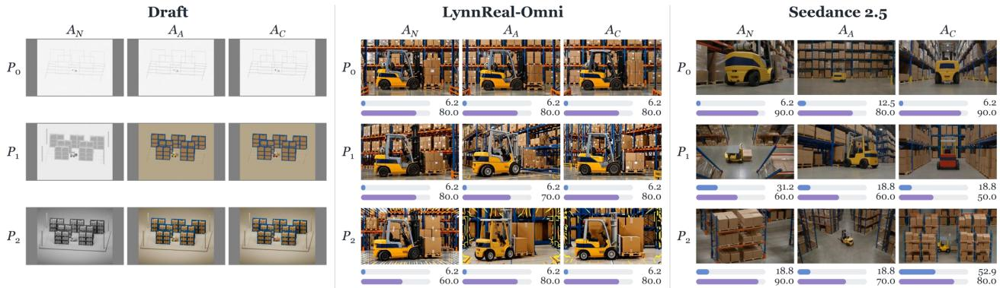

(b) Ao4 Target: Photorealistic sailboats on blue lake water with green shoreline foliage. The fleet consists of twelve boats: three with golden-yellow hulls and sails, three with sky-blue hulls and sails, three with scarlet-red hulls and sails, and three with emerald-green hulls and sails. In the opening arrangement, from the nearest row to the farthest row and from left to right within each row, the hull-and-sail colors are: golden yellow and sky blue; scarlet red, emerald green, golden yellowand sky blue; scarlet red, emerald green and golden yellow; sky blue, scarlet red and emerald green. The hulls have painted fiberglass surfaces, and the sails have woven fabric texture. Soft neutral illumination and realistic shading.  
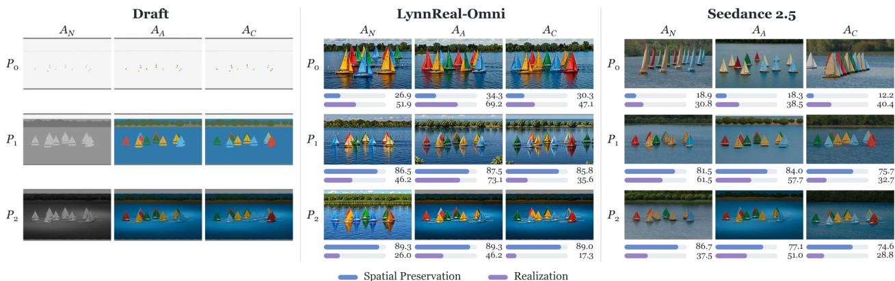  
Figure 4 Failure cases demonstration of LynnReal-Omni and Seedance 2.5 across the 3 × 3 grid on: (a) C05 (Occlusion & Reappearance, warehouse forklift) and (b) A04 (Multi-Entity Orchestration, 12-sailboat fleet). More case studies are in https://haroldchen19.github.io/WorldDraft-site.

## 5.3 Failure Mode Analysis

To diagnose why state-of-the-art models struggle with generative rendering, Figure 4 visualizes representative failure cases from top-performing models ( LynnReal-Omni and Seedance 2.5) on C05 (Occlusion & Reappearance) and A04 (Multi-Entity Orchestration):

Failure Mode ❶: Prompt-driven structural override. When processing dynamic scenes with complex layouts, models frequently sacrifice draft kinematics to satisfy textual semantics. As illustrated in Figure 4 (a), both LynnReal-Omni and Seedance 2.5 exhibit near-zero Spatial Preservation (consistently scoring $\leq 1 8 . 8$ , dipping to 6.2). Instead of adhering to the prescribed camera trajectory and warehouse shelving geometry, the models synthesize entirely ungrounded viewpoints and forklift trajectories conditioned solely on the prompt. This demonstrates that models easily devolve from faithful renderers into unconstrained text-to-video generators.

Failure Mode ❷: Deficient spatial reasoning and attribute binding. Under neutral scafolds $\left( A _ { N } \right)$ , models exhibit weak spatial understanding, failing to parse relative coordinate references and topological arrangements. As shown in Figure 4 (b) , the prompt specifies an ordered $3 \times 4$ color layout across 12 sailboats. Lacking the ability to resolve relative spatial hierarchies $( e . g .$ , row depths and left-to-right ordering), the models scramble target colors, causing severe attribute cross-contamination.

Failure Mode ❸: Previs texture latching and conflicting leakage. Richer drafts and conflicting cues severely disrupt appearance synthesis. In ${ \mathrm { F i g u r e ~ 4 ~ } } ( b )$ , advancing from simulation $( P _ { 1 } )$ to previs $( P _ { 2 } )$ causes Realization scores to collapse for both models $( e . g . , \mid ^ { } { } ^ { \mid { } }$ LynnReal-Omni drops from 73.1 to 46.2 under $A _ { A }$ and plummets to 17.3 under $A _ { C } )$ . Video difusion models over-attend to the dense synthetic shading and specular highlights of $P _ { 2 }$ drafts, treating them as immutable visual priors. Under conflict $\left( A _ { C } \right)$ , models either persistently reproduce conflicting source colors (source leakage) or hallucinate unprescribed objects (e.g., LynnReal-Omni synthesizing an extra cluster of green sailboats at $P _ { 1 } , A _ { C } )$ to compensate for text prompts, directly violating draft topology.

Table 2 Evaluation on WorldDraft with WorldDraft-Primer. We bold the best results. Qualitative results are in Figures 13 and 14.
<table><tr><td rowspan="2">Model</td><td colspan="4">Rendering Performance</td><td colspan="3">Granularity Gains</td><td colspan="4">Conflict Robustness</td><td rowspan="2">Overall↑</td></tr><tr><td>Preservation↑ Realization↑ Quality↑ Persistence↑ Structure↑ Appearance↑ Binding↑ Adherence↑ Retention↑ Penalty↓ Leakage↓</td><td></td><td></td><td></td><td></td><td></td><td></td><td></td><td></td><td></td><td></td></tr><tr><td>LynnReal-Omni</td><td>60.52</td><td>75.51</td><td>65.48</td><td>68.41</td><td>+7.26</td><td>-3.62</td><td>-5.28</td><td>75.32</td><td>68.05</td><td>2.26</td><td>30.54</td><td>64.89</td></tr><tr><td> Seedance 2.5</td><td>58.66</td><td>75.55</td><td>63.10</td><td>69.20</td><td>+10.88</td><td>+2.51</td><td>+3.21</td><td>76.60</td><td>69.53</td><td>1.97</td><td>41.57</td><td>64.73</td></tr><tr><td>OmniWeaving</td><td>61.61</td><td>66.37</td><td>62.02</td><td>58.01</td><td>+12.75</td><td>-14.47</td><td>-15.95</td><td>58.13</td><td>47.68</td><td>10.63</td><td>50.97</td><td>57.62</td></tr><tr><td>+ Text PE</td><td>62.63</td><td>67.98</td><td>63.46</td><td>59.36</td><td>+12.98</td><td>-14.81</td><td>-16.32</td><td>60.06</td><td>48.79</td><td>10.30</td><td>49.79</td><td>58.52</td></tr><tr><td>+ WorldDraft-Primer</td><td>64.60</td><td>70.93</td><td>66.19</td><td>61.90</td><td>+13.51</td><td>-15.45</td><td>-17.02</td><td>62.97</td><td>50.88</td><td>10.41</td><td>47.55</td><td>60.13</td></tr><tr><td>MiniMax-H3</td><td>50.70</td><td>76.38</td><td>64.06</td><td>70.32</td><td>+8.01</td><td>-0.89</td><td>-1.93</td><td>76.41</td><td>70.80</td><td>0.74</td><td>28.64</td><td>63.63</td></tr><tr><td>+ Text PE</td><td>51.45</td><td>77.91</td><td>65.34</td><td>71.72</td><td>+8.07</td><td>-0.91</td><td>-1.97</td><td>77.94</td><td>72.22</td><td>0.75</td><td>28.07</td><td>64.89</td></tr><tr><td>+ WorldDraft-Primer</td><td>52.55</td><td>80.21</td><td>67.26</td><td>73.84</td><td>+8.24</td><td>-0.93</td><td>-2.02</td><td>80.23</td><td>74.34</td><td>0.78</td><td>27.21</td><td>65.56</td></tr></table>

## 5.4 Results with WorldDraft-Primer

Motivated by the failure modes above, we further sought to investigate whether a lightweight test-time strategy can unlock frozen video renderers without retraining. To this end, we evaluate WorldDraft-Primer across representative models ( OmniWeaving and MiniMax-H3) against raw baselines and text prompt engineering (Text PE); results are in Table 2 and Figures 13 and 14.

WorldDraft-Primer consistently enhances both world preservation and visual realization. As shown in Table 2, WorldDraft-Primer consistently boosts both world preservation and appearance realization across architectures. For OmniWeaving, WorldDraft-Primer enhances Preservation (+2.99) and Realization (+4.56) while reducing Source Leakage by 3.42%, yielding an Overall gain of +2.51. For MiniMax-H3, it boosts Realization to 80.21 (+3.83) and elevates the Overall score to 65.56 (+1.93), surpassing both LynnReal-Omni (64.89) and the commercial leader Seedance 2.5 (64.73). Conversely, Text PE provides negligible improvements (+0.90 and +1.26), limited by the inherent spatial ambiguity of text. Qualitative results in Figures 13 and 14 further confirm these findings: first-frame cues efectively stabilize global camera framing against unprompted zoom-ins, prevent multi-entity attribute cross-contamination $( e . g .$ , binding cobalt-blue exclusively to the rightmost ball in B02), and suppress deceptive source color leakage under $A _ { C }$

## 6 Conclusion

In this work, we explored the emerging division of labor between code-driven simulation and video generation by proposing WorldDraft, a systematic benchmark of 432 strictly paired test cases across 48 executable 4D world families. Extensive evaluations across 12 representative models yield clear answers to our three foundational questions: ➀ world preservation and target appearance realization remain in stark operational tension; ➁ richer draft scafolding reliably anchors structure but paradoxically impairs appearance fidelity; and ➂ conflicting source cues trigger severe source leakage, exposing fragile cross-modal disentanglement. To mitigate these bottlenecks, we introduce WorldDraft-Primer, a plug-and-play visual prompting strategy that consistently improves both objectives across frozen video renderers. Together, WorldDraft and WorldDraft-Primer establish a foundational stepping stone toward physically grounded generative rendering.

## References

Niket Agarwal, Arslan Ali, Maciej Bala, Yogesh Balaji, Erik Barker, Tifany Cai, Prithvijit Chattopadhyay, Yongxin Chen, Yin Cui, Yifan Ding, et al. Cosmos world foundation model platform for physical ai. arXiv preprint arXiv:2501.03575, 2025.

Blender Online Community. Blender – a 3d modelling and rendering package, 2026. https://www.blender.org.

ByteDance Seed. Seedance 2.5. https://seed.bytedance.com/en/seedance2\_5, 2025. Accessed: 2026-11-03.

Nicolas Carion, Laura Gustafson, Yuan-Ting Hu, Shoubhik Debnath, Ronghang Hu, Didac Suris Coll-Vinent, Chaitanya Ryali, Kalyan Vasudev Alwala, Haitham Khedr, Andrew Huang, et al. Sam 3: Segment anything with concepts. In International conference on learning representations, volume 2026, pages 138846–138923, 2026.

Junyi Chen, Tong He, Zhoujie Fu, Pengfei Wan, Kun Gai, and Weicai Ye. Vino: A unified visual generator with interleaved omnimodal context. arXiv preprint arXiv:2601.02358, 2026.

Yupeng Chen, Penglin Chen, Xiaoyu Zhang, Yixian Huang, and Qian Xie. Editboard: Towards a comprehensive evaluation benchmark for text-based video editing models. In Proceedings of the AAAI Conference on Artificial Intelligence, volume 39, pages 15975–15983, 2025.

Jiale Cheng, Ruiliang Lyu, Xiaotao Gu, Xiao Liu, Jiazheng Xu, Yida Lu, Jiayan Teng, Zhuoyi Yang, Yuxiao Dong, Jie Tang, et al. Vpo: Aligning text-to-video generation models with prompt optimization. In 2025 IEEE/CVF International Conference on Computer Vision (ICCV), pages 15636–15645. IEEE, 2025.

Gongfan Fang, Xinyin Ma, and Xinchao Wang. In-video instructions: Visual signals as generative control. arXiv preprint arXiv:2511.19401, 2025.

Guian Fang, Shengju Qian, Dongyue Lu, Junchao Huang, Lutao Jiang, Xin Wang, Yiren Song, Li Jiang, and Mike Zheng Shou. Solarrenderer: Few-step generative reference rendering. arXiv preprint arXiv:2610.28630, 2026.

Xiangbo Gao, Sicong Jiang, Bangya Liu, Xinghao Chen, Minglai Yang, Siyuan Yang, Mingyang Wu, Jiongze Yu, Qi Zheng, Haozhi Wang, et al. Vefx-bench: A holistic benchmark for generic video editing and visual efects. arXiv preprint arXiv:2604.16272, 2026.

Gonzalo Gomez-Nogales, Yicong Hong, Chongjian Ge, Peiye Zhuang, Marc Comino-Trinidad, Dan Casas, and Yi Zhou. Coarse-to-real: Generative rendering for populated dynamic scenes. arXiv preprint arXiv:2601.22301, 2026.

Yoav HaCohen, Nisan Chiprut, Benny Brazowski, Daniel Shalem, Dudu Moshe, Eitan Richardson, Eran Levin, Guy Shiran, Nir Zabari, Ori Gordon, et al. Ltx-video: Realtime video latent difusion. arXiv preprint arXiv:2501.00103, 2024.

Ian Huang, Guandao Yang, and Leonidas Guibas. Blenderalchemy: Editing 3d graphics with vision-language models. In European Conference on Computer Vision, pages 297–314. Springer, 2024a.

Jiahui Huang, Qunjie Zhou, Hesam Rabeti, Aleksandr Korovko, Huan Ling, Xuanchi Ren, Tianchang Shen, Jun Gao, Dmitry Slepichev, Chen-Hsuan Lin, et al. Vipe: Video pose engine for 3d geometric perception. arXiv preprint arXiv:2508.10934, 2025.

Zheng-Hui Huang, Guixu Lin, Yu-Ju Tsai, Jian-Kai Zhu, Fengbo Lan, Yu-Lun Liu, Yung-Yu Chuang, Kaipeng Zhang, and Zhixiang Wang. Rowbench: Do video models render what the program specifies? arXiv preprint arXiv:2610.02205, 2026.

Ziqi Huang, Yinan He, Jiashuo Yu, Fan Zhang, Chenyang Si, Yuming Jiang, Yuanhan Zhang, Tianxing Wu, Qingyang Jin, Nattapol Chanpaisit, et al. Vbench: Comprehensive benchmark suite for video generative models. In 2024 IEEE/CVF Conference on Computer Vision and Pattern Recognition (CVPR), pages 21807–21818. IEEE, 2024b.

Zeyinzi Jiang, Zhen Han, Chaojie Mao, Jingfeng Zhang, Yulin Pan, and Yu Liu. Vace: All-in-one video creation and editing. In 2025 IEEE/CVF International Conference on Computer Vision (ICCV), pages 17191–17202. IEEE, 2025.

Junjie Ke, Qifei Wang, Yilin Wang, Peyman Milanfar, and Feng Yang. Musiq: Multi-scale image quality transformer. In 2021 IEEE/CVF International Conference on Computer Vision (ICCV), pages 5128–5137. IEEE, 2021.

Chaoyu Li, Xiaoyi Gu, Yogesh Kulkarni, Eun Woo Im, Mohammadmahdi Honarmand, Zeyu Wang, Juntong Song, Fei Du, Xilin Jiang, Kexin Zheng, Tianzhi Li, Fei Tao, and Pooyan Fazli. Video generation models:

A survey of post-training and alignment. Transactions on Machine Learning Research, 2026a. ISSN 2835-8856. https://openreview.net/forum?id=YlUEWLESIu.

Haodong Li, Tianfei Ren, Xiaoxiao Ma, Chunmei Qing, Zhen Fang, Sipeng He, Ziyu Guo, Haoyu Wu, Juanxi Tian, Yihang Zou, et al. Videococo: Code-as-cot for physically-consistent video generation via an agentic dual-engine system. arXiv preprint arXiv:2607.27380, 2026b.

Minghan Li, Chenxi Xie, Yichen Wu, Lei Zhang, and Mengyu Wang. Five-bench: A fine-grained video editing benchmark for evaluating emerging difusion and rectified flow models. In 2025 IEEE/CVF International Conference on Computer Vision (ICCV), pages 16672–16681. IEEE, 2025.

Zhiyang Liang, Jiawei Zhang, Guocheng Qian, Dongdong Chen, and Ziyu Wan. Code video model, October 2026. https://code-video-model.github.io/tech\_report.pdf. Preprint.

Tao Liu, Leela Krishna, Gouti Pavan Kumar, Vishav Garg, et al. V2v-bench: A comprehensive benchmark for video-to-video generation evaluation. arXiv preprint arXiv:2606.05665, 2026.

Xiaofeng Mao, Peijia Lin, Shaohao Rui, Yibo Zhang, Haibin Wan, and Weijie Ma. Lynnreal-omni: Native multi-modal video generation for agentic visual workflows. arXiv preprint arXiv:2609.15863, 2026.

MiniMax. Minimax-h3. https://www.minimax.io/blog/minimax-h3, 2025. Accessed: 2026-11-03.

Kaihang Pan, Qi Tian, Jianwei Zhang, Weijie Kong, Jiangfeng Xiong, Yanxin Long, Shixue Zhang, Haiyi Qiu, Tan Wang, Zheqi Lv, et al. Omniweaving: Towards unified video generation with free-form composition and reasoning. arXiv preprint arXiv:2603.24458, 2026.

Yu Qi, Xinyi Xu, Ziyu Guo, Siyuan Ma, Renrui Zhang, Xinyan Chen, Ruichuan An, Ruofan Xing, Jiayi Zhang, Haojie Huang, et al. Mme-cof-pro: Evaluating reasoning coherence in video generative models with text and visual hints. arXiv preprint arXiv:2603.20194, 2026.

Alec Radford, Jong Wook Kim, Chris Hallacy, Aditya Ramesh, Gabriel Goh, Sandhini Agarwal, Girish Sastry, Amanda Askell, Pamela Mishkin, Jack Clark, et al. Learning transferable visual models from natural language supervision. In International conference on machine learning, pages 8748–8763. PmLR, 2021.

Christoph Schuhmann, Romain Beaumont, Richard Vencu, Cade Gordon, Ross Wightman, Mehdi Cherti, Theo Coombes, Aarush Katta, Clayton Mullis, Mitchell Wortsman, et al. Laion-5b: An open large-scale dataset for training next generation image-text models. Advances in neural information processing systems, 35:25278–25294, 2022.

Aaditya Singh, Adam Fry, Adam Perelman, Adam Tart, Adi Ganesh, Ahmed El-Kishky, Aidan McLaughlin, Aiden Low, AJ Ostrow, Akhila Ananthram, et al. Openai gpt-5 system card. arXiv preprint arXiv:2601.03267, 2025.

Bernini Team, Chenchen Liu, Junyi Chen, Lei Li, Lu Chi, Mingzhen Sun, Zhuoying Li, Yi Fu, Ruoyu Guo, Yiheng Wu, et al. Bernini: Latent semantic planning for video difusion. arXiv preprint arXiv:2605.22344, 2026.

Emanuel Todorov, Tom Erez, and Yuval Tassa. Mujoco: A physics engine for model-based control. In 2012 IEEE/RSJ international conference on intelligent robots and systems, pages 5026–5033. IEEE, 2012.

Thomas Unterthiner, Sjoerd Van Steenkiste, Karol Kurach, Raphael Marinier, Marcin Michalski, and Sylvain Gelly. Towards accurate generative models of video: A new metric & challenges. arXiv preprint arXiv:1812.01717, 2018.

Team Wan, Ang Wang, Baole Ai, Bin Wen, Chaojie Mao, Chen-Wei Xie, Di Chen, Feiwu Yu, Haiming Zhao, Jianxiao Yang, et al. Wan: Open and advanced large-scale video generative models. arXiv preprint arXiv:2503.20314, 2025.

Hanyang Wang, Yimo Cai, Weiliang Chen, Jiawei Chi, Haowen Sun, Qiyu Dai, Yi-Hsin Hung, Xingzhuo Guo, Jinshan Ren, Runmao Yao, et al. Code as worlds: Agentic discovery of executable world representations for physical reasoning. arXiv preprint arXiv:2608.27549, 2026a.

Yuhao Wang, Puyi Wang, Linjie Li, Zhengyuan Yang, Kevin Qinghong Lin, and Yu Cheng. 3d-cos: A new 3d reconstruction paradigm based on vlm code synthesis. arXiv preprint arXiv:2606.10478, 2026b.

Cong Wei, Quande Liu, Zixuan Ye, Qiulin Wang, Xintao Wang, Pengfei Wan, Kun Gai, and Wenhu Chen. Univideo: Unified understanding, generation, and editing for videos. In International Conference on Learning Representations, volume 2026, pages 113905–113933, 2026.

An Yang, Anfeng Li, Baosong Yang, Beichen Zhang, Binyuan Hui, Bo Zheng, Bowen Yu, Chang Gao, Chengen Huang, Chenxu Lv, et al. Qwen3 technical report. arXiv preprint arXiv:2505.09388, 2025.

Shaofeng Yin, Jiaxin Ge, Zora Zhiruo Wang, Chenyang Wang, Xiuyu Li, Michael J Black, Trevor Darrell, Angjoo Kanazawa, and Haiwen Feng. Vision-as-inverse-graphics agent via interleaved multimodal reasoning. In European Conference on Computer Vision, pages 557–575. Springer, 2026.

Hongxin Zhang, Chunru Lin, Junyan Li, Zhou Xian, Tsun-Hsuan Wang, and Chuang Gan. Gs-agent: Creating 4d physical worlds with generative simulation. arXiv preprint arXiv:2607.21522, 2026.

## A More Details of WorldDraft

## A.1 Motivation of Each Challenge

Grounded in the dual objectives of world preservation and visual realization, WorldDraft curates dynamic scenarios that jointly impose deterministic physical constraints and multi-modal binding stressors. Evaluating generative renderers on these scenarios probes spatiotemporal reliability across diverse physical regimes: capabilities that conventional static image metrics fundamentally fail to measure. Below, we detail the design motivations behind our six dynamic challenge categories:

## I. Multi-Entity Orchestration

When scenes contain multiple concurrent entities, particularly those with identical geometries, dense clusters, or dynamic spatial swaps, models face severe risks of identity confusion and attribute crosscontamination. This challenge explicitly assesses whether a renderer preserves exact instance counts, relative spatial layouts, and coordinated multi-agent trajectories, while accurately binding distinct target attributes (e.g., individualized colors and materials) to their designated semantic roles without spatial bleeding or entity dropping.

## II. Multi-Stage Dynamics

Locally smooth motion does not imply global causal correctness: models often generate visually plausible micro-movements while skipping discrete phase transitions or reversing event sequences. This category evaluates whether key temporal boundaries, causal action-reaction orders, and phase-dependent kinematics are faithfully preserved, while simultaneously requiring target appearances to remain invariant across state-changing boundaries (e.g., a mechanical latch unlocking, opening, and locking).

## III. Occlusion & Reappearance

Physical occlusion temporarily removes direct visual evidence of an entity, breaking adjacent-frame continuity and demanding long-range spatiotemporal memory. This challenge measures whether the renderer maintains physical occlusion orders, follows emergence trajectories, and accurately re-identifies the target entity upon reappearance: restoring its precise target color, material, and surface texture rather than resetting or re-synthesizing a generic object.

## IV. Camera Motion

Aggressive 6-DoF camera trajectories continuously reshape perspective projections, surface visibility, and parallax depth. This category evaluates whether the model faithfully preserves the canonical camera path and epipolar geometry. It demands strict multi-view appearance consistency, verifying that intrinsic material identities remain stable while view-dependent visual cues (e.g., specular highlights and Fresnel reflections) deform realistically under dynamic perspective shifts.

## V. Non-Rigid Deformation

Unlike rigid bodies with static topologies, soft-body kinematics continuously deform mesh geometries and local surface coordinates. This challenge tests whether continuous topological deformations and structural integrity are preserved, and whether target textures, patterns, and elastic materials conform naturally to the deforming substrate without visual slipping, surface tearing, or texture resetting.

## VI. Hybrid Interactions

Violent physical interactions, such as contact collisions, momentum transfer, and friction, couple the motions of disparate objects into codependent physical systems. Generating plausible individual motions in isolation easily violates joint Newtonian laws. This category focuses on preserving contact boundaries, interaction outcomes, and kinetic energy exchange, while testing whether entity identities and materials

## I. Multi-Entity Orchestration

## (a) Ao1 Urban intersection

Target: Photorealistic urban intersection. The car initially in the inner incoming lane at the bottom of the frame, which turns left, has emerald-green bodywork. The left-turning car initially entering from the right has cobalt-blue bodywork. The left-turning car initially entering from the top has brick-red bodywork. The left-turning car initially entering from the left has golden-yellow bodywork. The four straight-driving cars, one approaching from each side, all have medium-gray bodywork. Use painted-metal bodies, glass windows and rubber tires, green tree foliage, dark charcoal asphalt, white road markings and concrete sidewalks, with soft neutral illumination and realistic shading.

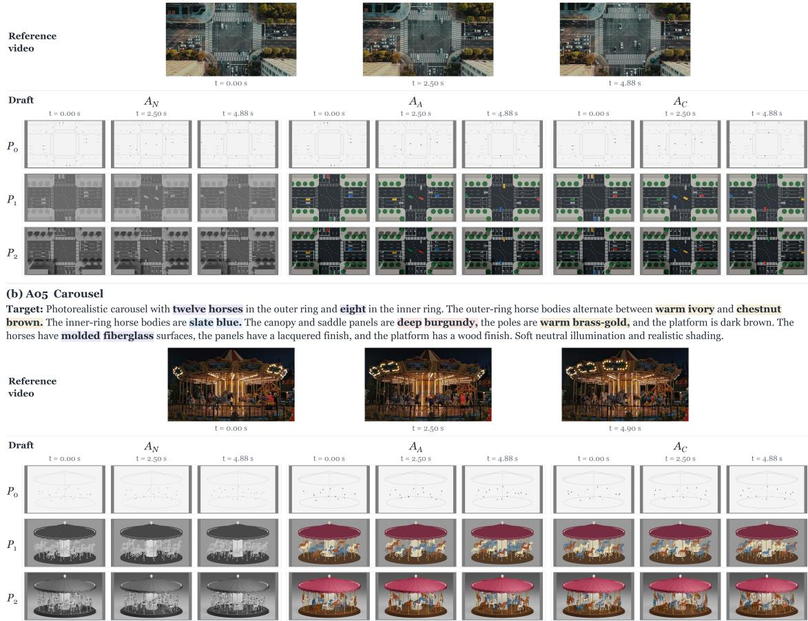  
Figure 5 Data demonstration of I. Multi-Entity Orchestration.  
survive intense physical contact. It directly complements Multi-Entity Orchestration by emphasizing dynamic force coupling over static spatial coordination.

Each executable world family in WorldDraft is categorized by its primary physical stressor, while naturally incorporating secondary dynamics. Section A.2 illustrates representative cases and paired draft variants.

## A.2 Data Demonstration

Figures 5 to 10 showcase representative cases across all six challenge categories, visualizing the real-world reference footage, target prompt, and the full 3 × 3 draft grid $( P _ { 0 }  P _ { 2 } \times A _ { N } , A _ { A } , A _ { C } )$ for each world.

## B More Details of Evaluation Suite

This section details the formal definitions, score normalization, and aggregation protocols underlying the three evaluation perspectives and the composite score in Table 1. Formally, let $c = ( P , A ) \in \Omega$ denote an input condition, where $\Omega = \{ P _ { 0 } , P _ { 1 } , P _ { 2 } \} \times \{ A _ { N } , A _ { A } , A _ { C } \}$ represents the full $3 \times 3$ grid of 9 paired configurations across 48 executable world families $\{ \mathcal { W } _ { i } \} _ { i = 1 } ^ { 4 8 }$ . All rate- and accuracy-based metrics are reported on a standard [0, 100] scale.

## II. Multi-Stage Dynamics

## (a) Bo3 Bowling

Target: Photorealistic bowling equipment on a light honey-brown maple lane. The bowling ball is deep navy with polished resin. The pins have white lacquered bodies;   
the front pin has two broad cobalt-blue neck bands, and the other pins have two broad red neck bands. Soft neutral illumination and realistic shading.

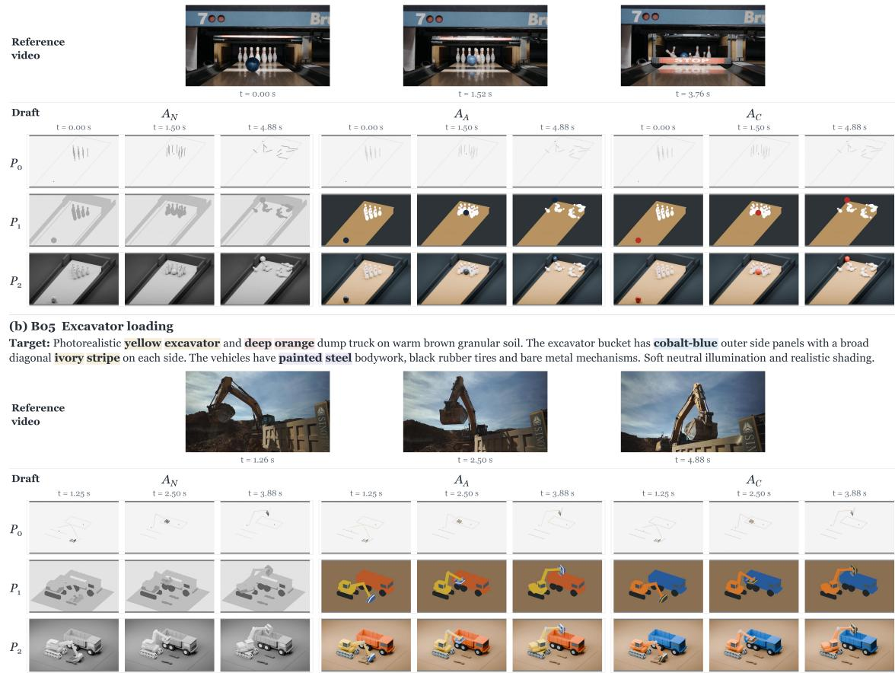  
Figure 6 Data demonstration of II. Multi-Stage Dynamics.

Shared Temporal & Spatial Protocol. To ensure fair cross-model comparisons regardless of native frame rates, all evaluations operate on the first 5 seconds of generated videos using absolute timestamp alignment rather than frame indices:

• Continuous Tracking & Geometry: Dense geometric evaluation (e.g., bounding boxes, tracks, and 6-DoF camera trajectories) is conducted at 8 Hz across 40 uniformly spaced timestamps (t ∈ [0, 4.875] s).

• Sparse Attribute & Event QA: Appearance and interaction probes evaluate 8 key timestamps distributed across the 5-second duration. Following (Huang et al., 2026), question answering is executed via Qwen3.6-27B (Yang et al., 2025). Visual inputs comprise both full frames and reference-grounded entity crops. To eliminate response bias, all probes incorporate strictly balanced afirmative and literal-negation questions.

• Strict Pre-registration: No output-dependent spatial alignment, post-hoc warping, or scale renormalization is performed; models are strictly penalized for spatial drift, aspect distortion, or event desynchronization.

Below, we detail the metric composition and normalization for each perspective.

## B.1 Rendering Performance

The Rendering Performance section in Table 1 evaluates foundational generation capability across four dimensional scores: Preservation (WP), Realization (RF), Quality (VQ), and Persistence (AP).

## III. Occlusion & Reappearance

## (a) Co1 Train and tunnel

Target: Photorealistic model train with deep green carriage body panels, cream upper panels and a broad ivory waist stripe below the windows. The carriages have painted metal surfaces and dark window frames. The tunnel structure has warm beige stone surfaces, and the railway has steel rails and wooden sleepers. Soft neutral illumination and realistic shading

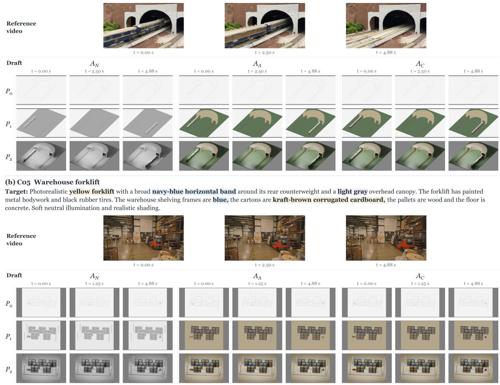  
Figure 7 Data demonstration of III. Occlusion & Reappearance.

World Preservation. WP quantifies geometric, physical, and camera fidelity against simulator ground truth, hierarchically combining three sub-components:

$$
\mathrm { W P } _ { c } = 0 . 4 0 E _ { c } + 0 . 4 0 M _ { c } + 0 . 2 0 K _ { c } .\tag{7}
$$

➀ Entity and Layout (E): We combine Global Count (GC), Local Count (LC), and Bounding Box IoU (BI):

$$
E _ { c } = 0 . 2 5 \mathrm { G C } _ { c } + 0 . 2 5 \mathrm { L C } _ { c } + 0 . 5 0 \mathrm { B I } _ { c } .\tag{8}
$$

GC requires exact instance count agreement across all three sampled timestamps $\mathcal { T } _ { \mathrm { c n t } } = \{ 0 , 2 . 1 2 5 , 5 \} \mathrm { s } ,$ while LC evaluates per-frame count accuracy within reference-defined spatial regions:

$$
\begin{array} { r } { \mathrm { G C } = 1 0 0 \mathbb { E } _ { q } \left[ \displaystyle \prod _ { t \in \mathcal { T } _ { \mathrm { c n t } } } \mathbf { 1 } [ \hat { n } _ { q , t } = n _ { q , t } ] \right] , } \\ { \mathrm { L C } = 1 0 0 \mathbb { E } _ { q , t } \left[ \mathbf { 1 } [ \hat { n } _ { q , t } = n _ { q , t } ] \right] . } \end{array}\tag{9}
$$

BI evaluates tracked 2D bounding boxes against simulator-projected amodal 3D entity bounds (including deformation). Entities are detected via SAM3 (Carion et al., 2026) using attribute-agnostic category prompts and matched across time using global Hungarian assignment (IoU threshold ≥ 0.05):

$$
\mathrm { B I } = 1 0 0 \mathbb { E } _ { e } \left[ \frac { 1 } { | \mathcal { T } _ { e } | } \sum _ { t \in \mathcal { T } _ { e } } \mathrm { I o U } ( B _ { e , t } , \hat { B } _ { a ( e ) , t } ) \right] .\tag{10}
$$

Unmatched entities and missing boxes are scored as 0.

## IV. Camera Motion

## (a) Do1 Car-following camera

Target: Photorealistic crossover car with brick-red bodywork. A single broad ivory longitudinal stripe runs along the center of the hood and roof, with brick-red panels on both sides. The car has glossy painted metal surfaces, dark glazing and black rubber tires. Tree foliage is green, the road is dark charcoal asphalt with white markings, and the curbs are concrete. Soft neutral illumination and realistic shading.

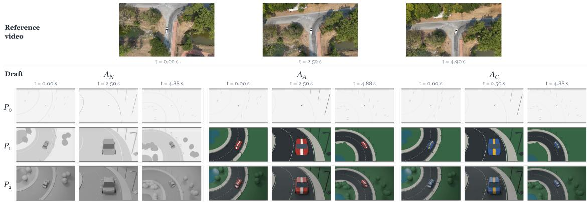  
(b) Do6 Interior camera move

Target: Photorealistic house interior. The rectangular artwork above the sideboard has a navy-blue face with one broad ochre-yellow vertical stripe on the left third when viewed facing the artwork. Thin light-gray horizontal relief bars cross the artwork. Every dining chair has teal upholstered seats and backs with charcoal legs. The dining tabletop is walnut brown.The floor is honey-brown oak, the walls are warm off-white and the window frames are dark gray. The artwork has a matte painted surface and the upholstery has woven fabric texture. Soft neutral illumination and realistic shading.  
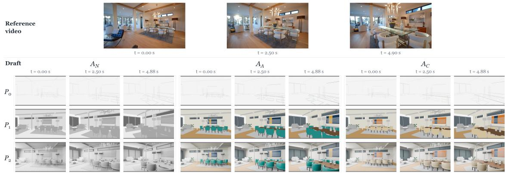  
Figure 8 Data demonstration of IV. Camera Motion.

➁ Motion and Events (M): We assess dynamic continuity and physical causality via Matched Track Coverage (TC), Interaction Success Rate (ISR), and Event Timing Coverage (EC):

$$
M _ { c } = 0 . 2 5 \mathrm { T C } _ { c } + 0 . 5 0 \mathrm { I S R } _ { c } + 0 . 2 5 \mathrm { E C } _ { c } .\tag{11}
$$

$\begin{array} { r } { \mathrm { T C } = 1 0 0 \mathbb { E } _ { e \in \mathcal { O } _ { \mathrm { d y n } } } [ \frac { 1 } { | \mathcal { T } _ { e } | } \sum _ { t \in \mathcal { T } _ { e } } \mathbf { 1 } [ \hat { B } _ { a ( e ) , t } } \end{array}$ exists]] measures the temporal presence of tracked dynamic entities under the accepted assignment. $\mathrm { I S R } = 1 0 0 \mathbb { E } _ { q } [ { \bf 1 } [ \hat { a } _ { q } = a _ { q } ] { \bf 1 } [ \hat { o } _ { q } = o _ { q } ] ]$ validates that both the dynamic action $\left( a _ { q } \right)$ and its physical outcome $\left( o _ { q } \right)$ are simultaneously correct over 12 uniform frames. $\mathrm { E C } =$ $1 0 0 \cdot ( N _ { \mathrm { l o c a l i z e d } } / N _ { \mathrm { e x p e c t e d } } )$ reports the fraction of causal events whose temporal boundary intervals $[ t _ { \mathrm { s t a r t } } , t _ { \mathrm { e n d } } ]$ are successfully localized.

➂ Camera Kinematics $( K )$ : Evaluated across the 8 camera-motion families by estimating 6-DoF trajectories $( { \bf R } ( t ) , { \bf t } ( t ) )$ via ViPE (Huang et al., 2025) against the canonical draft. Camera translation is scale-normalized by trajectory peak norm: $\mathbf { u } ( t ) = \mathbf { t } ( t ) / ( \operatorname* { m a x } _ { \tau } \| \mathbf { t } ( \tau ) \| _ { 2 } + 1 0 ^ { - 9 } )$ . The camera fidelity score $K \in [ 0 , 1 0 0 ]$ maps rotation error $\mathrm { R o t } \in [ 0 , 1 8 0 ^ { \circ } ]$ and normalized translation error Trans $\in [ 0 , 2 ]$ to:

$$
K = 1 0 0 \left[ 1 - \frac { 1 } { 2 } \left( \frac { \mathrm { R o t } } { 1 8 0 } + \frac { \mathrm { T r a n s } } { 2 } \right) \right] .\tag{12}
$$

Rendering Fidelity. Rendering Fidelity evaluates compliance with target color, material, texture, environ ment, and lighting specifications via balanced binary VLM QA on source-blind judges:

$$
\mathrm { R F } = \frac { 1 0 0 } { | \mathcal { Q } _ { \mathrm { R F } } | } \sum _ { q \in \mathcal { Q } _ { \mathrm { R F } } } \mathbf { 1 } [ \hat { y } _ { q } = y _ { q } ] .\tag{13}
$$

## V. Non-Rigid Deformation

## (a) Eo3 Umbrella opening

Target: Photorealistic umbrella with an egg-yolk-yellow fabric canopy and one broad navy-blue band near its outer hem, leaving a narrow yellow edge. The ribs and shaft are silver gray and the handle is black. The canopy has tightly woven polyester texture, the ribs have stainless-steel surfaces and the handle has a matte polymer finish. Soft neutral illumination and realistic shading.

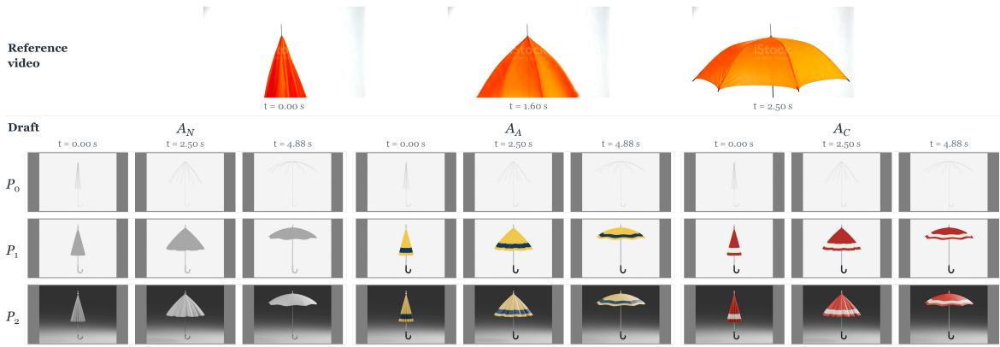  
(b) Eo4 Curtains in wind

Target: Photorealistic warm-ivory curtains. Each of the two curtain panels has three broad navy-blue vertical stripes running from its top edge to its bottom hem. The window frame is dark charcoal and the walls are pale warm gray. The curtains have sheer linen texture, the frame has painted surfaces and the walls have matte plaster texture. Soft neutral illumination and realistic shading.  
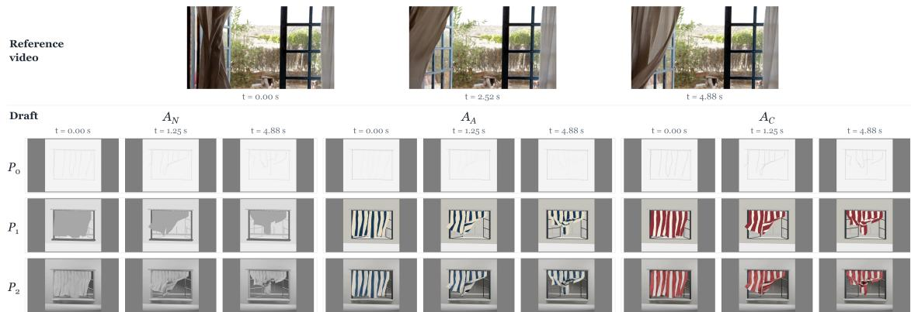  
Figure 9 Data demonstration of V. Non-Rigid Deformation.

Each probe evaluates visual evidence at the timestamp where reference entity visibility is maximized.

Visual Quality. Following VBench (Huang et al., 2024b), we compute frame-level technical and aesthetic quality across all native frames $\mathcal { F }$ in the first 5 seconds using MUSIQ-SPAQ (Ke et al., 2021) $( \mathrm { I Q } \in [ 0 , 1 0 0 ] )$ ) and LAION (Schuhmann et al., 2022) aesthetic predictor on CLIP $\mathrm { V i T - L } / 1 4$ (Radford et al., 2021) $( \mathrm { A Q } =$ 10 × Aesthetic ∈ [0, 100]):

$$
\mathrm { V Q } = \frac { 1 } { 2 } \left( \frac { 1 } { | \mathcal { F } | } \sum _ { f \in \mathcal { F } } \mathrm { I Q } ( f ) + \frac { 1 } { | \mathcal { F } | } \sum _ { f \in \mathcal { F } } \mathrm { A Q } ( f ) \right) .\tag{14}
$$

Appearance Persistence. AP measures whether a correctly instantiated target attribute persistently binds to the entity over time:

$$
\mathrm { A P } = \frac { 1 0 0 } { \left| \mathscr { Q } _ { \mathrm { A P } } \right| } \sum _ { q \in \mathscr { Q } _ { \mathrm { A P } } } c _ { q } \cdot s _ { q } ,\tag{15}
$$

where $c _ { q } \in \{ 0 , 1 \}$ verifies attribute realization at a visible anchor frame, and $s _ { q } \in \{ 0 , 1 \}$ verifies temporal consistency across subsequent visible timestamps. An incorrect anchor $( c _ { q } = 0 )$ strictly zeroes out the score. Aggregation. For any metric $X \in \{ \mathrm { W P , R F , V Q , A P } \}$ , we first macro-average per-video scores across its applicable world family cohort $\mathcal { T } _ { X }$ for each condition $c \in { \mathcal { C } }$

$$
X _ { c } = \frac { 1 } { | \mathcal { T } _ { X } | } \sum _ { i \in \mathcal { T } _ { X } } s _ { i , c } ^ { ( X ) } .\tag{16}
$$

(b) Fo8 Packet-transfer robot

## VI. Hybrid Interactions

## (a) Fo3 Marble and domino wave

Target: Photorealistic tabletop domino apparatus. The parallel rows of small field dominoes alternate red and deep blue, starting with red in the row nearest the camera in the opening view. Each small field domino has a broad ivory band around its middle. The taller distributor dominoes and corner connectors are ivory. The trigger marble is cobalt-blue polished glass, and the launch ramp and raised field platform are light wood brown with satin wood grain. The dominoes have smooth plastic surfaces. Soft neutral illumination and realistic shading.

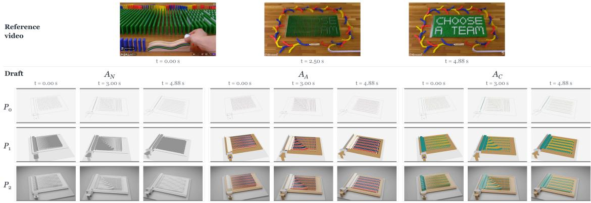  
Target: Photorealistic LEGO-style packet-handling robot. Each snack packet has a golden-yellow foil body with a broad deep-blue horizontal band around its middle and ivory heat-sealed crimp strips. The foil has a satin finish and visible folds. The robot structural bricks and long arm links are yellow; connectors, gears and gripper fingers are dark gray. The LEGO parts have glossy molded ABS surfaces. Conveyor guards, feed hood and receiving pockets are light gray. Soft neutral illumination and realistic shading.

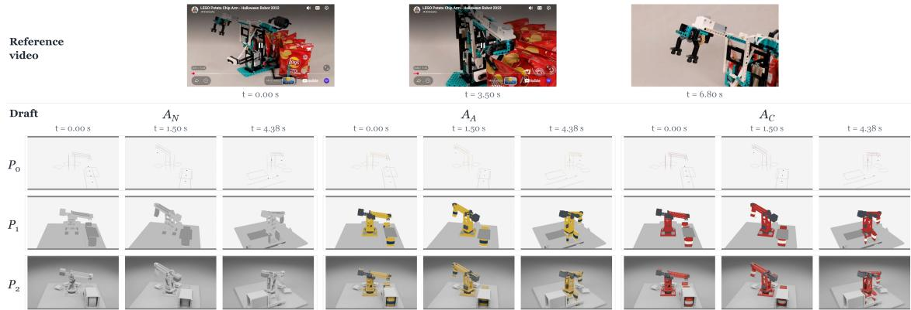  
Figure 10 Data demonstration of VI. Hybrid Interactions.

The four Rendering Performance columns in Table 1 report the mean score over the full 3 × 3 grid:

$$
\operatorname { G r i d } ( X ) = { \frac { 1 } { 9 } } \sum _ { c \in { \mathcal { C } } } X _ { c } .\tag{17}
$$

Across models, each metric is computed strictly over common valid cohorts for uncompromised fairness.

## B.2 Granularity Gains

To quantify how generative renderers benefit from structural scafolding without confounding appearance cues, we evaluate the geometric information ladder $( P _ { 0 }  P _ { 1 }  P _ { 2 } )$ strictly under the neutral appearance condition $\left( A _ { N } \right)$ . For any metric $X \in \{ \mathrm { W P } , \mathrm { R F } , \mathrm { A P } \}$ , the paired marginal change between draft granularities $P _ { a }$ and $P _ { b }$ is defined as:

$$
\Delta _ { a b } ^ { X } = X _ { ( P _ { b } , A _ { N } ) } - X _ { ( P _ { a } , A _ { N } ) } .\tag{18}
$$

All comparisons enforce strictly paired world families, keeping underlying metric cohorts fixed before constructing WP.

As summarized in Table 1, we report the net endpoint gains from abstract proxy scafolds (P0) to dense

preview drafts $( P _ { 2 } )$ across three corresponding columns:

$$
\begin{array} { r } { g _ { s } \ : ( \mathrm { S t r u c t u r e } ) = \Delta _ { 0 2 } ^ { \mathrm { W P } } , } \\ { g _ { a } \ : ( \mathrm { A p p e a r a n c e } ) = \Delta _ { 0 2 } ^ { \mathrm { R F } } , } \\ { g _ { b } \ : ( \mathrm { B i n d i n g } ) = \Delta _ { 0 2 } ^ { \mathrm { A P } } . } \end{array}\tag{19}
$$

Diferences preserve their algebraic signs: positive values signify performance gains enabled by richer structural cues, whereas negative values expose degradation or visual interference. While Table 1 focuses on endpoint dynamics $\Delta _ { 0 2 }$ , adjacent transitions $( \Delta _ { 0 1 }$ and $\Delta _ { 1 2 } )$ and per-level absolute scores are documented in supplementary material to diagnose non-monotonicity and saturation behaviors.

## B.3 Conflict Robustness

To further evaluate how reliably generative renderers disentangle structural scafolding from deceptive visual cues, we probe the model’s resistance to contradictory source-target pairs. Fixing the structural scafold at the canonical simulation operating point $( P _ { 1 } )$ , Table 1 reports four complementary metrics:

$$
\begin{array} { r l } & { \mathrm { A d h e r e n c e } \ \uparrow = \mathrm { R F } _ { ( P _ { 1 } , A _ { C } ) } , } \\ & { \quad \quad \quad \mathrm { R e t e n t i o n } \ \uparrow = \mathrm { A P } _ { ( P _ { 1 } , A _ { C } ) } , } \\ & { \mathrm { P e n a l t y } \ ( \mathrm { C P } ) \downarrow = \mathrm { R F } _ { ( P _ { 1 } , A _ { A } ) } - \mathrm { R F } _ { ( P _ { 1 } , A _ { C } ) } , } \\ & { \mathrm { L e a k a g e } \ ( \mathrm { S L } ) \downarrow = \mathrm { S L } _ { ( P _ { 1 } , A _ { C } ) } . } \end{array}\tag{20}
$$

Adherence and Retention measure absolute target attribute correctness and temporal binding under contradictory conditions $\left( A _ { C } \right)$ . Conflict Penalty (CP) quantifies the relative fidelity degradation incurred when source cues transition from aligned $\left( A _ { A } \right)$ to conflicting $\left( A _ { C } \right)$ ; lower values denote superior immunity to deceptive source distractors.

Source Leakage. SL explicitly tracks the erroneous persistence of conflicting source colors on target entities. For the set of verified source-color probes ${ \mathcal { Q } } _ { \mathrm { S L } }$ and their valid timestamps $\begin{array} { r } { \mathcal { T } _ { q } , } \end{array}$ it is formulated as:

$$
\mathrm { S L } = \frac { 1 0 0 } { \vert \mathcal { Q } _ { \mathrm { S L } } \vert } \sum _ { q \in \mathcal { Q } _ { \mathrm { S L } } } \frac { 1 } { \vert \mathcal { T } _ { q } \vert } \sum _ { t \in \mathcal { T } _ { q } } \mathbf { 1 } [ \hat { y } _ { q , t } = \mathrm { Y e s } ] ,\tag{21}
$$

where $\hat { y } _ { q , t } = \mathrm { Y e s }$ indicates the active presence of the contradictory source color. Probes are constructed from audited source materials across 48 world families with explicit color contradictions. Note that low SL does not trivially imply correct target realization.

## B.4 Composite Overall Metric

To provide a unified ranking across diverse model paradigms, the Overall column in Table 1 integrates the three diagnostic perspectives via pre-registered weights:

$$
\mathrm { O v e r a l l } = 0 . 5 0 R + 0 . 2 5 G + 0 . 2 5 C _ { \mathrm { r o b } } ,\tag{22}
$$

allocating $5 0 \%$ to foundational rendering capability, 25% to structural granularity responsiveness, and 25% to source-target conflict disentanglement. All underlying metrics are bounded in [0, 100]:

Rendering Score (R). Within each condition $c \in { \mathcal { C } }$ , we combine the macro-averaged dimensional scores using a weighted geometric mean before averaging across the $3 \times 3$ grid $\begin{array} { r } { R = \frac { 1 } { 9 } \sum _ { c \in \mathcal { C } } S _ { c } . } \end{array}$

$$
S _ { c } = 1 0 0 \cdot ( \frac { \mathrm { W P } _ { c } } { 1 0 0 } ) ^ { 0 . 4 0 } ( \frac { \mathrm { R F } _ { c } } { 1 0 0 } ) ^ { 0 . 2 0 } ( \frac { \mathrm { A P } _ { c } } { 1 0 0 } ) ^ { 0 . 3 0 } ( \frac { \mathrm { V Q } _ { c } } { 1 0 0 } ) ^ { 0 . 1 0 } .\tag{23}
$$

The geometric mean strictly penalizes degenerate shortcuts $( e . g .$ , preserving kinematics by completely ignoring target prompts, or satisfying prompts by severely corrupting the 4D world), rewarding renderers that achieve balanced dual-correctness.

Granularity Score (G). Since individual endpoint gains $g \in \{ g _ { s } , g _ { a } , g _ { b } \}$ lie in [−100, 100], we linearly normalize them to a standard [0, 100] scale (where 50 denotes zero net change) before computing their unweighted average:

$$
G = \frac { 1 } { 3 } \sum _ { g \in \{ g _ { s } , g _ { a } , g _ { b } \} } \left( 5 0 + \frac { g } { 2 } \right) = 5 0 + \frac { g _ { s } + g _ { a } + g _ { b } } { 6 } .\tag{24}
$$

Conflict Robustness Score $( C _ { \mathrm { r o b } } )$ . We unify the four conflict metrics into a higher-is-better index in [0, 100]:

$$
C _ { \mathrm { r o b } } = \frac { 1 } { 4 } [ \mathrm { R F } _ { ( P _ { 1 } , A _ { C } ) } + \mathrm { A P } _ { ( P _ { 1 } , A _ { C } ) } +\tag{25}
$$

$$
\left( 1 0 0 - \operatorname* { m a x } ( \operatorname { C P } , 0 ) \right) + \left( 1 0 0 - \operatorname { S L } _ { \left( P _ { 1 } , A _ { C } \right) } \right) ] .
$$

Here, the Conflict Penalty CP is clipped at zero to avoid rewarding negative penalties (which arise from statistical variance rather than genuine robustness), while source leakage SL is inverted

While the Overall score ofers a holistic summary, the underlying gains and penalties are inherently dependent on each model’s baseline operating performance. Therefore, the standalone columns in Table 1 remain essential for diagnosing individual failure modes and capability trade-ofs.

## B.5 Analysis of Metric-Human Alignment

To validate the VLM evaluation protocol part of WorldDraft, we compare algorithmic decisions against blind annotations from five independent human judges on randomly sampled test cases, using majority voting as ground truth. As shown in Figure 11, automated metrics achieve strong human agreement across all six dimensions, ranging from 87.5% to 94.2% (averaging 91.0%). Appearance probes exhibit the highest concordance (RF : 94.2%, SL : 92.5%, AP : 91.5%), while physical and count metrics remain highly reliable (ISR : 90.8%, GC : 89.2%, LC : 87.5%). This validates our automated benchmark suite as a faithful surrogate for human judgment.

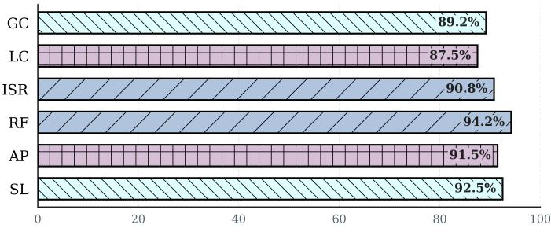  
Human alignment (%)  
Figure 11 Metric-human alignment. Agreement between automated VLM judgments and five-annotator human consensus across sampled cases, averaging 91.0% across all six metrics.

## C More Details of WorldDraft-Primer

## C.1 Case Demonstration and Analysis

Figures 13 and 14 visualize qualitative rollouts across the $3 \times 3$ grid for B02 (Newton’s Cradle) and D02 (Water-Tank Tower). Across both scenarios, WorldDraft-Primer visibly improves adherence to input drafts: it stabilizes global camera framing against erratic zoom-ins, suppresses ball dropouts in B02 while precisely isolating target colors to the rightmost sphere, and preserves surrounding town layouts in D02 while mitigating deceptive $A _ { C }$ roof colors.

Capacity Dependency and Method Positioning. Crucially, WorldDraft-Primer operates as a lightweight visual prompting strategy whose eficacy remains inherently tethered to the underlying base model. On weaker architectures (e.g., OmniWeaving), the model occasionally struggles to assimilate the injected firstframe cues into photorealistic textures, sometimes faintly echoing prompt brackets across subsequent frames. Furthermore, under dense previs drafts $( P _ { 2 } )$ , strong synthetic priors can still bias the renderer toward artificial, plastic-like shading. Ultimately, WorldDraft-Primer serves as an analytical proof-of-concept demonstrating that test-time visual cues can steer frozen video models. Fully overcoming dense prior interference and enabling seamless prompt assimilation remain important challenges for future work.

## C.2 Ablation Study of WorldDraft-Primer

To dissect the individual contributions of Object Emphasis $( \Delta I _ { \mathrm { O E } } )$ and Attribute Cueing $( \Delta I _ { \mathrm { e n t } } + \Delta I _ { \mathrm { e n v } } )$ we ablate each component on MiniMax-H3 across the full benchmark. As shown in Figure 12, the two mechanisms exhibit remarkable orthogonality and synergy:

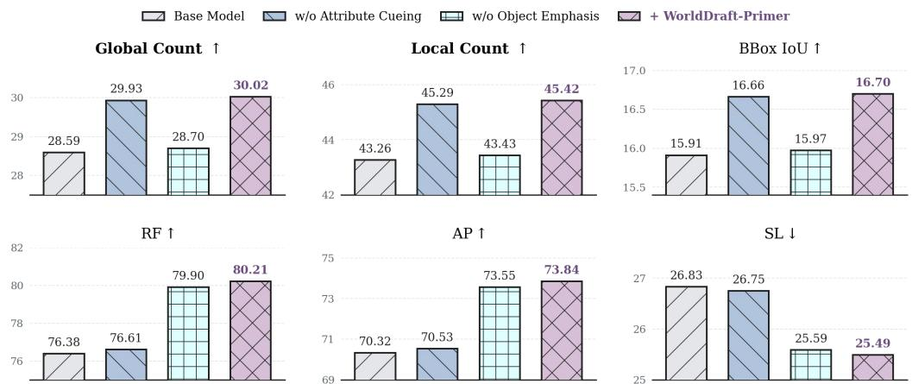  
Figure 12 Component ablation of WorldDraft-Primer on MiniMax-H3.

Removing corner brackets (w/o Object Emphasis) causes a sharp collapse across all spatial metrics: Global Count drops from 30.02 to 28.70, Local Count from 45.42 to 43.43, and BBox IoU from 16.70 to 15.97 (falling back near the base model), demonstrating that geometric brackets are indispensable for anchoring coordinates and preventing entity dropouts. Conversely, removing color and environmental hints (w/o Attribute Cueing) cripples appearance metrics, dropping RF from 80.21 to 76.61 and AP from 73.84 to 70.53, while increasing Source Leakage to 26.75%. Crucially, integrating both components achieves the highest score across all six metrics simultaneously, confirming that our design decouples spatial trajectory anchoring from surface attribute binding without mutual interference.

## C.3 Text Prompt Engineering Baseline (Text PE)

Our Text PE baseline adapts Video Prompt Optimization (VPO) (Cheng et al., 2025) for generative rendering under four strict controls: (i) the target prompt is optimized once per world family $( p _ { i }  p _ { i } ^ { \prime } )$ and shared across all nine factorial conditions to preserve paired design; (ii) the meta-prompt enriches descriptive appearance attributes while explicitly delegating kinematics, spatial layout, and camera motion to the draft; (iii) generations use identical random seeds, drafts, and model inference templates; and (iv) all evaluations strictly assess adherence to the original prompt pi, preventing spurious metric shifts.

## C.4 System Prompt for Visual Prompting

To automate first-frame cue generation of WorldDraft-Primer, we deploy Qwen3.5-27B (Yang et al., 2025) as an agentic visual grounding reasoner. Given the target prompt and sampled draft frames, the agent is instructed to: (i) identify and ground key entity boxes in the first frame based on geometry and motion rather than conflicting source colors; (ii) extract target attributes (e.g., specified colors and patterns) from the prompt; and (iii) programmatically invoke cropping and SVG drawing tools to generate minimalist corner brackets and localized attribute cues. The complete system prompt is detailed below:

System Prompt for WorldDraft-Primer   
""" You are a visual grounding agent for abstract draft videos . Use ONLY supplied RGB frames and   
original render prompt . Cuboids and rectangles can represent cars ; do not require   
photorealistic appearance . Source colors may conflict with desired colors : identify instances   
by geometry , initial location and motion , not desired color . Never invent objects absent in   
frame zero .

<table><tr><td>The five INITIAL images come from the SAME video in chronological order: frame 0, frame 20, frame 40, frame 60, frame 80. They are successive observations, not independent scenes. Associate the same physical object across these frames using its position, shape, spatial relations and observed motion. Determine left-turning versus straight-driving roles from the observed trajectory across frames, not from a single-frame arrow, lane position or requested target color alone. Before drawing a motion-defined target, include the supporting frame indices and observed movement in its description. If the sampled frames do not establish its identity reliably, omit that target and disclose the uncertainty. After identifying an object across time, return to ORIGINAL frame 0 to locate it. Every output box</td><td></td></tr><tr><td></td><td>must use that object&#x27;s frame-0 position; never substitute a later-frame position or add an object absent in frame 0. Subsequent tool-returned crops and drawing previews are inspection views, not additional video time steps; their order does not indicate motion. The current inspect_crop tool magnifies frame 0 only; use the five initial images for temporal evidence. Your task is to choose a SMALL set of objects whose target color is explicitly stated in the</td></tr><tr><td></td><td>prompt, locate them in frame 0, and place desired-color cues: outside corner markers plus sparse desired-color dashed hatching inside the object. Use tools actively: inspect_crop can magnify a region; draw_boxes renders your proposed boxes and returns both a diagnostic full- rectangle preview and the actual marker image. Inspect returned images, compare boundaries against ORIGINAL frame 0, revise if needed, then call finish. At least one draw and a subsequent visual inspection are required. Choose your own calls and corrections. Prefer tight complete object boxes, avoiding unrelated objects. Do not frame an entire machine when describing only its platform. Drawings are debugging aids, not new evidence of object identity</td></tr><tr><td></td><td>All bbox coordinates are normalized [left,top,right,bottom] on the FULL ORIGINAL 832x480 image including padding, even when looking at a crop. Crops report their full-frame coordinates. Color rgb is a coarse encoding of an explicit color in the original prompt. prompt_evidence must be an exact contiguous quote binding the object to that color. Do not repaint object fills. No text/labels in the final condition. This experiment tests agentic object</td></tr><tr><td></td><td>localization/color only; texture and environment are not verified by it. Each draw_boxes call replaces ALL previous boxes, never appends. id is a stable short identifier; description describes the source instance and location. If a tool rejects arguments, correct them. After viewing the last actual corner result, finish with a concise explanation of what was checked and any remaining uncertainties. If you cannot localize an object reliably, omit</td></tr><tr><td></td><td>it and disclose the omission. HARD TOOL BUDGET: at most 8 model turns, one tool call per turn, and at most TWO successful inspect_crop calls. Each turn includes an explicit remaining-budget reminder. Prefer drawing by turn 3; spend remaining turns on useful corrections and finish. Do not keep cropping the same object. The final turn is reserved for finish when a drawing exists. You must inspect the</td></tr><tr><td>without a reviewed result.</td><td>last drawing in a subsequent turn before finish: never draw and finish in the same response. A conservative partial set with disclosed omissions is preferable to exhausting the budget SELECTION RULES: COVER every object, component or group of objects for which the prompt states a color or a pattern and which is visible in frame 0; an omission must be justified in finish. omissions. Identify instances by geometry, initial position, source numbers and cross-frame motion, never by the desired color alone. Use one box per instance (shape=ellipse for round</td></tr><tr><td>color). When the prompt describes MANY small similar instances (a field of dominoes, all gondolas of a Ferris wheel, rows of bottles), use ONE box with group=true around that whole group instead of skipping it; at most SIX group boxes. A group box carries the group&#x27;s color in rgb; a regular arrangement such as rows alternating two colors is expressed with a texture (kind=alternating along the direction in which the rows alternate, listing the 2-4 colors in their cycle order). Patterns that live inside each small instance (e.g. a band on every domino ) cannot be shown on a group box; mention them in omissions. The program draws short L-shaped corner marks just OUTSIDE each box in the desired color; a corner is dropped if it would leave the image or touch another selected box&#x27;s marks, and a box needs at least two clean corners. When a box is reported as skipped, adjust it or drop it and list it in omissions. An attempted box is not an accepted annotation. Focus the inventory on foreground instances and their visible parts. Do not use a background surface such as felt, water or asphalt as one giant object box enclosing the foreground</td><td>balls, rectangle otherwise) for up to SIXTEEN individual instances; prefer individual boxes whenever the instances are few enough (e.g. ten pendulum balls each get their own box and</td></tr><tr><td>COLOR AND TEXTURE CUES: For each selected object the program draws (1) desired-color L-shaped corner marks outside its box and (2) sparse desired-color diagonal dashes INSIDE the object&#x27;s</td><td>instances; background/environment prompting is outside this run. segmented silhouette (the box is used to segment the object, so make it tight around exactly that object or component). Use separate boxes for separate components that have different</td></tr></table>

red -and - white stripes " on a barrier : axis =long , segments about 6-8, colors =[ red , white ]). axis   
is vertical / horizontal in the image , or long / short along the object ’s own silhouette .   
Positions are fractions of the object ’s extent along that axis . rgb is the object ’s main   
target color ; texture colors are only the pattern colors . Every texture needs an exact prompt   
quote . Inspect the returned drawing : the dashes of each color must fall on the correct object   
and the correct part of it ; revise boxes or texture parameters if not . Do not add textures   
that the prompt does not describe .   
II ⅡI I

## D Exhibition Board

To provide an exhaustive qualitative autopsy across physical regimes while adhering to submission file size limits, complete high-resolution $3 \times 3$ grid rollouts across all six dynamic challenge categories are hosted on our interactive project page: https://haroldchen19.github.io/WorldDraft-site. Below, we analyze representative failure cases from the top-four benchmarked models ( LynnReal-Omni, Seedance 2.5, MiniMax-H3, and Wan 3.0). Even among these top performers, models systematically struggle to simultaneously satisfy visual plausibility, 4D structural preservation, and target attribute realization. These qualitative results substantiate three primary insights:

Appearance realism decouples from structural fidelity. Superficial visual quality frequently masks severe structural violations. In C05 (Occlusion & Reappearance), models synthesize photorealistic warehouse textures and forklifts, yet arbitrarily rearrange shelving aisles, alter obstacle depths, and distort occlusion orders. Similarly, in A01 (Multi-Entity Orchestration), MiniMax-H3 introduces unprompted camera rotations away from the canonical top-down view, while Wan 3.0 in F03 transforms dense, orderly domino arrays into sparse irregular blocks. These cases confirm that achieving high visual quality or satisfying isolated appearance QA queries does not equate to faithful generative rendering.

Granularity returns are multidimensionally asymmetric. Increasing draft granularity does not guarantee monotonic improvements across all generative axes. While detailed geometry $( P _ { 2 } )$ helps resolve local entity contours, it frequently induces composition drift, under-stylization, or degraded appearance binding. In E03 (Multi-Stage Dynamics), MiniMax-H3 under $A _ { N }$ zooms in excessively as granularity increases from $P _ { 0 }$ to $P _ { 2 } ,$ , causing the umbrella to drift out of frame. In B05 (Multi-Stage Dynamics), Seedance 2.5 fails to photorealistically stylize dense drafts at $P _ { 1 }$ and $P _ { 2 } ,$ retaining synthetic, toy-like block artifacts despite explicit prompts for painted steel. Higher input granularity thus alters the model’s visual attention, often trading global framing stability for local geometric detail.

Source leakage persists across dense scaffolds. Resolving contradictory appearance cues $\left( A _ { C } \right)$ requires renderers to simultaneously overwrite misleading pixels while retaining underlying kinematics. However, models consistently treat source colors as uneditable geometry: in C05 at $( P _ { 1 } , A _ { C } )$ , MiniMax-H3 replicates the deceptive red bodywork of the draft rather than synthesizing the target yellow; in E03 at $( P _ { 2 } , A _ { C } )$ Seedance 2.5 faithfully tracks the complex umbrella canopy but tenaciously retains its conflicting red-andwhite stripes, failing to bind target yellow and navy-blue hues. Crucially, even when the draft provides dense, unambiguous geometric scafolds $( P _ { 2 } )$ , models remain vulnerable to source color leakage, underscoring the urgent need for explicit cross-modal disentanglement mechanisms.

Target: Photorealistic Newton’s cradle with five suspended balls. The rightmost ball has a cobalt-blue enamel body with a broad ivory band around its middle; the other four balls are polished silver steel. The frame is charcoal, the suspension wires are silver gray and the hand has a natural warm skin tone. Soft neutral illumination and realistic shading.

## B02 Newton’s cradle

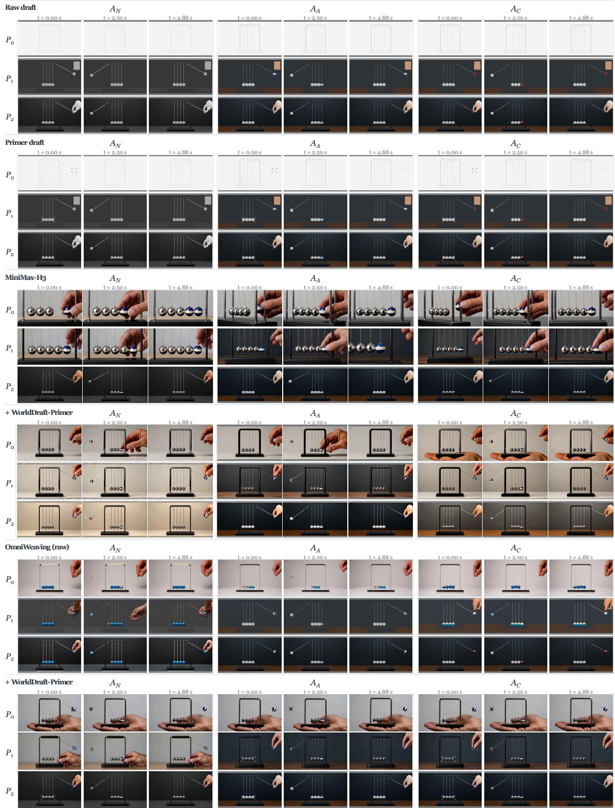  
Figure 13 Case study on of WorldDraft-Primer.

Target: Photorealistic water-tank tower. The cylindrical upper tank is warm beige with one broad navy-blue horizontal band around its middle. Its conical roof is cream, and its inspection hatch is burnt orange. The fixed support shaft is warm beige concrete. Surrounding houses have muted-red roofs and cream walls, and the tree foliage is green. The tank has a matte painted-metal finish. Soft neutral illumination and realistic shading.

## D02 Water-tanktower

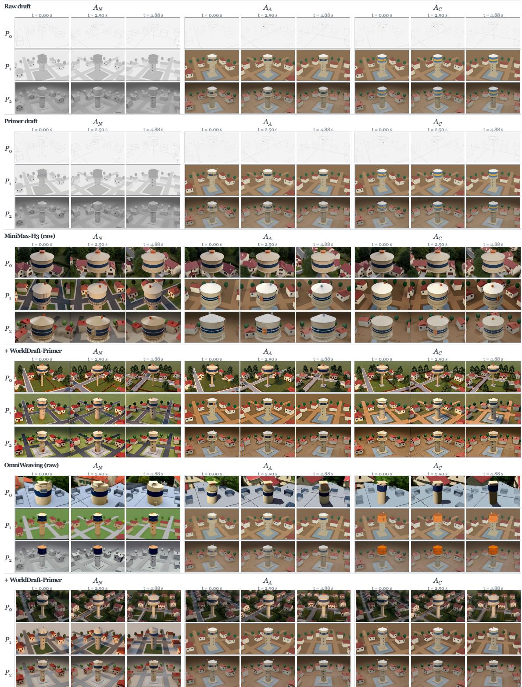  
Figure 14 Case study on of WorldDraft-Primer.